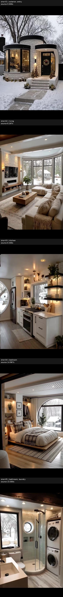
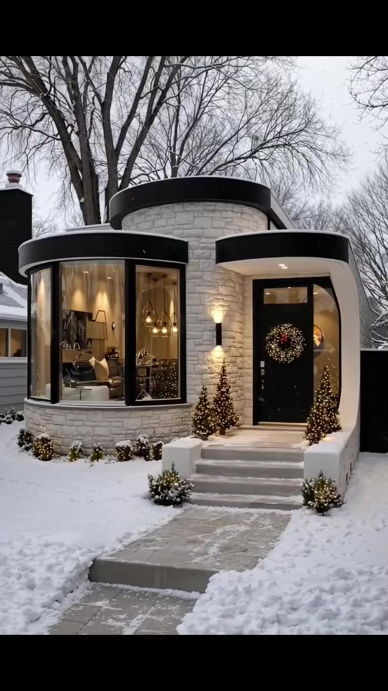
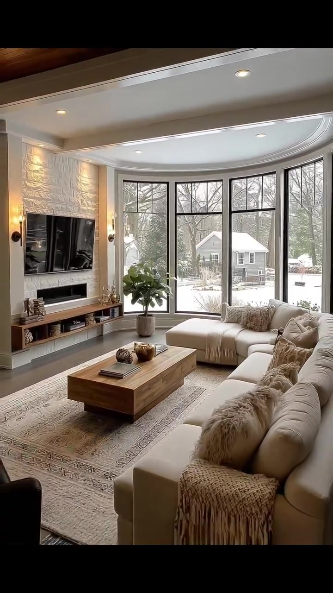
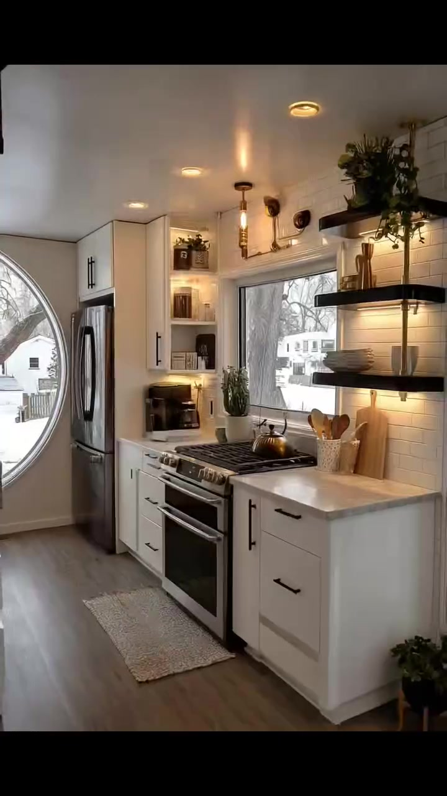
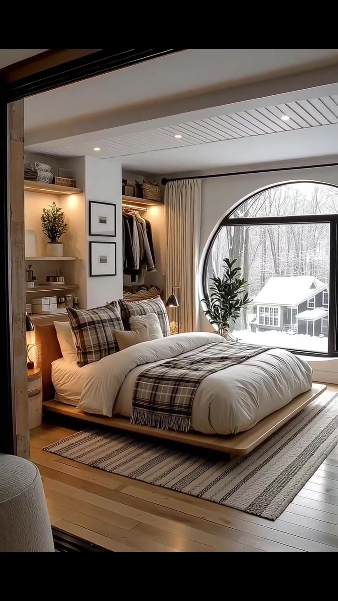
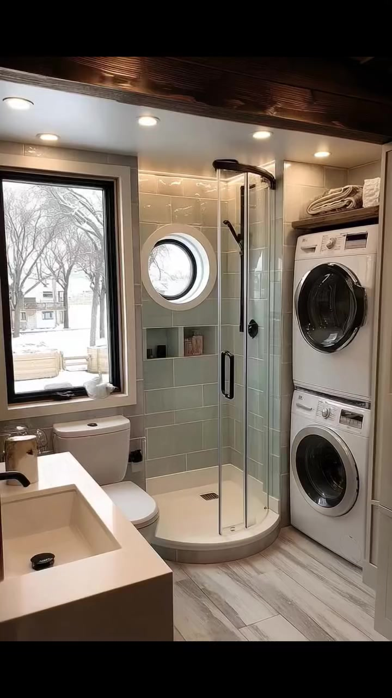

# edh001 — Rumah lengkung batu terang di lingkungan bersalju

## Identitas

<details>
<summary>Identitas teknis</summary>

| field | value |
| --- | --- |
| format_version | 1.1 |
| id | edh001 |
| revision | 1 |
| title | Rumah lengkung batu terang — bay, storage dan bathroom–laundry |

</details>

## Ringkasan

Rumah berkesan kompak dengan fasad batu terang, massa membulat bertingkat dan aksen hitam tegas. Tur berisi lima shot: eksterior, ruang tamu, dapur, kamar tidur, lalu kamar mandi sekaligus laundry. Kekayaan desainnya ada pada susunan elemen: bay window lengkung, coffee niche, storage di belakang ranjang, serta shower porthole yang bersebelahan dengan laundry tower.

Gerakan sumber mengikuti pola dominan IN → OUT → IN → OUT → IN, tetapi eksterior dimulai dengan orbit kanan sebelum pendekatan. Draf ini hasil audit ulang untuk koreksi pengguna; persetujuan kamera shot 02 sebelumnya tidak dianggap persetujuan seluruh laporan.

## Profil DNA

**Pembacaan gaya:** modern kontemporer dengan geometri lengkung; pengaruh Organic Modern merupakan interpretasi dari kurva, warna netral, tampilan kayu dan tekstil berlapis. Ini tidak menetapkan periode, lokasi atau gaya historis pasti.

**Bentuk dan skala:** volume tengah membulat lebih tinggi, bay kaca di kiri dan entrance berkanopi di kanan. Fascia hitam mengikuti kurva pada beberapa ketinggian. Satu tingkat bukaan depan tampak; tinggi drum tidak membuktikan lantai kedua. Kesan skala kecil/kompak adalah interpretasi, bukan luas terukur atau kepastian kategori tiny. Bentuk denah dan hubungan fisik kelima area belum diketahui.

**DNA pembeda:** hubungan kurva massa–kanopi–bay, pengulangan bukaan bundar/membulat, kontras bidang terang dengan frame gelap, storage terintegrasi dan pandangan bersalju. Setiap area tetap berbeda secara bentuk dan fungsi. Pengulangan visual tidak membuktikan semua shot berasal dari bangunan fisik yang sama.

<details>
<summary>Data DNA, status dan bukti</summary>

| id | aspect | value | state | confidence | evidence |
| --- | --- | --- | --- | --- | --- |
| dna-01 | primary-style | Modern kontemporer bergeometri lengkung | uncertain | medium | [start](media/shot-01/start.jpg); [end](media/shot-01/end.jpg) |
| dna-02 | style-influence | Organic Modern | uncertain | medium | [start](media/shot-01/start.jpg); [end](media/shot-02/end.jpg); [end](media/shot-04/end.jpg) |
| dna-03 | apparent-scale | small | uncertain | medium | [start](media/shot-01/start.jpg) |
| dna-04 | levels-visible | Satu tingkat bukaan fasad depan terlihat; volume tengah lebih tinggi tidak membuktikan lantai kedua. | observed | medium | [start](media/shot-01/start.jpg) |
| dna-05 | massing | Volume tengah menyerupai drum membulat yang lebih tinggi. | observed | high | [start](media/shot-01/start.jpg) |
| dna-06 | massing | Bay kaca melengkung di kiri dan proyeksi entrance di kanan menurut pandangan awal. | observed | high | [start](media/shot-01/start.jpg) |
| dna-07 | roof | Fascia hitam tebal mengikuti tepi lengkung pada beberapa ketinggian. | observed | high | [start](media/shot-01/start.jpg); [end](media/shot-01/end.jpg) |
| dna-08 | roof | Bidang permukaan atap di balik fascia tidak terlihat lengkap. | not-visible | high | [start](media/shot-01/start.jpg); [end](media/shot-01/end.jpg) |
| dna-09 | entrance | Pintu gelap dengan kaca atas, sidelight kanan dan wreath; dicapai melalui landing bertangga. | observed | high | [start](media/shot-01/start.jpg); [end](media/shot-01/end.jpg) |
| dna-10 | porch | Landing kecil dengan kanopi soffit terang dan tepi depan membulat. | observed | high | [start](media/shot-01/start.jpg); [end](media/shot-01/end.jpg) |
| dna-11 | openings | Bay window tinggi berpanel vertikal dan frame gelap. | observed | high | [start](media/shot-01/start.jpg); [end](media/shot-02/end.jpg) |
| dna-12 | openings | Bukaan bundar besar di dapur dan porthole di shower; bukan bukti bukaan fisik yang sama. | observed | high | [start](media/shot-03/start.jpg); [start](media/shot-05/start.jpg) |
| dna-13 | openings | Bukaan kamar tidur besar dengan garis atas membulat dan bagian bawah lebih lurus. | observed | high | [end](media/shot-04/end.jpg) |
| dna-14 | material-hierarchy | Fasad dan media wall tampak batu putih-krem bertekstur, dipadukan aksen hitam. | observed | high | [start](media/shot-01/start.jpg); [end](media/shot-02/end.jpg) |
| dna-15 | material-hierarchy | Kayu tampak hangat pada meja, platform, rak serta beberapa bidang lantai; spesies dan bahan fisik belum diketahui. | observed | high | [end](media/shot-02/end.jpg); [end](media/shot-04/end.jpg) |
| dna-16 | material-hierarchy | Kabinet dan counter terang menjadi bidang utama dapur; ubin sage mengilap menjadi aksen wet zone. | observed | high | [start](media/shot-03/start.jpg); [end](media/shot-03/end.jpg); [start](media/shot-05/start.jpg) |
| dna-17 | palette | Putih-krem dan hitam/charcoal. | observed | high | [start](media/shot-01/start.jpg); [start](media/shot-03/start.jpg) |
| dna-18 | palette | Kayu cokelat hangat, tekstil beige/taupe dan aksen sage di shower. | observed | high | [end](media/shot-02/end.jpg); [end](media/shot-04/end.jpg); [start](media/shot-05/start.jpg) |
| dna-19 | lighting | Daylight luar yang tampak dingin/difus dipadukan cahaya buatan hangat di interior. | observed | high | [start](media/shot-01/start.jpg); [end](media/shot-02/end.jpg) |
| dna-20 | lighting | Downlight, sconce dan cahaya tersembunyi/di bawah rak membentuk beberapa lapisan pencahayaan. | observed | high | [end](media/shot-02/end.jpg); [end](media/shot-03/end.jpg); [end](media/shot-04/end.jpg) |
| dna-21 | environment | Salju, pohon tanpa daun dan bangunan sekitar tampak pada luar rumah dan pandangan melalui bukaan. | observed | high | [start](media/shot-01/start.jpg); [end](media/shot-04/end.jpg) |
| dna-22 | environment | Dekorasi bernuansa liburan: wreath dan pohon kecil berlampu di entrance. | observed | high | [start](media/shot-01/start.jpg); [end](media/shot-01/end.jpg) |
| dna-23 | spatial-configuration | Area duduk sectional mengitari meja balok di samping bay window. | observed | high | [end](media/shot-02/end.jpg) |
| dna-24 | spatial-configuration | Deret dapur dengan refrigerator, coffee niche dan range di bawah jendela. | observed | high | [start](media/shot-03/start.jpg); [end](media/shot-03/end.jpg) |
| dna-25 | spatial-configuration | Storage headwall menggabungkan niche display dan hanging bay dalam kamar tidur. | observed | high | [end](media/shot-04/end.jpg) |
| dna-26 | spatial-configuration | Shower sudut lengkung, toilet, vanity dan laundry tower tampak dalam satu area. | observed | high | [start](media/shot-05/start.jpg) |
| dna-27 | distinctive-features | Kurva pada massa/kanopi/bay dipadukan dengan beberapa bukaan bundar di interior. | observed | high | [start](media/shot-01/start.jpg); [start](media/shot-03/start.jpg); [start](media/shot-05/start.jpg) |
| dna-28 | distinctive-features | Ranjang platform rendah, nakas barrel dan motif plaid berdekatan dengan bukaan membulat besar. | observed | high | [end](media/shot-04/end.jpg) |
| dna-29 | distinctive-features | Wet zone berubin sage dengan porthole dan niche, langsung berdampingan dengan dua unit front-load bertumpuk. | observed | high | [start](media/shot-05/start.jpg) |
| dna-30 | continuity | Pengulangan frame gelap, bidang terang, aksen kayu, kurva/bukaan membulat dan lingkungan bersalju. | observed | medium | [start](media/shot-01/start.jpg); [start](media/shot-03/start.jpg); [end](media/shot-04/end.jpg); [start](media/shot-05/start.jpg) |

</details>

## Palet dan suasana

Bidang utama putih-krem berpadu frame/fascia hitam, aksen kayu cokelat hangat dan tekstil beige/taupe. Dapur menambahkan cabinet putih, perangkat tampak stainless dan rak gelap; bedroom memakai plaid; wet zone memakai ubin sage mengilap. Material ditulis sebagai tampilan, bukan spesifikasi bahan.

Daylight luar tampak dingin dan difus; interior memakai downlight, sconce serta cahaya di tepi plafon/di bawah rak yang tampak hangat. Tidak ada pengukuran Kelvin/lux. Kesan hangat, nyaman dan bernuansa liburan adalah interpretasi suasana dari kontras cahaya, tekstil, salju, wreath dan pohon kecil berlampu; negara atau musim kalender sebenarnya tidak dipastikan.

## Cakupan

<details>
<summary>Metode dan batas pemeriksaan</summary>

| field | value |
| --- | --- |
| method | Audit adaptif 10 FPS per shot + frame batas asli; pendalaman native 30 FPS pada rentang meragukan dan seluruh shot 02/04; audio tidak diperiksa. |
| limitations | 461 frame unik diperiksa dari 552 melalui baseline dan pendalaman yang tercatat; bukan seluruh video frame-by-frame penuh. Sudut/rasio adalah estimasi visual, bukan rekonstruksi pose; material fisik, luas, denah dan audio belum dipastikan. |

</details>

## Timeline

Lima shot dipisahkan hard cut. Eksterior 0–4,733 s; living 4,733–8,3 s; kitchen 8,3–11,567 s; bedroom 11,567–15 s; bathroom/laundry 15–18,4 s. Tidak ada bukti sambungan ruang yang dapat dipastikan hanya dari urutan edit.



<details>
<summary>Timestamp sumber dan fungsi</summary>

| shot | start_s | end_s | areas | transition | continuity |
| --- | --- | --- | --- | --- | --- |
| shot-01 | 0.0 | 4.733333333 | exterior; entry | hard cut | Kontinuitas hanya di dalam shot; koneksi antararea tidak dibuktikan. |
| shot-02 | 4.733333333 | 8.3 | living | hard cut | Kontinuitas hanya di dalam shot; koneksi antararea tidak dibuktikan. |
| shot-03 | 8.3 | 11.566666667 | kitchen | hard cut | Kontinuitas hanya di dalam shot; koneksi antararea tidak dibuktikan. |
| shot-04 | 11.566666667 | 15.0 | bedroom | hard cut | Kontinuitas hanya di dalam shot; koneksi antararea tidak dibuktikan. |
| shot-05 | 15.0 | 18.4 | bathroom; laundry | end of video | Kontinuitas hanya di dalam shot; koneksi antararea tidak dibuktikan. |

</details>

<a id="shot-01"></a>
## Shot shot-01



### Ikhtisar

Fasad batu terang dibentuk oleh volume membulat, bay kaca kiri dan entrance berkanopi kanan. Tangga serta jalur bersalju memberi kedalaman; wreath dan pohon kecil berlampu menjadi aksen pintu.

### Desain dan konfigurasi

Massa depan dirangkai dari volume tengah menyerupai drum yang lebih tinggi, bay kaca melengkung di kiri dan entrance yang maju di kanan. Fascia hitam tebal mengikuti kurva pada beberapa ketinggian; permukaan atap di baliknya tidak terlihat lengkap. Kolom/cerobong gelap berpenutup tampak di sisi kiri. Dinding menyerupai batu potong putih-krem; bahan fisiknya belum diketahui.

Daun pintu gelap memiliki kaca atas, wreath dan glazing sempit di sisi kanan. Kanopi bertepi membulat mempunyai soffit terang dengan downlight. Jalur slab abu-abu dan beberapa anak tangga lurus mengarah ke landing kecil dengan pembatas rendah. Penampakan satu tingkat bukaan depan tidak cukup untuk memastikan jumlah lantai seluruh rumah.

Lampu dinding vertikal menyinari tekstur fasad ke atas-bawah; cahaya hangat juga terlihat melalui kaca. Pohon kecil berlampu mengapit akses, sementara salju menutupi tanah, semak dan tepi elemen bangunan. Pohon besar tanpa daun dan bangunan tetangga terlihat di belakang/samping. Elemen interior melalui kaca hanya parsial; fungsi ruang tersebut belum dipastikan.

### Fakta

<details>
<summary>Fakta desain dan bukti visual</summary>

| id | domain | subject | attribute | value | state | confidence | evidence |
| --- | --- | --- | --- | --- | --- | --- | --- |
| f-01 | space | exterior | layout | Jalur depan mengarah ke tangga/landing; bay window kiri dan entrance kanan tersusun berdampingan menurut layar awal. | observed | high | [bukti](media/shot-01/start.jpg) |
| f-02 | architecture | house | massing | Gabungan volume membulat dengan drum tengah lebih tinggi dan proyeksi rendah di depan. | observed | high | [bukti](media/shot-01/start.jpg) |
| f-03 | architecture | roof | shape | Fascia gelap mengikuti garis lengkung pada beberapa level atap. | observed | high | [bukti](media/shot-01/start.jpg) |
| f-04 | architecture | bay-window | shape | Bay kaca melengkung dengan beberapa panel vertikal berbingkai gelap di kiri entrance. | observed | high | [bukti](media/shot-01/start.jpg) |
| f-05 | architecture | canopy | shape | Kanopi entrance bertepi membulat, fascia gelap dan soffit terang. | observed | high | [bukti](media/shot-01/start.jpg) |
| f-06 | architecture | entry | opening | Daun pintu gelap dengan kaca atas dan glazing sempit di sisi kanan bukaan. | observed | high | [bukti](media/shot-01/start.jpg) |
| f-07 | relation | entry | position | Entrance berada di kanan bay window menurut layar awal dan dicapai melalui landing bertangga. | observed | high | [bukti](media/shot-01/start.jpg) |
| f-08 | architecture | stairs | shape | Beberapa anak tangga lurus lebar menuju landing, dengan pembatas rendah terang di sisi-sisinya. | observed | high | [bukti](media/shot-01/start.jpg) |
| f-09 | architecture | path | shape | Jalur berupa slab persegi/rectangular abu-abu dengan perubahan level sebelum tangga. | observed | high | [bukti](media/shot-01/start.jpg) |
| f-10 | material | facade | appearance | Tekstur menyerupai batu potong berwarna putih-krem dengan sambungan horizontal. | observed | high | [bukti](media/shot-01/start.jpg) |
| f-11 | material | facade | physical-material | unknown | unknown | unknown | - |
| f-12 | material | frame | appearance | Bingkai kaca, pintu dan fascia tampak hitam/gelap. | observed | high | [bukti](media/shot-01/start.jpg) |
| f-13 | lighting | wall-light | type | Lampu dinding vertikal gelap memancarkan cahaya hangat ke atas dan bawah pada tekstur fasad. | observed | high | [bukti](media/shot-01/start.jpg) |
| f-14 | lighting | ceiling-light | placement | Downlight tertanam pada soffit entrance terlihat lebih jelas di akhir pendekatan. | observed | high | [bukti](media/shot-01/end.jpg) |
| f-15 | decoration | seasonal-decoration | type | Wreath berlampu kecil dengan aksen pita merah pada pintu. | observed | high | [bukti](media/shot-01/start.jpg) |
| f-16 | decoration | seasonal-decoration | placement | Pohon konifer kecil berlampu hangat berada di sekitar kedua sisi entrance. | observed | high | [bukti](media/shot-01/start.jpg) |
| f-17 | environment | site | surface-condition | Salju menutupi tanah, tepi jalur, semak dan sebagian elemen atap. | observed | high | [bukti](media/shot-01/start.jpg) |
| f-18 | environment | landscape | vegetation | Pohon tinggi tanpa daun di belakang dan semak rendah di dekat jalur/fasad. | observed | high | [bukti](media/shot-01/start.jpg) |
| f-19 | environment | exterior-view | visible-setting | Bangunan tetangga terlihat parsial; lokasi geografis tidak diketahui. | observed | high | [bukti](media/shot-01/start.jpg) |
| f-20 | lighting | interior-light | light-character | Cahaya interior hangat terlihat melalui bay dan glazing entrance. | observed | high | [bukti](media/shot-01/start.jpg) |
| f-21 | furnishing | interior-through-glazing | type | Elemen duduk, lampu dan meja terlihat parsial melalui kaca; fungsi ruang tidak dipastikan hanya dari pandangan luar. | uncertain | medium | [bukti](media/shot-01/end.jpg) |
| f-22 | architecture | chimney | structure-appearance | Elemen vertikal gelap dengan penutup tampak seperti cerobong di kiri bay; bahan dan sistemnya belum dipastikan. | observed | medium | [bukti](media/shot-01/start.jpg) |

</details>

### Komposisi

Kamera mulai di jalur depan, memandang fasad sedikit serong: bay berada di kiri dan pintu di kanan. Jalur/tangga menjadi foreground dan jangkar paralaks; pohon serta bangunan sekitar menjadi latar. Sudut pandang berubah ke kanan terlebih dahulu, lalu pendekatan diarahkan ke pintu. Area-overview diambil pada awal karena mencakup massa, jalur, tangga dan entrance paling lengkap. Gambar awal baru yang mengikuti lintasan ini perlu menunjukkan kedalaman jalur serta sisi bangunan, bukan close-up frontal pintu.

<details>
<summary>Posisi kamera dan peran gambar area</summary>

| field | value |
| --- | --- |
| camera_direction | Orbit kanan terhadap massa depan, lalu mendekat ke entrance kanan; orientasi akhir mempertahankan pintu sebagai target. |
| camera_height | Estimasi visual sekitar level mata; tinggi meter tidak diketahui. |
| camera_position | Di jalur depan bangunan, dekat sumbu akses tetapi sedikit serong terhadap gabungan bay dan entrance; posisi dunia nyata tidak diukur. |
| camera_tilt | Tidak ada tilt vertikal yang jelas dan berkelanjutan; drift/koreksi framing kecil tidak dijadikan komponen tilt. |
| depth | Jalur dan semak dekat; teras serta bay di tengah; drum atap dan pohon tanpa daun di belakang. |
| end_composition | Entrance dan dinding lampu membesar; bay terpotong di kiri dan jalur bawah berkurang. |
| foreground | Jalur batu/slab abu-abu, tepi salju dan anak tangga. |
| motion_compatibility | Awal sumber perlu menampilkan massa dan kedalaman jalur/tangga untuk orbit kanan, lalu ruang pendekatan ke pintu. Overview awal berperan sebagai titik berangkat; close-up frontal pintu tidak menyediakan konteks orbit. |
| overview_exception | - |
| overview_reason | Frame pertama masih memuat massa utama, bay window, entrance, tangga, jalur dan konteks salju; pendekatan kemudian memotong sebagian massa. |
| overview_role | start |
| overview_timestamp_s | 0.0 |
| reveal | Detail tekstur fasad, lampu up/down, dekorasi pintu dan isi yang terlihat melalui glazing semakin terbaca saat mendekat. |
| start_composition | Seluruh entrance dan bay window kiri terbaca bersama jalur akses; pintu berada di kanan komposisi. |
| view_angle | near-frontal / slight oblique |

</details>

### Kamera

```text
Orbit Right (~15°–20°) →
Accelerating Dolly-In (~2×) toward entrance door.
```

Dua bagian dominan: orbit kanan pada sekitar 0–2,2 detik shot, lalu dorongan maju yang makin kuat sampai cut. Ritmenya sedang pada orbit dan meningkat dari sedang menuju cepat saat mendekati pintu. Perubahan sumbu berlangsung halus, bukan berhenti lalu memulai gerakan baru. Batas 2,2 detik adalah segmentasi praktis dengan toleransi sekitar 0,2 detik.

<details>
<summary>Fase, ritme, dasar dan ketidakpastian</summary>

| phase | start_s | end_s | components | anchor | tempo | speed_change | basis | evidence | confidence | uncertainty |
| --- | --- | --- | --- | --- | --- | --- | --- | --- | --- | --- |
| phase-01 | 0 | 2.2 | Orbit Right (~15°–20°) | fasad, tepi tangga/slab, sisi kanan entrance dan pohon latar | moderate | variable | Pada awal shot, jalur/tangga dekat bergeser relatif lebih ke kiri daripada pohon latar dan sisi entrance makin terbaca sementara massa tetap terbingkai. Ini mendukung perpindahan/orbit kanan, bukan pan murni. Rentang ~15°–20° adalah perkiraan perubahan sudut pandang, bukan sudut pose terukur. | [start](media/shot-01/start.jpg); [reveal-01](media/shot-01/reveal-01.jpg) | medium | Ada pembesaran ringan saat orbit; kontribusi IN kecil belum terpisah secara mandiri. Sudut visual tidak dikalibrasi dengan FOV. Batas fase sekitar 2,2 ±0,2 s. |
| phase-02 | 2.2 | 4.733333333 | Accelerating Dolly-In (~2×) toward entrance door | wreath, daun pintu, tepi kanopi dan landing | variable | accelerating | Setelah orbit dominan, pintu/wreath membesar dan jalur/tangga tersisih dari framing. Wreath mendekati dua kali ukuran proyeksi awal pendekatan; bidang pintu memberi rasio berbeda akibat perspektif. Perubahan per interval pada ekor lebih besar daripada awal pendekatan: tempo sedang menuju cepat. | [reveal-01](media/shot-01/reveal-01.jpg); [middle](media/shot-01/middle.jpg); [end](media/shot-01/end.jpg) | medium | ~2× merujuk skala jangkar, bukan jarak atau faktor akselerasi. Sisa perubahan yaw/arc tidak dipisahkan menjadi pan tambahan tanpa bukti mandiri; percepatan visual tidak memastikan akselerasi fisik. |

</details>

### Ketidakpastian

Permukaan atap, denah, luas, jumlah lantai di bagian tersembunyi dan material fisik belum diketahui. Gerakan awal lebih kuat mendukung orbit kanan; IN kecil selama orbit tidak dipastikan. Besaran derajat merupakan estimasi visual longgar. Perubahan ke pendekatan tidak mempunyai batas mekanis tegas; tidak ditambahkan tilt tipis atau default produksi.

<a id="shot-02"></a>
## Shot shot-02



### Ikhtisar

Sofa sectional krem mengitari meja kayu balok dan karpet ornamental. Media wall batu terang serta bay window tinggi membentuk dua sisi utama, dengan tanaman dan pencahayaan berlapis di antaranya.

### Desain dan konfigurasi

Area duduk memakai sofa sectional krem dengan bagian chaise dekat jendela, coffee table rendah berbentuk balok persegi panjang dan karpet terang bermotif ornamental. Bantal bertekstur, throw rajut/bulu tampak, buku dan objek dekoratif keemasan memberi lapisan yang berbeda dari geometri arsitektur. Bagian sandaran gelap masuk di kiri bawah pada akhir; bentuk kursi lengkap tidak terlihat.

TV dipasang pada bidang bertekstur menyerupai batu putih-krem. Di bawahnya ada ceruk/perangkat hitam linear yang menyerupai fireplace, tetapi fungsi pasti dan api aktif tidak diperlihatkan. Konsol kayu rendah dengan kompartemen terbuka menyimpan buku, keranjang dan dekorasi. Tanaman berdaun lebar dalam pot beralur berada di pertemuan media wall dan kaca.

Bay window tinggi terdiri dari panel vertikal gelap dengan pembagian bagian atas. Plafon turun mempunyai tepi lengkung, downlight dan cahaya tersembunyi; sconce mengapit bidang media wall. Salju, pohon dan rumah sekitar terlihat melalui kaca. Penampakan bay dan material serupa eksterior adalah kesamaan motif, bukan bukti denah atau identitas bangunan fisik.

### Fakta

<details>
<summary>Fakta desain dan bukti visual</summary>

| id | domain | subject | attribute | value | state | confidence | evidence |
| --- | --- | --- | --- | --- | --- | --- | --- |
| f-01 | space | living | layout | Sofa sectional dan chaise mengitari coffee table; media wall kiri dan bay window di belakang/sisi kanan membatasi area duduk. | observed | high | [bukti](media/shot-02/end.jpg) |
| f-02 | architecture | window | shape | Bay window tinggi terdiri dari beberapa panel vertikal berbingkai gelap, dengan bagian atas bermullion. | observed | high | [bukti](media/shot-02/end.jpg) |
| f-03 | architecture | ceiling | shape | Bidang plafon turun dengan tepi melengkung mengikuti sisi bay. | observed | high | [bukti](media/shot-02/end.jpg) |
| f-04 | furnishing | sofa | type | Sofa sectional krem berlapis kain dengan bagian duduk memanjang/chaise. | observed | high | [bukti](media/shot-02/end.jpg) |
| f-05 | relation | sofa | position | Sofa berada di kanan dan foreground, dengan ujung chaise dekat jendela menurut pandangan sumber. | observed | high | [bukti](media/shot-02/end.jpg) |
| f-06 | furnishing | coffee-table | shape | Coffee table rendah berbentuk balok persegi panjang dengan permukaan/tampilan kayu hangat. | observed | high | [bukti](media/shot-02/end.jpg) |
| f-07 | relation | coffee-table | position | Meja berada di tengah area karpet di depan sofa. | observed | high | [bukti](media/shot-02/end.jpg) |
| f-08 | furnishing | television | type | Layar TV hitam dipasang pada bidang dinding bertekstur terang. | observed | high | [bukti](media/shot-02/start.jpg) |
| f-09 | furnishing | linear-recess | shape | Ceruk/perangkat hitam memanjang terbenam di bawah TV. | observed | high | [bukti](media/shot-02/start.jpg) |
| f-10 | furnishing | linear-recess | type | Menyerupai inset fireplace; fungsi pastinya dan api aktif tidak diperlihatkan. | uncertain | medium | [bukti](media/shot-02/start.jpg) |
| f-11 | storage | media-console | configuration | Konsol kayu rendah terbuka dengan kompartemen buku dan dekorasi berada di bawah media wall. | observed | high | [bukti](media/shot-02/start.jpg) |
| f-12 | material | wall | appearance | Bidang media wall bertekstur menyerupai batu putih/krem. | observed | high | [bukti](media/shot-02/start.jpg) |
| f-13 | material | floor | appearance | Bidang lantai di tepi karpet tampak abu-abu terang; bahan fisik tidak dipastikan. | observed | high | [bukti](media/shot-02/end.jpg) |
| f-14 | material | coffee-table | physical-material | unknown | unknown | unknown | - |
| f-15 | decoration | textile | pattern | Karpet besar terang bermotif ornamental halus membentang di bawah meja dan sisi sofa. | observed | high | [bukti](media/shot-02/end.jpg) |
| f-16 | decoration | textile | type | Bantal krem/cokelat dengan tekstur rajut, bulu tampak dan throw menambah lapisan pada sofa. | observed | high | [bukti](media/shot-02/end.jpg) |
| f-17 | decoration | plant | placement | Tanaman daun lebar dalam pot beralur berada di antara media wall dan bay. | observed | high | [bukti](media/shot-02/start.jpg) |
| f-18 | decoration | tabletop | type | Buku/majalah serta objek dekoratif gelap dan keemasan diletakkan pada coffee table. | observed | high | [bukti](media/shot-02/end.jpg) |
| f-19 | lighting | ceiling-light | placement | Downlight tersebar pada bidang plafon. | observed | high | [bukti](media/shot-02/start.jpg) |
| f-20 | lighting | cove-light | placement | Cahaya tidak langsung hangat mengikuti tepi lengkung plafon. | observed | high | [bukti](media/shot-02/end.jpg) |
| f-21 | lighting | wall-light | placement | Sconce gelap dengan cahaya hangat terlihat di sisi bidang media wall. | observed | high | [bukti](media/shot-02/start.jpg) |
| f-22 | environment | exterior-view | visible-setting | Pohon tanpa daun, salju dan rumah tetangga terlihat melalui kaca. | observed | high | [bukti](media/shot-02/end.jpg) |
| f-23 | furnishing | foreground-seat | type | Bagian sandaran/elemen duduk gelap masuk di kiri bawah akhir; jenis lengkap tidak terlihat. | uncertain | medium | [bukti](media/shot-02/end.jpg) |

</details>

### Komposisi

Awal sumber dekat sisi sofa: meja terpotong di kiri bawah dan bantal sofa besar di kanan foreground. Selama mundur sambil mengitari jangkar ke kiri dan menoleh kanan, meja/karpet, bentuk sectional dan rangkaian bay window terbuka. Overview berada di akhir OUT. Untuk mengikuti gerak sumber, gambar awal perlu dekat area duduk dan menyisakan ruang reveal; overview luas akhir berperan sebagai tujuan cakupan, bukan otomatis frame awal.

<details>
<summary>Posisi kamera dan peran gambar area</summary>

| field | value |
| --- | --- |
| camera_direction | Mundur sambil mengitari jangkar meja/area duduk ke kiri dan mengarahkan pandangan ke kanan. |
| camera_height | Estimasi visual sekitar level mata; tinggi meter tidak diketahui. |
| camera_position | Di tepi area duduk, memandang serong antara dinding TV kiri dan bay window kanan/belakang; kamera kemudian mundur. |
| camera_tilt | Tidak ada tilt vertikal yang jelas dan berkelanjutan; drift/koreksi framing kecil tidak dijadikan komponen tilt. |
| depth | Sofa dekat, coffee table di tengah, TV wall dan bay window di belakang; pohon/salju di luar memberi lapisan jauh. |
| end_composition | Meja utuh dan sofa sectional lebih luas terbaca; seluruh konteks bay window meningkat. |
| foreground | Bagian sofa dan bantal dekat kamera; sebagian elemen duduk gelap di kiri akhir hanya tampak parsial. |
| motion_compatibility | Overview merupakan tujuan cakupan akhir OUT + Orbit Left + Pan Right. Awal sumber lebih dekat di sisi sofa/meja; pertahankan jangkar dekat-jauh agar arc dan oklusi tetap dapat terbaca. |
| overview_exception | - |
| overview_reason | Akhir OUT memperlihatkan konfigurasi sofa, meja, karpet dan bentang bay window lebih lengkap daripada awal yang lebih dekat. |
| overview_role | end |
| overview_timestamp_s | 8.266666667 |
| reveal | Lebih banyak panjang sofa, area karpet dan panel bay window masuk ke bingkai saat kamera mundur. |
| start_composition | TV wall kiri, chaise kanan dan meja yang terpotong bawah/kiri memenuhi bidang gambar. |
| view_angle | oblique |

</details>

### Kamera

```text
Dolly-Out (~2×) + Orbit Left + Pan Right.
```

Ketiga komponen berjalan bersamaan sepanjang shot. Ritme dominan sedang dan melandai menuju akhir, tanpa fase Static. Ini mempertahankan rumusan kamera shot 02 yang sebelumnya Anda terima; audit ulang memeriksa kembali seluruh 107 frame aslinya.

<details>
<summary>Fase, ritme, dasar dan ketidakpastian</summary>

| phase | start_s | end_s | components | anchor | tempo | speed_change | basis | evidence | confidence | uncertainty |
| --- | --- | --- | --- | --- | --- | --- | --- | --- | --- | --- |
| phase-01 | 4.733333333 | 8.3 | Dolly-Out (~2×) + Orbit Left + Pan Right | objek dekoratif pada meja, bidang media wall, tanaman dan bay window | moderate | decelerating | Objek dekat di meja mengecil mendekati separuh skala awal dan seluruh meja/karpet terbuka. Posisi dekor meja bergeser relatif lebih kanan terhadap tanaman/jendela, sisi meja dan kemiringan media wall berubah: mendukung arc/orbit kiri disertai OUT. Reorientasi ke kanan mempertahankan kelompok sofa–bay. Perubahan visual mengecil pada ekor dibanding bagian tengah. | [start](media/shot-02/start.jpg); [middle](media/shot-02/middle.jpg); [end](media/shot-02/end.jpg) | medium | ~2× memakai skala objek dekat meja, bukan ukuran TV yang juga berubah obliqueness. Sudut orbit dan pan belum dapat dipisahkan menjadi estimasi derajat mandiri yang andal pada kombinasi ini; rumusan yang diterima tetap dipertahankan. Kecepatan fisik tidak direkonstruksi. |

</details>

### Ketidakpastian

Fungsi ceruk hitam tidak dipastikan sebagai fireplace aktif. Material, dimensi, lensa, sudut orbit/pan terukur dan identitas bagian kursi gelap belum diketahui. Perubahan perspektif serta oklusi mendukung orbit, tetapi tidak menghasilkan rekonstruksi jalur fisik unik. Persetujuan sebelumnya khusus rumusan gerakan shot ini.

<a id="shot-03"></a>
## Shot shot-03



### Ikhtisar

Deret kabinet putih menghubungkan range di bawah jendela, coffee niche bertingkat dan refrigerator. Bukaan bundar besar serta rak gelap berisi tanaman/piring membuat dapur ini berbeda dari susunan island generik.

### Desain dan konfigurasi

Kabinet putih berpanel dan handle hitam membentuk deret dapur. Range/oven tampak stainless berada di bawah jendela horizontal; refrigerator tinggi dengan pintu atas dan freezer/laci bawah berada di ujung kiri. Niche terbuka bertingkat di antara refrigerator/kabinet tinggi dan jendela memberi tempat untuk tanaman, wadah, buku/objek serta stasiun kopi di bawahnya.

Counter terang mempunyai ujung luar yang sedikit membulat; pola menyerupai marmer lebih terlihat pada pendekatan akhir, termasuk tray terang di area kopi. Backsplash berupa ubin putih horizontal. Rak dinding gelap di sisi kanan atas menampung piring, wadah dan tanaman merambat. Teko metal berada pada grate range, sedangkan alat masak kayu disimpan di counter kanan. Karpet kecil terang berada di lantai plank-look; tanaman pot lantai tampak parsial di ujung kabinet kanan awal.

Bukaan bundar besar tampak di kiri refrigerator dan berbeda dari jendela horizontal di belakang range. Lampu bergaya exposed bulb di atas jendela, downlight dan cahaya niche/di bawah kabinet memberi cahaya hangat, berkontras dengan pandangan bersalju di luar. Sink, island dan hood tidak terlihat pada cakupan shot; ketidakterlihatannya tidak berarti tidak ada di luar framing.

### Fakta

<details>
<summary>Fakta desain dan bukti visual</summary>

| id | domain | subject | attribute | value | state | confidence | evidence |
| --- | --- | --- | --- | --- | --- | --- | --- |
| f-01 | space | kitchen | layout | Deret kabinet dinding memuat refrigerator di ujung kiri, niche kopi di sebelahnya dan range di bawah window horizontal. | observed | high | [bukti](media/shot-03/start.jpg) |
| f-02 | architecture | window | opening | Jendela horizontal persegi panjang berada di atas area range/counter. | observed | high | [bukti](media/shot-03/start.jpg) |
| f-03 | architecture | window | shape | Bukaan bundar besar terlihat di sebelah kiri refrigerator. | observed | high | [bukti](media/shot-03/start.jpg) |
| f-04 | furnishing | range | type | Perangkat range dengan burner/grate gelap dan oven di bawah, tampak stainless. | observed | high | [bukti](media/shot-03/start.jpg) |
| f-05 | relation | range | position | Range berada di tengah deret kabinet, langsung di bawah window horizontal. | observed | high | [bukti](media/shot-03/start.jpg) |
| f-06 | furnishing | refrigerator | type | Refrigerator tinggi tampak stainless dengan sepasang pintu atas dan freezer/laci bawah. | observed | high | [bukti](media/shot-03/end.jpg) |
| f-07 | relation | refrigerator | position | Refrigerator berada di ujung kiri deret kabinet menurut layar awal; kabinet tertutup berada di atasnya. | observed | high | [bukti](media/shot-03/end.jpg) |
| f-08 | storage | cabinet | type | Kabinet putih berpanel dengan handle batang hitam pada pintu/laci. | observed | high | [bukti](media/shot-03/start.jpg) |
| f-09 | storage | cabinet | configuration | Kabinet bawah berisi laci/pintu; kabinet tinggi/atas mengapit zona refrigerator dan niche. | observed | high | [bukti](media/shot-03/end.jpg) |
| f-10 | storage | niche | configuration | Rak terbuka bertingkat di samping refrigerator berisi wadah, buku/objek dan tanaman. | observed | high | [bukti](media/shot-03/end.jpg) |
| f-11 | relation | niche | position | Niche kopi berada di antara refrigerator/kabinet tinggi kiri dan window di kanan. | observed | high | [bukti](media/shot-03/end.jpg) |
| f-12 | furnishing | coffee-station | type | Perangkat kopi hitam/perak dengan bagian teko/karaff berada pada counter di bawah niche. | observed | high | [bukti](media/shot-03/end.jpg) |
| f-13 | storage | wall-shelf | configuration | Beberapa rak dinding horizontal gelap di kanan atas menampung piring, wadah dan tanaman. | observed | high | [bukti](media/shot-03/start.jpg) |
| f-14 | furnishing | countertop | shape | Permukaan counter terang dengan ujung/sudut luar membulat pada sisi kabinet depan kanan. | observed | high | [bukti](media/shot-03/start.jpg) |
| f-15 | material | countertop | appearance | Counter tampak putih/terang dengan sebagian pola mirip marmer pada frame akhir. | observed | high | [bukti](media/shot-03/end.jpg) |
| f-16 | material | countertop | physical-material | unknown | unknown | unknown | - |
| f-17 | material | wall | appearance | Backsplash ubin putih horizontal dengan garis nat terlihat. | observed | high | [bukti](media/shot-03/start.jpg) |
| f-18 | material | floor | appearance | Lantai tampak plank abu-abu kecokelatan; bahan fisiknya tidak dipastikan. | observed | high | [bukti](media/shot-03/start.jpg) |
| f-19 | lighting | niche-light | placement | Cahaya hangat menerangi setiap tingkat niche dan area kopi. | observed | high | [bukti](media/shot-03/end.jpg) |
| f-20 | lighting | wall-light | type | Lampu exposed-bulb beraksen logam berada di atas window. | observed | high | [bukti](media/shot-03/start.jpg) |
| f-21 | lighting | ceiling-light | type | Downlight bundar tertanam pada plafon putih. | observed | high | [bukti](media/shot-03/start.jpg) |
| f-22 | decoration | plant | placement | Tanaman merambat di rak atas kanan dan tanaman kecil dekat window/counter. | observed | high | [bukti](media/shot-03/start.jpg) |
| f-23 | decoration | countertop-accessories | type | Teko metal pada range dan wadah alat masak kayu pada counter kanan. | observed | high | [bukti](media/shot-03/start.jpg) |
| f-24 | decoration | textile | placement | Karpet kecil terang berada di lantai depan range. | observed | high | [bukti](media/shot-03/start.jpg) |
| f-25 | furnishing | sink | type | Sink tidak terlihat pada cakupan shot. | not-visible | high | [bukti](media/shot-03/start.jpg) |
| f-26 | furnishing | island | type | Island tidak terlihat; jangan mengisi area tengah dari asumsi. | not-visible | high | [bukti](media/shot-03/start.jpg) |
| f-27 | furnishing | range-hood | type | Hood tidak terlihat pada area yang diperiksa; ini tidak membuktikan perangkat tidak ada. | not-visible | medium | [bukti](media/shot-03/start.jpg) |
| f-28 | environment | exterior-view | visible-setting | Salju, pohon dan bangunan di luar terlihat lewat kedua jenis bukaan. | observed | high | [bukti](media/shot-03/start.jpg) |
| f-29 | decoration | floor-plant | placement | Tanaman pot lantai tampak parsial dekat ujung kabinet kanan pada frame awal. | observed | medium | [bukti](media/shot-03/start.jpg) |

</details>

### Komposisi

Kamera berawal di jalur depan deret kabinet dengan pandangan serong: counter/range mendominasi kanan, refrigerator dan bukaan bundar di kiri. Pendekatan bersamaan pan kiri memindahkan fokus ke refrigerator dan coffee niche; range lalu terpotong kanan. Overview awal memberi cakupan terluas. Gambar awal yang cocok perlu menyertakan kedua sisi susunan ini serta kedalaman counter, bukan crop frontal kompor saja.

<details>
<summary>Posisi kamera dan peran gambar area</summary>

| field | value |
| --- | --- |
| camera_direction | Berawal ke range/window lalu berorientasi ke kiri menuju refrigerator dan stasiun kopi. |
| camera_height | Estimasi visual sekitar level mata; tinggi meter tidak diketahui. |
| camera_position | Pada jalur di depan/samping deret kabinet, memandang serong sepanjang countertop menuju refrigerator dan niche kopi. |
| camera_tilt | Tidak ada tilt vertikal yang jelas dan berkelanjutan; drift/koreksi framing kecil tidak dijadikan komponen tilt. |
| depth | Counter/range dekat, niche kopi dan refrigerator di tengah, bukaan serta salju di luar sebagai lapisan jauh. |
| end_composition | Fridge, kabinet tinggi dan niche kopi mendominasi; range hanya tersisa parsial di kanan bawah. |
| foreground | Sudut countertop dan kabinet kanan; tepi range semakin terpotong kanan pada akhir. |
| motion_compatibility | Untuk IN + Pan Left, gambar awal memerlukan perspektif serong yang sudah memuat refrigerator/niche di sisi kiri dan range di kanan. Gambar frontal yang hanya berpusat pada range akan kehilangan konteks target kiri. |
| overview_exception | - |
| overview_reason | Awal shot paling luas memperlihatkan deret kabinet, range, window, shelving dan refrigerator sebelum gerak masuk/ke kiri memotong area range. |
| overview_role | start |
| overview_timestamp_s | 8.3 |
| reveal | Niche kopi, handle kabinet dan detail refrigerator membesar; bagian kanan deret range menghilang dari bingkai. |
| start_composition | Range dan kabinet kanan dominan, refrigerator serta bukaan bundar berada di kiri; rak gelap di kanan atas. |
| view_angle | oblique |

</details>

### Kamera

```text
Accelerating Dolly-In (~2×) + Pan Left (~25°–30°) toward refrigerator and coffee niche.
```

IN dan pan kiri sudah bekerja bersama sejak awal; gerak awal lebih ringan, lalu laju pendekatan/sapuan meningkat sehingga bagian akhir terasa cepat. Tidak ditemukan pergantian arah yang perlu dipecah menjadi beberapa fase komponen. Rasio ~2× dibaca dari perangkat kopi/niche; rentang derajat adalah perkiraan visual sapuan, bukan hasil kalibrasi lensa.

<details>
<summary>Fase, ritme, dasar dan ketidakpastian</summary>

| phase | start_s | end_s | components | anchor | tempo | speed_change | basis | evidence | confidence | uncertainty |
| --- | --- | --- | --- | --- | --- | --- | --- | --- | --- | --- |
| phase-01 | 8.3 | 11.566666667 | Accelerating Dolly-In (~2×) + Pan Left (~25°–30°) toward refrigerator and coffee niche | perangkat kopi, tepi niche, refrigerator dan range foreground | variable | accelerating | Perangkat kopi dan niche membesar sekitar dua kali, sedangkan range serta rak kanan keluar ke tepi kanan. Adegan berorientasi ulang ke kiri menuju refrigerator/coffee station, dengan perubahan skala dan kedalaman yang mendukung IN. Perubahan pada interval waktu sama meningkat setelah bagian awal; ekor lebih cepat. Sapuan ~25°–30° merupakan rentang visual kasar terhadap susunan kabinet. | [start](media/shot-03/start.jpg); [middle](media/shot-03/middle.jpg); [end](media/shot-03/end.jpg) | medium | Rasio berbeda antarjangkar dan perangkat dekat dapat terpotong. Derajat tidak terkalibrasi; arc/translasi lateral kecil belum dipisahkan sebagai orbit mandiri. Tidak ada klaim focal length atau akselerasi fisik. |

</details>

### Ketidakpastian

Fungsi alat yang tertutup/terpotong, material counter, luas dapur, sink, island dan hood di luar pandangan belum diketahui. Not-visible tidak diubah menjadi tidak ada. Pan kiri dan pendekatan didukung sumber; besaran derajat tetap estimasi visual, dan komponen lateral kecil tidak diberi label orbit tanpa dukungan yang cukup.

<a id="shot-04"></a>
## Shot shot-04



### Ikhtisar

Ranjang platform rendah dipadukan nakas barrel dan tekstil plaid. Niche display serta hanging bay menyatu di headwall; mundur dari ambang membuka ranjang dan jendela besar membulat di kanan.

### Desain dan konfigurasi

Ranjang rendah memakai platform berpenampilan kayu hangat dengan sudut lembut dan base setback yang memberi efek melayang. Duvet putih tebal, bantal berlapis serta throw plaid/tartan cokelat–abu menambah pola. Nakas kiri berbentuk barrel/silinder dengan hoop, menopang lampu hitam berlengan siku dan tanaman kecil. Lampu gelap kedua terlihat parsial di sisi kanan dekat jendela.

Headwall menggabungkan niche display terbuka di kiri dan hanging bay pakaian di kanan. Keduanya dipisahkan bidang putih dengan dua artwork berbingkai hitam yang disusun vertikal. Rak atas menyimpan linen, kotak dan keranjang; cahaya hangat di bawah rak menerangi isi. Ini storage terintegrasi dalam bedroom, bukan bukti ruang walk-in closet tersendiri.

Bukaan besar kanan mempunyai puncak/outline membulat, mullion horizontal dan bagian bawah yang lebih lurus dalam pandangan akhir. Curtain terang dan tanaman berdaun lebar menemani view salju serta rumah sekitar. Plafon putih memiliki bidang berbilah/panel dan downlight; lantai kayu tampak serta karpet garis melebar di bawah platform. Kusen dekat kamera dan elemen duduk abu-abu parsial menjadi foreground pada akhir OUT.

### Fakta

<details>
<summary>Fakta desain dan bukti visual</summary>

| id | domain | subject | attribute | value | state | confidence | evidence |
| --- | --- | --- | --- | --- | --- | --- | --- |
| f-01 | space | bedroom | layout | Ranjang pada platform rendah menghadap kamera secara serong; storage terintegrasi di headwall dan window besar di kanan. | observed | high | [bukti](media/shot-04/end.jpg) |
| f-02 | furnishing | bed | type | Ranjang rendah di atas platform berpenampilan kayu dengan headboard kayu. | observed | high | [bukti](media/shot-04/start.jpg) |
| f-03 | furnishing | bed | shape | Platform persegi panjang bersudut lembut menonjol di luar kasur dan tampak memiliki base setback/efek melayang. | observed | high | [bukti](media/shot-04/end.jpg) |
| f-04 | decoration | textile | type | Duvet putih tebal, bantal berlapis dan throw pada ranjang. | observed | high | [bukti](media/shot-04/start.jpg) |
| f-05 | decoration | textile | pattern | Motif plaid/tartan cokelat–abu pada throw dan bantal besar. | observed | high | [bukti](media/shot-04/start.jpg) |
| f-06 | furnishing | bedside-table | shape | Meja samping berbentuk barrel/silinder dengan hoop mendatar pada sisi kiri ranjang. | observed | high | [bukti](media/shot-04/start.jpg) |
| f-07 | lighting | task-light | type | Lampu meja hitam berkap kerucut dengan lengan siku berada pada meja barrel. | observed | high | [bukti](media/shot-04/start.jpg) |
| f-08 | decoration | plant | placement | Tanaman kecil berada di meja samping; tanaman lebih besar berada dekat window akhir. | observed | high | [bukti](media/shot-04/end.jpg) |
| f-09 | storage | niche | configuration | Niche display bertingkat terbuka di sisi kiri headwall, dengan kotak, buku/objek kecil dan tanaman. | observed | high | [bukti](media/shot-04/start.jpg) |
| f-10 | storage | wardrobe | configuration | Hanging bay terbuka dengan pakaian dan rak atas menyatu di sisi kanan headwall. | observed | high | [bukti](media/shot-04/start.jpg) |
| f-11 | relation | headwall-storage | position | Niche kiri dan hanging bay kanan dipisahkan pier putih dengan dua artwork bertumpuk. | observed | high | [bukti](media/shot-04/start.jpg) |
| f-12 | storage | upper-shelf | configuration | Linen lipat, kotak dan keranjang menempati rak atas headwall. | observed | high | [bukti](media/shot-04/start.jpg) |
| f-13 | lighting | niche-light | placement | LED/cahaya hangat berada di bawah rak niche dan area gantung pakaian. | observed | high | [bukti](media/shot-04/start.jpg) |
| f-14 | decoration | artwork | placement | Dua gambar berbingkai hitam disusun vertikal pada pier di antara bay storage. | observed | high | [bukti](media/shot-04/start.jpg) |
| f-15 | architecture | window | shape | Window kanan besar dengan puncak/outline membulat dan mullion horizontal; bagian bawah tampak lebih lurus dalam frame. | observed | high | [bukti](media/shot-04/end.jpg) |
| f-16 | decoration | curtain | placement | Curtain terang berada di tepi window kanan. | observed | high | [bukti](media/shot-04/end.jpg) |
| f-17 | architecture | ceiling | structure-appearance | Plafon putih memiliki bidang berbilah/berpanel memanjang dan downlight. | observed | high | [bukti](media/shot-04/end.jpg) |
| f-18 | architecture | ceiling | physical-function | Fungsi teknis bidang berbilah tidak dapat dipastikan sebagai ventilasi/servis tertentu. | uncertain | low | [bukti](media/shot-04/end.jpg) |
| f-19 | material | floor | appearance | Lantai berpenampilan plank kayu hangat. | observed | high | [bukti](media/shot-04/start.jpg) |
| f-20 | decoration | rug | pattern | Karpet persegi panjang terang berpola garis meluas melewati tepi platform. | observed | high | [bukti](media/shot-04/end.jpg) |
| f-21 | furnishing | foreground-seat | type | Bagian elemen duduk berlapis abu-abu dan membulat terlihat di kiri bawah; jenis penuh belum pasti. | uncertain | medium | [bukti](media/shot-04/end.jpg) |
| f-22 | environment | exterior-view | visible-setting | Pohon tanpa daun, salju dan rumah tetangga terlihat melalui window. | observed | high | [bukti](media/shot-04/end.jpg) |
| f-23 | relation | bedroom-bathroom | adjacency-visible | unknown | unknown | unknown | - |
| f-24 | lighting | bedside-light | placement | Lampu berkap gelap kedua terlihat parsial di sisi kanan ranjang dekat window pada frame akhir. | observed | medium | [bukti](media/shot-04/end.jpg) |

</details>

### Komposisi

Awal sumber berasal dari ambang pintu, dekat sisi kiri headboard/nakas; kaki ranjang dan bukaan kanan masih terpotong. Kusen kiri merupakan foreground penting untuk membaca oklusi dan arah orbit. OUT + Orbit Left + pan kanan yang kuat membuka platform dan jendela, sementara kepala ranjang berpindah ke kiri layar. Overview adalah pandangan akhir. Gambar awal mengikuti kedalaman ambang–nakas–headwall, bukan langsung menempatkan seluruh ranjang frontal seperti overview akhir.

<details>
<summary>Posisi kamera dan peran gambar area</summary>

| field | value |
| --- | --- |
| camera_direction | Mundur melalui arc/orbit kiri sambil menoleh kuat ke kanan menuju seluruh ranjang dan bukaan besar. |
| camera_height | Estimasi visual sekitar level mata; tinggi meter tidak diketahui. |
| camera_position | Di dekat ambang pintu pada sisi depan-kiri ranjang, memandang serong ke headwall dan window kanan. |
| camera_tilt | Tidak ada tilt vertikal yang jelas dan berkelanjutan; drift/koreksi framing kecil tidak dijadikan komponen tilt. |
| depth | Ambang/elemen foreground, platform dan bedding di tengah, niche/wardrobe/headwall serta window di belakang. |
| end_composition | Ranjang dan platform hampir utuh, karpet lebih luas, open wardrobe serta window membulat terbaca bersama. |
| foreground | Jamb/pembatas pintu di kiri; bagian kursi/elemen duduk abu-abu di kiri bawah akhir. |
| motion_compatibility | Overview adalah akhir OUT. Awal sumber dekat ambang kiri/headboard; kusen, nakas dan storage belakang diperlukan untuk membaca Orbit Left, sementara pan kanan membuka ranjang dan window. Jangan menganggap overview luas akhir sebagai awal sumber. |
| overview_exception | - |
| overview_reason | Akhir OUT memperlihatkan platform/foot bed, karpet, open storage dan window membulat dengan cakupan paling lengkap. |
| overview_role | end |
| overview_timestamp_s | 14.966666667 |
| reveal | Foot bed, platform rendah, karpet dan bukaan membulat kanan semakin lengkap; detail niche awal tetap menjadi konteks. |
| start_composition | Headboard kiri, meja barrel, lampu dan niche dominan; bagian kaki ranjang serta window masih terpotong. |
| view_angle | oblique |

</details>

### Kamera

```text
Dolly-Out (~1.3×) + Orbit Left + strong Pan Right (~30°–35°).
```

Komponen berjalan bersama sepanjang shot. Ritme dominan sedang, dengan perubahan laju halus dan pelandaian di bagian akhir. Sapuan kanan lebih kuat daripada living/bathroom: fokus bergeser dari niche/nakas menuju seluruh ranjang dan bukaan besar. Orbit kiri dibaca dari kusen dekat terhadap saklar/niche serta perubahan sisi ranjang, bukan dari arah benda di layar saja.

<details>
<summary>Fase, ritme, dasar dan ketidakpastian</summary>

| phase | start_s | end_s | components | anchor | tempo | speed_change | basis | evidence | confidence | uncertainty |
| --- | --- | --- | --- | --- | --- | --- | --- | --- | --- | --- |
| phase-01 | 11.566666667 | 15 | Dolly-Out (~1.3×) + Orbit Left + strong Pan Right (~30°–35°) | kusen kiri, saklar/niche, nakas dan sudut platform ranjang | moderate | variable | Kusen dekat bergeser lebih sedikit ke kiri daripada saklar/niche di belakangnya dan menutup sebagian elemen belakang; delta relatif mendukung kamera ke kiri. Sudut sisi ranjang berubah sambil tetap menjadi jangkar, sehingga arc/orbit kiri lebih sesuai daripada pan murni. OUT membuka kaki/platform dan rug; ukuran bantal/nakas memberi rasio visual sekitar 1,2–1,4×, diringkas ~1.3×. Pan kanan kuat membuka jendela; ~30°–35° adalah estimasi sapuan visual. | [start](media/shot-04/start.jpg); [middle](media/shot-04/middle.jpg); [end](media/shot-04/end.jpg) | medium | Sudut orbit sendiri belum dapat diisolasi secara andal. Sudut pan bukan pose terukur dan beririsan dengan reorientasi orbit. Perubahan tinggi/crop kecil tidak dicatat sebagai tilt; jenis elemen duduk kiri bawah hanya terlihat parsial. |

</details>

### Ketidakpastian

Bentuk bukaan bukan lingkaran sempurna yang diukur; bidang plafon berbilah tidak dipastikan sebagai ventilasi tertentu. Bahan, dimensi, fungsi kursi parsial dan adjacency ke bathroom belum diketahui. Estimasi rasio/sapuan memiliki ketidakpastian; oklusi mendukung orbit tetapi tidak memastikan perangkat kamera atau jalur fisik unik.

<a id="shot-05"></a>
## Shot shot-05



### Ikhtisar

Vanity parsial, toilet, shower sudut berkaca lengkung dan laundry tower tersusun dalam satu ruang. Porthole dan niche pada ubin sage menjadi fokus pendekatan, dengan dua jenis bukaan luar yang berbeda.

### Desain dan konfigurasi

Bathroom sekaligus laundry menggabungkan vanity parsial di kiri depan, toilet di bawah/dekat jendela persegi panjang, shower sudut di tengah dan dua unit front-load bertumpuk di kanan. Lantai terbuka di depan shower/toilet memberi jalur akses yang terlihat; ukuran fisiknya belum diketahui. Bathtub dan mirror tidak terlihat pada cakupan yang diperiksa.

Shower memakai tray terang dengan bibir naik dan sisi depan melengkung/seperempat lingkaran, enclosure kaca lengkung, top rail serta handle gelap. Porthole berbingkai/reveal putih tebal berada di dinding ubin sage mengilap; niche horizontal di bawahnya berisi perlengkapan. Controls, hand shower/rail dan hardware gelap terlihat lebih dekat pada akhir. Elemen gelap berbentuk disk/oval di bagian atas terlihat parsial; identifikasi rincinya sebagai shower head belum sepenuhnya pasti.

Laundry tower berada pada bay kanan dengan shelf kayu dan linen/handuk lipat di atas. Counter vanity terang memiliki basin persegi dan spout gelap parsial; lantai tampak plank abu-abu bercorak kayu. Downlight dan cahaya di tepi atas wet zone berpadu dengan daylight dari jendela kiri serta porthole. Salju, pohon dan bangunan luar tampak. Pembeda area ini adalah hubungan shower lengkung–porthole–niche–laundry, bukan sekadar warna ubin.

### Fakta

<details>
<summary>Fakta desain dan bukti visual</summary>

| id | domain | subject | attribute | value | state | confidence | evidence |
| --- | --- | --- | --- | --- | --- | --- | --- |
| f-01 | space | bathroom | layout | Vanity parsial kiri depan, toilet kiri-tengah, shower sudut tengah dan laundry tower kanan tersusun dalam satu cakupan. | observed | high | [bukti](media/shot-05/start.jpg) |
| f-02 | space | bathroom | combined-functions | Fungsi mandi/toilet dan laundry tampak dalam shot yang sama. | observed | high | [bukti](media/shot-05/start.jpg) |
| f-03 | space | bathroom | circulation | Lantai terbuka di depan shower/toilet menjadi area akses yang tampak; lebar fisik tidak diketahui. | observed | high | [bukti](media/shot-05/start.jpg) |
| f-04 | furnishing | shower | type | Shower sudut dengan enclosure kaca lengkung dan tray depan melengkung. | observed | high | [bukti](media/shot-05/start.jpg) |
| f-05 | furnishing | shower | shape | Tray terang tampak berbentuk seperempat lingkaran dengan bibir/threshold naik dari lantai. | observed | high | [bukti](media/shot-05/start.jpg) |
| f-06 | furnishing | shower | configuration | Top rail melengkung gelap, panel/pintu kaca dan handle vertikal gelap membatasi wet zone. | observed | high | [bukti](media/shot-05/start.jpg) |
| f-07 | relation | shower | position | Shower berada di antara toilet kiri dan tower laundry kanan menurut frame awal. | observed | high | [bukti](media/shot-05/start.jpg) |
| f-08 | architecture | porthole | shape | Bukaan bundar dengan bezel/reveal putih tebal berada di dalam area shower. | observed | high | [bukti](media/shot-05/start.jpg) |
| f-09 | storage | shower-niche | configuration | Niche horizontal berisi botol/perlengkapan berada di bawah porthole. | observed | high | [bukti](media/shot-05/start.jpg) |
| f-10 | relation | shower-niche | alignment | Niche berada lebih rendah dari porthole pada dinding wet zone. | observed | high | [bukti](media/shot-05/start.jpg) |
| f-11 | furnishing | shower-controls | type | Controls serta hand shower/rail tampak gelap pada sisi kanan enclosure. | observed | high | [bukti](media/shot-05/end.jpg) |
| f-12 | furnishing | shower-head | shape | Elemen gelap berbentuk disk/oval di bagian atas shower terlihat parsial; identifikasinya sebagai shower head belum sepenuhnya pasti. | uncertain | medium | [bukti](media/shot-05/end.jpg) |
| f-13 | material | wet-wall | appearance | Ubin sage/abu-hijau mengilap disusun horizontal dengan garis nat terang. | observed | high | [bukti](media/shot-05/start.jpg) |
| f-14 | material | wet-wall | physical-material | unknown | unknown | unknown | - |
| f-15 | furnishing | toilet | type | Toilet putih dengan tangki di sisi kiri shower. | observed | high | [bukti](media/shot-05/start.jpg) |
| f-16 | relation | toilet | position | Toilet berada di bawah/dekat window persegi panjang dan di belakang vanity menurut pandangan awal. | observed | high | [bukti](media/shot-05/start.jpg) |
| f-17 | furnishing | vanity | shape | Counter terang dengan basin persegi terintegrasi terlihat parsial di kiri foreground. | observed | high | [bukti](media/shot-05/start.jpg) |
| f-18 | relation | vanity | position | Vanity berada di sisi kiri dekat kamera; bagian kabinet/mirror di atasnya tidak tampak utuh. | observed | high | [bukti](media/shot-05/start.jpg) |
| f-19 | furnishing | mirror | type | Mirror tidak terlihat pada cakupan yang diperiksa. | not-visible | high | [bukti](media/shot-05/start.jpg) |
| f-20 | furnishing | bathtub | type | Bathtub tidak terlihat; tidak ditambahkan dari template bathroom. | not-visible | high | [bukti](media/shot-05/start.jpg) |
| f-21 | furnishing | laundry-tower | type | Dua unit front-load putih disusun bertumpuk vertikal. | observed | high | [bukti](media/shot-05/start.jpg) |
| f-22 | relation | laundry-tower | position | Tower berada tepat di kanan shower dalam bay dinding. | observed | high | [bukti](media/shot-05/start.jpg) |
| f-23 | furnishing | laundry-tower | individual-function | Peran washer/dryer masing-masing unit belum dipastikan dari visual. | uncertain | medium | [bukti](media/shot-05/start.jpg) |
| f-24 | storage | laundry-shelf | configuration | Shelf kayu terbuka di atas tower menyimpan linen/handuk lipat. | observed | high | [bukti](media/shot-05/start.jpg) |
| f-25 | architecture | window | opening | Window persegi panjang berbingkai gelap berada di atas/dekat toilet, terpisah dari porthole shower. | observed | high | [bukti](media/shot-05/start.jpg) |
| f-26 | material | floor | appearance | Lantai tampak bilah/plank abu-abu bercorak kayu; bahan fisiknya tidak diketahui. | observed | high | [bukti](media/shot-05/start.jpg) |
| f-27 | architecture | ceiling | structure-appearance | Bidang atas memiliki downlight dan bagian berpenampilan kayu gelap dekat sisi akses. | observed | high | [bukti](media/shot-05/start.jpg) |
| f-28 | lighting | ceiling-light | light-character | Cahaya hangat dari downlight dan tepi atas wet zone melengkapi daylight dari kedua bukaan. | observed | high | [bukti](media/shot-05/start.jpg) |
| f-29 | environment | exterior-view | visible-setting | Salju, pohon dan bangunan luar tampak lewat window kiri/porthole. | observed | high | [bukti](media/shot-05/start.jpg) |
| f-30 | furnishing | vanity-faucet | appearance | Kran/spout gelap terlihat parsial pada sisi vanity kiri. | observed | medium | [bukti](media/shot-05/start.jpg) |

</details>

### Komposisi

Kamera mulai dekat akses dan vanity, memandang serong ke shower/laundry. Vanity dan toilet menjadi lapisan dekat; kaca, porthole/niche dan laundry menjadi jangkar menengah/belakang. IN bersamaan pan kanan menjaga shower/laundry sebagai tujuan sambil melepas konteks kiri. Overview di awal memberi cakupan empat fungsi. Untuk gambar awal yang cocok, pertahankan vanity parsial kiri dan target shower/laundry; close-up frontal porthole sudah terlalu dekat untuk mengulang reveal sumber.

<details>
<summary>Posisi kamera dan peran gambar area</summary>

| field | value |
| --- | --- |
| camera_direction | Maju ke shower sambil pan kanan lembut, mempertahankan hubungan kaca/porthole dan laundry tower. |
| camera_height | Estimasi visual sekitar level mata; tinggi meter tidak diketahui. |
| camera_position | Dekat akses depan ruang, dari sisi vanity memandang serong ke sudut shower dan laundry di kanan. |
| camera_tilt | Tidak ada tilt vertikal yang jelas dan berkelanjutan; drift/koreksi framing kecil tidak dijadikan komponen tilt. |
| depth | Vanity/toilet dekat, tray serta kaca shower di tengah, porthole dan niche pada dinding belakang; laundry tower menjadi lapisan kanan. |
| end_composition | Porthole/niche dan hardware shower menjadi close view; tower laundry terpotong kanan dan vanity/toilet keluar dari bingkai. |
| foreground | Counter vanity persegi di kiri dan lantai plank-look di bawah. |
| motion_compatibility | Untuk IN + gentle Pan Right, awali dari cakupan serong dekat vanity: shower dan laundry sudah tersedia sebagai target kanan. Close-up frontal porthole kehilangan kedalaman dan konteks kiri yang dilepas selama gerak. |
| overview_exception | - |
| overview_reason | Awal IN memperlihatkan vanity parsial, toilet, shower dan tower laundry bersama; akhir fokus dekat shower dan memotong konteks area lainnya. |
| overview_role | start |
| overview_timestamp_s | 15.0 |
| reveal | Detail porthole, niche, profil kaca, controls dan shower head membesar; konteks vanity/toilet/window persegi berkurang. |
| start_composition | Empat fungsi terlihat bersama: vanity kiri foreground, toilet kiri-tengah, shower sudut tengah dan laundry tower kanan. |
| view_angle | oblique |

</details>

### Kamera

```text
Dolly-In (~2×) + gentle Pan Right (~10°–15°).
```

IN dan pan kanan berlangsung bersama; laju awal lebih ringan lalu meningkat menuju akhir. Ritme bergerak dari sedang menuju cepat, tanpa alasan memecahnya menjadi tiga fase IN yang identik. ~2× merujuk pembesaran porthole/handle; pan kanan lembut dibaca dari pergeseran framing ke shower/laundry, bukan tilt tipis. Akhir masih bergerak sampai cut, sehingga tidak dipaksakan easing/berhenti.

<details>
<summary>Fase, ritme, dasar dan ketidakpastian</summary>

| phase | start_s | end_s | components | anchor | tempo | speed_change | basis | evidence | confidence | uncertainty |
| --- | --- | --- | --- | --- | --- | --- | --- | --- | --- | --- |
| phase-01 | 15 | 18.4 | Dolly-In (~2×) + gentle Pan Right (~10°–15°) | porthole, niche, handle kaca dan muka laundry tower | variable | accelerating | Diameter proyeksi porthole dan skala handle mendekati dua kali awal; vanity/toilet/window kiri tersisih, sementara shower dan laundry dipertahankan. Arah pandang menyapu kanan secara lembut bersama IN. Pada durasi interval sama, pergeseran/pembesaran ekor lebih kuat dibanding awal, sehingga dicatat percepatan visual dengan tempo sedang menuju cepat. | [start](media/shot-05/start.jpg); [middle](media/shot-05/middle.jpg); [end](media/shot-05/end.jpg) | medium | ~10°–15° adalah perkiraan visual, bukan kalibrasi pose/FOV. Dolly, pan serta deformasi kaca/refleksi dapat bertumpang tindih. Tidak ada sudut orbit mandiri yang cukup jelas; percepatan fisik dan perangkat kamera tidak dipastikan. |

</details>

### Ketidakpastian

Fungsi individual washer/dryer, material fisik, ukuran ruang, mirror/bathtub di luar cakupan dan elemen disk atas belum dipastikan. Refleksi/deformasi dapat menyumbang perubahan perspektif. Notasi menjaga pan kanan yang terlihat, tanpa menambahkan tilt tipis atau memaksakan akhir yang berhenti.

## Hubungan antarshot

<details>
<summary>Hubungan yang didukung sumber</summary>

| from | to | relation | description | state | confidence | evidence |
| --- | --- | --- | --- | --- | --- | --- |
| shot-01 | shot-02 | shared-motif | Kurva pada bay/massa luar dan bay/plafon living tampak konsisten secara visual; bukan bukti keduanya terhubung langsung. | observed | medium | [bukti](media/shot-01/start.jpg); [bukti](media/shot-02/end.jpg) |
| shot-02 | shot-03 | adjacency | unknown | unknown | unknown | - |
| shot-03 | shot-04 | shared-palette | Kabinet/storage terang, aksen gelap dan tampilan kayu diulang dengan konfigurasi fungsi yang berbeda. | observed | high | [bukti](media/shot-03/start.jpg); [bukti](media/shot-04/end.jpg) |
| shot-04 | shot-05 | adjacency | unknown | unknown | unknown | - |
| shot-03 | shot-05 | shared-motif | Bukaan bundar terlihat di kitchen dan shower, tetapi tidak diidentifikasi sebagai bukaan fisik yang sama. | observed | high | [bukti](media/shot-03/start.jpg); [bukti](media/shot-05/start.jpg) |

</details>

## Keterbatasan

Audit ulang memeriksa 189 frame pilihan baseline 10 FPS di sepanjang kelima shot, termasuk frame asli pertama/terakhir. Pendalaman native 30 FPS menampilkan 415 frame dalam delapan lintasan pendalaman dan satu pemeriksaan media kandidat; sebagian bertumpang tindih dengan baseline. Total frame unik yang benar-benar diperiksa adalah 461 dari 552, dengan cakupan per shot: shot-01: 96, shot-02: 107, shot-03: 79, shot-04: 103, shot-05: 76. Jumlah tidak diperoleh dengan menjumlahkan sampel bertumpang tindih. Seluruh shot 02 (107 frame) dan 04 (103 frame) diperiksa pada FPS asli; shot lain memakai baseline dan pendalaman rentang, bukan klaim seluruh video frame-by-frame penuh.

Rentang pendalaman sumber: shot 01 pada 1,8–3,1 dan 3,6–4,733333333 s; shot 02 pada 4,733333333–8,3 s; shot 03 pada 8,3–9,4 dan 10,4–11,566666667 s; shot 04 pada 11,566666667–15 s; shot 05 pada 15–16,1 dan 17,4–18,4 s. Frame diperiksa melalui contact sheet berurutan dan pembesaran, bukan hanya diekstrak. Media final dipilih dari PTS asli tanpa interpolasi; contact sheet/rangkaian frame kerja tetap sementara.

Cut berada pada frame 142, 249, 347 dan 450; pasangan frame akhir/awal masing-masing telah diperiksa. Audio tidak diperiksa, sehingga tidak ada klaim beat atau sinkronisasi musik. Arah merupakan tafsir berbukti terhadap video yang dapat mengandung deformasi generatif; tidak ada rekonstruksi unik perangkat, FOV, pose, akselerasi fisik atau geometri tersembunyi. Derajat dan rasio bersifat perkiraan visual dengan jangkar/batas per fase, bukan angka presisi.

Material fisik, luas, denah dan hubungan ruang tersembunyi belum dipastikan. Label gaya/skala/mood adalah interpretasi yang dijelaskan. Not-visible bukan not-present; pengulangan motif bukan bukti satu bangunan fisik. Ini draf format 1.1 untuk tinjauan pengguna. Rumusan kamera shot 02 pernah diterima, tetapi persetujuan seluruh audit belum diberikan.

Pemeriksaan tambahan media kandidat: frame tengah kitchen pada 9.933333333 s dilihat pada resolusi asli; tercatat sebagai satu frame native tambahan dalam log, bukan rentang penuh baru.
