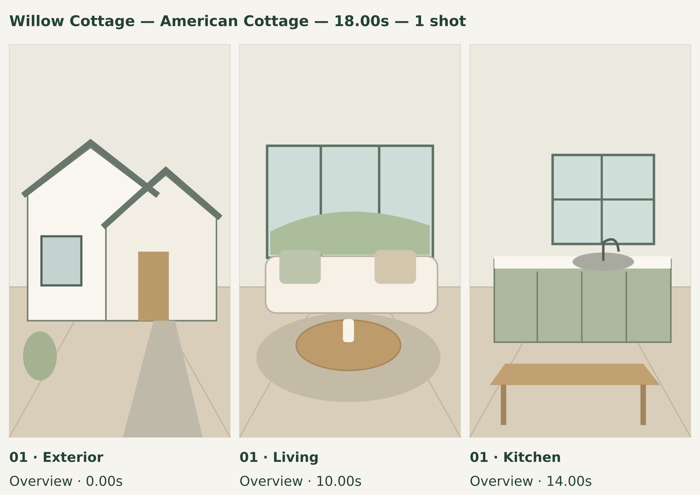
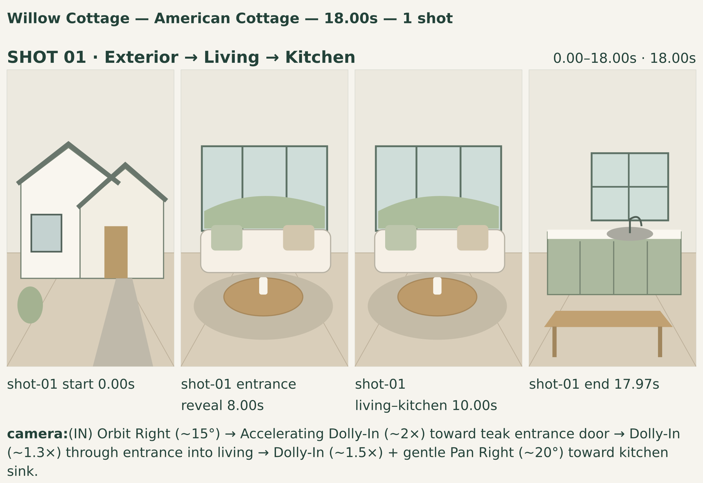
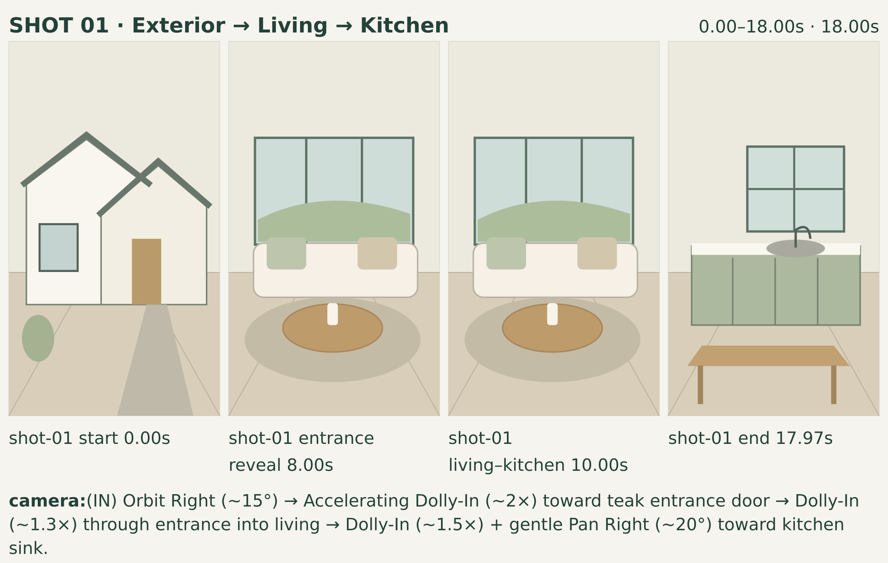

# Willow Cottage — Rumah L dengan Teras Taman

## 1. Profil desain

- **Nama desain:** Willow Cottage — Rumah L dengan Teras Taman.
- **Gaya utama:** **American Cottage**.
- **Pengaruh gaya:** Modern Farmhouse pada pintu kayu dan jendela berbingkai gelap; Scandinavian pada furnitur ringan dan penggunaan kayu terang.
- **Gaya interior:** Warm Contemporary Cottage, dengan bentuk sederhana, tekstur alami dan beberapa detail klasik.
- **Ciri khas:** atap pelana rendah, teras masuk yang menjorok ke dalam, serta living dan kitchen yang menyatu menghadap taman.
- **Warna & material:** putih gading, kayu oak muda, hijau sage dan aksen hitam; fasad bertekstur bata cat dan lantai interior menyerupai papan kayu.
- **Suasana dan lingkungan:** rumah kecil di taman rimbun, dengan cahaya pagi lembut dan lampu interior hangat.

## 2. Ukuran & proporsi

| Aspek | Estimasi visual |
| --- | --- |
| **Ukuran rumah** | Small |
| **Bentuk bangunan** | Massa berbentuk L dengan teras pada sudut pertemuan dua sayap |
| **Lantai & bentuk atap** | Satu lantai dengan atap pelana dan plafon living mengikuti kemiringan atap |
| **Tapak bangunan** | Kompak, dengan taman di sisi dalam bentuk L |
| **Proporsi utama** | Bangunan melebar; bukaan tinggi menyeimbangkan garis atap yang rendah |
| **Perkiraan luas lantai** | **70–90 m²** |

## 3. Shot Timeline

Video berdurasi 18 detik dan seluruhnya merupakan **satu shot tanpa cut**. Kamera bergerak dari taman melewati teras dan pintu masuk, masuk ke living, lalu mengikuti jalur terbuka menuju kitchen.

**Camera Pattern:** IN.

| Shot | Time (s) | Duration | Area/Scene | Camera Movement |
| --- | --- | --- | --- | --- |
| 01 | 0–18 | 18.00s | Exterior → Living → Kitchen | Orbit Right (~15°) → Accelerating Dolly-In (~2×) toward teak entrance door → Dolly-In (~1.3×) through entrance into living → Dolly-In (~1.5×) + gentle Pan Right (~20°) toward kitchen sink. |

## 4. Overview

**Shot 01 · Exterior · 0.00s**

> Kamera berada di taman sebelah kiri jalur masuk, menghadap serong ke sudut teras pada pertemuan dua sayap rumah. Pandangan wide sekitar level mata dengan sedikit menunduk memperlihatkan kedua sayap, atap pelana dan seluruh akses teras. Jalur batu serta lavender mengisi depan, bangku dan pintu berada di tengah, sementara pagar serta pepohonan menjadi latar. Cahaya pagi masuk lembut dari kiri, dilengkapi lampu dinding hangat pada teras.

**Shot 01 · Living · 10.00s**

> Kamera telah melewati pintu masuk dan berada di jalur kanan kelompok duduk, menghadap serong ke sofa serta bukaan kitchen. Pandangan wide sekitar level mata dengan sedikit menunduk memperlihatkan meja oval pada kiri depan, sofa dan kursi rotan di tengah, serta kabinet sage mulai terlihat di belakang kanan. Jendela taman di belakang sofa memberi daylight lembut, dibantu lampu meja hangat.

**Shot 01 · Kitchen · 14.00s**

> Kamera berada pada bukaan living–kitchen sebelum mendekati sink, di kanan meja persiapan, menghadap diagonal ke sudut countertop L. Pandangan wide sekitar level mata dengan sedikit menunduk mempertahankan meja persiapan pada kiri depan, kabinet sage dan sink di tengah, kulkas di kanan, serta jendela taman di belakang. Daylight dari jendela berpadu lampu bawah kabinet yang hangat.

## 5. Storyboard

## 6. Shot Details

### Shot 01 · Exterior → Living → Kitchen

**Time:** 0.00–18.00s · **Duration:** 18.00s

**Shot Type:** Continuous shot · Multi area · No cut.

#### **A. Desain area**

##### **Exterior**

**Arsitektur**

> Dua sayap rumah membentuk L, dengan fasad bata cat putih gading dan atap pelana abu-abu bertepi putih. Teras masuk berada di sudut pertemuan kedua sayap, dilindungi perpanjangan atap dan ditopang dua tiang kayu ramping. Pintu kayu berpanel kaca diapit jendela tinggi berbingkai hitam. Lantai teras berpenampilan batu abu-abu muda, sedikit lebih tinggi dari jalur taman dan dicapai melalui dua anak tangga lebar. Dua lampu dinding hitam dipasang di sisi pintu, sementara bagian bawah atap teras diberi lampu tanam kecil.

**Furnitur & dekorasi**

> Bangku kayu bersandaran rendah diletakkan menempel pada dinding kiri teras, dengan satu bantal linen warna krem. Di dekat tiang kanan terdapat pot tanah liat besar berisi tanaman berdaun kecil; pot yang lebih pendek mengisi sudut dekat bangku. Keset serat alami berada di depan pintu. Nomor rumah berwarna hitam dipasang pada dinding sebelah kanan pintu. Furnitur dan pot berada di tepi teras sehingga bagian tengah tetap terbuka sebagai jalur masuk.

**Lingkungan**

> Jalan setapak batu melengkung dari taman menuju teras, diapit lavender dan rumpun rumput rendah. Halaman berumput mengisi sisi dalam bentuk L, dengan pohon kecil di dekat ujung sayap kiri. Di belakang taman terlihat pagar kayu rendah serta pepohonan yang lebih tinggi. Daun dan semak tampak hijau, tanpa salju atau genangan. Cahaya pagi masuk dari kiri dan menghasilkan bayangan lembut di bawah atap teras.

##### **Living**

**Arsitektur**

> Living berbentuk memanjang dengan plafon miring putih mengikuti atap dan satu balok kayu melintang di bagian atas. Dinding berwarna putih hangat, dengan lis sederhana pada pertemuan dinding dan lantai. Jendela lebar berbingkai gelap menghadap taman; tirai linen tipis digantung dari dekat plafon hingga lantai. Lantai berpenampilan papan oak muda berlanjut menuju kitchen. Di belakang kanan kelompok duduk terdapat bukaan lebar tanpa daun pintu atau sekat penuh, sehingga kabinet kitchen sudah terlihat dari living. Jalur dari pintu masuk menuju bukaan tersebut berada di sisi kanan sofa.

**Furnitur & dekorasi**

> Sofa linen krem berbentuk lurus berada di bawah jendela taman, dilengkapi bantal hijau sage dan selimut rajut di salah satu lengan. Kursi rotan berkaki kayu ditempatkan menyerong ke sofa. Meja kopi oval berkaki pendek berada di atas karpet anyaman beige; di atasnya ada baki kayu, dua buku dan vas keramik kecil berisi ranting. Rak buku rendah menempel pada dinding samping, dengan buku, mangkuk keramik serta lampu meja berkap kain. Bagian tengah dan sisi kanan kelompok duduk tetap cukup terbuka untuk dilewati.

**Lingkungan**

> Melalui jendela di belakang sofa terlihat halaman rumput dan tanaman lavender yang juga berada di dekat jalur masuk. Pagar kayu dan sebagian tajuk pohon menjadi latar, tanpa bangunan tinggi yang menutupi cahaya. Tirai tipis melembutkan pemandangan dan cahaya dari taman. Saat pandangan mengarah ke kanan, jendela kitchen memperlihatkan taman yang sama dari sisi lain rumah.

##### **Kitchen**

**Arsitektur**

> Kitchen tersusun kompak dengan countertop berbentuk L. Kabinet bawah hijau sage memakai panel sederhana dan pegangan panjang hitam, sedangkan kabinet atas putih gading hanya mengisi dinding pendek agar sisi jendela tetap terbuka. Countertop putih bercorak abu-abu menyerupai marmer bertemu backsplash ubin putih persegi panjang bersusunan bata horizontal. Sink berada di bawah jendela taman berbingkai gelap dan trim putih; bidang kompor berada pada sisi yang tegak lurus dengannya. Kabinet tinggi mengapit kulkas di ujung dekat akses living. Dua rak kayu terbuka berada di sebelah jendela. Lampu plafon tanam dan lampu bawah kabinet melengkapi cahaya alami. Lantai berpenampilan papan oak muda menerus dari living.

**Furnitur & dekorasi**

> Meja persiapan kayu yang ramping berdiri di tengah, dengan rak bawah berisi keranjang anyaman dan dua mangkuk besar. Jalur berjalan tersedia di kedua sisinya. Kompor gas berkisi hitam dan oven berpenampilan stainless steel terpasang pada deret kabinet pendek, dengan teko gelap di atas salah satu tungku. Kulkas berpintu ganda berpenampilan stainless steel berada dekat bukaan living. Mesin kopi hitam dan nampan putih mengisi countertop di sebelah kulkas. Di sisi sink terdapat pot kecil, botol sabun dan wadah putih berisi spatula kayu; talenan disandarkan ke backsplash. Rak terbuka memuat piring putih, stoples kaca dan tanaman menjuntai. Karpet lorong beige berada di depan area kerja.

**Lingkungan**

> Jendela di atas sink menghadap taman pada sisi dalam bentuk L. Rumput, lavender dan pohon kecil terlihat di balik kaca, dengan pagar kayu rendah sebagai batas halaman. Sebagian dinding serta tepi atap sayap rumah yang lain terlihat menyerong di sisi kiri jendela. Cahaya pagi masuk tanpa terhalang bangunan dekat, sehingga daun tanaman dan tekstur taman masih terbaca dari dalam kitchen.

#### **B. Framing & Lighting**

- **Fokus:** Bentuk fasad dan teras → pintu masuk → kelompok duduk → kabinet sage dan sink.
- **Camera Start:** Di taman sebelah kiri jalur masuk, menghadap serong ke teras; dua sisi bangunan terlihat, dengan pintu di kanan tengah gambar.
- **Framing:** Tampilan luas fasad → pintu mendominasi gambar → living terbuka dengan kitchen di belakang kanan → tampilan lebih dekat pada sink dan jendela kitchen.
- **Lighting:** Cahaya pagi lembut di taman; sesudah melewati pintu, jendela living dan lampu hangat menjaga interior terbaca. Di kitchen, cahaya jendela dan lampu bawah kabinet menonjolkan permukaan kerja.

- **Area:** Eksterior, teras masuk, living dan kitchen; living dan kitchen sempat terlihat bersamaan.
- **Rute kamera:** Taman kiri jalur masuk → teras → ambang pintu → sisi kanan kelompok duduk → bukaan living–kitchen → sisi kanan meja persiapan.

**Hubungan antararea**

- **Penghubung area:** Pintu masuk terbuka menghubungkan teras dengan living; bukaan lebar tanpa daun pintu menghubungkan living dengan kitchen.
- **Peralihan:** Ambang pintu dilewati sekitar detik 8; kitchen mulai terlihat sekitar detik 10; kamera memasuki kitchen sekitar detik 14. Kitchen muncul sebelum kamera meninggalkan living.
- **Orientasi ruang:** Pintu dan tiang teras menjadi penanda saat masuk; sofa serta meja oval mempertahankan orientasi di living; meja persiapan dan jendela sink menuntun arah akhir.

#### **C. Camera Movement**

Kamera mula-mula bergerak melingkar ke kanan mengitari bagian depan teras, lalu maju menuju pintu kayu. Tanpa cut, kamera melewati pintu dan memasuki living, memperlihatkan sofa, meja dan kitchen di belakang kanan. Kamera kemudian terus maju di sisi kanan meja persiapan sambil perlahan memutar pandangan ke kanan menuju sink kitchen.

**Tempo:** Sedang saat mengitari teras → semakin cepat mendekati pintu → kembali sedang di living → sedikit melambat di akhir kitchen.

**Alur visual:** Mulai dari konteks rumah yang luas, menguatkan pintu sebagai tujuan, membuka interior secara bertahap, lalu mengakhiri perjalanan pada detail kitchen. Percepatan menuju pintu memberi dorongan; penurunan kecepatan di dalam memberi waktu membaca susunan ruang.

**Movement Timeline**

| Time (s) | Area & fokus | Camera Movement | Tempo |
| --- | --- | --- | --- |
| 0–3 | Eksterior; sudut fasad bergeser sehingga kedalaman teras lebih terbuka | Orbit Right (~15°). | Sedang |
| 3–7 | Eksterior menuju teras; pintu kayu semakin besar dan menjadi pusat perhatian | Accelerating Dolly-In (~2×) toward teak entrance door. | Sedang → cepat |
| 7–13 | Melewati ambang pintu ke living; sofa dan meja tampil lebih dahulu, lalu kitchen terlihat di belakang kanan | Dolly-In (~1.3×) through entrance into living. | Cepat di awal, lalu sedang |
| 13–18 | Living masih terlihat di kiri saat kamera mengikuti jalur ke kitchen; fokus beralih ke kabinet dan sink | Dolly-In (~1.5×) + gentle Pan Right (~20°) toward kitchen sink. | Sedang, sedikit melambat di akhir |

**Camera:** Orbit Right (~15°) → Accelerating Dolly-In (~2×) toward teak entrance door → Dolly-In (~1.3×) through entrance into living → Dolly-In (~1.5×) + gentle Pan Right (~20°) toward kitchen sink.
