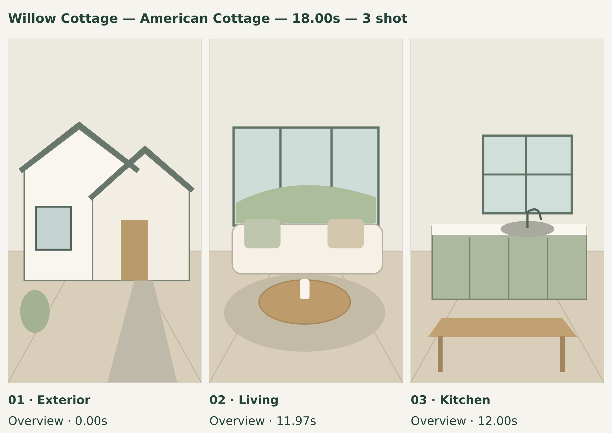
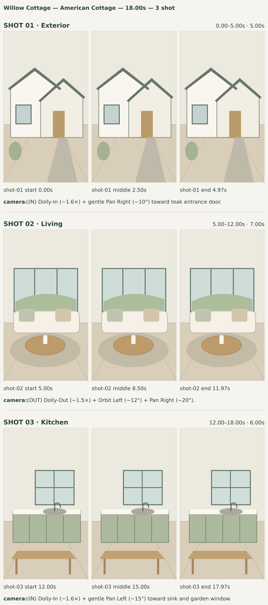
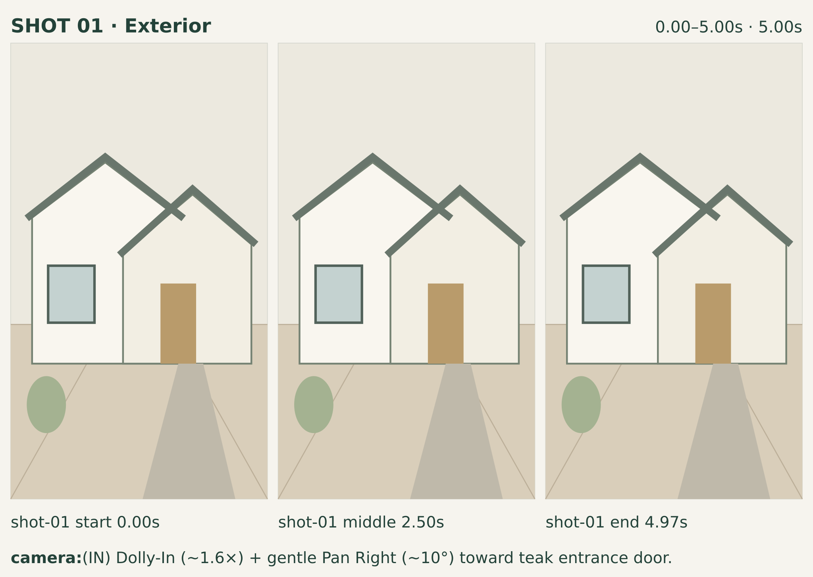
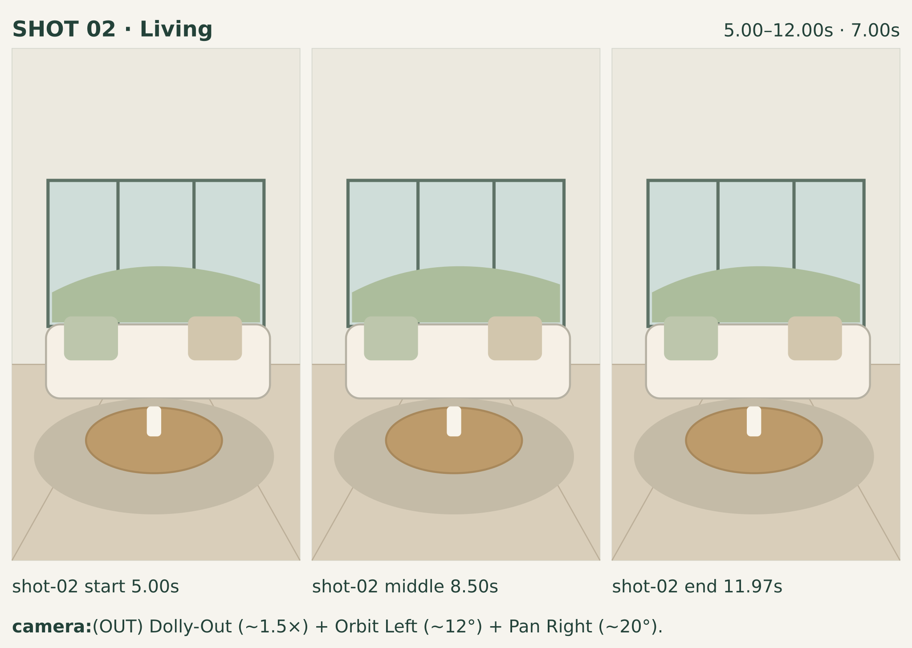
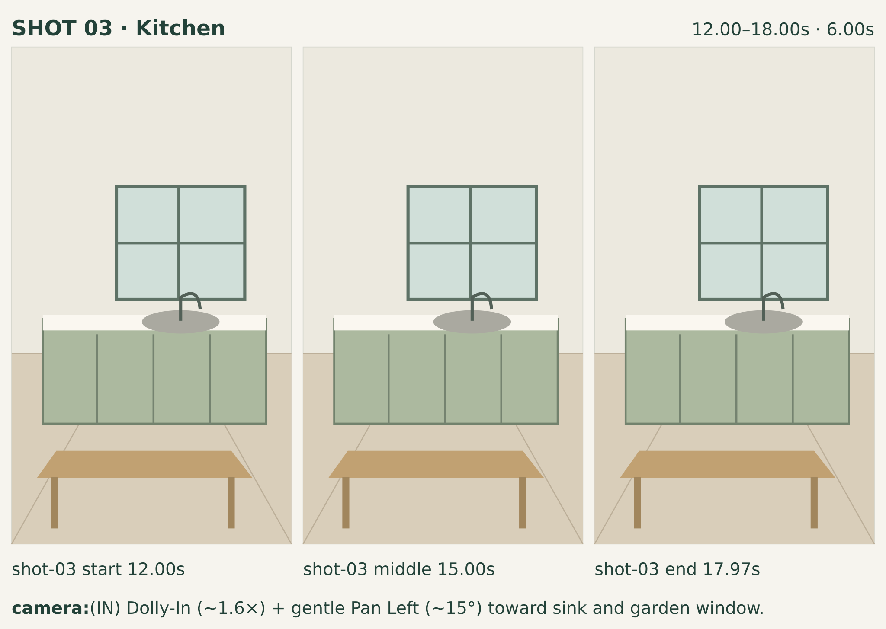

# Willow Cottage — Rumah L dengan Teras Taman

## 1. Profil desain

- **Nama desain:** Willow Cottage — Rumah L dengan Teras Taman.
- **Gaya utama:** **American Cottage**.
- **Pengaruh gaya:** Modern Farmhouse pada pintu kayu dan jendela berbingkai gelap; Scandinavian pada furnitur ringan dan penggunaan kayu terang.
- **Gaya interior:** Warm Contemporary Cottage, dengan bentuk sederhana, tekstur alami dan beberapa detail klasik.
- **Ciri khas:** atap pelana rendah, teras masuk yang menjorok ke dalam, serta living dan kitchen yang menyatu menghadap taman.
- **Warna & material:** putih gading, kayu oak muda, hijau sage dan aksen hitam; fasad bertekstur bata cat dan lantai interior menyerupai papan kayu.
- **Suasana dan lingkungan:** rumah kecil di taman rimbun, dengan cahaya pagi lembut dan lampu interior hangat.

## 2. Ukuran & proporsi

| Aspek | Estimasi visual |
| --- | --- |
| **Ukuran rumah** | Small |
| **Bentuk bangunan** | Massa berbentuk L dengan teras pada sudut pertemuan dua sayap |
| **Lantai & bentuk atap** | Satu lantai dengan atap pelana dan plafon living mengikuti kemiringan atap |
| **Tapak bangunan** | Kompak, dengan taman di sisi dalam bentuk L |
| **Proporsi utama** | Bangunan melebar; bukaan tinggi menyeimbangkan garis atap yang rendah |
| **Perkiraan luas lantai** | **70–90 m²** |

## 3. Shot Timeline

Video berdurasi 18 detik, terdiri dari tiga shot dengan cut pada detik 5 dan 12.

**Camera Pattern:** IN – OUT – IN.

| Shot | Time (s) | Duration | Area/Scene | Camera Movement |
| --- | --- | --- | --- | --- |
| 01 | 0–5 | 5.00s | Exterior | Dolly-In (~1.6×) + gentle Pan Right (~10°) toward teak entrance door. |
| 02 | 5–12 | 7.00s | Living | Dolly-Out (~1.5×) + Orbit Left (~12°) + Pan Right (~20°). |
| 03 | 12–18 | 6.00s | Kitchen | Dolly-In (~1.6×) + gentle Pan Left (~15°) toward sink and garden window. |

## 4. Overview

**Shot 01 · Exterior · 0.00s**

> Kamera berada di taman sebelah kiri jalur masuk, menghadap serong ke sudut teras pada pertemuan dua sayap rumah. Pandangan wide sekitar level mata dengan sedikit menunduk memperlihatkan kedua sayap, atap pelana dan seluruh akses teras. Jalur batu serta lavender mengisi depan, bangku dan pintu berada di tengah, sementara pagar serta pepohonan menjadi latar. Cahaya pagi masuk lembut dari kiri, dilengkapi lampu dinding hangat pada teras.

**Shot 02 · Living · 11.97s**

> Kamera berada di tepi luar kelompok duduk, dekat akses masuk dan lebih mundur dari coffee table, menghadap diagonal ke sofa serta jendela taman. Pandangan wide sekitar level mata, sedikit menunduk, memperlihatkan meja oval utuh, sofa di belakangnya, kursi rotan di kiri dan jalur menuju kitchen di kanan. Tepi karpet mengisi depan, furnitur berada di tengah, sedangkan jendela dan bukaan kitchen membentuk latar. Daylight lembut dari taman berpadu dengan lampu meja hangat.

**Shot 03 · Kitchen · 12.00s**

> Kamera berada di akses kitchen, pada jalur kanan meja persiapan, menghadap serong ke pertemuan countertop L dan jendela sink. Pandangan wide sekitar level mata dengan sedikit menunduk memuat meja persiapan pada kiri depan, kabinet sage serta sink di tengah, dan kulkas dekat akses living di sisi kanan. Jendela memperlihatkan taman serta sayap rumah lainnya sebagai lapisan belakang. Daylight dari jendela dipadukan lampu bawah kabinet dan downlight hangat.

## 5. Storyboard

## 6. Shot Details

### Shot 01 · Exterior

**Time:** 0.00–5.00s · **Duration:** 5.00s

#### **A. Desain area**

**Arsitektur**

> Dua sayap rumah membentuk L, dengan fasad bata cat putih gading dan atap pelana abu-abu bertepi putih. Teras masuk berada di sudut pertemuan kedua sayap, dilindungi perpanjangan atap dan ditopang dua tiang kayu ramping. Pintu kayu berpanel kaca diapit jendela tinggi berbingkai hitam. Lantai teras berpenampilan batu abu-abu muda, sedikit lebih tinggi dari jalur taman dan dicapai melalui dua anak tangga lebar. Dua lampu dinding hitam dipasang di sisi pintu, sementara bagian bawah atap teras diberi lampu tanam kecil.

**Furnitur & dekorasi**

> Bangku kayu bersandaran rendah diletakkan menempel pada dinding kiri teras, dengan satu bantal linen warna krem. Di dekat tiang kanan terdapat pot tanah liat besar berisi tanaman berdaun kecil; pot yang lebih pendek mengisi sudut dekat bangku. Keset serat alami berada di depan pintu. Nomor rumah berwarna hitam dipasang pada dinding sebelah kanan pintu. Furnitur dan pot berada di tepi teras sehingga bagian tengah tetap terbuka sebagai jalur masuk.

**Lingkungan**

> Jalan setapak batu melengkung dari taman menuju teras, diapit lavender dan rumpun rumput rendah. Halaman berumput mengisi sisi dalam bentuk L, dengan pohon kecil di dekat ujung sayap kiri. Di belakang taman terlihat pagar kayu rendah serta pepohonan yang lebih tinggi. Daun dan semak tampak hijau, tanpa salju atau genangan. Cahaya pagi masuk dari kiri dan menghasilkan bayangan lembut di bawah atap teras.

#### **B. Framing & Lighting**

- **Fokus:** Pintu kayu dan kedalaman teras di antara dua sayap rumah.
- **Camera Start:** Di taman sebelah kiri jalur masuk, menghadap serong ke sudut teras; sisi depan dan samping fasad terlihat bersamaan.
- **Framing:** Tampilan luas dua sayap rumah → tampilan lebih dekat pada teras dan pintu, dengan sebagian taman keluar dari gambar.
- **Lighting:** Cahaya pagi lembut dari kiri; lampu dinding di sisi pintu memberi aksen hangat.

#### **C. Camera Movement**

Kamera maju dari taman menuju pintu kayu sambil perlahan mengarahkan pandangan ke kanan, dari tampilan luas rumah menjadi lebih dekat pada teras dan pintu. Arah pandang mengikuti pintu sehingga gerak maju tetap terasa terarah.

**Tempo:** Sedang → semakin cepat mendekati teras.

**Camera:** Dolly-In (~1.6×) + gentle Pan Right (~10°) toward teak entrance door.

---

### Shot 02 · Living

**Time:** 5.00–12.00s · **Duration:** 7.00s

#### **A. Desain area**

**Arsitektur**

> Living berbentuk memanjang dengan plafon miring putih mengikuti atap dan satu balok kayu melintang di bagian atas. Dinding berwarna putih hangat, dengan lis sederhana pada pertemuan dinding dan lantai. Jendela lebar berbingkai gelap menghadap taman; tirai linen tipis digantung dari dekat plafon hingga lantai. Lantai berpenampilan papan oak muda berlanjut menuju kitchen. Di belakang kanan kelompok duduk terdapat bukaan lebar tanpa daun pintu atau sekat penuh, sehingga kabinet kitchen sudah terlihat dari living. Jalur dari pintu masuk menuju bukaan tersebut berada di sisi kanan sofa.

**Furnitur & dekorasi**

> Sofa linen krem berbentuk lurus berada di bawah jendela taman, dilengkapi bantal hijau sage dan selimut rajut di salah satu lengan. Kursi rotan berkaki kayu ditempatkan menyerong ke sofa. Meja kopi oval berkaki pendek berada di atas karpet anyaman beige; di atasnya ada baki kayu, dua buku dan vas keramik kecil berisi ranting. Rak buku rendah menempel pada dinding samping, dengan buku, mangkuk keramik serta lampu meja berkap kain. Bagian tengah dan sisi kanan kelompok duduk tetap cukup terbuka untuk dilewati.

**Lingkungan**

> Melalui jendela di belakang sofa terlihat halaman rumput dan tanaman lavender yang juga berada di dekat jalur masuk. Pagar kayu dan sebagian tajuk pohon menjadi latar, tanpa bangunan tinggi yang menutupi cahaya. Tirai tipis melembutkan pemandangan dan cahaya dari taman. Saat pandangan mengarah ke kanan, jendela kitchen memperlihatkan taman yang sama dari sisi lain rumah.

#### **B. Framing & Lighting**

- **Fokus:** Hubungan sofa, meja oval dan kursi rotan dalam satu kelompok duduk.
- **Camera Start:** Dekat ujung meja kopi, sedikit di kanan sumbu sofa, menghadap serong ke sofa dan jendela.
- **Framing:** Meja dan sebagian sofa mengisi gambar → seluruh kelompok duduk, plafon miring dan jalur samping terlihat.
- **Lighting:** Cahaya lembut dari jendela belakang sofa, dibantu lampu meja berkap kain di atas rak rendah.

#### **C. Camera Movement**

Kamera mundur sambil bergerak melingkar ke kiri mengitari meja kopi dan sekaligus memutar arah pandang ke kanan untuk mempertahankan kelompok duduk dalam gambar. Ruangan terlihat semakin luas. Perubahan sudut memperlihatkan sisi meja dan jarak antara kursi dengan sofa.

**Tempo:** Sedang → melambat menjelang cut.

**Camera:** Dolly-Out (~1.5×) + Orbit Left (~12°) + Pan Right (~20°).

---

### Shot 03 · Kitchen

**Time:** 12.00–18.00s · **Duration:** 6.00s

#### **A. Desain area**

**Arsitektur**

> Kitchen tersusun kompak dengan countertop berbentuk L. Kabinet bawah hijau sage memakai panel sederhana dan pegangan panjang hitam, sedangkan kabinet atas putih gading hanya mengisi dinding pendek agar sisi jendela tetap terbuka. Countertop putih bercorak abu-abu menyerupai marmer bertemu backsplash ubin putih persegi panjang bersusunan bata horizontal. Sink berada di bawah jendela taman berbingkai gelap dan trim putih; bidang kompor berada pada sisi yang tegak lurus dengannya. Kabinet tinggi mengapit kulkas di ujung dekat akses living. Dua rak kayu terbuka berada di sebelah jendela. Lampu plafon tanam dan lampu bawah kabinet melengkapi cahaya alami. Lantai berpenampilan papan oak muda menerus dari living.

**Furnitur & dekorasi**

> Meja persiapan kayu yang ramping berdiri di tengah, dengan rak bawah berisi keranjang anyaman dan dua mangkuk besar. Jalur berjalan tersedia di kedua sisinya. Kompor gas berkisi hitam dan oven berpenampilan stainless steel terpasang pada deret kabinet pendek, dengan teko gelap di atas salah satu tungku. Kulkas berpintu ganda berpenampilan stainless steel berada dekat bukaan living. Mesin kopi hitam dan nampan putih mengisi countertop di sebelah kulkas. Di sisi sink terdapat pot kecil, botol sabun dan wadah putih berisi spatula kayu; talenan disandarkan ke backsplash. Rak terbuka memuat piring putih, stoples kaca dan tanaman menjuntai. Karpet lorong beige berada di depan area kerja.

**Lingkungan**

> Jendela di atas sink menghadap taman pada sisi dalam bentuk L. Rumput, lavender dan pohon kecil terlihat di balik kaca, dengan pagar kayu rendah sebagai batas halaman. Sebagian dinding serta tepi atap sayap rumah yang lain terlihat menyerong di sisi kiri jendela. Cahaya pagi masuk tanpa terhalang bangunan dekat, sehingga daun tanaman dan tekstur taman masih terbaca dari dalam kitchen.

#### **B. Framing & Lighting**

- **Fokus:** Sink di bawah jendela serta pertemuan countertop dan kabinet sage.
- **Camera Start:** Di pintu masuk kitchen, di kanan meja persiapan, menghadap serong ke sudut kabinet L.
- **Framing:** Kitchen luas dengan meja persiapan sebagai latar depan → sink, countertop dan jendela memenuhi sebagian besar gambar.
- **Lighting:** Cahaya pagi dari jendela taman, dengan lampu bawah kabinet yang menerangi permukaan kerja.

#### **C. Camera Movement**

Kamera maju dari akses kitchen menuju sink sambil perlahan memutar arah pandang ke kiri. Meja persiapan bergeser keluar dari latar depan, sementara sink dan jendela semakin dominan.

**Tempo:** Sedang dan relatif stabil sampai cut.

**Camera:** Dolly-In (~1.6×) + gentle Pan Left (~15°) toward sink and garden window.
