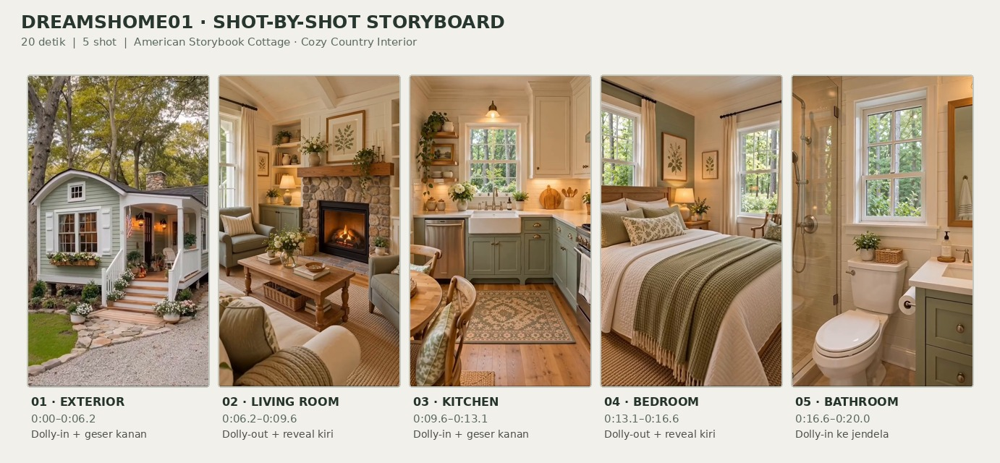
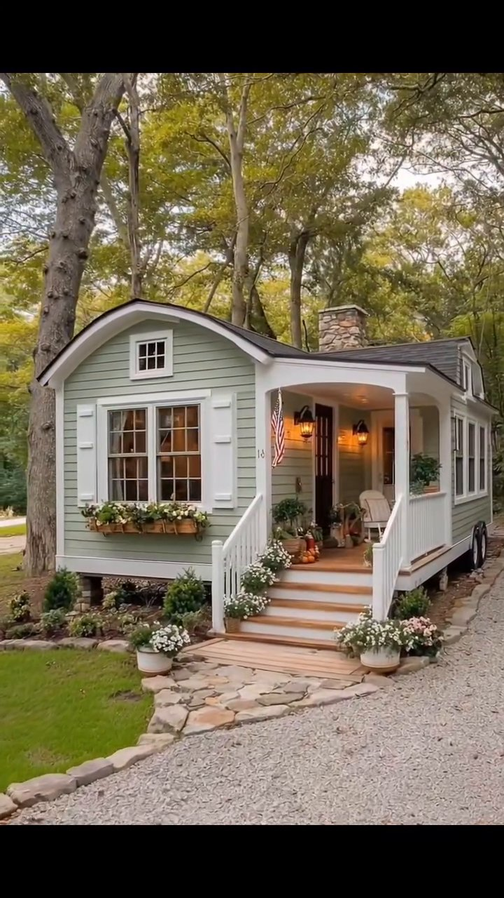
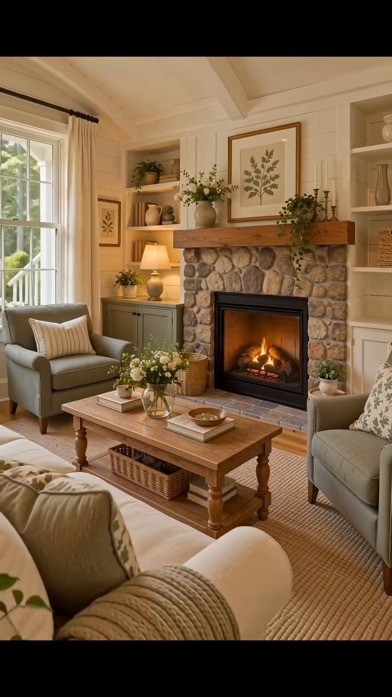
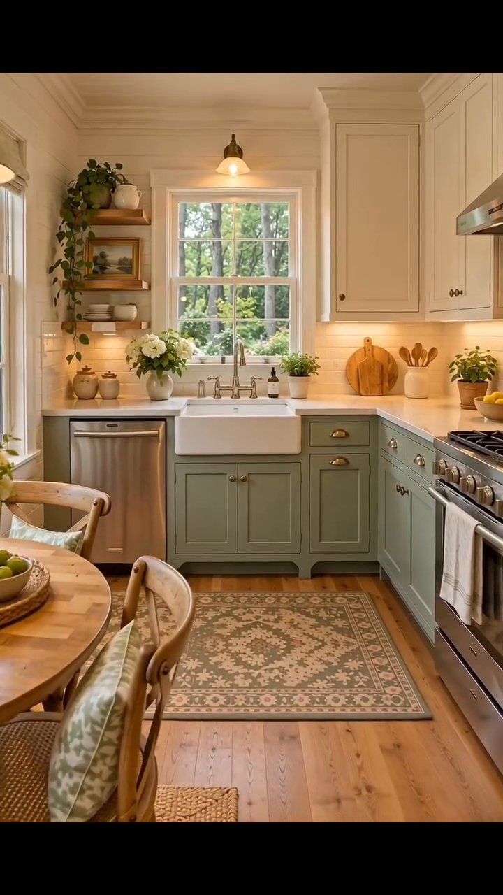
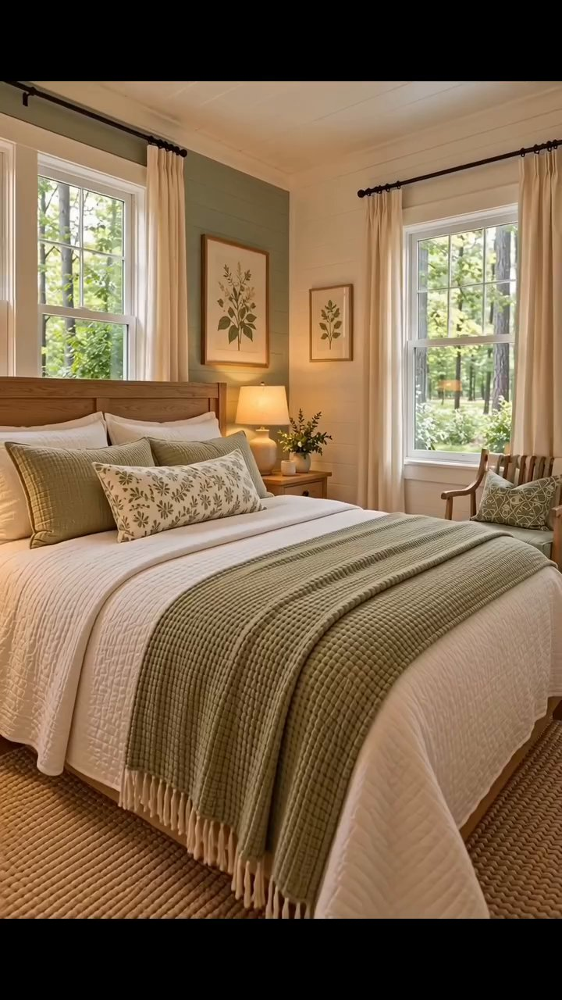
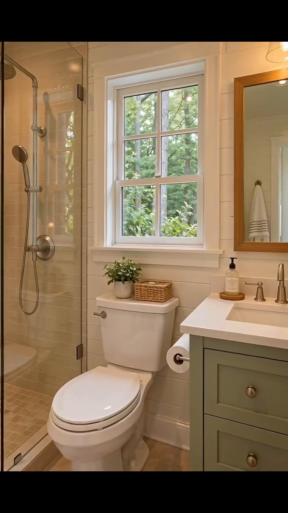

# VID-001 — American Storybook Cottage

> Tur visual rumah cottage dengan fasad sage green, teras depan, pepohonan rindang, dan interior hangat bernuansa country cottage / modern farmhouse.

**Sumber data:** [analysis.yaml](analysis.yaml) · **Status:** `draft` · **Diverifikasi manusia:** Belum

## 1. Informasi Video

| Informasi | Nilai |
|---|---|
| ID | `VID-001` |
| File asli | `dreamshome01.mp4` |
| Durasi | 20,03 detik |
| Resolusi | 720 × 1280 |
| FPS | 30 |
| Rasio | 9:16 |
| Jumlah shot | 5 |

## 2. Storyboard Gabungan

> Urutan video: exterior → living room → kitchen → bedroom → bathroom. Waktu batas shot merupakan estimasi.

## 3. Identitas Desain

| Aspek | Hasil analisis |
|---|---|
| Gaya utama | American Storybook Cottage |
| Pengaruh gaya | American Country Cottage, Modern Farmhouse Interior |
| Ciri eksterior | Sage green siding, curved front gable, covered front porch, white shutters, stone chimney |
| Gaya interior | Cozy Country Cottage, Modern Farmhouse |
| Confidence klasifikasi gaya | Medium |

## 4. Warna, Pencahayaan, dan Atmosfer

| Warna dominan | HEX (perkiraan visual) |
|---|---|
| Sage green | `#A6B2A0` |
| Warm cream | `#F0E6D4` |
| Natural oak | `#B88C61` |
| Olive green | `#788269` |

| Aspek | Hasil analisis |
|---|---|
| Pencahayaan | Soft natural daylight; warm interior lamps |
| Lingkungan | Leafy countryside, mature trees, flower garden |
| Musim yang tampak | Early autumn |
| Mood | Cozy, peaceful, nostalgic, inviting |

## 5. Struktur dan Timeline Video

**Jenis:** Exterior-to-interior home tour · **Tempo:** Slow · **Pola transisi:** Soft blur pada perpindahan awal, kemudian cut

| Shot | Waktu (detik) | Durasi | Area/Scene | Gerakan Kamera |
|---|---|---|---|---|
| Shot 01 | 0,00–6,20 | 6,20 dtk | Exterior front | Dolly-in + tracking right |
| Shot 02 | 6,20–9,60 | 3,40 dtk | Living room | Dolly-out + pan left |
| Shot 03 | 9,60–13,10 | 3,50 dtk | Kitchen | Dolly-in + tracking right |
| Shot 04 | 13,10–16,57 | 3,47 dtk | Bedroom | Dolly-out + pan left |
| Shot 05 | 16,57–20,03 | 3,46 dtk | Bathroom | Dolly-in |

## 6. Analisis per Shot

### Shot 01 — Exterior Front

**Waktu:** 0,00–6,20 detik · **Durasi:** 6,20 detik

| Komponen | Pengamatan |
|---|---|
| Fokus utama | Tampak depan cottage dan teras |
| Framing awal → akhir | Wide → medium wide |
| Sudut pandang | Three-quarter front |
| Gerakan kamera | Dolly-in + tracking right |
| Kecepatan kamera | Slow |
| Pencahayaan | Soft daylight |
| Transisi keluar | Soft blur |

**Detail yang terlihat**

- **Arsitektur:** Sage green siding, curved front gable, white shutters, covered front porch, stone chimney.
- **Furnitur dan properti:** Rocking chair, American flag, porch lantern, pumpkins.
- **Lingkungan:** Large trees, white flowers, gravel driveway.

**Catatan pengamatan:** Kamera tampak maju perlahan dan bergeser sedikit ke kanan; arah gerak adalah estimasi visual.

**Confidence:** Kamera medium · Detail visual high

### Shot 02 — Living Room

**Waktu:** 6,20–9,60 detik · **Durasi:** 3,40 detik

| Komponen | Pengamatan |
|---|---|
| Fokus utama | Perapian dan area duduk |
| Framing awal → akhir | Medium → wide |
| Sudut pandang | Toward fireplace and seating |
| Gerakan kamera | Dolly-out + pan left |
| Kecepatan kamera | Slow |
| Pencahayaan | Window daylight and warm lamps |
| Transisi keluar | Cut |

**Detail yang terlihat**

- **Arsitektur:** Stone fireplace, wood mantel, large windows.
- **Furnitur dan properti:** Cream sofa, sage green armchair, wood coffee table, woven basket, textured rug, botanical art, table lamps.
- **Lingkungan:** Tidak dicatat.

**Catatan pengamatan:** Framing semakin luas sehingga area duduk lebih terlihat; lintasan kamera diperkirakan.

**Confidence:** Kamera medium · Detail visual high

### Shot 03 — Kitchen

**Waktu:** 9,60–13,10 detik · **Durasi:** 3,50 detik

| Komponen | Pengamatan |
|---|---|
| Fokus utama | Farmhouse sink dan kabinet |
| Framing awal → akhir | Medium wide → medium |
| Sudut pandang | Toward sink |
| Gerakan kamera | Dolly-in + tracking right |
| Kecepatan kamera | Slow |
| Pencahayaan | Window daylight and warm pendant |
| Transisi keluar | Cut |

**Detail yang terlihat**

- **Arsitektur:** Sage green lower cabinets, cream upper cabinets, farmhouse sink, divided-pane window.
- **Furnitur dan properti:** Wood dining table, vintage rug, pendant lighting, flowers, kitchenware.
- **Lingkungan:** Tidak dicatat.

**Catatan pengamatan:** Pandangan mendekati area sink dan kabinet, sedikit bergeser ke kanan.

**Confidence:** Kamera medium · Detail visual high

### Shot 04 — Bedroom

**Waktu:** 13,10–16,57 detik · **Durasi:** 3,47 detik

| Komponen | Pengamatan |
|---|---|
| Fokus utama | Tempat tidur dan tata ruang kamar |
| Framing awal → akhir | Medium → wide |
| Sudut pandang | Bed toward window |
| Gerakan kamera | Dolly-out + pan left |
| Kecepatan kamera | Slow |
| Pencahayaan | Soft window daylight and warm lamps |
| Transisi keluar | Cut |

**Detail yang terlihat**

- **Arsitektur:** Sage accent wall, large windows.
- **Furnitur dan properti:** Oak bed, white bedding, sage knitted throw, botanical pillows, bedside lamps, cream curtains.
- **Lingkungan:** Trees outside window.

**Catatan pengamatan:** Kamera memperluas pandangan kamar dari posisi dekat ke lebih lebar.

**Confidence:** Kamera medium · Detail visual high

### Shot 05 — Bathroom

**Waktu:** 16,57–20,03 detik · **Durasi:** 3,46 detik

| Komponen | Pengamatan |
|---|---|
| Fokus utama | Vanity kamar mandi dan jendela |
| Framing awal → akhir | Wide → medium |
| Sudut pandang | Toward window |
| Gerakan kamera | Dolly-in |
| Kecepatan kamera | Slow |
| Pencahayaan | Soft window daylight and warm sconce |
| Transisi keluar | End |

**Detail yang terlihat**

- **Arsitektur:** Sage green vanity, glass shower, white tile, large window.
- **Furnitur dan properti:** Mirror, wall sconce, white towels, woven baskets, small plants.
- **Lingkungan:** Trees outside window.

**Catatan pengamatan:** Pandangan maju perlahan ke arah jendela dan area vanity.

**Confidence:** Kamera medium · Detail visual high

## 7. Kualitas dan Ketidakpastian Analisis

| Parameter | Hasil |
|---|---|
| Status | Draft |
| Verifikasi manusia | Belum |
| Ketepatan timestamp | Estimated |
| Ketidakpastian | Exact shot boundaries, exact camera trajectories, exact paint colors, architectural style taxonomy |

**Catatan:** Analisis deskriptif berdasarkan pemeriksaan visual; nama gaya, musim, dan gerak kamera merupakan interpretasi, bukan fakta produksi yang telah diverifikasi.

---

*Laporan ini disusun dari [analysis.yaml](analysis.yaml) untuk memudahkan pembacaan visual di GitHub. Jika data YAML direvisi, perbarui laporan ini agar tetap sinkron.*
