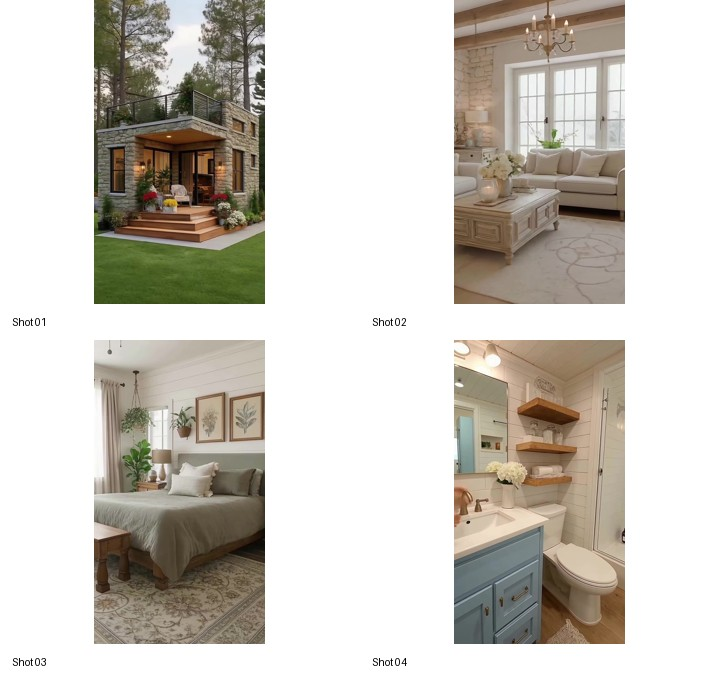
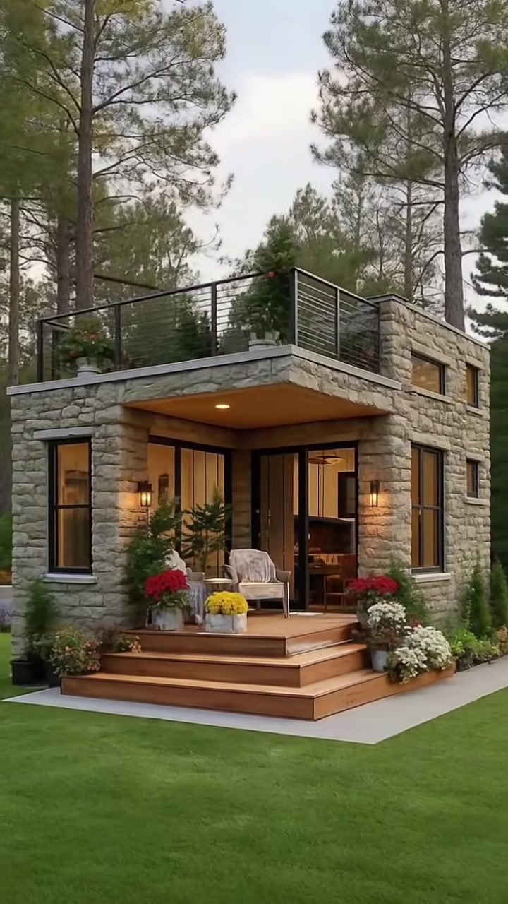
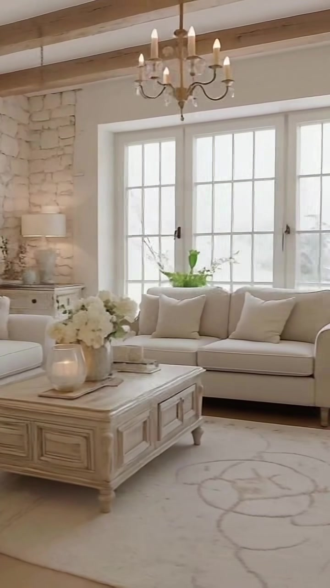
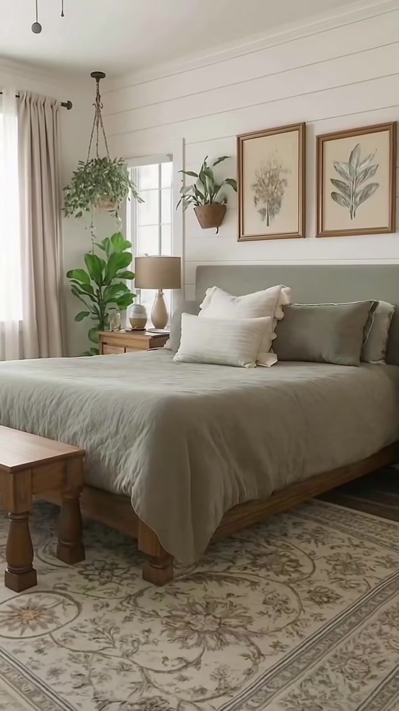
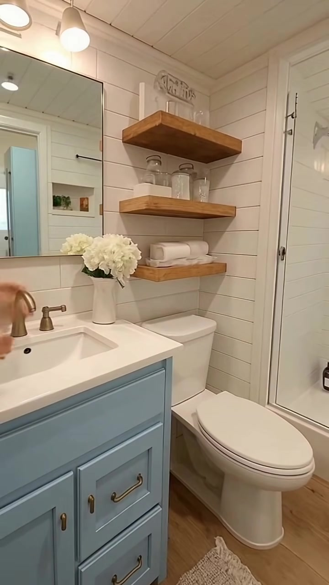

# VID-002 — Modern Rustic Cottage

<!-- homeku_request_id: dreamsHouse002-20261102-reviewed-001 -->

**Sumber data:** [analysis.yaml](analysis.yaml) · **Status:** draft · **Diverifikasi manusia:** Tidak

## 1. Informasi Video

| Informasi | Nilai |
|---|---|
| ID | VID-002 |
| File asli | dreamsHouse002.mp4 |
| Durasi | 20.9 |
| Resolusi | 720x1280 |
| FPS | 60.04 |
| Rasio | 9:16 |
| Jumlah shot | 4 |

## 2. Storyboard Gabungan

## 3. Identitas Desain

| Aspek | Hasil analisis |
|---|---|
| Gaya utama | modern rustic cottage |
| Pengaruh gaya | contemporary compact house, stone cottage, rustic farmhouse interior |
| Ciri eksterior | light gray beige stone cladding, flat roof with terrace, black metal rooftop railing, partially raised upper volume with horizontal windows, deep wood soffit entry canopy, wooden front steps and porch, dark framed tall windows, dark framed glazed entry, warm wall sconces, planters with blooming flowers |
| Gaya interior | soft rustic farmhouse, modern cottage, neutral natural materials, botanical accents |
| Confidence gaya | medium |

## 4. Ukuran & Proporsi Bangunan

| Aspek | Estimasi visual |
|---|---|
| Ukuran yang terlihat | small |
| Bentuk bangunan | compact rectangular with partial upper volume |
| Skala vertikal | partial two story with rooftop terrace |
| Tapak bangunan | compact |
| Perkiraan luas lantai | 55–95 m² |
| Confidence | low |

> Luas adalah perkiraan visual, bukan ukuran terukur.

## 5. Warna, Pencahayaan, dan Atmosfer

| Warna dominan | HEX (perkiraan) |
|---|---|
| warm stone beige | #C8BBA9 |
| soft cream white | #EFECE4 |
| natural oak wood | #B59066 |
| sage green | #8A9585 |
| pale dusty blue | #92AFBD |
| forest green | #52664E |

| Aspek | Hasil analisis |
|---|---|
| Pencahayaan | soft overcast exterior daylight, warm exterior practical lights, diffused interior window daylight, warm indoor practical lighting |
| Lingkungan | pine like tall trees, green lawn, flowering potted plants, landscaped plant beds |
| Musim yang tampak | green foliage flowering season like |
| Mood | cozy, calm, inviting, nature surrounded, warm rustic |

## 6. Struktur dan Timeline Video

**Jenis:** compact house tour · **Tempo:** slow · **Transisi:** hard cuts between four scenes

| Shot | Waktu (detik) | Durasi | Area/Scene | Gerakan Kamera |
|---|---|---|---|---|
| Shot 01 | 0.0–6.31 | 6.31 | exterior front | subtle dolly in |
| Shot 02 | 6.31–11.92 | 5.61 | living room | pan right |
| Shot 03 | 11.92–15.27 | 3.35 | bedroom | pan left |
| Shot 04 | 15.27–20.9 | 5.63 | bathroom | pan left |

## 7. Analisis per Shot

### Shot 01 — exterior front

**Waktu:** 0.0–6.31 detik

| Komponen | Pengamatan |
|---|---|
| Fokus utama | stone clad compact house with roof terrace and front porch |
| Framing awal → akhir | wide three quarter front facade → slightly closer three quarter front facade |
| Sudut pandang | eye level slightly low angle |
| Gerakan kamera | subtle dolly in |
| Kecepatan kamera | slow |
| Pencahayaan | soft daylight with warm entry lights |
| Transisi keluar | hard cut |

**Detail yang terlihat**

- **Arsitektur:** light stone clad facade, flat roof rooftop terrace with black railing, partial upper level with small horizontal windows, recessed entry with wood ceiling, dark framed glass doors and vertical windows, timber stairs and porch, wall mounted warm sconces
- **Furnitur dan properti:** light porch armchair, small porch seating, flower pots in red yellow and white, upper terrace planters
- **Lingkungan:** closely cut green lawn, tall pine like trees, low shrubs and flower beds, bright overcast sky

**Catatan pengamatan:** Rumah tampak dari sudut tiga perempat depan; kamera mendekat sangat pelan dengan komposisi relatif stabil. Terlihat atap datar/teras berpagarkan metal hitam serta volume lantai atas parsial.

**Confidence:** Kamera medium · Detail visual high

### Shot 02 — living room

**Waktu:** 6.31–11.92 detik

| Komponen | Pengamatan |
|---|---|
| Fokus utama | cozy neutral living room from sofa group to tv area |
| Framing awal → akhir | medium wide sofas and wood coffee table → medium tv console and bookshelf |
| Sudut pandang | eye level interior |
| Gerakan kamera | pan right |
| Kecepatan kamera | slow |
| Pencahayaan | diffused daylight through windows with soft interior lighting |
| Transisi keluar | hard cut |

**Detail yang terlihat**

- **Arsitektur:** pale stone accent wall, exposed natural wood ceiling beams, white grid paned windows, light wood floor, white plaster wall
- **Furnitur dan properti:** two cream upholstered sofas, carved light wood coffee table, white flower vase and candle, cream patterned area rug, woven basket with white throw, wall mirror, table lamp on side cabinet, classic metal chandelier, small bookcase with books, framed landscape art, television on cream media console, small potted plants
- **Lingkungan:** —

**Catatan pengamatan:** Satu gerakan pan pelan ke kanan: dua sofa dan meja kopi meninggalkan frame, kemudian rak buku dan televisi pada kabinet terang masuk ke bidang pandang. Tidak tampak cut besar di tengah scene ini.

**Confidence:** Kamera high · Detail visual high

### Shot 03 — bedroom

**Waktu:** 11.92–15.27 detik

| Komponen | Pengamatan |
|---|---|
| Fokus utama | sage green bedroom with botanical decor |
| Framing awal → akhir | medium wide bed and botanical art → medium wide bed and window side |
| Sudut pandang | eye level interior |
| Gerakan kamera | pan left |
| Kecepatan kamera | slow |
| Pencahayaan | soft natural daylight from curtained windows |
| Transisi keluar | hard cut |

**Detail yang terlihat**

- **Arsitektur:** white horizontal shiplap wall, white trimmed windows, pale floorboards
- **Furnitur dan properti:** wooden bed frame, sage green bedding and padded headboard, layered cream pillows, two framed botanical prints, wooden bedside table, small table lamp, hanging basket planters, leafy floor plant, neutral curtains, floral patterned area rug, narrow wooden bench at bed foot
- **Lingkungan:** —

**Catatan pengamatan:** Kamera perlahan menggeser pandangan ke kiri; sisi jendela dan tanaman lebih banyak terlihat, sementara sebagian dekorasi dinding kanan keluar frame. Nuansa sage green, kayu alami, dan putih mendominasi.

**Confidence:** Kamera high · Detail visual high

### Shot 04 — bathroom

**Waktu:** 15.27–20.9 detik

| Komponen | Pengamatan |
|---|---|
| Fokus utama | compact farmhouse bathroom with blue vanity and open wood shelves |
| Framing awal → akhir | medium wide shower toilet and partial vanity → medium close vanity mirror and sink |
| Sudut pandang | eye level interior |
| Gerakan kamera | pan left |
| Kecepatan kamera | slow |
| Pencahayaan | warm ceiling and mirror lamps with soft room light |
| Transisi keluar | end of video |

**Detail yang terlihat**

- **Arsitektur:** white horizontal shiplap walls, white paneled ceiling, glass enclosed shower, light wood look floor, white door and trim
- **Furnitur dan properti:** pale dusty blue sink vanity, white sink and countertop, brass toned faucet and cabinet handles, white toilet, three open natural wood shelves, rolled white towels, clear storage jars, white flower vase, large wall mirror, multi bulb vanity lights, small neutral bath mat
- **Lingkungan:** —

**Catatan pengamatan:** Gerak pan kiri dari pintu shower ke wastafel biru pucat dan cermin. Menjelang akhir, tangan seseorang terlihat di dekat keran dan sosok seseorang tampak dalam pantulan cermin; identitasnya tidak dapat ditentukan dari video.

**Confidence:** Kamera high · Detail visual high

## 8. Kualitas dan Ketidakpastian Analisis

| Parameter | Hasil |
|---|---|
| Status | draft |
| Verifikasi manusia | Tidak |
| Ketepatan timestamp | estimated |
| Ketidakpastian | Gaya arsitektur adalah klasifikasi visual, bukan identifikasi asal negara atau bangunan aktual., Perkiraan luas 55–95 m² dibuat dari proporsi fasad dan kemungkinan volume atas; tidak ada denah atau skala pengukuran., Gerakan kamera dapat menyerupai pan/dolly digital; jenis alat dan metode pengambilan gambar tidak diketahui., Tidak dapat dipastikan apakah finishing batu merupakan batu struktural atau lapisan dekoratif., Musim hanya disarankan oleh pohon hijau dan tanaman berbunga, tidak dapat dipastikan., Tidak ada bukti visual yang memastikan hubungan spasial setiap interior dengan eksterior yang ditampilkan. |

**Catatan:** Empat perubahan scene utama teramati pada ~6.31, ~11.92, dan ~15.27 detik. Semua keyframe adalah cuplikan frame asli dari video sumber; nilai warna HEX dan luas merupakan estimasi visual. Audio tidak dianalisis.

---

*Laporan ini diturunkan dari [analysis.yaml](analysis.yaml).*
