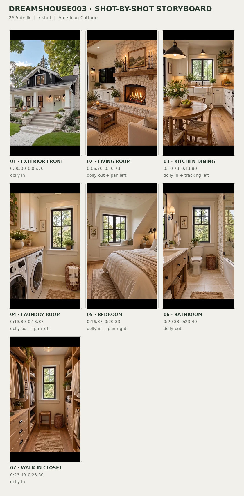
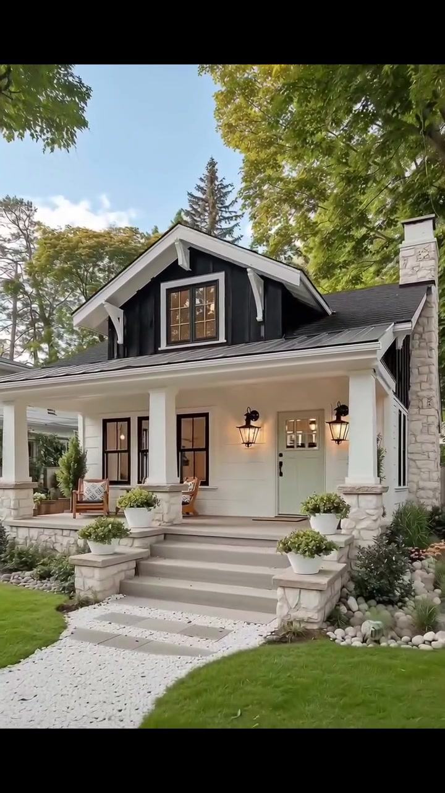
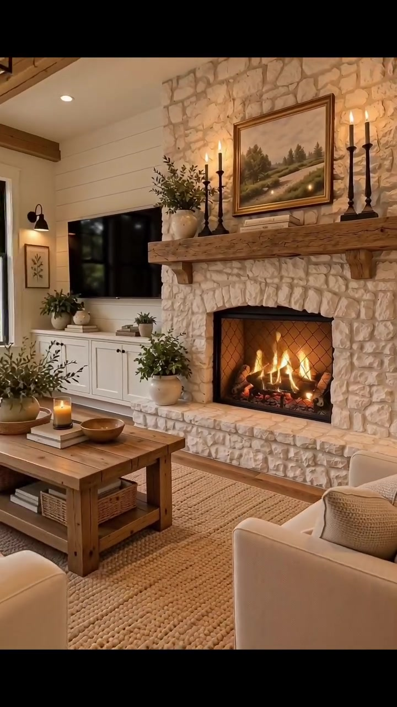
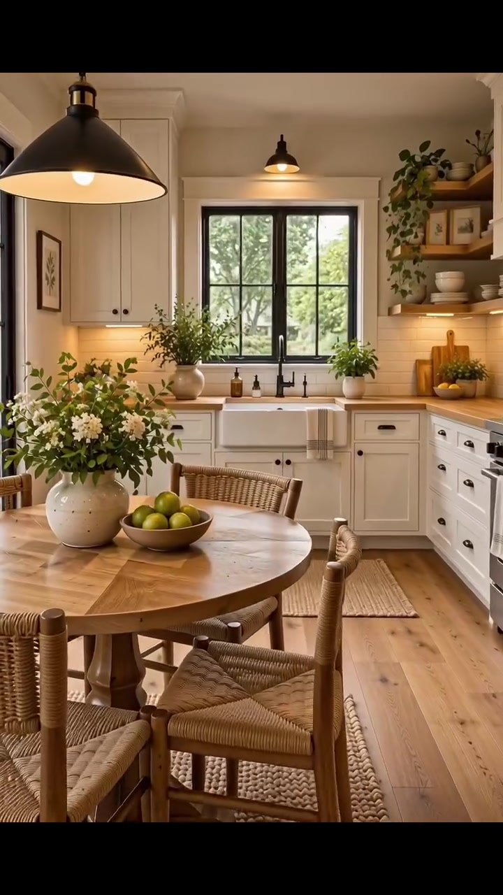
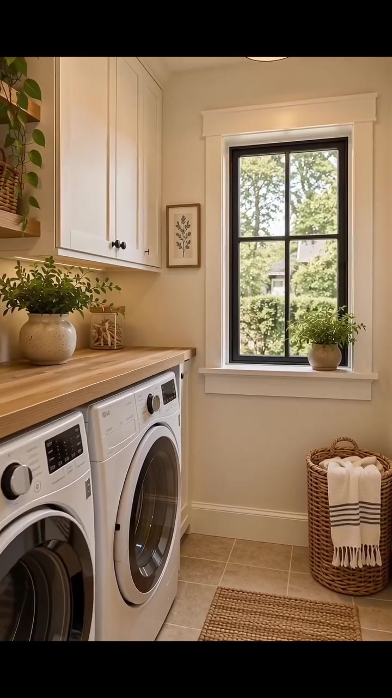
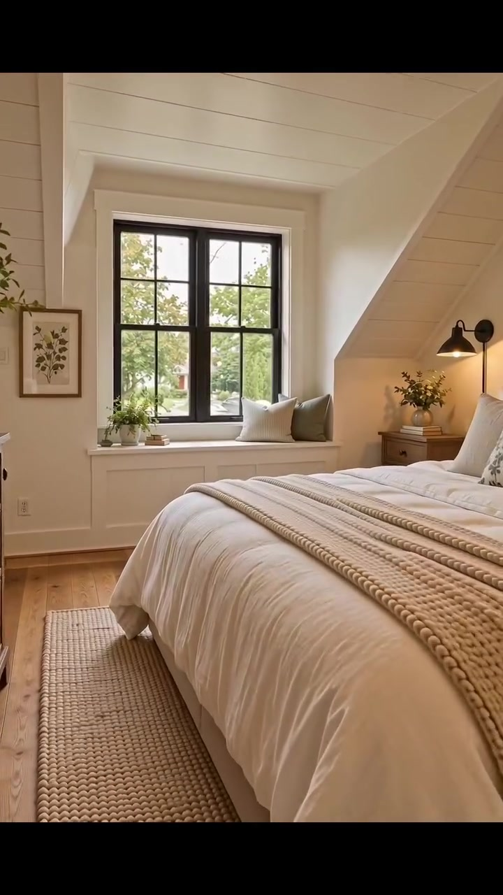
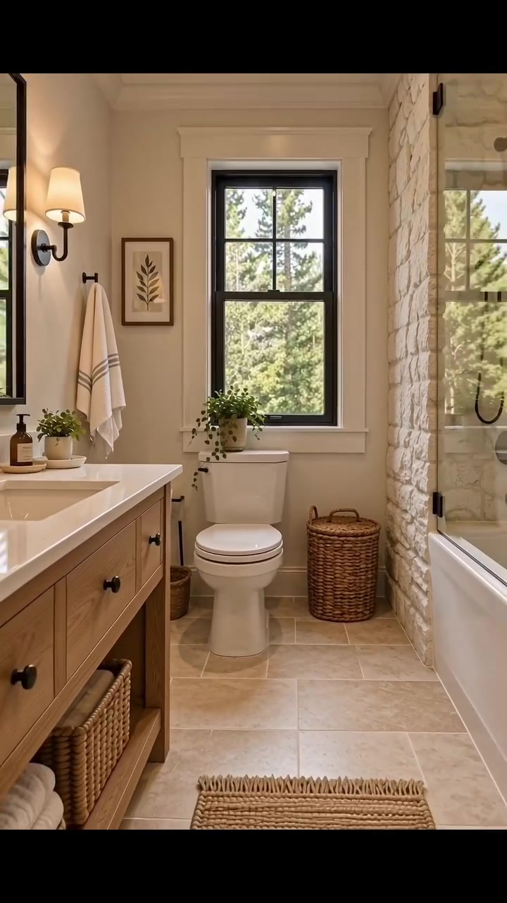
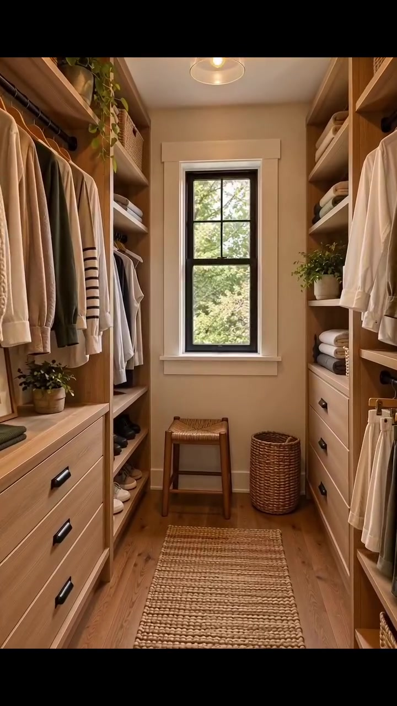

# VID-003 — American Cottage

<!-- homeku_request_id: dreamsHouse003-20261102-reviewed-001 -->

**Sumber data:** [analysis.yaml](analysis.yaml) · **Status:** draft · **Diverifikasi manusia:** Tidak

## 1. Informasi Video

| Informasi | Nilai |
|---|---|
| ID | VID-003 |
| File asli | dreamsHouse003.mp4 |
| Durasi | 26.5 |
| Resolusi | 720x1280 |
| FPS | 30 |
| Rasio | 9:16 |
| Jumlah shot | 7 |

## 2. Storyboard Gabungan

## 3. Identitas Desain

| Aspek | Hasil analisis |
|---|---|
| Gaya utama | american cottage |
| Pengaruh gaya | craftsman cottage, modern farmhouse, rustic farmhouse |
| Ciri eksterior | front facing gabled dormer, dark charcoal roof and gable siding, white horizontal lap siding, covered full width front porch, tapered stone porch piers, light stone chimney, pale sage front door, dark window frames, broad stone front steps |
| Gaya interior | modern farmhouse, rustic cottage, warm neutral transitional |
| Confidence gaya | high |

## 4. Ukuran & Proporsi Bangunan

| Aspek | Estimasi visual |
|---|---|
| Ukuran yang terlihat | medium |
| Bentuk bangunan | rectangular with front porch |
| Skala vertikal | single story with attic dormer |
| Tapak bangunan | moderate |
| Perkiraan luas lantai | 100–160 m² |
| Confidence | low |

> Luas adalah perkiraan visual, bukan ukuran terukur.

## 5. Warna, Pencahayaan, dan Atmosfer

| Warna dominan | HEX (perkiraan) |
|---|---|
| warm cream | #EBE5D7 |
| charcoal black | #303331 |
| natural oak | #B58B62 |
| pale limestone | #C7B9A5 |
| sage green | #8A9A7D |
| warm amber | #D9A76C |

| Aspek | Hasil analisis |
|---|---|
| Pencahayaan | soft daylight, warm wall sconces, warm pendant lighting, fireplace glow |
| Lingkungan | mature deciduous trees, manicured lawn, white gravel walkway, landscaped flower beds, potted greenery |
| Musim yang tampak | late summer to early autumn appearance |
| Mood | cozy, welcoming, tranquil, rustic elegant, lived in |

## 6. Struktur dan Timeline Video

**Jenis:** exterior to interior home tour · **Tempo:** moderate · **Transisi:** soft warm dissolve then hard cuts

| Shot | Waktu (detik) | Durasi | Area/Scene | Gerakan Kamera |
|---|---|---|---|---|
| Shot 01 | 0.0–6.7 | 6.70 | exterior front | dolly in |
| Shot 02 | 6.7–10.73 | 4.03 | living room | dolly out, pan left |
| Shot 03 | 10.73–13.8 | 3.07 | kitchen dining | dolly in, tracking left |
| Shot 04 | 13.8–16.87 | 3.07 | laundry room | dolly out, pan left |
| Shot 05 | 16.87–20.33 | 3.46 | bedroom | dolly in, pan right |
| Shot 06 | 20.33–23.4 | 3.07 | bathroom | dolly out |
| Shot 07 | 23.4–26.5 | 3.10 | walk in closet | dolly in |

## 7. Analisis per Shot

### Shot 01 — exterior front

**Waktu:** 0.0–6.7 detik

| Komponen | Pengamatan |
|---|---|
| Fokus utama | front porch and gabled entry |
| Framing awal → akhir | wide establishing → medium close architectural |
| Sudut pandang | eye level three quarter front |
| Gerakan kamera | dolly in |
| Kecepatan kamera | slow to moderate |
| Pencahayaan | warm daylight with lit entry lanterns |
| Transisi keluar | warm flash dissolve |

**Detail yang terlihat**

- **Arsitektur:** dark gabled dormer with window, white clapboard facade, covered porch with white columns, stone porch piers and front steps, pale sage front door, black framed windows, stone chimney, warm wall lanterns
- **Furnitur dan properti:** potted white flowers, porch chairs, small porch table
- **Lingkungan:** mature trees, green lawn, white gravel path, shrubs and planting beds

**Catatan pengamatan:** Kamera mendekati beranda dan pintu utama dari sudut depan agak menyamping; bangunan terlihat satu lantai utama dengan dormer/ruang atap yang mungkin digunakan.

**Confidence:** Kamera high · Detail visual high

### Shot 02 — living room

**Waktu:** 6.7–10.73 detik

| Komponen | Pengamatan |
|---|---|
| Fokus utama | stone fireplace and seating area |
| Framing awal → akhir | medium fireplace detail → wide living room |
| Sudut pandang | eye level slight oblique |
| Gerakan kamera | dolly out, pan left |
| Kecepatan kamera | slow |
| Pencahayaan | warm firelight and soft window daylight |
| Transisi keluar | hard cut |

**Detail yang terlihat**

- **Arsitektur:** floor to ceiling stone fireplace, heavy wood mantel, white shiplap walls, exposed wood ceiling beams, dark framed tall windows, pale wood floor
- **Furnitur dan properti:** cream upholstered sofas, rustic wood coffee table, woven area rug, wall mounted tv, framed landscape art, tall candlesticks, potted plants, lit candles, black metal pendant light
- **Lingkungan:** trees visible through windows

**Catatan pengamatan:** Awalnya berfokus pada perapian menyala, kemudian sudut melebar dan bergeser sehingga sofa, meja kopi, televisi, serta jendela ikut terlihat. Gerakan mundur/pan adalah interpretasi visual.

**Confidence:** Kamera medium · Detail visual high

### Shot 03 — kitchen dining

**Waktu:** 10.73–13.8 detik

| Komponen | Pengamatan |
|---|---|
| Fokus utama | round dining table and farmhouse sink |
| Framing awal → akhir | medium wide kitchen → medium dining table |
| Sudut pandang | eye level front oblique |
| Gerakan kamera | dolly in, tracking left |
| Kecepatan kamera | slow |
| Pencahayaan | soft window daylight with warm pendants |
| Transisi keluar | hard cut |

**Detail yang terlihat**

- **Arsitektur:** white shaker cabinets, farmhouse apron sink, black framed window above sink, light wood countertops, open wood shelves, white vertical paneling, warm wood plank floor
- **Furnitur dan properti:** round wood dining table, woven seat dining chairs, black metal pendant lights, vase of white flowers, bowl of green apples, potted herbs, kitchenware on open shelves, small woven rug
- **Lingkungan:** leafy trees visible through window

**Catatan pengamatan:** Kamera bergerak perlahan mendekati meja makan bundar sambil sedikit menggeser komposisi; kitchen sink tetap menjadi latar tengah.

**Confidence:** Kamera medium · Detail visual high

### Shot 04 — laundry room

**Waktu:** 13.8–16.87 detik

| Komponen | Pengamatan |
|---|---|
| Fokus utama | side by side washer dryer and window |
| Framing awal → akhir | medium window and counter → medium wide utility space |
| Sudut pandang | eye level straight on |
| Gerakan kamera | dolly out, pan left |
| Kecepatan kamera | slow |
| Pencahayaan | soft daylight with warm ceiling light |
| Transisi keluar | hard cut |

**Detail yang terlihat**

- **Arsitektur:** white upper cabinets, wood worktop over machines, black framed window, light square floor tiles, white paneled walls, floating wood shelf
- **Furnitur dan properti:** front load washing machine, front load dryer, wicker laundry basket, folded white towels, potted plants, woven floor runner, framed botanical art
- **Lingkungan:** green trees visible through window

**Catatan pengamatan:** Ruang utilitas sempit dengan dua mesin bukaan depan; pembingkaian melebar dan membuka lebih banyak bagian kiri serta rak atas.

**Confidence:** Kamera medium · Detail visual high

### Shot 05 — bedroom

**Waktu:** 16.87–20.33 detik

| Komponen | Pengamatan |
|---|---|
| Fokus utama | cream bed and window bench |
| Framing awal → akhir | medium wide bedroom → medium close bed and window |
| Sudut pandang | eye level slight oblique |
| Gerakan kamera | dolly in, pan right |
| Kecepatan kamera | slow |
| Pencahayaan | gentle window daylight with warm bedside lamp |
| Transisi keluar | hard cut |

**Detail yang terlihat**

- **Arsitektur:** sloped attic ceiling, white paneled ceiling, black framed window, built in window seat, light wood floor, white wall moldings
- **Furnitur dan properti:** cream duvet and pillows, chunky knit throw blanket, natural fiber area rug, small bedside table, warm wall reading sconce, framed botanical art, small vase with greenery, neutral cushions on window seat
- **Lingkungan:** leafy trees visible through window

**Catatan pengamatan:** Tempat tidur tekstil krem mendominasi foreground; kamera mendekati jendela dan sisi tempat tidur di bawah plafon miring.

**Confidence:** Kamera medium · Detail visual high

### Shot 06 — bathroom

**Waktu:** 20.33–23.4 detik

| Komponen | Pengamatan |
|---|---|
| Fokus utama | vanity toilet and glass tub screen |
| Framing awal → akhir | medium toilet and window → wide narrow bathroom |
| Sudut pandang | eye level straight on |
| Gerakan kamera | dolly out |
| Kecepatan kamera | slow |
| Pencahayaan | natural window light with warm wall sconce |
| Transisi keluar | hard cut |

**Detail yang terlihat**

- **Arsitektur:** black framed window, pale stone floor tiles, wood vanity with white countertop, stone tile shower wall, glass tub shower screen, white wall paneling
- **Furnitur dan properti:** white toilet, round wicker hamper, folded white towels, woven bath mat, black metal faucets and shower fittings, framed botanical print, small potted greenery, wall sconce
- **Lingkungan:** garden trees visible through window

**Catatan pengamatan:** Komposisi melebar untuk memperlihatkan wastafel kayu di kiri, toilet di tengah, serta area bathtub dengan sekat kaca di kanan.

**Confidence:** Kamera medium · Detail visual high

### Shot 07 — walk in closet

**Waktu:** 23.4–26.5 detik

| Komponen | Pengamatan |
|---|---|
| Fokus utama | built in wood wardrobe and end window |
| Framing awal → akhir | wide symmetrical closet → medium symmetrical closet |
| Sudut pandang | eye level central axis |
| Gerakan kamera | dolly in |
| Kecepatan kamera | slow |
| Pencahayaan | soft window daylight with warm ceiling fixture |
| Transisi keluar | end of video |

**Detail yang terlihat**

- **Arsitektur:** custom wood built in cabinets, open wardrobe shelves, drawers with dark handles, central black framed window, light wood floor
- **Furnitur dan properti:** neatly hung neutral clothing, folded sweaters and towels, shoes on lower shelves, small wood stool, wicker basket, woven floor runner, small decorative plants, warm ceiling pendant
- **Lingkungan:** greenery visible through window

**Catatan pengamatan:** Kamera menyusuri sumbu tengah walk-in closet menuju jendela, diapit dua baris lemari kayu terbuka dan pakaian bernuansa netral.

**Confidence:** Kamera high · Detail visual high

## 8. Kualitas dan Ketidakpastian Analisis

| Parameter | Hasil |
|---|---|
| Status | draft |
| Verifikasi manusia | Tidak |
| Ketepatan timestamp | estimated |
| Ketidakpastian | Estimasi luas 100–160 m² hanya dari proporsi visual; tidak ada dimensi atau denah yang terverifikasi., Dormer mengisyaratkan ruang atap namun fungsi dan jumlah tingkat yang dapat dihuni belum pasti., Istilah dolly, pan, dan tracking menyatakan gerakan visual yang tampak; tidak dapat dipastikan apakah kamera fisik, digital zoom, atau gerakan video sintetis., Batas antar-shot diperkirakan pada frame terdekat; transisi eksterior ke interior menggunakan kilatan/dissolve singkat., Penampilan musim hanyalah interpretasi dari dedaunan dan pencahayaan, bukan tanggal/lokasi asli. |

**Catatan:** Analisis khusus visual dari MP4 yang identik secara Git blob SHA dengan video sumber di main; semua gambar preview diambil dari frame asli. Terdapat letterboxing gelap bawaan pada bingkai vertikal.

---

*Laporan ini diturunkan dari [analysis.yaml](analysis.yaml).*
