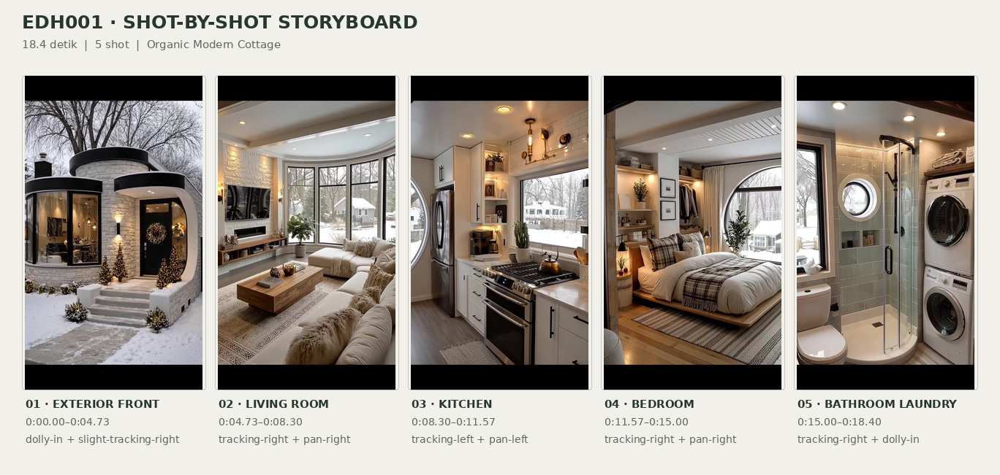
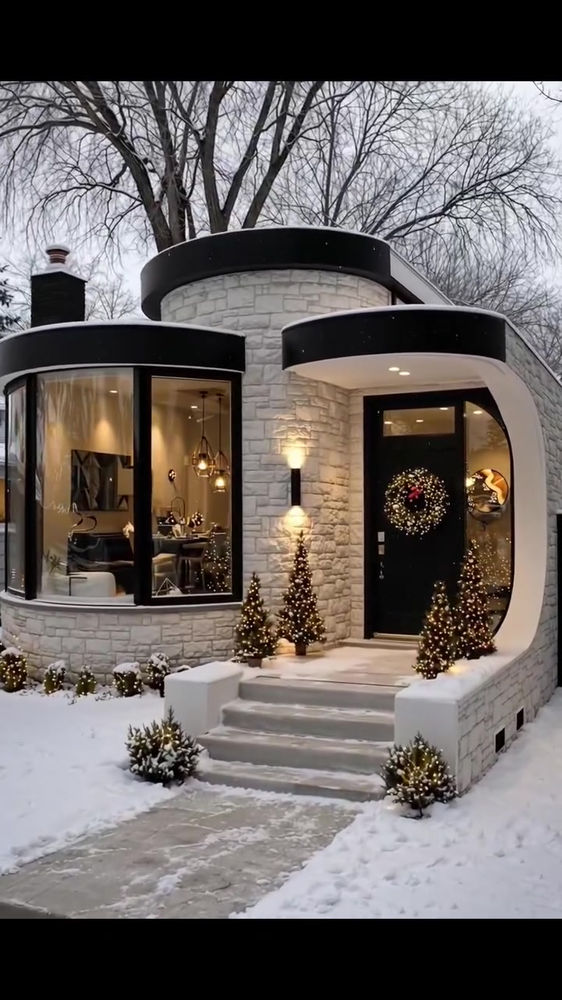
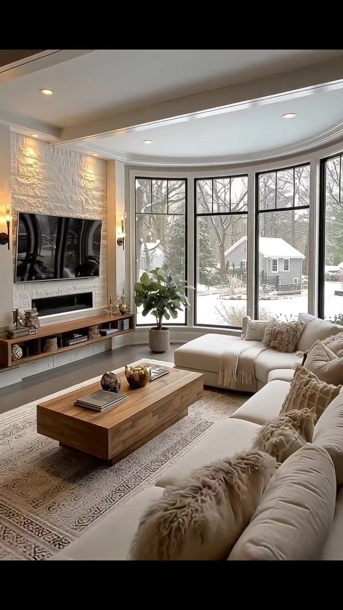
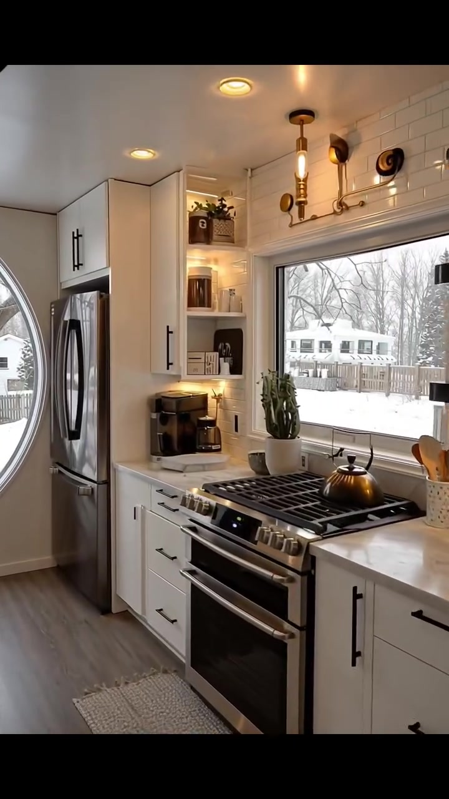
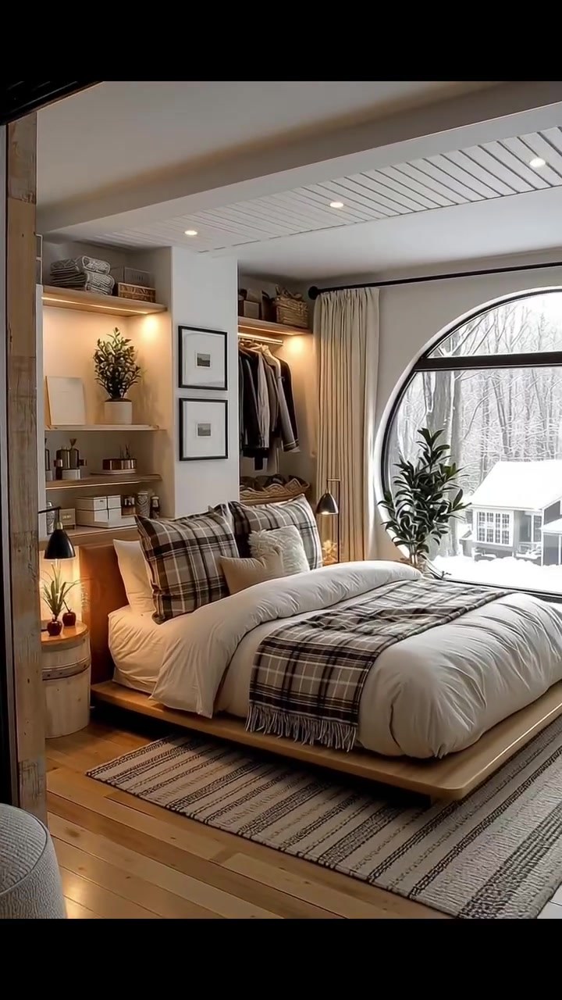
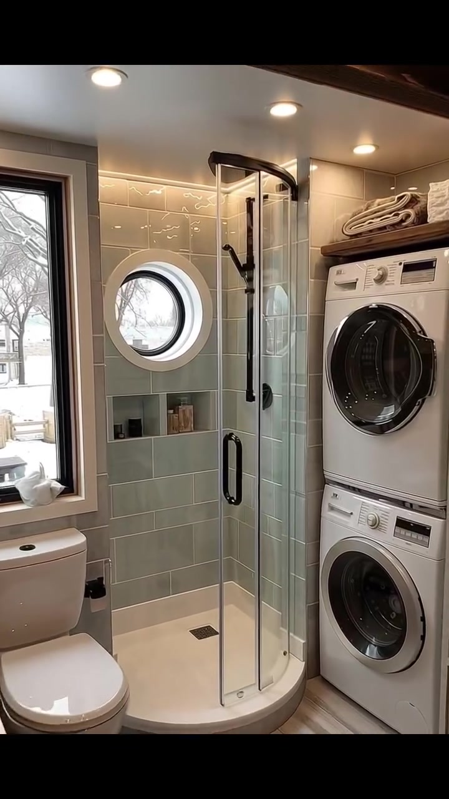

# VID-004 — Organic Modern Cottage

<!-- homeku_request_id: edh001-20261103-reviewed-001 -->

<!-- homeku_detail_narratives: chat-reviewed -->

**Sumber data:** [analysis.yaml](analysis.yaml) · **Status:** reviewed · **Diverifikasi manusia:** Tidak

## 1. Informasi Video

| Informasi | Nilai |
|---|---|
| ID | VID-004 |
| File asli | edh001.mp4 |
| Durasi | 18.4 |
| Resolusi | 720x1280 |
| FPS | 30 |
| Rasio | 9:16 |
| Jumlah shot | 5 |

## 2. Storyboard Gabungan

## 3. Identitas Desain

| Aspek | Hasil analisis |
|---|---|
| Gaya utama | organic modern cottage |
| Wilayah terkait gaya desain | north america, europe |
| Pengaruh gaya | contemporary scandinavian, modern farmhouse, cozy minimalist interior |
| Ciri eksterior | compact rounded white stone look facade, multiple cylindrical or curved front masses, smooth black curved roof fascia, black framed curved bay window, rounded entry canopy with warm downlights, black front door with festive wreath, short wide entry staircase, warm black wall sconces |
| Gaya interior | warm neutral color palette, curved black framed windows, white and cream walls, pale natural wood appearance finishes, soft cream textiles, black metal accents, warm recessed and accent lighting, compact built in storage |
| Confidence gaya | medium |

## 4. Ukuran & Proporsi Bangunan

| Aspek | Estimasi visual |
|---|---|
| Ukuran yang terlihat | small |
| Bentuk bangunan | compact curvilinear |
| Skala vertikal | single story with raised rounded roof form |
| Tapak bangunan | compact |
| Perkiraan luas lantai | 60–90 m² |
| Confidence | low |

> Luas adalah perkiraan visual, bukan ukuran terukur.

## 5. Warna, Pencahayaan, dan Atmosfer

| Warna dominan | HEX (perkiraan) |
|---|---|
| warm white stone | #E8E5DD |
| matte black | #232525 |
| cream beige | #D6CBBB |
| natural light wood | #B98F66 |
| sage green tile | #9CAFA6 |
| snow white | #E5E9E9 |

| Aspek | Hasil analisis |
|---|---|
| Pencahayaan | soft overcast daylight, warm exterior wall sconces, warm interior recessed ceiling lights, warm under shelf lighting, soft daylight from large windows |
| Lingkungan | snow covered residential yard, bare deciduous trees and some evergreens, nearby light colored houses, winter front garden with small conifers, paved front path bordered by snow, holiday decorations on front entry |
| Musim yang tampak | snowy winter appearance |
| Mood | cozy, warm, calm, festive winter, intimate modern cottage |

## 6. Struktur dan Timeline Video

**Jenis:** home tour · **Tempo:** moderate · **Transisi:** four hard cuts with slow intra shot camera motion

| Shot | Waktu (detik) | Durasi | Area/Scene | Gerakan Kamera |
|---|---|---|---|---|
| Shot 01 | 0.0–4.73 | 4.73 | exterior front | dolly in, slight tracking right |
| Shot 02 | 4.73–8.3 | 3.57 | living room | tracking right, pan right |
| Shot 03 | 8.3–11.57 | 3.27 | kitchen | tracking left, pan left |
| Shot 04 | 11.57–15.0 | 3.43 | bedroom | tracking right, pan right |
| Shot 05 | 15.0–18.4 | 3.40 | bathroom laundry | tracking right, dolly in |

## 7. Analisis per Shot

### Shot 01 — exterior front

**Waktu:** 0.0–4.73 detik

| Komponen | Pengamatan |
|---|---|
| Fokus utama | rounded front facade and black entry |
| Framing awal → akhir | wide exterior → medium wide front entry |
| Sudut pandang | eye level slightly from left |
| Gerakan kamera | dolly in, slight tracking right |
| Kecepatan kamera | slow |
| Pencahayaan | cool overcast daylight with warm wall sconces and canopy spotlights |
| Transisi keluar | hard cut |

**Detail yang terlihat**

**Arsitektur**

Fasad rumah tampil kompak dengan beberapa bidang dinding membulat dan susunan permukaan bertekstur menyerupai blok batu atau masonry berwarna putih keabu\-abuan. Di atasnya terdapat massa atap membulat yang lebih tinggi, dibatasi lis atap hitam lebar dan melengkung. Pintu masuk dinaungi kanopi melengkung bertepi hitam, dengan bagian bawah putih dan lampu tanam hangat. Sebelah kiri pintu terdapat jendela bay tinggi berbingkai logam hitam yang mengikuti lengkung dinding. Pintu hitam memiliki bidang kaca kecil di bagian atas, sementara anak tangga depan yang lebar diapit dinding pembatas rendah berwarna putih. Lampu dinding hitam dengan pancaran ke atas dan ke bawah menyala di dekat pintu. Di belakang sisi kiri atap terlihat cerobong berbentuk kotak berwarna gelap.

**Furnitur dan properti**

Pintu hitam dihiasi karangan daun melingkar dengan lampu kecil hangat dan aksen merah. Sejumlah pohon konifer berukuran kecil berbentuk kerucut dan semak hijau rendah di dekat tangga serta dasar fasad dibalut lampu hias kuning hangat. Melalui jendela bay tampak tirai berwarna krem dan beberapa lampu gantung yang menyala di dalam rumah.

**Lingkungan**

Hamparan salju putih tebal menutupi halaman depan dan area tanaman. Jalan setapak dari paving abu\-abu terlihat sebagian dibersihkan, dengan tumpukan salju di sisi jalur dan tepi tangga. Pohon gugur yang tinggi tumbuh di sebelah kiri rumah, dengan cabang\-cabang tanpa daun membentang di atas atap; semak hijau kecil di bawah fasad juga tersaput salju. Bagian atap rumah tetangga yang gelap tampak di sisi kiri. Langit terlihat pucat mendung di sela ranting, dan beberapa butiran salju kecil tampak turun di depan bagian atap berwarna hitam.

**Catatan pengamatan:** Kamera mendekati fasad dari sisi sedikit kiri dan bergeser perlahan ke kanan. Potongan lebih dekat memperlihatkan tekstur batu, wreath pada pintu hitam, lampu teras, deretan konifer kecil dan jejak salju di tepi jalan setapak.

**Confidence:** Kamera medium · Detail visual high

### Shot 02 — living room

**Waktu:** 4.73–8.3 detik

| Komponen | Pengamatan |
|---|---|
| Fokus utama | cream sectional seating and curved bay window |
| Framing awal → akhir | medium wide interior → wide interior showing sofa |
| Sudut pandang | eye level three quarter |
| Gerakan kamera | tracking right, pan right |
| Kecepatan kamera | slow |
| Pencahayaan | soft cool window daylight with warm recessed and sconce lighting |
| Transisi keluar | hard cut |

**Detail yang terlihat**

**Arsitektur**

Ruang tamu memiliki bidang dinding aksen putih bertekstur menyerupai batu di sisi kiri dan jendela bay panorama setinggi hampir seluruh dinding pada sisi lainnya. Jendela terdiri atas beberapa panel berbingkai hitam yang mengikuti lekukan dinding. Garis cekung plafon putih juga melengkung mengikuti bentuk jendela, dilengkapi lampu tanam bulat yang memancarkan cahaya hangat. Di dekat dinding aksen terdapat lampu dinding hitam berwarna cahaya hangat. Tepat di bawah area televisi terlihat bidang horizontal gelap yang menyerupai sisipan perapian linear, tetapi fungsinya belum dapat dipastikan. Lantai terlihat berpenampilan papan kayu berwarna abu\-abu terang.

**Furnitur dan properti**

Sofa sectional besar berlapis kain krem mengelilingi area duduk, dengan bagian chaise yang memanjang di dekat jendela. Sofa dihiasi bantal bertekstur krem dan taupe, bantal berbulu lembut serta selimut rajut. Di tengah area duduk ada meja kopi kayu alami yang rendah, tebal, dan berbentuk persegi panjang, ditempatkan di atas karpet bermotif rumit berwarna beige keabu\-abuan. Di atas meja terlihat buku serta ornamen kecil berkilau keemasan. Televisi layar datar hitam berukuran besar dipasang di dinding kiri, dengan rak media kayu panjang yang terbuka di bawahnya dan memuat buku serta pajangan kecil. Tanaman hijau berdaun lebar berada dalam pot abu\-abu tinggi di dekat jendela.

**Lingkungan**

Dari panel\-panel jendela besar terlihat halaman tertutup salju, batang serta cabang pepohonan gugur yang tidak berdaun, dan sebuah pohon cemara hijau gelap. Lebih jauh terdapat rumah tetangga berwarna terang yang tampak bertingkat di seberang halaman bersalju. Langit di belakang atap rumah tampak pucat dan mendung.

**Catatan pengamatan:** Kamera bergerak ke kanan sehingga sofa krem dengan chaise, meja kopi kayu dan jendela panorama melengkung semakin memenuhi frame. Bidang gelap di bawah TV tampak menyerupai sisipan perapian linear; fungsi sebenarnya belum pasti.

**Confidence:** Kamera medium · Detail visual high

### Shot 03 — kitchen

**Waktu:** 8.3–11.57 detik

| Komponen | Pengamatan |
|---|---|
| Fokus utama | cooking range large window and tall refrigerator |
| Framing awal → akhir | wide single wall kitchen → medium kitchen refrigerator and counter |
| Sudut pandang | eye level three quarter |
| Gerakan kamera | tracking left, pan left |
| Kecepatan kamera | slow |
| Pencahayaan | soft cool winter daylight mixed with warm recessed pendant and under shelf lights |
| Transisi keluar | hard cut |

**Detail yang terlihat**

**Arsitektur**

Dapur tersusun kompak mengikuti satu sisi dinding, dengan kabinet dan laci putih berpanel sederhana serta pegangan panjang berwarna hitam. Dinding belakang meja kerja menggunakan ubin putih persegi panjang berpola susunan bata horizontal, sedangkan countertop berwarna putih dengan corak abu\-abu menyerupai marmer. Kabinet tinggi mengapit area kulkas, sementara rak ceruk terbuka putih berada di sisi jendela. Di sisi kanan dapur terdapat rak dinding melayang berwarna gelap. Jendela utama berbentuk persegi panjang dengan trim putih dan bagian bingkai gelap, sedangkan di sisi kiri kulkas tampak jendela besar dengan tepian melengkung. Penerangan terdiri atas lampu plafon tanam, lampu pada rak dan ceruk, serta satu lampu vertikal bernuansa kuningan di atas jendela. Lantai terlihat berpenampilan papan kayu abu\-abu kecokelatan.

**Furnitur dan properti**

Kompor gas berukuran besar dengan kisi hitam dan oven berbahan tampak stainless steel berada tepat di bawah jendela utama. Di atas kompor terdapat teko logam gelap. Kulkas stainless steel berpintu ganda ditempatkan di sisi kiri area memasak, dan mesin kopi hitam berada pada countertop di sebelahnya, ditemani nampan putih. Di dekat jendela ada kaktus kecil dalam pot putih. Pada sisi kanan kompor terlihat wadah putih berisi sendok dan spatula kayu, serta talenan kayu yang disandarkan ke backsplash. Rak terbuka memuat tumpukan piring putih, tanaman hijau menjuntai, dan beberapa stoples penyimpanan. Karpet lorong kecil bertekstur beige terletak di depan kompor.

**Lingkungan**

Jendela dapur memperlihatkan halaman yang tertutup salju, batang dan ranting pohon tanpa daun yang cukup dekat dengan rumah, serta pagar kayu yang membentang di bagian belakang. Di luar pagar terlihat beberapa rumah terang dan pepohonan cemara hijau gelap. Pemandangan lingkungan bersalju juga tampak melalui jendela melengkung di sisi kulkas.

**Catatan pengamatan:** Pandangan dapur berubah dari kompor serta rak terbuka di kanan menuju kulkas dan sudut mesin kopi di kiri. Arah pergeseran objek mendukung pan/tracking ke kiri, bukan tracking ke kanan seperti analisis lama; klasifikasi gerak tetap perkiraan.

**Confidence:** Kamera medium · Detail visual high

### Shot 04 — bedroom

**Waktu:** 11.57–15.0 detik

| Komponen | Pengamatan |
|---|---|
| Fokus utama | low platform bed and large arched window |
| Framing awal → akhir | medium wide view from doorway → wide bedroom with arch window |
| Sudut pandang | eye level from doorway |
| Gerakan kamera | tracking right, pan right |
| Kecepatan kamera | slow |
| Pencahayaan | cool diffused window light with warm bedside and built in shelf lighting |
| Transisi keluar | hard cut |

**Detail yang terlihat**

**Arsitektur**

Kamar tidur menggunakan dinding putih halus dan bidang headboard beraksen kayu hangat. Sebagian plafon di atas ranjang diberi panel garis\-garis putih dengan beberapa lampu tanam kecil. Lantai tersusun dari papan berpenampilan kayu bernuansa madu terang. Tiang\-tiang kayu tegak tampak membingkai bukaan kamar dari sisi pintu. Pada dinding kanan terdapat jendela besar berbingkai hitam dengan bagian atas melengkung. Di sebelah kiri ranjang dibangun rak terbuka berwarna putih dengan lampu hangat tersembunyi di bawah ambalan, bersebelahan dengan ceruk lemari gantung terbuka. Ranjang sendiri berdiri rendah pada rangka platform kayu terang.

**Furnitur dan properti**

Ranjang platform besar ditata dengan duvet tebal warna krem dan bantal putih, ditambah bantal motif kotak\-kotak cokelat, hitam, dan krem serta bantal kecil beige. Selimut motif kotak\-kotak cokelat keabu\-abuan membentang di bagian kaki ranjang. Karpet panjang bermotif garis\-garis sempit warna beige dan cokelat sebagian berada di bawah ranjang. Di samping kiri ada meja kecil berbentuk silinder menyerupai batang kayu, memuat lampu baca hitam dan tanaman mungil. Rak bagian atas menyimpan handuk atau tekstil terlipat serta keranjang anyaman; pada lemari terbuka tergantung pakaian berwarna netral. Dua karya seni kecil berbingkai hitam tersusun vertikal pada dinding. Tirai krem panjang serta tanaman hijau tinggi dalam pot mengapit jendela melengkung, dan sebuah lampu samping ranjang lain memancarkan cahaya hangat dari sisi seberang.

**Lingkungan**

Melalui jendela melengkung terlihat tanah dan atap bangunan yang diselimuti salju. Ranting\-ranting pohon tanpa daun membentang di luar, sementara sebuah rumah tetangga berwarna terang dengan atap miring berada di seberang jendela.

**Catatan pengamatan:** Awalnya kamera melihat ranjang dari arah pintu; pergerakan ke kanan membuka lebih banyak jendela besar melengkung, lantai kayu terang, karpet, lemari terbuka, dan tirai. Tekstur plaid tampak jelas pada bantal serta selimut.

**Confidence:** Kamera medium · Detail visual high

### Shot 05 — bathroom laundry

**Waktu:** 15.0–18.4 detik

| Komponen | Pengamatan |
|---|---|
| Fokus utama | sage tile curved glass shower and stacked laundry |
| Framing awal → akhir | wide bathroom including vanity toilet shower and laundry → medium tight shower and stacked laundry |
| Sudut pandang | eye level three quarter |
| Gerakan kamera | tracking right, dolly in |
| Kecepatan kamera | slow |
| Pencahayaan | cool window daylight with warm recessed ceiling spotlights |
| Transisi keluar | end of video |

**Detail yang terlihat**

**Arsitektur**

Area kamar mandi dan laundry memiliki dinding shower yang dilapisi ubin persegi panjang hijau sage dengan permukaan mengilap. Bilik shower berbentuk melengkung dan dibatasi panel kaca bening dengan pegangan logam hitam, berdiri di atas dasar shower putih membulat dengan saluran air berbentuk kotak kecil. Pada dinding keramik terdapat jendela bundar menyerupai porthole berbingkai putih, serta ceruk penyimpanan mendatar tepat di bawahnya. Di sebelah kiri toilet ada jendela tinggi persegi panjang berbingkai gelap. Sebagian plafon memperlihatkan panel kayu cokelat gelap beralur, sedangkan bidang plafon putih dilengkapi lampu tanam hangat. Lantai berpenampilan papan kayu abu\-abu pucat. Wastafel countertop krem muda berbentuk persegi panjang tampak sebagian di sisi kiri depan, sedangkan ceruk vertikal di sisi kanan menampung perangkat laundry bertumpuk.

**Furnitur dan properti**

Toilet putih ditempatkan di bawah jendela persegi panjang, dekat vanity krem dengan keran hitam. Di dalam shower terlihat rel hitam vertikal dan perlengkapan shower genggam. Mesin pengering dan mesin cuci putih tipe bukaan depan ditumpuk secara vertikal dalam satu ceruk, masing\-masing dengan pintu kaca bundar gelap yang besar. Di atas perangkat laundry terdapat rak kayu gelap berisi handuk putih dan kain netral terlipat. Ceruk pada dinding shower menyimpan botol kecil berwarna gelap serta beberapa wadah produk berwarna cokelat muda, sementara benda dekorasi putih kecil terlihat di ambang jendela persegi panjang.

**Lingkungan**

Dari jendela persegi panjang terlihat tanah permukiman yang bersalju, batang dan cabang pohon tanpa daun, serta bagian rumah terang dan pagar di seberangnya. Ranting tanpa daun juga terlihat melalui jendela bundar pada dinding shower.

**Catatan pengamatan:** Kamera perlahan mendekat dan bergeser ke kanan dari vanity dan toilet menuju bilik shower melengkung, jendela bundar, niche penyimpanan, dan mesin cuci-pengering bertumpuk. Keramik tampak hijau sage berpermukaan mengilap.

**Confidence:** Kamera medium · Detail visual high

## 8. Kualitas dan Ketidakpastian Analisis

| Parameter | Hasil |
|---|---|
| Status | reviewed |
| Verifikasi manusia | Tidak |
| Ketepatan timestamp | frame confirmed for cuts keyframes estimated |
| Ketidakpastian | Primary architectural style is a visual interpretation, not an official design or geographic identification., Curved exterior wall finish looks like pale textured stone or masonry; precise construction material is unknown., Estimated building floor area 60-90 m2 is a broad visual estimate without measured scale., The raised rounded roof masses do not establish an upper floor or loft., Dark rectangular unit beneath the living-room television looks like a linear fireplace insert; functionality is unverified., Camera tracking versus panning is estimated from apparent perspective shift, not capture metadata., The first kitchen camera move is interpreted as leftward panning/tracking, differing from the older VID-004 rightward label., Pale kitchen and bathroom surfaces are described by appearance rather than verified wood, stone or tile product types., North America and Europe are stylistic associations only, not the location of the house., Interior continuity and exact room dimensions cannot be confirmed from independently edited shots. |

**Catatan:** Re-analysis of the same edh001.mp4 source for existing VID-004 using Homeku v1.3. Updated 126 technical visible-detail labels and Indonesian per-shot narratives. The 5-shot 18.40 s timeline and original video identity are preserved. Git source blob: ba844313b645b154566a08a56ba500295ed4f021. Human verification of visual facts is not claimed; material, style, scale, and camera uncertainties remain estimations.

---

*Laporan ini diturunkan dari [analysis.yaml](analysis.yaml).*
