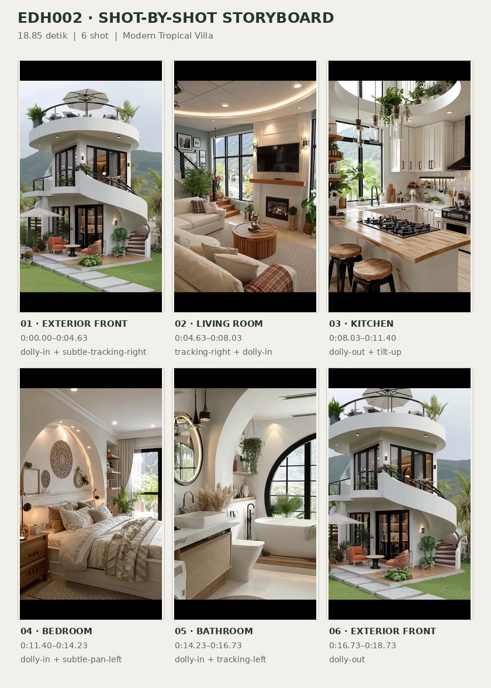
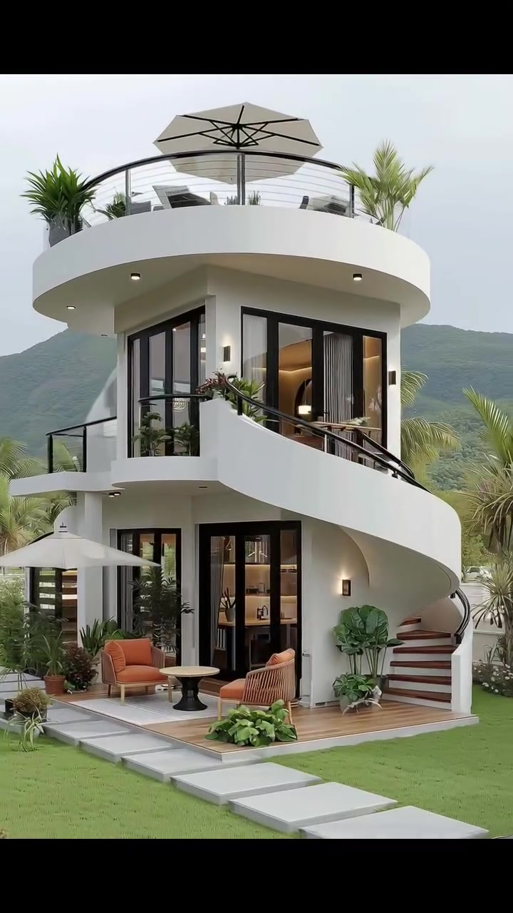
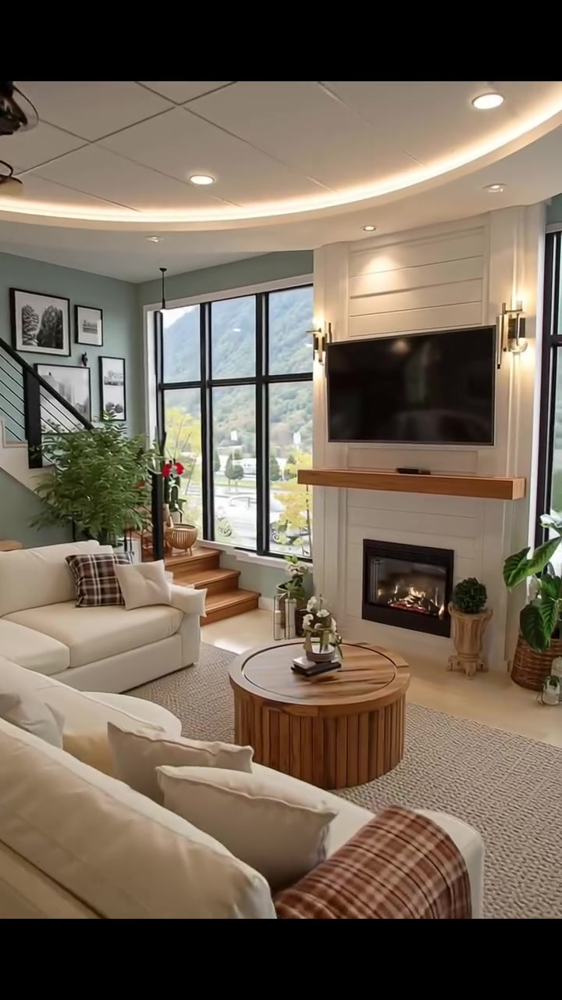
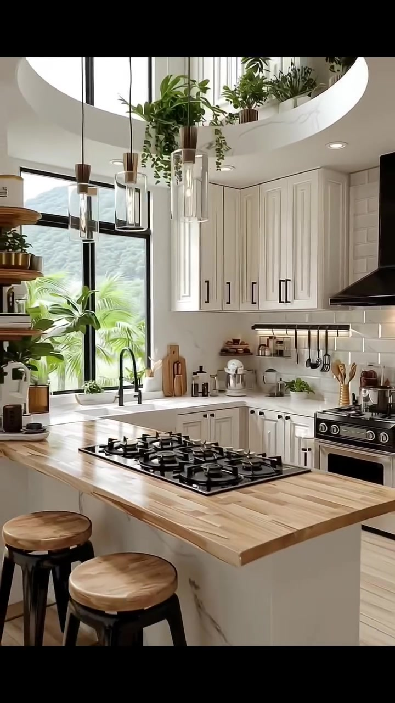
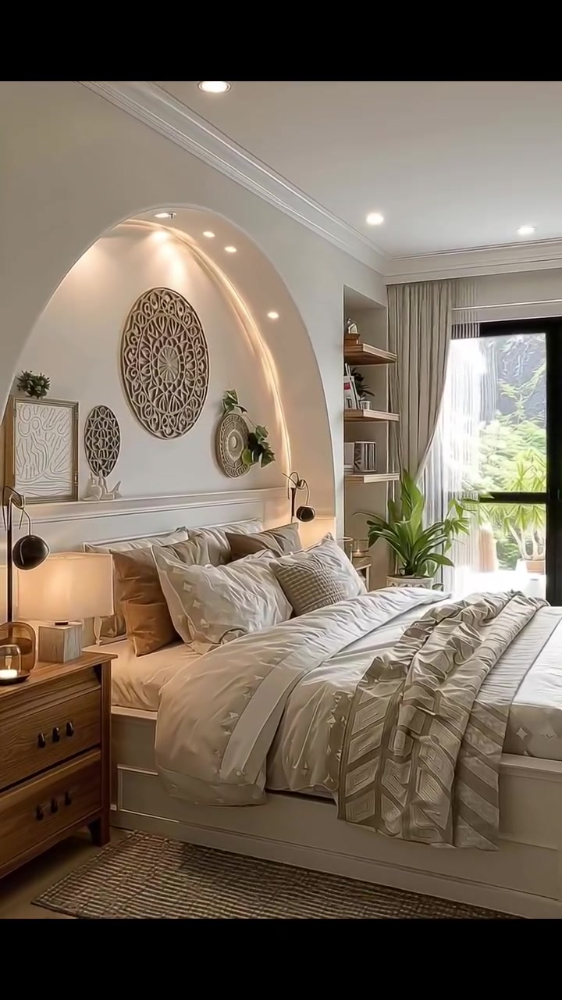
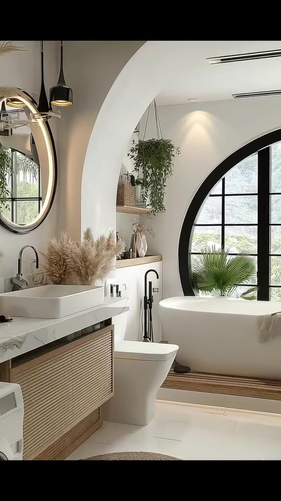
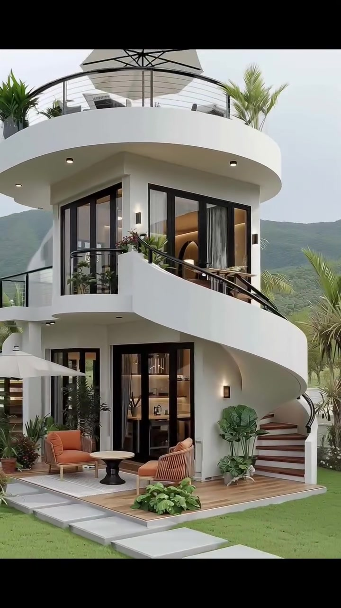

# VID-005 — Modern Tropical Villa

<!-- homeku_request_id: edh002-20261103-reviewed-001 -->

<!-- homeku_detail_narratives: chat-reviewed -->

**Sumber data:** [analysis.yaml](analysis.yaml) · **Status:** draft · **Diverifikasi manusia:** Tidak

## 1. Informasi Video

| Informasi | Nilai |
|---|---|
| ID | VID-005 |
| File asli | edh002.mp4 |
| Durasi | 18.85 |
| Resolusi | 720x1280 |
| FPS | 30 |
| Rasio | 9:16 |
| Jumlah shot | 6 |

## 2. Storyboard Gabungan

## 3. Identitas Desain

| Aspek | Hasil analisis |
|---|---|
| Gaya utama | modern tropical villa |
| Wilayah terkait gaya desain | asia, oceania |
| Pengaruh gaya | organic modern, contemporary resort, soft minimalism |
| Ciri eksterior | rounded white plaster appearance facade, curved wraparound second floor balcony, curved exterior staircase with wood tone treads, rooftop terrace with transparent guardrail, tall black framed glazing, warm exterior wall sconces, ground level wood tone patio |
| Gaya interior | organic modern, warm contemporary, natural wood accents, curved architectural details, indoor tropical greenery |
| Confidence gaya | high |

## 4. Ukuran & Proporsi Bangunan

| Aspek | Estimasi visual |
|---|---|
| Ukuran yang terlihat | medium |
| Bentuk bangunan | compact curvilinear |
| Skala vertikal | two stories with rooftop terrace |
| Tapak bangunan | compact |
| Perkiraan luas lantai | 90–150 m² |
| Confidence | low |

> Luas adalah perkiraan visual, bukan ukuran terukur.

## 5. Warna, Pencahayaan, dan Atmosfer

| Warna dominan | HEX (perkiraan) |
|---|---|
| warm white | #F1EEE7 |
| natural wood | #B18B64 |
| matte black | #292B2B |
| soft beige | #D9CCB8 |
| leafy green | #66805A |
| terracotta orange | #BE7955 |
| muted sage | #A3ADA0 |

| Aspek | Hasil analisis |
|---|---|
| Pencahayaan | soft diffused daylight, warm recessed ceiling lighting, warm wall sconces, interior cove and accent lighting |
| Lingkungan | tropical landscaped garden, palm trees around house, green hills in background, trimmed front lawn and stepping stones |
| Musim yang tampak | green tropical vegetation no specific season confirmed |
| Mood | calm, airy, warm, refined, resort like |

## 6. Struktur dan Timeline Video

**Jenis:** residential architecture tour · **Tempo:** slow · **Transisi:** five hard cuts between six shots

| Shot | Waktu (detik) | Durasi | Area/Scene | Gerakan Kamera |
|---|---|---|---|---|
| Shot 01 | 0.0–4.63 | 4.63 | exterior front | dolly in, subtle tracking right |
| Shot 02 | 4.63–8.03 | 3.40 | living room | tracking right, dolly in |
| Shot 03 | 8.03–11.4 | 3.37 | kitchen | dolly out, tilt up |
| Shot 04 | 11.4–14.23 | 2.83 | bedroom | dolly in, subtle pan left |
| Shot 05 | 14.23–16.73 | 2.50 | bathroom | dolly in, tracking left |
| Shot 06 | 16.73–18.73 | 2.00 | exterior front | dolly out |

## 7. Analisis per Shot

### Shot 01 — exterior front

**Waktu:** 0.0–4.63 detik

| Komponen | Pengamatan |
|---|---|
| Fokus utama | white curved two story villa with rooftop terrace |
| Framing awal → akhir | wide front three quarter view → close front right three quarter view |
| Sudut pandang | eye level slightly upward |
| Gerakan kamera | dolly in, subtle tracking right |
| Kecepatan kamera | slow |
| Pencahayaan | diffused cloudy daylight with warm exterior sconces |
| Transisi keluar | hard cut |

**Detail yang terlihat**

**Arsitektur**

Rumah kompak dua lantai ini menampilkan massa melengkung dengan dinding luar putih berpenampilan plester halus. Di puncak terdapat teras atap bundar dengan parapet putih, pagar kaca berangka logam gelap yang mengikuti lengkung tepi, serta payung besar berwarna abu\-abu. Balkon lantai atas melengkung mengitari bagian depan hingga sisi kanan, dilengkapi railing logam hitam; kedua lantai memiliki pintu kaca tinggi dengan kusen hitam. Tangga luar mengikuti lengkungan fasad kanan, dengan anak tangga bernuansa kayu dan dinding pembatas putih. Lampu dinding berpendar hangat dan lampu bulat kecil di bawah tepi teras terlihat, sementara lantai teras bawah berpenampilan dek kayu.

**Furnitur dan properti**

Di teras bawah ada dua kursi santai berbantalan jingga, dengan meja kecil bundar berkaki hitam di antaranya dan alas duduk atau karpet luar berwarna terang di bawahnya. Payung kain berwarna terang tampak di sebelah kiri rumah. Pot berisi tanaman tropis ditempatkan dekat pintu dan kaki tangga, sedangkan kotak tanaman berbunga berada di railing balkon lantai atas. Di balik pagar teras atap, sebagian furnitur duduk luar ruangan juga terlihat.

**Lingkungan**

Di depan rumah terbentang rumput hijau berbentuk bidang persegi panjang. Pijakan lebar berbentuk kotak berwarna abu\-abu muda mengarah menuju teras. Pohon palem tinggi tumbuh di sekitar dan belakang bangunan; semak tropis berdaun runcing membingkai sisi rumah dan tanaman berbunga putih rendah tampak dekat tangga. Punggung perbukitan atau pegunungan hijau berada di kejauhan, dengan langit pucat berawan di atas atap.

**Catatan pengamatan:** Kamera mendekat perlahan dan sedikit menggeser komposisi ke sisi kanan; lapisan atap, balkon, teras, dan tangga menjadi semakin jelas.

**Confidence:** Kamera medium · Detail visual high

### Shot 02 — living room

**Waktu:** 4.63–8.03 detik

| Komponen | Pengamatan |
|---|---|
| Fokus utama | fireplace tv feature wall and cream seating area |
| Framing awal → akhir | wide room view from seating area → medium close fireplace and window view |
| Sudut pandang | eye level slightly upward |
| Gerakan kamera | tracking right, dolly in |
| Kecepatan kamera | slow |
| Pencahayaan | soft daylight from tall window with warm cove sconces and downlights |
| Transisi keluar | hard cut |

**Detail yang terlihat**

**Arsitektur**

Ruang keluarga memiliki plafon putih melengkung dengan pencahayaan cove hangat, panel\-panel plafon, beberapa downlight kecil, dan kipas angin langit\-langit berwarna hitam di sisi kiri. Dinding utama fireplace dilapisi panel horizontal putih, menempatkan televisi layar datar hitam berukuran besar di atas perapian persegi panjang berkaca hitam; keduanya dipisahkan mantel kayu tebal bernuansa hangat. Jendela tinggi berbingkai hitam dengan pembagian beberapa panel berada di kiri fireplace. Pada bagian kiri belakang, tangga dengan anak tangga terang dan pagar logam hitam berdiri di depan dinding hijau sage lembut, sementara beberapa anak tangga kayu pendek berada di samping jendela.

**Furnitur dan properti**

Dua sofa berlapis kain krem membentuk area duduk yang menghadap fireplace, satu terlihat dekat kamera dan satu lagi di sisi kiri. Sandaran sofa dekat kamera diberi selimut motif kotak\-kotak cokelat krem; bantal sofa lainnya memadukan motif kotak\-kotak dan warna krem polos. Meja kopi bundar berstruktur kayu beralur ditempatkan di atas karpet anyaman krem, dengan rangkaian bunga putih di atasnya. Sepasang lampu dinding logam bernuansa hangat berada di sisi televisi, beberapa gambar dalam bingkai hitam kecil menghiasi dinding dekat tangga, dan beberapa tanaman pot hijau serta tanaman topiary kecil menempati area jendela dan fireplace. Satu lampu gantung hitam juga terlihat dekat tangga.

**Lingkungan**

Melalui jendela besar tampak perbukitan hijau dan sebatang pohon berdaun kuning di bagian bawah pemandangan. Beberapa kendaraan berwarna terang terlihat terparkir di area luar yang lebih rendah.

**Catatan pengamatan:** Pergerakan ke kanan membuat dinding TV dan fireplace mendominasi; anak tangga dan galeri foto di kiri perlahan keluar dari bingkai.

**Confidence:** Kamera medium · Detail visual high

### Shot 03 — kitchen

**Waktu:** 8.03–11.4 detik

| Komponen | Pengamatan |
|---|---|
| Fokus utama | wood countertop kitchen island and circular ceiling opening |
| Framing awal → akhir | medium close island and cooking area → wider kitchen view including ceiling void |
| Sudut pandang | eye level to slightly upward |
| Gerakan kamera | dolly out, tilt up |
| Kecepatan kamera | slow |
| Pencahayaan | bright daylight from window with warm pendant and task lights |
| Transisi keluar | hard cut |

**Detail yang terlihat**

**Arsitektur**

Dapur menggunakan kabinet model shaker berwarna putih krem dengan gagang panjang hitam, backsplash ubin persegi panjang putih mengilap, serta countertop berpenampilan marmer putih yang mengikuti meja dapur berbentuk L. Island besar di depan memiliki permukaan kayu terang bergaris\-garis dan badan putih dengan corak urat abu\-abu samar; kompor gas hitam dengan beberapa tungku tertanam di atasnya. Area memasak belakang dilengkapi cooker hood logam gelap dan oven range berwarna stainless steel\-hitam di sisi kanan. Jendela besar berkusen logam hitam berada di atas area bak cuci sudut, dengan keran leher angsa hitam. Di atas dapur terdapat bukaan plafon melingkar dan tepian balkon lantai atas putih yang membulat, beberapa downlight, serta rak sudut kayu terbuka dekat jendela.

**Furnitur dan properti**

Dua bangku bar dengan dudukan kayu bundar dan rangka logam hitam ditempatkan di tepi island. Pada countertop belakang tampak mixer berdiri berwarna perak, panci logam di atas kompor, rel perkakas hitam dengan spatula dan sendok masak tergantung, papan potong dan wadah sendok kayu, serta stoples dan wadah kecil di depan backsplash. Pot tanaman hijau kecil menghiasi meja dan rak, sedangkan sulur tanaman hijau panjang menjuntai dari area lantai atas. Beberapa lampu gantung berbentuk silinder kaca dengan aksen kayu gelap turun di atas dapur.

**Lingkungan**

Dari jendela dapur terlihat pelepah palem dan perbukitan hijau jauh di belakangnya. Cahaya siang yang lembut masuk melalui kaca berbingkai hitam.

**Catatan pengamatan:** Sudut melebar sambil mengarah ke atas, sehingga lingkar bukaan lantai atas, tanaman gantung, dan lampu silinder menjadi terlihat.

**Confidence:** Kamera medium · Detail visual high

### Shot 04 — bedroom

**Waktu:** 11.4–14.23 detik

| Komponen | Pengamatan |
|---|---|
| Fokus utama | neutral bed beneath curved illuminated feature arch |
| Framing awal → akhir | wide view toward bed and window → medium close bed and feature arch |
| Sudut pandang | eye level |
| Gerakan kamera | dolly in, subtle pan left |
| Kecepatan kamera | slow |
| Pencahayaan | soft daylight with warm arch led recessed spotlights and bedside lamp |
| Transisi keluar | hard cut |

**Detail yang terlihat**

**Arsitektur**

Kamar tidur memiliki dinding putih hangat dengan lis mahkota putih, plafon datar cukup tinggi dan beberapa downlight tanam. Pada dinding kepala tempat tidur terdapat ceruk dekoratif melengkung besar dengan strip LED hangat mengikuti kontur serta titik\-titik lampu kecil di dalam lengkungannya. Bagian dinding di bawah lengkungan memakai panel putih timbul. Jendela tinggi berkosen hitam terletak di ujung ruangan; lantainya berpenampilan papan kayu terang, dan rak kayu terbuka built\-in berada di sisi kanan tempat tidur.

**Furnitur dan properti**

Ranjang platform besar berwarna putih berada tepat di bawah lengkungan, ditata dengan duvet putih, kain runner bermotif krem yang terlipat, dan beberapa lapis bantal putih serta cokelat muda. Di kiri ranjang ada nakas kayu dua laci dengan lampu meja yang menyala hangat; sebuah lampu baca hitam terpasang pada dinding di dekat headboard. Dekorasi utama pada ceruk berupa ukiran bundar besar bermotif mandala dengan dua piringan hias bundar lebih kecil di kiri dan kanan, ditambah sebuah gambar berbingkai bernuansa netral yang disandarkan pada dinding. Karpet anyaman krem bermotif geometris sebagian berada di bawah ranjang. Beberapa tanaman pot diletakkan dekat jendela dan pada rak terbuka yang juga memuat buku. Tirai panjang krem muda dan tirai tipis putih membingkai jendela.

**Lingkungan**

Pelepah palem hijau tampak melalui jendela ujung kamar. Cahaya siang terang tetapi lembut masuk melalui tirai tipisnya.

**Catatan pengamatan:** Kamera mendekati ranjang, menonjolkan panel lengkung berlampu dan dekorasi bundar; area jendela semakin terpotong di kanan.

**Confidence:** Kamera medium · Detail visual high

### Shot 05 — bathroom

**Waktu:** 14.23–16.73 detik

| Komponen | Pengamatan |
|---|---|
| Fokus utama | illuminated round vanity mirror and sweeping white arch |
| Framing awal → akhir | wide bathroom vanity and tub view → medium close vanity arch and toilet view |
| Sudut pandang | eye level |
| Gerakan kamera | dolly in, tracking left |
| Kecepatan kamera | slow |
| Pencahayaan | bright diffused window daylight with warm mirror and pendant lighting |
| Transisi keluar | hard cut |

**Detail yang terlihat**

**Arsitektur**

Kamar mandi didominasi lengkungan dinding putih besar yang memisahkan area wastafel dan bathtub, serta jendela besar berbentuk setengah lingkaran dengan kusen hitam di belakang bathtub. Lantai memakai ubin putih mengilap. Vanity memiliki countertop putih bercorak urat abu\-abu seperti marmer, kabinet berpola bilah kayu hangat, wastafel vessel putih berbentuk persegi panjang, dan keran tinggi hitam. Cermin bundar berbingkai gelap di atas wastafel memiliki cahaya belakang hangat. Bathtub putih berbentuk oval berdiri di atas platform bernuansa kayu, ditemani pengisi air bathtub hitam yang berdiri dari lantai. Rak ceruk kecil dengan permukaan kayu, balok plafon horizontal bernuansa kayu, beberapa spotlight tanam dan ventilasi linear juga tampak. Toilet putih berbentuk satu kesatuan berada di antara vanity dan bathtub.

**Furnitur dan properti**

Mesin cuci putih dengan bukaan depan muncul di bawah ujung kiri meja. Sebuah keset bundar anyaman krem berada di lantai, sementara dua lampu gantung kecil berwarna gelap menggantung dekat cermin. Di samping wastafel ada rangkaian rerumputan kering besar bernuansa krem. Tanaman hijau menggantung di area dekat bathtub, dan rak memuat keranjang anyaman kecil serta vas putih. Handuk abu\-abu kecokelatan dilipat menyampir pada tepi bathtub; dekat wastafel terdapat dispenser dan baki kecil, sedangkan tanaman hijau lain tampak pada ujung kanan bathtub.

**Lingkungan**

Melalui jendela melengkung terlihat vegetasi hijau tropis dengan bentuk dedaunan yang lembut. Cahaya siang terdifusi masuk melalui bukaan kaca besar tersebut.

**Catatan pengamatan:** Kamera bergerak ke kiri sambil mendekat; wastafel dan cermin makin besar sedangkan bathtub bergeser ke tepi kanan.

**Confidence:** Kamera medium · Detail visual high

### Shot 06 — exterior front

**Waktu:** 16.73–18.73 detik

| Komponen | Pengamatan |
|---|---|
| Fokus utama | white curved villa with outdoor stairs patio and rooftop umbrella |
| Framing awal → akhir | medium close front right house view → wider front right house view |
| Sudut pandang | eye level slightly upward |
| Gerakan kamera | dolly out |
| Kecepatan kamera | slow |
| Pencahayaan | soft cloudy daylight with warm exterior sconces |
| Transisi keluar | end of video |

**Detail yang terlihat**

**Arsitektur**

Tampilan penutup kembali memperlihatkan rumah tropis dua lantai berwarna putih dengan fasad melengkung dari arah depan kanan. Teras atap bundar memiliki pagar kaca dengan rangka logam hitam dan payung terbuka abu\-abu di tengahnya. Balkon lantai kedua berwarna putih melengkung ke depan, dilengkapi handrail logam hitam di atas parapet. Pintu kaca tinggi berbingkai hitam berada di lantai bawah, sedangkan sudut lantai atas menggunakan kaca berkusen hitam. Di sisi kanan terlihat tangga luar melengkung dengan anak tangga bernuansa kayu. Lampu dinding persegi panjang menyala hangat di dekat tangga dan jendela, beberapa lampu kecil tertanam di bawah tepi atap, dan teras bawah berlantai papan bernuansa kayu terang.

**Furnitur dan properti**

Dua kursi santai jingga terakota diarahkan ke meja bundar kecil berkaki hitam, di atas karpet luar bernuansa netral terang. Di kaki tangga terdapat pot tanaman hijau berdaun besar terbelah, dengan kelompok pot tanaman dan semak rendah di tepi teras. Payung taman putih gading terbuka terlihat di kiri rumah, sedangkan tanaman berbunga kecil menghiasi tepi balkon atas.

**Lingkungan**

Hamparan rumput hijau terawat memenuhi bagian depan, dipotong jalur pijakan batu persegi panjang berwarna terang. Beberapa palem tinggi tampak di belakang dan sisi kanan rumah. Punggung bukit hijau lembut berada di belakang atap, dengan langit abu\-abu terang berawan. Tembok batas rendah berwarna putih dan tanaman di sepanjang tepinya terlihat di sekitar halaman.

**Catatan pengamatan:** Shot penutup mengulang eksterior dari jarak lebih dekat lalu mundur perlahan, membuka kembali taman, jalur pijakan, dan komposisi penuh rumah.

**Confidence:** Kamera high · Detail visual high

## 8. Kualitas dan Ketidakpastian Analisis

| Parameter | Hasil |
|---|---|
| Status | draft |
| Verifikasi manusia | Tidak |
| Ketepatan timestamp | estimated |
| Ketidakpastian | Gerakan kamera disimpulkan dari perubahan framing; tidak tersedia metadata lintasan kamera asli., Material dinding, kayu, batu, dan marmer diklasifikasi berdasarkan penampilan visual, bukan uji material., Perkiraan luas bangunan dan skala tapak tidak bersumber dari gambar kerja atau ukuran terukur., Kawasan gaya arsitektur adalah asosiasi desain dan bukan lokasi aktual rumah., Musim dan spesies tanaman tidak bisa dipastikan dari video., Durasi kontainer 18,85 detik mencakup ekor audio; frame gambar berakhir sekitar 18,73 detik. |

**Catatan:** Enam shot visual teridentifikasi melalui lima perubahan adegan pada frame 139, 241, 342, 427, dan 502 dari video 30 fps. Analisis hanya visual; belum disetujui pengguna dan belum disimpan ke GitHub.

---

*Laporan ini diturunkan dari [analysis.yaml](analysis.yaml).*
