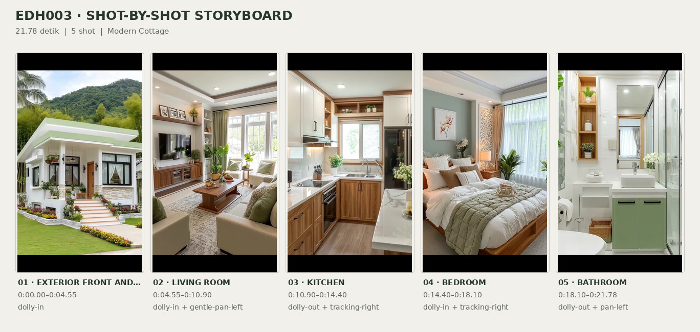
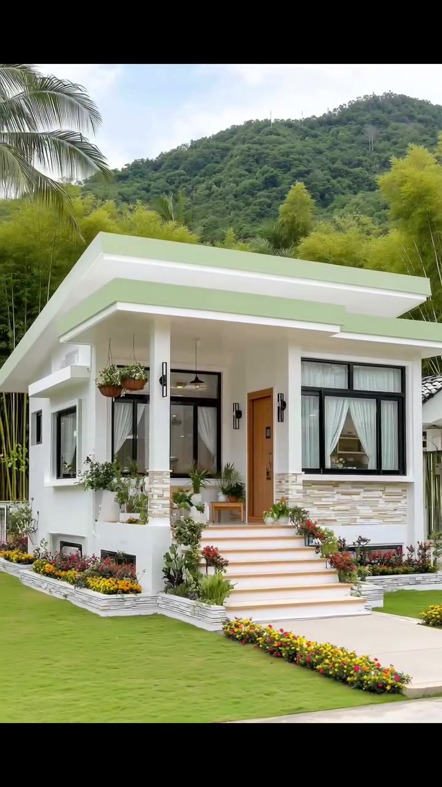
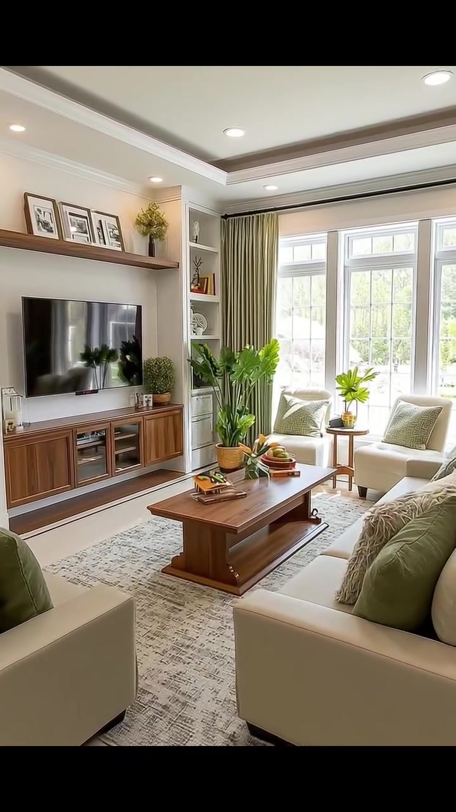
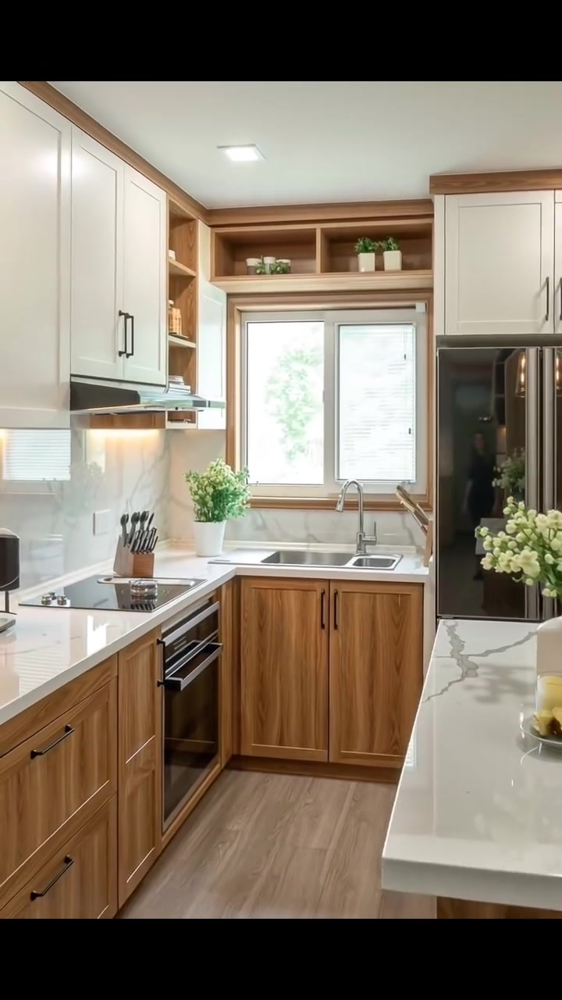
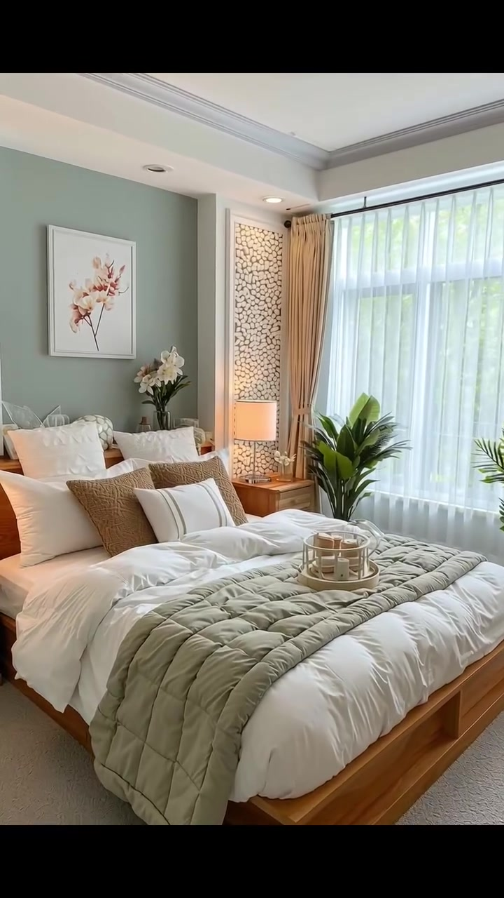
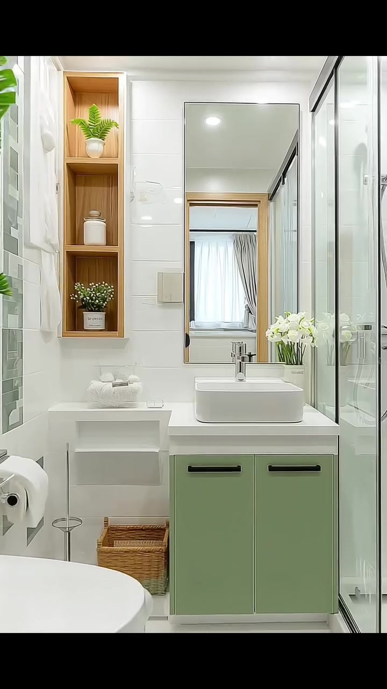

# VID-006 — Modern Cottage

<!-- homeku_request_id: edh003-20261103-reviewed-001 -->

<!-- homeku_detail_narratives: chat-reviewed -->

**Sumber data:** [analysis.yaml](analysis.yaml) · **Status:** draft · **Diverifikasi manusia:** Tidak

## 1. Informasi Video

| Informasi | Nilai |
|---|---|
| ID | VID-006 |
| File asli | edh003.mp4 |
| Durasi | 21.78 |
| Resolusi | 720x1280 |
| FPS | 30 |
| Rasio | 9:16 |
| Jumlah shot | 5 |

## 2. Storyboard Gabungan

## 3. Identitas Desain

| Aspek | Hasil analisis |
|---|---|
| Gaya utama | modern cottage |
| Wilayah terkait gaya desain | north america, europe, asia |
| Pengaruh gaya | contemporary bungalow, tropical cottage |
| Ciri eksterior | low pitched roof with extended eaves, white exterior walls, pale sage green roof trim, front porch with columns, stone clad column bases and lower facade, black framed windows, warm wood entry door, light colored entry staircase |
| Gaya interior | cozy contemporary, warm wood accents, soft neutral palette, sage green accents, decorative indoor plants |
| Confidence gaya | medium |

## 4. Ukuran & Proporsi Bangunan

| Aspek | Estimasi visual |
|---|---|
| Ukuran yang terlihat | medium |
| Bentuk bangunan | rectangular |
| Skala vertikal | single story |
| Tapak bangunan | moderate |
| Perkiraan luas lantai | 80–140 m² |
| Confidence | low |

> Luas adalah perkiraan visual, bukan ukuran terukur.

## 5. Warna, Pencahayaan, dan Atmosfer

| Warna dominan | HEX (perkiraan) |
|---|---|
| soft white | #F1F0E9 |
| pale sage green | #B8C8A6 |
| warm wood brown | #A7754A |
| light beige | #D7CDBB |
| deep charcoal | #2D2E2A |
| foliage green | #587446 |

| Aspek | Hasil analisis |
|---|---|
| Pencahayaan | bright diffuse daylight, warm recessed spotlights, warm accent lamps |
| Lingkungan | neatly trimmed front lawn, colorful front flower beds, tall palms and yellow green trees, distant forest covered hills |
| Musim yang tampak | lush green vegetation no confirmed season |
| Mood | cozy, bright, calm, inviting, orderly |

## 6. Struktur dan Timeline Video

**Jenis:** home tour · **Tempo:** slow · **Transisi:** continuous exterior to interior move followed by hard cuts

| Shot | Waktu (detik) | Durasi | Area/Scene | Gerakan Kamera |
|---|---|---|---|---|
| Shot 01 | 0.0–4.55 | 4.55 | exterior front and porch | dolly in |
| Shot 02 | 4.55–10.9 | 6.35 | living room | dolly in, gentle pan left |
| Shot 03 | 10.9–14.4 | 3.50 | kitchen | dolly out, tracking right |
| Shot 04 | 14.4–18.1 | 3.70 | bedroom | dolly in, tracking right |
| Shot 05 | 18.1–21.78 | 3.68 | bathroom | dolly out, pan left |

## 7. Analisis per Shot

### Shot 01 — exterior front and porch

**Waktu:** 0.0–4.55 detik

| Komponen | Pengamatan |
|---|---|
| Fokus utama | white single story cottage facade and entry porch |
| Framing awal → akhir | wide three quarter front view → close front porch view |
| Sudut pandang | front left eye level to slight low angle |
| Gerakan kamera | dolly in |
| Kecepatan kamera | slow to moderate |
| Pencahayaan | diffuse bright daylight |
| Transisi keluar | continuous forward move into living room |

**Detail yang terlihat**

**Arsitektur**

Fasad rumah tampak putih dengan permukaan dinding halus. Bidang atap berkemiringan rendah dan tidak simetris memiliki overhang putih yang lebar, dengan fascia berwarna hijau sage pucat. Teras depan yang lebih tinggi ditopang dua kolom persegi putih; bagian bawah kolom dan sebagian fasad dilapisi batu susun berwarna krem muda. Di tengah depan terdapat tangga masuk lebar dengan lapisan menyerupai ubin beige muda. Pintu masuk berpenampilan kayu hangat berada di sisi kanan teras. Di kanan pintu terdapat jendela besar dengan bingkai hitam dan tirai putih tipis, sedangkan di sisi kiri pintu terlihat bukaan kaca teras berbingkai hitam. Lampu dinding hitam berbentuk vertikal dipasang di dekat bukaan\-bukaan depan.

**Furnitur dan properti**

Keranjang pot gantung cokelat menggantung di bawah tepian atap teras. Beberapa pot putih berisi tanaman hijau dan tanaman berbunga kecil tersebar di teras. Sebuah tempat duduk kecil dengan tampilan kayu terlihat di belakang kolom teras sebelah kiri.

**Lingkungan**

Halaman depan berupa hamparan rumput hijau yang dipangkas rata. Hamparan bunga rendah berwarna kuning, jingga, dan merah mengikuti kaki tangga serta tepi rumah, dibatasi pinggiran batu berwarna terang. Daun palem tinggi memasuki bingkai dari kiri atas; di belakang rumah tampak pepohonan rimbun berwarna hijau kekuningan. Bukit berhutan hijau naik di belakang garis atap, dengan langit siang berawan terang di atasnya.

**Catatan pengamatan:** Kamera bergerak maju dari halaman ke arah teras dan melewati ambang masuk; batas menuju adegan ruang keluarga merupakan pembagian fokus, bukan potongan gambar tegas.

**Confidence:** Kamera high · Detail visual high

### Shot 02 — living room

**Waktu:** 4.55–10.9 detik

| Komponen | Pengamatan |
|---|---|
| Fokus utama | tv feature wall and cream seating area |
| Framing awal → akhir | medium wide view from entry → medium close view toward tv wall and coffee table |
| Sudut pandang | eye level oblique front to tv wall |
| Gerakan kamera | dolly in, gentle pan left |
| Kecepatan kamera | slow |
| Pencahayaan | bright window daylight with soft ceiling spotlights |
| Transisi keluar | hard cut to kitchen |

**Detail yang terlihat**

**Arsitektur**

Dinding ruang keluarga berwarna putih gading hangat. Plafon bertingkat memiliki bidang cekung dengan garis tepi abu\-abu kecokelatan serta lampu tanam bulat. Di dinding kanan terdapat jendela besar berpanel banyak dan bingkai putih, diapit tirai beige panjang sampai lantai. Di sekitar dinding TV terlihat rak pajang terbuka built\-in berwarna putih. Area lantai dekat pintu masuk tampak memakai ubin krem terang, dengan garis ambang berwarna gelap.

**Furnitur dan properti**

Televisi layar datar hitam berukuran besar terpasang pada dinding depan, di atas kabinet media panjang berpenampilan kayu hangat dengan beberapa bagian tengah berkaca gelap. Rak kayu melayang di atas televisi memajang tiga foto berbingkai dan rangkaian bunga kecil berwarna kuning. Sofa berlapis kain krem dengan bantal aksen hijau zaitun menghadap televisi. Meja kopi kayu persegi panjang dengan rak bawah ditempatkan di antara tempat duduk, di atas karpet besar bermotif beige\-abu. Sepasang kursi santai krem dekat jendela dipisahkan meja samping kayu bundar kecil. Tanaman pot berdaun lebar berada di dekat jendela dan rak TV. Di atas meja kopi tampak nampan dekoratif, buku, dan rangkaian bunga jingga; rak putih menampung buku serta benda dekoratif kecil.

**Lingkungan**

Cahaya siang dan bentuk dedaunan hijau lembut terlihat melalui jendela kanan.

**Catatan pengamatan:** Kamera meneruskan gerakan maju dari area pintu masuk ke ruang duduk, lalu mengarahkan perhatian pada dinding TV dan meja tengah.

**Confidence:** Kamera medium · Detail visual high

### Shot 03 — kitchen

**Waktu:** 10.9–14.4 detik

| Komponen | Pengamatan |
|---|---|
| Fokus utama | compact kitchen sink cabinets and countertops |
| Framing awal → akhir | medium view toward sink wall → wider three quarter view including peninsula |
| Sudut pandang | eye level front to oblique right |
| Gerakan kamera | dolly out, tracking right |
| Kecepatan kamera | slow |
| Pencahayaan | daylight from sink window with warm under cabinet and ceiling lighting |
| Transisi keluar | hard cut to bedroom |

**Detail yang terlihat**

**Arsitektur**

Area kerja dapur tampak ringkas dengan susunan menyerupai huruf U dan semenanjung di sisi kanan. Kabinet atas berpintu panel putih dengan gagang logam gelap dipadukan kabinet bawah bermotif serat kayu hangat dan gagang gelap. Permukaan counter putih memperlihatkan pola urat abu\-abu menyerupai marmer, sementara backsplash di belakang kompor juga berpenampilan marmer putih keabu\-abuan. Jendela lebar berbingkai putih berada tepat di atas wastafel. Rak kayu terbuka di atas jendela menampung beberapa tanaman kecil. Lantai memperlihatkan susunan papan bermotif kayu terang, sedangkan plafon menggunakan lampu tanam persegi. Pada bagian paling kiri yang kemudian masuk bingkai tampak kabinet tinggi berwarna hijau sage pucat.

**Furnitur dan properti**

Wastafel logam dua bak dengan keran melengkung berada di bawah jendela. Di counter kiri terdapat kompor tanam kaca hitam, oven tanam hitam di bawahnya, dan blok penyimpan pisau di dekat kompor. Lemari es tinggi berpermukaan hitam mengilap berada di kanan wastafel. Vas putih berisi bunga\-bunga putih kecil menempati semenanjung, sedangkan tanaman pot hijau terlihat dekat wastafel dan kompor. Sebuah lampu gantung berkaca berada di atas counter kanan. Bangku dengan dudukan terang tampak pada sisi luar semenanjung di akhir adegan.

**Lingkungan**

Melalui jendela dapur tampak kehijauan luar ruang yang terang tetapi samar.

**Catatan pengamatan:** Sudut pandang menarik mundur dan bergeser ke kanan sehingga counter semenanjung, lampu gantung, dan kabinet tinggi kiri bertahap masuk bingkai.

**Confidence:** Kamera high · Detail visual high

### Shot 04 — bedroom

**Waktu:** 14.4–18.1 detik

| Komponen | Pengamatan |
|---|---|
| Fokus utama | wood platform bed against sage accent wall |
| Framing awal → akhir | wide three quarter view of bedroom → closer oblique view of bed and headboard |
| Sudut pandang | eye level front left to front right |
| Gerakan kamera | dolly in, tracking right |
| Kecepatan kamera | slow |
| Pencahayaan | soft window daylight plus warm bedside lamps |
| Transisi keluar | hard cut to bathroom |

**Detail yang terlihat**

**Arsitektur**

Dinding aksen di belakang kepala ranjang berwarna hijau sage keabu\-abuan. Plafon putih dibatasi lis dan profil tepi abu\-abu. Sebuah jendela besar di sisi kanan menggunakan tirai putih tipis, dilengkapi gorden beige panjang yang diikat pada sisi\-sisinya. Panel dekoratif vertikal bermotif bulatan seperti batu kecil di dekat sisi ranjang diberi pencahayaan hangat dari belakang. Lantai terlihat berlapis penutup berwarna abu\-abu hangat muda.

**Furnitur dan properti**

Ranjang rendah dengan platform dan sandaran berpenampilan kayu hangat menjadi fokus ruang. Seprai serta duvet putih ditata bersama beberapa bantal putih, krem, dan cokelat muda. Selimut quilt hijau sage terlipat melintang pada bagian bawah ranjang, dan nampan dekoratif bundar kecil berada di atas ranjang. Meja samping kayu yang serasi berada di kedua sisi ranjang, masing\-masing dengan lampu meja bercahaya hangat. Lukisan bunga merah muda berbingkai terpusat di atas kepala ranjang. Sebuah vas berisi bunga putih berada di dekat area samping kanan kepala ranjang, sementara tanaman pot hijau berdaun besar ditempatkan di depan jendela sebelah kanan.

**Lingkungan**

Bentuk samar dedaunan hijau tampak di luar melalui tirai putih tipis jendela kamar.

**Catatan pengamatan:** Pergerakan kamera memperbesar area ranjang dan bergeser perlahan ke kanan; dominasi seprai dan tekstil meningkat sampai akhir shot.

**Confidence:** Kamera high · Detail visual high

### Shot 05 — bathroom

**Waktu:** 18.1–21.78 detik

| Komponen | Pengamatan |
|---|---|
| Fokus utama | white bathroom vanity and glass shower |
| Framing awal → akhir | tight sink and mirror view → wider view showing toilet vanity and shower |
| Sudut pandang | eye level slight oblique |
| Gerakan kamera | dolly out, pan left |
| Kecepatan kamera | slow |
| Pencahayaan | bright white recessed lighting with soft reflected light |
| Transisi keluar | end of video |

**Detail yang terlihat**

**Arsitektur**

Dinding kamar mandi dilapisi ubin putih besar yang mengilap. Lantai menggunakan ubin putih dengan saluran pembuangan kecil berbentuk persegi. Di sisi kanan berdiri sekat shower kaca bening setinggi ruang dengan tepian logam gelap, dan perlengkapan shower genggam berwarna krom terlihat di baliknya. Cermin persegi panjang besar dengan bingkai tipis terpasang di atas wastafel. Di kiri cermin terdapat ceruk rak vertikal berlapis kayu. Plafon dilengkapi lampu tanam dan kisi ventilasi persegi panjang.

**Furnitur dan properti**

Wastafel putih berbentuk bak persegi panjang berada di atas counter, memakai keran tuas tunggal krom. Di bawahnya terdapat kabinet dua pintu berwarna hijau sage pucat dengan gagang hitam memanjang. Kloset duduk putih berada di sisi kiri kabinet, dengan tempat tisu toilet krom di sebelahnya. Rak terbuka putih di kiri kabinet menyimpan handuk putih yang dilipat; keranjang anyaman cokelat berada di lantai bawah rak tersebut. Pot tanaman kecil dan stoples warna netral mengisi ceruk rak kayu. Vas bunga putih berada di counter dekat cermin, sementara tanaman hijau berdaun besar tampak di tepi kiri bingkai.

**Lingkungan**

Tidak ada detail yang tercatat.

**Catatan pengamatan:** Pada awal shot wastafel tampak dekat; kamera mundur dan sedikit mengarah ke kiri sehingga toilet dan komposisi kamar mandi lengkap terlihat.

**Confidence:** Kamera high · Detail visual high

## 8. Kualitas dan Ketidakpastian Analisis

| Parameter | Hasil |
|---|---|
| Status | draft |
| Verifikasi manusia | Tidak |
| Ketepatan timestamp | estimated |
| Ketidakpastian | visual scene boundary at 4 55s is semantic not hard cut, actual building floor area unverified, exact wall roof floor and counter materials unverified, original video generation or location unverified, architectural region associations are not actual location, vegetation does not prove season |

**Catatan:** Analisis berdasarkan bukti visual sepanjang adegan. Data warna HEX dan luas merupakan estimasi; tidak ada analisis audio, ide, atau prompt. Durasi 21,78 s mencakup ekor kontainer audio, sedangkan frame video aktif kira-kira sampai 21,63 s.

---

*Laporan ini diturunkan dari [analysis.yaml](analysis.yaml).*
