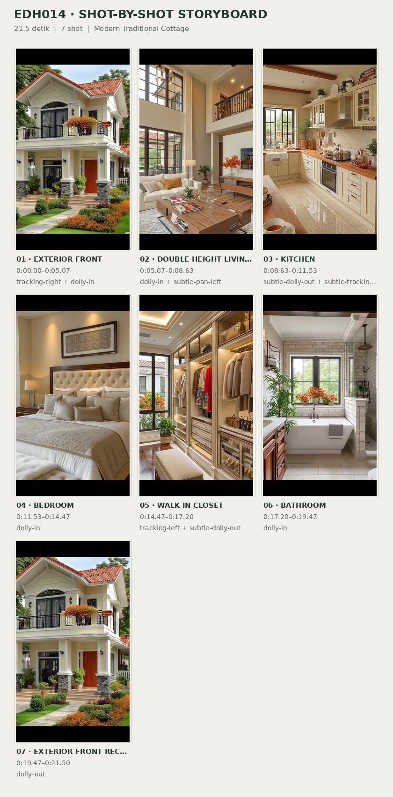
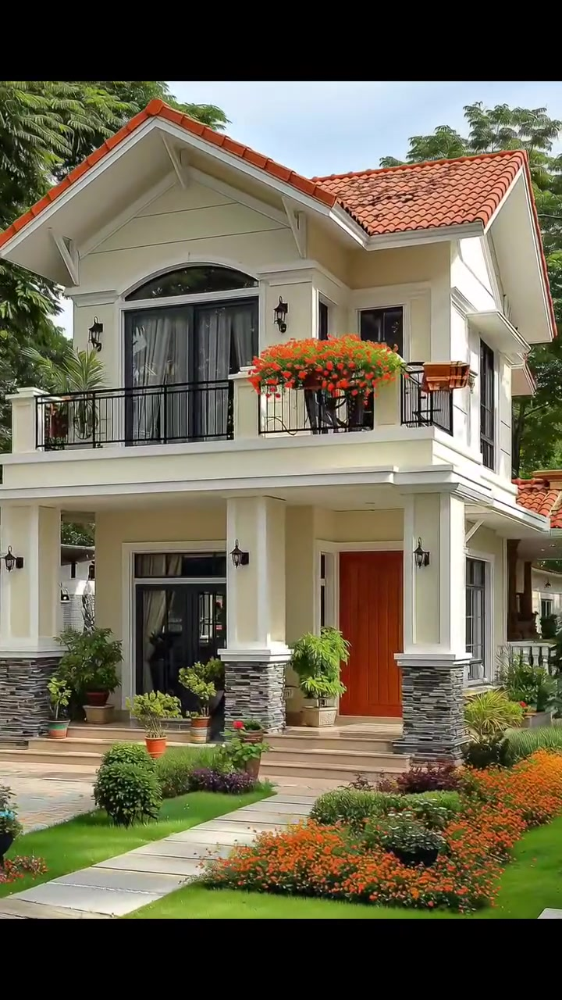
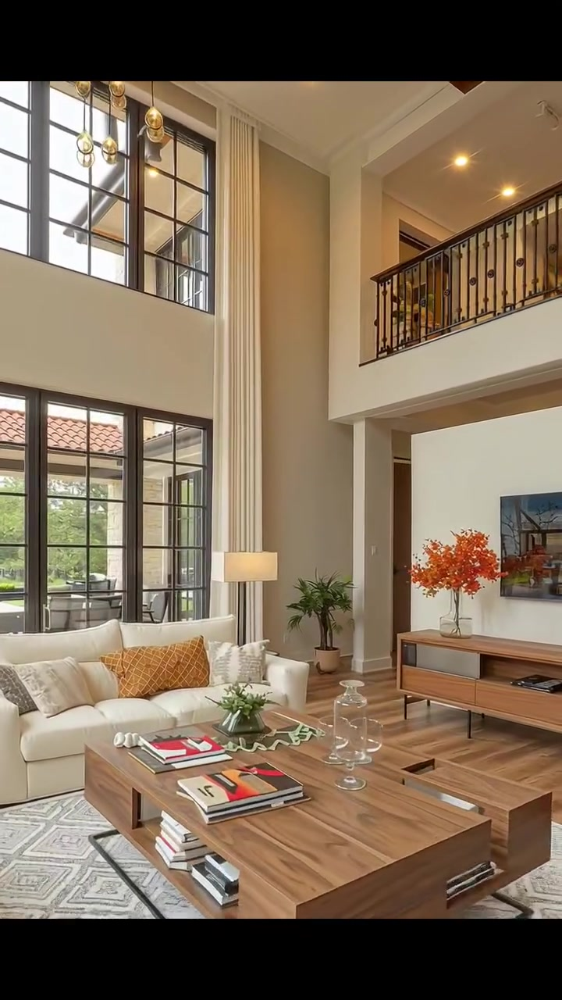
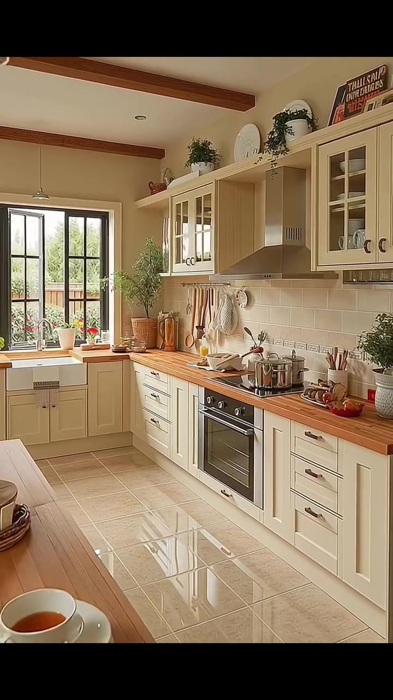
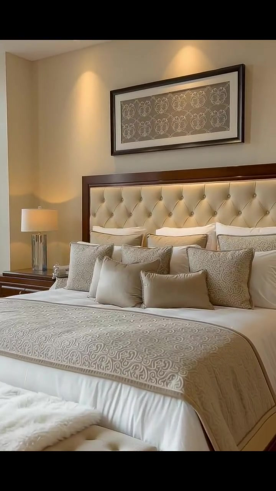
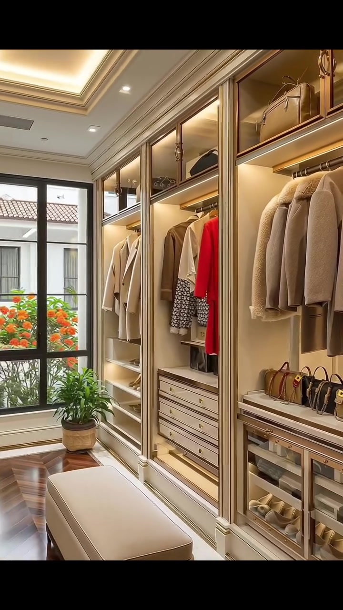
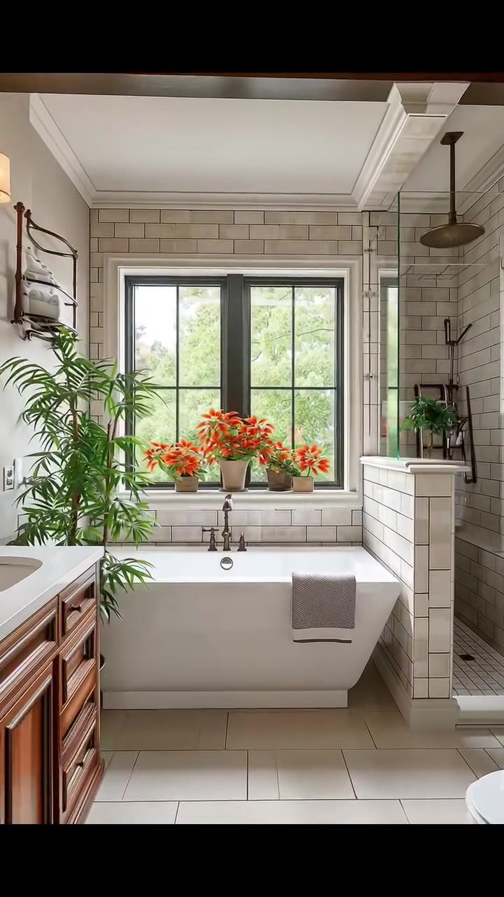
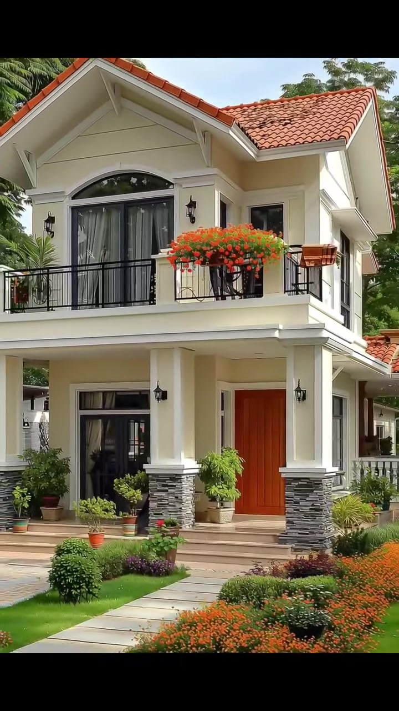

# VID-007 — Modern Traditional Cottage

<!-- homeku_request_id: edh014-20261103-reviewed-001 -->

<!-- homeku_detail_narratives: chat-reviewed -->

**Sumber data:** [analysis.yaml](analysis.yaml) · **Status:** draft · **Diverifikasi manusia:** Tidak

## 1. Informasi Video

| Informasi | Nilai |
|---|---|
| ID | VID-007 |
| File asli | edh014.mp4 |
| Durasi | 21.5 |
| Resolusi | 720x1280 |
| FPS | 30 |
| Rasio | 9:16 |
| Jumlah shot | 7 |

## 2. Storyboard Gabungan

## 3. Identitas Desain

| Aspek | Hasil analisis |
|---|---|
| Gaya utama | modern traditional cottage |
| Wilayah terkait gaya desain | europe, north america |
| Pengaruh gaya | european country house, transitional classic interior, mediterranean tile roof accents |
| Ciri eksterior | intersecting terracotta appearance tiled gables, warm cream exterior walls, arched upper balcony glass door, black metal balcony railings, gray stacked stone appearance porch column bases, recessed reddish wood tone front door, orange flower balcony planters |
| Gaya interior | warm transitional, classic detailing, neutral palette, wood furniture, bright natural light |
| Confidence gaya | medium |

## 4. Ukuran & Proporsi Bangunan

| Aspek | Estimasi visual |
|---|---|
| Ukuran yang terlihat | medium |
| Bentuk bangunan | compact rectangular with projecting front gable |
| Skala vertikal | two story |
| Tapak bangunan | moderate |
| Perkiraan luas lantai | 140–220 m² |
| Confidence | low |

> Luas adalah perkiraan visual, bukan ukuran terukur.

## 5. Warna, Pencahayaan, dan Atmosfer

| Warna dominan | HEX (perkiraan) |
|---|---|
| warm cream | #E8DDCA |
| terracotta orange | #B85F38 |
| charcoal black | #292C2D |
| warm wood brown | #A87950 |
| foliage green | #4E6B42 |
| flower orange | #E06B2E |

| Aspek | Hasil analisis |
|---|---|
| Pencahayaan | bright soft daylight, warm indoor recessed lighting, warm accent shelf lighting |
| Lingkungan | landscaped front garden, mature green trees, trimmed lawn, ornamental flower beds, suburban like residential context |
| Musim yang tampak | lush green vegetation with orange blooms |
| Mood | warm, orderly, welcoming, cozy, bright |

## 6. Struktur dan Timeline Video

**Jenis:** residential home tour · **Tempo:** moderate · **Transisi:** hard cuts between scenes with exterior bookends

| Shot | Waktu (detik) | Durasi | Area/Scene | Gerakan Kamera |
|---|---|---|---|---|
| Shot 01 | 0.0–5.07 | 5.07 | exterior front | tracking right, dolly in |
| Shot 02 | 5.07–8.63 | 3.56 | double height living room | dolly in, subtle pan left |
| Shot 03 | 8.63–11.53 | 2.90 | kitchen | subtle dolly out, subtle tracking left |
| Shot 04 | 11.53–14.47 | 2.94 | bedroom | dolly in |
| Shot 05 | 14.47–17.2 | 2.73 | walk in closet | tracking left, subtle dolly out |
| Shot 06 | 17.2–19.47 | 2.27 | bathroom | dolly in |
| Shot 07 | 19.47–21.5 | 2.03 | exterior front recap | dolly out |

## 7. Analisis per Shot

### Shot 01 — exterior front

**Waktu:** 0.0–5.07 detik

| Komponen | Pengamatan |
|---|---|
| Fokus utama | cream two story gabled house and front garden |
| Framing awal → akhir | wide front three quarter with foreground tree → closer front facade and balcony |
| Sudut pandang | eye level slightly upward |
| Gerakan kamera | tracking right, dolly in |
| Kecepatan kamera | slow |
| Pencahayaan | bright soft daylight |
| Transisi keluar | hard cut |

**Detail yang terlihat**

**Arsitektur**

Rumah dua lantai berdinding krem memiliki beberapa bidang atap pelana dengan penutup yang tampak seperti genteng terakota oranye. Pada bagian segitiga atap terlihat lis sederhana. Balkon lantai atas dengan pagar logam hitam berada tepat di atas teras depan; di belakangnya ada bukaan kaca lengkung berbingkai gelap dengan tirai gelap, serta pot bunga oranye berjajar di sepanjang pagar. Pintu masuk bernuansa kayu merah kecokelatan berada di sisi kanan, sedangkan bukaan kaca berbingkai gelap berada di kiri. Kolom teras krem mempunyai dasar yang tampak seperti susunan batu abu\-abu, dengan beberapa anak tangga rendah di bawah atap teras. Lampu dinding hitam terlihat di sekitar bukaan atas dan pintu, sementara bagian atap tambahan tampak menjulur ke kanan.

**Furnitur dan properti**

Pot berisi tanaman hijau ditempatkan di sekitar kedua sisi akses pintu masuk. Beberapa pot hias kecil juga terlihat di dekat anak tangga teras.

**Lingkungan**

Sebuah batang pohon besar di foreground bergeser melintasi tampak depan saat kamera bergerak. Pepohonan hijau tinggi dan rimbun terlihat di sekitar dan di belakang rumah. Halaman depan tertutup rumput hijau yang dipangkas rapi, dengan semak\-semak bulat rendah di dekat jalur masuk. Hamparan bunga oranye padat mengisi bedeng taman di sisi depan kanan, sementara jalur berpaving terang mengarah dari foreground ke pintu masuk. Di atas atap tampak sebagian langit siang yang biru pucat.

**Catatan pengamatan:** Batang pohon bergeser ke kiri selama kamera mendekati fasad; material genteng, batu dan pintu diidentifikasi hanya dari penampilan.

**Confidence:** Kamera medium · Detail visual high

### Shot 02 — double height living room

**Waktu:** 5.07–8.63 detik

| Komponen | Pengamatan |
|---|---|
| Fokus utama | sofa and large wood coffee table below tall windows |
| Framing awal → akhir | wide double height living room → closer living room seating and window area |
| Sudut pandang | eye level slightly upward |
| Gerakan kamera | dolly in, subtle pan left |
| Kecepatan kamera | slow |
| Pencahayaan | bright window daylight with warm ceiling spotlights |
| Transisi keluar | hard cut |

**Detail yang terlihat**

**Arsitektur**

Ruang keluarga memiliki langit\-langit setinggi dua lantai dan dinding putih gading. Jendela tinggi bersekat hitam memenuhi sisi kiri serta belakang, sementara balkon mezzanine dengan pagar logam gelap tampak di bagian atas kanan. Plafon putih dilengkapi lampu tanam hangat dan sebuah balok yang tampak seperti kayu gelap. Gorden panjang krem muda menggantung di sisi jendela, dan lantai yang tampak seperti kayu terang mengelilingi karpet area. Di bawah mezzanine sisi kanan terdapat akses terbuka menuju area lain.

**Furnitur dan properti**

Sofa sectional putih gading berada di bawah jendela dan diberi bantal aksen bercorak oker. Meja kopi rendah persegi panjang berpenampilan kayu alami berada di tengah, dengan buku dan benda kaca di atasnya, serta karpet bermotif geometris pucat di bawah. Di dinding kanan terdapat kabinet media kayu panjang dan layar datar di atasnya, dengan rangkaian bunga oranye di sisi kabinet. Sebuah lampu lantai bertudung krem berdiri dekat jendela belakang; meja bundar kecil dengan vas bunga oranye tampak di depan, disertai kursi aksen berlapis kain terang di kanan depan dan tanaman hijau berpot besar di sudut ruangan.

**Lingkungan**

Melalui jendela\-jendela gelap terlihat tanaman hijau di luar dan sebagian atap bangunan lain bernuansa genteng terakota.

**Catatan pengamatan:** Mezzanine hanya terlihat sebagai balkon internal; tidak semua hubungan ruang antar lantai dapat dipastikan.

**Confidence:** Kamera medium · Detail visual high

### Shot 03 — kitchen

**Waktu:** 8.63–11.53 detik

| Komponen | Pengamatan |
|---|---|
| Fokus utama | cream cabinetry and wood tone countertops |
| Framing awal → akhir | medium wide view of counter and range → wider kitchen view with foreground table |
| Sudut pandang | eye level |
| Gerakan kamera | subtle dolly out, subtle tracking left |
| Kecepatan kamera | slow |
| Pencahayaan | bright natural window light with warm indoor fill |
| Transisi keluar | hard cut |

**Detail yang terlihat**

**Arsitektur**

Dapur berbentuk L mempunyai kabinet atas dan bawah berpanel shaker warna krem. Countertop pada dua sisi tampil seperti kayu hangat, dipadukan dengan backsplash ubin kecil krem yang diberi garis dekoratif. Jendela ganda bersekat gelap berada di atas bak cuci putih model apron\-front. Di dinding kanan terdapat cooker hood metalik di atas kompor dan oven hitam, dengan kabinet atas berpintu kaca. Lantainya menggunakan ubin persegi besar krem muda berkilau, dan plafon memiliki balok berpenampilan kayu gelap serta satu lampu gantung kaca kecil di atas area meja depan.

**Furnitur dan properti**

Panci dan teko berbahan logam ditempatkan di kompor. Di atas meja makan kayu yang mulai terlihat di foreground ada tumpukan piring putih dan sebuah cangkir. Berbagai tanaman kecil dalam pot serta benda dekoratif tersebar di countertop; papan potong dan peralatan memasak diletakkan dekat area kerja belakang, dengan peralatan dan lap dapur tergantung pada rel backsplash. Beberapa benda kecil menyerupai bahan makanan merah berada di sisi kanan, sedangkan di atas kabinet terdapat wadah dekoratif dan tanaman hijau.

**Lingkungan**

Dari jendela dapur tampak tanaman hijau yang terkena cahaya matahari dan semburat bunga oranye di luar.

**Catatan pengamatan:** Kamera memperlihatkan bagian meja makan di foreground menjelang akhir; gerak kamera lateral dan zoom sulit dipisahkan.

**Confidence:** Kamera low · Detail visual medium

### Shot 04 — bedroom

**Waktu:** 11.53–14.47 detik

| Komponen | Pengamatan |
|---|---|
| Fokus utama | large bed with tufted cream headboard |
| Framing awal → akhir | medium wide bedroom view → tight bed headboard and wall art |
| Sudut pandang | eye level |
| Gerakan kamera | dolly in |
| Kecepatan kamera | slow |
| Pencahayaan | warm bedside and recessed lighting with soft daylight from left |
| Transisi keluar | hard cut |

**Detail yang terlihat**

**Arsitektur**

Kamar tidur berdinding krem hangat memiliki lis plafon sederhana, tepian plafon bertingkat, dan lampu tanam berwarna hangat. Area headboard dibatasi bingkai yang tampak seperti kayu gelap. Sebuah karya seni horizontal berbingkai dengan motif berulang tergantung di atas tempat tidur, sementara jendela tinggi dengan gorden panjang terang berada di sisi kiri ruangan.

**Furnitur dan properti**

Tempat tidur besar menggunakan headboard berlapis kain krem dengan pola kancing tufted. Seprai putih dipadukan dengan coverlet bermotif warna taupe, serta beberapa bantal dekoratif krem dan taupe yang tersusun berlapis. Di sisi kiri terdapat nakas berpenampilan kayu gelap dan lampu bertudung pucat. Bangku sempit berlapis kain krem berada di ujung tempat tidur, dan tanaman hijau kecil ditempatkan dekat jendela kiri.

**Lingkungan**

Tidak ada detail yang tercatat.

**Catatan pengamatan:** Close-up berakhir pada headboard, bantalan dan karya seni; pemandangan di luar jendela tidak terlihat jelas.

**Confidence:** Kamera high · Detail visual high

### Shot 05 — walk in closet

**Waktu:** 14.47–17.2 detik

| Komponen | Pengamatan |
|---|---|
| Fokus utama | open wardrobe storage and center ottoman |
| Framing awal → akhir | medium view of illuminated wardrobe wall → wider view toward end window and center bench |
| Sudut pandang | eye level |
| Gerakan kamera | tracking left, subtle dolly out |
| Kecepatan kamera | moderate |
| Pencahayaan | warm integrated shelf lighting and ceiling spots with window daylight |
| Transisi keluar | hard cut |

**Detail yang terlihat**

**Arsitektur**

Walk\-in closet memanjang memiliki deretan kabinet built\-in warna beige yang tinggi di kedua sisi. Kompartemen lemari terbuka diterangi lampu strip hangat, dengan laci\-laci krem di bawah rel pakaian dan ruang simpan terbuka untuk tas atau boks pada bagian atas. Lantai lorong tengah tampak menggunakan papan kayu gelap. Plafon bertingkat memiliki pencahayaan cove serta lampu tanam, dan di ujung ruang terdapat jendela besar dengan kisi bingkai gelap.

**Furnitur dan properti**

Pakaian bernuansa beige, putih, serta satu pakaian merah terang tergantung di rel terbuka. Beberapa tas tangan disusun di rak bawah yang bercahaya, sedangkan sepatu berada di rak terbuka lebih rendah. Sebuah ottoman panjang berlapis kain krem terletak di tengah lorong. Di dekat jendela ada tanaman hijau berpot; tas simpan kain berwarna terang tampak pada kompartemen atas.

**Lingkungan**

Bunga oranye dan dedaunan hijau terlihat melalui jendela di ujung ruang lemari.

**Catatan pengamatan:** Tata letak dan beberapa produk pada rak sedikit berubah dalam gerak; detail individual pakaian tidak dipastikan.

**Confidence:** Kamera low · Detail visual medium

### Shot 06 — bathroom

**Waktu:** 17.2–19.47 detik

| Komponen | Pengamatan |
|---|---|
| Fokus utama | white soaking tub under large dark framed window |
| Framing awal → akhir | medium wide bathroom including vanity and tub → closer centered bathtub and window |
| Sudut pandang | eye level |
| Gerakan kamera | dolly in |
| Kecepatan kamera | slow |
| Pencahayaan | strong daylight from window with soft warm indoor fill |
| Transisi keluar | hard cut |

**Detail yang terlihat**

**Arsitektur**

Kamar mandi berlapis ubin dinding warna terang dengan susunan garis persegi panjang. Jendela besar bersekat gelap terletak tepat di atas bathtub putih berbentuk persegi panjang. Di kanan terlihat area shower berlapis ubin terang dengan partisi kaca bening, sementara lantai menggunakan ubin berukuran relatif besar dan plafon mempunyai lis. Sisi kiri menampilkan kabinet wastafel bernuansa kayu dengan countertop putih. Sebuah shower head bundar gelap berada di kanan atas, dan balok berpenampilan kayu gelap melintas dekat bagian plafon kiri.

**Furnitur dan properti**

Sejumlah pot bunga oranye berjajar pada ambang jendela di belakang bathtub. Handuk abu\-abu terlipat menggantung di bibir bak yang dekat kamera. Tanaman hijau besar berada di kiri bak, dan tanaman pot kecil diletakkan pada dinding separuh tinggi di sisi shower. Beberapa botol perlengkapan mandi tampak di meja wastafel, sementara sebagian toilet putih terlihat di kanan bawah pada awal shot.

**Lingkungan**

Pepohonan hijau terlihat melalui jendela besar kamar mandi.

**Catatan pengamatan:** Area shower terlihat hanya sebagian; jenis material dinding dan jenis tanaman tidak dapat dipastikan.

**Confidence:** Kamera medium · Detail visual medium

### Shot 07 — exterior front recap

**Waktu:** 19.47–21.5 detik

| Komponen | Pengamatan |
|---|---|
| Fokus utama | front entry and upper balcony of cream house |
| Framing awal → akhir | medium front facade with entry and balcony → wider three quarter front facade and garden |
| Sudut pandang | eye level slightly upward |
| Gerakan kamera | dolly out |
| Kecepatan kamera | slow |
| Pencahayaan | bright soft daylight |
| Transisi keluar | end of video |

**Detail yang terlihat**

**Arsitektur**

Shot penutup kembali memperlihatkan fasad dua lantai warna krem, dengan atap pelana berpenampilan genteng oranye. Bukaan kaca lantai atas berbentuk lengkung mempunyai bingkai gelap dan pagar balkon hitam, disertai kotak\-kotak bunga oranye di sepanjang balkon. Teras bawah ditopang kolom krem dengan dasar mirip batu bertumpuk abu\-abu. Pintu bernuansa kayu cokelat kemerahan berada di kanan, dan bukaan kaca berbingkai gelap ada di kiri. Beberapa anak tangga menuju teras beratap terlihat bersama lampu dinding hitam pada fasad.

**Furnitur dan properti**

Pot\-pot besar berisi tanaman hijau ditempatkan di sekitar pintu masuk depan.

**Lingkungan**

Di bagian depan terlihat rumput hijau, jalur paving terang, serta hamparan bunga oranye dan semak yang dipangkas rapi. Pepohonan hijau tinggi berada di belakang rumah, dengan langit siang yang terang di atas atap.

**Catatan pengamatan:** Fasad yang sama kembali terlihat sebagai shot penutup; sudut framing melebar sedikit hingga akhir.

**Confidence:** Kamera medium · Detail visual high

## 8. Kualitas dan Ketidakpastian Analisis

| Parameter | Hasil |
|---|---|
| Status | draft |
| Verifikasi manusia | Tidak |
| Ketepatan timestamp | frame based estimate |
| Ketidakpastian | architectural style is interpretive not verified, estimated total floor area has no measured scale reference, exact wall floor roof and countertop materials not confirmed, camera translation vs digital zoom cannot be determined with certainty, flower and plant species not identifiable, same exterior shown at start and end does not prove interior is contiguous with that house, possible synthetic or composited visuals cannot be verified from video alone |

**Catatan:** Analisis visual seluruh durasi 7 shot; batas cut diperkirakan dari perubahan frame sekitar 5.067, 8.633, 11.533, 14.467, 17.200, 19.467 detik. Tidak menganalisis audio. Semua ukuran dan material tertentu adalah interpretasi visual, bukan hasil inspeksi.

---

*Laporan ini diturunkan dari [analysis.yaml](analysis.yaml).*
