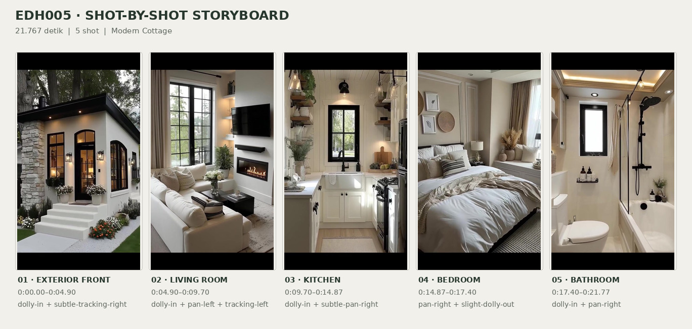
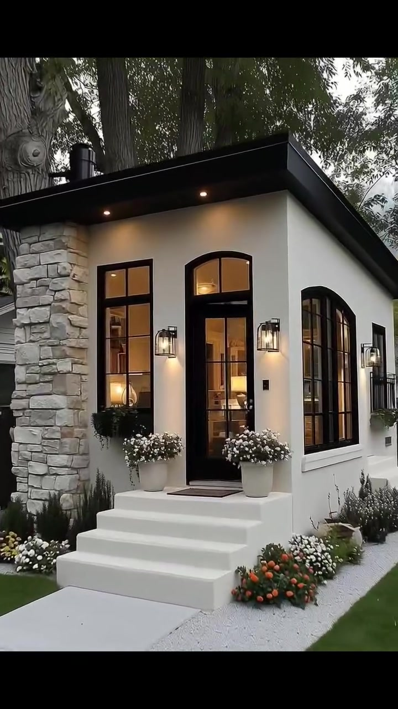
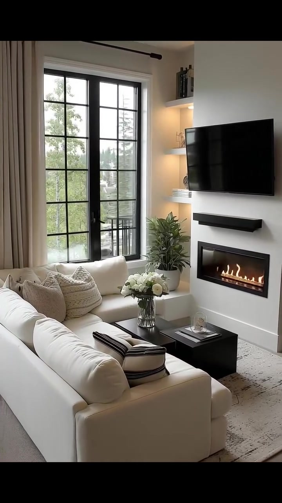
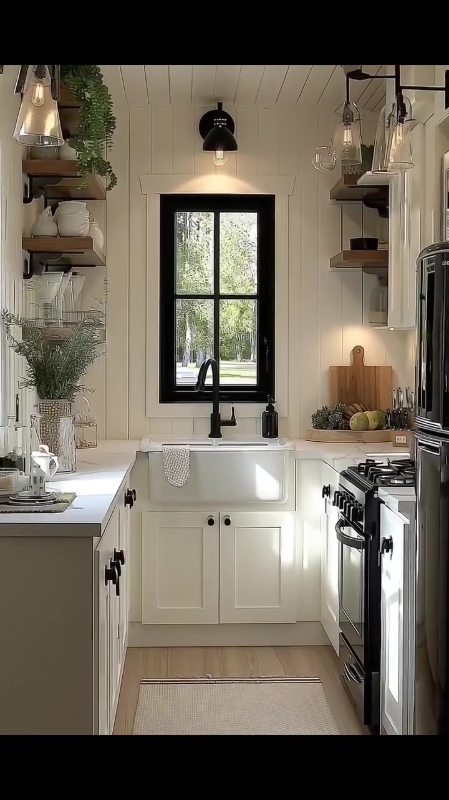
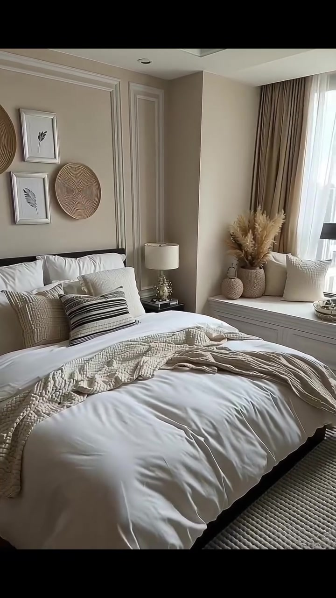
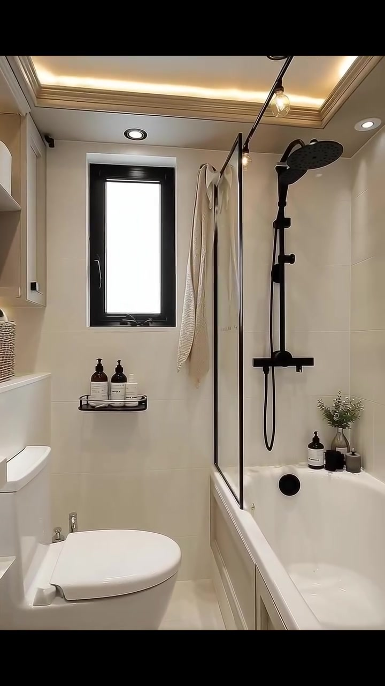

# VID-008 — Modern Cottage

<!-- homeku_request_id: edh005-20261104-reviewed-001 -->

<!-- homeku_detail_narratives: chat-reviewed -->

**Sumber data:** [analysis.yaml](analysis.yaml) · **Status:** draft · **Diverifikasi manusia:** Tidak

## 1. Informasi Video

| Informasi | Nilai |
|---|---|
| ID | VID-008 |
| File asli | edh005.mp4 |
| Durasi | 21.767 |
| Resolusi | 720x1280 |
| FPS | 30 |
| Rasio | 9:16 |
| Jumlah shot | 5 |

## 2. Storyboard Gabungan

## 3. Identitas Desain

| Aspek | Hasil analisis |
|---|---|
| Gaya utama | modern cottage |
| Wilayah terkait gaya desain | north america, europe |
| Pengaruh gaya | modern farmhouse, contemporary minimalist |
| Ciri eksterior | low pitch dark mono pitch roof appearance, cream white smooth exterior walls, light gray rough stone clad left facade section, black gridded windows and glazed front door, arched transom and arched side window, warm black metal wall lanterns, white entry steps with potted flowers |
| Gaya interior | warm neutral contemporary, modern farmhouse kitchen, soft minimalist bedroom, compact modern bathroom |
| Confidence gaya | medium |

## 4. Ukuran & Proporsi Bangunan

| Aspek | Estimasi visual |
|---|---|
| Ukuran yang terlihat | small |
| Bentuk bangunan | narrow rectangular appearance |
| Skala vertikal | single story appearance |
| Tapak bangunan | compact |
| Perkiraan luas lantai | 35–65 m² |
| Confidence | low |

> Luas adalah perkiraan visual, bukan ukuran terukur.

## 5. Warna, Pencahayaan, dan Atmosfer

| Warna dominan | HEX (perkiraan) |
|---|---|
| warm cream white | #F1EEE7 |
| soft beige | #C5B8A7 |
| matte charcoal black | #252523 |
| light stone gray | #BDBBB4 |
| natural wood brown | #A78B6D |
| leafy green | #61745A |

| Aspek | Hasil analisis |
|---|---|
| Pencahayaan | soft diffused exterior daylight, warm entry lanterns and recessed downlights, daylight through black framed windows, warm interior accent and under cabinet lights, warm recessed bathroom cove lighting |
| Lingkungan | mature tree canopy around house, maintained grass lawn, white pebble flower border, neighbor structure partly visible |
| Musim yang tampak | green foliage visible season undetermined |
| Mood | cozy, warm, tidy, intimate, modern rustic |

## 6. Struktur dan Timeline Video

**Jenis:** compact house tour · **Tempo:** moderate · **Transisi:** continuous exterior to living to kitchen then two hard cuts

| Shot | Waktu (detik) | Durasi | Area/Scene | Gerakan Kamera |
|---|---|---|---|---|
| Shot 01 | 0.0–4.9 | 4.90 | exterior front | dolly in, subtle tracking right |
| Shot 02 | 4.9–9.7 | 4.80 | living room | dolly in, pan left, tracking left |
| Shot 03 | 9.7–14.867 | 5.17 | kitchen | dolly in, subtle pan right |
| Shot 04 | 14.867–17.4 | 2.53 | bedroom | pan right, slight dolly out |
| Shot 05 | 17.4–21.767 | 4.37 | bathroom | dolly in, pan right |

## 7. Analisis per Shot

### Shot 01 — exterior front

**Waktu:** 0.0–4.9 detik

| Komponen | Pengamatan |
|---|---|
| Fokus utama | front entry and compact cottage facade |
| Framing awal → akhir | wide front left three quarter → closer front entry and side window |
| Sudut pandang | slightly low front left three quarter |
| Gerakan kamera | dolly in, subtle tracking right |
| Kecepatan kamera | slow to moderate |
| Pencahayaan | soft diffused outdoor daylight with warm entry lamps |
| Transisi keluar | continuous camera move through entry |

**Detail yang terlihat**

**Arsitektur**

Rumah terlihat kompak dan cenderung satu lantai, dengan massa memanjang, atap gelap berkemiringan rendah, dan overhang hitam yang cukup dalam. Dinding luarnya tampak halus berwarna krem\-putih, sementara bidang vertikal di kiri depan berlapis batu tidak beraturan berwarna abu\-abu terang. Di sebelah kiri pintu terdapat jendela tinggi berbingkai hitam dengan pembagi kaca. Pintu masuk berpanel kaca hitam berada di bawah transom melengkung, dan di dinding samping kanan terlihat jendela besar berbagian atas melengkung. Dua lentera dinding hitam mengapit pintu, satu lentera serupa berada di dinding kanan, serta titik lampu hangat tertanam di bawah overhang depan. Sejumlah anak tangga putih yang lebar mengantar ke bordes kecil dengan keset persegi panjang gelap. Dekat sisi kiri atap tampak pipa ventilasi silindris hitam pendek, sedangkan bagian kanan jauh memperlihatkan sedikit pagar metal gelap horizontal.

**Furnitur dan properti**

Di kedua sisi pintu ada dua pot besar berwarna putih gading berisi bunga putih kecil yang rapat. Kotak tanaman jendela hitam di bawah jendela depan kiri diisi daun hijau gelap yang menjuntai.

**Lingkungan**

Batang\-batang pohon matang berukuran besar berdiri sangat dekat di belakang dan sebelah kiri rumah, dengan tajuk hijau rimbun menaungi atap. Di depan terlihat halaman rumput terpangkas, jalan setapak lurus berwarna terang menuju tangga, dan hamparan kerikil putih yang melengkung di sisi kanan rumah. Tepat di sekitar kaki tangga tumbuh bunga kecil putih dan jingga; semak rendah hijau keabu\-abuan mengikuti tepian samping. Sebagian bangunan lain berwarna terang tampak di latar belakang kiri.

**Catatan pengamatan:** Komposisi rumah, tangga, dan detail lanskap terbaca selama kamera mendekat; kemiringan atap dan bahan fasad merupakan deskripsi penampakan.

**Confidence:** Kamera medium · Detail visual high

### Shot 02 — living room

**Waktu:** 4.9–9.7 detik

| Komponen | Pengamatan |
|---|---|
| Fokus utama | cream seating and media fireplace wall |
| Framing awal → akhir | doorway view into small living room → sideways living to kitchen reveal |
| Sudut pandang | eye level interior from entry |
| Gerakan kamera | dolly in, pan left, tracking left |
| Kecepatan kamera | slow to moderate |
| Pencahayaan | soft window daylight mixed with warm shelf light and fireplace glow |
| Transisi keluar | continuous camera turn toward kitchen |

**Detail yang terlihat**

**Arsitektur**

Ruang duduk memiliki dinding dan langit\-langit putih. Pada dinding kiri terdapat jendela tinggi bersekat hitam dengan gorden panjang krem muda. Dinding media putih di sebelah kanan menampung televisi datar hitam, bilah hitam horizontal tepat di bawahnya, serta perapian linear berbingkai hitam dengan nyala api terlihat di bagian bawah. Rak pajang putih yang masuk ke dinding, berada di sisi televisi, diterangi cahaya hangat. Dari area duduk terdapat sambungan pandangan terbuka ke arah dapur di sebelah kiri.

**Furnitur dan properti**

Sofa berlapis kain krem tersusun membentuk area duduk menyerupai huruf L dengan beberapa bantal bertekstur warna netral, termasuk bantal aksen bergaris hitam\-krem di bagian sofa dekat kamera. Meja kopi hitam rendah berbentuk persegi panjang berada di depannya; di atasnya ada vas bening berisi bunga putih. Tanaman berdaun hijau dalam pot berada di dekat sisi kiri dinding media. Karpet besar bercorak halus warna beige terang berada di bawah meja, sementara buku dan pajangan kecil mengisi rak dengan penerangan hangat.

**Lingkungan**

Melalui jendela tinggi terlihat pepohonan hijau dan sebagian pagar atau railing logam hitam di luar.

**Catatan pengamatan:** Kamera memasuki ruang duduk, lalu bergerak ke kiri sehingga sebagian dapur mulai terlihat sebelum pergantian fokus utama. Bentuk sofa L dinilai berdasarkan sudut tampilan.

**Confidence:** Kamera medium · Detail visual high

### Shot 03 — kitchen

**Waktu:** 9.7–14.867 detik

| Komponen | Pengamatan |
|---|---|
| Fokus utama | farmhouse sink and black framed kitchen window |
| Framing awal → akhir | centered galley kitchen from living side → closer sink stove and right counter |
| Sudut pandang | eye level straight down narrow kitchen |
| Gerakan kamera | dolly in, subtle pan right |
| Kecepatan kamera | slow to moderate |
| Pencahayaan | daylight through sink window and warm pendant and cabinet lights |
| Transisi keluar | hard cut to bedroom at about 14 867 s |

**Detail yang terlihat**

**Arsitektur**

Dapur berbentuk lorong sempit dengan dua deret meja kerja yang saling berhadapan. Dinding dan plafon tampak menggunakan panel putih bergaris vertikal. Jendela persegi panjang bersekat hitam terpusat di atas wastafel putih model apron\-front, dengan keran leher angsa hitam tinggi. Kabinet bawah putih bergaya shaker memiliki knop hitam, sementara permukaan meja tampak halus dan terang. Lantai berpenampilan papan kayu terang diberi runner panjang krem. Rak kayu terbuka terpasang di kedua sisi wastafel; lampu gantung kubah hitam berada di tengah atas wastafel, dilengkapi lampu gantung kaca bening di sisi\-sisinya dan cahaya hangat di bawah kabinet kanan.

**Furnitur dan properti**

Di deret kanan terdapat kompor freestanding hitam\-perak serta lemari es tinggi berwarna gelap di bagian depan. Sisi kiri meja memuat vas kaca berisi batang\-batang hijau. Rak terbuka berisi piring keramik putih, stoples kaca, dan tanaman kecil. Di meja kanan, beberapa talenan kayu disandarkan ke dinding, sebuah baki bundar kayu berisi buah hijau serta buah gelap, dan wadah kecil gelap berisi alat dapur berada dekat kompor. Handuk dapur warna terang menggantung pada bagian depan wastafel.

**Lingkungan**

Dari jendela dapur terlihat dedaunan pohon berwarna hijau dan area rumput di luar.

**Catatan pengamatan:** Kamera bergerak perlahan mendekati sink dan kompor; susunan kabinet serta aksesori dicatat berdasarkan tampilan, bukan merek atau bahan persis.

**Confidence:** Kamera medium · Detail visual high

### Shot 04 — bedroom

**Waktu:** 14.867–17.4 detik

| Komponen | Pengamatan |
|---|---|
| Fokus utama | white bed and built in window bench |
| Framing awal → akhir | bed dominant front left corner → wider right side with window bench |
| Sudut pandang | eye level front left of bed |
| Gerakan kamera | pan right, slight dolly out |
| Kecepatan kamera | slow |
| Pencahayaan | soft diffused window daylight and subtle recessed ceiling light |
| Transisi keluar | hard cut to bathroom at 17 4 s |

**Detail yang terlihat**

**Arsitektur**

Kamar tidur memakai warna dinding beige hangat dengan molding persegi panjang sebagai aksen panel. Plafon terang memiliki beberapa downlight kecil. Kepala tempat tidur tampak memiliki garis bingkai atas yang gelap. Di sisi kanan terdapat bangku jendela built\-in putih dengan panel penyimpanan pada bagian bawah. Jendela besar di atasnya dilengkapi tirai beige dan lapisan gorden tipis putih.

**Furnitur dan properti**

Tempat tidur lebar dilapisi duvet putih dan bantal besar putih, dengan selimut rajut bertekstur beige yang disampirkan melintasi ujung kasur. Sejumlah bantal dekoratif netral, termasuk bantal panjang bermotif garis hitam\-krem, tersusun dekat sandaran. Di atas kepala tempat tidur terpasang dua karya botani dalam bingkai putih kecil dan dua hiasan dinding bundar dari anyaman serat alami. Sebuah meja samping tempat tidur berwarna gelap menopang lampu dengan kap silindris krem. Di atas bangku jendela terdapat vas besar berisi rumput kering beige dan bantal\-bantal terang. Karpet bertekstur bergaris beige terang terlihat pada bagian bawah tempat tidur.

**Lingkungan**

Tidak ada detail yang tercatat.

**Catatan pengamatan:** Pan halus ke kanan menonjolkan sudut duduk berjendela. Isi pemandangan luar jendela tidak cukup jelas untuk diidentifikasi.

**Confidence:** Kamera medium · Detail visual high

### Shot 05 — bathroom

**Waktu:** 17.4–21.767 detik

| Komponen | Pengamatan |
|---|---|
| Fokus utama | white bathtub with black rain shower |
| Framing awal → akhir | wide long narrow bathroom view → close right side bathtub and shower |
| Sudut pandang | eye level into narrow bathroom |
| Gerakan kamera | dolly in, pan right |
| Kecepatan kamera | slow to moderate |
| Pencahayaan | warm recessed cove and ceiling spotlights with window daylight |
| Transisi keluar | end of video |

**Detail yang terlihat**

**Arsitektur**

Kamar mandi berbentuk lorong persegi panjang yang sempit, dengan dinding berpenampilan ubin besar warna krem terang dan lantai senada. Di kiri terdapat meja dan kabinet built\-in putih dengan mesin cuci front\-loading di bawahnya. Jendela tinggi berbingkai hitam di dinding ujung tampak berkaca buram atau sangat terang; di bawahnya ada toilet putih berukuran kompak. Bak mandi putih persegi panjang memanjang di sisi kanan, dibatasi panel kaca bening berbingkai hitam. Di atas bak terpasang shower hujan berkepala bundar hitam dan perlengkapan shower genggam hitam. Plafon cekung memakai pencahayaan tersembunyi hangat serta beberapa downlight bulat kecil.

**Furnitur dan properti**

Di bawah jendela terdapat rak kecil hitam berisi dua botol pompa berwarna amber gelap. Handuk terang tergantung pada sekat shower. Beberapa botol perlengkapan mandi gelap dan vas kaca kecil berisi daun hijau diletakkan pada tepi bak mandi. Di meja kiri terlihat keranjang penyimpanan netral dan dekorasi kecil; pada sisi dalam bak terlihat satu kelengkapan bundar hitam yang fungsi pastinya tidak dapat diidentifikasi.

**Lingkungan**

Tidak ada detail yang tercatat.

**Catatan pengamatan:** Shot berawal dari ruang mandi sempit secara keseluruhan dan menutup pada shower di sisi kanan. Kaca/jendela tampak terang tetapi kondisi di luar tidak jelas.

**Confidence:** Kamera high · Detail visual high

## 8. Kualitas dan Ketidakpastian Analisis

| Parameter | Hasil |
|---|---|
| Status | draft |
| Verifikasi manusia | Tidak |
| Ketepatan timestamp | estimated |
| Ketidakpastian | first three scene boundaries are semantic segments within one continuous camera movement not hard cuts, estimated floor area has no measured scale reference, roof profile and finish materials are visual appearances only, room spatial relationships beyond visible passage are not verified, exterior time of day and geographic location are not confirmed, architecture common regions are style associations not video location, some glass and reflections can obscure exterior details |

**Catatan:** Analisis visual sepanjang video. Lima segmen dipilih untuk memberi satu keyframe representatif setiap area; cut keras baru tampak sekitar 14.867 s dan 17.4 s. Semua label material dan ukuran yang tidak terbukti merupakan perkiraan penampilan.

---

*Laporan ini diturunkan dari [analysis.yaml](analysis.yaml).*
