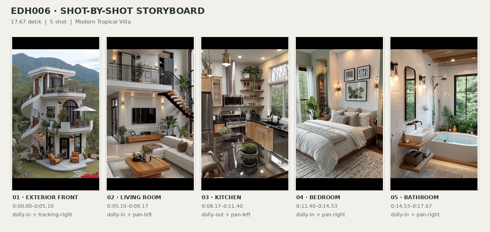
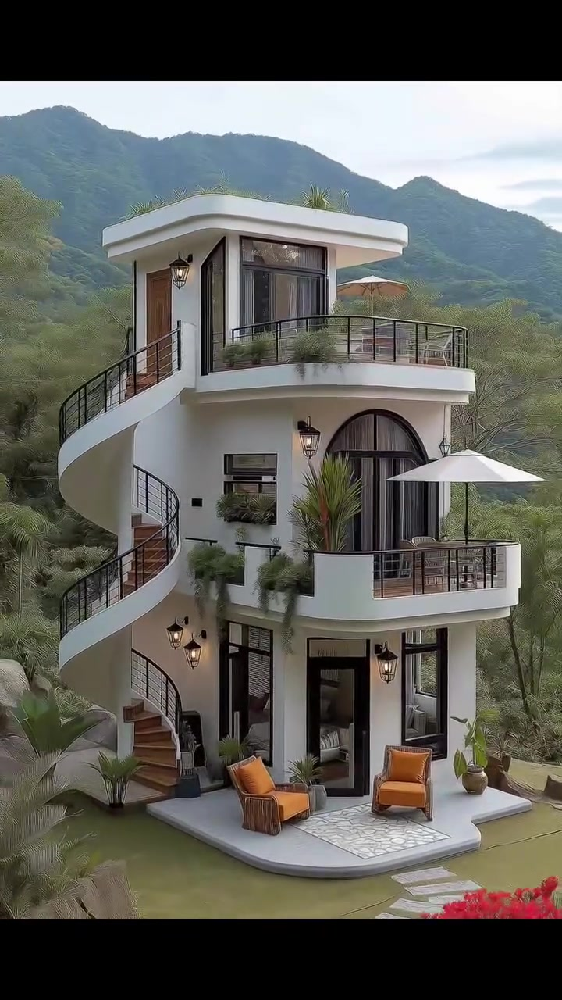
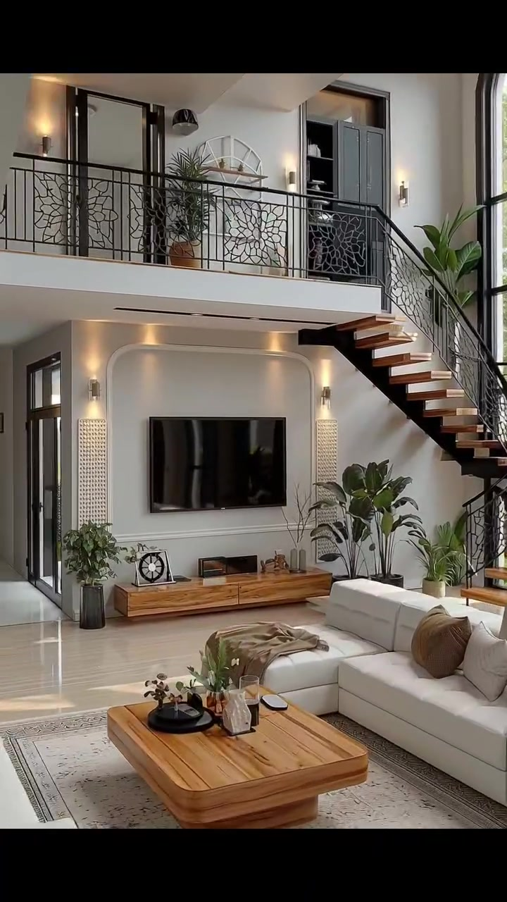
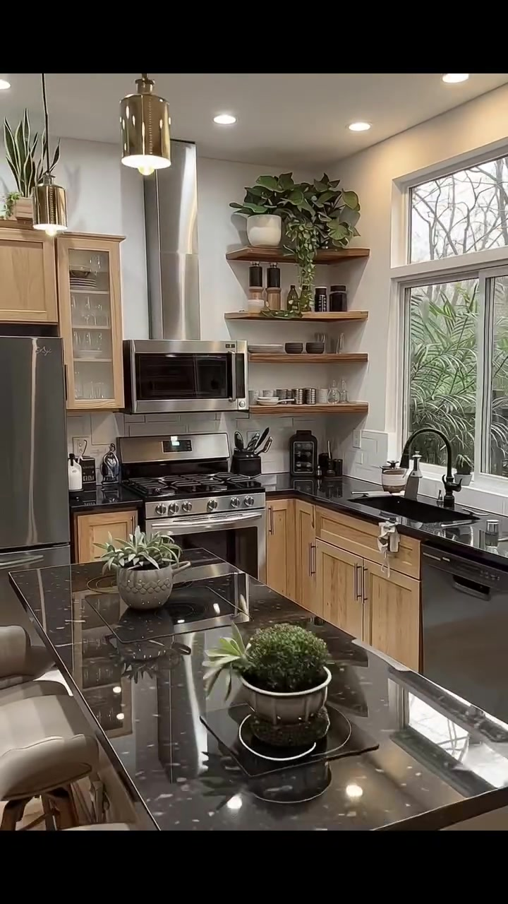
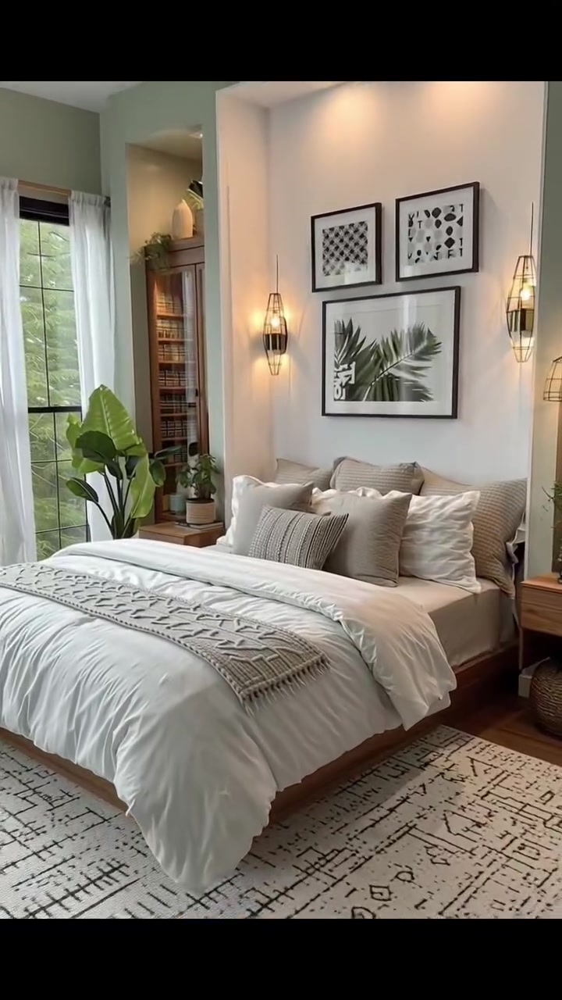
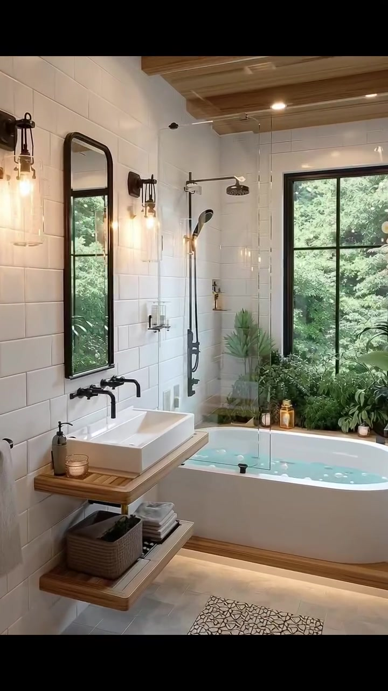

# VID-009 — Modern Tropical Villa

<!-- homeku_request_id: edh006-20261104-reviewed-001 -->

<!-- homeku_detail_narratives: chat-reviewed -->

**Sumber data:** [analysis.yaml](analysis.yaml) · **Status:** draft · **Diverifikasi manusia:** Tidak

## 1. Informasi Video

| Informasi | Nilai |
|---|---|
| ID | VID-009 |
| File asli | edh006.mp4 |
| Durasi | 17.67 |
| Resolusi | 720x1280 |
| FPS | 30.0 |
| Rasio | 9:16 |
| Jumlah shot | 5 |

## 2. Storyboard Gabungan

## 3. Identitas Desain

| Aspek | Hasil analisis |
|---|---|
| Gaya utama | modern tropical villa |
| Wilayah terkait gaya desain | asia, oceania |
| Pengaruh gaya | contemporary organic curves, warm modern interior, biophilic interior, ornamental metalwork |
| Ciri eksterior | white plaster appearance exterior, flat roof with deep white overhangs, curving stacked balconies, exterior curving staircase, black metal balcony railings, arched black framed middle level doors, large dark framed glazing, balcony plantings |
| Gaya interior | warm contemporary, natural wood accents, neutral soft furnishings, black metal details, indoor greenery |
| Confidence gaya | medium |

## 4. Ukuran & Proporsi Bangunan

| Aspek | Estimasi visual |
|---|---|
| Ukuran yang terlihat | medium |
| Bentuk bangunan | narrow stacked mass with curved balconies |
| Skala vertikal | three visible levels |
| Tapak bangunan | compact |
| Perkiraan luas lantai | 110–190 m² |
| Confidence | low |

> Luas adalah perkiraan visual, bukan ukuran terukur.

## 5. Warna, Pencahayaan, dan Atmosfer

| Warna dominan | HEX (perkiraan) |
|---|---|
| warm white | #F2EFE7 |
| light natural wood | #B88F65 |
| matte black | #272726 |
| soft beige | #D9CFBE |
| sage green | #A7B4A2 |
| green vegetation | #617557 |

| Aspek | Hasil analisis |
|---|---|
| Pencahayaan | soft cloud filtered daylight exterior, large window natural daylight interior, warm wall sconces, warm recessed lighting, decorative pendant lighting |
| Lingkungan | vegetated mountainous hillside, garden lawn and ornamental plantings, mountain ridges in background |
| Musim yang tampak | Tidak diketahui |
| Mood | calm, airy, warm, nature connected, contemporary cozy |

## 6. Struktur dan Timeline Video

**Jenis:** home tour · **Tempo:** moderate · **Transisi:** hard cuts between five scenes

| Shot | Waktu (detik) | Durasi | Area/Scene | Gerakan Kamera |
|---|---|---|---|---|
| Shot 01 | 0.0–5.1 | 5.10 | exterior front | dolly in, tracking right |
| Shot 02 | 5.1–8.17 | 3.07 | living room | dolly in, pan left |
| Shot 03 | 8.17–11.4 | 3.23 | kitchen | dolly out, pan left |
| Shot 04 | 11.4–14.53 | 3.13 | bedroom | dolly in, pan right |
| Shot 05 | 14.53–17.67 | 3.14 | bathroom | dolly in, pan right |

## 7. Analisis per Shot

### Shot 01 — exterior front

**Waktu:** 0.0–5.1 detik

| Komponen | Pengamatan |
|---|---|
| Fokus utama | three level white house with curved balconies |
| Framing awal → akhir | wide full building view → medium wide upper facade view |
| Sudut pandang | slightly elevated three quarter front view |
| Gerakan kamera | dolly in, tracking right |
| Kecepatan kamera | slow |
| Pencahayaan | soft overcast daylight |
| Transisi keluar | hard cut |

**Detail yang terlihat**

**Arsitektur**

Rumah berkesan ramping dan bertingkat tiga dengan permukaan luar putih menyerupai plester. Atap bagian atas tampak datar dengan overhang putih yang lebar. Pada tingkat teratas terlihat pintu masuk bernuansa kayu cokelat di sisi kiri serta bukaan kaca besar berbingkai hitam. Balkon atas melengkung, berpagar logam hitam, dan memiliki tepi berwarna putih. Di sisi kiri bangunan, tangga luar berkelok mengikuti bentuk spiral dengan anak tangga berpenampilan kayu dan pagar hitam. Tingkat tengah memperlihatkan pintu kaca ganda berbentuk lengkung dengan bingkai gelap dan balkon putih melengkung berpagar hitam. Lantai dasar memiliki pintu kaca serta jendela tinggi berbingkai hitam, menghadap teras putih dengan ujung membulat. Lampu dinding bergaya lentera hitam tersebar pada fasad. Tepi balkon juga memiliki parapet putih yang melengkung dan berfungsi sebagai area tanaman.

**Furnitur dan properti**

Pada teras lantai dasar terdapat dua kursi santai bernuansa kayu dengan bantalan oranye, sebuah meja rendah di antara keduanya, dan bidang lantai teras bermotif batu terang di antara kursi. Balkon tengah di sisi kanan dinaungi payung putih, dengan meja makan kecil beserta kursi di belakang pagar. Balkon paling atas memiliki payung berwarna tan di sisi kanan dan jajaran pot rerumputan di sepanjang pagarnya. Sebuah palem dalam pot tinggi berada di sudut depan balkon tengah, sementara tanaman hijau menjuntai dari bawah balkon tersebut.

**Lingkungan**

Bangunan dikelilingi vegetasi lebat di lereng berbukit. Punggung pegunungan biru kehijauan membentang di belakang rumah, dengan langit pucat berawan di atasnya. Di depan teras terdapat hamparan rumput hijau pendek dan jalur batu pijakan persegi panjang berwarna terang yang berkelok di sisi kanan. Sekelompok batu besar berwarna kelabu menempati bagian kiri depan. Di sekitar kaki rumah tumbuh tanaman hias berdaun lebar, sementara semak berbunga merah terlihat pada tepi kanan bawah.

**Catatan pengamatan:** Rumah tampak memiliki tiga tingkat dari eksterior. Kurva tangga dan balkon diamati langsung; material kayu, plester dan logam disimpulkan dari tampilannya.

**Confidence:** Kamera medium · Detail visual high

### Shot 02 — living room

**Waktu:** 5.1–8.17 detik

| Komponen | Pengamatan |
|---|---|
| Fokus utama | double height living room tv wall and stair |
| Framing awal → akhir | wide double height living room view → medium tv wall and stair view |
| Sudut pandang | eye level slightly upward view |
| Gerakan kamera | dolly in, pan left |
| Kecepatan kamera | slow |
| Pencahayaan | balanced window daylight and warm interior sconces |
| Transisi keluar | hard cut |

**Detail yang terlihat**

**Arsitektur**

Ruang keluarga memiliki dinding putih dan plafon tinggi ganda. Di tingkat atas terlihat jalur mezanin berpagar logam hitam bermotif floral. Tangga terbuka di sisi kanan memakai pijakan berpenampilan kayu cokelat dengan struktur hitam, berdekatan dengan jendela lengkung yang tinggi dan berpetak bingkai hitam. Dinding televisi dibuat sebagai bidang ceruk persegi panjang dengan sudut atas membulat, diapit panel putih bertekstur. Lampu dinding serta pencahayaan aksen hangat menerangi ceruk tersebut. Lantai tampak licin mengilap berwarna netral terang, sementara sisi kiri memiliki pintu kaca berbingkai gelap. Panel plafon bernuansa kayu tampak pada bagian atas mezanin.

**Furnitur dan properti**

Televisi datar hitam berukuran besar berada di tengah dinding utama, dengan konsol kayu panjang dan rendah di bawahnya. Sebuah sofa sectional krem dengan bantal bernuansa tan mendominasi sisi kanan, sedangkan sofa terang lain tampak di sisi kiri pada awal shot. Di depan sofa terdapat meja kopi kayu persegi rendah, lengkap dengan baki dan vas dekoratif, di atas karpet krem bermotif halus. Selimut lempar beige terhampar pada sofa terdekat. Beberapa tanaman hijau dalam pot ditempatkan di sekitar televisi dan kaki tangga. Di atas konsol terdapat dekorasi bundar dan aksesori kecil, sedangkan area mezanin mempunyai tanaman dalam pot.

**Lingkungan**

Pepohonan hijau tampak di luar melalui jendela tinggi pada sisi kanan ruangan.

**Catatan pengamatan:** Kamera perlahan mendekat dan sedikit menggeser pandangan ke dinding TV. Tangga terlihat melengkung di sisi jendela tinggi pada awal adegan.

**Confidence:** Kamera medium · Detail visual high

### Shot 03 — kitchen

**Waktu:** 8.17–11.4 detik

| Komponen | Pengamatan |
|---|---|
| Fokus utama | black stone appearance island and light wood cabinetry |
| Framing awal → akhir | medium kitchen cooking wall view → wide kitchen island and stools view |
| Sudut pandang | eye level three quarter interior view |
| Gerakan kamera | dolly out, pan left |
| Kecepatan kamera | slow |
| Pencahayaan | bright window daylight warm ceiling downlights and gold pendants |
| Transisi keluar | hard cut |

**Detail yang terlihat**

**Arsitektur**

Dapur memiliki dinding dan plafon putih dengan lampu tanam. Kabinet dan laci berprofil shaker tampil dalam warna kayu oak terang, dipadukan countertop perimeter berpenampilan batu hitam. Di belakang kompor terlihat backsplash ubin putih persegi panjang, dengan cerobong pengisap udara baja nirkarat menjulang di atasnya. Sisi kanan cerobong memakai rak terbuka kayu bertingkat, sedangkan bak cuci berada tepat di bawah jendela besar berbingkai putih. Lemari atas berpintu kaca berada di sebelah kiri area kompor. Lantai sekitar island bernuansa kayu terang. Island besar memiliki bidang atas batu hitam mengilap dengan urat tipis berwarna terang.

**Furnitur dan properti**

Kompor gas dan oven baja nirkarat berada di bawah microwave berfasad hitam dan baja, sementara kulkas baja nirkarat berada di sisi kiri deretan kabinet. Bak cuci berwarna gelap dan keran melengkung berwarna gelap terdapat di bawah jendela kanan, dengan mesin pencuci piring berpanel gelap pada kabinet bawahnya. Tiga bangku bar dengan bantalan beige terang berada di sisi kiri island. Di atas island menggantung lampu silinder berwarna emas, sedangkan permukaan island memuat dua rangkaian tanaman kecil dalam pot. Rak sudut terbuka menampung pot tanaman rimbun, piring, wadah, serta stoples. Area memasak juga memiliki tempat alat masak dan peralatan dapur kecil.

**Lingkungan**

Daun\-daunan hijau terlihat melalui jendela dapur pada sisi kanan.

**Catatan pengamatan:** Gerakan membuka framing dari area kompor ke susunan dapur berbentuk sudut dan island, dengan bagian island yang makin terlihat pada akhir shot.

**Confidence:** Kamera medium · Detail visual high

### Shot 04 — bedroom

**Waktu:** 11.4–14.53 detik

| Komponen | Pengamatan |
|---|---|
| Fokus utama | neutral layered bed beneath framed botanical art |
| Framing awal → akhir | wide bedroom corner view → medium close view of bed and headboard wall |
| Sudut pandang | eye level three quarter front view |
| Gerakan kamera | dolly in, pan right |
| Kecepatan kamera | slow |
| Pencahayaan | gentle window daylight with warm wall lights and recessed spotlights |
| Transisi keluar | hard cut |

**Detail yang terlihat**

**Arsitektur**

Dinding sekitar jendela kiri berwarna hijau sage pucat. Di belakang kepala ranjang terdapat ceruk dinding putih dengan pencahayaan tanam hangat, sementara plafon putih memiliki lampu sorot tanam. Jendela tinggi di kiri memakai bingkai kotak hitam dan gorden tipis putih. Lantai kamar berpenampilan papan kayu hangat. Di sebelah kiri ranjang ada ceruk vertikal dengan rak kayu, dan sepasang lampu dinding berpagar logam hitam berbentuk sangkar mengapit area kepala ranjang.

**Furnitur dan properti**

Ranjang besar berbingkai kayu rendah memiliki kepala ranjang berlapis kain beige. Selimut putih dipadukan tumpukan bantal krem dan beige bertekstur; kain rajut abu\-beige terletak melintang di bagian kaki ranjang. Karpet besar krem bermotif garis abstrak hitam terbentang di bawah ranjang. Tiga karya berbingkai hitam dipasang di dinding: dua gambar lebih kecil di atas dan satu gambar botani lebih besar di bawahnya. Di sisi kiri terdapat nakas kayu terang dengan tanaman kecil dalam pot, sedangkan nakas kayu kedua terlihat di kanan. Tanaman berdaun lebar berdiri dekat jendela kiri. Pada awal shot terlihat lampu gantung bernuansa hangat di area plafon, dan rak ceruk memuat dekorasi kecil serta buku.

**Lingkungan**

Pepohonan hijau terlihat di luar jendela kamar sebelah kiri.

**Catatan pengamatan:** Pencahayaan dan penataan menonjolkan area dinding kepala ranjang. Ukuran kasur tidak dapat dipastikan dari visual saja.

**Confidence:** Kamera medium · Detail visual high

### Shot 05 — bathroom

**Waktu:** 14.53–17.67 detik

| Komponen | Pengamatan |
|---|---|
| Fokus utama | floating wood vanity and white bathtub beside green window |
| Framing awal → akhir | wide bathroom view including toilet vanity and tub → medium vanity shower and tub view |
| Sudut pandang | eye level slightly downward view |
| Gerakan kamera | dolly in, pan right |
| Kecepatan kamera | slow |
| Pencahayaan | natural green facing window daylight and warm vanity lights |
| Transisi keluar | end of video |

**Detail yang terlihat**

**Arsitektur**

Kamar mandi dilapisi ubin dinding putih persegi panjang dan ubin lantai abu\-abu terang. Balok plafon terekspos memperlihatkan tampilan kayu hangat. Jendela ramping berbingkai hitam berada di atas wastafel, sedangkan jendela hitam besar berada di belakang bak mandi. Di sisi kiri bak terlihat perlengkapan shower hitam, termasuk kepala shower hujan dan shower tangan, dengan panel pemisah kaca bening. Bak mandi putih berbentuk persegi panjang berdiri di atas dudukan berpenampilan kayu. Meja wastafel bergaya melayang memakai permukaan kayu dengan rak bawah terbuka, dan terdapat cahaya garis hangat di bawah bagian depan bak.

**Furnitur dan properti**

Wastafel putih berbentuk kotak terletak di sisi kiri di atas meja kayu dan memakai keran dinding hitam. Cermin tinggi dengan bagian atas melengkung dan bingkai hitam terpasang di atasnya, diapit dua lampu dinding hitam dengan bohlam hangat yang tampak jelas. Toilet putih terlihat di bagian depan kiri pada awal adegan. Rak terbuka di bawah wastafel menampung handuk putih terlipat dan keranjang anyaman. Di atas meja terdapat beberapa aksesori mandi kecil. Karpet lantai persegi panjang bermotif hitam\-krem terhampar di jalur berjalan. Berbagai tanaman hijau dalam pot mengisi sudut belakang bak, dan lentera kecil bercahaya hangat diletakkan di dekat tepinya.

**Lingkungan**

Melalui jendela besar di belakang bak tampak dedaunan hijau yang rapat.

**Catatan pengamatan:** Bak terlihat terisi air kebiruan. Tidak dipastikan apakah material dinding dan countertop adalah material alami atau tampilannya saja.

**Confidence:** Kamera medium · Detail visual high

## 8. Kualitas dan Ketidakpastian Analisis

| Parameter | Hasil |
|---|---|
| Status | draft |
| Verifikasi manusia | Tidak |
| Ketepatan timestamp | estimated |
| Ketidakpastian | architectural style is visual interpretation not verified design origin, building floor area estimate has no measured scale reference, exact exterior and interior materials cannot be confirmed from video, actual geographic location and season are unknown, camera translation vs digital motion is not verifiable |

**Catatan:** Observasi menyeluruh atas 530 frame video pada 30 fps; batas shot diperkirakan di 5.10, 8.17, 11.40, dan 14.53 detik. Sumber identik dengan Git blob SHA 99a05a2408d4cb4f8c183218397fbd36b4641a64 di main/video/edh006.mp4.

---

*Laporan ini diturunkan dari [analysis.yaml](analysis.yaml).*
