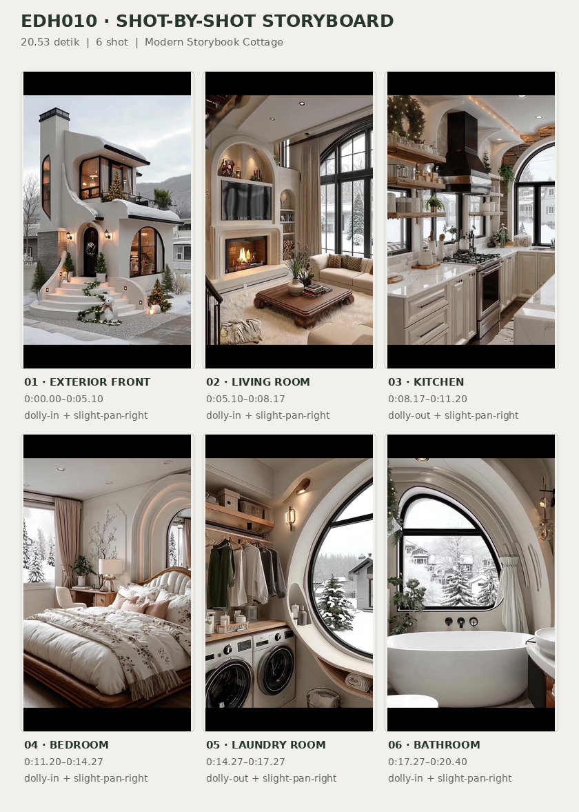
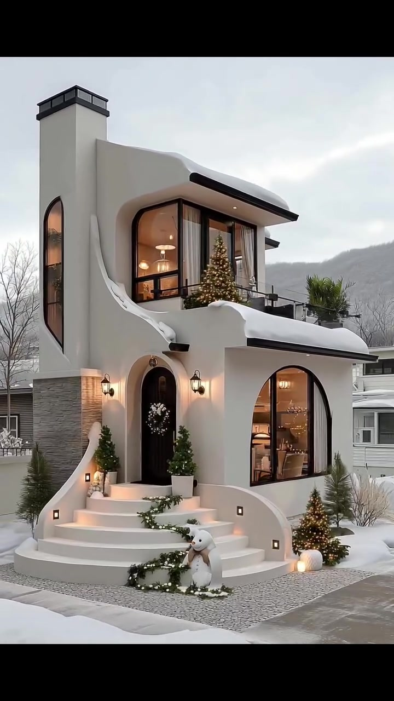
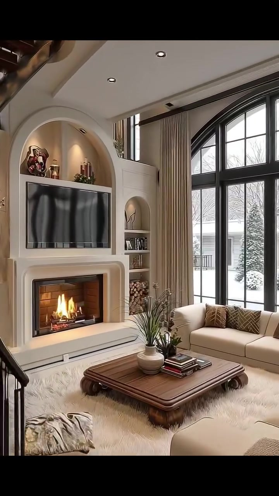
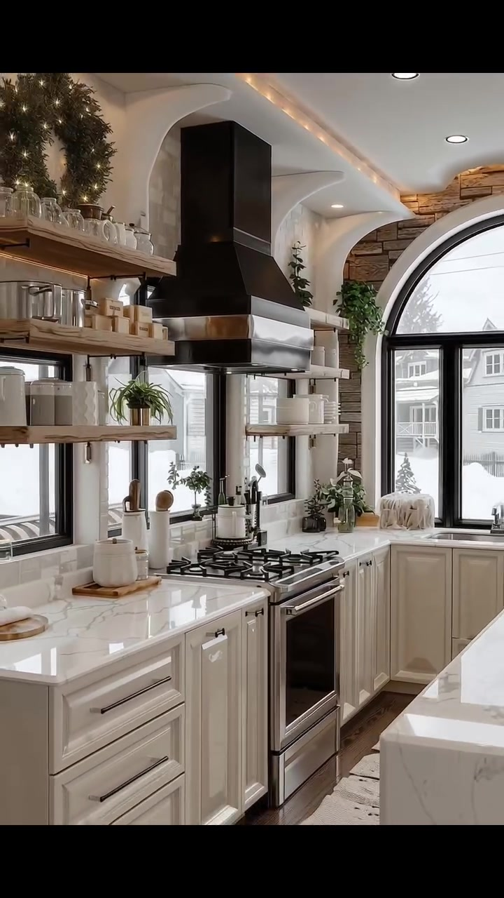
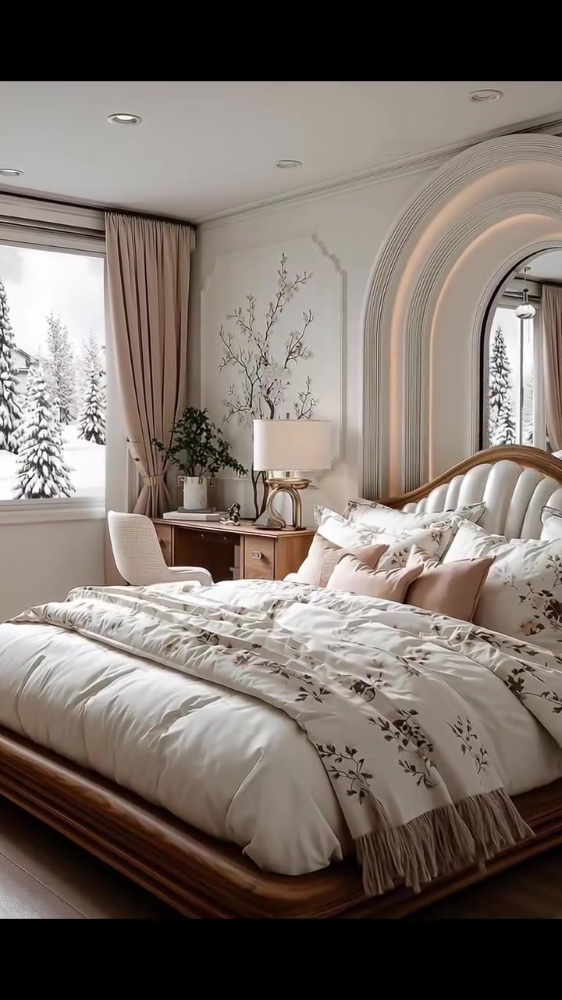
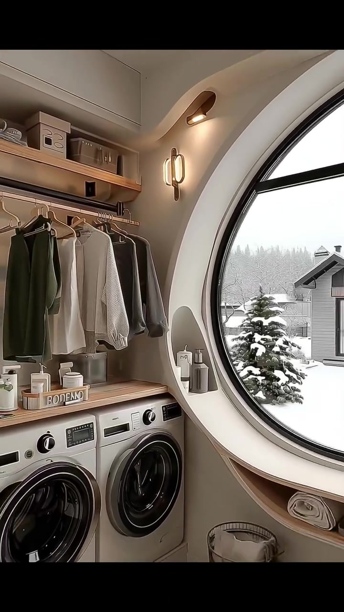
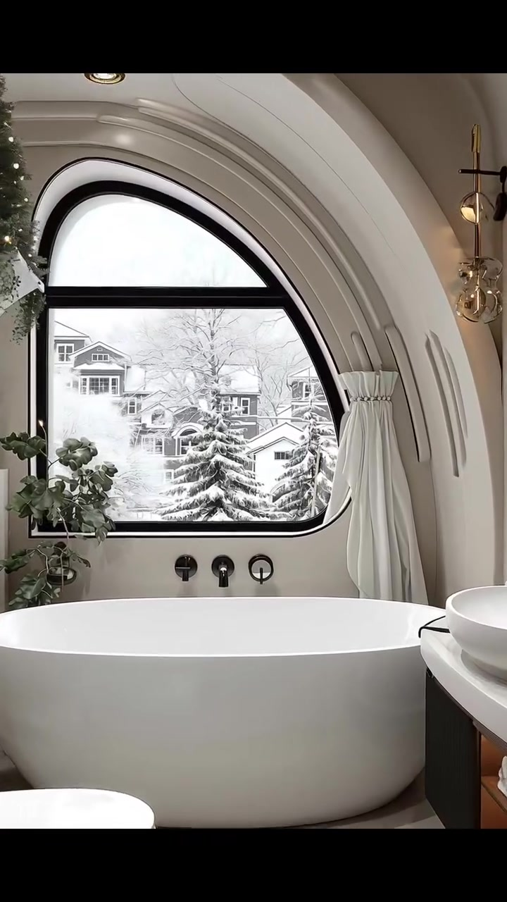

# VID-010 — Modern Storybook Cottage

<!-- homeku_request_id: edh010-20261104-reviewed-001 -->

<!-- homeku_detail_narratives: chat-reviewed -->

**Sumber data:** [analysis.yaml](analysis.yaml) · **Status:** draft · **Diverifikasi manusia:** Tidak

## 1. Informasi Video

| Informasi | Nilai |
|---|---|
| ID | VID-010 |
| File asli | edh010.mp4 |
| Durasi | 20.53 |
| Resolusi | 720x1280 |
| FPS | 30 |
| Rasio | 9:16 |
| Jumlah shot | 6 |

## 2. Storyboard Gabungan

## 3. Identitas Desain

| Aspek | Hasil analisis |
|---|---|
| Gaya utama | modern storybook cottage |
| Wilayah terkait gaya desain | europe, north america |
| Pengaruh gaya | whimsical architecture, organic modernism, warm transitional luxury |
| Ciri eksterior | white smooth stucco appearance facade, sculpted curved parapet and entry walls, dark low profile roof edges, black framed arch windows, small upper balcony with black guardrail, tall left vertical tower with dark cap, curved front staircase, warm wall mounted entry lanterns |
| Gaya interior | warm transitional luxury, soft organic arch details, ivory and beige neutral palette, wood appearance and stone appearance accents, arched windows and recessed wall niches |
| Confidence gaya | medium |

## 4. Ukuran & Proporsi Bangunan

| Aspek | Estimasi visual |
|---|---|
| Ukuran yang terlihat | medium |
| Bentuk bangunan | narrow rectangular mass |
| Skala vertikal | two story |
| Tapak bangunan | compact |
| Perkiraan luas lantai | 100–170 m² |
| Confidence | low |

> Luas adalah perkiraan visual, bukan ukuran terukur.

## 5. Warna, Pencahayaan, dan Atmosfer

| Warna dominan | HEX (perkiraan) |
|---|---|
| warm ivory | #E9E5DE |
| snow white | #F2F2F0 |
| matte black | #262626 |
| natural wood brown | #A78565 |
| soft beige | #C5B4A0 |
| warm amber light | #DAB278 |

| Aspek | Hasil analisis |
|---|---|
| Pencahayaan | soft overcast outdoor daylight, warm interior practical lights, warm recessed downlights, warm indirect arch lighting |
| Lingkungan | snow covered residential neighborhood, snow dusted evergreen landscaping, neighboring suburban houses, distant wooded hill in exterior shot, winter holiday decorations |
| Musim yang tampak | snowy winter appearance |
| Mood | cozy, quiet, festive, elegant, warm interior cold exterior contrast |

## 6. Struktur dan Timeline Video

**Jenis:** home tour · **Tempo:** moderate · **Transisi:** hard cuts between six scenes

| Shot | Waktu (detik) | Durasi | Area/Scene | Gerakan Kamera |
|---|---|---|---|---|
| Shot 01 | 0.0–5.1 | 5.10 | exterior front | dolly in, slight pan right |
| Shot 02 | 5.1–8.17 | 3.07 | living room | dolly in, slight pan right |
| Shot 03 | 8.17–11.2 | 3.03 | kitchen | dolly out, slight pan right |
| Shot 04 | 11.2–14.27 | 3.07 | bedroom | dolly in, slight pan right |
| Shot 05 | 14.27–17.27 | 3.00 | laundry room | dolly out, slight pan right |
| Shot 06 | 17.27–20.4 | 3.13 | bathroom | dolly in, slight pan right |

## 7. Analisis per Shot

### Shot 01 — exterior front

**Waktu:** 0.0–5.1 detik

| Komponen | Pengamatan |
|---|---|
| Fokus utama | two story white house with curved facade |
| Framing awal → akhir | wide three quarter front facade → close front entry and upper balcony |
| Sudut pandang | eye level to slight upward angle |
| Gerakan kamera | dolly in, slight pan right |
| Kecepatan kamera | slow |
| Pencahayaan | soft overcast daylight with warm exterior lanterns |
| Transisi keluar | hard cut |

**Detail yang terlihat**

**Arsitektur**

Rumah dua lantai bermassa sempit ini memiliki fasad putih menyerupai plester halus, dengan dinding dan parapet yang melengkung mengitari area pintu dan balkon atas. Tepian atap berprofil rendah berwarna gelap tertutup salju. Di kiri terdapat massa menara tinggi dengan penutup datar gelap, lapisan berpenampilan batu abu\-abu di bagian bawah, dan jendela lengkung sempit. Jendela lengkung besar di lantai dasar kanan serta kaca sudut lantai atas memakai bingkai hitam. Balkon atas dibatasi pagar logam hitam, dengan lampu tanam di bawah kanopi. Pintu utama yang gelap dan melengkung dihias karangan bunga putih; tangga masuk putih berbentuk lengkung memiliki lampu kotak tanam pada dinding samping. Sepasang lentera dinding hitam yang menyala hangat mengapit area pintu.

**Furnitur dan properti**

Dua tanaman hijau berbentuk kerucut dalam pot mengapit pintu. Di balkon atas terlihat pohon Natal tinggi dengan lampu, serta tanaman hijau berdaun runcing di sisi kanan. Pohon Natal kecil yang menyala berada di kanan tangga; untaian dedaunan hijau menghiasi tepian anak tangga. Figur manusia salju putih dan beberapa dekorasi bercahaya hangat ditempatkan dekat kaki tangga. Tirai berwarna terang tampak di balik jendela berbingkai hitam.

**Lingkungan**

Salju menutupi tepian atap, anak tangga, dan tanah halaman depan. Jalur berpaving abu\-abu melintas di depan rumah, diapit bedeng tanaman yang tertimbun salju dan pohon\-pohon hijau kecil berlapis salju. Cabang pohon meranggas menggantung di bagian kiri atas frame. Langit terlihat pucat berawan, dengan bukit rendah berhutan di kejauhan dan rumah\-rumah tetangga berwarna abu\-abu pucat di kiri serta kanan.

**Catatan pengamatan:** Massa rumah dan area depan menyempit dalam frame sepanjang gerak mendekat; salju menunjukkan tampilan musim dingin, bukan lokasi atau tanggal yang pasti.

**Confidence:** Kamera medium · Detail visual high

### Shot 02 — living room

**Waktu:** 5.1–8.17 detik

| Komponen | Pengamatan |
|---|---|
| Fokus utama | arched media wall with fireplace and sofas |
| Framing awal → akhir | wide living room including left staircase → closer fireplace and television wall |
| Sudut pandang | eye level slightly upward view |
| Gerakan kamera | dolly in, slight pan right |
| Kecepatan kamera | slow |
| Pencahayaan | mixed cool window daylight warm downlights and fireplace glow |
| Transisi keluar | hard cut |

**Detail yang terlihat**

**Arsitektur**

Ruang keluarga tampak tinggi dengan plafon putih melengkung dan lampu downlight tanam. Dinding utama menempatkan perapian di dalam bingkai putih melengkung, dengan televisi hitam terpasang di atasnya. Sebuah ceruk display berbentuk lengkung berada di atas TV, sementara ceruk rak yang lebih sempit mengisi sisi kanannya. Jendela tinggi dengan puncak melengkung dan bingkai hitam menempati dinding kanan, didampingi tirai krem dari atas hingga bawah. Di sisi kiri terlihat anak tangga berpenampilan kayu gelap dengan railing logam hitam.

**Furnitur dan properti**

Dua sofa berlapis bahan tampak krem terlihat, satu berada di bawah jendela tinggi dan satu lagi di kanan depan. Bantal bermotif geometris cokelat menghiasi sofa, sementara kain selimut bertekstur beige tersampir pada sofa terdekat. Meja kopi kayu persegi panjang berwarna cokelat ditempatkan di tengah area duduk di atas karpet tebal berbulu krem. Di atas meja terdapat vas keramik bundar berisi batang tanaman dan tumpukan buku kecil. Rak samping perapian menyimpan kayu bakar, sedangkan ceruk display berisi hiasan, buku, dan benda seni kecil.

**Lingkungan**

Melalui jendela besar di sisi kanan terlihat pohon hijau yang tertutup salju, sebagian fasad rumah tetangga, serta permukaan tanah bersalju.

**Catatan pengamatan:** Kamera menutup jarak ke dinding TV dan perapian; bagian tangga kiri menghilang dari framing. Tidak dapat menentukan apakah gerak kamera fisik atau crop digital.

**Confidence:** Kamera medium · Detail visual high

### Shot 03 — kitchen

**Waktu:** 8.17–11.2 detik

| Komponen | Pengamatan |
|---|---|
| Fokus utama | white kitchen with dark range hood and arched window |
| Framing awal → akhir | medium view of hood and stove → wider view showing counter and island |
| Sudut pandang | eye level oblique counter view |
| Gerakan kamera | dolly out, slight pan right |
| Kecepatan kamera | slow |
| Pencahayaan | soft outdoor daylight with warm ceiling and shelf lighting |
| Transisi keluar | hard cut |

**Detail yang terlihat**

**Arsitektur**

Dapur menggunakan kabinet bawah berpanel shaker warna gading dengan pegangan logam gelap. Permukaan meja kerja berpenampilan marmer terang dengan urat abu\-abu. Di atas kompor gas dan oven baja tahan karat tampak hood logam hitam besar. Rak kayu terbuka dipasang pada sisi hood, dan di dinding kiri terdapat jendela persegi panjang berbingkai hitam. Jendela besar melengkung berbingkai hitam berada di dinding belakang dengan lapisan dinding berpenampilan batu berwarna hangat di sekelilingnya. Lengkungan putih menyambungkan dinding kabinet dan plafon, mengikuti pencahayaan tersembunyi hangat serta downlight putih. Island berpermukaan berpenampilan marmer putih muncul di depan kanan, sementara papan lantai berpenampilan kayu cokelat sedang tampak di area kerja.

**Furnitur dan properti**

Rak terbuka menampung piring, cangkir, dan stoples putih. Beberapa tanaman hijau kecil diletakkan di rak dan countertop, dengan karangan dedaunan hijau bernuansa liburan di bagian atas rak kiri. Di sekitar kompor terdapat wadah peralatan putih berisi sendok kayu serta perlengkapan dapur kecil dari keramik dan kayu. Sebuah runner berwarna terang terbentang di depan kompor, dan rangkaian bunga putih tampak pada sisi kanan depan.

**Lingkungan**

Melalui jendela dapur terlihat tanah bersalju, fasad rumah\-rumah tetangga berwarna terang, dan beberapa pepohonan yang tertutup salju.

**Catatan pengamatan:** Bidang pandang melebar dan sedikit bergeser ke kanan sehingga island serta kabinet memanjang semakin terlihat.

**Confidence:** Kamera medium · Detail visual high

### Shot 04 — bedroom

**Waktu:** 11.2–14.27 detik

| Komponen | Pengamatan |
|---|---|
| Fokus utama | cream bed with wood frame and glowing arch |
| Framing awal → akhir | medium wide bedroom with window and full bed → closer bed headboard and arched wall |
| Sudut pandang | eye level diagonal toward bed |
| Gerakan kamera | dolly in, slight pan right |
| Kecepatan kamera | slow |
| Pencahayaan | soft window daylight with warm arch accent lighting |
| Transisi keluar | hard cut |

**Detail yang terlihat**

**Arsitektur**

Kamar tidur memiliki plafon putih dengan downlight kecil dan dinding yang diberi molding serta cornice berwarna putih. Di sisi kanan tampak fitur dinding berupa lengkungan molding besar dengan pencahayaan tidak langsung berwarna hangat. Jendela tinggi di kiri dibingkai tirai beige sepanjang dinding, sedangkan lantai menunjukkan tampilan papan kayu cokelat muda. Panel\-panel dekoratif berprofil halus melengkapi bidang dinding terang.

**Furnitur dan properti**

Tempat tidur besar berada pada rangka platform rendah dari kayu cokelat yang melengkung, dengan headboard krem berlapis tufting vertikal dan tepian kayu. Seprai dan duvet putih bermotif botani taupe dipadukan dengan lapisan bantal putih dan merah muda pucat. Selimut krem bermotif botani dengan rumbai terhampar di atas ranjang. Karpet berbulu krem berada di samping ranjang. Di kiri tempat tidur terdapat meja kayu menyerupai desk atau vanity dan kursi berlapis bahan terang, disertai lampu meja bertudung putih dengan dasar logam melengkung, susunan ranting dalam wadah, serta tanaman pot berdaun di dekat jendela.

**Lingkungan**

Pohon konifer dengan ranting bersalju dan hamparan luar yang putih bersalju terlihat melalui jendela kiri.

**Catatan pengamatan:** Framing berangsur mendekat dan mengarah ke headboard; elemen jendela kiri semakin terpotong. Bukaan di belakang lengkungan kanan tidak diidentifikasi sebagai pintu atau cermin tanpa kepastian.

**Confidence:** Kamera medium · Detail visual high

### Shot 05 — laundry room

**Waktu:** 14.27–17.27 detik

| Komponen | Pengamatan |
|---|---|
| Fokus utama | pair of front load machines below storage shelves |
| Framing awal → akhir | tight view of laundry machines and window edge → wider laundry area with round window |
| Sudut pandang | eye level oblique toward round window |
| Gerakan kamera | dolly out, slight pan right |
| Kecepatan kamera | slow |
| Pencahayaan | cool diffused daylight through round window and warm wall light |
| Transisi keluar | hard cut |

**Detail yang terlihat**

**Arsitektur**

Laundry room memiliki dua mesin bukaan depan berwarna perak yang berdampingan di bawah countertop kayu terang. Di atasnya terbentang rel pakaian logam gelap di bawah rak kayu terbuka, dengan kabinet atas warna krem. Jendela bundar besar berbingkai hitam dikelilingi bidang dinding putih tebal yang membentuk lengkungan, termasuk beberapa ceruk penyimpanan. Lampu dinding bernuansa hangat dipasang di dekat ujung kanan rel pakaian. Lantai berpenampilan ubin netral terang.

**Furnitur dan properti**

Beberapa pakaian berwarna krem, hijau, dan abu\-abu menggantung pada rel. Kotak berlabel serta keranjang penyimpanan berada pada rak kayu atas; botol dan wadah keperluan laundry berada di atas countertop. Handuk terang yang dilipat dan beberapa botol kecil tersusun pada ceruk di bawah jendela. Di dekat jendela terdapat keranjang laundry berbahan kawat bundar, sedangkan keranjang anyaman dan bangku kecil tampak di bagian kanan bawah.

**Lingkungan**

Di luar jendela bundar terlihat pohon hijau bersalju, rumah tetangga berwarna abu\-abu, serta pepohonan tanpa daun dan halaman bersalju.

**Catatan pengamatan:** Dua mesin front-load dan area penyimpanan terungkap sepenuhnya saat kamera menjauh dan sedikit bergeser ke kanan; jenis washer/dryer spesifik tidak dapat dipastikan dari panel.

**Confidence:** Kamera medium · Detail visual high

### Shot 06 — bathroom

**Waktu:** 17.27–20.4 detik

| Komponen | Pengamatan |
|---|---|
| Fokus utama | white freestanding bathtub below black arched window |
| Framing awal → akhir | wide bathroom including tub toilet and vanity → tight arched window and bathtub rim |
| Sudut pandang | eye level toward large arch window |
| Gerakan kamera | dolly in, slight pan right |
| Kecepatan kamera | slow |
| Pencahayaan | bright soft window daylight with warm ceiling and wall lamps |
| Transisi keluar | end of video |

**Detail yang terlihat**

**Arsitektur**

Kamar mandi didominasi dinding dan rusuk lengkung plafon putih yang mengitari jendela besar berpuncak melengkung dengan bingkai hitam. Lantai berubin putih memperlihatkan sambungan berbentuk persegi panjang. Di bawah jendela, keran dan pengatur bathtub berwarna gelap terpasang pada dinding. Downlight kecil tertanam di plafon, sementara lampu dinding logam bernuansa hangat berada di sisi cermin yang sebagian terlihat di kanan.

**Furnitur dan properti**

Bathtub oval freestanding putih ditempatkan tepat di bawah jendela. Toilet putih berukuran ringkas tampak di kiri depan, sementara wastafel mangkuk bundar putih berdiri pada vanity kanan berwarna kayu gelap dengan rak handuk terbuka. Handuk terang tersusun di rak vanity. Pohon hijau dekoratif kecil yang menyala diletakkan pada rak kiri atas; tanaman pot berdaun berada di dekat sisi kiri bathtub. Tirai putih ditarik dan diikat di kanan jendela.

**Lingkungan**

Melalui jendela lengkung terlihat deretan pohon konifer bersalju, rumah\-rumah di sekitar dengan atap putih tertutup salju, dahan pohon meranggas, dan langit musim dingin yang tampak pucat berawan.

**Catatan pengamatan:** Kamera semakin dekat pada jendela dan bibir bathtub, menghilangkan toilet serta sebagian vanity dari framing; suasana lanskap luar bersalju sangat dominan.

**Confidence:** Kamera medium · Detail visual high

## 8. Kualitas dan Ketidakpastian Analisis

| Parameter | Hasil |
|---|---|
| Status | draft |
| Verifikasi manusia | Tidak |
| Ketepatan timestamp | frame based estimate |
| Ketidakpastian | exact architectural style is interpretive not proven, building floor area is rough visual estimate without measured scale, material identification limited to visual appearance for stucco stone wood marble and textiles, camera motion may be digital zoom or simulated dolly, snowy environment suggests winter appearance without verified location or date, room layout and connection between shots not verifiable, video duration includes short audio tail beyond last video frame |

**Catatan:** Batas shot diidentifikasi dari perubahan frame pada sekitar 5.10, 8.17, 11.20, 14.27, dan 17.27 detik; frame video berakhir sekitar 20.40 s, sementara durasi kontainer 20.53 s. Semua data merupakan observasi visual atau interpretasi yang diberi ketidakpastian; tanpa analisis audio.

---

*Laporan ini diturunkan dari [analysis.yaml](analysis.yaml).*
