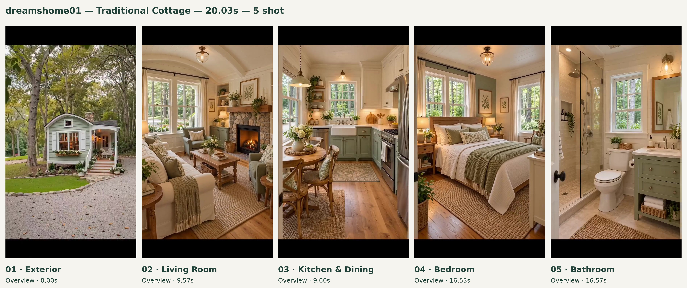
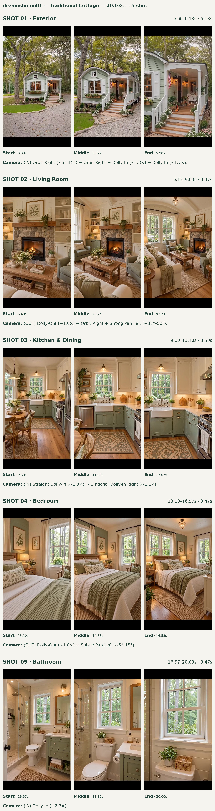
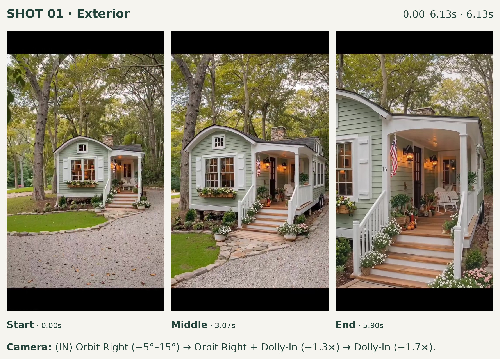
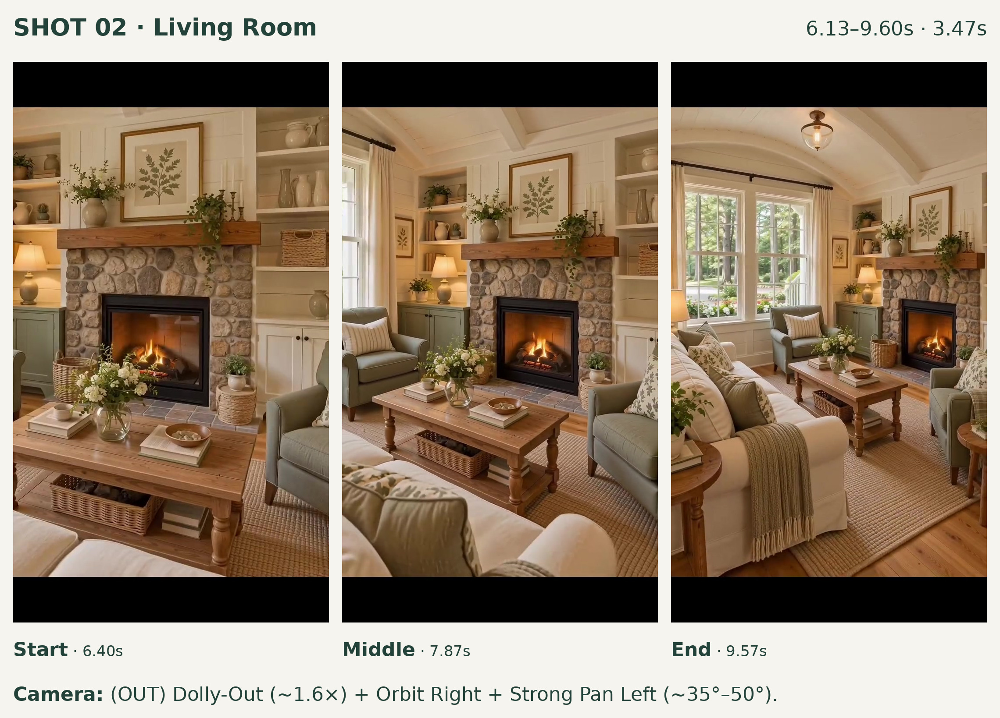
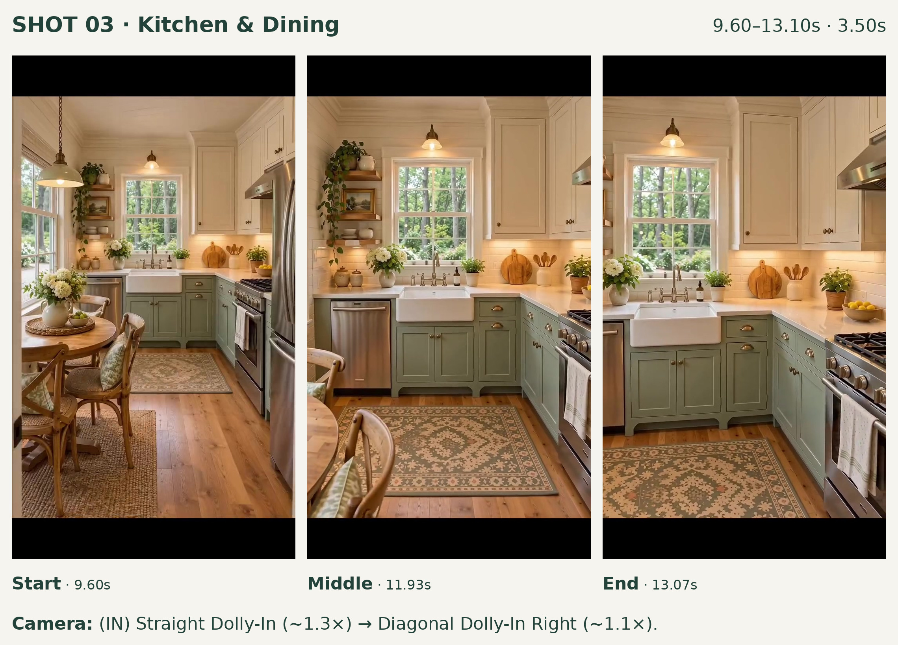
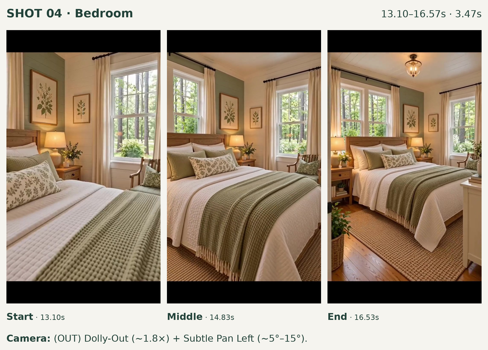
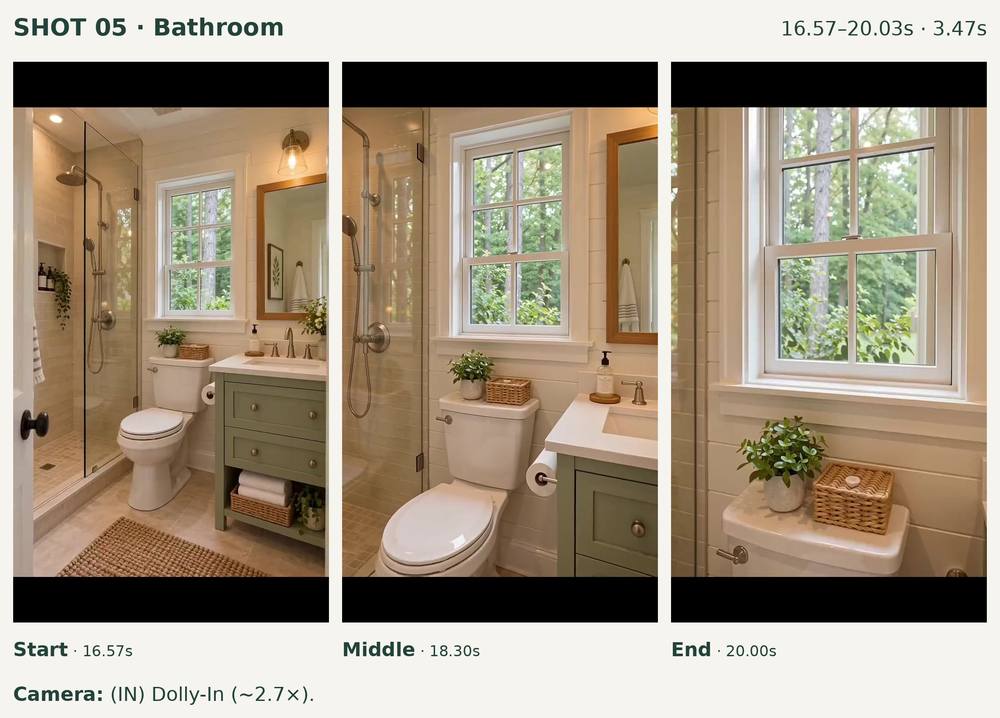

# dreamshome01 — Sage Woodland Cottage

## 1. Profil desain

- **Nama desain:** Sage Woodland Cottage
- **Tipe rumah:** Tiny House on Wheels
- **Gaya utama:** **Traditional Cottage**
- **Pengaruh gaya:** American Cottage
- **Gaya interior:** English Country; Traditional Farmhouse
- **Susunan ruang utama:** Montase memperlihatkan eksterior, living, dapur sekaligus meja makan, kamar tidur dan kamar mandi; sambungan denah tidak terlihat.
- **Ciri khas:** Mantel kayu perapian batu, cabinetry sage, tekstil botanical, jendela berpetak.; Roda ganda tampak di bawah sisi kanan rumah, indikasi basis trailer.
- **Material utama:** Siding horizontal tampak hijau pucat, lantai tampak kayu hangat, batu perapian, ubin krem.
- **Pencahayaan:** Daylight lembut dari jendela, dilapis lampu hangat dan api perapian.
- **Atmosfer:** Hangat, tenang dan bernuansa hutan dengan tekstur rustic yang lembut.
- **Lingkungan:** Tapak berhutan, pepohonan tinggi, rumput dan jalur kerikil.

### Palet warna

| Peran | Warna | HEX |
| --- | --- | --- |
| Dominan | Sage green | `#8C9784` |
| Dominan | Ivory | `#F0E6D5` |
| Pendamping | Warm oak brown | `#A77B50` |
| Pendamping | Beige linen | `#D5C6AE` |
| Aksen | Dark bronze | `#514338` |

## 2. Ukuran & proporsi

| Aspek | Estimasi visual |
| --- | --- |
| **Ukuran rumah** | tiny |
| **Bentuk bangunan** | Massa cottage kecil dengan teras beratap di kanan. |
| **Lantai & bentuk atap** | Satu tingkat yang terlihat; bukaan kecil tinggi di fasad tidak membuktikan loft. · Profil atap utama melengkung dengan atap teras lebih rendah. |
| **Tapak bangunan** | Massa kompak memanjang di atas basis terangkat; roda terlihat pada sisi kanan. |
| **Proporsi utama** | Fasad relatif sempit, atap lengkung rendah, lantai sedikit terangkat. |
| **Perkiraan luas lantai** | **20–45 m²** |

## 3. Shot Timeline

Durasi 20.03s · 5 shot.

**Camera Pattern:** IN – OUT – IN – OUT – IN.

| Shot | Time (s) | Duration | Area/Scene | Camera Movement |
| --- | --- | --- | --- | --- |
| 01 | 0.00–6.13 | 6.13s | Exterior | Orbit Right (~5°–15°) → Orbit Right + Dolly-In (~1.3×) → Dolly-In (~1.7×). |
| 02 | 6.13–9.60 | 3.47s | Living Room | Dolly-Out (~1.6×) + Orbit Right + Strong Pan Left (~35°–50°). |
| 03 | 9.60–13.10 | 3.50s | Kitchen & Dining | Straight Dolly-In (~1.3×) → Diagonal Dolly-In Right (~1.1×). |
| 04 | 13.10–16.57 | 3.47s | Bedroom | Dolly-Out (~1.8×) + Subtle Pan Left (~5°–15°). |
| 05 | 16.57–20.03 | 3.47s | Bathroom | Dolly-In (~2.7×). |

## 4. Overview

**Shot 01 · Exterior · 0.00s**

> Dari jalur kerikil, pandangan frontal wide memperlihatkan fasad, teras kanan, rumput kiri dan hutan tinggi di belakang.

**Shot 02 · Living Room · 9.57s**

> Dari sisi sofa yang telah mundur, pandangan serong wide ke perapian kanan dan jendela kiri menunjukkan susunan sofa, kursi dan meja di atas rug.

**Shot 03 · Kitchen & Dining · 9.60s**

> Dari akses dapur, pandangan wide menuju jendela wastafel mencakup meja makan kiri dan kabinet serta peralatan di kanan.

**Shot 04 · Bedroom · 16.53s**

> Dari sisi kaki ranjang setelah mundur, pandangan wide serong memperlihatkan ranjang utuh, dua jendela, lampu plafon dan lantai.

**Shot 05 · Bathroom · 16.57s**

> Dari ambang, pandangan wide menghadap jendela belakang menampilkan shower kaca kiri, kloset tengah dan vanity kanan.

## 5. Storyboard

## 6. Shot Details

### Shot 01 · Exterior

**Time:** 0.00–6.13s · **Duration:** 6.13s

#### **A. Desain area**

**Arsitektur**

> Siding horizontal sage dengan trim putih, profil atap utama melengkung dan bukaan kecil tinggi. Fasad memiliki jendela berpetak, kotak bunga, teras kanan beratap, tangga kayu dan railing putih. Roda ganda tampak di bawah sisi kanan, mengindikasikan basis trailer.

**Furnitur & dekorasi**

> Kursi teras, pot bunga dan kotak bunga di bawah jendela; lampu dinding hangat di area masuk.

**Lingkungan**

> Pepohonan tinggi membingkai rumah, rumput di kiri dan jalan kerikil serta batu pijakan di depan.

#### **B. Framing & Lighting**

- **Fokus:** Bergerak dari tapak luas ke pintu
- **Camera Start:** Di jalur kerikil depan rumah · Menghadap fasad, kemudian teras kanan · wide frontal · Sekitar tinggi mata · Hampir datar
- **Framing:** Wide seluruh rumah dan pohon → Teras dan tangga memenuhi frame; akhir sumber blur
- **Lighting:** Daylight lembut, lampu teras hangat
- **Foreground dan kedalaman:** Jalan kerikil, rumput dan pohon · Pohon dan jalan memberi lapisan depan, rumah tengah, hutan belakang
- **Reveal:** Teras kanan dan detail bunga
- **Kesesuaian gerak:** Orbit memberi sisi rumah, dolly memperkuat tujuan pintu

#### **C. Camera Movement**

Orbit ke kanan dominan dengan pendekatan visual ringan sejak F0, lalu overlap dengan pendekatan; pendekatan menuju tangga menjadi dominan pada akhir. Batas fase F30 dan F110 adalah perkiraan transisi bertahap, bukan perubahan gerakan mendadak. Pan terpisah tidak cukup terbukti.

**Tempo:** Awal mengalir, pembesaran lebih cepat menuju akhir sebelum blur; profil kecepatan fisik belum terpisah dari perspektif.

**Movement Timeline**

| Time (s) | Area & fokus | Camera Movement | Tempo |
| --- | --- | --- | --- |
| 0.00–1.00 | Exterior · Fasad dan pohon | Orbit Right (~5°–15°) | Awal mengalir, pembesaran lebih cepat menuju akhir sebelum blur; profil kecepatan fisik belum terpisah dari perspektif. |
| 1.00–3.67 | Exterior · Fasad menuju teras | Orbit Right + Dolly-In (~1.3×) | Awal mengalir, pembesaran lebih cepat menuju akhir sebelum blur; profil kecepatan fisik belum terpisah dari perspektif. |
| 3.67–6.13 | Exterior · Tangga dan bukaan teras | Dolly-In (~1.7×) | Awal mengalir, pembesaran lebih cepat menuju akhir sebelum blur; profil kecepatan fisik belum terpisah dari perspektif. |

**Camera:** Orbit Right (~5°–15°) → Orbit Right + Dolly-In (~1.3×) → Dolly-In (~1.7×).

---

### Shot 02 · Living Room

**Time:** 6.13–9.60s · **Duration:** 3.47s

#### **A. Desain area**

**Arsitektur**

> Perapian berlapis batu dengan mantel kayu dan rak built-in di kiri-kanan; plafon melengkung terang dan jendela besar berpetak di kiri. Lantai tampak papan kayu.

**Furnitur & dekorasi**

> Meja kopi persegi panjang di antara sofa terang dan kursi sage; rak pajangan, kabinet bawah, keranjang di bawah meja, karya botanical dan throw rajut.

**Lingkungan**

> Cahaya dari jendela kiri dengan pepohonan terlihat, lampu meja dan api memberi aksen hangat.

#### **B. Framing & Lighting**

- **Fokus:** Perapian sebagai jangkar, lalu ruang duduk
- **Camera Start:** Di sisi sofa dekat meja kopi · Menghadap perapian dan kemudian jendela kiri · oblique · Sekitar tinggi mata duduk/berdiri rendah · Sedikit menurun ke meja
- **Production Start:** F192 · 6.40s · Kamera di sisi sofa menghadap perapian batu dan mantel dari sudut agak serong; meja kayu di depan dan rak di sisi perapian. Frame jernih setelah blur pembuka.
- **Framing:** Awal sumber tertutup blur; perapian muncul di tengah → Wide sofa, meja dan jendela
- **Lighting:** Api dan lampu hangat, daylight dari kiri
- **Foreground dan kedalaman:** Tepi sofa dan meja · Sofa depan, meja tengah, dinding dan bukaan belakang
- **Reveal:** Jendela dan kursi kiri, plafon
- **Kesesuaian gerak:** Mundur dan pan membuka konteks furnitur

#### **C. Camera Movement**

Mundur dari perapian dengan gerak badan ke kanan dan sapuan kiri kuat, membuka jendela, sofa serta lantai. Awal blur; pengukuran dimulai F192.

**Tempo:** Mundur dan sapuan berlanjut; sapuan lebih nyata pada pertengahan dan laju pergeseran horizontal mereda menjelang akhir (sekitar F245–F287). Kurva laju fisik tidak dapat dikonfirmasi; Ease-Out independen tidak ditetapkan.

**Camera:** Dolly-Out (~1.6×) + Orbit Right + Strong Pan Left (~35°–50°).

---

### Shot 03 · Kitchen & Dining

**Time:** 9.60–13.10s · **Duration:** 3.50s

#### **A. Desain area**

**Arsitektur**

> Kabinet membentuk L dari bawah jendela ke kanan, kabinet atas krem dan bawah sage. Apron sink di bawah jendela berpetak; backsplash terang, lantai papan tampak kayu.

**Furnitur & dekorasi**

> Meja makan bulat kayu dan kursi di kiri; kompor dan hood di kanan, lemari es di awal kanan, dishwasher di kiri wastafel, papan potong dan tanaman di countertop.

**Lingkungan**

> Jendela menghadap dedaunan; lampu pendant dan lampu bawah kabinet bernuansa hangat.

#### **B. Framing & Lighting**

- **Fokus:** Wastafel sebagai jangkar, kompor makin dominan
- **Camera Start:** Di akses dapur antara meja makan dan kabinet · Menuju jendela wastafel lalu bidang kanan · wide oblique · Sekitar tinggi mata · Sedikit menurun ke lantai kerja
- **Framing:** Wide dapur dan meja kiri → Medium wide sudut wastafel-kompor
- **Lighting:** Daylight depan dan lampu tugas hangat
- **Foreground dan kedalaman:** Kursi dan meja kiri, kabinet kanan · Lorong tengah menuju jendela belakang
- **Reveal:** Detail kabinet L dan countertop
- **Kesesuaian gerak:** Dolly lewat lorong, lalu pendekatan serong membuka sisi kerja kanan

#### **C. Camera Movement**

Maju dominan lurus menuju wastafel, lalu framing bergerak ke kanan dengan pendekatan serong sebagai tafsir paling masuk akal. Pan terpisah belum terkonfirmasi.

**Tempo:** Pembesaran berlanjut dengan rasio lebih kecil pada fase akhir; pergeseran horizontal lebih nyata, kurva laju fisik tidak diketahui.

**Movement Timeline**

| Time (s) | Area & fokus | Camera Movement | Tempo |
| --- | --- | --- | --- |
| 9.60–11.93 | Kitchen & Dining · Wastafel dan jendela | Straight Dolly-In (~1.3×) | Pembesaran berlanjut dengan rasio lebih kecil pada fase akhir; pergeseran horizontal lebih nyata, kurva laju fisik tidak diketahui. |
| 11.93–13.10 | Kitchen & Dining · Sudut kabinet dan kompor | Diagonal Dolly-In Right (~1.1×) | Pembesaran berlanjut dengan rasio lebih kecil pada fase akhir; pergeseran horizontal lebih nyata, kurva laju fisik tidak diketahui. |

**Camera:** Straight Dolly-In (~1.3×) → Diagonal Dolly-In Right (~1.1×).

---

### Shot 04 · Bedroom

**Time:** 13.10–16.57s · **Duration:** 3.47s

#### **A. Desain area**

**Arsitektur**

> Kamar dengan dua bidang jendela berpetak, dinding aksen sage di belakang ranjang, dinding krem lainnya, plafon terang dan lantai papan kayu.

**Furnitur & dekorasi**

> Ranjang besar headboard kayu, linen putih, throw sage, bantal botanical, meja samping dan lampu hangat, karya botani di dinding; tanaman di tepi jendela.

**Lingkungan**

> Cahaya alami melalui dua bukaan dengan pepohonan di luar, dilapis lampu samping dan plafon hangat.

#### **B. Framing & Lighting**

- **Fokus:** Ranjang pusat, bukaan membingkai
- **Camera Start:** Dekat sisi kaki ranjang · Menghadap serong ke kepala ranjang dan jendela kanan · oblique · Sekitar tinggi mata rendah · Sedikit ke bawah menuju ranjang
- **Framing:** Detail ranjang dan jendela kanan → Wide ranjang, dua bukaan dan lantai
- **Lighting:** Daylight dari dua bukaan dengan lampu hangat
- **Foreground dan kedalaman:** Bedcover dan bantal · Ranjang foreground ke dinding jendela
- **Reveal:** Jendela kiri, lampu plafon, lantai
- **Kesesuaian gerak:** Mundur dan pan kiri membuka simetri dan volume

#### **C. Camera Movement**

Mundur dari detail ranjang, dengan pembukaan framing ke kiri dan putaran kiri ringan sebagai tafsir visual; sudut tidak terkalibrasi.

**Tempo:** Mundur mengalir; perubahan framing terasa pada bagian tengah, profil laju fisik tidak terukur.

**Camera:** Dolly-Out (~1.8×) + Subtle Pan Left (~5°–15°).

---

### Shot 05 · Bathroom

**Time:** 16.57–20.03s · **Duration:** 3.47s

#### **A. Desain area**

**Arsitektur**

> Kamar mandi kompak: shower kaca di kiri, kloset di bawah jendela belakang, vanity sage di kanan. Bidang dinding dan lantai ubin krem, cermin berbingkai kayu.

**Furnitur & dekorasi**

> Shower kaca dengan head dan hand shower, vanity dua laci dan rak bawah dengan handuk; wastafel putih, cermin kayu, keranjang kecil dan tanaman di atas tangki kloset.

**Lingkungan**

> Pemandangan hijau melalui jendela, cahaya luar difus dan lampu dinding hangat dekat cermin.

#### **B. Framing & Lighting**

- **Fokus:** Jendela di atas kloset
- **Camera Start:** Di ambang pintu kamar mandi · Menghadap kloset dan jendela belakang · oblique · Sekitar tinggi mata · Sedikit ke bawah pada awal
- **Framing:** Wide shower kiri, kloset tengah, vanity kanan → Detail jendela dan tangki kloset
- **Lighting:** Daylight dari jendela, lampu hangat cermin
- **Foreground dan kedalaman:** Pintu dan vanity · Ambang, perlengkapan, dinding belakang
- **Reveal:** Detail tanaman, keranjang dan bukaan
- **Kesesuaian gerak:** Maju sepanjang ruang sempit, framing mengerucut

#### **C. Camera Movement**

Maju dari ambang menuju jendela di atas kloset. Tepi bawah daun jendela yang sama membesar sekitar 2,7×; shower dan vanity keluar di sisi yang berlawanan, tanpa bukti sapuan kanan yang berdiri sendiri.

**Tempo:** Pendekatan berlanjut sampai akhir; pembesaran gambar makin terasa, tetapi profil laju fisik dan Ease-Out tidak dapat dipastikan dari perspektif.

**Camera:** Dolly-In (~2.7×).

**Catatan referensi:** Estimasi luas 20–45 m² hanya berdasar skala visual massa rumah dan ruang yang tampil; tanpa denah/ukuran referensi tidak bisa dipastikan. Video berupa montase; material fisik, lokasi, denah dan kontinuitas rumah nyata belum terverifikasi. Skala kamera merupakan perkiraan visual, bukan parameter kamera 3D. Roda terlihat di eksterior; kesesuaian ruang interior dengan massa trailer tidak dapat dibuktikan dari montase.
