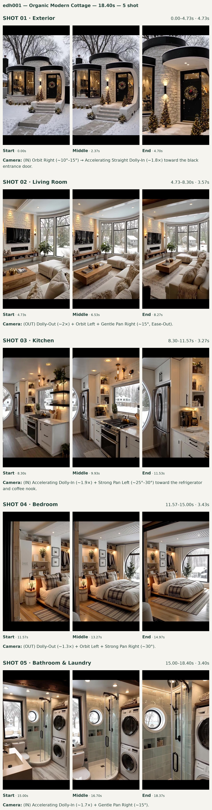
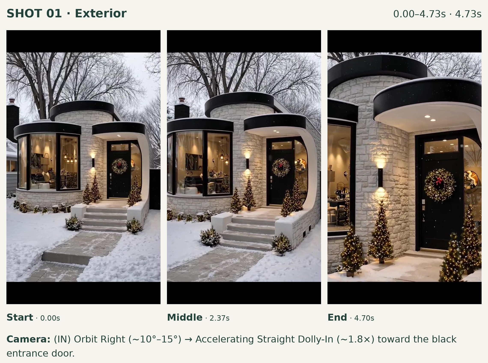
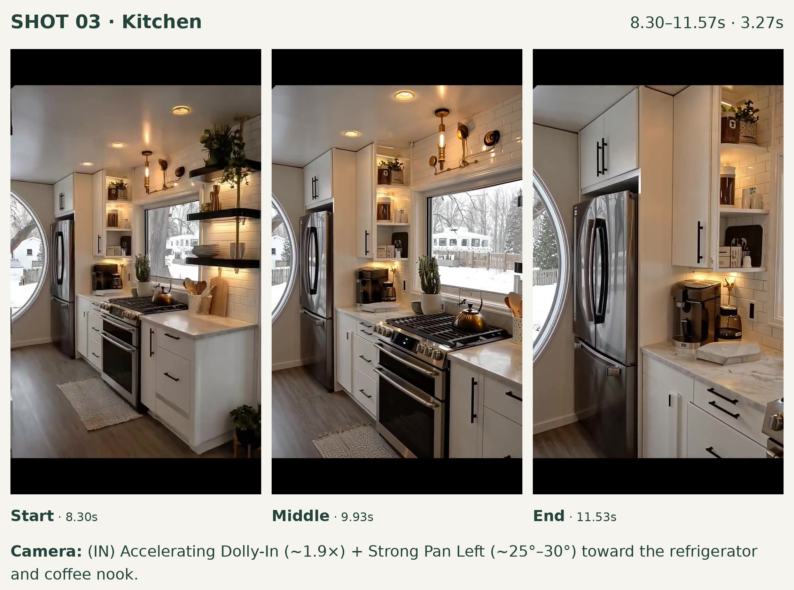

# edh001 — Cottage Batu Lengkung di Halaman Bersalju

## 1. Profil desain

- **Nama desain:** Cottage Batu Lengkung di Halaman Bersalju
- **Tipe rumah:** Cottage
- **Gaya utama:** **Organic Modern Cottage**
- **Pengaruh gaya:** Contemporary Scandinavian; Modern Farmhouse
- **Gaya interior:** Cozy Modern
- **Susunan ruang utama:** Dapur linear, penyimpanan terbuka kamar dan laundry bertumpuk di kamar mandi
- **Ciri khas:** Motif lengkung pada massa, kanopi, kaca ruang tamu, jendela kamar dan shower
- **Material utama:** Batu terang bertekstur dan bidang kayu hangat, dipertegas kusen dan logam hitam
- **Pencahayaan:** Lampu dalam bernuansa hangat dipadukan cahaya siang yang sejuk
- **Atmosfer:** Hangat dan intim, dengan aksen lampu keemasan dan kayu madu di tengah suasana musim dingin.
- **Lingkungan:** Pemandangan musim dingin dengan salju, batang pohon tanpa daun dan beberapa rumah sekitar

### Palet warna

| Peran | Warna | HEX |
| --- | --- | --- |
| Dominan | Abu batu terang | `#9B9493` |
| Pendamping | Krem lembut | `#C6BEB6` |
| Pendamping | Kayu madu | `#A17653` |
| Aksen | Hitam arang | `#0A090B` |
| Aksen kamar mandi | Hijau zaitun keabu-abuan | `#717062` |

## 2. Ukuran & proporsi

| Aspek | Estimasi visual |
| --- | --- |
| **Ukuran rumah** | small |
| **Bentuk bangunan** | Massa kompak berlapis dengan bay window dan portal membulat |
| **Lantai & bentuk atap** | Satu tingkat utama yang terlihat · Tepi atap hitam mengikuti lengkung setiap massa |
| **Tapak bangunan** | compact |
| **Proporsi utama** | Fasad rendah melebar dengan massa tengah yang lebih tinggi |
| **Perkiraan luas lantai** | **60–85 m²** |

## 3. Shot Timeline

Durasi 18.40s · 5 shot.

**Camera Pattern:** IN – OUT – IN – OUT – IN.

| Shot | Time (s) | Duration | Area/Scene | Camera Movement |
| --- | --- | --- | --- | --- |
| 01 | 0.00–4.73 | 4.73s | Exterior | Orbit Right (~10°–15°) → Accelerating Straight Dolly-In (~1.8×) toward the black entrance door. |
| 02 | 4.73–8.30 | 3.57s | Living Room | Dolly-Out (~2×) + Orbit Left + Gentle Pan Right (~15°, Ease-Out). |
| 03 | 8.30–11.57 | 3.27s | Kitchen | Accelerating Dolly-In (~1.9×) + Strong Pan Left (~25°–30°) toward the refrigerator and coffee nook. |
| 04 | 11.57–15.00 | 3.43s | Bedroom | Dolly-Out (~1.3×) + Orbit Left + Strong Pan Right (~30°). |
| 05 | 15.00–18.40 | 3.40s | Bathroom & Laundry | Accelerating Dolly-In (~1.7×) + Gentle Pan Right (~15°). |

## 4. Overview

**Shot 01 · Exterior · 0.00s**

> Dari jalur bersalju sebelum tangga, kamera setinggi mata menghadap fasad hampir lurus dengan sedikit sudut serong. Jalur paving membawa mata ke tangga dan portal putih di kanan, sementara bay window serta massa tengah yang lebih tinggi tetap masuk bingkai. Pepohonan tanpa daun membentuk latar yang kontras dengan lampu hangat di sekitar pintu.

**Shot 02 · Living Room · 8.27s**

> Kamera di belakang sisi sofa menghadap serong ke dinding TV di kiri dan jendela lengkung di belakang. Dari posisi agak lebih jauh ini seluruh meja, sebagian besar sofa L, karpet dan jalur lantai dekat dinding terbaca bersamaan. Bantal serta selimut berada di sisi kanan depan, salju terlihat melalui kaca dan lampu hangat menyorot dinding media.

**Shot 03 · Kitchen · 8.30s**

> Dari ujung kanan baris kabinet, kamera setinggi mata melihat serong sepanjang meja. Ujung kabinet mengisi depan kanan, kompor berada di tengah, sedangkan ceruk kopi, kulkas dan bukaan melengkung menyusun kedalaman ke kiri. Lampu rak dan cahaya salju dari jendela rectangular memperlihatkan hampir seluruh susunan kerja sejak awal.

**Shot 04 · Bedroom · 14.97s**

> Dilihat dari posisi yang sudah mundur ke ambang, kamera menghadap serong ke ranjang dan jendela. Kusen tersisa di tepi kiri, ranjang rendah dan karpet terbaca hampir utuh di tengah, serta jendela bundar dengan pemandangan salju mendominasi kanan. Rak dan gantungan menjaga kedalaman di belakang bantal.

**Shot 05 · Bathroom & Laundry · 15.00s**

> Dari dekat pintu dan sisi wastafel, kamera setinggi mata menghadap serong ke shower dan laundry. Countertop dan toilet mendahului shower kaca di tengah, dengan menara mesin cuci di kanan serta dua bentuk jendela yang tampil bersamaan. Cahaya luar dingin mengimbangi lampu hangat yang memantul pada ubin.

## 5. Storyboard

## 6. Shot Details

### Shot 01 · Exterior

**Time:** 0.00–4.73s · **Duration:** 4.73s

#### **A. Desain area**

**Arsitektur**

> Fasad kompak tersusun dari beberapa massa melengkung dengan dinding berpenampilan batu terang dan tepian atap hitam yang tegas. Di kiri, kaca tinggi berbingkai hitam mengikuti tonjolan dinding melengkung. Massa tengah naik di belakangnya. Pintu hitam dengan kaca atas dan panel kaca di kanan berada di balik portal putih berundak yang melengkung, dengan kanopi hitam dan lampu tanam. Beberapa anak tangga menyambungkan teras pendek dengan jalur berpaving.

**Furnitur & dekorasi**

> Karangan hias berlampu menempel di daun pintu. Cemara kecil berlampu mengapit area masuk dan semak rendah mengikuti dasar fasad serta sisi tangga. Dari kaca besar di kiri terlihat sebagian lampu gantung, kap lampu dan isi ruang yang bernuansa hangat.

**Lingkungan**

> Salju menutup halaman dan bagian tepi jalur masuk. Pohon besar tanpa daun berada di belakang rumah, dan bagian bangunan sekitar terlihat di sisi kiri. Cahaya luar mendung membuat batu terang dan tepian hitam terbaca jelas.

#### **B. Framing & Lighting**

- **Fokus:** Hubungan bay window melengkung dan pintu hitam.
- **Camera Start:** Di jalur masuk sebelum tangga teras. · Menghadap fasad dengan pintu di sisi kanan bingkai. · Hampir frontal, sedikit serong ke bidang masuk. · Sekitar tinggi mata terhadap jalur. · Hampir datar.
- **Framing:** Wide fasad dengan jalur masuk utuh. → Medium wide pada pintu hitam, portal dan sebagian bay window.
- **Lighting:** Cahaya mendung sejuk dengan lampu dinding dan kanopi hangat.
- **Foreground dan kedalaman:** Jalur paving dan tepi salju. · Jalur, tangga, portal, lalu pintu yang lebih dalam di bawah kanopi.
- **Reveal:** Sisi kanan portal dan detail pintu semakin terbuka.
- **Kesesuaian gerak:** Mulai cukup lebar untuk memberi ruang gerak ke kanan, dengan tangga sebagai garis masuk menuju pintu.

#### **C. Camera Movement**

Kamera melengkung ke kanan sambil mempertahankan fasad, kemudian maju dengan ritme yang menguat menuju pintu hitam sampai jalur dan sisi kiri fasad keluar dari bingkai.

**Tempo:** Pelan saat melengkung, lalu berkembang dari sedang menjadi cepat ketika mendekati pintu.

- **0.00–2.10s · slow:** Pergeseran sudut pelan dengan fasad tetap terbaca.
- **2.10–3.17s · moderate:** Mulai maju dan dasar fasad membesar.
- **3.17–4.73s · fast:** Tangga dan tepi fasad keluar dari bingkai dalam waktu lebih singkat.

**Movement Timeline**

| Time (s) | Area & fokus | Camera Movement | Tempo |
| --- | --- | --- | --- |
| 0.00–2.10 | Exterior · Bay window, portal masuk dan muka tangga | Orbit Right (~10°–15°) | Pergeseran sudut pelan dengan fasad tetap terbaca. |
| 2.10–4.73 | Exterior · Pintu hitam dan kanopi masuk | Accelerating Straight Dolly-In (~1.8×) toward the black entrance door | Mulai maju dan dasar fasad membesar.; Tangga dan tepi fasad keluar dari bingkai dalam waktu lebih singkat. |

**Camera:** Orbit Right (~10°–15°) → Accelerating Straight Dolly-In (~1.8×) toward the black entrance door.

---

### Shot 02 · Living Room

**Time:** 4.73–8.30s · **Duration:** 3.57s

#### **A. Desain area**

**Arsitektur**

> Dinding media bertekstur batu terang mengikat TV hitam dengan perapian linear di bawahnya. Ambalan kayu rendah memanjang dengan ceruk terbuka. Pada sisi kanan, kaca tinggi berbingkai gelap mengikuti bidang melengkung. Plafon mengikuti lengkung area kaca dengan tingkat putih dan titik lampu tanam. Lantai berpenampilan papan kayu abu kecokelatan terlihat di luar tepi karpet.

**Furnitur & dekorasi**

> Sofa krem berbentuk L membingkai sisi kanan dan belakang area duduk, dengan modul chaise dekat jendela. Meja kopi balok kayu bertapak rendah berada di tengah karpet bermotif netral. Buku dan benda dekoratif berwarna kuningan serta gelap tersusun di atas meja. Ada bantal bertekstur, selimut rajut, tanaman dalam pot beralur dekat jendela, dan dekorasi kecil di ambalan bawah TV.

**Lingkungan**

> Di balik kaca terlihat salju, pohon tanpa daun, tanaman hijau gelap dan bangunan tetangga. Cahaya siang dari jendela mengisi area duduk, dengan lapisan cahaya hangat pada dinding media dan sisi jendela.

#### **B. Framing & Lighting**

- **Fokus:** Susunan sofa dan meja terhadap TV serta jendela.
- **Camera Start:** Di sisi dalam area duduk dekat sofa dan meja kopi. · Serong dari sofa menuju pertemuan dinding TV dan kaca melengkung. · Serong lintas ruang. · Di atas sandaran dan permukaan meja, sekitar tinggi mata. · Sedikit mengarah ke bawah, tetap stabil.
- **Framing:** Medium wide terpotong bantal dan meja kopi. → Wide seluruh susunan sofa, meja, dinding TV dan jendela lengkung.
- **Lighting:** Siang dingin dari kaca dengan lampu dinding dan plafon yang hangat.
- **Foreground dan kedalaman:** Bantal sofa dan bagian meja kopi di tepi depan. · Sofa dekat, meja tengah, dinding media dan kaca ke halaman.
- **Reveal:** Meja utuh, lengkung kaca dan susunan sofa L.
- **Kesesuaian gerak:** Letakkan kamera cukup dekat dengan tepi sofa untuk memberi ruang reveal saat mundur dan memutar ke kanan.

#### **C. Camera Movement**

Kamera mundur melengkung ke kiri sambil menoleh lembut ke kanan. Meja kopi yang terpotong menjadi utuh, lalu sofa L dan bidang jendela melengkung terbuka dalam satu komposisi.

**Tempo:** Mundur dengan tempo sedang. Bukaan ruang paling terasa di bagian tengah, lalu pergeseran melandai menjelang cut.

**Camera:** Dolly-Out (~2×) + Orbit Left + Gentle Pan Right (~15°, Ease-Out).

---

### Shot 03 · Kitchen

**Time:** 8.30–11.57s · **Duration:** 3.27s

#### **A. Desain area**

**Arsitektur**

> Dapur kompak mengikuti satu dinding. Kabinet putih berpanel dan pegangan hitam mengapit kompor serta kulkas di ujung kiri. Countertop putih bercorak abu menyerupai marmer, di depan backsplash ubin putih persegi panjang bersusun bata. Jendela persegi panjang berada di atas kompor dan bukaan besar melengkung terlihat di kiri kulkas. Ceruk terbuka putih di kiri jendela dan rak hitam di kanan mendapat cahaya aksen. Lantai tampak seperti papan kayu abu kecokelatan.

**Furnitur & dekorasi**

> Kompor dengan kisi hitam dan oven berpenampilan stainless berada di bawah jendela. Teko logam bernuansa kuningan di atasnya. Kulkas dua pintu atas dengan laci bawah ditemani mesin kopi hitam di countertop. Ada kaktus dalam pot putih, alat masak kayu, talenan sandar, piring bertumpuk, tanaman menjuntai dan runner beige pendek di lantai.

**Lingkungan**

> Dari jendela tampak halaman bersalju dengan batang pohon dekat rumah, pagar kayu dan bangunan terang di belakang. Pohon cemara gelap ikut terbaca dari bukaan melengkung ketika kamera mendekati kulkas.

#### **B. Framing & Lighting**

- **Fokus:** Kompor di bawah jendela, beralih ke ceruk kopi dan kulkas.
- **Camera Start:** Di dekat ujung kanan kabinet, sebelum area kompor. · Serong menyusuri baris meja menuju kompor dan kulkas di kiri. · Serong dari ujung susunan satu dinding. · Sekitar tinggi mata, permukaan countertop terlihat. · Sedikit melihat ke bawah pada meja kerja.
- **Framing:** Wide baris dapur dengan kulkas, kompor dan rak kanan. → Bidang lebih rapat pada kulkas dan ceruk kopi.
- **Lighting:** Cahaya siang bersalju di jendela dengan lampu tanam, aksen ceruk dan rak hangat.
- **Foreground dan kedalaman:** Ujung kabinet kanan, rak dan tepian runner. · Countertop dekat menuju kompor, ceruk kopi lalu kulkas.
- **Reveal:** Ceruk kopi, detail kabinet dan fasad kulkas.
- **Kesesuaian gerak:** Awal yang serong memberi kedalaman di sepanjang countertop dan memungkinkan sapuan kiri saat maju.

#### **C. Camera Movement**

Kamera maju sepanjang baris kabinet dan menyapu ke kiri. Kompor membesar terlebih dahulu, lalu bergerak ke kanan bingkai saat fokus beralih ke kulkas dan ceruk kopi.

**Tempo:** Sedang saat mendekati kompor dan lebih cepat saat pandangan berpindah ke kulkas.

- **8.30–9.80s · moderate:** Mendekat dengan perubahan framing bertahap.
- **9.80–11.57s · fast:** Rak kanan lepas dan fokus cepat berpindah ke ceruk kopi serta kulkas.

**Camera:** Accelerating Dolly-In (~1.9×) + Strong Pan Left (~25°–30°) toward the refrigerator and coffee nook.

---

### Shot 04 · Bedroom

**Time:** 11.57–15.00s · **Duration:** 3.43s

#### **A. Desain area**

**Arsitektur**

> Kusen kayu gelap membingkai akses ke kamar dengan lantai papan kayu hangat. Di belakang ranjang ada ceruk rak berlapis kayu dan rak pakaian terbuka yang dipisahkan bidang putih sempit. Simpanan atas memakai kotak dan keranjang. Bagian plafon di atas ranjang berpanel putih dengan lampu tanam. Jendela besar berbingkai hitam membentuk lengkung bundar, dengan batang gorden gelap dan kain krem di sampingnya.

**Furnitur & dekorasi**

> Ranjang rendah bertumpu pada platform kayu. Sprei dan selimut gading dipadukan dengan bantal serta runner kotak gelap. Meja samping bulat bertekstur kayu memuat tanaman kecil di bawah lampu hitam berlengan tipis. Rak menyimpan dekorasi dan wadah, serta dua bingkai gambar tersusun vertikal di antara ceruk rak dan gantungan pakaian. Karpet garis mengikuti dasar ranjang.

**Lingkungan**

> Di balik jendela lengkung terlihat salju, rumah tetangga dan batang pohon. Tanaman tegak dekat kaca memperjelas kedalaman. Cahaya dingin dari jendela datang dari kanan, sedangkan rak dan lampu samping ranjang memberi cahaya hangat.

#### **B. Framing & Lighting**

- **Fokus:** Ranjang dan ceruk rak, bergeser menuju jendela bundar.
- **Camera Start:** Di tepi bukaan kamar dengan kusen di kiri depan. · Serong ke sisi kiri ranjang, rak dan gantungan pakaian. · Serong dari ambang. · Sekitar tinggi mata terhadap kamar. · Hampir datar dengan sedikit lantai terlihat.
- **Framing:** Medium wide pada sisi ranjang dan area simpan. → Wide pada ranjang, karpet dan jendela bundar.
- **Lighting:** Aksen rak dan lampu samping hangat dengan cahaya bersalju dari kanan.
- **Foreground dan kedalaman:** Kusen kayu dan tepi bukaan di kiri. · Kusen, nakas dan ranjang, lalu rak serta kaca di sisi kanan.
- **Reveal:** Ujung ranjang, karpet, jendela bundar dan pandangan luar.
- **Kesesuaian gerak:** Awal dekat kusen memberi jangkar depan sementara gerak mundur membuka sisi kanan kamar.

#### **C. Camera Movement**

Kamera mundur dari sisi ranjang sambil melengkung ke kiri dan menoleh ke kanan. Kusen menjadi bingkai kiri, lalu ujung ranjang, karpet, dan jendela bundar terlihat semakin lengkap.

**Tempo:** Tempo sedang dan mengalir. Bukaan jendela mulai terasa di pertengahan shot dan terus bertambah sampai akhir.

**Camera:** Dolly-Out (~1.3×) + Orbit Left + Strong Pan Right (~30°).

---

### Shot 05 · Bathroom & Laundry

**Time:** 15.00–18.40s · **Duration:** 3.40s

#### **A. Desain area**

**Arsitektur**

> Kamar mandi memadukan wastafel di kiri, toilet di bawah jendela persegi panjang, shower kaca melengkung di tengah dan laundry bertumpuk di kanan. Shower berdiri pada alas terang yang sedikit terangkat dengan rel, tarikan pintu dan perangkat shower hitam. Ubin persegi panjang bernuansa hijau abu di bawah beralih ke krem mengilap di atas. Jendela kecil bulat dan ceruk perlengkapan menempel pada dinding shower. Lantai berpenampilan papan abu terang.

**Furnitur & dekorasi**

> Wastafel persegi menyatu dengan countertop terang yang tebal. Toilet putih berada di sela wastafel dan shower. Mesin cuci dan pengering bukaan depan disusun vertikal, dengan handuk lipat di atas rak kayu. Botol dan wadah kecil berada di ceruk shower; saluran kotak gelap terlihat pada alas shower.

**Lingkungan**

> Jendela persegi panjang dan jendela bulat membawa cahaya dingin dari halaman bersalju dan pepohonan tanpa daun. Lampu tanam serta garis cahaya hangat di tepi plafon terpantul pada ubin mengilap dan kaca shower.

#### **B. Framing & Lighting**

- **Fokus:** Shower melengkung dan jendela bulat, dengan laundry di kanan.
- **Camera Start:** Dekat pintu dan sisi wastafel, sebelum susunan shower dan laundry. · Serong dari kiri depan ke shower di tengah dan laundry di kanan. · Serong ringan. · Sekitar tinggi mata dengan bagian atas wastafel terlihat. · Sedikit mengarah ke bawah pada awal.
- **Framing:** Wide wastafel, toilet, shower dan laundry. → Rapat pada jendela bulat dan perangkat shower, dengan tepi laundry masih terlihat.
- **Lighting:** Cahaya siang dari dua jendela dan pantulan lampu tanam serta cahaya tepi plafon yang hangat.
- **Foreground dan kedalaman:** Countertop wastafel di kiri bawah. · Wastafel dan toilet dekat, shower di tengah, dinding ubin dan laundry di sisi kanan.
- **Reveal:** Bukaan bulat, ceruk perlengkapan dan rel shower.
- **Kesesuaian gerak:** Wastafel di depan memberi lapisan awal dan keluar dari bingkai saat kamera maju serta menoleh ke kanan.

#### **C. Camera Movement**

Kamera maju ke shower sambil menoleh lembut ke kanan. Wastafel, toilet dan jendela kiri keluar bertahap. Jendela bulat dan perangkat shower membesar, dengan sisi mesin laundry masih terbaca.

**Tempo:** Sedang pada awal, lalu perubahan framing lebih cepat ketika kamera berada dekat kaca shower.

- **15.00–16.67s · moderate:** Susunan ruang masih terbaca sementara kamera mulai mendekat.
- **16.67–18.40s · fast:** Wastafel dan toilet lepas dari bidang, lalu jendela bulat dan perangkat shower cepat memenuhi bingkai.

**Camera:** Accelerating Dolly-In (~1.7×) + Gentle Pan Right (~15°).

**Catatan referensi:** Lengkung, material terang dan pencahayaan hangat berulang sepanjang video. Urutan cut tidak memperlihatkan koneksi fisik antararea.
