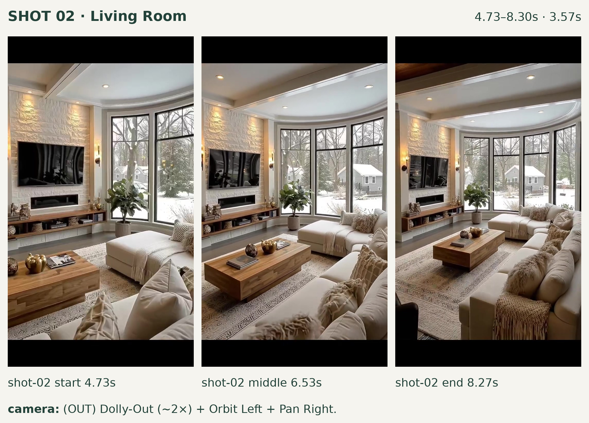
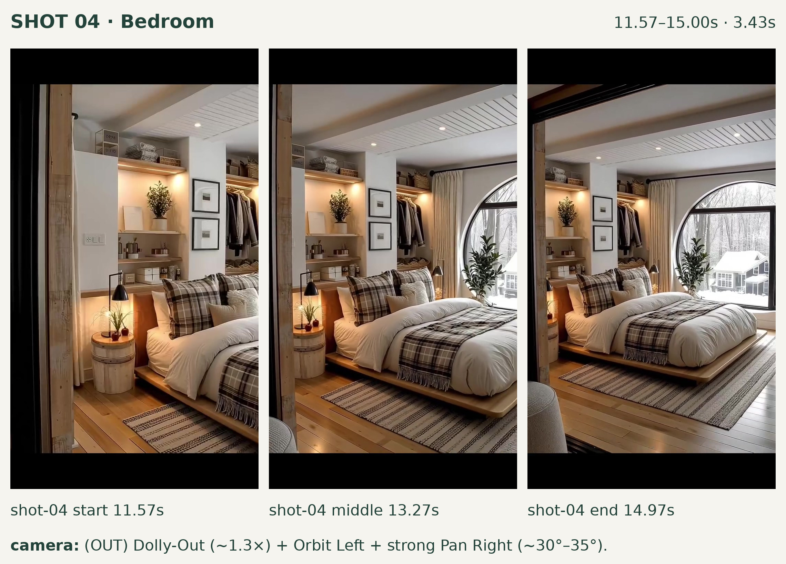

# edh001 — Curved Stone Winter Home

## 1. Profil desain

- **Nama desain:** Curved Stone Winter Home
- **Gaya utama:** **Contemporary Modern**
- **Pengaruh gaya:** Organic Modern; Scandinavian Contemporary
- **Gaya interior:** Warm Contemporary
- **Ciri khas:** Massa membulat dengan beberapa ketinggian volume, fascia hitam, bay window lengkung dan kanopi entrance membulat; Coffee niche bercahaya yang menyatu dengan deret kabinet dapur; Ranjang platform rendah dengan storage display dan hanging bay pada headwall; Shower kaca lengkung dengan porthole, ubin sage dan laundry tower di ruang yang sama
- **Warna & material:** Putih-krem, hitam/charcoal, kayu cokelat hangat, tekstil beige/taupe dan aksen sage pada shower.
- **Suasana dan lingkungan:** Interior hangat dan berlapis di tengah lingkungan bersalju, pepohonan tanpa daun serta rumah tetangga; wreath dan pohon kecil berlampu memberi suasana liburan.

## 2. Ukuran & proporsi

| Aspek | Estimasi visual |
| --- | --- |
| **Ukuran rumah** | small |
| **Bentuk bangunan** | Compact curvilinear; volume tengah membulat lebih tinggi dengan bay dan entrance yang menonjol di depan. |
| **Lantai & bentuk atap** | Satu tingkat bukaan depan terlihat, dengan volume atap tengah yang lebih tinggi. |
| **Tapak bangunan** | Kompak, dengan proyeksi melengkung pada bagian depan. |
| **Proporsi utama** | Fasad relatif sempit; bay window tinggi dan pintu ramping memperkuat proporsi vertikal, sementara interior memakai furnitur rendah. |
| **Perkiraan luas lantai** | **60–90 m²** |

## 3. Shot Timeline

Video berdurasi 18.40 detik terdiri atas lima shot kontinu yang dipisahkan hard cut: Exterior, Living Room, Kitchen, Bedroom, serta Bathroom & Laundry. Pergantian fungsi antarshot tidak membuktikan sambungan denah.

**Camera Pattern:** IN – OUT – IN – OUT – IN.

| Shot | Time (s) | Duration | Area/Scene | Camera Movement |
| --- | --- | --- | --- | --- |
| 01 | 0.00–4.73 | 4.73s | Exterior | Orbit Right (~15°–20°) → Accelerating Dolly-In (~2×) toward entrance door. |
| 02 | 4.73–8.30 | 3.57s | Living Room | Dolly-Out (~2×) + Orbit Left + Pan Right. |
| 03 | 8.30–11.57 | 3.27s | Kitchen | Accelerating Dolly-In (~2×) + Pan Left (~25°–30°) toward refrigerator and coffee niche. |
| 04 | 11.57–15.00 | 3.43s | Bedroom | Dolly-Out (~1.3×) + Orbit Left + strong Pan Right (~30°–35°). |
| 05 | 15.00–18.40 | 3.40s | Bathroom & Laundry | Dolly-In (~2×) + gentle Pan Right (~10°–15°). |

## 4. Overview

**Shot 01 · Exterior · 0.00s**

> Kamera berada di jalur pejalan kaki di depan tangga, sedikit serong terhadap fasad, dengan posisi sekitar tinggi mata dan pandangan hampir datar. Cakupan wide memuat bay window lengkung di kiri, pintu masuk hitam dan kanopi membulat di kanan, serta volume lebih tinggi di tengah-belakang. Jalur dan tangga mengisi foreground, fasad menjadi lapisan tengah, dan pepohonan tanpa daun berada di belakang. Salju putih membingkai rumah, dengan daylight mendung yang dingin dipadukan cahaya hangat dari jendela, sconce dan lampu kanopi.

**Shot 02 · Living Room · 8.27s**

> Kamera berada di tepi jalur masuk living, di belakang ujung sofa kanan, memandang serong ke pertemuan media wall kiri dan bay window belakang. Posisi sekitar tinggi mata dengan kemiringan hampir datar menghasilkan cakupan wide: sectional krem memanjang dari foreground kanan ke jendela, coffee table kayu berada di tengah karpet, dan TV serta konsol menempati sisi kiri. Kedalaman terbaca dari sofa terdekat, meja di tengah, lalu tanaman dan bidang kaca lengkung di belakang. Daylight dingin dari bay window berpadu dengan downlight, cahaya plafon lengkung dan sconce hangat.

**Shot 03 · Kitchen · 8.30s**

> Kamera berada di jalur depan kitchen dekat ujung counter kanan, memandang serong sepanjang deret kabinet pada posisi sekitar tinggi mata dengan pandangan sedikit ke bawah agar countertop dan lantai terbaca. Framing wide menempatkan sudut counter di foreground kanan, range di tengah, refrigerator serta coffee niche di kiri-belakang, dan rak gelap di kanan atas. Jendela persegi panjang berada di atas area memasak, sedangkan bukaan bundar terlihat di kiri refrigerator. Kedalaman mengikuti counter menuju niche, dengan daylight dingin dari kedua bukaan dan lapisan cahaya hangat pada niche, rak serta lampu atas jendela.

**Shot 04 · Bedroom · 14.97s**

> Kamera berada dekat akses bedroom pada sisi depan-kiri ranjang, memandang serong ke headwall dan bukaan besar di kanan, sekitar tinggi mata dengan pandangan sedikit ke bawah. Cakupan wide memuat ranjang beserta platform dan karpet hampir utuh, storage display di kiri headwall, hanging bay di belakang ranjang, serta jendela beroutline membulat di kanan. Kusen kiri dan sebagian tempat duduk abu-abu menjadi foreground, ranjang lapisan tengah, dan headwall serta pemandangan bersalju menjadi latar. Daylight dari kanan berpadu dengan downlight, lampu samping ranjang dan cahaya rak yang hangat.

**Shot 05 · Bathroom & Laundry · 15.00s**

> Kamera berada di akses depan bathroom dekat vanity, memandang serong ke shower dan laundry pada posisi sekitar tinggi mata dengan arah sedikit ke bawah sehingga lantai dan tray tetap terlihat. Framing wide menempatkan vanity di foreground kiri, toilet dan jendela persegi panjang di kiri-tengah, enclosure shower lengkung di tengah, serta laundry tower di kanan. Kedalaman bergerak dari counter terdekat menuju kaca shower, niche dan porthole pada dinding belakang. Cahaya luar dingin dari kedua bukaan berpadu dengan downlight dan cahaya hangat di bagian atas wet zone.

## 5. Storyboard

## 6. Shot Details

### Shot 01 · Exterior

**Time:** 0.00–4.73s · **Duration:** 4.73s

#### **A. Desain area**

**Arsitektur**

> Fasad memadukan volume tengah menyerupai drum yang lebih tinggi, bay kaca melengkung di kiri dan entrance menonjol di kanan. Dinding berpenampilan batu potong putih-krem dipertegas fascia hitam tebal yang mengikuti kurva pada beberapa ketinggian. Pintu hitam memiliki kaca atas dan sidelight di kanan. Kanopi entrance membulat, dengan soffit putih dan downlight. Jalur slab abu-abu, anak tangga lurus lebar serta pembatas rendah mengantar ke landing. Elemen vertikal gelap berpenutup tampak di kiri bay; permukaan atap di belakang fascia tidak terlihat lengkap.

**Furnitur & dekorasi**

> Wreath dengan aksen merah dan lampu kecil terpasang pada pintu. Dua pohon konifer kecil berlampu hangat mengapit landing; semak rendah menghiasi kaki fasad serta sisi tangga. Melalui bay kaca terlihat sebagian tempat duduk, lampu dan meja. Lampu dinding hitam memberi sorotan hangat ke atas-bawah pada tekstur batu, sementara downlight menerangi akses masuk.

**Lingkungan**

> Salju menutupi halaman, tepi jalur, semak dan sebagian tepian bangunan. Pohon besar tanpa daun berdiri di belakang rumah; bangunan tetangga tampak parsial di kiri. Cahaya siang mendung yang dingin berkontras dengan pendar hangat dari bay window, pintu dan dekorasi entrance.

#### **B. Framing & Lighting**

- **Fokus:** Fasad membulat, bay window dan entrance berwarna hitam.
- **Camera Start:** Di jalur depan, sedikit serong terhadap bay dan entrance; Menghadap fasad dengan bay di kiri dan pintu di kanan; near-frontal / slight oblique
- **Framing:** Seluruh entrance dan bay window kiri terbaca bersama jalur akses; pintu berada di kanan komposisi. → Entrance dan dinding lampu membesar; bay terpotong di kiri dan jalur bawah berkurang.
- **Lighting:** Daylight mendung dingin, sconce up/down hangat dan downlight kanopi.

#### **C. Camera Movement**

Kamera mengitari fasad ke kanan, lalu maju semakin cepat menuju pintu masuk.

**Tempo:** Sedang pada orbit awal, lalu meningkat dari sedang menjadi cepat saat mendekati pintu.

**Movement Timeline**

| Time (s) | Area & fokus | Camera Movement | Tempo |
| --- | --- | --- | --- |
| 0.00–2.20 | Exterior · Kurva massa, bay window dan jalur/tangga | Orbit Right (~15°–20°) | Orbit kanan dominan |
| 2.20–4.73 | Exterior · Entrance, wreath dan kanopi | Accelerating Dolly-In (~2×) toward entrance door | Pendekatan ke entrance mulai menguat; Pembesaran pintu/wreath dan pengurangan foreground meningkat |

**Camera:** Orbit Right (~15°–20°) → Accelerating Dolly-In (~2×) toward entrance door.

---

### Shot 02 · Living Room

**Time:** 4.73–8.30s · **Duration:** 3.57s

#### **A. Desain area**

**Arsitektur**

> Area duduk mengikuti bay window tinggi yang melengkung, terdiri atas panel vertikal berbingkai hitam dengan pembagian kaca di bagian atas. Di kiri, bidang bertekstur batu putih-krem menjadi media wall untuk TV dan ceruk hitam linear di bawahnya. Plafon turun membentuk tepi lengkung dengan downlight dan cahaya tersembunyi. Bidang lantai yang terlihat di luar karpet tampak abu-abu terang. Bentuk ceruk menyerupai inset fireplace, tetapi api aktif tidak diperlihatkan.

**Furnitur & dekorasi**

> Sofa sectional krem berada di kanan dan foreground, dengan chaise dekat jendela. Coffee table rendah berbentuk balok kayu persegi panjang berdiri di tengah karpet terang bermotif ornamental. Buku/majalah serta objek dekorasi gelap dan keemasan menghiasi meja. Bantal rajut dan bertekstur bulu tampak, bersama throw berumbai, menambah lapisan pada sofa. Konsol kayu terbuka memanjang di bawah media wall, berisi buku, keranjang serta dekorasi. Tanaman berdaun lebar dalam pot beralur ditempatkan di pertemuan dinding TV dan kaca. Bagian tempat duduk gelap terlihat parsial di kiri bawah pada akhir shot.

**Lingkungan**

> Bay window memperlihatkan pepohonan tanpa daun, tanah bersalju dan rumah tetangga beratap salju. Daylight menyinari sofa dan karpet dari samping, dilengkapi downlight, cahaya lengkung plafon dan sconce hangat pada media wall.

#### **B. Framing & Lighting**

- **Fokus:** Hubungan sectional, coffee table, media wall dan bay window.
- **Camera Start:** Di tepi sofa, lebih dekat ke meja daripada framing akhir; Menghadap pertemuan media wall kiri dan bay window kanan; oblique
- **Framing:** TV wall kiri, chaise kanan dan meja yang terpotong bawah/kiri memenuhi bidang gambar. → Meja utuh dan sofa sectional lebih luas terbaca; seluruh konteks bay window meningkat.
- **Lighting:** Daylight dari bay window; downlight, cove lighting dan sconce hangat.

#### **C. Camera Movement**

Kamera mundur sambil mengitari area duduk ke kiri dan menoleh ke kanan; sofa, meja serta bay window terbuka lebih lengkap.

**Tempo:** Sedang sepanjang gerak, kemudian melandai pada ujung shot.

**Camera:** Dolly-Out (~2×) + Orbit Left + Pan Right.

---

### Shot 03 · Kitchen

**Time:** 8.30–11.57s · **Duration:** 3.27s

#### **A. Desain area**

**Arsitektur**

> Dapur tersusun kompak mengikuti satu sisi dinding. Kabinet serta laci putih berpanel sederhana memakai handle batang hitam; kabinet tinggi dan kabinet atas membingkai refrigerator di ujung kiri. Countertop putih dengan pola abu-abu menyerupai marmer memiliki sudut luar yang sedikit membulat. Backsplash memakai ubin putih persegi panjang tersusun horizontal. Niche putih bertingkat berada di antara refrigerator dan jendela utama, sedangkan rak melayang gelap tersusun di kanan atas. Jendela utama berbentuk persegi panjang dengan trim putih dan bingkai gelap; bukaan bundar besar tampak di kiri refrigerator. Plafon putih memiliki downlight, lampu exposed-bulb beraksen logam di atas jendela, serta pencahayaan pada niche dan bawah rak. Lantai berpenampilan plank abu-abu kecokelatan.

**Furnitur & dekorasi**

> Range gas bergrate hitam dan oven tampak stainless berada di bawah jendela utama, dengan teko metal di atasnya. Refrigerator tampak stainless mempunyai sepasang pintu atas dan laci freezer bawah. Di sebelahnya, perangkat kopi hitam/perak berada pada counter di bawah niche, ditemani tray putih. Tanaman tegak kecil dalam pot putih berada dekat jendela. Wadah putih berisi alat masak kayu serta talenan bersandar di counter kanan. Rak gelap memuat tumpukan piring, wadah dan tanaman menjuntai; niche menyimpan buku, wadah serta tanaman kecil. Karpet kecil beige membentang di depan range dan tanaman pot lantai terlihat parsial dekat ujung kabinet kanan. Sink, island dan hood tidak terlihat dalam shot.

**Lingkungan**

> Kedua bukaan memperlihatkan halaman bersalju, batang pohon tanpa daun, pagar dan rumah sekitar. Pada awal shot, pandangan luar menjadi latar seluruh deret memasak; menjelang akhir, fokus mendekat ke coffee niche dan refrigerator. Cahaya luar dingin dipadukan penerangan rak, niche dan lampu atas jendela yang hangat.

#### **B. Framing & Lighting**

- **Fokus:** Deret memasak dengan peralihan fokus ke refrigerator dan coffee niche.
- **Camera Start:** Pada jalur depan deret kabinet, dekat ujung counter kanan; Memandang serong sepanjang countertop; range di kanan, refrigerator dan niche di kiri; oblique
- **Framing:** Range dan kabinet kanan dominan, refrigerator serta bukaan bundar berada di kiri; rak gelap di kanan atas. → Fridge, kabinet tinggi dan niche kopi mendominasi; range hanya tersisa parsial di kanan bawah.
- **Lighting:** Daylight dari dua bukaan; downlight, exposed-bulb serta cahaya niche/rak hangat.

#### **C. Camera Movement**

Kamera maju semakin cepat sambil menoleh ke kiri, dari area range menuju refrigerator dan coffee niche.

**Tempo:** Awal sedang, kemudian meningkat menjadi cepat pada pendekatan akhir.

**Camera:** Accelerating Dolly-In (~2×) + Pan Left (~25°–30°) toward refrigerator and coffee niche.

---

### Shot 04 · Bedroom

**Time:** 11.57–15.00s · **Duration:** 3.43s

#### **A. Desain area**

**Arsitektur**

> Ranjang berada pada platform rendah berpenampilan kayu dengan sudut lembut dan base setback yang memberi efek melayang. Headwall menyatukan niche display terbuka di kiri dan hanging bay pakaian di kanan; bidang putih dengan dua artwork berbingkai hitam memisahkan keduanya. Rak tinggi mengisi bagian atas storage. Di kanan terdapat bukaan besar dengan outline atas membulat, mullion horizontal dan bagian bawah lebih lurus, disertai curtain krem. Plafon putih memakai bidang berbilah/panel dan downlight; lantai plank kayu hangat mengelilingi platform. Kusen kayu dekat kamera membingkai sisi kiri shot.

**Furnitur & dekorasi**

> Duvet putih tebal, bantal netral berlapis serta bantal dan throw plaid cokelat–abu mengisi ranjang. Nakas barrel/silinder berhoop di kiri menopang lampu hitam berlengan siku dan tanaman kecil. Lampu berkap gelap kedua tampak parsial di kanan dekat jendela. Niche display berisi tanaman, kotak dan benda kecil; hanging bay memuat pakaian, sementara linen lipat, kotak dan keranjang menempati rak atas. Karpet terang berpola garis meluas melewati platform. Tanaman berdaun lebar berdiri dekat bukaan besar, dan elemen duduk abu-abu membulat tampak parsial di kiri bawah akhir shot.

**Lingkungan**

> Bukaan kanan menampilkan pepohonan tanpa daun, halaman bersalju dan rumah tetangga. Daylight dingin masuk dari sisi kanan, sedangkan cahaya hangat di bawah rak, lampu samping ranjang dan downlight memperjelas storage serta tekstur bedding.

#### **B. Framing & Lighting**

- **Fokus:** Ranjang platform, storage headwall dan bukaan besar membulat.
- **Camera Start:** Di ambang pintu pada sisi depan-kiri ranjang; Menghadap headwall dan ranjang; bukaan besar berada di kanan komposisi; oblique
- **Framing:** Headboard kiri, meja barrel, lampu dan niche dominan; bagian kaki ranjang serta window masih terpotong. → Ranjang dan platform hampir utuh, karpet lebih luas, open wardrobe serta window membulat terbaca bersama.
- **Lighting:** Daylight samping dari bukaan besar; downlight, lampu meja dan cahaya storage hangat.

#### **C. Camera Movement**

Kamera mundur sambil mengitari ranjang ke kiri dan menoleh kuat ke kanan, sehingga platform serta bukaan besar terungkap.

**Tempo:** Sedang, dengan perubahan laju halus dan pelandaian pada ujung shot.

**Camera:** Dolly-Out (~1.3×) + Orbit Left + strong Pan Right (~30°–35°).

---

### Shot 05 · Bathroom & Laundry

**Time:** 15.00–18.40s · **Duration:** 3.40s

#### **A. Desain area**

**Arsitektur**

> Bathroom dan laundry berbagi satu ruang. Vanity berada di kiri depan, toilet di bawah/dekat jendela persegi panjang, shower sudut di tengah dan laundry tower di kanan. Shower memakai tray terang berthreshold naik, sisi depan melengkung dan enclosure kaca dengan top rail serta handle gelap. Dinding shower dilapisi ubin sage mengilap tersusun horizontal; porthole dengan reveal putih tebal berada di atas niche perlengkapan. Lantai berpenampilan plank abu-abu bercorak kayu. Bidang plafon putih memiliki downlight, dengan elemen berpenampilan kayu gelap dekat akses. Bathtub dan mirror tidak terlihat dalam shot.

**Furnitur & dekorasi**

> Vanity memiliki counter terang dan basin persegi terintegrasi, dengan spout gelap yang terlihat parsial. Toilet putih bertangki berada di antara vanity dan shower. Di dalam shower tampak kontrol dan hand shower/rail gelap serta perlengkapan pada niche. Dua unit front-load putih bertumpuk pada bay di kanan shower; shelf kayu di atasnya menyimpan handuk/linen lipat. Fungsi washer atau dryer tiap unit belum terbaca. Elemen gelap di bagian atas shower terlihat parsial, sehingga detail jenisnya belum pasti.

**Lingkungan**

> Jendela kiri dan porthole sama-sama memperlihatkan salju, cabang pohon tanpa daun serta sebagian bangunan sekitar. Daylight dari kedua bukaan berpadu dengan downlight dan cahaya hangat pada tepi atas wet zone. Pendekatan kamera membuat porthole, niche serta kaca shower semakin dominan sambil melepas konteks vanity dan toilet.

#### **B. Framing & Lighting**

- **Fokus:** Shower lengkung dengan porthole serta laundry tower di sampingnya.
- **Camera Start:** Di akses depan ruang, dekat vanity; Menghadap serong ke shower tengah dan laundry di kanan; oblique
- **Framing:** Empat fungsi terlihat bersama: vanity kiri foreground, toilet kiri-tengah, shower sudut tengah dan laundry tower kanan. → Porthole/niche dan hardware shower menjadi close view; tower laundry terpotong kanan dan vanity/toilet keluar dari bingkai.
- **Lighting:** Daylight dari jendela dan porthole; downlight dan cahaya tepi atas shower hangat.

#### **C. Camera Movement**

Kamera maju ke shower sambil menoleh sedikit ke kanan, mendekatkan porthole dan niche sambil melepas vanity serta toilet dari bingkai.

**Tempo:** Awal sedang, kemudian lebih cepat menjelang akhir; kamera masih bergerak saat cut.

**Camera:** Dolly-In (~2×) + gentle Pan Right (~10°–15°).
