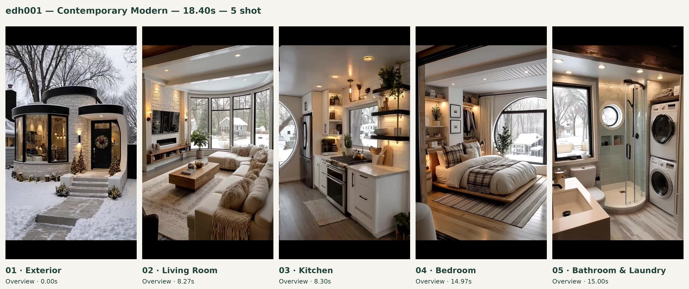
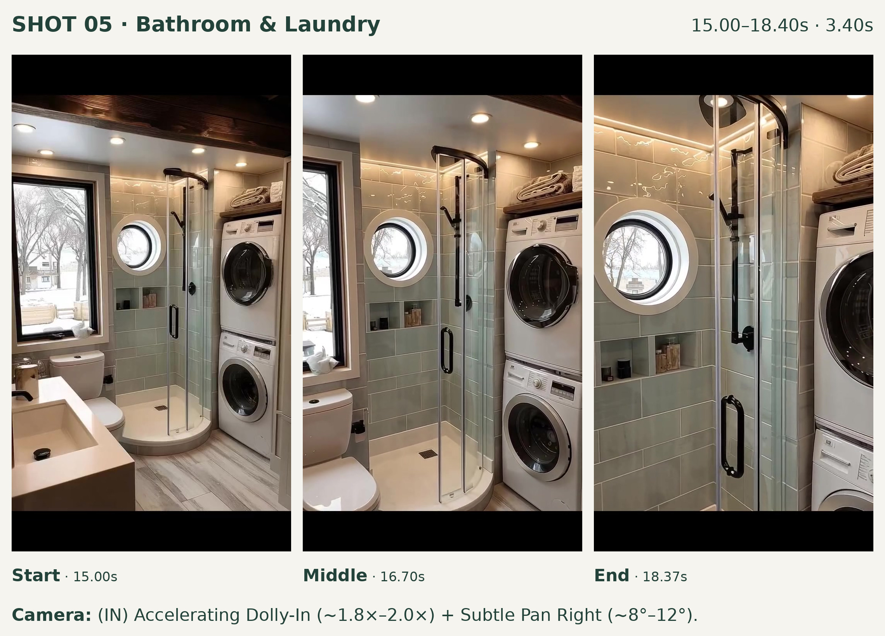

# edh001 — Rounded Modern Cottage — Winter Retreat

## 1. Profil desain

- **Nama desain:** Rounded Modern Cottage — Winter Retreat
- **Tipe rumah:** Single-Storey Detached House
- **Gaya utama:** **Contemporary Modern**
- **Pengaruh gaya:** Streamline Moderne
- **Gaya interior:** Modern Rustic; Contemporary Cozy
- **Susunan ruang utama:** Area tinggal, dapur linear, kamar tidur dan kamar mandi bersama laundry ditampilkan; koneksi denah antar-cut belum diketahui
- **Ciri khas:** Motif lengkung berulang pada fasad, kaca living, jendela bedroom dan shower melengkung
- **Material utama:** Tampilan batu susun pucat, kayu hangat, kaca, logam gelap dan ubin sage
- **Pencahayaan:** Cahaya siang difus melalui jendela, dipadukan lampu aksen hangat dan downlight
- **Atmosfer:** Hangat, nyaman dan intim dengan kontras lanskap musim dingin
- **Lingkungan:** Salju, pohon gugur tanpa daun dan rumah tetangga terlihat dari bukaan

### Palet warna

| Peran | Warna | HEX |
| --- | --- | --- |
| Dominan | Ivory | `#E8E1D4` |
| Pendamping | Warm Beige | `#C9B9A4` |
| Pendamping | Honey Oak | `#B38451` |
| Aksen | Charcoal Black | `#242424` |
| Aksen | Muted Sage | `#899B91` |
| Pendamping | Soft White | `#F1EDE6` |

## 2. Ukuran & proporsi

| Aspek | Estimasi visual |
| --- | --- |
| **Ukuran rumah** | small |
| **Bentuk bangunan** | Volume rendah dengan bay window membulat, massa tengah lebih tinggi dan kanopi entrance melengkung |
| **Lantai & bentuk atap** | Satu tingkat terlihat · Parapet hitam horizontal dengan tepi membulat; bidang atap di belakang tidak terlihat |
| **Tapak bangunan** | Massa depan kompak dengan tonjolan membulat |
| **Proporsi utama** | Fasad lebih lebar daripada tinggi, volume tengah sedikit lebih tinggi |
| **Perkiraan luas lantai** | **55–90 m²** |

## 3. Shot Timeline

Durasi 18.40s · 5 shot.

**Camera Pattern:** IN – OUT – IN – OUT – IN.

| Shot | Time (s) | Duration | Area/Scene | Camera Movement |
| --- | --- | --- | --- | --- |
| 01 | 0.00–4.73 | 4.73s | Exterior | Gentle Orbit Right (~10°–15°) → Accelerating Dolly-In (~1.2×) + Mild Orbit Right (~5°–10°) → Accelerating Straight Dolly-In (~1.6×–1.7×). |
| 02 | 4.73–8.30 | 3.57s | Living Room | Dolly-Out (~1.5×–1.7×, Ease-Out) + Gentle Orbit Left (~10°–15°) + Moderate Pan Right (~15°–25°, Ease-Out). |
| 03 | 8.30–11.57 | 3.27s | Kitchen | Accelerating Diagonal Dolly-In (~2.2×–2.5×) + Accelerating Pan Left (~20°–30°). |
| 04 | 11.57–15.00 | 3.43s | Bedroom | Diagonal Dolly-Out (~1.3×–1.5×, Ease-Out) + Moderate Pan Right (~25°–35°, Ease-Out). |
| 05 | 15.00–18.40 | 3.40s | Bathroom & Laundry | Accelerating Dolly-In (~1.8×–2.0×) + Subtle Pan Right (~8°–12°). |

## 4. Overview

**Shot 01 · Exterior · 0.00s**

> Dari jalur depan pada tinggi mata, kamera menghadap agak serong ke fasad. Wide F0 memperlihatkan volume membulat, bay window kiri, teras kanan, tangga dan lingkungan bersalju.

**Shot 02 · Living Room · 8.27s**

> Dari sisi depan area duduk pada F248, arah serong ke TV kiri dan bay window kanan. Wide akhir menunjukkan sofa sectional, meja kopi, rug, konsol dan jendela tinggi.

**Shot 03 · Kitchen · 8.30s**

> Dari ujung lorong dapur F249, kamera serong menyusuri kabinet kanan. Wide awal memuat kulkas kiri, range, counter, rak, jendela persegi dan sebagian bukaan bulat.

**Shot 04 · Bedroom · 14.97s**

> Dari ambang kamar pada F449, kamera menghadap serong ke ranjang dan jendela bulat. Wide akhir menunjukkan platform, rug, storage terbuka, kolom foto dan tirai.

**Shot 05 · Bathroom & Laundry · 15.00s**

> Dari dekat wastafel F450, kamera menghadap serong ke shower sudut. Wide awal mencakup wastafel, kloset, dua bukaan, shower kaca dan laundry bertumpuk.

## 5. Storyboard

## 6. Shot Details

### Shot 01 · Exterior

**Time:** 0.00–4.73s · **Duration:** 4.73s

#### **A. Desain area**

**Arsitektur**

> Fasad satu lantai tampak memiliki tiga volume membulat; bidang tengah lebih tinggi dengan batu susun pucat dan pita parapet hitam. Bay window tinggi berbingkai hitam di kiri, pintu hitam berglasir di kanan dengan kanopi kurva dan lampu tanam. Tangga pendek menghubungkan paving ke teras kecil, diapit dinding rendah.

**Furnitur & dekorasi**

> Dua pohon dekoratif kecil berlampu mengapit pintu; wreath di pintu, lampu dinding hitam hangat, semak rendah di tepi fasad.

**Lingkungan**

> Halaman bersalju, pohon tinggi tanpa daun dan jalur paving abu-abu menuju tangga. Cahaya luar difus; lampu teras dan interior berwarna hangat.

#### **B. Framing & Lighting**

- **Fokus:** Pintu masuk dengan bay window sebagai konteks
- **Camera Start:** Di jalur paving depan rumah · Menghadap fasad dan pintu di kanan tengah · oblique · Sekitar tinggi mata · Hampir datar
- **Framing:** Wide fasad dengan kaca kiri, pintu kanan dan jalur di bawah → Close menuju pintu dan tangga
- **Lighting:** Cahaya luar difus, sconce dan downlight hangat
- **Foreground dan kedalaman:** Paving dan salju · Jalur–tangga–pintu–massa belakang
- **Reveal:** Orbit membuka sisi kanan lalu dolly memperbesar pintu
- **Kesesuaian gerak:** Wide memberi ruang orbit; pendekatan akhir mengisolasi entrance

#### **C. Camera Movement**

Kamera mengitari fasad ke kanan dengan pintu sebagai jangkar, lalu maju semakin cepat ke teras dan pintu.

**Tempo:** Lambat ketika mengitari, sedang saat mulai maju, cepat menjelang pintu.

- **0.00–1.50s · slow:** Sapuan orbit ringan.
- **1.50–3.33s · moderate:** Pendekatan bertambah.
- **3.33–4.73s · fast:** Ekspansi cepat menuju pintu.

**Movement Timeline**

| Time (s) | Area & fokus | Camera Movement | Tempo |
| --- | --- | --- | --- |
| 0.00–1.50 | Exterior · Fasad dan pintu | Gentle Orbit Right (~10°–15°) | Sapuan orbit ringan. |
| 1.50–2.67 | Exterior · Tangga dan pintu | Accelerating Dolly-In (~1.2×) + Mild Orbit Right (~5°–10°) | Pendekatan bertambah. |
| 2.67–4.73 | Exterior · Pintu masuk | Accelerating Straight Dolly-In (~1.6×–1.7×) | Pendekatan bertambah.; Ekspansi cepat menuju pintu. |

**Camera:** Gentle Orbit Right (~10°–15°) → Accelerating Dolly-In (~1.2×) + Mild Orbit Right (~5°–10°) → Accelerating Straight Dolly-In (~1.6×–1.7×).

---

### Shot 02 · Living Room

**Time:** 4.73–8.30s · **Duration:** 3.57s

#### **A. Desain area**

**Arsitektur**

> Dinding fokus bertekstur batu terang menampung TV dan perapian linear hitam; bay window melengkung dengan mullion hitam membuka pandangan ke salju. Plafon mengikuti kurva bukaan dengan downlight dan pencahayaan tidak langsung. Lantai terang berlapis rug besar.

**Furnitur & dekorasi**

> Sofa sectional krem di kanan dan depan jendela menghadap TV; meja kopi kayu tebal berbentuk persegi panjang berada di tengah rug. Konsol kayu rendah dengan ceruk di bawah TV/perapian; bantal, throw dan tanaman pot menambah tekstur.

**Lingkungan**

> Jendela memperlihatkan pohon gundul, salju dan bangunan tetangga. Cahaya siang dari kaca kanan berpadu dengan lampu dinding dan plafon hangat.

#### **B. Framing & Lighting**

- **Fokus:** Dinding TV dan konfigurasi duduk
- **Camera Start:** Dekat meja kopi dan ujung sofa · Menghadap serong ke TV dan jendela kanan · oblique · Sekitar tinggi mata duduk/berdiri rendah · Hampir datar
- **Framing:** Medium-wide TV kiri, meja depan, jendela kanan → Wide sectional dan seluruh area duduk
- **Lighting:** Cahaya siang kanan dengan sconce, downlight hangat
- **Foreground dan kedalaman:** Meja kopi dan ujung sofa · Meja–sofa–TV/jendela–luar
- **Reveal:** Dolly-out membuka sectional, orbit dan pan menjaga hubungan bidang
- **Kesesuaian gerak:** Gerak OUT memperluas cakupan area duduk

#### **C. Camera Movement**

Kamera mundur dari meja dan sofa, membuka ruang duduk dengan pergeseran perspektif ke kiri dan pandangan ke kanan yang mereda.

**Tempo:** Sedang, pergeseran melandai pada sepertiga akhir.

**Camera:** Dolly-Out (~1.5×–1.7×, Ease-Out) + Gentle Orbit Left (~10°–15°) + Moderate Pan Right (~15°–25°, Ease-Out).

---

### Shot 03 · Kitchen

**Time:** 8.30–11.57s · **Duration:** 3.27s

#### **A. Desain area**

**Arsitektur**

> Dapur kompak dengan run kabinet putih di sisi kanan lorong, kulkas tinggi di ujung kiri, range di bawah jendela persegi. Countertop terang berpola batu, backsplash ubin terang, kabinet atas dan rak terbuka gelap; jendela bulat besar pada dinding ujung kiri. Lantai berpola papan kayu.

**Furnitur & dekorasi**

> Kulkas stainless tinggi, kompor/range dengan oven, mesin kopi di counter ujung, kabinet pintu putih dengan handle hitam dan laci. Rak kayu gelap memuat wadah dan tanaman; lampu gantung tabung hangat dekat jendela.

**Lingkungan**

> Dua bukaan memperlihatkan salju dan rumah sekitar; cahaya luar dari kiri dan kanan area kerja, lampu bawah kabinet dan plafon memberi aksen hangat.

#### **B. Framing & Lighting**

- **Fokus:** Ujung kabinet dan coffee station
- **Camera Start:** Di ujung lorong dapur menghadap kabinet · Serong ke ujung run kabinet dan kulkas · oblique · Sekitar tinggi mata · Hampir datar
- **Framing:** Wide sepanjang kabinet dan kedua bukaan → Close pada coffee station dan kulkas
- **Lighting:** Cahaya siang jendela, pendant dan lampu kabinet
- **Foreground dan kedalaman:** Counter dan range · Counter depan–range–coffee station–kulkas
- **Reveal:** Dolly-in dan pan kiri mengisolasi ujung dapur
- **Kesesuaian gerak:** Wide awal menetapkan layout, IN mengungkap detail

#### **C. Camera Movement**

Kamera mendekat sepanjang kabinet ke arah kulkas dan sudut kopi, disertai sapuan kiri yang makin terasa.

**Tempo:** Sedang dengan percepatan nyata, paling cepat secara visual pada bagian akhir.

**Camera:** Accelerating Diagonal Dolly-In (~2.2×–2.5×) + Accelerating Pan Left (~20°–30°).

---

### Shot 04 · Bedroom

**Time:** 11.57–15.00s · **Duration:** 3.43s

#### **A. Desain area**

**Arsitektur**

> Kamar tidur kompak dilihat melalui kusen kayu. Jendela besar berbentuk lingkaran dengan rangka hitam di belakang kanan, tirai krem dan plafon putih dengan bagian berbilah. Ceruk penyimpanan terbuka di belakang ranjang, dipisah kolom putih berbingkai gambar; lantai kayu hangat.

**Furnitur & dekorasi**

> Ranjang platform kayu rendah dengan linen putih gading, bantal dan throw motif plaid; rug garis di bawah kaki ranjang. Meja samping bulat bertekstur kayu dengan lampu hitam; shelving dan pakaian gantung terbuka di belakang, rak atas berisi keranjang.

**Lingkungan**

> Jendela bulat menampilkan pepohonan tanpa daun, salju dan rumah sekitar. Cahaya siang kanan bercampur lampu meja, lampu ceruk dan downlight hangat.

#### **B. Framing & Lighting**

- **Fokus:** Ranjang dan jendela bulat
- **Camera Start:** Pada ambang pintu kamar · Serong ke ranjang dan sisi penyimpanan · oblique · Sekitar tinggi mata · Hampir datar
- **Framing:** Medium-wide melalui kusen, ranjang terpotong → Wide ranjang, storage, jendela bulat
- **Lighting:** Cahaya kanan dari jendela, lampu ceruk hangat
- **Foreground dan kedalaman:** Kusen kayu dan tepi ranjang · Kusen–ranjang–storage–jendela
- **Reveal:** Dolly-out dan pan kanan membuka ranjang dan jendela
- **Kesesuaian gerak:** Framing OUT membuka konteks ruangan tanpa memastikan denah luar

#### **C. Camera Movement**

Kamera mundur diagonal dari ambang kamar sambil menyapu ke kanan, membuka ranjang utuh dan jendela bulat.

**Tempo:** Sedang di awal/tengah, melambat lembut hingga akhir.

**Camera:** Diagonal Dolly-Out (~1.3×–1.5×, Ease-Out) + Moderate Pan Right (~25°–35°, Ease-Out).

---

### Shot 05 · Bathroom & Laundry

**Time:** 15.00–18.40s · **Duration:** 3.40s

#### **A. Desain area**

**Arsitektur**

> Ruang kompak menggabungkan kamar mandi dan laundry: wastafel di depan kiri, kloset di bawah jendela persegi kiri, shower sudut berpintu kaca melengkung di tengah, mesin laundry bertumpuk kanan. Ubin persegi sage di bawah dan bidang terang di atas; jendela bulat di dinding shower, ceruk sabun, lantai papan abu-abu dan balok/trim gelap di atas.

**Furnitur & dekorasi**

> Wastafel persegi terang dengan faucet gelap, kloset putih, shower head dan kontrol hitam, dua mesin front-load putih bertumpuk dengan rak handuk di atas. Botol toiletries di niche.

**Lingkungan**

> Salju dan pohon terlihat melalui bukaan. Cahaya siang difus dengan downlight dan strip hangat pada pertemuan dinding-plafon.

#### **B. Framing & Lighting**

- **Fokus:** Shower melengkung dan laundry
- **Camera Start:** Di dekat wastafel pada pintu masuk ruang · Serong ke shower dan mesin laundry · oblique · Sekitar tinggi mata · Hampir datar
- **Framing:** Wide wastafel, kloset, shower dan laundry → Close jendela bulat, shower dan tepi mesin
- **Lighting:** Cahaya jendela kiri dan bulat, downlight serta aksen hangat
- **Foreground dan kedalaman:** Wastafel dan tepi kloset · Wastafel–kloset–shower–laundry
- **Reveal:** Dolly-in memperbesar shower, pan kanan kecil mengikuti pusat perhatian
- **Kesesuaian gerak:** Wide awal menjelaskan fungsi gabungan sebelum detail

#### **C. Camera Movement**

Kamera maju ke area shower dengan framing sedikit menyapu kanan, hingga porthole dan perlengkapan shower mendominasi.

**Tempo:** Sedang dan menguat progresif; pembesaran paling jelas pada sepertiga akhir.

**Camera:** Accelerating Dolly-In (~1.8×–2.0×) + Subtle Pan Right (~8°–12°).

**Catatan referensi:** Estimasi luas 55–90 m² adalah perkiraan visual berketidakpastian tinggi dari proporsi pintu, furnitur dan cakupan ruang; bukan pengukuran denah. Label gaya bersifat interpretatif. Material hanya tampilan visual, bukan spesifikasi fisik. Kronologi cut tidak membuktikan hubungan ruang atau identitas satu rumah. Kamera disalin tanpa perubahan dari checkpoint yang disetujui pengguna.
