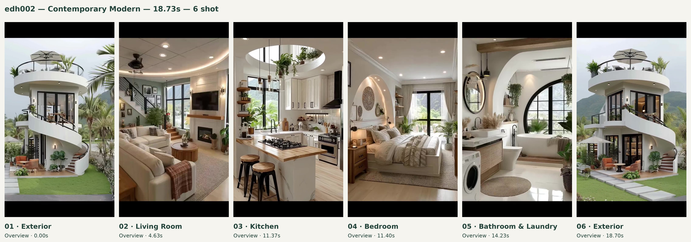
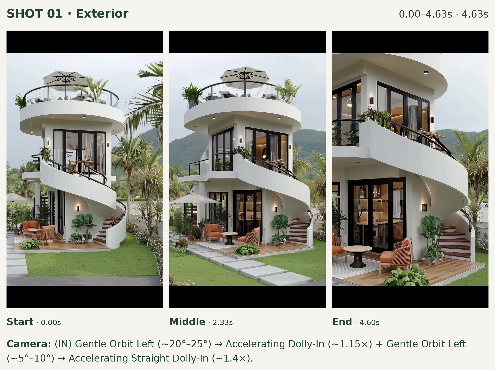
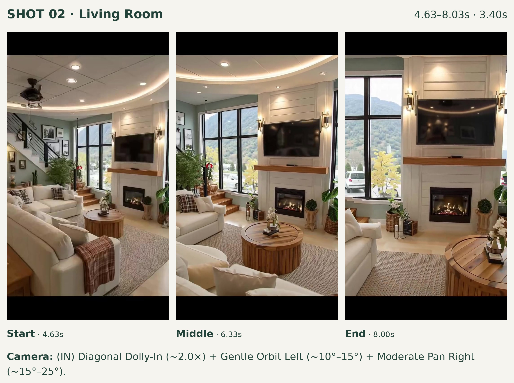
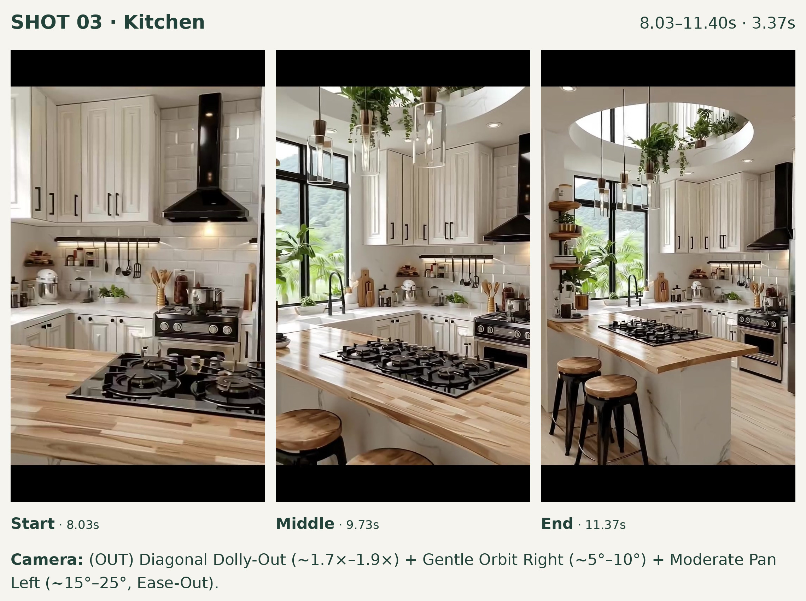
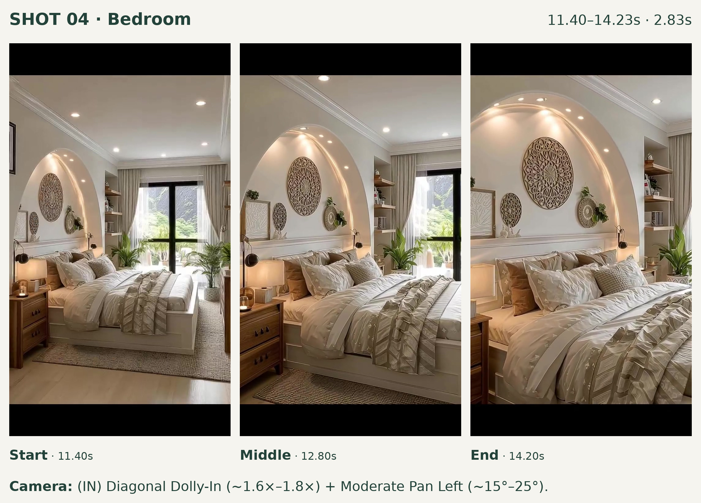
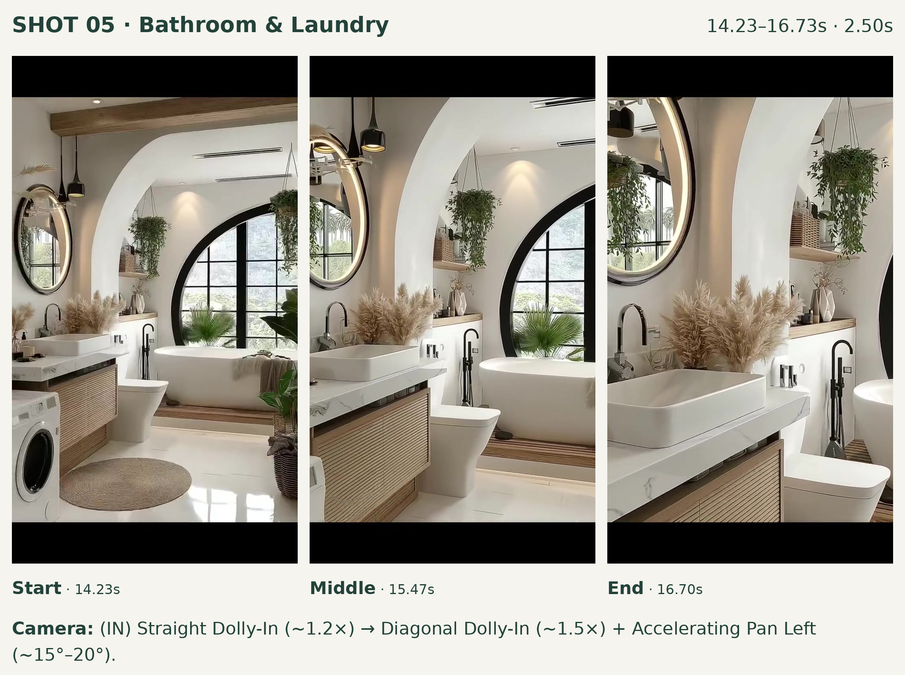
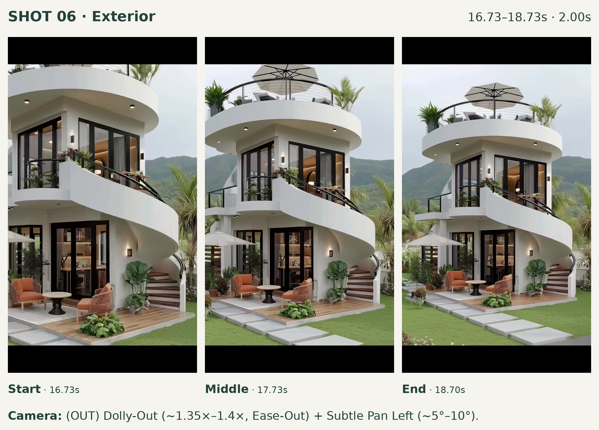

# edh002 — Spiral Terrace House — Tropical Hillside Retreat

## 1. Profil desain

- **Nama desain:** Spiral Terrace House — Tropical Hillside Retreat
- **Tipe rumah:** Two-Storey Detached House
- **Gaya utama:** **Contemporary Modern**
- **Pengaruh gaya:** Streamline Moderne
- **Gaya interior:** Modern Farmhouse; Contemporary Cozy
- **Susunan ruang utama:** Exterior, living room bertangga, kitchen ber-island dan void, bedroom, bathroom sekaligus laundry; hubungan denah antar-cut tidak terbukti
- **Ciri khas:** Tangga luar melingkar, rooftop terrace, void dapur berbentuk oval, ceruk headboard lengkung dan bukaan lengkung kamar mandi
- **Material utama:** Tampilan plester putih, kaca, logam gelap, papan kayu, tekstil krem, anyaman dan permukaan batu terang
- **Pencahayaan:** Cahaya siang lewat kaca tinggi berpadu downlight, cove light dan lampu aksen hangat
- **Atmosfer:** Terang, hangat dan santai dengan aksen natural serta panorama hijau
- **Lingkungan:** Rumput, palem, tanaman tropis, jalur paving dan perbukitan hijau

### Palet warna

| Peran | Warna | HEX |
| --- | --- | --- |
| Dominan | Warm White | `#E8E4D9` |
| Pendamping | Natural Oak | `#B88D62` |
| Pendamping | Warm Beige | `#C8BBA7` |
| Aksen | Charcoal Black | `#242526` |
| Aksen | Terracotta | `#B86C48` |
| Pendamping | Muted Sage | `#8E9B8D` |

## 2. Ukuran & proporsi

| Aspek | Estimasi visual |
| --- | --- |
| **Ukuran rumah** | small |
| **Bentuk bangunan** | Massa dua tingkat dengan pelat kurva dan rooftop terrace |
| **Lantai & bentuk atap** | Dua tingkat tertutup terlihat, dengan rooftop terrace terbuka · Atap datar berfungsi sebagai teras terbuka berpagar dengan payung |
| **Tapak bangunan** | Massa inti kompak dengan pelat membulat dan tangga luar melingkar |
| **Proporsi utama** | Massa vertikal ramping; lebar pelat lebih besar dari inti kaca |
| **Perkiraan luas lantai** | **65–110 m²** |

## 3. Shot Timeline

Durasi 18.73s · 6 shot.

**Camera Pattern:** IN – IN – OUT – IN – IN – OUT.

| Shot | Time (s) | Duration | Area/Scene | Camera Movement |
| --- | --- | --- | --- | --- |
| 01 | 0.00–4.63 | 4.63s | Exterior | Gentle Orbit Left (~20°–25°) → Accelerating Dolly-In (~1.15×) + Gentle Orbit Left (~5°–10°) → Accelerating Straight Dolly-In (~1.4×). |
| 02 | 4.63–8.03 | 3.40s | Living Room | Diagonal Dolly-In (~2.0×) + Gentle Orbit Left (~10°–15°) + Moderate Pan Right (~15°–25°). |
| 03 | 8.03–11.40 | 3.37s | Kitchen | Diagonal Dolly-Out (~1.7×–1.9×) + Gentle Orbit Right (~5°–10°) + Moderate Pan Left (~15°–25°, Ease-Out). |
| 04 | 11.40–14.23 | 2.83s | Bedroom | Diagonal Dolly-In (~1.6×–1.8×) + Moderate Pan Left (~15°–25°). |
| 05 | 14.23–16.73 | 2.50s | Bathroom & Laundry | Straight Dolly-In (~1.2×) → Diagonal Dolly-In (~1.5×) + Accelerating Pan Left (~15°–20°). |
| 06 | 16.73–18.73 | 2.00s | Exterior | Dolly-Out (~1.35×–1.4×, Ease-Out) + Subtle Pan Left (~5°–10°). |

## 4. Overview

**Shot 01 · Exterior · 0.00s**

> Dari jalur taman pada tinggi mata, pandangan serong ke fasad; wide awal mencakup dua tingkat, tangga melingkar, rooftop dengan payung, deck, rumput, paving dan palem.

**Shot 02 · Living Room · 4.63s**

> Dari belakang sofa depan, pandangan serong ke dinding TV kanan, jendela dan tangga kiri; wide mencakup konfigurasi sofa, meja bundar, rug, plafon bercahaya dan perapian.

**Shot 03 · Kitchen · 11.37s**

> Dari sisi bangku di depan island, pandangan serong ke kabinet belakang dan sink kiri; wide akhir memperlihatkan island, dua bangku, range, bukaan tinggi, pendant dan void oval.

**Shot 04 · Bedroom · 11.40s**

> Dari dekat kaki ranjang, pandangan serong ke headboard lengkung kiri dan jendela kanan; wide memperlihatkan ranjang utuh, nakas, rug, tirai dan rak ceruk.

**Shot 05 · Bathroom & Laundry · 14.23s**

> Dari dekat mesin laundry dan vanity, pandangan serong ke bathtub di bawah lengkung dan jendela; wide mencakup mesin front-load, wastafel, kloset, bathtub, rug dan balok atas.

**Shot 06 · Exterior · 18.70s**

> Dari jalur taman depan, pandangan serong ke fasad; wide akhir memuat dua tingkat, tangga luar, rooftop berpayung, teras, rumput, jalur paving dan perbukitan.

## 5. Storyboard

## 6. Shot Details

### Shot 01 · Exterior

**Time:** 0.00–4.63s · **Duration:** 4.63s

#### **A. Desain area**

**Arsitektur**

> Massa inti vertikal dua tingkat dengan kaca sudut tinggi berbingkai hitam; pelat rooftop membulat menjorok, pagar transparan dan tangga luar melingkar dengan dinding putih solid serta anak tangga tampak kayu. Teras bawah berlantai deck di depan pintu kaca.

**Furnitur & dekorasi**

> Dua kursi warna terracotta, meja bulat kaki gelap dan tanaman pot di deck; payung putih, kursi santai dan tanaman di rooftop.

**Lingkungan**

> Rumput, paving persegi panjang, tanaman tropis dan palem membingkai tapak, dengan bukit hijau di belakang. Cahaya siang difus dan lampu fasad hangat.

#### **B. Framing & Lighting**

- **Fokus:** Tangga melingkar dan entrance
- **Camera Start:** Di jalur taman depan rumah · Serong ke fasad dan tangga luar · oblique · Sekitar tinggi mata · Hampir datar
- **Framing:** Wide seluruh rumah, rooftop dan halaman → Medium dekat teras dan kaca dua tingkat
- **Lighting:** Siang difus dan lampu fasad hangat
- **Foreground dan kedalaman:** Rumput dan paving · Paving–teras–kaca–bukit
- **Reveal:** Orbit membuka sisi kaca, IN mengisolasi teras
- **Kesesuaian gerak:** Wide menyediakan konteks sebelum pendekatan

#### **C. Camera Movement**

Kamera mengitari rumah ke kiri, lalu mulai mendekat sambil melanjutkan orbit yang mereda; akhirnya maju lebih cepat menuju teras.

**Tempo:** Lambat saat orbit, sedang ketika pendekatan mulai, cepat di akhir.

- **0.00–2.00s · slow:** Orbit halus dengan skala hampir tetap.
- **2.00–3.00s · moderate:** Pendekatan mulai terasa.
- **3.00–4.63s · fast:** Pembesaran dan keluarnya foreground kian cepat.

**Movement Timeline**

| Time (s) | Area & fokus | Camera Movement | Tempo |
| --- | --- | --- | --- |
| 0.00–2.00 | Exterior · Fasad, tangga spiral dan teras | Gentle Orbit Left (~20°–25°) | Orbit halus dengan skala hampir tetap. |
| 2.00–3.00 | Exterior · Fasad kaca dan teras | Accelerating Dolly-In (~1.15×) + Gentle Orbit Left (~5°–10°) | Pendekatan mulai terasa. |
| 3.00–4.63 | Exterior · Teras bawah dan tangga spiral | Accelerating Straight Dolly-In (~1.4×) | Pembesaran dan keluarnya foreground kian cepat. |

**Camera:** Gentle Orbit Left (~20°–25°) → Accelerating Dolly-In (~1.15×) + Gentle Orbit Left (~5°–10°) → Accelerating Straight Dolly-In (~1.4×).

---

### Shot 02 · Living Room

**Time:** 4.63–8.03s · **Duration:** 3.40s

#### **A. Desain area**

**Arsitektur**

> Dinding TV berpanel terang dengan mantel kayu horizontal dan perapian hitam di bawahnya. Jendela hitam tinggi di kiri dinding fokus, dinding hijau sage dan tangga kayu berpagar logam gelap di kiri. Plafon grid dengan perimeter lengkung bercahaya.

**Furnitur & dekorasi**

> Sofa krem di depan dan kiri mengapit meja kopi kayu bundar berbilah di atas rug bertekstur. Bantal dan throw plaid, tanaman pot, galeri foto, kipas plafon hitam serta sconce di kedua sisi TV.

**Lingkungan**

> Jendela menampilkan perbukitan dan pepohonan; daylight dari kiri dinding fokus, cove light, downlight, sconce serta perapian memberi aksen hangat.

#### **B. Framing & Lighting**

- **Fokus:** TV dan perapian
- **Camera Start:** Di belakang sofa depan · Serong ke dinding TV dan jendela · oblique · Sekitar tinggi mata · Sedikit menunduk
- **Framing:** Wide sofa, tangga dan dinding TV → Medium frontal TV dan fireplace
- **Lighting:** Daylight dari jendela dan cahaya aksen hangat
- **Foreground dan kedalaman:** Punggung sofa dan throw · Sofa–meja–TV–jendela
- **Reveal:** IN dan pan mengisolasi dinding TV
- **Kesesuaian gerak:** Framing awal memberi konteks ruang sebelum fokus menyempit

#### **C. Camera Movement**

Kamera bergerak maju menyusuri sisi kiri area duduk sambil menyapu ke kanan menuju TV dan perapian; sudut dinding menjadi lebih frontal.

**Tempo:** Sedang, pembesaran menguat di tengah dan sapuan mereda sedikit menjelang akhir.

**Camera:** Diagonal Dolly-In (~2.0×) + Gentle Orbit Left (~10°–15°) + Moderate Pan Right (~15°–25°).

---

### Shot 03 · Kitchen

**Time:** 8.03–11.40s · **Duration:** 3.37s

#### **A. Desain area**

**Arsitektur**

> Kabinet panel putih membentuk run pada dinding belakang dan kiri dengan sink di bawah jendela; range dan hood hitam di kanan. Island berpermukaan papan kayu dan badan putih bermotif batu memuat cooktop. Void plafon oval membuka tingkat atas dengan tanaman gantung.

**Furnitur & dekorasi**

> Dua bangku kayu bundar berkaki gelap di depan island, cooktop hitam, range oven, hood, rak kayu, utensil gantung, papan potong dan lampu gantung kaca bening.

**Lingkungan**

> Vegetasi hijau terlihat dari jendela. Cahaya alami dari kiri dan void, lampu kabinet dan pendant menambah cahaya kerja.

#### **B. Framing & Lighting**

- **Fokus:** Island dan layout dapur
- **Camera Start:** Dekat tepi island · Serong ke cooktop dan kabinet belakang · oblique · Sekitar tinggi mata · Sedikit menunduk
- **Framing:** Medium-wide cooktop, range dan kabinet → Wide island, bangku, sink, void
- **Lighting:** Daylight dari jendela dan lampu kerja
- **Foreground dan kedalaman:** Permukaan island · Island–kabinet–jendela–void
- **Reveal:** OUT membuka bangku, jendela dan void
- **Kesesuaian gerak:** Mundur mengungkap konfigurasi lebih lengkap

#### **C. Camera Movement**

Kamera mundur dari island dapur sambil menyapu kiri; jendela, bangku dan void di atas island semakin terbuka.

**Tempo:** Sedang; sapuan lebih terasa di awal, mereda pada akhir, sementara penurunan skala berlanjut.

**Camera:** Diagonal Dolly-Out (~1.7×–1.9×) + Gentle Orbit Right (~5°–10°) + Moderate Pan Left (~15°–25°, Ease-Out).

---

### Shot 04 · Bedroom

**Time:** 11.40–14.23s · **Duration:** 2.83s

#### **A. Desain area**

**Arsitektur**

> Dinding headboard memiliki ceruk lengkung besar dengan strip cahaya hangat dan dekorasi bundar. Jendela tinggi berbingkai hitam di kanan dengan tirai, rak ceruk di antara jendela dan ranjang; plafon putih dengan cornice dan downlight.

**Furnitur & dekorasi**

> Ranjang putih berpanel dengan linen krem, bantal dan throw tekstur geometris; nakas kayu berlaci di kiri, lampu baca dinding hitam, rug netral dan tanaman pot.

**Lingkungan**

> Cahaya dari jendela kanan menampilkan tanaman dan bukit; strip lengkung, downlight dan lampu baca membentuk suasana hangat.

#### **B. Framing & Lighting**

- **Fokus:** Ceruk headboard dan ranjang
- **Camera Start:** Di dekat kaki ranjang · Serong ke headboard dan jendela kanan · oblique · Sekitar tinggi mata · Sedikit menunduk
- **Framing:** Wide ranjang, nakas, ceruk dan jendela → Medium dekat headboard dan dekorasi
- **Lighting:** Cahaya kanan dan strip hangat
- **Foreground dan kedalaman:** Kaki ranjang dan rug · Rug–ranjang–headboard–jendela
- **Reveal:** IN dan pan mengisolasi ceruk
- **Kesesuaian gerak:** Wide awal memberi konfigurasi ranjang sebelum detail

#### **C. Camera Movement**

Kamera maju diagonal menuju kepala ranjang dengan sapuan kiri, mengalihkan perhatian dari jendela ke dekorasi lengkung.

**Tempo:** Sedang, sapuan menguat pada tengah shot lalu sedikit melandai; pembesaran berlanjut.

**Camera:** Diagonal Dolly-In (~1.6×–1.8×) + Moderate Pan Left (~15°–25°).

---

### Shot 05 · Bathroom & Laundry

**Time:** 14.23–16.73s · **Duration:** 2.50s

#### **A. Desain area**

**Arsitektur**

> Bukaan lengkung besar membingkai zona bathtub yang ditinggikan dengan lantai tampak kayu dan jendela melengkung bergrid hitam. Vanity di kiri, kloset di antara vanity dan bathtub; mesin laundry terlihat di depan kiri. Balok tampak kayu melintang atas dan lantai terang mengilap.

**Furnitur & dekorasi**

> Vanity putih berpola batu dengan kabinet bertekstur anyaman, wastafel vessel putih dan faucet hitam; cermin oval bercahaya, pendant hitam, kloset putih, bathtub putih dan filler berdiri, mesin front-load serta tanaman gantung.

**Lingkungan**

> Bukaan besar menghadap vegetasi dan bukit; cahaya siang kuat di lantai dengan pantulan, cermin dan spot lampu hangat.

#### **B. Framing & Lighting**

- **Fokus:** Bathtub lalu vanity
- **Camera Start:** Di depan vanity dan mesin laundry · Serong ke bathtub dan bukaan lengkung · oblique · Sekitar tinggi mata · Sedikit menunduk
- **Framing:** Wide vanity, kloset, bathtub dan mesin → Close wastafel, cermin dan kloset
- **Lighting:** Daylight dari jendela dan lampu hangat
- **Foreground dan kedalaman:** Mesin laundry dan rug · Vanity–kloset–bathtub–jendela
- **Reveal:** IN kemudian pan kiri mengisolasi wastafel
- **Kesesuaian gerak:** Awal menunjukkan fungsi gabungan sebelum detail

#### **C. Camera Movement**

Kamera maju dari ambang kamar mandi, awalnya hampir lurus, kemudian semakin menyapu kiri ke wastafel dan cermin.

**Tempo:** Sedang, sapuan kiri meningkat menjelang akhir sehingga framing berubah lebih cepat.

**Movement Timeline**

| Time (s) | Area & fokus | Camera Movement | Tempo |
| --- | --- | --- | --- |
| 14.23–15.03 | Bathroom & Laundry · Wastafel, kloset dan bathtub | Straight Dolly-In (~1.2×) | Sedang, sapuan kiri meningkat menjelang akhir sehingga framing berubah lebih cepat. |
| 15.03–16.73 | Bathroom & Laundry · Wastafel, faucet dan cermin | Diagonal Dolly-In (~1.5×) + Accelerating Pan Left (~15°–20°) | Sedang, sapuan kiri meningkat menjelang akhir sehingga framing berubah lebih cepat. |

**Camera:** Straight Dolly-In (~1.2×) → Diagonal Dolly-In (~1.5×) + Accelerating Pan Left (~15°–20°).

---

### Shot 06 · Exterior

**Time:** 16.73–18.73s · **Duration:** 2.00s

#### **A. Desain area**

**Arsitektur**

> Kembali pada fasad dua tingkat dengan tangga melingkar putih, kaca sudut hitam, teras bawah dan rooftop berpelat bulat. Mundur menampilkan rooftop dan tapak lebih utuh.

**Furnitur & dekorasi**

> Kursi terracotta dan meja bulat di deck, pot daun lebar dekat tangga, rooftop dengan payung dan tempat duduk.

**Lingkungan**

> Jalur paving dan rumput masuk kembali dalam framing; palem dan bukit hijau menjadi latar. Cahaya siang lembut dengan lampu fasad.

#### **B. Framing & Lighting**

- **Fokus:** Massa rumah dan rooftop
- **Camera Start:** Dekat deck depan · Serong ke kaca fasad dan tangga · oblique · Sekitar tinggi mata · Hampir datar
- **Framing:** Medium fasad dan teras, rooftop terpotong → Wide seluruh rumah dan taman
- **Lighting:** Siang difus dan lampu fasad
- **Foreground dan kedalaman:** Deck dan kursi · Deck–fasad–taman–bukit
- **Reveal:** OUT mengembalikan rooftop dan tapak
- **Kesesuaian gerak:** Gerak mundur cocok sebagai penutup yang memperlihatkan massa

#### **C. Camera Movement**

Kamera mundur dari teras untuk kembali memperlihatkan bangunan dan rooftop, dengan koreksi arah pandang kecil ke kiri.

**Tempo:** Sedang pada awal lalu melandai; penyusutan skala berkurang menjelang akhir.

**Camera:** Dolly-Out (~1.35×–1.4×, Ease-Out) + Subtle Pan Left (~5°–10°).

**Catatan referensi:** Luas 65–110 m² merupakan estimasi visual berketidakpastian tinggi dari proporsi pintu, furnitur dan massa dua tingkat; bukan pengukuran denah dan tidak memasukkan rooftop terbuka. Gaya dan tipe rumah bersifat interpretatif. Material disebut berdasarkan tampilan saja. Urutan edit tidak membuktikan koneksi ruang atau satu rumah fisik. Kamera dan tempo dipertahankan persis dari checkpoint Fase 2 yang disetujui pengguna.
