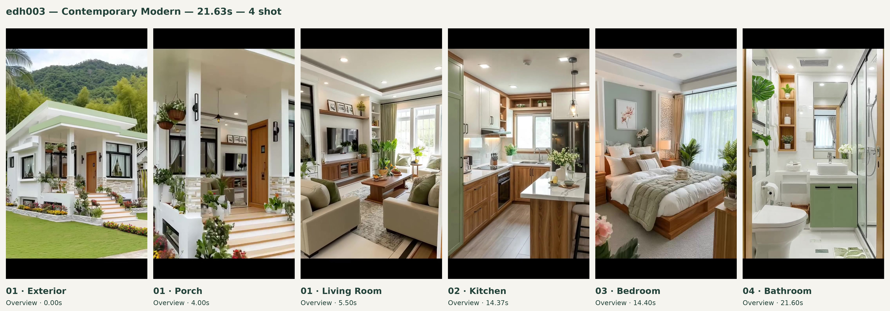
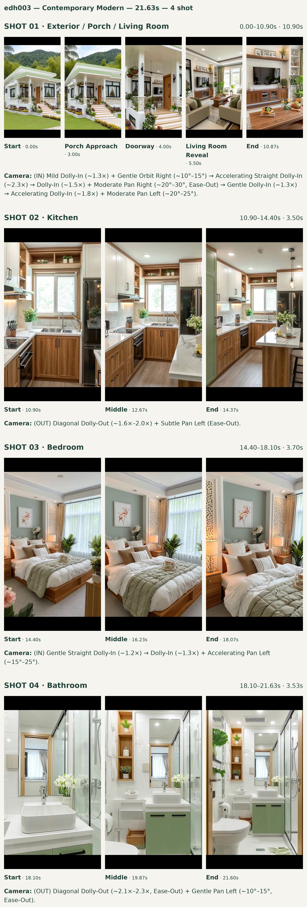
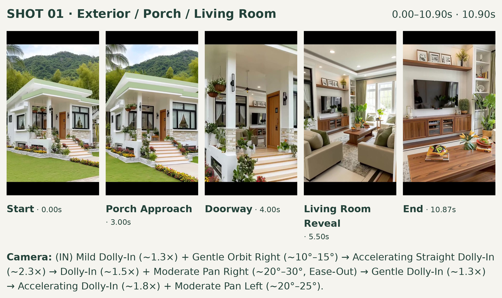
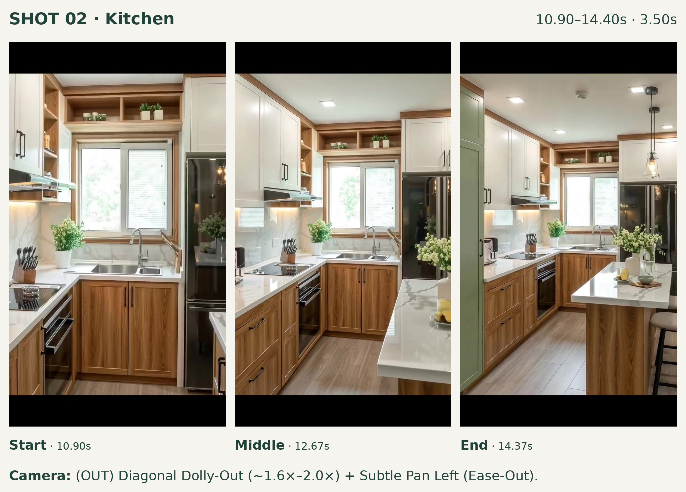
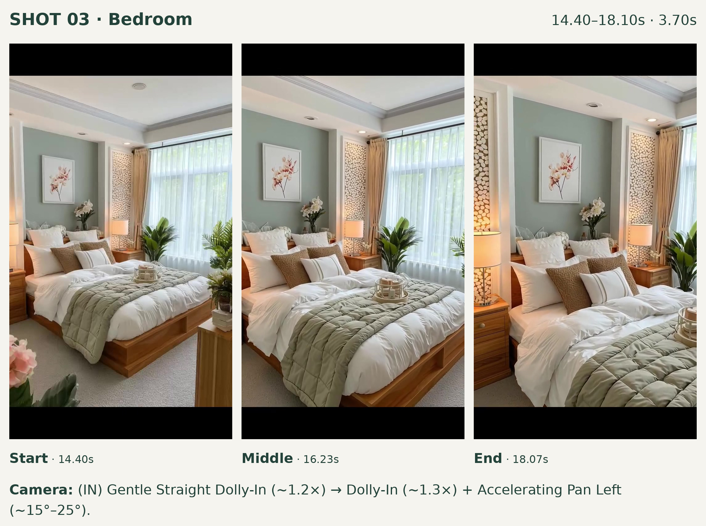
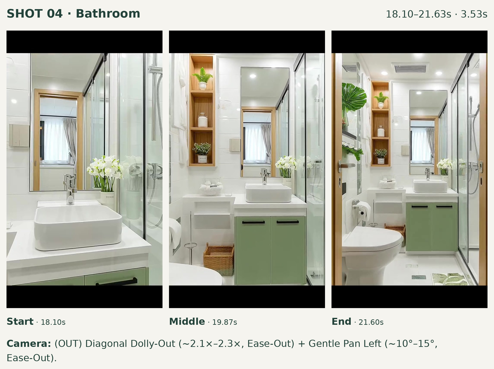

# edh003 — Modern Sage Garden Bungalow

## 1. Profil desain

- **Nama desain:** Modern Sage Garden Bungalow
- **Tipe rumah:** Bungalow
- **Gaya utama:** **Contemporary Modern**
- **Pengaruh gaya:** Modern Cottage
- **Gaya interior:** Warm Contemporary
- **Susunan ruang utama:** Rute kontinu dari halaman melalui teras ke living room; dapur, kamar tidur dan kamar mandi muncul pada cut tersendiri
- **Ciri khas:** TV wall dengan rak kayu dan kabinet rendah; kitchen cabinet dua warna; headboard berlatar sage; vanity hijau dengan shower kaca
- **Material utama:** Bidang putih dan hijau lembut, kayu cokelat tampak pada pintu, kabinet dan furnitur; aksen batu dan logam gelap
- **Pencahayaan:** Cahaya siang dari jendela dan bukaan, downlight, lampu aksen hangat dan pendant
- **Atmosfer:** Terang, hangat, rapi dan natural dengan tanaman serta tekstil lembut
- **Lingkungan:** Halaman rumput dan bed bunga; pepohonan dan perbukitan hijau di latar

### Palet warna

| Peran | Warna | HEX |
| --- | --- | --- |
| Dominan | Warm White | `#F2F0E7` |
| Pendamping | Sage Green | `#A0AD91` |
| Pendamping | Honey Wood | `#A57547` |
| Pendamping | Sand Beige | `#D0C5B0` |
| Aksen | Charcoal | `#30322F` |
| Pendamping | Soft Greige | `#B9B5AA` |

## 2. Ukuran & proporsi

| Aspek | Estimasi visual |
| --- | --- |
| **Ukuran rumah** | small |
| **Bentuk bangunan** | Massa satu lantai tampak melebar, volume teras menjorok |
| **Lantai & bentuk atap** | Satu lantai terlihat · Atap landai bertingkat dengan overhang putih dan lis hijau pucat |
| **Tapak bangunan** | Massa rendah dengan teras menjorok; bagian belakang tidak diketahui |
| **Proporsi utama** | Lebar fasad dominan terhadap tinggi, lantai terangkat beberapa anak tangga |
| **Perkiraan luas lantai** | **50–90 m²** |

## 3. Shot Timeline

Durasi 21.63s · 4 shot.

**Camera Pattern:** IN – OUT – IN – OUT.

| Shot | Time (s) | Duration | Area/Scene | Camera Movement |
| --- | --- | --- | --- | --- |
| 01 | 0.00–10.90 | 10.90s | Exterior / Porch / Living Room | Mild Dolly-In (~1.3×) + Gentle Orbit Right (~10°–15°) → Accelerating Straight Dolly-In (~2.3×) → Dolly-In (~1.5×) + Moderate Pan Right (~20°–30°, Ease-Out) → Gentle Dolly-In (~1.3×) → Accelerating Dolly-In (~1.8×) + Moderate Pan Left (~20°–25°). |
| 02 | 10.90–14.40 | 3.50s | Kitchen | Diagonal Dolly-Out (~1.6×–2.0×) + Subtle Pan Left (Ease-Out). |
| 03 | 14.40–18.10 | 3.70s | Bedroom | Gentle Straight Dolly-In (~1.2×) → Dolly-In (~1.3×) + Accelerating Pan Left (~15°–25°). |
| 04 | 18.10–21.63 | 3.53s | Bathroom | Diagonal Dolly-Out (~2.1×–2.3×, Ease-Out) + Gentle Pan Left (~10°–15°, Ease-Out). |

## 4. Overview

**Shot 01 · Exterior · 0.00s**

> Dari halaman depan, pandangan serong pada tinggi kira-kira mata mencakup massa rendah, atap, jendela, tangga, rumput dan bukit.

**Shot 01 · Porch · 4.00s**

> Di kaki teras menghadap pintu kayu dan kolom; bingkai wide vertikal memperlihatkan tangga, tanaman pot, langit-langit teras dan ambang.

**Shot 01 · Living Room · 5.50s**

> Dari ambang masuk menghadap serong ke TV dan jendela kanan; wide memperlihatkan dua sofa, meja kopi, karpet, kabinet TV dan plafon tray.

**Shot 02 · Kitchen · 14.37s**

> Dari sisi masuk menghadap sink di jendela, wide menampilkan kabinet sage kiri depan, run kabinet kayu-putih, kulkas di ujung kanan, lorong dan counter kanan dengan pendant.

**Shot 03 · Bedroom · 14.40s**

> Dari kaki ranjang agak serong menuju headboard, wide mencakup platform ranjang, bedding, dinding sage, lampu samping dan jendela besar di kanan.

**Shot 04 · Bathroom · 21.60s**

> Dari ambang masuk menghadap vanity di ujung, wide memperlihatkan toilet kiri, rak kayu, wastafel dan cermin, serta enclosure shower kaca kanan.

## 5. Storyboard

## 6. Shot Details

### Shot 01 · Exterior / Porch / Living Room

**Time:** 0.00–10.90s · **Duration:** 10.90s

**Shot Type:** Continuous shot · Multi area · No cut.

#### **A. Desain area**

##### **Exterior**

**Arsitektur**

> Massa rendah melebar dengan atap landai berlapis, lis sage dan overhang putih. Fasad putih dengan jendela persegi bingkai hitam; tangga terang naik dari jalur taman.

**Furnitur & dekorasi**

> Tanaman pot dan bed bunga menghiasi jalur masuk.

**Lingkungan**

> Rumput hijau, jalur terang dan bed bunga kuning; latar pepohonan serta bukit hijau dalam cahaya siang.

##### **Porch**

**Arsitektur**

> Teras ternaungi overhang, kolom putih persegi berdasar tekstur batu, lantai terang hangat dan pintu kayu berpanel di kanan pandangan masuk.

**Furnitur & dekorasi**

> Pot hijau di kaki kolom, tanaman gantung, lampu dinding vertikal hitam dan pendant gelap.

**Lingkungan**

> Teras terbuka ke taman dengan naungan dari atap dan cahaya alami.

##### **Living Room**

**Arsitektur**

> Ruang persegi dengan plafon tray berlis gelap dan downlight, jendela besar bertirai di sisi kanan layar, lantai terang dan jalur sirkulasi dari pintu.

**Furnitur & dekorasi**

> Sofa krem saling menghadap meja kopi kayu persegi panjang di atas karpet; TV di dinding pada panel terang, kabinet kayu rendah, rak panjang di atas dan shelving vertikal di kanan; tanaman, cushion hijau dan dekorasi bingkai.

**Lingkungan**

> Cahaya jendela kanan menembus tirai tipis; view luar tidak terbaca jelas.

#### **B. Framing & Lighting**

- **Fokus:** Fasad, pintu, susunan sofa dan TV.
- **Camera Start:** Di halaman depan, sedikit serong dari sisi kiri fasad. · Menghadap fasad dan pintu masuk. · oblique · Sekitar tinggi mata, perkiraan visual. · Hampir datar, sedikit mengarah ke fasad.
- **Framing:** Wide fasad dengan taman dan bukit. → Medium-wide TV wall dan meja kopi.
- **Lighting:** Siang alami di luar; jendela dan downlight di living.
- **Foreground dan kedalaman:** Rumput dan jalur taman. · Jalur dan tangga menuju pintu, kemudian sofa dan TV.
- **Reveal:** Fasad → tangga → kolom teras → pintu → ruang tamu.
- **Kesesuaian gerak:** Gerak IN dan orbit memperkenalkan massa, lalu percepatan melewati ambang; sapuan mengungkap living.
- **Area:** Exterior / Porch / Living Room
- **Rute kamera:** Exterior (0.00–3.00s · awal di halaman · fasad) → Porch (3.00–5.00s · tangga dan ambang pintu · kolom dan pintu) → Living Room (5.00–10.90s · melalui pintu · sofa dan TV)

**Hubungan antararea**

- **Penghubung area:** Tangga menghubungkan halaman dan teras.; Ambang pintu menghubungkan teras dan living.
- **Peralihan:** Exterior · 0.00–4.50s; Porch · 3.00–5.00s; Living Room · 4.00–10.90s
- **Orientasi ruang:** —

#### **C. Camera Movement**

Dari halaman, kamera bergeser menghadap fasad, mempercepat pendekatan melalui teras dan pintu, lalu melambat di ruang tamu sebelum mendekati TV sambil menyapu ke kiri.

**Tempo:** Lambat di fasad, sangat cepat saat masuk, melambat di ruang tamu, lalu meningkat menuju TV.

- **0.00–3.00s · slow:** Perubahan fasad bertahap.
- **3.00–5.50s · fast:** Pendekatan dan lintasan ambang cepat.
- **5.50–7.90s · slow:** Maju pelan di antara sofa.
- **7.90–10.90s · moderate:** Pendekatan dan sapuan kiri meningkat.

**Movement Timeline**

| Time (s) | Area & fokus | Camera Movement | Tempo |
| --- | --- | --- | --- |
| 0.00–3.00 | Exterior / Porch / Living Room · Fasad dan tangga teras | Mild Dolly-In (~1.3×) + Gentle Orbit Right (~10°–15°) | Perubahan fasad bertahap. |
| 3.00–4.00 | Exterior / Porch / Living Room · Tangga dan bukaan teras | Accelerating Straight Dolly-In (~2.3×) | Pendekatan dan lintasan ambang cepat. |
| 4.00–5.50 | Exterior / Porch / Living Room · Teras, pintu masuk, ruang tamu | Dolly-In (~1.5×) + Moderate Pan Right (~20°–30°, Ease-Out) | Pendekatan dan lintasan ambang cepat. |
| 5.50–7.90 | Exterior / Porch / Living Room · Sofa dan meja ruang tamu | Gentle Dolly-In (~1.3×) | Maju pelan di antara sofa. |
| 7.90–10.90 | Exterior / Porch / Living Room · Meja kopi dan dinding TV | Accelerating Dolly-In (~1.8×) + Moderate Pan Left (~20°–25°) | Pendekatan dan sapuan kiri meningkat. |

**Camera:** Mild Dolly-In (~1.3×) + Gentle Orbit Right (~10°–15°) → Accelerating Straight Dolly-In (~2.3×) → Dolly-In (~1.5×) + Moderate Pan Right (~20°–30°, Ease-Out) → Gentle Dolly-In (~1.3×) → Accelerating Dolly-In (~1.8×) + Moderate Pan Left (~20°–25°).

---

### Shot 02 · Kitchen

**Time:** 10.90–14.40s · **Duration:** 3.50s

#### **A. Desain area**

**Arsitektur**

> Dapur kompak dengan run kabinet di kiri dan belakang membentuk L, jendela persegi dua panel di atas sink, lantai tampak kayu, plafon putih downlight. Counter tambahan di kanan membentuk lorong kerja; sambungan ujung tidak terlihat jelas.

**Furnitur & dekorasi**

> Kabinet bawah kayu cokelat berhandle gelap, kabinet atas putih dan rak terbuka kayu di atas jendela. Sink ganda di bawah jendela; cooktop/oven gelap di kiri, kulkas hitam tinggi kanan belakang. Counter kanan berpermukaan putih bermotif marmer, vas bunga dan bangku di sisi luar; kabinet tinggi sage muncul kiri depan.

**Lingkungan**

> Jendela memberi cahaya siang lembut; tampak vegetasi samar, detail lokasi tidak terbaca.

#### **B. Framing & Lighting**

- **Fokus:** Sink, kabinet dan counter kanan.
- **Camera Start:** Dekat area kerja, menghadap jendela di ujung dapur. · Ke sink dan jendela, agak serong terhadap run kiri. · oblique · Sekitar tinggi mata. · Hampir datar.
- **Framing:** Medium-wide sink dan area kerja. → Wide lorong dapur dan counter kanan.
- **Lighting:** Cahaya jendela, task light dan downlight; pendant hangat.
- **Foreground dan kedalaman:** Tepi countertop kiri dan kanan. · Lorong antara kabinet menuju sink.
- **Reveal:** Kabinet penuh, counter kanan, pendant dan sisi masuk.
- **Kesesuaian gerak:** Gerak OUT memperluas cakupan sambil pan kiri ringan.

#### **C. Camera Movement**

Kamera mundur dari wastafel dan jendela, membuka meja kerja, island dan ambang dapur.

**Tempo:** Mundur cukup konsisten; sapuan lateral lebih kuat di awal, mereda di akhir.

**Camera:** Diagonal Dolly-Out (~1.6×–2.0×) + Subtle Pan Left (Ease-Out).

---

### Shot 03 · Bedroom

**Time:** 14.40–18.10s · **Duration:** 3.70s

#### **A. Desain area**

**Arsitektur**

> Kamar tidur dengan dinding aksen sage berpanel putih di belakang ranjang, jendela besar di kanan bertirai tipis dan drape hangat, plafon berlis/downlight dan lantai terang.

**Furnitur & dekorasi**

> Ranjang kayu rendah dengan headboard berlapis warna netral, bedding putih, throw quilted hijau abu, bantal krem. Meja samping kayu dengan lampu hangat, lukisan floral di atas, tanaman dekat jendela dan panel dekoratif vertikal bercelah di sisi kiri akhir shot.

**Lingkungan**

> Cahaya siang tersebar melalui tirai kanan; detail view luar tidak jelas.

#### **B. Framing & Lighting**

- **Fokus:** Ranjang dan headboard.
- **Camera Start:** Di sisi kaki ranjang, agak serong. · Menghadap headboard dan sudut jendela kanan. · oblique · Sekitar tinggi mata. · Sedikit mengarah ke permukaan ranjang.
- **Framing:** Wide ranjang, dinding sage dan jendela. → Medium-wide ranjang dan dinding headboard.
- **Lighting:** Cahaya difus jendela kanan, lampu sisi ranjang hangat.
- **Foreground dan kedalaman:** Kaki ranjang dan tekstil. · Ranjang menuju headboard, jendela di sisi.
- **Reveal:** Panel kiri dan meja samping muncul lebih jelas saat pan kiri.
- **Kesesuaian gerak:** IN memperbesar detail bedding, pan kiri menonjolkan dinding aksen.

#### **C. Camera Movement**

Kamera maju menuju ranjang, kemudian semakin menyapu ke kiri menuju headboard dan artwork.

**Tempo:** Maju halus dengan sapuan kiri yang makin cepat menjelang akhir.

**Movement Timeline**

| Time (s) | Area & fokus | Camera Movement | Tempo |
| --- | --- | --- | --- |
| 14.40–15.80 | Bedroom · Ranjang dan jendela | Gentle Straight Dolly-In (~1.2×) | Maju halus dengan sapuan kiri yang makin cepat menjelang akhir. |
| 15.80–18.10 | Bedroom · Headboard dan lukisan | Dolly-In (~1.3×) + Accelerating Pan Left (~15°–25°) | Maju halus dengan sapuan kiri yang makin cepat menjelang akhir. |

**Camera:** Gentle Straight Dolly-In (~1.2×) → Dolly-In (~1.3×) + Accelerating Pan Left (~15°–25°).

---

### Shot 04 · Bathroom

**Time:** 18.10–21.63s · **Duration:** 3.53s

#### **A. Desain area**

**Arsitektur**

> Kamar mandi memanjang dengan vanity di ujung, toilet kiri dan shower kaca kanan; dinding serta lantai terang, plafon putih dengan downlight. Ambang pintu tampak di akhir.

**Furnitur & dekorasi**

> Basin vessel persegi membulat putih di atas vanity sage dua pintu dengan handle gelap, cermin persegi bingkai kayu; rak ceruk kayu bertingkat di kiri, toilet putih, aksesori tisu, keranjang dan tanaman.

**Lingkungan**

> Cahaya putih merata dari plafon dan bukaan terang yang tampak pada refleksi; lingkungan luar tidak dapat diidentifikasi.

#### **B. Framing & Lighting**

- **Fokus:** Vanity sage dan susunan fixture.
- **Camera Start:** Dekat wastafel, menghadap cermin dan vanity. · Menghadap vanity di dinding ujung. · frontal · Sekitar tinggi mata. · Hampir datar.
- **Framing:** Close-medium basin dan cermin. → Wide dari ambang toilet, vanity dan shower.
- **Lighting:** Downlight putih dan cahaya difus dari bukaan/refleksi.
- **Foreground dan kedalaman:** Basin dan countertop. · Vanity di ujung, kaca shower di kanan.
- **Reveal:** Rak kiri, toilet dan ambang masuk terbuka saat mundur.
- **Kesesuaian gerak:** OUT dan pan kiri memperjelas layout secara bertahap.

#### **C. Camera Movement**

Kamera mundur dari wastafel melalui kamar mandi, membuka toilet di kiri, shower di kanan dan ambang pintu.

**Tempo:** Mundur lancar, sapuan kiri lebih nyata di awal; menjelang akhir melambat saat ambang pintu masuk frame.

**Camera:** Diagonal Dolly-Out (~2.1×–2.3×, Ease-Out) + Gentle Pan Left (~10°–15°, Ease-Out).

**Catatan referensi:** Luas 50–90 m² adalah perkiraan kasar berdasarkan proporsi fasad dan ukuran relatif furnitur, tanpa denah atau skala terkalibrasi. Tampilan material dan warna bukan identifikasi material fisik. Hubungan fisik hanya teramati pada shot 01; cut lain tidak membuktikan denah atau satu rumah yang sama. Kamera dan Production Start dipertahankan persis dari persetujuan pengguna.
