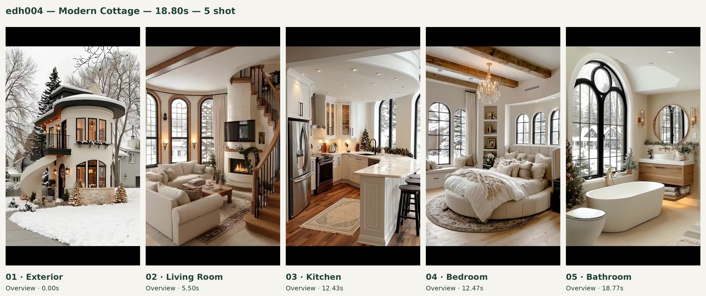
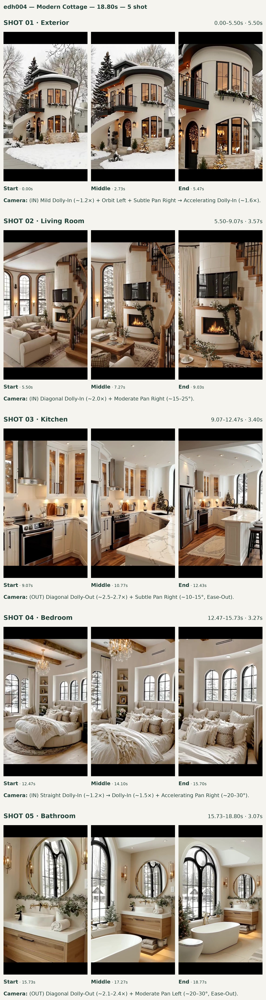
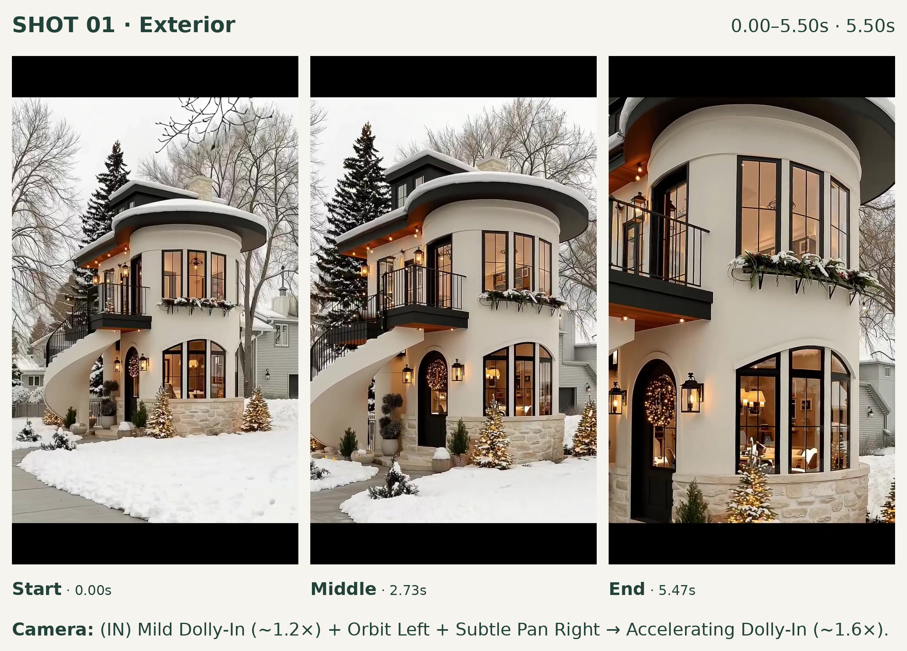
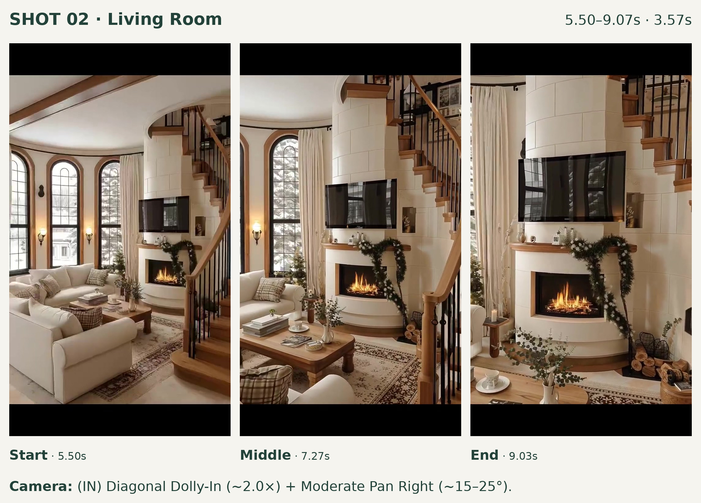
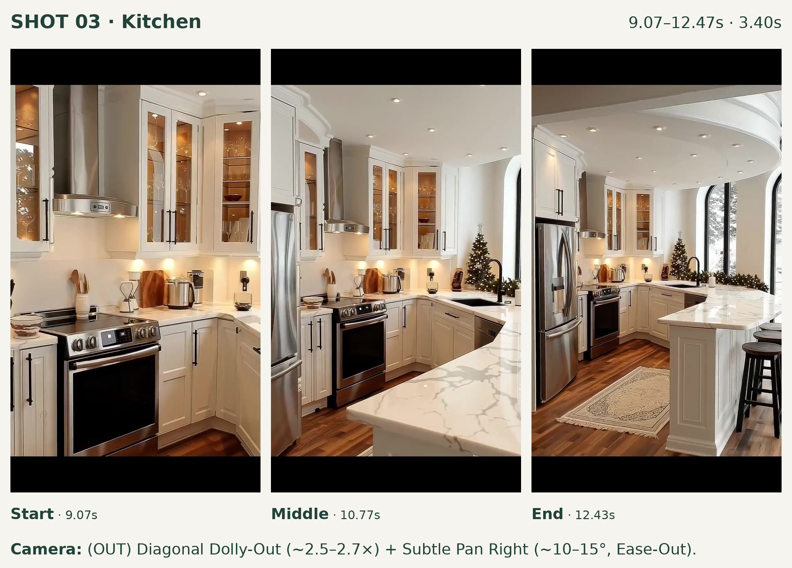
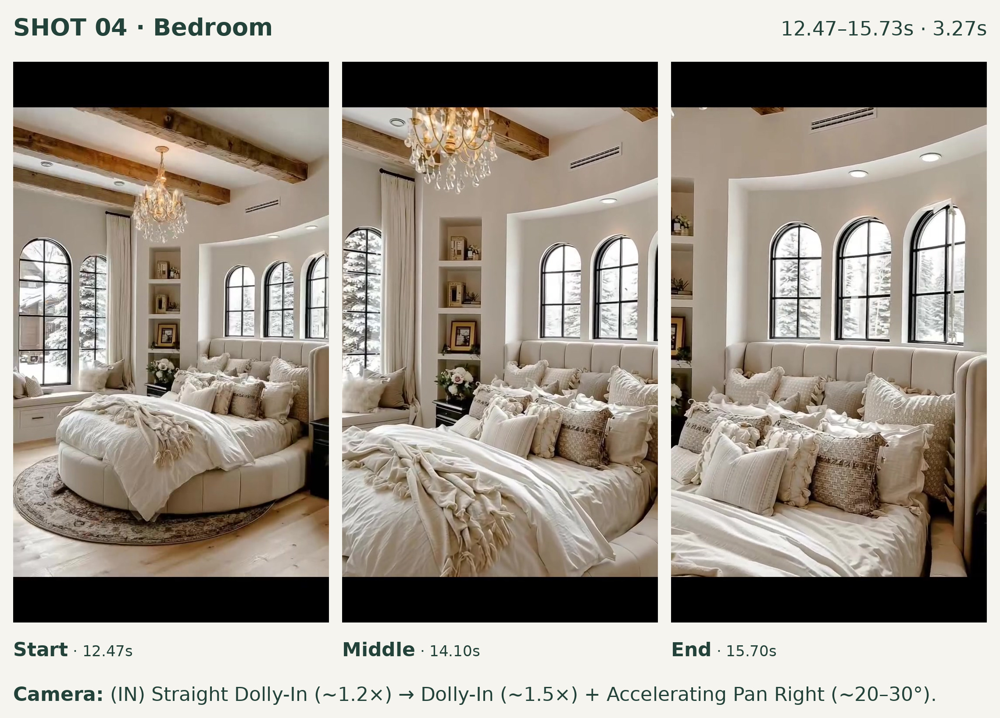
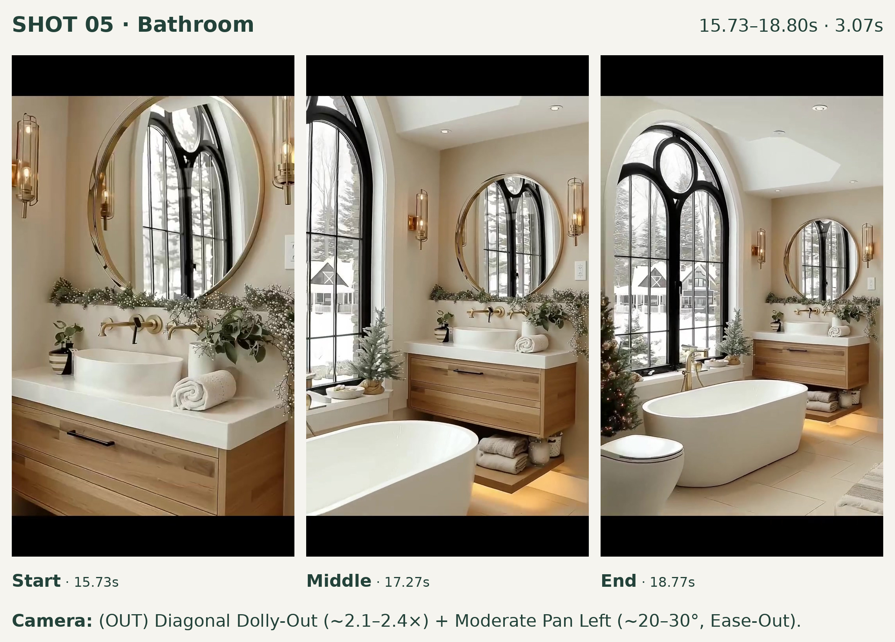

# edh004 — Rounded Winter Cottage

## 1. Profil desain

- **Nama desain:** Rounded Winter Cottage
- **Tipe rumah:** Detached House
- **Gaya utama:** **Modern Cottage**
- **Pengaruh gaya:** Storybook Cottage
- **Gaya interior:** Modern Traditional
- **Susunan ruang utama:** Urutan edit menampilkan Exterior, Living Room, Kitchen, Bedroom, Bathroom; hubungan denah tidak dapat ditentukan dari cut
- **Ciri khas:** Fasad membulat, tangga luar melengkung, perapian kolom membulat, ranjang berlapis kain melengkung dan jendela kamar mandi berornamen lingkaran
- **Material utama:** Tampilan plester putih gading, dasar bertekstur batu, bingkai hitam, kayu hangat dan kain krem; material fisik tidak terverifikasi
- **Pencahayaan:** Cahaya siang difus dari salju/jendela, dipadukan lampu dinding, perapian, lampu kabinet dan chandelier hangat
- **Atmosfer:** Hangat, lembut dan meriah dengan aksen dekorasi musim dingin
- **Lingkungan:** Halaman bersalju, pohon gugur dan cemara serta bangunan tetangga

### Palet warna

| Peran | Warna | HEX |
| --- | --- | --- |
| Dominan | Putih gading | `#F0E8DB` |
| Pendamping | Krem linen | `#D4C7B3` |
| Pendamping | Cokelat kayu | `#9C704A` |
| Aksen | Hitam arang | `#292625` |
| Aksen | Hijau cemara | `#4B5743` |
| Aksen | Emas hangat | `#B8945C` |

## 2. Ukuran & proporsi

| Aspek | Estimasi visual |
| --- | --- |
| **Ukuran rumah** | small |
| **Bentuk bangunan** | Volume vertikal dengan bay membulat dan balkon di sisi kiri |
| **Lantai & bentuk atap** | Dua tingkat fasad utama, volume atap atas tambahan terlihat; jumlah lantai lengkap belum pasti · Overhang lengkung gelap berlapis salju, volume atap atas bersudut |
| **Tapak bangunan** | Massa depan kompak dengan bidang melengkung; tapak keseluruhan tidak terlihat |
| **Proporsi utama** | Massa vertikal dua tingkat dengan bukaan tinggi dan overhang melengkung |
| **Perkiraan luas lantai** | **80–130 m²** |

## 3. Shot Timeline

Durasi 18.80s · 5 shot.

**Camera Pattern:** IN – IN – OUT – IN – OUT.

| Shot | Time (s) | Duration | Area/Scene | Camera Movement |
| --- | --- | --- | --- | --- |
| 01 | 0.00–5.50 | 5.50s | Exterior | Mild Dolly-In (~1.2×) + Orbit Left + Subtle Pan Right → Accelerating Dolly-In (~1.6×). |
| 02 | 5.50–9.07 | 3.57s | Living Room | Diagonal Dolly-In (~2.0×) + Moderate Pan Right (~15–25°). |
| 03 | 9.07–12.47 | 3.40s | Kitchen | Diagonal Dolly-Out (~2.5–2.7×) + Subtle Pan Right (~10–15°, Ease-Out). |
| 04 | 12.47–15.73 | 3.27s | Bedroom | Straight Dolly-In (~1.2×) → Dolly-In (~1.5×) + Accelerating Pan Right (~20–30°). |
| 05 | 15.73–18.80 | 3.07s | Bathroom | Diagonal Dolly-Out (~2.1–2.4×) + Moderate Pan Left (~20–30°, Ease-Out). |

## 4. Overview

**Shot 01 · Exterior · 0.00s**

> Dari jalur halaman depan pada tinggi mendekati mata, arah serong sedikit ke atas mencakup fasad membulat, tangga luar dan balkon kiri, atap serta halaman bersalju.

**Shot 02 · Living Room · 5.50s**

> Dari sisi ruang duduk dekat tangga pada tinggi mata, pandangan serong mencakup sofa krem, meja kopi, jendela lengkung, perapian dan tangga kanan.

**Shot 03 · Kitchen · 12.43s**

> Dari ujung lorong kerja di dekat island, pandangan serong menuju kompor dan sudut sink menampilkan lemari es kiri, kabinet L, island kanan, bangku serta jendela lengkung.

**Shot 04 · Bedroom · 12.47s**

> Dari sisi kaki ranjang pada tinggi mendekati mata, pandangan serong memperlihatkan ranjang membulat, karpet, bangku jendela kiri, rak ceruk, chandelier serta tiga jendela di atas headboard.

**Shot 05 · Bathroom · 18.77s**

> Dari sisi depan bathtub pada tinggi mendekati mata, pandangan serong mencakup toilet kiri, bathtub oval dekat jendela lengkung tinggi, vanity kayu dan cermin bundar di kanan.

## 5. Storyboard

## 6. Shot Details

### Shot 01 · Exterior

**Time:** 0.00–5.50s · **Duration:** 5.50s

#### **A. Desain area**

**Arsitektur**

> Fasad dua tingkat putih gading dengan bay melengkung, overhang atap gelap membulat dan volume atap atas bersudut. Bukaan berbingkai hitam tinggi; lantai dasar berjendela lengkung dan alas bertekstur batu. Tangga luar melengkung di kiri naik ke balkon berpagar hitam di atas pintu lengkung.

**Furnitur & dekorasi**

> Kotak tanaman di jendela atas, lampu lentera pada dinding, pot topiary, karangan di pintu dan pohon kecil berlampu mengapit akses.

**Lingkungan**

> Salju menutup halaman dan atap; jalur abu-abu melengkung di depan; pohon gugur, cemara dan rumah tetangga di belakang.

#### **B. Framing & Lighting**

- **Fokus:** Fasad membulat dan pintu
- **Camera Start:** Di jalur depan halaman · Menghadap serong ke rumah · oblique · Sekitar tinggi mata; melihat sedikit ke atas · Sedikit mendongak secara visual
- **Framing:** Wide seluruh fasad, tangga, tapak dan atap → Tight pada bay, pintu, balkon; tapak terpotong
- **Lighting:** Siang difus pada salju, lentera dan cahaya dalam berwarna hangat
- **Foreground dan kedalaman:** Jalur dan hamparan salju · Halaman, fasad, pepohonan belakang
- **Reveal:** Detail lengkung dan tekstur alas batu semakin jelas
- **Kesesuaian gerak:** Orbit awal memberi sudut fasad; Dolly-In mengutamakan detail

#### **C. Camera Movement**

Kamera melengkung ke kiri mengitari fasad dengan pendekatan ringan, kemudian mempercepat maju menuju jendela lengkung dan pintu.

**Tempo:** Lambat saat orbit awal, meningkat menjadi sedang hingga cepat pada pendekatan akhir.

- **0.00–2.67s · slow:** Orbit dan pendekatan ringan.
- **2.67–5.50s · moderate:** Pendekatan semakin tegas; pembesaran paling cepat menjelang akhir.

**Movement Timeline**

| Time (s) | Area & fokus | Camera Movement | Tempo |
| --- | --- | --- | --- |
| 0.00–2.67 | Exterior · Fasad, balkon dan jendela lengkung | Mild Dolly-In (~1.2×) + Orbit Left + Subtle Pan Right | Orbit dan pendekatan ringan. |
| 2.67–5.50 | Exterior · Jendela lengkung, pintu dan balkon | Accelerating Dolly-In (~1.6×) | Pendekatan semakin tegas; pembesaran paling cepat menjelang akhir. |

**Camera:** Mild Dolly-In (~1.2×) + Orbit Left + Subtle Pan Right → Accelerating Dolly-In (~1.6×).

---

### Shot 02 · Living Room

**Time:** 5.50–9.07s · **Duration:** 3.57s

#### **A. Desain area**

**Arsitektur**

> Dinding putih dengan deret jendela tinggi lengkung dan bingkai hitam; bidang perapian membulat berlapis panel terang, TV hitam di atas mantel. Tangga kayu melengkung naik di kanan dengan baluster hitam; plafon putih dan elemen balok kayu.

**Furnitur & dekorasi**

> Sofa krem mengitari meja kopi kayu persegi panjang di atas karpet motif; bantal, buku, vas, garland dan kayu bakar di samping perapian.

**Lingkungan**

> Cahaya dari deret jendela memperlihatkan pepohonan dan bangunan bersalju di luar.

#### **B. Framing & Lighting**

- **Fokus:** Perapian dan TV
- **Camera Start:** Sisi area duduk dekat tangga · Serong menuju perapian dan dinding jendela · oblique · Sekitar tinggi mata berdiri · Relatif datar
- **Framing:** Wide sofa, meja, tangga, perapian dan jendela → Medium-tight perapian dan TV, meja terpotong
- **Lighting:** Daylight jendela kiri, nyala api dan lampu dinding hangat
- **Foreground dan kedalaman:** Sofa, meja kopi dan tangga kanan · Meja dan sofa di depan, perapian di tengah, jendela di belakang
- **Reveal:** Detail mantel dan perapian semakin dominan
- **Kesesuaian gerak:** Dolly-In + Pan Right memindah pusat perhatian ke perapian

#### **C. Camera Movement**

Maju menuju perapian sambil menyapu ke kanan; sofa dan tangga dekat keluar dari tepi gambar.

**Tempo:** Maju stabil, sapuan kanan berangsur mereda; pembesaran makin nyata ketika dekat.

**Camera:** Diagonal Dolly-In (~2.0×) + Moderate Pan Right (~15–25°).

---

### Shot 03 · Kitchen

**Time:** 9.07–12.47s · **Duration:** 3.40s

#### **A. Desain area**

**Arsitektur**

> Dapur dengan kabinet panel putih berbentuk L yang berbelok ke area sink di bawah jendela lengkung; kabinet atas berkaca dan crown molding. Plafon terang dengan downlight, lantai tampak papan kayu, countertop putih berurat abu-abu.

**Furnitur & dekorasi**

> Kompor oven dan hood tampak metalik di kiri, lemari es tinggi di kiri depan, sink dan keran hitam di belakang. Island putih dengan overhang dan bangku hitam di kanan; karpet runner di lorong, alat masak dan dekorasi cemara di meja.

**Lingkungan**

> Jendela belakang menampilkan pohon bersalju, memberi cahaya alami pada area sink.

#### **B. Framing & Lighting**

- **Fokus:** Kompor dan kabinet
- **Camera Start:** Dekat kompor di lorong kerja · Menghadap bidang kompor dan sudut kabinet · oblique · Sekitar tinggi mata · Relatif datar
- **Framing:** Close-medium kompor, hood dan sudut kabinet → Wide lorong, refrigerator, island, sink dan jendela
- **Lighting:** Downlight, cahaya kabinet hangat dan daylight jendela
- **Foreground dan kedalaman:** Countertop island masuk kanan saat mundur · Island depan, kabinet perimeter tengah, jendela belakang
- **Reveal:** Lemari es, island dan bangku terungkap
- **Kesesuaian gerak:** Dolly-Out + Pan Right membuka layout dapur

#### **C. Camera Movement**

Mundur diagonal sambil menyapu ke kanan dari kompor, memperlihatkan island, lemari es dan jendela.

**Tempo:** Mundur cukup tegas dan halus, mereda menjelang komposisi wide akhir.

**Camera:** Diagonal Dolly-Out (~2.5–2.7×) + Subtle Pan Right (~10–15°, Ease-Out).

---

### Shot 04 · Bedroom

**Time:** 12.47–15.73s · **Duration:** 3.27s

#### **A. Desain area**

**Arsitektur**

> Kamar dengan ceruk dinding melengkung berisi tiga jendela lengkung di atas headboard; jendela tinggi sisi kiri dengan bangku built-in, rak ceruk vertikal di antara kedua bidang. Plafon putih dengan balok kayu tampak ekspos dan chandelier kristal; lantai kayu terang.

**Furnitur & dekorasi**

> Ranjang berlapis kain krem dengan ujung membulat, headboard bersegmen, banyak bantal dan selimut putih berumbai; karpet bulat bermotif di bawah ranjang. Meja samping gelap, bunga, buku/rangka foto di rak; bangku jendela kiri berbantal.

**Lingkungan**

> Pepohonan bersalju terlihat dari jendela; daylight lembut dan menyebar.

#### **B. Framing & Lighting**

- **Fokus:** Ranjang dan jendela lengkung
- **Camera Start:** Dekat kaki ranjang · Serong ke headboard dan jendela · oblique · Sekitar tinggi mata · Relatif datar
- **Framing:** Wide ranjang, bangku jendela, rak dan chandelier → Tight headboard, bantal dan jendela belakang
- **Lighting:** Daylight sisi kiri dan belakang, chandelier dan downlight hangat
- **Foreground dan kedalaman:** Ujung ranjang dan karpet · Ranjang depan, headboard tengah, ceruk jendela belakang
- **Reveal:** Detail tekstil dan lengkung headboard dominan
- **Kesesuaian gerak:** Dolly-In kemudian Pan Right mengarahkan fokus ke headboard

#### **C. Camera Movement**

Maju dari kaki ranjang, lalu tetap mendekat sambil menyapu kanan menuju headboard dan jendela.

**Tempo:** Awal maju halus, lalu sapuan kanan menjadi lebih tegas sambil laju pendekatan mereda.

**Movement Timeline**

| Time (s) | Area & fokus | Camera Movement | Tempo |
| --- | --- | --- | --- |
| 12.47–13.63 | Bedroom · Ranjang dan headboard | Straight Dolly-In (~1.2×) | Awal maju halus, lalu sapuan kanan menjadi lebih tegas sambil laju pendekatan mereda. |
| 13.63–15.73 | Bedroom · Headboard dan jendela lengkung | Dolly-In (~1.5×) + Accelerating Pan Right (~20–30°) | Awal maju halus, lalu sapuan kanan menjadi lebih tegas sambil laju pendekatan mereda. |

**Camera:** Straight Dolly-In (~1.2×) → Dolly-In (~1.5×) + Accelerating Pan Right (~20–30°).

---

### Shot 05 · Bathroom

**Time:** 15.73–18.80s · **Duration:** 3.07s

#### **A. Desain area**

**Arsitektur**

> Kamar mandi berdinding beige dengan jendela lengkung hitam tinggi berornamen lingkaran dan garis vertikal; plafon putih berbidang turun/naik dan downlight, lantai ubin terang.

**Furnitur & dekorasi**

> Vanity kayu gantung berlaci dan rak handuk, countertop putih dengan vessel sink dan keran dinding warna emas; cermin bundar berbingkai emas di antara sconce. Bathtub oval freestanding dekat jendela, keran emas, toilet putih kiri depan; dekorasi hijau dan pohon kecil.

**Lingkungan**

> Jendela besar memperlihatkan halaman dan rumah tetangga bersalju; pantulan cermin menampilkan bukaan yang sama.

#### **B. Framing & Lighting**

- **Fokus:** Cermin, vanity dan bathtub
- **Camera Start:** Dekat vanity di depan cermin · Menghadap bidang vanity · oblique · Sekitar tinggi mata · Relatif datar
- **Framing:** Close-medium vanity dan cermin → Wide bathtub, jendela, vanity dan toilet
- **Lighting:** Daylight kuat dari jendela, sconce dan lampu bawah vanity hangat
- **Foreground dan kedalaman:** Tepi vanity lalu bathtub dan toilet · Bathtub depan, vanity tengah, jendela dan lingkungan belakang
- **Reveal:** Bathtub, jendela tinggi dan toilet terungkap
- **Kesesuaian gerak:** Dolly-Out + Pan Left memperluas cakupan ke bathtub

#### **C. Camera Movement**

Mundur diagonal dengan sapuan kiri dari vanity, menyingkap jendela tinggi, bathtub dan toilet.

**Tempo:** Mundur dan sapuan kiri tegas di awal-tengah, kemudian melambat menjelang wide akhir.

**Camera:** Diagonal Dolly-Out (~2.1–2.4×) + Moderate Pan Left (~20–30°, Ease-Out).

**Catatan referensi:** Luas lantai 80–130 m² adalah perkiraan kasar berdasarkan massa tampak dan ruang yang ditampilkan, bukan pengukuran. Material disebut sesuai tampilan; hubungan fisik antarruang, jumlah lantai penuh, dan lokasi tidak dapat diverifikasi dari cut. Kamera Fase 2 dipertahankan sesuai persetujuan pengguna.
