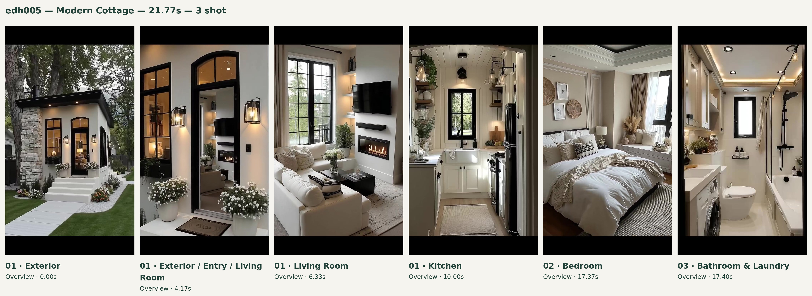
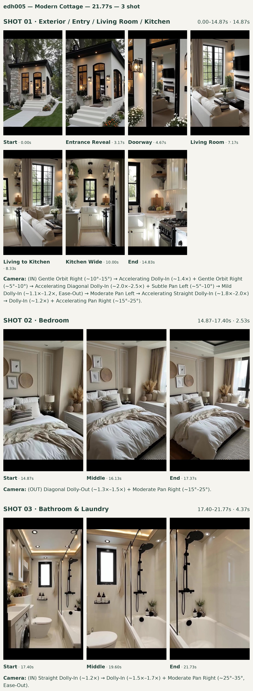
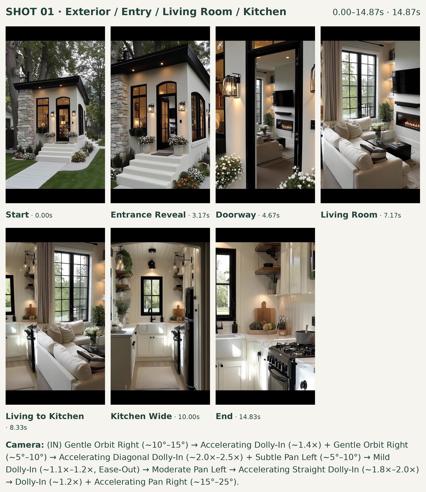
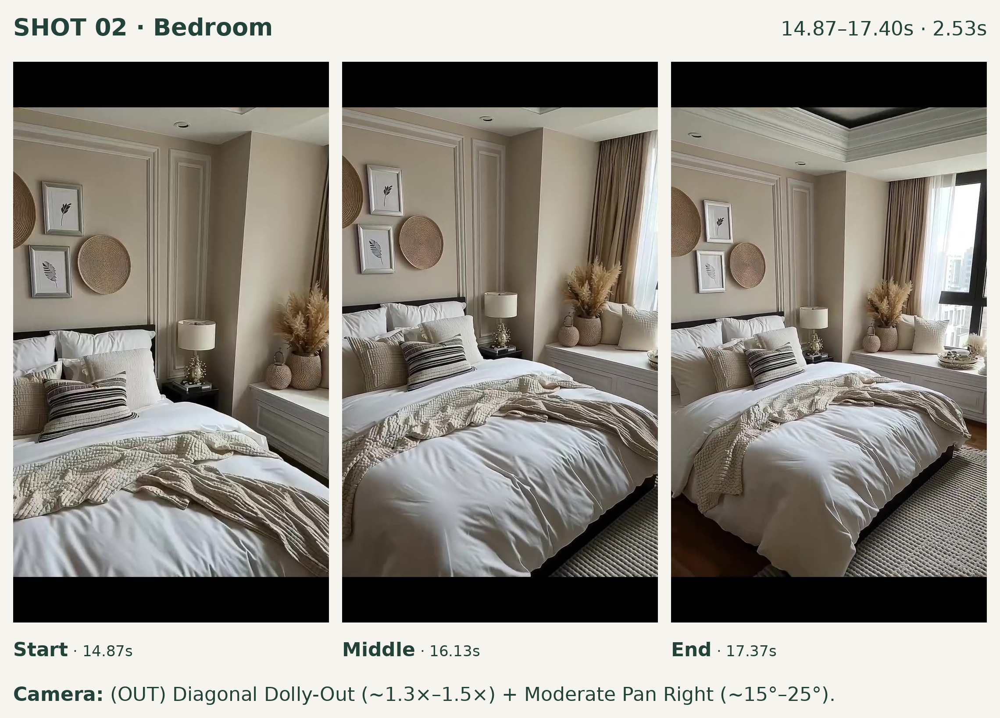
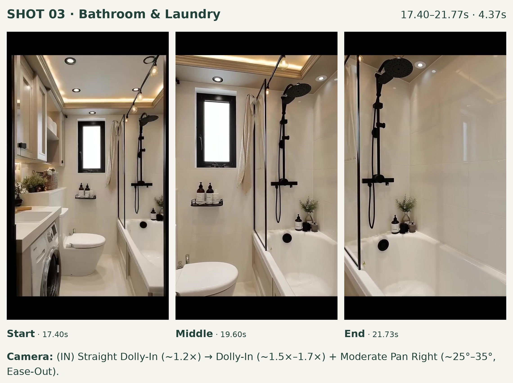

# edh005 — Modern Cottage — Ivory & Black Woodland Retreat

## 1. Profil desain

- **Nama desain:** Modern Cottage — Ivory & Black Woodland Retreat
- **Tipe rumah:** Cottage
- **Gaya utama:** **Modern Cottage**
- **Pengaruh gaya:** Contemporary Modern; Modern Farmhouse
- **Gaya interior:** Modern Farmhouse; Contemporary Cozy
- **Susunan ruang utama:** Exterior dan Entry menuju living secara visual; kitchen berbentuk lorong, bedroom, serta bathroom dengan laundry diperlihatkan; hubungan denah antar-cut belum diketahui
- **Ciri khas:** Transom pintu melengkung, pier batu, dinding TV dengan perapian linear, apron sink putih dan bathtub dengan shower hitam
- **Material utama:** Tampilan plester ivory, batu susun abu, bingkai hitam, permukaan kayu hangat, tekstil krem dan panel putih
- **Pencahayaan:** Cahaya siang dari bukaan tinggi; sconce, downlight, lampu rak dan cove hangat sebagai aksen
- **Atmosfer:** Intim, hangat, rapi dan tenang dengan kontras hitam-putih serta tekstil netral
- **Lingkungan:** Pohon dewasa, rumput, bed tanaman berbunga, jalur putih dan sebagian bangunan sekitar

### Palet warna

| Peran | Warna | HEX |
| --- | --- | --- |
| Dominan | Warm Ivory | `#E9E4D9` |
| Aksen | Charcoal Black | `#242321` |
| Pendamping | Warm Greige | `#B8AA98` |
| Pendamping | Natural Oak | `#A27B53` |
| Pendamping | Stone Grey | `#A8A49B` |
| Aksen | Muted Olive | `#68744C` |

## 2. Ukuran & proporsi

| Aspek | Estimasi visual |
| --- | --- |
| **Ukuran rumah** | tiny |
| **Bentuk bangunan** | Massa kompak satu tingkat, fasad plester terang dan pier batu di kiri |
| **Lantai & bentuk atap** | Satu tingkat terlihat · Atap rendah dengan tepi hitam menonjol; bentuk bidang atas tidak sepenuhnya terlihat |
| **Tapak bangunan** | Massa depan sempit, memanjang ke belakang; batas tapak penuh tidak terlihat |
| **Proporsi utama** | Fasad kompak dengan bukaan tinggi dan tangga masuk pendek |
| **Perkiraan luas lantai** | **30–55 m²** |

## 3. Shot Timeline

Durasi 21.77s · 3 shot.

**Camera Pattern:** IN – OUT – IN.

| Shot | Time (s) | Duration | Area/Scene | Camera Movement |
| --- | --- | --- | --- | --- |
| 01 | 0.00–14.87 | 14.87s | Exterior / Entry / Living Room / Kitchen | Gentle Orbit Right (~10°–15°) → Accelerating Dolly-In (~1.4×) + Gentle Orbit Right (~5°–10°) → Accelerating Diagonal Dolly-In (~2.0×–2.5×) + Subtle Pan Left (~5°–10°) → Mild Dolly-In (~1.1×–1.2×, Ease-Out) → Moderate Pan Left → Accelerating Straight Dolly-In (~1.8×–2.0×) → Dolly-In (~1.2×) + Accelerating Pan Right (~15°–25°). |
| 02 | 14.87–17.40 | 2.53s | Bedroom | Diagonal Dolly-Out (~1.3×–1.5×) + Moderate Pan Right (~15°–25°). |
| 03 | 17.40–21.77 | 4.37s | Bathroom & Laundry | Straight Dolly-In (~1.2×) → Dolly-In (~1.5×–1.7×) + Moderate Pan Right (~25°–35°, Ease-Out). |

## 4. Overview

**Shot 01 · Exterior · 0.00s**

> Dari jalur depan, kamera menghadap serong ke fasad pada ketinggian sekitar mata; wide mencakup tangga, bukaan tinggi, pier batu, taman dan pohon.

**Shot 01 · Exterior / Entry / Living Room · 4.17s**

> Dari landing, kamera menghadap pintu terbuka dan dinding TV di dalam; kusen tinggi, lentera, pot dan ambang terlihat.

**Shot 01 · Living Room · 6.33s**

> Dari belakang sofa dekat ambang, kamera menghadap serong ke TV kanan dan jendela kiri; wide menampilkan konfigurasi sofa, meja kopi, rug dan perapian.

**Shot 01 · Kitchen · 10.00s**

> Dari mulut lorong dapur, kamera menghadap sink dan jendela ujung; wide menunjukkan kabinet kedua sisi, range kanan, rak, kulkas dan runner.

**Shot 02 · Bedroom · 17.37s**

> Dari sisi kaki ranjang, kamera menghadap serong ke headboard kiri dan jendela kanan; wide akhir menampilkan ranjang utuh, bangku jendela, rug, dekorasi dinding dan cornice.

**Shot 03 · Bathroom & Laundry · 17.40s**

> Dari pintu ruang mandi, kamera menghadap lurus ke jendela ujung; wide awal menampilkan counter dan mesin cuci kiri, toilet, bathtub dengan shower kanan, panel kaca dan plafon bercahaya.

## 5. Storyboard

## 6. Shot Details

### Shot 01 · Exterior / Entry / Living Room / Kitchen

**Time:** 0.00–14.87s · **Duration:** 14.87s

**Shot Type:** Continuous shot · Multi area · No cut.

#### **A. Desain area**

##### **Exterior**

**Arsitektur**

> Massa rendah dan kompak dengan bidang putih, pier batu susun abu di kiri dan tepi atap hitam menjorok. Jendela tinggi di muka serta bukaan tinggi melengkung di samping kanan; pintu kaca hitam bertransom lengkung di atas tangga putih.

**Furnitur & dekorasi**

> Dua pot bunga putih mengapit pintu, planter gelap di bawah jendela depan; sconce lentera hitam dan downlight hangat di bawah overhang.

**Lingkungan**

> Jalur beton putih di tengah rumput hijau; bed bunga mengapit tangga dan pohon besar mengelilingi rumah. Cahaya luar lembut, interior terlihat hangat.

##### **Entry**

**Arsitektur**

> Ambang langsung menghadap area duduk melalui pintu kaca hitam tinggi dengan transom melengkung; tidak terlihat foyer terpisah.

**Furnitur & dekorasi**

> Keset gelap di landing, pot berbunga dan lentera dinding pada kedua sisi pintu.

**Lingkungan**

> Cahaya luar lembut berkontras dengan cahaya hangat dari sconce dan living.

##### **Living Room**

**Arsitektur**

> Ruang duduk kompak dengan jendela tinggi berkisi hitam, tirai panjang beige, dinding fokus putih menampung TV dan perapian linear; rak sisi berlampu dan lantai tampak kayu.

**Furnitur & dekorasi**

> Sofa berlapis ivory menghadap dinding TV, kursi/sofa di dekat jendela; meja kopi persegi panjang hitam di atas rug terang, bantal krem, buku dan vas bunga; tanaman di sudut.

**Lingkungan**

> Pepohonan hijau tampak melalui kaca; cahaya siang dari kiri berpadu dengan cahaya hangat rak dan perapian.

##### **Kitchen**

**Arsitektur**

> Lorong dapur dengan kabinet di kedua sisi dan kabinet bawah di ujung, membentuk U yang tampak; jendela hitam di atas apron sink, dinding/plafon panel putih, counter terang, rak kayu terbuka kiri dan kanan.

**Furnitur & dekorasi**

> Apron sink putih dengan faucet hitam di ujung, kompor/range di kanan dan kulkas gelap dekat sisi kanan awal. Rak kayu memuat cangkir dan wadah; papan potong kayu, sayuran dan alat masak di counter, runner krem di lorong.

**Lingkungan**

> Vegetasi tampak melalui jendela sink; sinar siang mengenai kabinet, dengan pendant dan lampu dinding hitam serta aksen bawah kabinet.

#### **B. Framing & Lighting**

- **Fokus:** Entrance, sofa living, sink dan range kitchen
- **Camera Start:** Jalur putih di depan tangga rumah · Menghadap serong ke fasad dan pintu masuk · oblique · Sekitar tinggi mata · Hampir datar
- **Framing:** Wide fasad, tangga dan taman → Close pada counter, kompor dan sebagian sink
- **Lighting:** Siang difus di luar, jendela interior dan aksen lampu hangat
- **Foreground dan kedalaman:** Jalur, tangga, kusen, sofa, lalu counter · Jalur–tangga–ambang–living; kemudian lorong–sink–jendela
- **Reveal:** Orbit membuka sisi kanan, IN melintasi ambang, sapuan kiri menampilkan kitchen, IN mengisolasi area kerja
- **Kesesuaian gerak:** IN membuka detail bertahap; sapuan tampak antara living dan kitchen tidak memastikan kontinuitas denah
- **Area:** Exterior / Entry / Living Room / Kitchen
- **Rute kamera:** —

**Hubungan antararea**

- **Penghubung area:** —
- **Peralihan:** Exterior · 0.00–5.67s; Entry · 3.17–5.83s; Living Room · 4.17–10.00s; Kitchen · 7.33–14.87s
- **Orientasi ruang:** Satu shot visual hingga F445; sambungan living–kitchen tampak seperti slide/wipe, tidak membuktikan denah fisik.

#### **C. Camera Movement**

Kamera menyapu sisi kanan fasad, mendekat dan melintas ambang pintu, maju ringan ke ruang duduk, menyapu kiri menuju dapur lalu maju ke sink dan berbelok kanan menuju kompor.

**Tempo:** Lambat pada orbit awal, makin cepat saat mendekati pintu, melandai di living, sedang saat sapuan dapur dan menguat di akhir.

- **0.00–1.67s · slow:** Orbit ringan.
- **1.67–3.17s · moderate:** Pendekatan bertambah.
- **3.17–5.67s · fast:** Melintas ambang dengan perubahan skala besar.
- **5.67–7.17s · slow:** Melandai di living.
- **7.17–10.00s · moderate:** Sapuan kiri menuju kitchen.
- **10.00–13.67s · moderate:** Maju sepanjang lorong, bertambah.
- **13.67–14.87s · fast:** Mendekat dan menyapu kanan menuju kompor.

**Alur visual:** Exterior → ambang Entry → Living Room → Kitchen; kontinuitas fisik sambungan living–kitchen tidak dapat dipastikan dari citra.

**Movement Timeline**

| Time (s) | Area & fokus | Camera Movement | Tempo |
| --- | --- | --- | --- |
| 0.00–1.67 | Exterior / Entry / Living Room / Kitchen · Exterior · fasad dan sisi kanan | Gentle Orbit Right (~10°–15°) | Orbit ringan. |
| 1.67–3.17 | Exterior / Entry / Living Room / Kitchen · Exterior · tangga dan entrance | Accelerating Dolly-In (~1.4×) + Gentle Orbit Right (~5°–10°) | Pendekatan bertambah. |
| 3.17–5.67 | Exterior / Entry / Living Room / Kitchen · Entry · pintu menuju living | Accelerating Diagonal Dolly-In (~2.0×–2.5×) + Subtle Pan Left (~5°–10°) | Melintas ambang dengan perubahan skala besar. |
| 5.67–7.17 | Exterior / Entry / Living Room / Kitchen · Living Room · sofa, jendela, TV | Mild Dolly-In (~1.1×–1.2×, Ease-Out) | Melandai di living. |
| 7.17–10.00 | Exterior / Entry / Living Room / Kitchen · Living Room → Kitchen | Moderate Pan Left | Sapuan kiri menuju kitchen. |
| 10.00–13.67 | Exterior / Entry / Living Room / Kitchen · Kitchen · sink dan jendela | Accelerating Straight Dolly-In (~1.8×–2.0×) | Maju sepanjang lorong, bertambah. |
| 13.67–14.87 | Exterior / Entry / Living Room / Kitchen · Kitchen · sink menuju range | Dolly-In (~1.2×) + Accelerating Pan Right (~15°–25°) | Mendekat dan menyapu kanan menuju kompor. |

**Camera:** Gentle Orbit Right (~10°–15°) → Accelerating Dolly-In (~1.4×) + Gentle Orbit Right (~5°–10°) → Accelerating Diagonal Dolly-In (~2.0×–2.5×) + Subtle Pan Left (~5°–10°) → Mild Dolly-In (~1.1×–1.2×, Ease-Out) → Moderate Pan Left → Accelerating Straight Dolly-In (~1.8×–2.0×) → Dolly-In (~1.2×) + Accelerating Pan Right (~15°–25°).

---

### Shot 02 · Bedroom

**Time:** 14.87–17.40s · **Duration:** 2.53s

#### **A. Desain area**

**Arsitektur**

> Dinding greige bermoulding persegi, plafon dengan cornice bertingkat, jendela tinggi di kanan dengan tirai panjang dan bangku built-in berpanel di bawahnya. Lantai tampak papan kayu gelap.

**Furnitur & dekorasi**

> Ranjang berheadboard gelap, linen putih, bantal netral dan cushion garis, throw rajut beige, lampu meja di samping kanan. Dekorasi lingkar anyaman serta gambar berbingkai di atas ranjang, vas rumput kering dan bantal di bangku jendela; rug tekstur di bawah kaki ranjang.

**Lingkungan**

> Cahaya siang masuk dari kanan melalui tirai tipis; pemandangan luar tidak cukup jelas untuk mengidentifikasi lokasi.

#### **B. Framing & Lighting**

- **Fokus:** Ranjang dan jendela
- **Camera Start:** Dekat kaki/sisi ranjang · Serong ke headboard dan jendela kanan · oblique · Sekitar tinggi mata · Hampir datar
- **Framing:** Medium pada ranjang dan dinding headboard → Wide ranjang, rug dan bangku jendela
- **Lighting:** Cahaya siang dari jendela kanan
- **Foreground dan kedalaman:** Linen dan throw ranjang · Kaki ranjang–headboard–dinding dan bangku jendela
- **Reveal:** OUT dan pan kanan membuka ranjang utuh serta jendela
- **Kesesuaian gerak:** Gerak mundur memperluas cakupan konfigurasi kamar

#### **C. Camera Movement**

Kamera mundur diagonal sambil mengarahkan pandangan ke kanan, membuka ranjang, sisi tempat tidur dan bench jendela.

**Tempo:** Mundur dan menyapu kanan dengan laju sedang, relatif mulus.

**Camera:** Diagonal Dolly-Out (~1.3×–1.5×) + Moderate Pan Right (~15°–25°).

---

### Shot 03 · Bathroom & Laundry

**Time:** 17.40–21.77s · **Duration:** 4.37s

#### **A. Desain area**

**Arsitektur**

> Ruang memanjang kompak, vanity/laundry kiri, toilet dekat jendela tinggi di ujung dan bathtub sepanjang kanan. Panel kaca tetap memisahkan sisi shower; dinding krem berbidang ubin besar dan plafon tray dengan cove light.

**Furnitur & dekorasi**

> Mesin front-load di bawah counter kiri, wastafel dan kabinet atas berpanel putih, toilet putih, bathtub putih dan perangkat rain shower hitam dengan hand shower; rak sabun di bawah jendela, handuk dan tanaman kecil.

**Lingkungan**

> Jendela sangat terang tanpa detail luar; downlight bundar, cove hangat dan lampu di dekat vanity memberi pencahayaan berlapis.

#### **B. Framing & Lighting**

- **Fokus:** Toilet, shower dan bathtub
- **Camera Start:** Ambang ruang mandi dekat counter kiri · Menghadap jendela ujung dan bathtub kanan · frontal · Sekitar tinggi mata · Hampir datar
- **Framing:** Wide lorong bathroom dan laundry → Close shower hitam dan bathtub
- **Lighting:** Cahaya jendela, downlight, cove hangat
- **Foreground dan kedalaman:** Counter dan mesin front-load kiri, tepi bathtub kanan · Ambang–toilet–jendela, bidang kaca dan bathtub di kanan
- **Reveal:** IN memperbesar ruang lalu pan kanan menonjolkan shower
- **Kesesuaian gerak:** Wide awal menetapkan fungsi gabungan; gerak IN menampilkan detail bath dan shower

#### **C. Camera Movement**

Kamera masuk sepanjang bathroom lalu semakin mengarahkan pandangan ke shower dan bathtub kanan.

**Tempo:** Sedang sepanjang pendekatan, sapuan kanan bertambah lalu melandai pada akhir.

**Movement Timeline**

| Time (s) | Area & fokus | Camera Movement | Tempo |
| --- | --- | --- | --- |
| 17.40–18.40 | Bathroom & Laundry · Bathroom & Laundry · toilet dan jendela | Straight Dolly-In (~1.2×) | Sedang sepanjang pendekatan, sapuan kanan bertambah lalu melandai pada akhir. |
| 18.40–21.77 | Bathroom & Laundry · Bathroom · shower dan bathtub | Dolly-In (~1.5×–1.7×) + Moderate Pan Right (~25°–35°, Ease-Out) | Sedang sepanjang pendekatan, sapuan kanan bertambah lalu melandai pada akhir. |

**Camera:** Straight Dolly-In (~1.2×) → Dolly-In (~1.5×–1.7×) + Moderate Pan Right (~25°–35°, Ease-Out).
