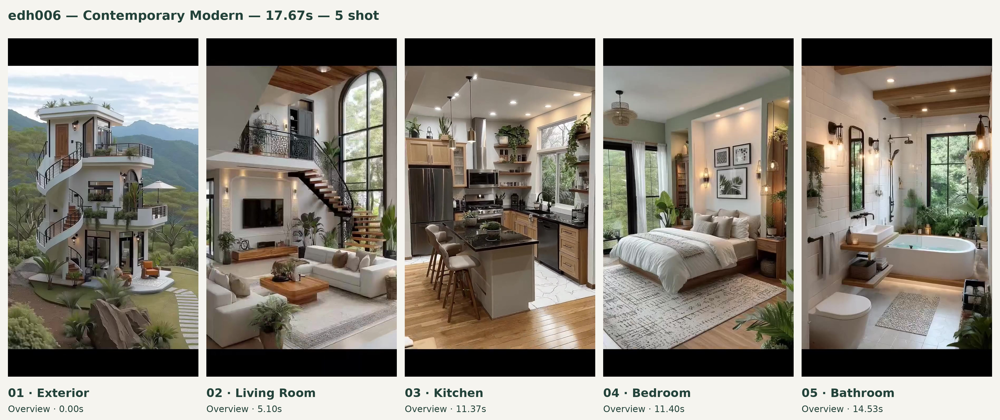
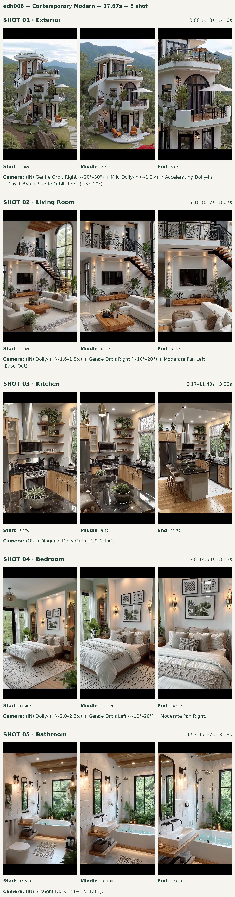
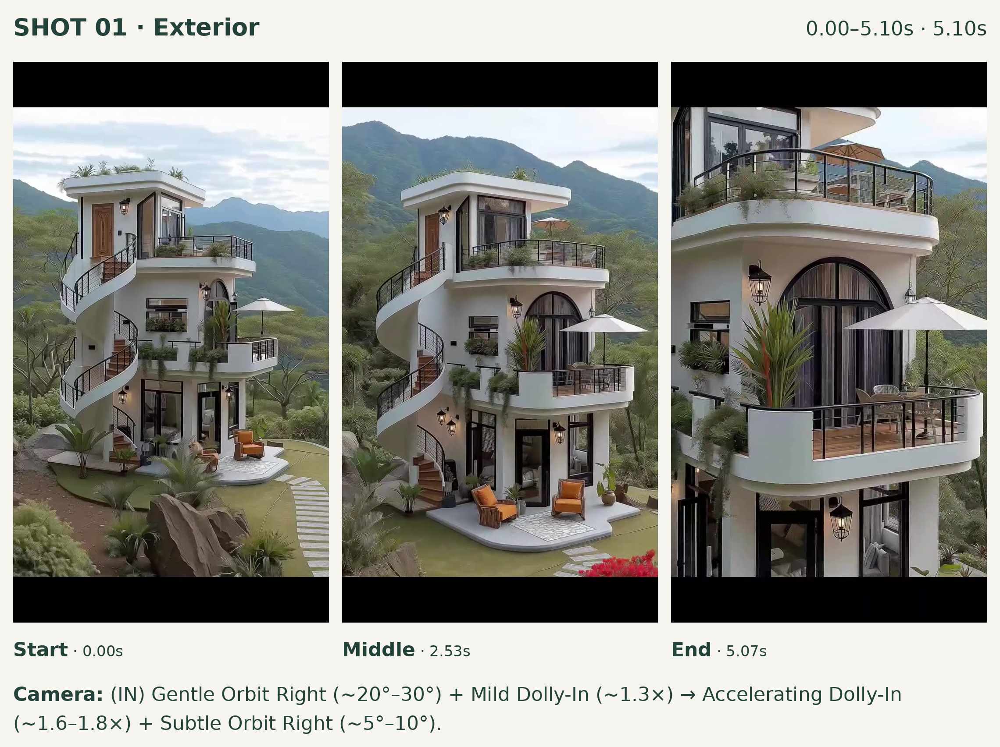
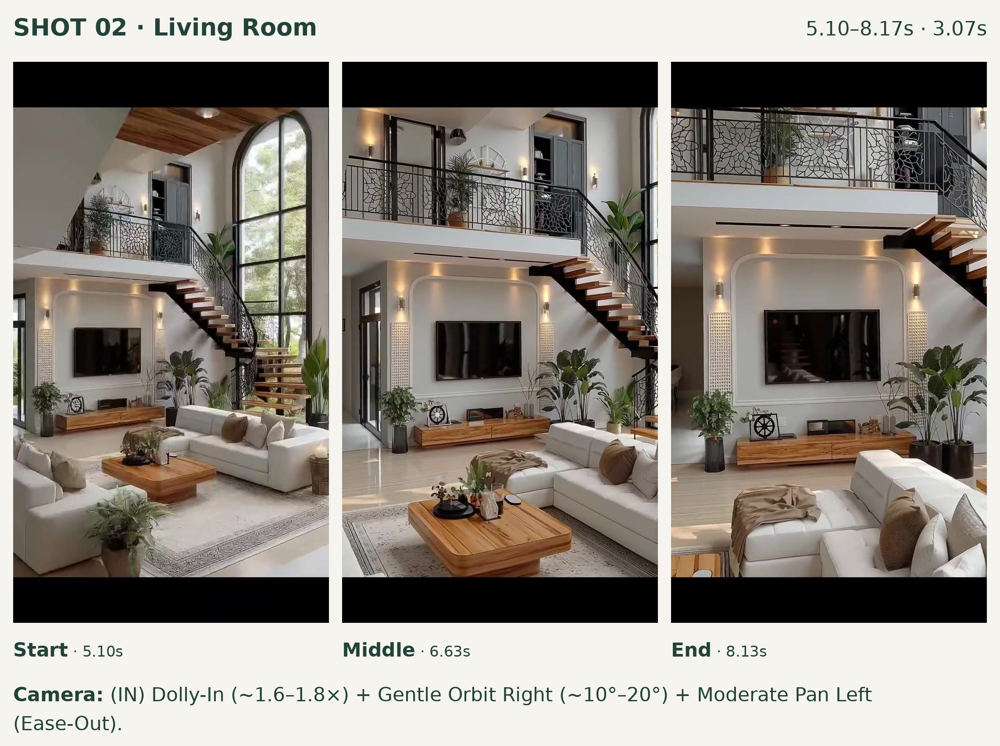
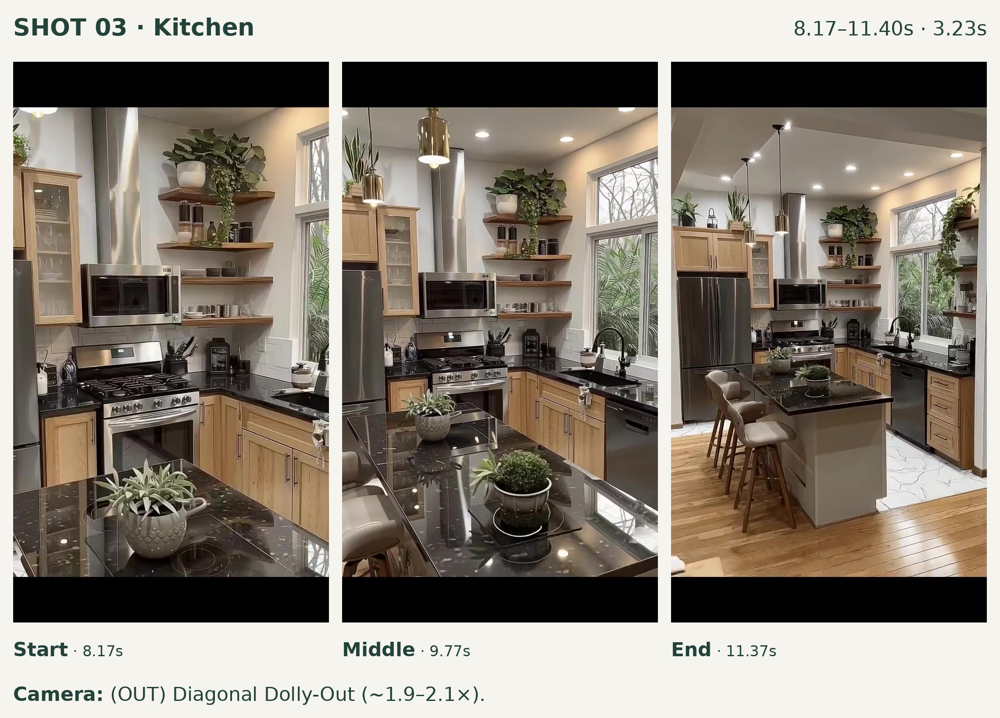
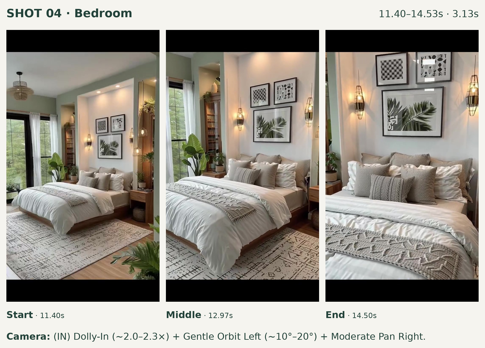
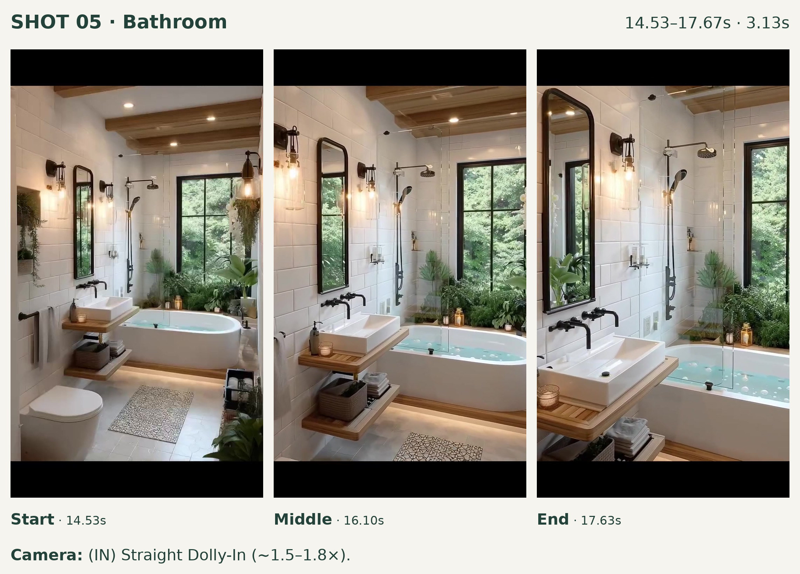

# edh006 — Curved Vertical Mountain Retreat

## 1. Profil desain

- **Nama desain:** Curved Vertical Mountain Retreat
- **Tipe rumah:** Multi-Storey Detached House
- **Gaya utama:** **Contemporary Modern**
- **Pengaruh gaya:** Streamline Moderne
- **Gaya interior:** Contemporary Cozy; Organic Modern
- **Susunan ruang utama:** Fasad bertingkat, living bervoid, dapur dengan island, kamar tidur dan kamar mandi; hubungan denah antar-cut belum terbukti
- **Ciri khas:** Tangga luar melengkung, balkon membulat bertumpuk, bukaan lengkung hitam dan kombinasi kayu dengan tanaman
- **Material utama:** Tampilan plester putih, kayu hangat, kaca dan logam hitam; countertop batu gelap mengilap dan ubin putih
- **Pencahayaan:** Cahaya siang dari bukaan besar dan lampu aksen hangat pada fasad serta interior
- **Atmosfer:** Retret pegunungan terang, hangat dan intim dengan tanaman sebagai aksen alami
- **Lingkungan:** Lanskap hijau berbukit, batu dan jalur pijak; vegetasi terlihat melalui jendela interior

### Palet warna

| Peran | Warna | HEX |
| --- | --- | --- |
| Dominan | Warm White | `#E5E2D9` |
| Pendamping | Honey Oak | `#B98B5C` |
| Pendamping | Warm Beige | `#C6BBAA` |
| Aksen | Charcoal Black | `#292C2B` |
| Pendamping | Muted Sage | `#A3AA99` |
| Aksen | Burnt Orange | `#C77C42` |

## 2. Ukuran & proporsi

| Aspek | Estimasi visual |
| --- | --- |
| **Ukuran rumah** | medium |
| **Bentuk bangunan** | Massa tiga tingkat dengan tepian balkon membulat dan tangga eksterior melingkar |
| **Lantai & bentuk atap** | Tiga tingkat terlihat dari fasad; living menunjukkan void dua tingkat · Atap tampak datar dengan overhang membulat dan tanaman di tepi; struktur atap tidak terlihat |
| **Tapak bangunan** | Tapak kompak, massa vertikal dengan balkon dan tangga melengkung di luar |
| **Proporsi utama** | Tinggi lebih dominan daripada lebar; bidang balkon horizontal berulang |
| **Perkiraan luas lantai** | **90–150 m²** |

## 3. Shot Timeline

Durasi 17.67s · 5 shot.

**Camera Pattern:** IN – IN – OUT – IN – IN.

| Shot | Time (s) | Duration | Area/Scene | Camera Movement |
| --- | --- | --- | --- | --- |
| 01 | 0.00–5.10 | 5.10s | Exterior | Gentle Orbit Right (~20°–30°) + Mild Dolly-In (~1.3×) → Accelerating Dolly-In (~1.6–1.8×) + Subtle Orbit Right (~5°–10°). |
| 02 | 5.10–8.17 | 3.07s | Living Room | Dolly-In (~1.6–1.8×) + Gentle Orbit Right (~10°–20°) + Moderate Pan Left (Ease-Out). |
| 03 | 8.17–11.40 | 3.23s | Kitchen | Diagonal Dolly-Out (~1.9–2.1×). |
| 04 | 11.40–14.53 | 3.13s | Bedroom | Dolly-In (~2.0–2.3×) + Gentle Orbit Left (~10°–20°) + Moderate Pan Right. |
| 05 | 14.53–17.67 | 3.13s | Bathroom | Straight Dolly-In (~1.5–1.8×). |

## 4. Overview

**Shot 01 · Exterior · 0.00s**

> Dari taman depan pada elevasi agak tinggi, kamera menghadap serong ke tiga tingkat, tangga kiri, balkon bertumpuk, teras, jalur pijak, batu dan pegunungan.

**Shot 02 · Living Room · 5.10s**

> Dari sisi depan sofa, kamera menghadap serong ke TV dan tangga kanan; wide mencakup sofa, meja kopi, galeri, void serta jendela lengkung tinggi.

**Shot 03 · Kitchen · 11.37s**

> Dari sisi luar island, kamera menghadap serong ke range dan sink kanan. Wide akhir menunjukkan tiga bangku, island terpisah, kulkas, kabinet L, rak, jendela dan transisi lantai.

**Shot 04 · Bedroom · 11.40s**

> Dari sisi kaki ranjang, kamera menghadap serong ke kepala ranjang; wide awal menampilkan jendela kiri, platform, rug, ceruk putih, penyimpanan samping dan karya dinding.

**Shot 05 · Bathroom · 14.53s**

> Dari ujung ruang dekat kloset, kamera menghadap serong ke bathtub belakang, mencakup wastafel kiri, shower, jendela, platform dan balok plafon.

## 5. Storyboard

## 6. Shot Details

### Shot 01 · Exterior

**Time:** 0.00–5.10s · **Duration:** 5.10s

#### **A. Desain area**

**Arsitektur**

> Massa ramping tiga tingkat dengan bidang putih, balkon melengkung berulang dan tangga luar melingkar di kiri. Teras bawah membulat dengan akses pintu kaca; bukaan tingkat tengah melengkung dan bagian atas berjendela tinggi. Atap ber-overhang membulat tampak datar, dengan tanaman pada tepinya.

**Furnitur & dekorasi**

> Dua kursi warna jingga dan meja kecil pada teras bawah; balkon berisi meja kursi, payung putih dan pot tanaman. Lampu dinding hitam menyala di tiap tingkat.

**Lingkungan**

> Tapak hijau di lereng dengan batu besar, tanaman rendah, jalur stepping stone melengkung dan pegunungan di kejauhan. Langit berawan terang.

#### **B. Framing & Lighting**

- **Fokus:** Fasad bertingkat, lalu balkon tengah
- **Camera Start:** Di luar rumah, di atas jalur/taman depan · Menghadap serong ke fasad dan tangga kiri · oblique · Elevasi di atas teras bawah, perkiraan visual · Sedikit menunduk
- **Framing:** Wide seluruh massa dan lanskap → Close balkon tengah dan bukaan lengkung
- **Lighting:** Cahaya siang difus dan lentera hangat
- **Foreground dan kedalaman:** Batu dan tanaman · Batu–teras–balkon–pegunungan
- **Reveal:** Orbit membuka bidang balkon; IN menonjolkan bukaan lengkung
- **Kesesuaian gerak:** Wide awal memberi konteks, pendekatan mengisolasi balkon

#### **C. Camera Movement**

Kamera mengitari fasad ke kanan sambil mendekat perlahan, kemudian pendekatan ke balkon tengah meningkat pesat sementara orbit mereda.

**Tempo:** Lambat pada awal orbit, sedang saat mendekat, lalu cepat menuju balkon.

- **0.00–2.00s · slow:** Orbit dan pendekatan ringan.
- **2.00–3.50s · moderate:** Pembesaran fasad makin nyata.
- **3.50–5.10s · fast:** Ekspansi menuju balkon tengah sangat cepat.

**Movement Timeline**

| Time (s) | Area & fokus | Camera Movement | Tempo |
| --- | --- | --- | --- |
| 0.00–3.00 | Exterior · Exterior · fasad dan tangga spiral | Gentle Orbit Right (~20°–30°) + Mild Dolly-In (~1.3×) | Orbit dan pendekatan ringan.; Pembesaran fasad makin nyata. |
| 3.00–5.10 | Exterior · Exterior · balkon tengah dan pintu lengkung | Accelerating Dolly-In (~1.6–1.8×) + Subtle Orbit Right (~5°–10°) | Pembesaran fasad makin nyata.; Ekspansi menuju balkon tengah sangat cepat. |

**Camera:** Gentle Orbit Right (~20°–30°) + Mild Dolly-In (~1.3×) → Accelerating Dolly-In (~1.6–1.8×) + Subtle Orbit Right (~5°–10°).

---

### Shot 02 · Living Room

**Time:** 5.10–8.17s · **Duration:** 3.07s

#### **A. Desain area**

**Arsitektur**

> Living bervoid tinggi dengan jendela lengkung besar berbingkai hitam di kanan. Tangga terbuka beranak kayu dan rangka gelap naik menuju galeri atas ber-railing dekoratif. TV menempel pada bidang ceruk sudut membulat dengan panel bertekstur dan lampu aksen; lantai terang dan bidang plafon kayu.

**Furnitur & dekorasi**

> Sofa putih di sisi kanan dan kiri mengapit meja kopi kayu persegi membulat di atas rug pucat bermotif. Konsol kayu rendah di bawah TV, tanaman pot, bantal krem dan throw cokelat.

**Lingkungan**

> Pepohonan terlihat dari jendela kanan. Cahaya siang lateral berpadu dengan sconce dan downlight hangat pada dinding TV.

#### **B. Framing & Lighting**

- **Fokus:** Dinding TV dan area duduk
- **Camera Start:** Di sisi depan area duduk · Serong ke dinding TV dan tangga kanan · oblique · Sekitar tinggi mata · Hampir datar
- **Framing:** Wide sofa, meja, void, galeri dan tangga → Medium-close dinding TV dan sisi sofa
- **Lighting:** Cahaya kanan dari jendela tinggi dan lampu hangat
- **Foreground dan kedalaman:** Sofa kiri, meja kopi · Meja–sofa–TV–galeri
- **Reveal:** Pendekatan dan rotasi memusatkan TV
- **Kesesuaian gerak:** IN mengubah konteks void menjadi fokus dinding TV

#### **C. Camera Movement**

Kamera maju menuju dinding TV sambil bergeser melengkung ke kanan dan menyapu pandangan ke kiri; sapuan mereda menjelang akhir.

**Tempo:** Pendekatan sedang, sapuan kiri paling nyata awal-tengah lalu melandai; pembesaran tetap berlangsung.

**Camera:** Dolly-In (~1.6–1.8×) + Gentle Orbit Right (~10°–20°) + Moderate Pan Left (Ease-Out).

---

### Shot 03 · Kitchen

**Time:** 8.17–11.40s · **Duration:** 3.23s

#### **A. Desain area**

**Arsitektur**

> Kabinet tampak kayu membentuk run L di belakang dan kanan. Island terpisah dengan top hitam mengilap serta bidang masak tanam; backsplash ubin putih, jendela lebar di atas sink, rak terbuka dan kabinet kaca. Lantai area kerja putih bermotif urat bertemu papan kayu.

**Furnitur & dekorasi**

> Range dan oven di bawah microwave dengan bidang logam vertikal, kulkas stainless di kiri, dishwasher kanan, sink dan faucet hitam. Tiga bangku berlapis krem di sisi island, tanaman pot di atasnya, pendant silinder dan downlight.

**Lingkungan**

> Vegetasi lebat terlihat melalui jendela. Cahaya siang dari kanan ditambah downlight dan pendant.

#### **B. Framing & Lighting**

- **Fokus:** Island dan zona kerja
- **Camera Start:** Dekat ujung island · Serong ke range dan sudut kabinet · oblique · Sekitar tinggi mata · Sedikit menunduk ke counter
- **Framing:** Medium area kerja dan island terpotong → Wide island, bangku, kulkas, kabinet L dan lantai
- **Lighting:** Cahaya jendela kanan, pendant dan downlight
- **Foreground dan kedalaman:** Top island dan pot · Island–range–kabinet–jendela
- **Reveal:** OUT membuka bangku dan keseluruhan susunan kabinet
- **Kesesuaian gerak:** Mundur memperluas cakupan layout

#### **C. Camera Movement**

Kamera mundur dari dekat island, sedikit diagonal ke sisi tempat duduk, memperlihatkan kulkas, kursi dan keseluruhan island.

**Tempo:** Mundur sedang; perubahan skala meningkat secara relatif pada akhir, tetapi profil laju fisik tidak terukur dari skala saja.

**Camera:** Diagonal Dolly-Out (~1.9–2.1×).

---

### Shot 04 · Bedroom

**Time:** 11.40–14.53s · **Duration:** 3.13s

#### **A. Desain area**

**Arsitektur**

> Dinding sage membingkai ceruk kepala ranjang putih dengan downlight. Jendela tinggi berbingkai hitam di kiri dengan tirai putih; ceruk penyimpanan kayu di sisi ranjang. Lantai papan kayu dan rug besar pucat.

**Furnitur & dekorasi**

> Ranjang platform kayu berlinen putih, throw rajut dan bantal krem. Meja samping kayu dengan tanaman, tiga karya berbingkai hitam di dinding dan lampu gantung/sconce hangat berulang. Keranjang di bawah meja samping.

**Lingkungan**

> Jendela memperlihatkan dedaunan hijau; cahaya kiri difus berpadu lampu ceruk dan sisi ranjang.

#### **B. Framing & Lighting**

- **Fokus:** Ranjang dan ceruk kepala ranjang
- **Camera Start:** Di sisi kaki ranjang agak ke kanan · Menghadap serong ke kepala ranjang dan jendela kiri · oblique · Sekitar tinggi mata · Hampir datar dengan lantai terlihat
- **Framing:** Wide ranjang, jendela, ceruk dan rug → Close bantal, throw dan karya dinding
- **Lighting:** Cahaya jendela kiri, downlight dan lampu sisi
- **Foreground dan kedalaman:** Rug dan tepi ranjang · Rug–ranjang–ceruk–jendela
- **Reveal:** IN dan rotasi memusatkan ranjang menuju frontal
- **Kesesuaian gerak:** Wide awal memberi konteks, detail akhir menonjolkan tekstur

#### **C. Camera Movement**

Kamera maju menuju ranjang, menggeser sudut pandang dari serong menjadi lebih frontal sambil menyapu ke kanan; pendekatan makin terasa di bagian akhir.

**Tempo:** Sedang dengan ekspansi visual dan sapuan yang makin terasa terutama setelah tengah shot.

**Camera:** Dolly-In (~2.0–2.3×) + Gentle Orbit Left (~10°–20°) + Moderate Pan Right.

---

### Shot 05 · Bathroom

**Time:** 14.53–17.67s · **Duration:** 3.13s

#### **A. Desain area**

**Arsitektur**

> Dinding ubin putih persegi panjang, plafon dengan balok tampak kayu, jendela hitam besar di belakang bathtub dan lantai abu terang. Tub putih berbentuk oval memanjang pada platform kayu dengan cahaya bawah; shower kaca transparan dan fixture gelap di belakang kiri.

**Furnitur & dekorasi**

> Wastafel vessel persegi di atas rak kayu melayang, faucet dinding hitam, cermin tinggi bersudut membulat, dua lampu dinding hangat. Rak bawah memuat keranjang dan handuk; kloset putih di depan kiri, rug kecil, tanaman berkelompok di sekitar tub.

**Lingkungan**

> Jendela belakang memperlihatkan pepohonan lebat. Cahaya siang berpadu lampu dinding hangat, downlight dan strip di bawah platform tub.

#### **B. Framing & Lighting**

- **Fokus:** Wastafel, shower dan bathtub
- **Camera Start:** Di dekat pintu/ujung ruang, di samping kloset · Menghadap serong ke bathtub dan shower belakang · oblique · Sekitar tinggi mata · Hampir datar
- **Framing:** Wide kloset, wastafel, tub, shower dan jendela → Medium-close wastafel, shower dan tub
- **Lighting:** Cahaya belakang, lampu dinding dan strip bawah tub
- **Foreground dan kedalaman:** Kloset, rug dan wastafel · Kloset–wastafel–tub–jendela
- **Reveal:** IN menonjolkan detail wastafel dan zona mandi
- **Kesesuaian gerak:** Wide menjelaskan ruang sebelum detail akhir

#### **C. Camera Movement**

Kamera maju hampir lurus menuju area shower di antara wastafel dan bathtub; lapisan dekat membesar lebih cepat dan keluar frame.

**Tempo:** Pendekatan relatif merata; ekspansi foreground lebih terasa mendekati akhir tanpa bukti perubahan laju fisik yang kuat.

**Camera:** Straight Dolly-In (~1.5–1.8×).

**Catatan referensi:** Luas 90–150 m² merupakan estimasi visual berketidakpastian tinggi dari massa bertingkat dan proporsi pintu/furnitur, bukan pengukuran denah. Gaya, tipe rumah dan palet adalah interpretasi visual; material hanya tampilan. Urutan cut tidak membuktikan hubungan denah atau identitas satu rumah. Hasil kamera disalin tanpa perubahan dari checkpoint yang disetujui pengguna; sudut pan S02/S04 tidak terpisah meyakinkan dari orbit; pan kecil S03 tidak diisolasi.
