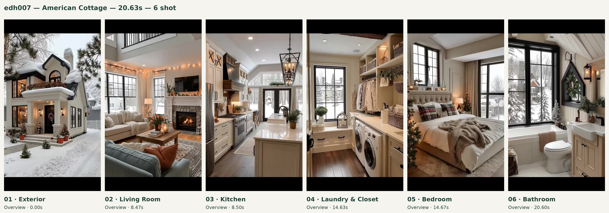
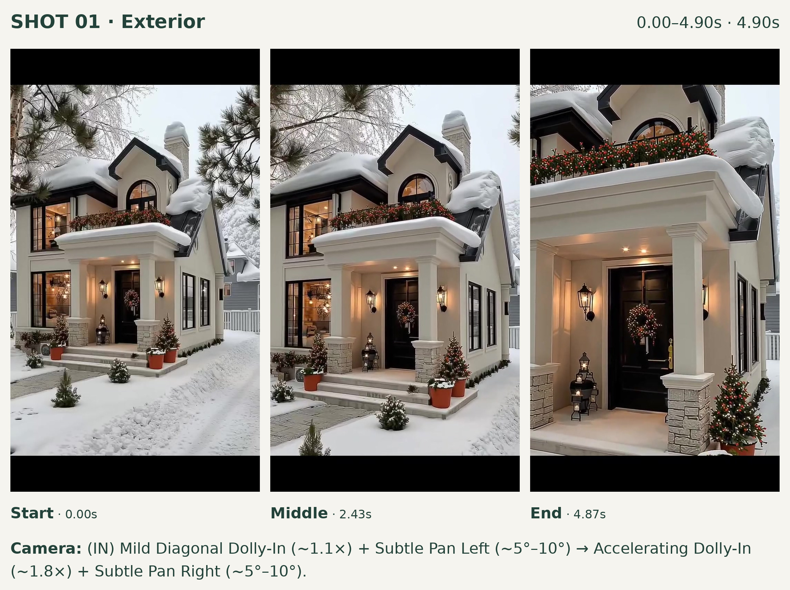
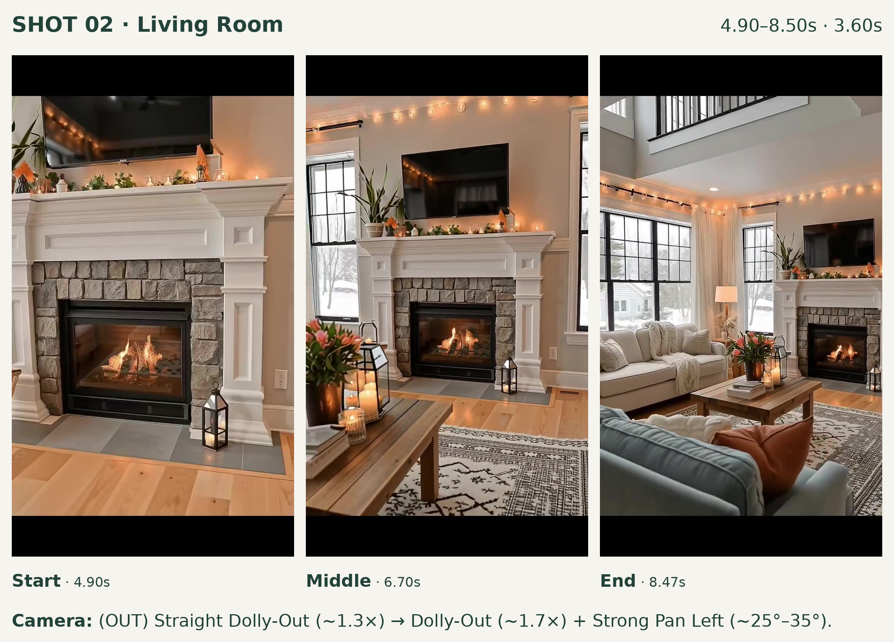
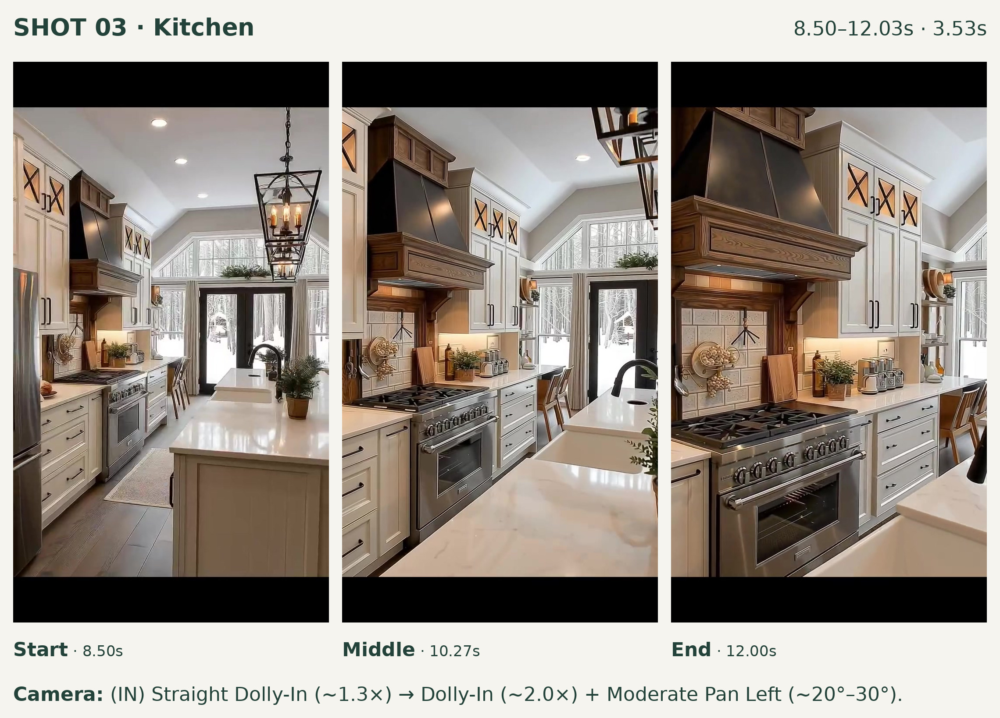
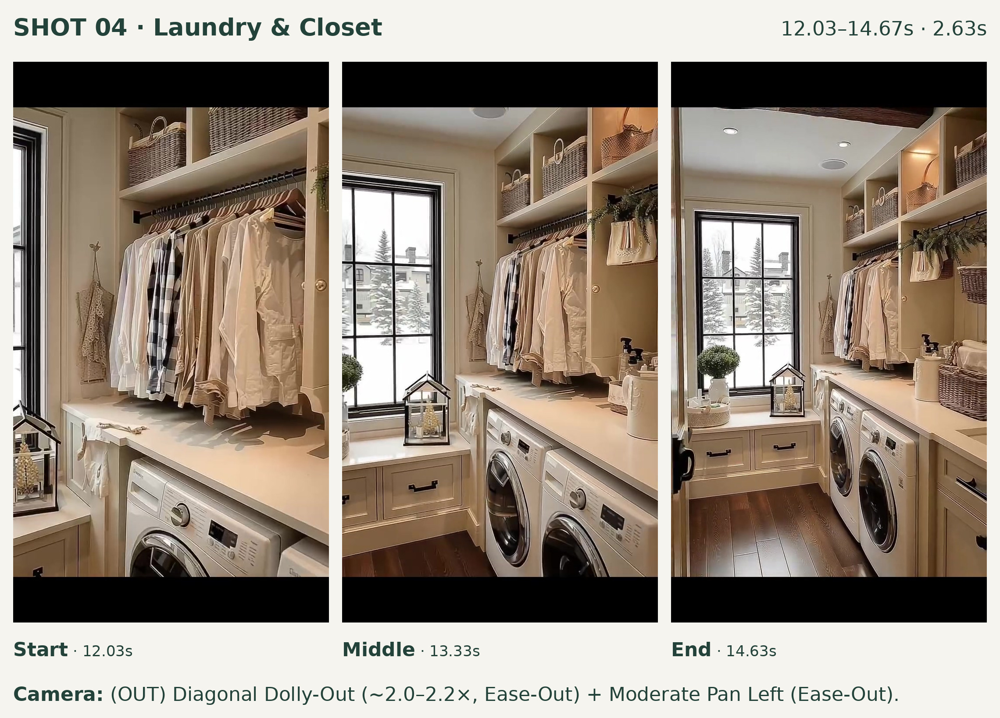
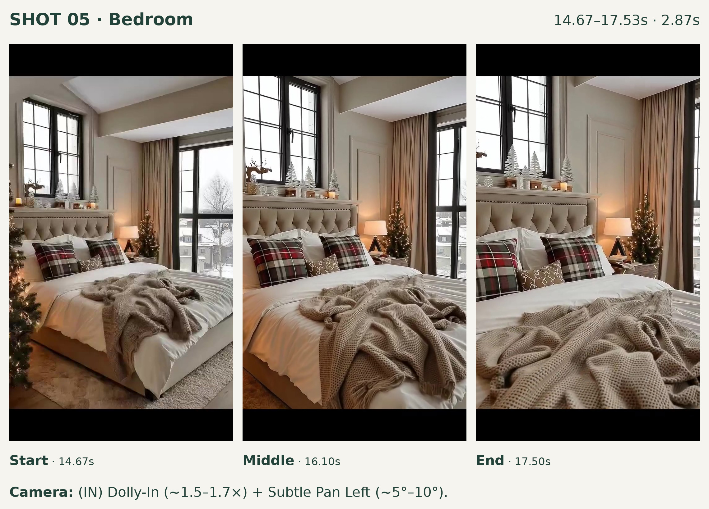
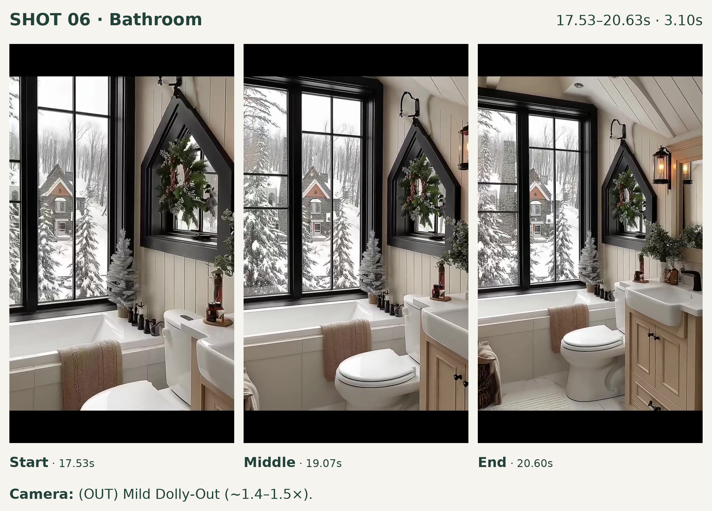

# edh007 — Snowy Gabled Cottage — Warm Traditional Interiors

## 1. Profil desain

- **Nama desain:** Snowy Gabled Cottage — Warm Traditional Interiors
- **Tipe rumah:** Cottage
- **Gaya utama:** **American Cottage**
- **Pengaruh gaya:** Traditional
- **Gaya interior:** Traditional Cottage
- **Susunan ruang utama:** Enam area terekam sebagai shot terpisah; laundry dan penyimpanan pakaian berbagi ruang
- **Ciri khas:** Fireplace batu, hood gelap berbingkai kayu, tekstil plaid dan wreath
- **Material utama:** Bidang krem, trim gelap, permukaan tampak kayu dan batu; bahan fisik tidak teruji
- **Pencahayaan:** Cahaya siang dingin melalui jendela berpadu lampu, fireplace dan aksen hangat
- **Atmosfer:** Hangat, intim dan meriah dengan dekorasi musim dingin
- **Lingkungan:** Salju di tanah dan atap, pepohonan, bangunan di kejauhan

### Palet warna

| Peran | Warna | HEX |
| --- | --- | --- |
| Dominan | Warm Ivory | `#E8DFCF` |
| Pendamping | Soft Greige | `#B5A89A` |
| Pendamping | Honey Oak | `#B58C60` |
| Aksen | Charcoal Black | `#282724` |
| Aksen | Evergreen | `#43523D` |
| Aksen | Burgundy | `#793E36` |

## 2. Ukuran & proporsi

| Aspek | Estimasi visual |
| --- | --- |
| **Ukuran rumah** | medium |
| **Bentuk bangunan** | Massa dua tingkat dengan gable depan dan portico menjorok |
| **Lantai & bentuk atap** | 2 · Atap miring gable bertrim gelap tertutup salju; cerobong tinggi |
| **Tapak bangunan** | compact rectangular appearance |
| **Proporsi utama** | Massa cenderung vertikal; gable dan portico menonjol |
| **Perkiraan luas lantai** | **100–160 m²** |

## 3. Shot Timeline

Durasi 20.63s · 6 shot.

**Camera Pattern:** IN – OUT – IN – OUT – IN – OUT.

| Shot | Time (s) | Duration | Area/Scene | Camera Movement |
| --- | --- | --- | --- | --- |
| 01 | 0.00–4.90 | 4.90s | Exterior | Mild Diagonal Dolly-In (~1.1×) + Subtle Pan Left (~5°–10°) → Accelerating Dolly-In (~1.8×) + Subtle Pan Right (~5°–10°). |
| 02 | 4.90–8.50 | 3.60s | Living Room | Straight Dolly-Out (~1.3×) → Dolly-Out (~1.7×) + Strong Pan Left (~25°–35°). |
| 03 | 8.50–12.03 | 3.53s | Kitchen | Straight Dolly-In (~1.3×) → Dolly-In (~2.0×) + Moderate Pan Left (~20°–30°). |
| 04 | 12.03–14.67 | 2.63s | Laundry & Closet | Diagonal Dolly-Out (~2.0–2.2×, Ease-Out) + Moderate Pan Left (Ease-Out). |
| 05 | 14.67–17.53 | 2.87s | Bedroom | Dolly-In (~1.5–1.7×) + Subtle Pan Left (~5°–10°). |
| 06 | 17.53–20.63 | 3.10s | Bathroom | Mild Dolly-Out (~1.4–1.5×). |

## 4. Overview

**Shot 01 · Exterior · 0.00s**

> Dari jalur bersalju, pandangan menyerong ke muka bangunan memperlihatkan gable, jendela atas, portico, tangga dan sisi kanan.

**Shot 02 · Living Room · 8.47s**

> Dari sisi ruang duduk, kamera memandang menyerong ke fireplace; meja, sofa, bukaan tinggi dan bagian railing atas terlihat bersama.

**Shot 03 · Kitchen · 8.50s**

> Dari ujung island, kamera menghadap koridor dapur dan pintu belakang; kabinet kiri, range, island dan pendant berada dalam satu pandangan.

**Shot 04 · Laundry & Closet · 14.63s**

> Dari dekat ambang pintu, pandangan ke jendela ujung memperlihatkan lorong sempit, countertop, mesin dan gantungan pakaian sisi kanan.

**Shot 05 · Bedroom · 14.67s**

> Dari sisi kaki ranjang, kamera menghadap headboard; ranjang, jendela tinggi di belakang, tirai kanan dan lampu samping terlihat.

**Shot 06 · Bathroom · 20.60s**

> Dari sisi akses kamar mandi, kamera menghadap sudut jendela; bathtub kiri, toilet tengah, vanity kanan dan bidang plafon miring terlihat.

## 5. Storyboard

## 6. Shot Details

### Shot 01 · Exterior

**Time:** 0.00–4.90s · **Duration:** 4.90s

#### **A. Desain area**

**Arsitektur**

> Fasad krem dua tingkat dengan gable depan bertrim gelap, jendela kotak hitam dan bukaan lengkung atas. Portico datar menjorok dengan pilar persegi, dasar tampak batu, tangga dan pintu hitam.

**Furnitur & dekorasi**

> Pot tanaman dan miniatur pohon mengapit akses; wreath pada pintu, lentera dinding dan garland di atas portico.

**Lingkungan**

> Salju menutup tanah dan atap; pepohonan dan bangunan tetangga tampak sebagian.

#### **B. Framing & Lighting**

- **Fokus:** Pintu gelap dan portico
- **Camera Start:** Di jalur depan rumah · Ke fasad dan portico · oblique · Eye level · Sedikit mendongak
- **Framing:** Wide fasad dua tingkat dan tapak bersalju → Close pada pintu dan pilar
- **Lighting:** Cahaya siang menyebar; lampu dinding hangat
- **Foreground dan kedalaman:** Salju, semak kecil dan jalur · Jalur–tangga–pilar–fasad–gable
- **Reveal:** Pintu dan detail portico makin jelas
- **Kesesuaian gerak:** Pendekatan memperbesar lapisan depan secara bertahap

#### **C. Camera Movement**

Awalnya mendekat perlahan dengan koreksi pandang kiri, kemudian dorongan ke portico lebih nyata sambil mengoreksi ke kanan; akhir menempatkan pintu sebagai fokus. Profil accelerating bersifat visual, bukan pengukuran kecepatan badan.

**Tempo:** Awal lambat, pendekatan terasa makin cepat saat pintu memenuhi gambar.

- **0.00–1.50s · slow:** Pergeseran dan skala kecil.
- **1.50–4.90s · moderate:** Pembesaran semakin cepat menuju pintu.

**Movement Timeline**

| Time (s) | Area & fokus | Camera Movement | Tempo |
| --- | --- | --- | --- |
| 0.00–1.50 | Exterior · Fasad dan portico | Mild Diagonal Dolly-In (~1.1×) + Subtle Pan Left (~5°–10°) | Pergeseran dan skala kecil. |
| 1.50–4.90 | Exterior · Pintu masuk dan pilar portico | Accelerating Dolly-In (~1.8×) + Subtle Pan Right (~5°–10°) | Pembesaran semakin cepat menuju pintu. |

**Camera:** Mild Diagonal Dolly-In (~1.1×) + Subtle Pan Left (~5°–10°) → Accelerating Dolly-In (~1.8×) + Subtle Pan Right (~5°–10°).

---

### Shot 02 · Living Room

**Time:** 4.90–8.50s · **Duration:** 3.60s

#### **A. Desain area**

**Arsitektur**

> Fireplace berbidang batu dengan mantel putih berprofil dan TV di atasnya. Jendela hitam tinggi, dinding krem dan volume tinggi dengan railing atas terlihat; lantai berkesan kayu.

**Furnitur & dekorasi**

> Sofa krem di dekat jendela menghadap meja kopi kayu di atas karpet bermotif; dudukan gelap di foreground menghadap kelompok meja. Lentera, tanaman, string lights dan dekorasi mantel.

**Lingkungan**

> Cahaya luar dari jendela tinggi, tampak suasana musim dingin.

#### **B. Framing & Lighting**

- **Fokus:** Fireplace, lalu kelompok sofa
- **Camera Start:** Dekat fireplace · Ke mantel dan layar TV · frontal · Eye level · Hampir datar
- **Framing:** Tight fireplace batu dan mantel putih → Wide ruang duduk dengan jendela dan furnitur
- **Lighting:** Api, string lights, lampu dan cahaya jendela
- **Foreground dan kedalaman:** Hearth dan tepi lantai · Fireplace–meja–sofa–jendela
- **Reveal:** Area duduk dan volume atas terungkap
- **Kesesuaian gerak:** Mundur dan pan kiri membuka tata duduk

#### **C. Camera Movement**

Mundur dari fireplace, kemudian sapu kiri sambil tetap mundur hingga ruang duduk terbuka. Rasio total jangkar bukaan api sekitar 2.2 kali; bukan skala 3D.

**Tempo:** Awal terkendali, sapuan kiri dan reveal terasa lebih cepat pada paruh akhir.

**Movement Timeline**

| Time (s) | Area & fokus | Camera Movement | Tempo |
| --- | --- | --- | --- |
| 4.90–5.90 | Living Room · Fireplace | Straight Dolly-Out (~1.3×) | Awal terkendali, sapuan kiri dan reveal terasa lebih cepat pada paruh akhir. |
| 5.90–8.50 | Living Room · Fireplace menuju seating area | Dolly-Out (~1.7×) + Strong Pan Left (~25°–35°) | Awal terkendali, sapuan kiri dan reveal terasa lebih cepat pada paruh akhir. |

**Camera:** Straight Dolly-Out (~1.3×) → Dolly-Out (~1.7×) + Strong Pan Left (~25°–35°).

---

### Shot 03 · Kitchen

**Time:** 8.50–12.03s · **Duration:** 3.53s

#### **A. Desain area**

**Arsitektur**

> Kabinet krem berpanel membingkai range pada sisi kiri; hood hitam dengan bingkai kayu, backsplash terang, plafon tinggi miring dan bukaan belakang berpetak.

**Furnitur & dekorasi**

> Island panjang dengan sink dan faucet gelap tampak; range metal lebar di bawah hood, pendant berbentuk lentera, tanaman dan properti dapur.

**Lingkungan**

> Pintu dan jendela belakang memasukkan cahaya alami dari luar terang bersalju.

#### **B. Framing & Lighting**

- **Fokus:** Range hood, kompor dan backsplash
- **Camera Start:** Di ujung island · Ke kabinet dan pintu belakang · oblique · Eye level · Hampir datar
- **Framing:** Wide kitchen dengan island, kabinet dan bukaan belakang → Close range dan hood gelap
- **Lighting:** Daylight belakang, pendant dan task lights
- **Foreground dan kedalaman:** Countertop island terang · Island–range–kabinet–bukaan belakang
- **Reveal:** Range hood dan backsplash menjadi fokus
- **Kesesuaian gerak:** Maju dan pan kiri mempertegas area memasak

#### **C. Camera Movement**

Maju menelusuri kitchen, kemudian mengarahkan pandangan ke kiri menuju range hood tanpa berhenti mendekat. Jangkar hood total sekitar 2.6 kali.

**Tempo:** Gerak maju stabil; sapuan kiri bertambah dan pembesaran foreground membuat akhir lebih dinamis.

**Movement Timeline**

| Time (s) | Area & fokus | Camera Movement | Tempo |
| --- | --- | --- | --- |
| 8.50–9.50 | Kitchen · Lorong kitchen di sisi island | Straight Dolly-In (~1.3×) | Gerak maju stabil; sapuan kiri bertambah dan pembesaran foreground membuat akhir lebih dinamis. |
| 9.50–12.03 | Kitchen · Range hood dan oven | Dolly-In (~2.0×) + Moderate Pan Left (~20°–30°) | Gerak maju stabil; sapuan kiri bertambah dan pembesaran foreground membuat akhir lebih dinamis. |

**Camera:** Straight Dolly-In (~1.3×) → Dolly-In (~2.0×) + Moderate Pan Left (~20°–30°).

---

### Shot 04 · Laundry & Closet

**Time:** 12.03–14.67s · **Duration:** 2.63s

#### **A. Desain area**

**Arsitektur**

> Ruang memanjang dengan jendela hitam di ujung, lantai gelap tampak kayu dan built-in krem di sisi kanan serta kabinet rendah bawah jendela.

**Furnitur & dekorasi**

> Dua mesin front-load di bawah countertop, batang gantungan pakaian di atas, rak keranjang terbuka dan laci di bawah jendela; lentera dan pot di meja.

**Lingkungan**

> Salju dan pohon terlihat melalui jendela ujung.

#### **B. Framing & Lighting**

- **Fokus:** Penyimpanan pakaian dan mesin laundry
- **Camera Start:** Dekat countertop mesin cuci · Ke rak pakaian dan jendela ujung · oblique · Eye level · Hampir datar
- **Framing:** Close rak pakaian di atas mesin → Wide dari ambang, jendela di ujung dan storage kanan
- **Lighting:** Daylight jendela, lampu plafon dan rak
- **Foreground dan kedalaman:** Countertop terang dan pakaian · Mesin–rak–jendela–ambang pintu
- **Reveal:** Lantai dan keseluruhan ruang lebih terbuka
- **Kesesuaian gerak:** Mundur diagonal memperlihatkan lorong dan fungsi gabungan

#### **C. Camera Movement**

Kamera mundur dari gantungan dan mesin cuci menuju ambang pintu sambil mengalihkan pandang ke kiri ke jendela; melambat menjelang akhir.

**Tempo:** Reveal luas dalam 2.63 detik; laju melemah pada bagian akhir, tanpa stop mendadak.

**Camera:** Diagonal Dolly-Out (~2.0–2.2×, Ease-Out) + Moderate Pan Left (Ease-Out).

---

### Shot 05 · Bedroom

**Time:** 14.67–17.53s · **Duration:** 2.87s

#### **A. Desain area**

**Arsitektur**

> Dinding krem dengan panel dekoratif di belakang ranjang; jendela hitam tinggi dan bukaan kaca di kanan dengan tirai panjang. Lantai tampak kayu.

**Furnitur & dekorasi**

> Ranjang besar headboard tufted krem, bedding putih, selimut rajut beige dan bantal plaid burgundy gelap. Lampu meja dan pohon dekoratif di sisi ranjang.

**Lingkungan**

> Jendela menampilkan salju dan pepohonan di luar.

#### **B. Framing & Lighting**

- **Fokus:** Headboard tufted dan bantal plaid
- **Camera Start:** Dekat kaki ranjang · Ke headboard dan jendela · oblique · Eye level · Hampir datar
- **Framing:** Wide ranjang dengan dua arah bukaan → Close headboard dan bedding
- **Lighting:** Cahaya jendela dan lampu bedside hangat
- **Foreground dan kedalaman:** Kaki ranjang dan blanket · Ranjang–headboard–jendela dan tirai
- **Reveal:** Detail tekstil dan bantal makin dekat
- **Kesesuaian gerak:** Dolly-in menguatkan tekstur ranjang

#### **C. Camera Movement**

Mendekat ke ranjang dan sedikit menggeser pandang ke kiri menuju headboard dan tekstur bedding.

**Tempo:** Maju relatif stabil, pembesaran foreground meningkat secara alami ketika mendekat.

**Camera:** Dolly-In (~1.5–1.7×) + Subtle Pan Left (~5°–10°).

---

### Shot 06 · Bathroom

**Time:** 17.53–20.63s · **Duration:** 3.10s

#### **A. Desain area**

**Arsitektur**

> Jendela hitam besar di atas bathtub, panel vertikal krem, plafon miring berpanel dan elemen dinding berbentuk rumah dengan wreath.

**Furnitur & dekorasi**

> Bathtub putih di bawah jendela, toilet putih di tengah, vanity tampak kayu dengan sink putih di kanan; handuk dan dekorasi evergreen serta lampu dinding.

**Lingkungan**

> Pemandangan pepohonan bersalju dan atap rumah melalui jendela.

#### **B. Framing & Lighting**

- **Fokus:** Bathtub dan jendela, lalu vanity
- **Camera Start:** Dekat bathtub dan toilet · Ke jendela dan sudut dinding · oblique · Eye level · Hampir datar
- **Framing:** Tight jendela, bathtub dan dekorasi dinding → Wide bathtub, toilet dan vanity
- **Lighting:** Daylight jendela dan lampu dinding hangat
- **Foreground dan kedalaman:** Tepi bathtub dan toilet · Bathtub–toilet–vanity–jendela
- **Reveal:** Vanity dan sudut kamar mandi terbuka
- **Kesesuaian gerak:** Dolly-out ringan memperluas cakupan tanpa rotasi kuat

#### **C. Camera Movement**

Mundur perlahan dari bathtub dan jendela hingga toilet serta vanity masuk frame, tanpa sapuan besar.

**Tempo:** Mundur lembut dan relatif konstan, perubahan framing kecil dibanding shot lainnya.

**Camera:** Mild Dolly-Out (~1.4–1.5×).

**Catatan referensi:** Estimasi luas 100–160 m² sangat kasar berdasarkan massa tampak dua tingkat dan proporsi ruang; bukan pengukuran denah. Identitas satu rumah, hubungan antarshot, material fisik, lokasi, dan konstruksi tidak dapat dipastikan dari edit. HEX perkiraan visual. Notasi kamera dipertahankan sesuai persetujuan pengguna.
