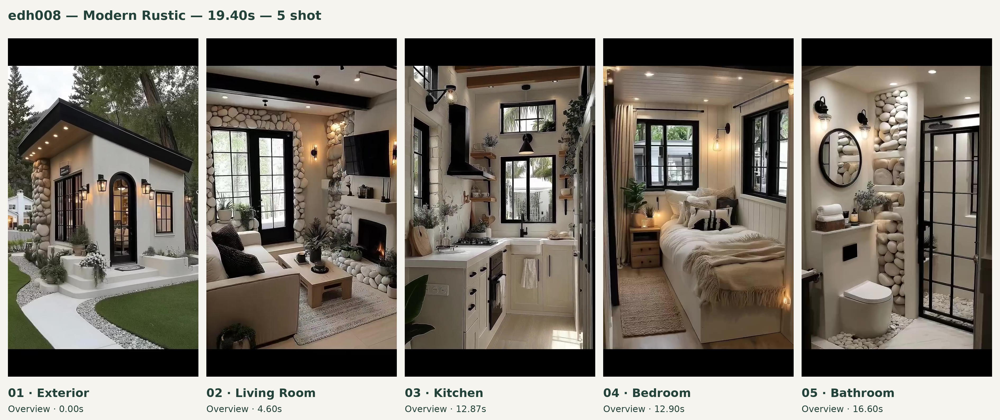
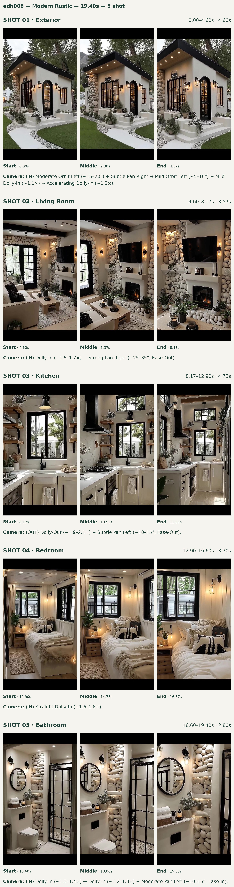
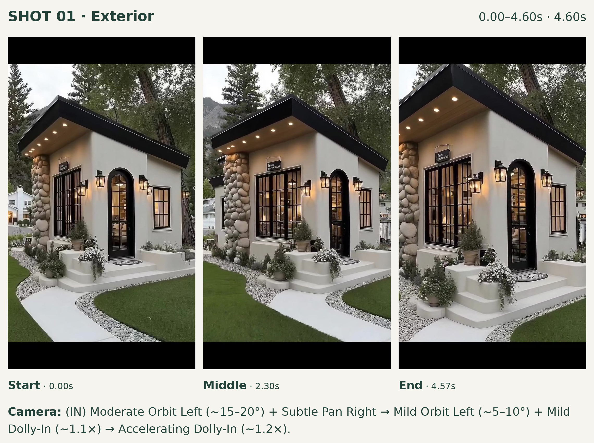
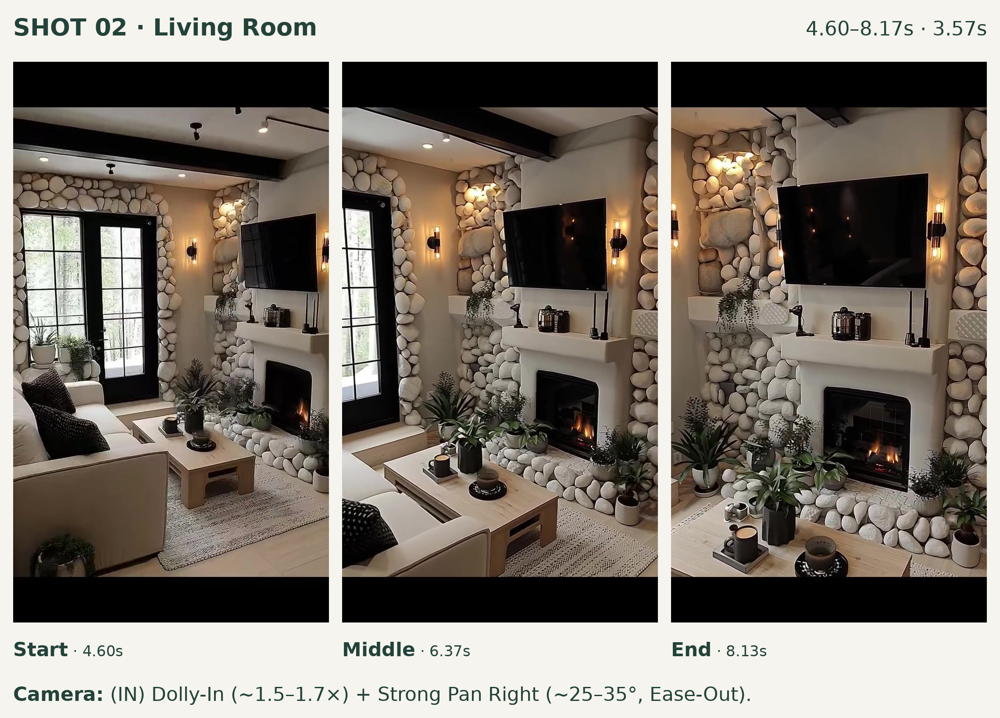
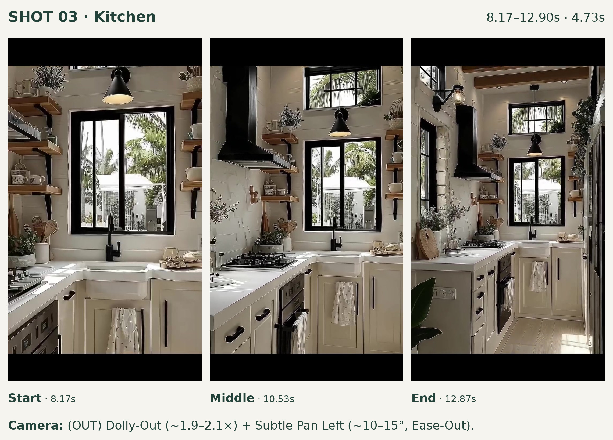
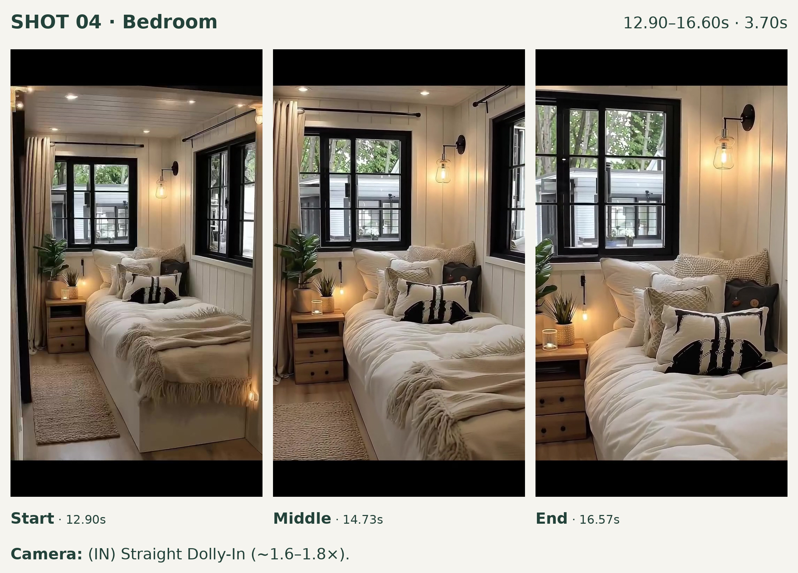
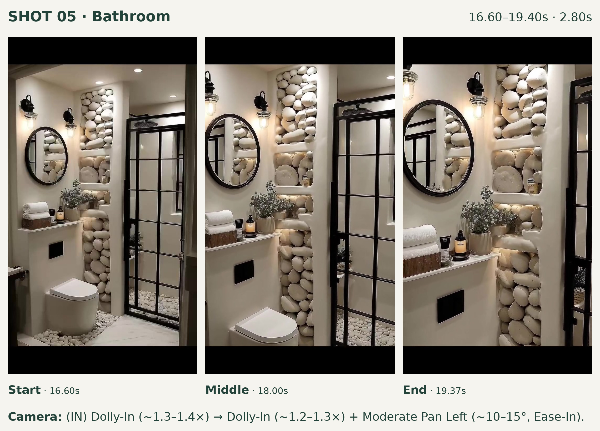

# edh008 — Modern Rustic Stone Cottage

## 1. Profil desain

- **Nama desain:** Modern Rustic Stone Cottage
- **Tipe rumah:** Cottage
- **Gaya utama:** **Modern Rustic**
- **Pengaruh gaya:** Cottage Style
- **Gaya interior:** Modern Rustic; Modern Farmhouse
- **Susunan ruang utama:** Exterior, Living Room, Kitchen, Bedroom, Bathroom tampil terpisah dalam lima cut; denah dan koneksi tidak terverifikasi
- **Ciri khas:** Aksen batu bulat menerus sebagai motif visual fasad, perapian dan ceruk kamar mandi
- **Material utama:** Dinding terang halus, aksen batu bulat, bingkai hitam, tekstur kayu dan kain natural
- **Pencahayaan:** Cahaya alami dari jendela, dilengkapi downlight, sconce dan lampu aksen hangat
- **Atmosfer:** Intim, hangat, tenang dengan kontras hitam dan tekstur alami
- **Lingkungan:** Taman rumput, jalur putih melengkung, kerikil dan pohon tinggi; bangunan lain terlihat melalui bukaan

### Palet warna

| Peran | Warna | HEX |
| --- | --- | --- |
| Dominan | Putih hangat | `#E6E1D4` |
| Pendamping | Krem taupe | `#BDB09E` |
| Pendamping | Abu batu | `#A59F91` |
| Pendamping | Cokelat kayu | `#A68661` |
| Aksen | Hitam arang | `#252522` |
| Aksen | Hijau daun | `#46563A` |

## 2. Ukuran & proporsi

| Aspek | Estimasi visual |
| --- | --- |
| **Ukuran rumah** | small |
| **Bentuk bangunan** | Massa kompak berbidang sederhana |
| **Lantai & bentuk atap** | Satu lantai tampak · Shed roof; lis hitam tebal dan soffit kecokelatan dengan downlight |
| **Tapak bangunan** | Massa persegi panjang kompak |
| **Proporsi utama** | Massa rendah, atap satu kemiringan dengan overhang lebar; akses dinaikkan beberapa anak tangga |
| **Perkiraan luas lantai** | **25–45 m²** |

## 3. Shot Timeline

Durasi 19.40s · 5 shot.

**Camera Pattern:** IN – IN – OUT – IN – IN.

| Shot | Time (s) | Duration | Area/Scene | Camera Movement |
| --- | --- | --- | --- | --- |
| 01 | 0.00–4.60 | 4.60s | Exterior | Moderate Orbit Left (~15–20°) + Subtle Pan Right → Mild Orbit Left (~5–10°) + Mild Dolly-In (~1.1×) → Accelerating Dolly-In (~1.2×). |
| 02 | 4.60–8.17 | 3.57s | Living Room | Dolly-In (~1.5–1.7×) + Strong Pan Right (~25–35°, Ease-Out). |
| 03 | 8.17–12.90 | 4.73s | Kitchen | Dolly-Out (~1.9–2.1×) + Subtle Pan Left (~10–15°, Ease-Out). |
| 04 | 12.90–16.60 | 3.70s | Bedroom | Straight Dolly-In (~1.6–1.8×). |
| 05 | 16.60–19.40 | 2.80s | Bathroom | Dolly-In (~1.3–1.4×) → Dolly-In (~1.2–1.3×) + Moderate Pan Left (~10–15°, Ease-In). |

## 4. Overview

**Shot 01 · Exterior · 0.00s**

> Dari jalur taman depan-samping, pandangan oblique mencakup massa, atap, pintu, jendela, tangga dan jalur melengkung.

**Shot 02 · Living Room · 4.60s**

> Dari sisi sofa, pandangan serong mencakup zona duduk, meja, pintu kaca dan dinding perapian.

**Shot 03 · Kitchen · 12.87s**

> Dari arah akses dapur, pandangan ke jendela belakang mencakup counter kiri, sink, hood, kabinet, rak, lorong dan balok plafon.

**Shot 04 · Bedroom · 12.90s**

> Dari ambang kamar, pandangan sepanjang ranjang mencakup dua jendela, nakas, lorong kiri dan plafon.

**Shot 05 · Bathroom · 16.60s**

> Dari ambang kamar mandi, pandangan serong mencakup toilet, cermin bundar, ledge, ceruk batu dan shower grid hitam.

## 5. Storyboard

## 6. Shot Details

### Shot 01 · Exterior

**Time:** 0.00–4.60s · **Duration:** 4.60s

#### **A. Desain area**

**Arsitektur**

> Massa rendah kompak dengan atap miring satu arah, fascia hitam lebar, soffit bernuansa kayu dan downlight. Dinding putih hangat, sudut kiri beraksen batu bulat; jendela besar grid hitam di fasad dan pintu kaca lengkung di bidang kanan. Landing bertingkat putih dengan akses dari jalur taman.

**Furnitur & dekorasi**

> Pot tanaman dan bunga putih mengapit tangga; lampu dinding model lentera hitam mengapit bukaan. Keset bulat di depan pintu.

**Lingkungan**

> Rumput hijau rapi, jalur putih melengkung bertepi kerikil terang, pohon tinggi di belakang; bangunan tetangga tampak di kiri.

#### **B. Framing & Lighting**

- **Fokus:** Fasad, pintu lengkung, batu dan atap
- **Camera Start:** Di jalur taman di depan-samping rumah · Ke sudut fasad dan bidang pintu · Oblique tiga perempat · Sekitar tinggi mata, estimasi · Sedikit mengarah ke atas untuk atap
- **Framing:** Wide tiga perempat, massa dan taman terlihat → Lebih dekat pada jendela, pintu dan tangga
- **Lighting:** Cahaya luar lembut; lampu lentera dan downlight hangat
- **Foreground dan kedalaman:** Jalur putih, kerikil dan rumput · Jalur dekat → tangga → fasad → pohon
- **Reveal:** Bidang jendela semakin frontal, tangga makin menonjol
- **Kesesuaian gerak:** Orbit membuka bidang depan; Dolly-In kemudian mempertegas akses

#### **C. Camera Movement**

Kamera melengkung ke kiri untuk memperlihatkan bidang fasad berjendela lebih frontal, lalu mulai mendekat dan meneruskan pendekatan ketika perubahan sudut mereda.

**Tempo:** Sedang: ayunan awal halus, transisi ke maju lebih cepat menjelang akhir; bukan perubahan tempo drastis.

**Movement Timeline**

| Time (s) | Area & fokus | Camera Movement | Tempo |
| --- | --- | --- | --- |
| 0.00–2.17 | Exterior · Fasad dan sudut atap | Moderate Orbit Left (~15–20°) + Subtle Pan Right | Sedang: ayunan awal halus, transisi ke maju lebih cepat menjelang akhir; bukan perubahan tempo drastis. |
| 2.17–3.00 | Exterior · Fasad dan teras | Mild Orbit Left (~5–10°) + Mild Dolly-In (~1.1×) | Sedang: ayunan awal halus, transisi ke maju lebih cepat menjelang akhir; bukan perubahan tempo drastis. |
| 3.00–4.60 | Exterior · Jendela depan, pintu dan tangga | Accelerating Dolly-In (~1.2×) | Sedang: ayunan awal halus, transisi ke maju lebih cepat menjelang akhir; bukan perubahan tempo drastis. |

**Camera:** Moderate Orbit Left (~15–20°) + Subtle Pan Right → Mild Orbit Left (~5–10°) + Mild Dolly-In (~1.1×) → Accelerating Dolly-In (~1.2×).

---

### Shot 02 · Living Room

**Time:** 4.60–8.17s · **Duration:** 3.57s

#### **A. Desain area**

**Arsitektur**

> Ruang kompak dengan pintu kaca grid hitam di belakang-kiri, bingkai dikelilingi batu bulat. Dinding krem, balok plafon hitam, downlight, perapian inset dengan mantel putih dan batu bulat mengapit bidang TV.

**Furnitur & dekorasi**

> Sofa krem di kiri dengan bantal hitam, meja kopi persegi panjang bernuansa kayu di atas karpet netral, TV hitam di atas mantel; tanaman pot mengelilingi perapian dan dekorasi kecil di meja/mantel.

**Lingkungan**

> Cahaya alami melalui pintu kaca; vegetasi terang di balik kaca, detail lingkungan tidak jelas. Sconce dan aksen di sekitar batu memberi cahaya hangat.

#### **B. Framing & Lighting**

- **Fokus:** Perapian, TV dan aksen batu
- **Camera Start:** Di sisi belakang/dekat sofa · Ke pintu kaca dan dinding perapian di kanan · Oblique · Sekitar tinggi mata · Hampir level
- **Framing:** Wide interior dengan sofa, pintu dan perapian → Framing rapat pada mantel, TV dan dekorasi
- **Lighting:** Daylight dari pintu kaca, downlight dan sconce hangat
- **Foreground dan kedalaman:** Lengan sofa, meja kopi, karpet · Sofa/meja → perapian dan pintu
- **Reveal:** Perapian dan TV menjadi pusat; pintu keluar bingkai
- **Kesesuaian gerak:** Dolly-In memperbesar perapian; Pan Right menggeser perhatian dari pintu

#### **C. Camera Movement**

Kamera maju sambil menyapu ke kanan dari pintu dan sofa menuju perapian dan televisi; sapuan paling kuat di tengah dan mereda di akhir.

**Tempo:** Sedang, sapuan terasa lebih aktif di pertengahan dan melandai pada akhir; pembesaran relatif berlanjut.

**Camera:** Dolly-In (~1.5–1.7×) + Strong Pan Right (~25–35°, Ease-Out).

---

### Shot 03 · Kitchen

**Time:** 8.17–12.90s · **Duration:** 4.73s

#### **A. Desain area**

**Arsitektur**

> Dapur kompak dengan counter berbelok L pada dinding kiri dan belakang; sisi kanan hanya tampak sebagian sehingga denah lengkap belum pasti. Jendela grid hitam di atas sink apron-front, clerestory di atasnya, bukaan samping kiri, plafon dengan balok bernuansa kayu. Dinding terang dan backsplash bertekstur bata.

**Furnitur & dekorasi**

> Kabinet bawah krem berpanel dengan gagang hitam; countertop putih, sink apron-front dan keran hitam di belakang, cooktop serta oven di kiri dengan hood hitam. Rak kayu terbuka di sekitar jendela memuat cangkir, mangkuk dan tanaman.

**Lingkungan**

> Jendela belakang menghadap vegetasi palem dan struktur putih di luar. Cahaya alami kuat dari belakang dan kiri, lampu gantung hitam di atas sink.

#### **B. Framing & Lighting**

- **Fokus:** Sink, kabinet, jendela dan cooktop
- **Camera Start:** Dekat counter dan sink · Ke jendela belakang/sink · Hampir frontal · Sekitar tinggi mata · Hampir level
- **Framing:** Close interior pada sink dan jendela → Wide dapur dari arah akses
- **Lighting:** Daylight dari jendela belakang/kiri, pendant hangat
- **Foreground dan kedalaman:** Counter dan sink · Counter kiri → sink → bukaan luar
- **Reveal:** Mundur membuka hood, rak, oven, lorong dan balok
- **Kesesuaian gerak:** Dolly-Out memperluas cakupan, Pan Left memperlihatkan counter kiri

#### **C. Camera Movement**

Mundur dari sink melalui lorong dapur sambil menggeser arah pandang ringan ke kiri; kompor, kabinet, plafon dan ambang dekat terbuka.

**Tempo:** Sedang dan stabil; sapuan lateral mereda, pengecilan gambar terus berlangsung.

**Camera:** Dolly-Out (~1.9–2.1×) + Subtle Pan Left (~10–15°, Ease-Out).

---

### Shot 04 · Bedroom

**Time:** 12.90–16.60s · **Duration:** 3.70s

#### **A. Desain area**

**Arsitektur**

> Kamar memanjang kompak, dua jendela grid hitam pada dinding belakang dan kanan, dinding terang berpanel vertikal, plafon beralur horizontal dan downlight. Jalur sempit berada di sisi kiri ranjang.

**Furnitur & dekorasi**

> Ranjang dengan alas krem, bedding putih hangat, selimut berumbai dan bantal bertekstur termasuk aksen hitam-putih. Nakas kayu tampak dua laci dan satu ceruk di kiri kepala ranjang, pot tanaman, lampu kecil, karpet anyam dan tirai krem.

**Lingkungan**

> Vegetasi dan bangunan berlapis horizontal terang terlihat melalui jendela; lampu plafon dan dinding hangat melengkapi daylight.

#### **B. Framing & Lighting**

- **Fokus:** Ranjang dan jendela belakang
- **Camera Start:** Di dekat ambang kamar · Ke kepala ranjang dan jendela belakang · Oblique ringan · Sekitar tinggi mata · Hampir level
- **Framing:** Wide kamar dengan dua jendela dan lorong → Close pada bantal, nakas dan jendela
- **Lighting:** Daylight dari dua sisi, lampu dinding dan downlight hangat
- **Foreground dan kedalaman:** Kaki ranjang dan karpet · Kaki ranjang → kepala ranjang → jendela luar
- **Reveal:** Tekstur bedding, nakas dan lampu semakin jelas
- **Kesesuaian gerak:** Straight Dolly-In menekankan kedalaman ranjang dan tekstur

#### **C. Camera Movement**

Kamera masuk dari ambang bedroom dan maju di sisi tempat tidur menuju bantal, meja kecil, dan jendela belakang.

**Tempo:** Sedang, maju relatif konstan dan halus, skala gambar berubah lebih nyata saat dekat.

**Camera:** Straight Dolly-In (~1.6–1.8×).

---

### Shot 05 · Bathroom

**Time:** 16.60–19.40s · **Duration:** 2.80s

#### **A. Desain area**

**Arsitektur**

> Kamar mandi kompak dengan dinding krem, bidang batu bulat vertikal dan ceruk bersusun berlampu. Shower dipisahkan pintu/partisi kaca grid hitam di kanan; area toilet di kiri dengan flush plate hitam. Lantai terang dan kerikil putih tampak di sekitar toilet serta shower.

**Furnitur & dekorasi**

> Toilet putih model ringkas dengan flush plate hitam di bawah ledge; cermin bundar berbingkai hitam di atas ledge, handuk gulung, botol dan vas tanaman. Dua lampu dinding hitam dengan globe transparan.

**Lingkungan**

> Tidak ada pandangan luar langsung yang jelas pada frame pilihan. Cahaya hangat dari sconce dan ceruk, downlight plafon menambah penerangan umum.

#### **B. Framing & Lighting**

- **Fokus:** Cermin bulat dan aksen batu
- **Camera Start:** Di ambang kamar mandi · Ke toilet, cermin dan shower di kanan · Oblique ringan · Sekitar tinggi mata · Hampir level
- **Framing:** Wide toilet, cermin, ceruk dan shower → Close cermin, ledge dan ceruk batu
- **Lighting:** Downlight, sconce dan ceruk hangat
- **Foreground dan kedalaman:** Ambang, lantai kerikil dan toilet · Toilet/ledge → batu dan shower
- **Reveal:** Detail cermin dan ceruk semakin dominan; shower terpotong
- **Kesesuaian gerak:** Dolly-In mendekati detail, Pan Left pada akhir memusatkan cermin

#### **C. Camera Movement**

Maju dari ambang bathroom ke arah cermin dan ceruk batu; pada bagian akhir pandangan berbelok ke kiri untuk mempertahankan cermin dan ceruk dalam bingkai.

**Tempo:** Sedang, mendekat relatif konstan; sapuan kiri membuat akhir terasa lebih dinamis.

**Movement Timeline**

| Time (s) | Area & fokus | Camera Movement | Tempo |
| --- | --- | --- | --- |
| 16.60–18.27 | Bathroom · Cermin, toilet dan shower | Dolly-In (~1.3–1.4×) | Sedang, mendekat relatif konstan; sapuan kiri membuat akhir terasa lebih dinamis. |
| 18.27–19.40 | Bathroom · Cermin dan ceruk batu | Dolly-In (~1.2–1.3×) + Moderate Pan Left (~10–15°, Ease-In) | Sedang, mendekat relatif konstan; sapuan kiri membuat akhir terasa lebih dinamis. |

**Camera:** Dolly-In (~1.3–1.4×) → Dolly-In (~1.2–1.3×) + Moderate Pan Left (~10–15°, Ease-In).
