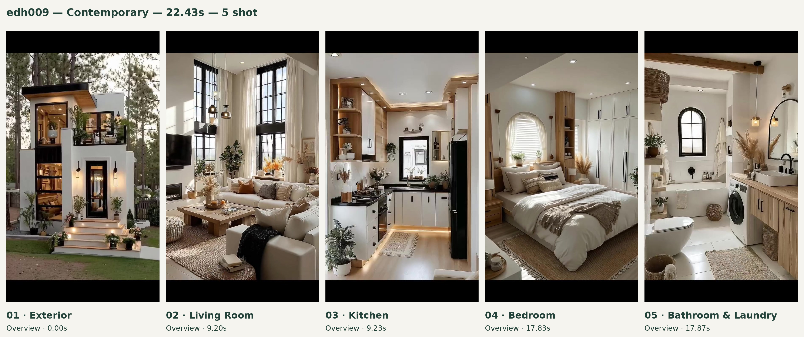
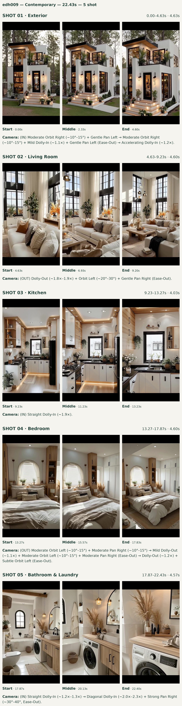
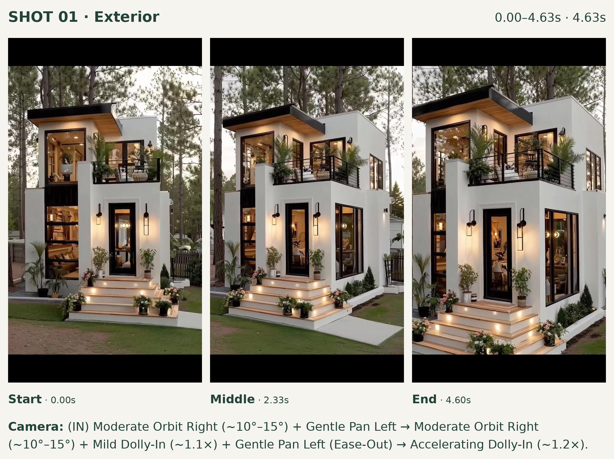
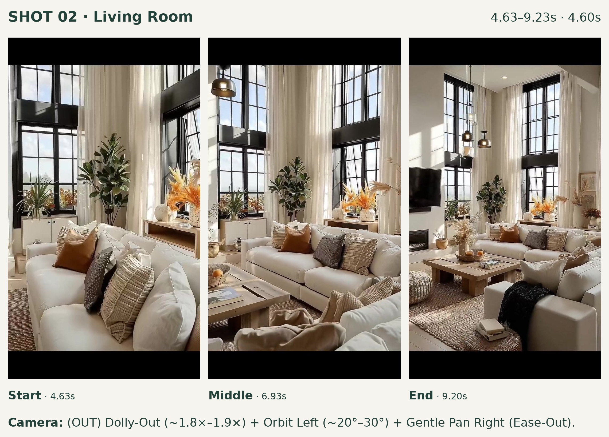
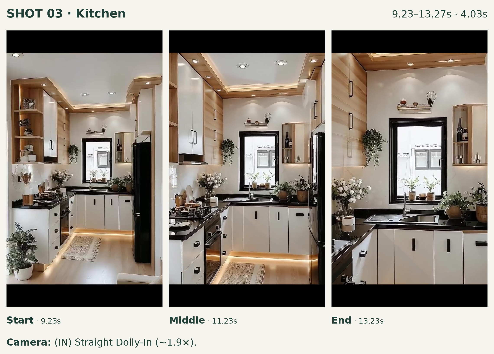
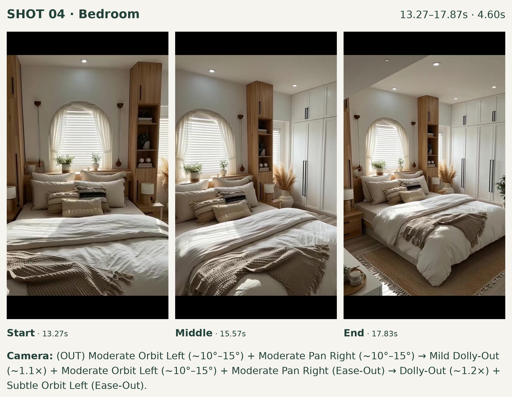
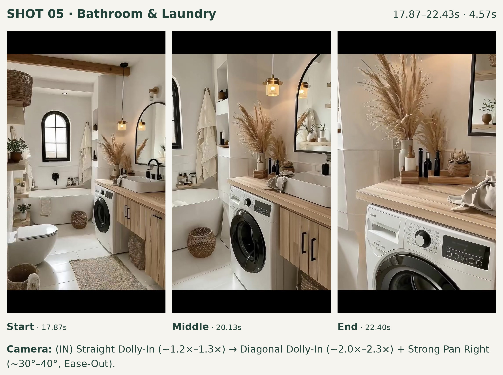

# edh009 — Compact Contemporary House — Warm Neutral Interior

## 1. Profil desain

- **Nama desain:** Compact Contemporary House — Warm Neutral Interior
- **Tipe rumah:** Detached House
- **Gaya utama:** **Contemporary**
- **Pengaruh gaya:** —
- **Gaya interior:** Warm Modern
- **Susunan ruang utama:** Edit memperlihatkan eksterior, ruang tamu, dapur, kamar tidur, kamar mandi merangkap laundry; denah belum terverifikasi
- **Ciri khas:** Balkon hijau, jendela grid tinggi, kabinet dapur berlampu bawah, jendela lengkung kamar dan mesin cuci bawah meja vanity
- **Material utama:** Bidang putih/cream dominan, aksen tampak kayu terang, profil hitam, tekstil beige
- **Pencahayaan:** Cahaya luar lewat kaca, lampu dinding, pendant, downlight dan strip hangat pada kabinet/tangga
- **Atmosfer:** Terang, hangat dan nyaman dengan dekorasi natural dan tekstil lembut
- **Lingkungan:** Halaman rumput, jalan pijak dan pepohonan tinggi mengelilingi tampak rumah

### Palet warna

| Peran | Warna | HEX |
| --- | --- | --- |
| Dominan | Warm White | `#E8E4DB` |
| Pendamping | Cream Beige | `#CFC0AA` |
| Pendamping | Natural Oak | `#B48A60` |
| Aksen | Charcoal Black | `#292723` |
| Aksen | Muted Olive | `#526044` |
| Pendamping | Warm Taupe | `#91816D` |

## 2. Ukuran & proporsi

| Aspek | Estimasi visual |
| --- | --- |
| **Ukuran rumah** | small |
| **Bentuk bangunan** | Massa dua tingkat bertumpuk dengan balkon di muka |
| **Lantai & bentuk atap** | Dua tingkat tampak dari balkon dan bukaan atas · Kanopi datar bertepi gelap dan soffit tampak kayu; atap utama tidak seluruhnya terlihat |
| **Tapak bangunan** | Massa kompak cenderung persegi panjang |
| **Proporsi utama** | Fasad ramping; tinggi massa lebih dominan dibanding lebar tampak |
| **Perkiraan luas lantai** | **70–120 m²** |

## 3. Shot Timeline

Durasi 22.43s · 5 shot.

**Camera Pattern:** IN – OUT – IN – OUT – IN.

| Shot | Time (s) | Duration | Area/Scene | Camera Movement |
| --- | --- | --- | --- | --- |
| 01 | 0.00–4.63 | 4.63s | Exterior | Moderate Orbit Right (~10°–15°) + Gentle Pan Left → Moderate Orbit Right (~10°–15°) + Mild Dolly-In (~1.1×) + Gentle Pan Left (Ease-Out) → Accelerating Dolly-In (~1.2×). |
| 02 | 4.63–9.23 | 4.60s | Living Room | Dolly-Out (~1.8×–1.9×) + Orbit Left (~20°–30°) + Gentle Pan Right (Ease-Out). |
| 03 | 9.23–13.27 | 4.03s | Kitchen | Straight Dolly-In (~1.9×). |
| 04 | 13.27–17.87 | 4.60s | Bedroom | Moderate Orbit Left (~10°–15°) + Moderate Pan Right (~10°–15°) → Mild Dolly-Out (~1.1×) + Moderate Orbit Left (~10°–15°) + Moderate Pan Right (Ease-Out) → Dolly-Out (~1.2×) + Subtle Orbit Left (Ease-Out). |
| 05 | 17.87–22.43 | 4.57s | Bathroom & Laundry | Straight Dolly-In (~1.2×–1.3×) → Diagonal Dolly-In (~2.0×–2.3×) + Strong Pan Right (~30°–40°, Ease-Out). |

## 4. Overview

**Shot 01 · Exterior · 0.00s**

> Kamera di halaman depan agak rendah, menatap fasad hampir frontal; wide memperlihatkan rumah dua tingkat, balkon, kanopi, tangga dan halaman berlatar pepohonan.

**Shot 02 · Living Room · 9.20s**

> Kamera lebih jauh dari sofa utama, menghadap sudut ruang berjendela tinggi; wide mencakup dua sofa, meja kopi, TV dan pendant dengan tirai panjang.

**Shot 03 · Kitchen · 9.23s**

> Kamera berada di akses dapur, menatap lorong kerja ke jendela belakang; wide mencakup kabinet kiri, meja kerja hitam, kulkas kanan, lantai dan plafon berlampu.

**Shot 04 · Bedroom · 17.83s**

> Kamera menjauh di depan-samping ranjang, menghadap serong ke kepala ranjang dan dinding lemari; wide memperlihatkan ranjang, jendela lengkung, rak vertikal dan wardrobe.

**Shot 05 · Bathroom & Laundry · 17.87s**

> Kamera di akses kamar mandi, menghadap bathtub di bawah jendela lengkung; wide mencakup toilet kiri, bathtub belakang, mesin cuci dan vanity kanan.

## 5. Storyboard

## 6. Shot Details

### Shot 01 · Exterior

**Time:** 0.00–4.63s · **Duration:** 4.63s

#### **A. Desain area**

**Arsitektur**

> Massa putih dua tingkat ramping dengan balkon depan berpagar gelap, kanopi tepi hitam dan soffit kayu, bukaan kaca tinggi serta pintu masuk gelap di atas tangga lebar. Dinding samping kanan terbuka dalam pandangan tiga perempat.

**Furnitur & dekorasi**

> Tanaman pot pada balkon, sisi tangga dan landing; lampu dinding hitam dan lampu hangat pada anak tangga.

**Lingkungan**

> Rumput, jalur paving terang dan pohon tinggi di belakang/samping rumah. Cahaya luar lembut, lampu rumah menyala.

#### **B. Framing & Lighting**

- **Fokus:** Fasad, balkon, pintu
- **Camera Start:** Halaman depan · Ke fasad dan akses pintu · near-frontal · Rendah relatif massa dua lantai · Sedikit mendongak secara perspektif
- **Framing:** Wide rumah utuh dan halaman → Tiga perempat kanan lebih dekat, pintu dan tangga menonjol
- **Lighting:** Cahaya luar lembut dan aksen lampu amber
- **Foreground dan kedalaman:** Rumput, tangga dan pot · Lapisan halaman, fasad, pohon
- **Reveal:** Sisi kanan terbuka lalu detail pintu membesar
- **Kesesuaian gerak:** Orbit membuka volume, dolly-in menekankan akses

#### **C. Camera Movement**

Kamera mengitari fasad ke kanan dari hampir frontal menuju sudut tiga perempat, kemudian mendekati pintu dan tangga dengan pembesaran yang makin nyata.

**Tempo:** Tempo moderat: sapuan awal lancar dan mereda, pendekatan semakin nyata di 1,6 detik terakhir; pembesaran perspektif ikut memengaruhi laju tampak.

**Movement Timeline**

| Time (s) | Area & fokus | Camera Movement | Tempo |
| --- | --- | --- | --- |
| 0.00–1.50 | Exterior · Fasad dan balkon | Moderate Orbit Right (~10°–15°) + Gentle Pan Left | Tempo moderat: sapuan awal lancar dan mereda, pendekatan semakin nyata di 1,6 detik terakhir; pembesaran perspektif ikut memengaruhi laju tampak. |
| 1.50–3.00 | Exterior · Sudut kanan fasad dan pintu | Moderate Orbit Right (~10°–15°) + Mild Dolly-In (~1.1×) + Gentle Pan Left (Ease-Out) | Tempo moderat: sapuan awal lancar dan mereda, pendekatan semakin nyata di 1,6 detik terakhir; pembesaran perspektif ikut memengaruhi laju tampak. |
| 3.00–4.63 | Exterior · Pintu masuk dan tangga | Accelerating Dolly-In (~1.2×) | Tempo moderat: sapuan awal lancar dan mereda, pendekatan semakin nyata di 1,6 detik terakhir; pembesaran perspektif ikut memengaruhi laju tampak. |

**Camera:** Moderate Orbit Right (~10°–15°) + Gentle Pan Left → Moderate Orbit Right (~10°–15°) + Mild Dolly-In (~1.1×) + Gentle Pan Left (Ease-Out) → Accelerating Dolly-In (~1.2×).

---

### Shot 02 · Living Room

**Time:** 4.63–9.23s · **Duration:** 4.60s

#### **A. Desain area**

**Arsitektur**

> Ruang tamu tampak berplafon tinggi dengan dua bidang jendela grid hitam tinggi, tirai putih panjang, dinding terang dan lantai berpenampilan kayu. Bukaan besar memberi volume vertikal.

**Furnitur & dekorasi**

> Sofa krem dengan bantal taupe dan cokelat menghadap area meja kopi kayu persegi panjang; sofa/seat depan membingkai meja. TV hitam pada dinding kiri tampak saat kamera mundur. Karpet anyam, lampu gantung berkelompok, tanaman dan vas di dekat jendela.

**Lingkungan**

> Cahaya siang kuat lewat kaca dan tirai tipis, bercampur lampu hangat; vegetasi terlihat samar di balik kaca.

#### **B. Framing & Lighting**

- **Fokus:** Sofa, jendela dan layout duduk
- **Camera Start:** Dekat sofa utama di sudut ruang · Serong sepanjang sofa menuju jendela tinggi · oblique · Sekitar tinggi mata duduk/berdiri rendah · Relatif datar
- **Framing:** Medium-wide sofa dan jendela → Wide susunan duduk dengan TV dan meja
- **Lighting:** Daylight difus dari jendela dan pendant hangat
- **Foreground dan kedalaman:** Sandaran, bantal dan tepi meja · Sofa depan, meja, sofa belakang dan jendela tinggi
- **Reveal:** TV dan susunan duduk semakin terbuka
- **Kesesuaian gerak:** Dolly-out dan orbit memperluas cakupan ruang

#### **C. Camera Movement**

Kamera mundur dari sisi kanan sofa menuju pandangan ruang yang lebih luas, mengubah sudut sofa menjadi lebih frontal. Meja, sofa depan dan TV terungkap.

**Tempo:** Gerak mundur stabil dengan perubahan sudut paling terasa pada awal hingga tengah; perubahan lateral melambat di akhir, meski penyusutan skala tetap nyata.

**Camera:** Dolly-Out (~1.8×–1.9×) + Orbit Left (~20°–30°) + Gentle Pan Right (Ease-Out).

---

### Shot 03 · Kitchen

**Time:** 9.23–13.27s · **Duration:** 4.03s

#### **A. Desain area**

**Arsitektur**

> Dapur kompak dengan kabinet dan counter di kiri serta belakang, kulkas tinggi kanan pada awal, bukaan jendela persegi bingkai hitam di atas wastafel. Plafon tray dengan trim tampak kayu dan downlight; lantai terang.

**Furnitur & dekorasi**

> Kabinet bawah putih bergagang hitam, counter gelap, kabinet atas dan rak terbuka tampak kayu, area memasak kiri, wastafel di bawah jendela dan kulkas hitam kanan. Vas bunga, botol dan tanaman dekoratif; strip LED di bawah kabinet.

**Lingkungan**

> Cahaya dari jendela belakang; pemandangan luar terbatas, bentuk bangunan/bukaan samar.

#### **B. Framing & Lighting**

- **Fokus:** Jendela dan wastafel
- **Camera Start:** Di akses ruang dapur · Ke wastafel dan jendela belakang · near-frontal · Sekitar tinggi mata · Relatif datar
- **Framing:** Wide jalur kerja dengan kulkas dan kabinet → Lebih dekat pada counter dan jendela
- **Lighting:** Daylight dari jendela dan strip hangat, downlight
- **Foreground dan kedalaman:** Tepi counter kiri, kulkas kanan · Lorong kerja mengarah ke jendela
- **Reveal:** Detail kabinet dan aksesori membesar
- **Kesesuaian gerak:** Dolly-in mengikuti sumbu ruang menuju titik fokus

#### **C. Camera Movement**

Kamera bergerak maju relatif lurus menuju wastafel di bawah jendela. Kabinet dan lemari es di tepi keluar dari bidang pandang, sementara jendela tetap dekat sumbu.

**Tempo:** Maju mantap; pembesaran nyata dari awal, sedikit lebih cepat di tengah lalu relatif stabil, tidak cukup bukti akselerasi fisik yang terpisah dari perspektif.

**Camera:** Straight Dolly-In (~1.9×).

---

### Shot 04 · Bedroom

**Time:** 13.27–17.87s · **Duration:** 4.60s

#### **A. Desain area**

**Arsitektur**

> Kamar berwarna putih hangat, jendela lengkung dengan blind horizontal di atas kepala ranjang, plafon rata ber-downlight, lemari built-in putih di sisi kanan tampak pada akhir.

**Furnitur & dekorasi**

> Ranjang besar berheadboard berlapis bantalan, sprei putih, bantal bertingkat dan throw taupe. Rak kayu vertikal terbuka di samping jendela, wardrobe putih tinggi bergagang gelap, meja samping kecil, lampu gantung kecil dan rumput kering.

**Lingkungan**

> Blind menyaring cahaya siang; detail lingkungan di luar tidak terbaca.

#### **B. Framing & Lighting**

- **Fokus:** Ranjang dan jendela lengkung
- **Camera Start:** Di depan ranjang dekat kaki · Ke kepala ranjang dan jendela lengkung · near-frontal · Sekitar tinggi dada/mata · Relatif datar
- **Framing:** Medium-wide ranjang memenuhi bawah frame → Wide serong ranjang dan lemari
- **Lighting:** Cahaya difus melalui blind dan downlight hangat
- **Foreground dan kedalaman:** Selimut dan bantal · Kaki ranjang, headboard, jendela dan lemari
- **Reveal:** Lemari kanan dan cakupan ranjang terbuka
- **Kesesuaian gerak:** Orbit dan pan mengubah orientasi, dolly-out memperluas ruang

#### **C. Camera Movement**

Kamera membuka sisi kanan kamar dengan beralih dari depan ranjang ke sudut kiri ranjang, sambil berputar ke kanan, kemudian mundur untuk memperlihatkan keseluruhan ranjang dan lemari.

**Tempo:** Tempo moderat; perubahan sudut paling nyata di awal dan tengah, lalu pullback lebih stabil serta orbit mereda pada akhir.

**Movement Timeline**

| Time (s) | Area & fokus | Camera Movement | Tempo |
| --- | --- | --- | --- |
| 13.27–14.27 | Bedroom · Ranjang dan jendela lengkung | Moderate Orbit Left (~10°–15°) + Moderate Pan Right (~10°–15°) | Tempo moderat; perubahan sudut paling nyata di awal dan tengah, lalu pullback lebih stabil serta orbit mereda pada akhir. |
| 14.27–15.60 | Bedroom · Ranjang, rak vertikal, lemari kanan | Mild Dolly-Out (~1.1×) + Moderate Orbit Left (~10°–15°) + Moderate Pan Right (Ease-Out) | Tempo moderat; perubahan sudut paling nyata di awal dan tengah, lalu pullback lebih stabil serta orbit mereda pada akhir. |
| 15.60–17.87 | Bedroom · Ranjang utuh dan lemari | Dolly-Out (~1.2×) + Subtle Orbit Left (Ease-Out) | Tempo moderat; perubahan sudut paling nyata di awal dan tengah, lalu pullback lebih stabil serta orbit mereda pada akhir. |

**Camera:** Moderate Orbit Left (~10°–15°) + Moderate Pan Right (~10°–15°) → Mild Dolly-Out (~1.1×) + Moderate Orbit Left (~10°–15°) + Moderate Pan Right (Ease-Out) → Dolly-Out (~1.2×) + Subtle Orbit Left (Ease-Out).

---

### Shot 05 · Bathroom & Laundry

**Time:** 17.87–22.43s · **Duration:** 4.57s

#### **A. Desain area**

**Arsitektur**

> Ruang gabungan kamar mandi/laundry dengan dinding dan lantai terang, jendela lengkung hitam di atas bathtub belakang; meja panjang di sisi kanan dengan cermin lengkung dan ceruk/rak vertikal.

**Furnitur & dekorasi**

> Bathtub putih di bawah jendela, toilet putih di kiri awal frame, mesin cuci front-load di bawah meja tampak kayu kanan; vanity dengan wastafel putih, faucet hitam, kabinet kayu bergagang gelap, cermin melengkung, pendant hangat, keranjang anyam dan vas rumput kering.

**Lingkungan**

> Cahaya melalui jendela lengkung; pemandangan luar tidak dapat dipastikan, pendant menghangatkan bidang vanity.

#### **B. Framing & Lighting**

- **Fokus:** Bathtub lalu vanity dan laundry
- **Camera Start:** Di akses kamar mandi · Ke bathtub dan jendela belakang · oblique · Sekitar tinggi mata · Relatif datar
- **Framing:** Wide toilet, bathtub dan vanity/laundry → Close-up meja vanity dan mesin cuci
- **Lighting:** Daylight dari jendela dan pendant amber
- **Foreground dan kedalaman:** Toilet kiri, counter kanan · Toilet, vanity, mesin cuci dan bathtub belakang
- **Reveal:** Detail counter dan mesin cuci menjadi dominan
- **Kesesuaian gerak:** Pendekatan awal lalu sapuan kanan mengikuti counter

#### **C. Camera Movement**

Kamera maju dari pintu kamar mandi ke arah area bathtub, lalu membelok ke kanan sambil mendekati meja wastafel dan mesin cuci, berakhir close-up.

**Tempo:** Tempo moderat dengan sapuan kanan yang meningkat di tengah dan mereda mendekati akhir; pembesaran tetap berlangsung cepat secara visual pada close-up.

**Movement Timeline**

| Time (s) | Area & fokus | Camera Movement | Tempo |
| --- | --- | --- | --- |
| 17.87–18.87 | Bathroom & Laundry · Bathtub dan jendela lengkung | Straight Dolly-In (~1.2×–1.3×) | Tempo moderat dengan sapuan kanan yang meningkat di tengah dan mereda mendekati akhir; pembesaran tetap berlangsung cepat secara visual pada close-up. |
| 18.87–22.43 | Bathroom & Laundry · Vanity, mesin cuci dan dekorasi meja | Diagonal Dolly-In (~2.0×–2.3×) + Strong Pan Right (~30°–40°, Ease-Out) | Tempo moderat dengan sapuan kanan yang meningkat di tengah dan mereda mendekati akhir; pembesaran tetap berlangsung cepat secara visual pada close-up. |

**Camera:** Straight Dolly-In (~1.2×–1.3×) → Diagonal Dolly-In (~2.0×–2.3×) + Strong Pan Right (~30°–40°, Ease-Out).

**Catatan referensi:** Estimasi luas lantai 70–120 m² hanya dari proporsi visual tanpa skala terkalibrasi atau denah. Identitas tipe/gaya dan material fisik tidak terkonfirmasi; nama desain merupakan label deskriptif auditor. Urutan edit tidak membuktikan hubungan denah atau bahwa interior dan eksterior adalah satu bangunan fisik. HEX adalah perkiraan tampilan dalam pencahayaan video.
