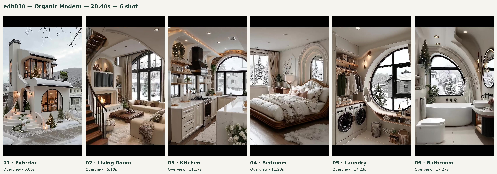
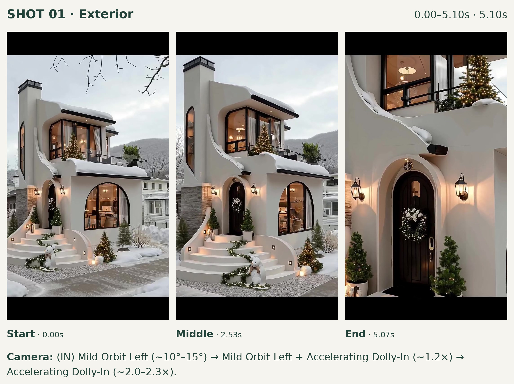
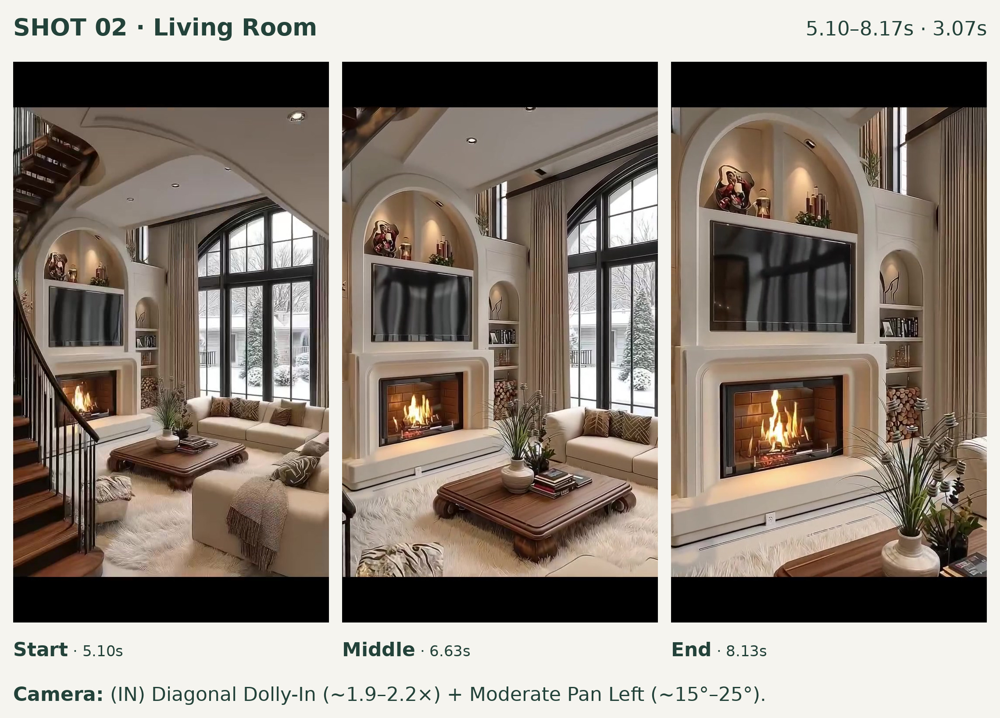
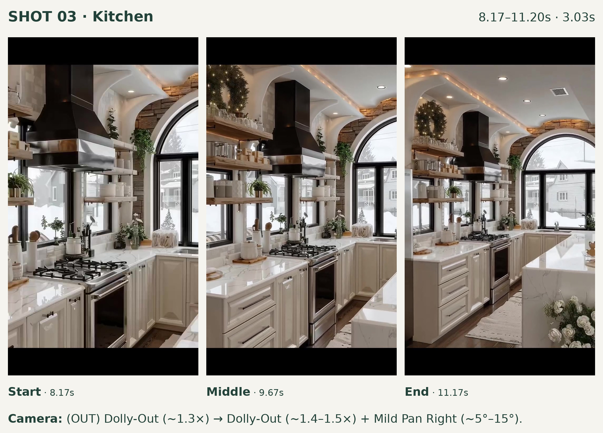
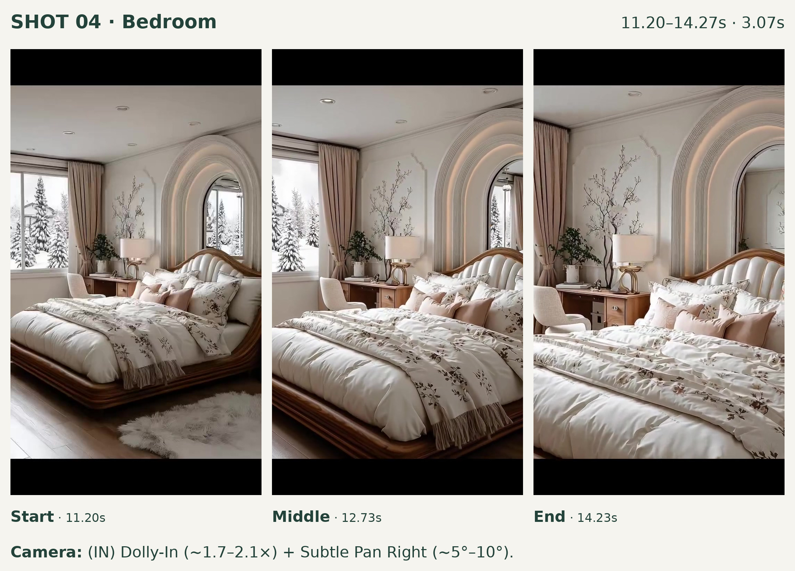
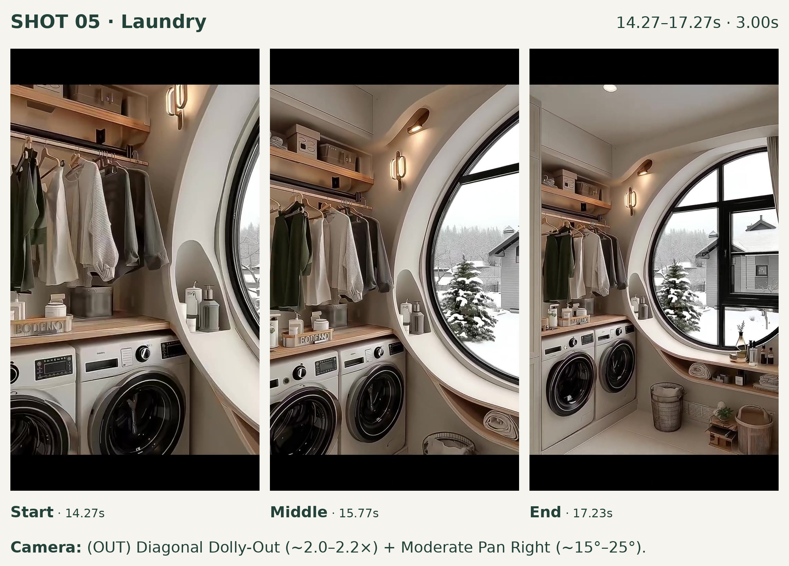
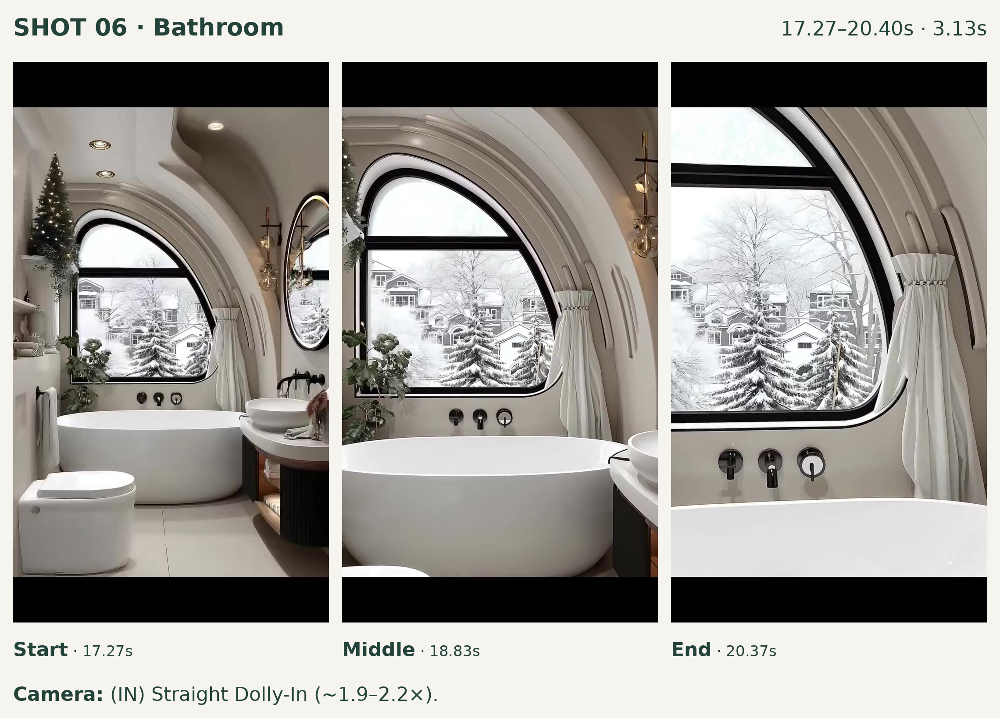

# edh010 — Snowy Curved Modern Cottage

## 1. Profil desain

- **Nama desain:** Snowy Curved Modern Cottage
- **Tipe rumah:** Detached House
- **Gaya utama:** **Organic Modern**
- **Pengaruh gaya:** Modern Cottage
- **Gaya interior:** Cozy Contemporary; Organic Modern
- **Susunan ruang utama:** Montase eksterior, ruang duduk, dapur, kamar tidur, laundry, kamar mandi; koneksi denah tidak terlihat
- **Ciri khas:** Relief lengkung berulang, jendela bulat besar, perapian built-in dan dekorasi musiman
- **Material utama:** Tampilan plester putih halus, kayu hangat, logam gelap, tekstil krem; material fisik tidak terkonfirmasi
- **Pencahayaan:** Cahaya siang difus dari jendela besar, lampu aksen hangat dan perapian
- **Atmosfer:** Hangat, intim dan lembut dengan kontras lanskap musim dingin
- **Lingkungan:** Salju, konifer dan bangunan tetangga tampak dari luar dan bukaan

### Palet warna

| Peran | Warna | HEX |
| --- | --- | --- |
| Dominan | Warm White | `#E1DDD3` |
| Pendamping | Ivory | `#F1EDE3` |
| Pendamping | Taupe | `#B3A392` |
| Pendamping | Warm Wood | `#795538` |
| Aksen | Charcoal | `#292927` |
| Aksen | Evergreen | `#435044` |

## 2. Ukuran & proporsi

| Aspek | Estimasi visual |
| --- | --- |
| **Ukuran rumah** | small |
| **Bentuk bangunan** | Massa dua tingkat asimetris dengan volume tinggi dan dinding melengkung |
| **Lantai & bentuk atap** | Dua tingkat tampak pada fasad; tangga interior terlihat · Bidang atap rendah bertingkat dengan tepi gelap dan salju |
| **Tapak bangunan** | Massa kompak dengan tonjolan sisi dan teras bertangga |
| **Proporsi utama** | Vertikal, massa atas lebih sempit; bukaan tinggi dominan |
| **Perkiraan luas lantai** | **75–130 m²** |

## 3. Shot Timeline

Durasi 20.40s · 6 shot.

**Camera Pattern:** IN – IN – OUT – IN – OUT – IN.

| Shot | Time (s) | Duration | Area/Scene | Camera Movement |
| --- | --- | --- | --- | --- |
| 01 | 0.00–5.10 | 5.10s | Exterior | Mild Orbit Left (~10°–15°) → Mild Orbit Left + Accelerating Dolly-In (~1.2×) → Accelerating Dolly-In (~2.0–2.3×). |
| 02 | 5.10–8.17 | 3.07s | Living Room | Diagonal Dolly-In (~1.9–2.2×) + Moderate Pan Left (~15°–25°). |
| 03 | 8.17–11.20 | 3.03s | Kitchen | Dolly-Out (~1.3×) → Dolly-Out (~1.4–1.5×) + Mild Pan Right (~5°–15°). |
| 04 | 11.20–14.27 | 3.07s | Bedroom | Dolly-In (~1.7–2.1×) + Subtle Pan Right (~5°–10°). |
| 05 | 14.27–17.27 | 3.00s | Laundry | Diagonal Dolly-Out (~2.0–2.2×) + Moderate Pan Right (~15°–25°). |
| 06 | 17.27–20.40 | 3.13s | Bathroom | Straight Dolly-In (~1.9–2.2×). |

## 4. Overview

**Shot 01 · Exterior · 0.00s**

> Dari halaman depan dengan sudut serong ke fasad; massa dua tingkat, tangga, bukaan dan lingkungan bersalju tampak bersama.

**Shot 02 · Living Room · 5.10s**

> Dari sisi tangga menghadap serong ruang duduk; sofa, meja kopi, dinding media dan jendela lengkung tampil dalam satu wide.

**Shot 03 · Kitchen · 11.17s**

> Dari ujung lintasan mundur menghadap sepanjang jalur kerja; range, kabinet berbelok, counter kanan, rak dan jendela lengkung tercakup.

**Shot 04 · Bedroom · 11.20s**

> Dari kaki ranjang secara serong, ranjang, karpet, meja, jendela, kursi dan lengkung belakang tampak bersama.

**Shot 05 · Laundry · 17.23s**

> Dari ujung mundur menghadap dinding mesin serta jendela; dua mesin, rak, gantungan, keranjang dan bukaan bulat terlihat.

**Shot 06 · Bathroom · 17.27s**

> Dari depan ruang menghadap bathtub di bawah bukaan lengkung; toilet kiri, vanity kanan, lantai dan jendela terlihat bersama.

## 5. Storyboard

## 6. Shot Details

### Shot 01 · Exterior

**Time:** 0.00–5.10s · **Duration:** 5.10s

#### **A. Desain area**

**Arsitektur**

> Fasad putih asimetris dua tingkat; volume kiri tinggi dengan cerobong, atap rendah bertingkat, jendela atas kotak dan bukaan bawah lengkung. Pintu gelap lengkung dicapai lewat tangga membulat; dinding tangga menyatu dengan fasad.

**Furnitur & dekorasi**

> Lampu lentera di sisi pintu, karangan daun pada pintu dan pohon kecil/dekorasi musiman di sekitar tangga dan balkon.

**Lingkungan**

> Tapak bersalju, jalan berlapis paving di depan, pohon konifer dan rumah tetangga di belakang; langit mendung terang.

#### **B. Framing & Lighting**

- **Fokus:** Fasad lalu pintu masuk
- **Camera Start:** Di luar rumah, dari halaman depan menyamping · Ke fasad dan pintu · oblique · Sekitar tinggi mata dari halaman · Hampir datar dengan sedikit pandang ke atas
- **Framing:** Wide fasad dua tingkat dan tapak depan → Close-up pintu lengkung dan lentera
- **Lighting:** Langit difus; lampu luar dan interior hangat
- **Foreground dan kedalaman:** Jalan, salju, tangga dan tanaman kecil · Tangga depan, fasad, bangunan tetangga di belakang
- **Reveal:** Sisi fasad kiri lalu pintu dan lampu
- **Kesesuaian gerak:** Orbit membuka sisi massa; dolly-in mengisolasi pintu

#### **C. Camera Movement**

Kamera mengitari fasad ke kiri pada awal, kemudian mulai mendekati pintu saat putaran mereda, dan berakhir dengan dorongan cepat ke pintu.

**Tempo:** Awal lambat dan terkontrol; dari sekitar F63 pendekatan makin nyata dan bagian akhir cepat. Skala log 2D awal/tengah/akhir 0,021/0,201/0,349 per detik.

**Movement Timeline**

| Time (s) | Area & fokus | Camera Movement | Tempo |
| --- | --- | --- | --- |
| 0.00–2.10 | Exterior · Fasad dan teras | Mild Orbit Left (~10°–15°) | Awal lambat dan terkontrol; dari sekitar F63 pendekatan makin nyata dan bagian akhir cepat. Skala log 2D awal/tengah/akhir 0,021/0,201/0,349 per detik. |
| 2.10–3.00 | Exterior · Fasad menuju pintu | Mild Orbit Left + Accelerating Dolly-In (~1.2×) | Awal lambat dan terkontrol; dari sekitar F63 pendekatan makin nyata dan bagian akhir cepat. Skala log 2D awal/tengah/akhir 0,021/0,201/0,349 per detik. |
| 3.00–5.10 | Exterior · Pintu masuk | Accelerating Dolly-In (~2.0–2.3×) | Awal lambat dan terkontrol; dari sekitar F63 pendekatan makin nyata dan bagian akhir cepat. Skala log 2D awal/tengah/akhir 0,021/0,201/0,349 per detik. |

**Camera:** Mild Orbit Left (~10°–15°) → Mild Orbit Left + Accelerating Dolly-In (~1.2×) → Accelerating Dolly-In (~2.0–2.3×).

---

### Shot 02 · Living Room

**Time:** 5.10–8.17s · **Duration:** 3.07s

#### **A. Desain area**

**Arsitektur**

> Ruang duduk tinggi dengan bukaan lengkung berbingkai gelap, dinding media berrelung lengkung dan perapian di bawah TV; tangga kayu dengan railing gelap di kiri awal.

**Furnitur & dekorasi**

> Sofa krem menghadap dinding TV/perapian, meja kopi kayu persegi panjang rendah di tengah karpet terang; bantal, throw, tanaman dan benda hias pada niche.

**Lingkungan**

> Jendela tinggi memperlihatkan pohon dan salju; cahaya difus bercampur cahaya api dan relung hangat.

#### **B. Framing & Lighting**

- **Fokus:** Dinding media dan perapian
- **Camera Start:** Di sisi tangga dekat ruang duduk · Serong menuju TV dan perapian · oblique · Sekitar tinggi mata · Sedikit pandang ke bawah pada meja
- **Framing:** Wide tangga, sofa, meja, jendela dan dinding media → TV, perapian dan relung mendominasi
- **Lighting:** Cahaya siang dari kanan, relung dan api hangat
- **Foreground dan kedalaman:** Railing dan sofa · Railing, meja, sofa, dinding media, jendela
- **Reveal:** Dinding media menjadi dominan
- **Kesesuaian gerak:** Dolly-in dan pan kiri mengurangi foreground tangga

#### **C. Camera Movement**

Maju dari sisi tangga ke ruang duduk sambil mengarahkan pandangan ke kiri menuju TV dan perapian; meja dan sofa terpotong di akhir.

**Tempo:** Maju mulus selama 3,07 detik; pembesaran dan sapuan terasa semakin cepat menjelang akhir, sebagian karena perspektif.

**Camera:** Diagonal Dolly-In (~1.9–2.2×) + Moderate Pan Left (~15°–25°).

---

### Shot 03 · Kitchen

**Time:** 8.17–11.20s · **Duration:** 3.03s

#### **A. Desain area**

**Arsitektur**

> Dapur dengan kabinet putih sepanjang sisi kompor dan berbelok ke bukaan lengkung besar; backsplash terang, rak terbuka, plafon dengan detail lengkung serta strip cahaya hangat. Counter di kanan terlihat, sambungan tidak pasti.

**Furnitur & dekorasi**

> Range dan oven stainless-look dengan hood gelap, kabinet bawah laci/pintu berpanel, rak kayu terbuka dengan cangkir dan tanaman; counter putih di sisi kanan menyerupai island, sambungannya tidak terlihat.

**Lingkungan**

> Pemandangan bangunan dan salju melalui jendela; cahaya alami dingin diimbangi strip plafon dan lampu dalam.

#### **B. Framing & Lighting**

- **Fokus:** Range lalu keseluruhan dapur
- **Camera Start:** Dekat sisi counter kompor · Ke kompor, kemudian ke arah jendela · oblique · Sekitar tinggi mata · Sedikit menurun ke countertop
- **Framing:** Close-medium kompor dan hood → Wide dapur dengan counter kanan dan bukaan
- **Lighting:** Cahaya jendela difus dan aksen plafon hangat
- **Foreground dan kedalaman:** Counter dan kompor · Counter, range, kabinet dan jendela
- **Reveal:** Rak terbuka, counter kanan dan jendela terbuka lebih lebar
- **Kesesuaian gerak:** Dolly-out membuka layout; pan kanan mengungkap jendela

#### **C. Camera Movement**

Mundur dari kompor dan hood; mula-mula membuka rak dan kabinet, lalu bergeser pandangan ke kanan untuk memperlihatkan island dan jendela besar.

**Tempo:** Mundur relatif stabil sepanjang 3,03 detik; log skala 2D sekitar −0,21 hingga −0,23 per detik. Sapuan berubah arah secara halus di tengah.

**Movement Timeline**

| Time (s) | Area & fokus | Camera Movement | Tempo |
| --- | --- | --- | --- |
| 8.17–9.40 | Kitchen · Hood dan kompor | Dolly-Out (~1.3×) | Mundur relatif stabil sepanjang 3,03 detik; log skala 2D sekitar −0,21 hingga −0,23 per detik. Sapuan berubah arah secara halus di tengah. |
| 9.40–11.20 | Kitchen · Kompor, island dan jendela | Dolly-Out (~1.4–1.5×) + Mild Pan Right (~5°–15°) | Mundur relatif stabil sepanjang 3,03 detik; log skala 2D sekitar −0,21 hingga −0,23 per detik. Sapuan berubah arah secara halus di tengah. |

**Camera:** Dolly-Out (~1.3×) → Dolly-Out (~1.4–1.5×) + Mild Pan Right (~5°–15°).

---

### Shot 04 · Bedroom

**Time:** 11.20–14.27s · **Duration:** 3.07s

#### **A. Desain area**

**Arsitektur**

> Kamar tidur bernuansa putih dan krem, jendela besar bersebelahan dengan headboard; panel dinding dan lengkung bertingkat berlampu mengelilingi cermin atau bukaan reflektif.

**Furnitur & dekorasi**

> Ranjang kayu dengan headboard lengkung berlapis krem, tekstil bermotif botani, bantal bertumpuk dan throw; meja kayu dan lampu dekat jendela, kursi krem dan karpet berbulu.

**Lingkungan**

> Pohon konifer bersalju di luar jendela; siang difus dan cahaya hangat di lengkung serta lampu meja.

#### **B. Framing & Lighting**

- **Fokus:** Ranjang dan headboard
- **Camera Start:** Di kaki ranjang, sedikit menyamping · Ke headboard dan jendela · oblique · Sekitar tinggi mata · Sedikit menurun ke ranjang
- **Framing:** Wide ranjang, jendela, meja dan karpet → Close-up ranjang, lampu dan lengkung
- **Lighting:** Siang dari kiri, lampu meja dan lengkung hangat
- **Foreground dan kedalaman:** Kaki ranjang dan karpet · Ranjang, meja, jendela dan dinding belakang
- **Reveal:** Tekstur bedding dan lengkung headboard
- **Kesesuaian gerak:** Dolly-in memperbesar ranjang, pan kanan halus

#### **C. Camera Movement**

Maju ke ranjang dan lampu samping, dengan sedikit pengalihan pandangan ke kanan; kaki ranjang dan jendela kiri keluar dari bingkai.

**Tempo:** Pendekatan stabil dan agak meningkat di tengah; perubahan framing lebih nyata pada akhir, tanpa easing yang tegas.

**Camera:** Dolly-In (~1.7–2.1×) + Subtle Pan Right (~5°–10°).

---

### Shot 05 · Laundry

**Time:** 14.27–17.27s · **Duration:** 3.00s

#### **A. Desain area**

**Arsitektur**

> Ruang utilitas kompak dengan jendela bulat besar berbingkai gelap dan ambang melengkung tebal; dinding kabinet mesin cuci berdampingan dengan jendela.

**Furnitur & dekorasi**

> Dua mesin front-load berdampingan di bawah countertop kayu, rak terbuka dan gantungan pakaian di atas; botol, kotak, keranjang dan handuk di area bawah jendela.

**Lingkungan**

> Jendela menampilkan konifer, atap dan salju; lampu dinding hangat di sisi jendela.

#### **B. Framing & Lighting**

- **Fokus:** Mesin laundry lalu jendela
- **Camera Start:** Dekat mesin laundry · Ke mesin dan kemudian jendela bulat · oblique · Sekitar tinggi mata · Sedikit menurun ke mesin
- **Framing:** Close-medium mesin dan rak → Wide mesin, gantungan, jendela dan keranjang
- **Lighting:** Cahaya siang dari kanan dan lampu dinding hangat
- **Foreground dan kedalaman:** Counter dan bagian depan mesin · Mesin, rak, ambang jendela dan pemandangan luar
- **Reveal:** Jendela, keranjang, area lantai
- **Kesesuaian gerak:** Dolly-out dan pan kanan memperluas area terlihat

#### **C. Camera Movement**

Mundur dari mesin cuci sambil membuka pandangan ke jendela bulat di kanan; rak, kedua mesin, keranjang dan lantai masuk ke bingkai.

**Tempo:** Pull-back cukup lancar dalam 3 detik, sedikit lebih cepat di bagian tengah; rotasi relatif mereda di akhir.

**Camera:** Diagonal Dolly-Out (~2.0–2.2×) + Moderate Pan Right (~15°–25°).

---

### Shot 06 · Bathroom

**Time:** 17.27–20.40s · **Duration:** 3.13s

#### **A. Desain area**

**Arsitektur**

> Kamar mandi dengan jendela lengkung besar tak simetris berbingkai gelap dan relief lengkung bertingkat; dinding terang dan lantai ubin terang.

**Furnitur & dekorasi**

> Bathtub putih freestanding di bawah jendela dengan fitting gelap, toilet putih di kiri depan, wastafel vessel di atas vanity gelap di kanan dan cermin bulat/oval; tirai putih di sisi jendela.

**Lingkungan**

> Konifer, salju dan rumah tetangga terlihat dari jendela; cahaya siang terang dan downlight hangat.

#### **B. Framing & Lighting**

- **Fokus:** Bathtub dan bukaan lengkung
- **Camera Start:** Di akses ruang, di depan bathtub · Ke bathtub dan jendela · frontal · Sekitar tinggi mata · Hampir datar
- **Framing:** Wide toilet, bathtub, vanity dan jendela → Close-up jendela dan tepi bathtub
- **Lighting:** Cahaya difus dari jendela dan downlight hangat
- **Foreground dan kedalaman:** Toilet dan wastafel · Toilet, bathtub, jendela dan pemandangan luar
- **Reveal:** Bathtub, fitting dan jendela menjadi fokus
- **Kesesuaian gerak:** Dolly-in menghilangkan toilet dan vanity dari bingkai

#### **C. Camera Movement**

Kamera bergerak mendekati bathtub dan jendela; toilet dan wastafel di tepi keluar dari bingkai.

**Tempo:** Maju merata, sedikit lebih pesat di tengah dan melandai menjelang akhir; perubahan skala tetap signifikan.

**Camera:** Straight Dolly-In (~1.9–2.2×).

**Catatan referensi:** Estimasi luas 75–130 m² bersifat kasar dan tidak terukur dari tampak massa, proporsi pintu dan furnitur; denah, dimensi, material fisik, lokasi, serta kesinambungan rumah lintas cut tidak terkonfirmasi. Palet HEX taksiran visual. Kamera mempertahankan hasil Fase 2 yang disetujui.
