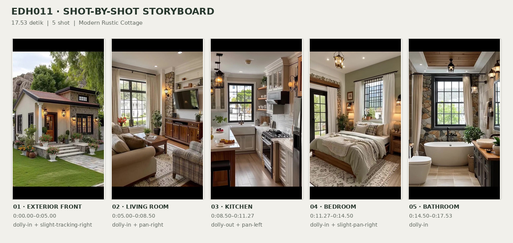
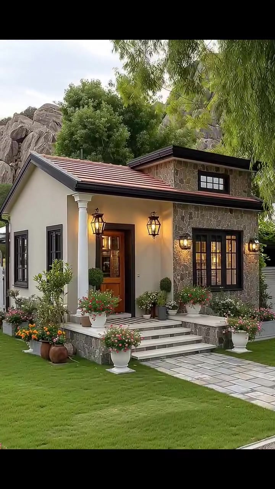
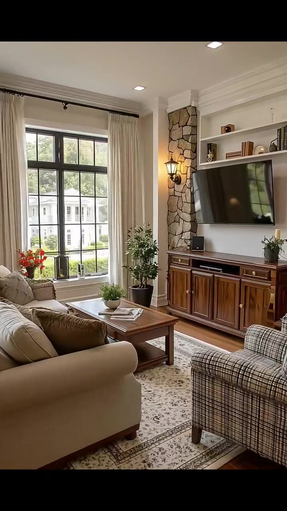
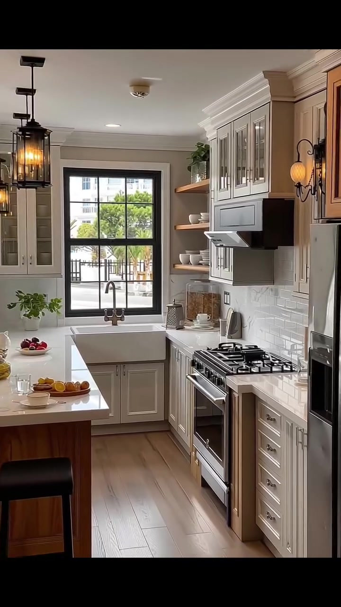
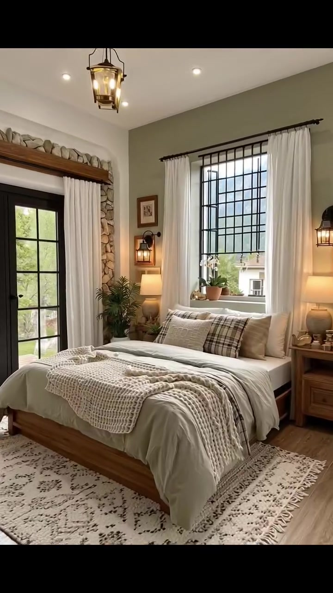
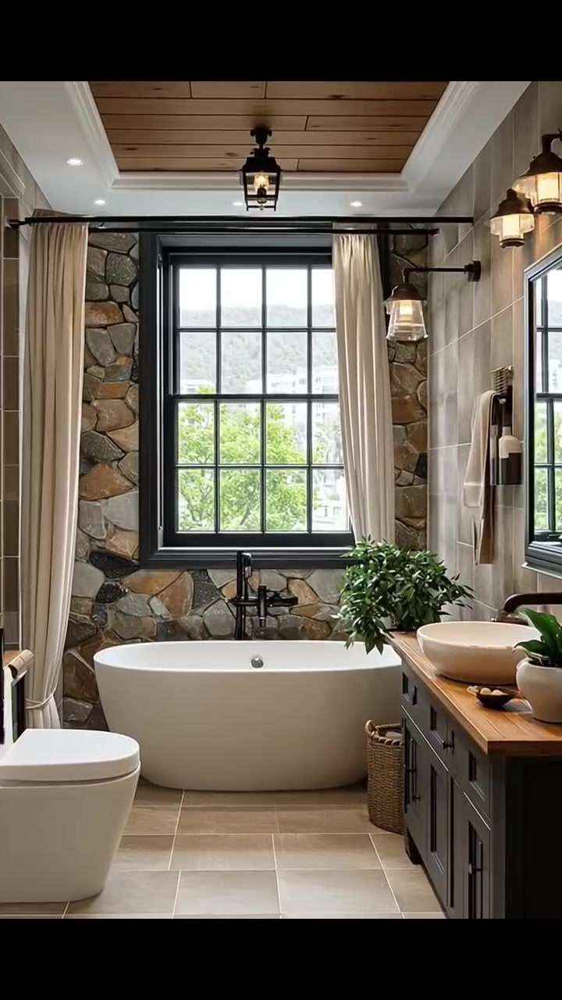

# edh011 — Modern Rustic Cottage

<!-- homeku_request_id: edh011-1aa84d7d1cf2acbe -->

<!-- homeku_detail_narratives: chat-reviewed -->

**Sumber data:** [analysis.yaml](analysis.yaml) · **Status:** draft · **Diverifikasi manusia:** Tidak

## 1. Informasi Video

| Informasi | Nilai |
|---|---|
| ID | edh011 |
| File asli | edh011.mp4 |
| Durasi | 17.53 |
| Resolusi | 720x1280 |
| FPS | 30 |
| Rasio | 9:16 |
| Jumlah shot | 5 |

## 2. Storyboard Gabungan

## 3. Identitas Desain

| Aspek | Hasil analisis |
|---|---|
| Gaya utama | modern rustic cottage |
| Wilayah terkait gaya desain | europe, north america |
| Pengaruh gaya | european country cottage, modern farmhouse, rustic country house |
| Ciri eksterior | cream stucco appearance walls, gray beige irregular stone cladding, terracotta red sloped tile roof, black framed multi pane windows, warm brown wood appearance front door, white columned recessed porch, light stone front steps, black amber glowing wall lanterns, raised roof section with small black window |
| Gaya interior | warm rustic transitional, modern farmhouse interior, natural wood furniture, stone feature walls, traditional cream cabinetry, neutral soft textiles, black metal accents |
| Confidence gaya | medium |

## 4. Ukuran & Proporsi Bangunan

| Aspek | Estimasi visual |
|---|---|
| Ukuran yang terlihat | small |
| Bentuk bangunan | compact rectangular with front gable projection |
| Skala vertikal | predominantly single story with raised roof section |
| Tapak bangunan | compact |
| Perkiraan luas lantai | 55–95 m² |
| Confidence | low |

> Luas adalah perkiraan visual, bukan ukuran terukur.

## 5. Warna, Pencahayaan, dan Atmosfer

| Warna dominan | HEX (perkiraan) |
|---|---|
| warm cream | #E7DDCB |
| stone gray beige | #918675 |
| terracotta red | #AD6751 |
| charcoal black | #292A28 |
| warm wood brown | #98643F |
| muted sage green | #919582 |
| garden green | #638452 |

| Aspek | Hasil analisis |
|---|---|
| Pencahayaan | soft exterior daylight, warm amber lantern lighting, natural daylight through large windows, warm interior practical lighting |
| Lingkungan | manicured front lawn, flowering planters by front steps, tall green trees and hanging branches, gray rock outcrops behind house, neighboring buildings visible through some windows |
| Musim yang tampak | Tidak diketahui |
| Mood | cozy, calm, warm, rustic elegant, inviting |

## 6. Struktur dan Timeline Video

**Jenis:** home tour · **Tempo:** slow · **Transisi:** hard cut between five continuous moving shots

| Shot | Waktu (detik) | Durasi | Area/Scene | Gerakan Kamera |
|---|---|---|---|---|
| Shot 01 | 0.0–5.0 | 5.00 | exterior front | dolly in, slight tracking right |
| Shot 02 | 5.0–8.5 | 3.50 | living room | dolly in, pan right |
| Shot 03 | 8.5–11.27 | 2.77 | kitchen | dolly out, pan left |
| Shot 04 | 11.27–14.5 | 3.23 | bedroom | dolly in, slight pan right |
| Shot 05 | 14.5–17.53 | 3.03 | bathroom | dolly in |

## 7. Analisis per Shot

### Shot 01 — exterior front

**Waktu:** 0.0–5.0 detik

| Komponen | Pengamatan |
|---|---|
| Fokus utama | front entry and stone clad cottage façade |
| Framing awal → akhir | wide front three quarter view → medium close front entry view |
| Sudut pandang | slightly low eye level front left |
| Gerakan kamera | dolly in, slight tracking right |
| Kecepatan kamera | slow |
| Pencahayaan | soft daylight with warm amber exterior lanterns |
| Transisi keluar | hard cut |

**Detail yang terlihat**

**Arsitektur**

Massa rumah tampak kompak, dengan atap pelana di kiri dan satu bagian atap kanan yang ditinggikan. Dinding kiri serta area masuk berpenampilan plester krem hangat, sedangkan dinding depan kanan dilapisi batu tidak beraturan bernuansa abu\-abu dan beige. Atap miring memakai genteng tampak merah terakota dengan lis dan talang arang gelap. Bagian atap yang ditinggikan berlapis batu dan memiliki tepi atas gelap serta jendela kecil horizontal bersekat hitam. Dua jendela sempit berbingkai hitam berada di sisi kiri, sementara jendela lebar bersekat hitam ada di fasad kanan. Pintu masuk menyerupai kayu cokelat dengan panel kaca dan bingkai gelap. Teras masuk dangkal dinaungi atap, ditopang satu kolom putih bundar di kiri, serta dihubungkan dengan beberapa anak tangga terang berlis abu\-abu. Alas dan tepi teras berlapis batu abu\-abu. Dua lentera hitam menyala hangat mengapit pintu, disertai lentera serupa di sisi jendela depan.

**Furnitur dan properti**

Tidak ada detail yang tercatat.

**Lingkungan**

Halaman depan berupa hamparan rumput hijau terpotong rapi dengan jalur paving abu\-abu berbentuk persegi panjang menuju anak tangga dari kanan bawah. Pot putih berbentuk urna berisi bunga merah muda, merah, dan putih mengapit area tangga; pot terakota dan bunga oranye terkumpul di sudut depan kiri. Semak bulat yang dipangkas rapi berada dalam pot dekat pintu, sedangkan bunga\-bunga kecil putih menghiasi dasar jendela kanan. Pagar putih berbilah horizontal tampak di batas samping. Di belakang dan sisi rumah tumbuh pepohonan hijau tinggi dan rapat, dengan daun\-daun hijau panjang menggantung dari kanan atas. Singkapan batu abu\-abu berukuran besar menjulang di balik pohon dan rumah, di bawah langit pucat yang berawan sebagian.

**Catatan pengamatan:** Kamera mendekati fasad dari kiri-depan; banyak detail teras menjadi lebih jelas menuju akhir. Batu, plester, dan genteng adalah identifikasi berdasarkan tampilan, bukan uji material.

**Confidence:** Kamera medium · Detail visual high

### Shot 02 — living room

**Waktu:** 5.0–8.5 detik

| Komponen | Pengamatan |
|---|---|
| Fokus utama | tv wall and wooden media console |
| Framing awal → akhir | wide living room with window and seating → medium view of tv feature wall and media console |
| Sudut pandang | eye level interior three quarter |
| Gerakan kamera | dolly in, pan right |
| Kecepatan kamera | slow |
| Pencahayaan | natural daylight through window with warm sconce and ceiling lights |
| Transisi keluar | hard cut |

**Detail yang terlihat**

**Arsitektur**

Ruang keluarga memiliki dinding putih gading hangat, lis plafon putih berprofil, dan lantai papan berpenampilan kayu cokelat hangat. Jendela besar bersekat hitam berada di dinding kiri dengan tirai panjang berwarna gading di kedua sisinya. Di sisi dinding televisi terdapat pilar vertikal berlapis batu abu\-abu dan beige tidak beraturan. Sebuah ceruk putih dengan dua rak pajangan dipasang di atas televisi. Plafon putih memuat lampu kecil tertanam, dan lentera dinding bercahaya hangat terpasang pada pilar batu.

**Furnitur dan properti**

Sofa kain krem dengan bantal cokelat\-tan berada di kiri menghadap televisi, sedangkan kursi berlengan berlapis kain kotak\-kotak hitam krem ada di kanan depan. Meja kopi kayu cokelat persegi panjang menempati tengah ruang, di atas karpet krem bermotif bunga dan tepian gelap. Televisi datar hitam besar dipasang dalam ceruk putih, dengan kabinet media kayu cokelat hangat berpintu panel di bawahnya. Rak atas berisi buku dan vas kecil. Di meja kopi terdapat tanaman berdaun kecil dan majalah terbuka; pohon kecil dalam pot berada di kiri kabinet. Perangkat kecil berbentuk kotak hitam diletakkan di atas kabinet, dan rangkaian bunga jingga\-merah terlihat dekat jendela kiri.

**Lingkungan**

Melalui jendela kiri terlihat pepohonan dan semak hijau di luar, serta bangunan pucat bertingkat dengan deretan jendela pada latar belakang.

**Catatan pengamatan:** Framing beralih dari komposisi sofa–kursi–jendela ke dinding televisi. Tidak tampak perapian; pilar batu adalah elemen aksen interior.

**Confidence:** Kamera medium · Detail visual high

### Shot 03 — kitchen

**Waktu:** 8.5–11.27 detik

| Komponen | Pengamatan |
|---|---|
| Fokus utama | cream cabinetry cooking range and farmhouse sink |
| Framing awal → akhir | medium close cooking range and upper cabinets → wide narrow kitchen with sink and peninsula |
| Sudut pandang | eye level interior toward rear window |
| Gerakan kamera | dolly out, pan left |
| Kecepatan kamera | slow |
| Pencahayaan | bright window daylight with warm pendant and wall lights |
| Transisi keluar | hard cut |

**Detail yang terlihat**

**Arsitektur**

Dapur tampak memanjang dan relatif sempit, dengan bidang kerja di dua sisi. Kabinet atas serta bawah bergaya panel Shaker berwarna krem dan memakai gagang logam; sejumlah kabinet atas memiliki pintu kaca. Backsplash dinding kanan memakai ubin putih mengilap bentuk persegi panjang yang tersusun seperti bata. Meja kerja tampak putih dengan urat abu\-abu tipis menyerupai marmer. Jendela hitam bersekat berada tepat di atas bak cuci putih berpanel depan terbuka, dengan keran logam gelap melengkung tinggi. Lantai berpola papan menyerupai kayu terang dan bagian atas dinding memakai lis putih. Dua rak terbuka berwarna kayu alami terletak di antara jendela dan kabinet atas.

**Furnitur dan properti**

Di sisi kanan terpasang kompor\-oven gas berpenampilan baja nirkarat dengan tungku hitam dan pengisap asap logam di atasnya; sebagian kulkas logam terlihat di ujung kanan. Meja semenanjung berbasis kayu dengan permukaan putih berada di depan kiri, dilengkapi satu bangku hitam tanpa sandaran. Di atas sisi kiri tergantung lampu\-lampu lentera logam hitam berkaca, sedangkan lampu dinding dengan kaca amber bersinar hangat ada di kanan. Rak terbuka menampung piring dan mangkuk putih serta tanaman hijau dalam pot di rak atas. Meja semenanjung berisi nampan buah, termasuk jeruk, sementara permukaan meja kiri memuat botol minyak, cangkir, dan tanaman bumbu kecil. Di meja kanan terlihat blok pisau kayu; di dekat bak cuci terdapat wadah bening dan talenan yang disandarkan.

**Lingkungan**

Melalui jendela belakang terlihat pepohonan berdaun hijau, pagar, dan sebagian bangunan tetangga berwarna pucat.

**Catatan pengamatan:** Shot membuka detail kompor dan kabinet kanan, lalu bidang pandang melebar ke bak cuci, meja semenanjung, dan jendela. Material meja hanya dipastikan berpenampilan marmer.

**Confidence:** Kamera medium · Detail visual high

### Shot 04 — bedroom

**Waktu:** 11.27–14.5 detik

| Komponen | Pengamatan |
|---|---|
| Fokus utama | wooden bed beneath large black grid window |
| Framing awal → akhir | wide bedroom with bed window and glazed door → close view of pillows bedding and window |
| Sudut pandang | eye level interior front three quarter |
| Gerakan kamera | dolly in, slight pan right |
| Kecepatan kamera | slow |
| Pencahayaan | soft daylight and warm bedside lamps and lanterns |
| Transisi keluar | hard cut |

**Detail yang terlihat**

**Arsitektur**

Dinding aksen di belakang tempat tidur berwarna hijau sage keabu\-abuan, dengan plafon putih, lis mahkota, serta lampu sorot tertanam. Jendela besar berkisi hitam terletak di tengah, di atas kepala tempat tidur dan diapit tirai krem panjang. Di sisi kiri ruangan terdapat pintu kaca ganda berbingkai hitam dengan keliling batu tak beraturan. Lantai berupa papan berpenampilan kayu terang. Lentera dinding hitam bernyala hangat berada di sisi area ranjang, dan satu lentera gantung hitam menggantung di dekat tengah plafon.

**Furnitur dan properti**

Ranjang panggung rendah berbahan tampak kayu hangat terletak di bawah jendela, dilapisi duvet abu\-abu kehijauan lembut dan seprai krem. Selimut rajut tebal berwarna krem dengan pola anyaman terbuka menjuntai di bagian kaki ranjang. Bantal dekoratif kotak\-kotak hitam krem tersusun bersama bantal tidur netral. Di bawah ranjang membentang karpet krem bermotif gelap dengan pinggiran berjumbai. Meja samping kayu kecil berada di kanan, dan lampu meja bertudung krem hangat terlihat di kedua sisi ranjang. Anggrek putih kecil dalam pot menempati ambang jendela, tanaman berdaun hijau ada di lantai sisi kiri, serta beberapa gambar berbingkai kecil menghiasi dinding samping jendela.

**Lingkungan**

Di luar pintu kaca kiri terlihat dedaunan hijau. Melalui jendela di atas ranjang tampak atap bangunan tetangga yang berwarna terang dan perbukitan berhutan di kejauhan.

**Catatan pengamatan:** Kamera bergerak mendekati tempat tidur dan jendela; close-up akhir memperlihatkan tekstur selimut serta bantal. Tidak ada ukuran pasti tempat tidur yang dapat diukur.

**Confidence:** Kamera medium · Detail visual high

### Shot 05 — bathroom

**Waktu:** 14.5–17.53 detik

| Komponen | Pengamatan |
|---|---|
| Fokus utama | white freestanding bathtub below large window |
| Framing awal → akhir | wide bathroom with bathtub toilet and vanity → close view of tub and back window |
| Sudut pandang | eye level interior facing bathtub |
| Gerakan kamera | dolly in |
| Kecepatan kamera | slow |
| Pencahayaan | cool soft daylight from back window with warm lantern accents |
| Transisi keluar | end of video |

**Detail yang terlihat**

**Arsitektur**

Dinding belakang kamar mandi ditutup batu tak beraturan dalam campuran warna abu\-abu dan cokelat muda. Dinding kanan memakai ubin persegi panjang besar abu\-abu taupe, sedangkan lantai berupa ubin persegi bernuansa beige. Jendela besar bersekat dengan bingkai hitam memenuhi tengah dinding belakang dan diapit tirai krem panjang. Plafon model tray memiliki bagian tengah berpenampilan papan kayu alami, dikelilingi lis putih dan lampu tertanam. Di kanan, kabinet wastafel bergaya Shaker berwarna arang gelap memakai top kayu hangat, dengan cermin besar berbingkai gelap di atasnya. Lentera gantung dan lampu dinding logam hitam berkaca bening menjadi aksen pencahayaan.

**Furnitur dan properti**

Bak mandi putih berdiri bebas berbentuk oval berada tepat di bawah jendela belakang, dengan keran mandi hitam di belakangnya. Kloset putih modern terlihat di sisi kiri depan. Pada top kabinet kanan terdapat wastafel mangkuk bundar putih dengan keran logam gelap, serta tanaman sukulen kecil dalam pot. Tanaman hijau berdaun rimbun ditempatkan di dekat tepi kanan bak mandi. Keranjang anyaman tinggi berdiri di lantai sebelah kabinet, dan handuk netral terang tergantung pada dinding kanan.

**Lingkungan**

Melalui jendela belakang tampak rimbun pepohonan hijau, sebagian bangunan bertingkat berwarna terang, dan kontur perbukitan hijau yang terlihat samar di atas pepohonan.

**Catatan pengamatan:** Gerakan mendekat mengurangi tampilan toilet dan vanity, menekankan jendela, bak mandi, dan dinding batu. Jenis batu dan lantai disimpulkan dari penampakan saja.

**Confidence:** Kamera medium · Detail visual high

## 8. Kualitas dan Ketidakpastian Analisis

| Parameter | Hasil |
|---|---|
| Status | draft |
| Verifikasi manusia | Tidak |
| Ketepatan timestamp | frame aligned estimate |
| Ketidakpastian | precise stucco stone wood and countertop materials not verified, building floor area estimated only from visible scale no floor plan, raised roof section does not prove usable upper story, camera translation vs digital zoom not distinguishable, visible hills and neighbor buildings do not establish actual location or season, architectural region association is stylistic not geographic |

**Catatan:** Pemeriksaan batas adegan dari 526 frame dan observasi berkala sepanjang tiap shot selama 17,53 detik pada 30 FPS. Batas hard cut: 5,00; 8,50; 11,27; 14,50 detik. Source MP4 chat cocok secara Git blob SHA dengan main/video/edh011.mp4. Semua detail material dan luas hanya interpretasi tampilan.

---

*Laporan ini diturunkan dari [analysis.yaml](analysis.yaml).*
