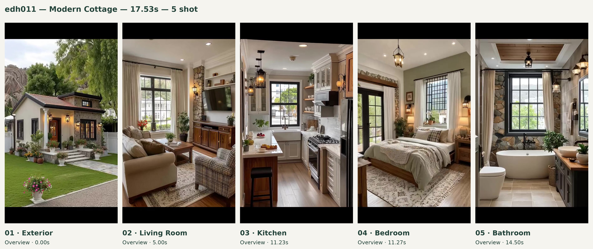
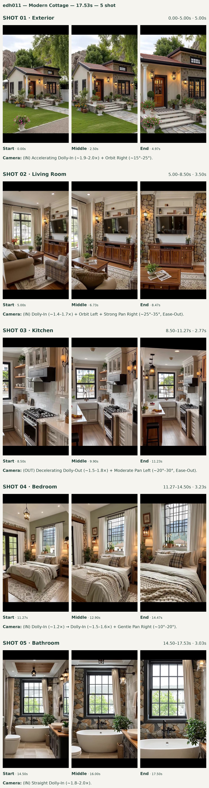
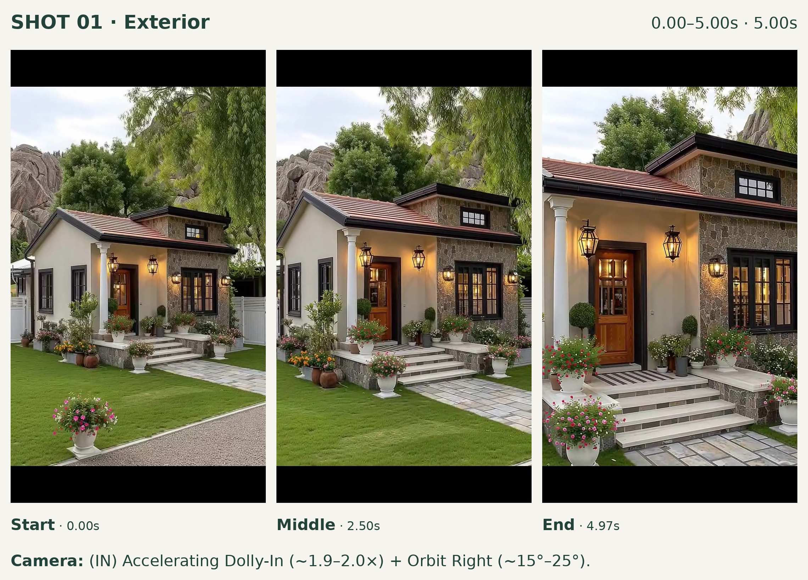
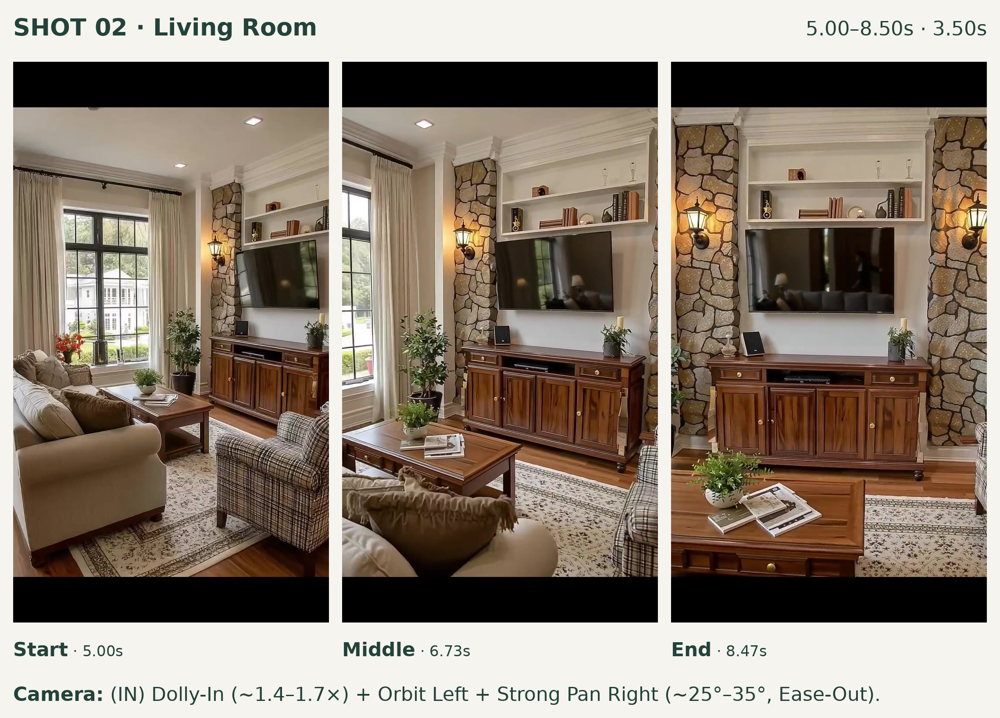
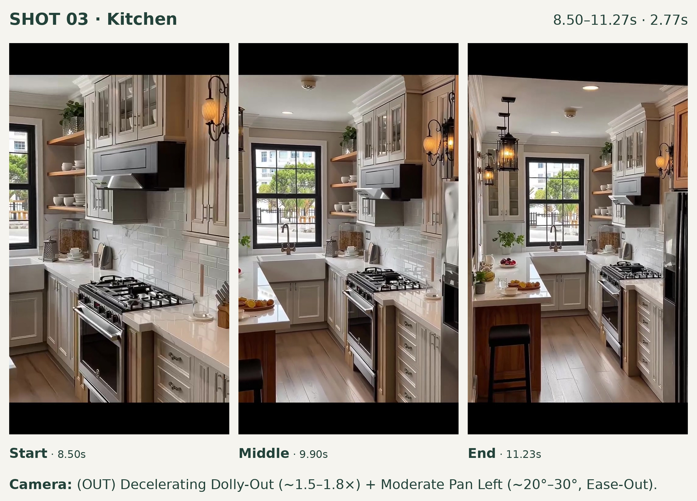
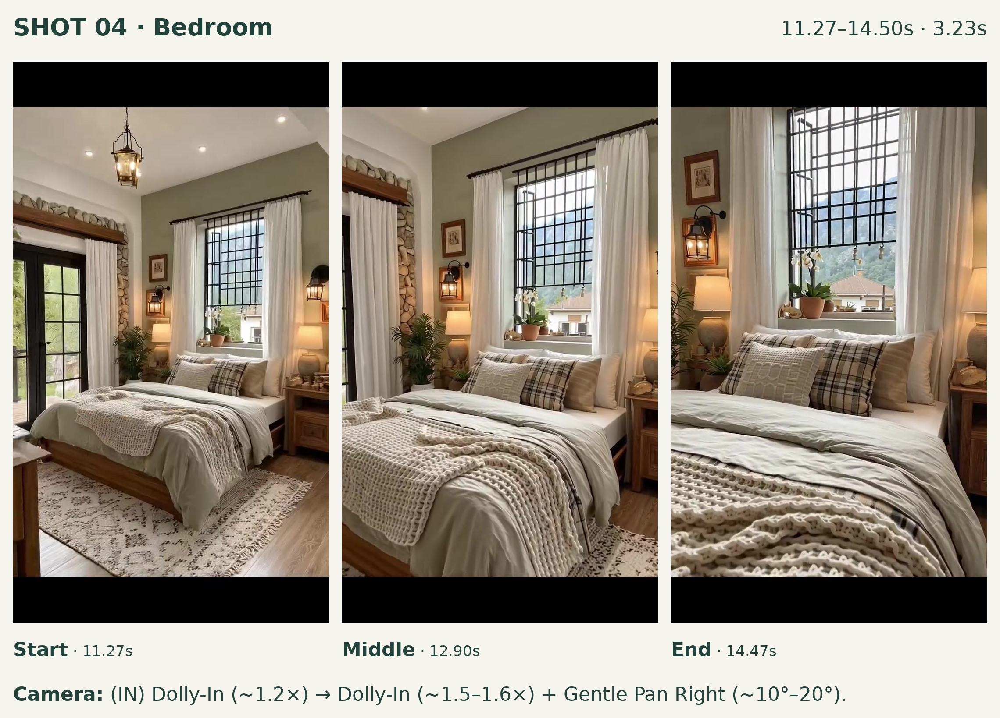
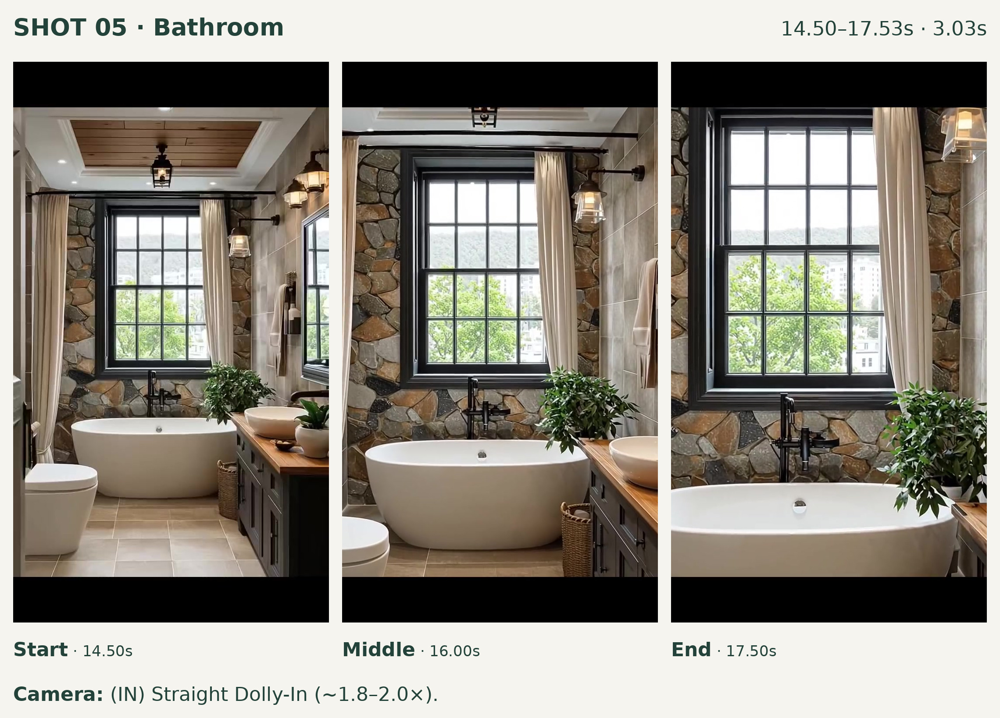

# edh011 — Warm Stone & Timber Cottage

## 1. Profil desain

- **Nama desain:** Warm Stone & Timber Cottage
- **Tipe rumah:** Cottage
- **Gaya utama:** **Modern Cottage**
- **Pengaruh gaya:** Rustic
- **Gaya interior:** Rustic Traditional
- **Susunan ruang utama:** Eksterior, ruang duduk, dapur, kamar tidur dan kamar mandi tampil sebagai lima shot terpisah; hubungan denah tidak diketahui.
- **Ciri khas:** Grid hitam berulang, tekstur batu kasar, kabinet kayu dan lampu hangat.
- **Material utama:** Bidang terang halus, aksen tampak batu tak beraturan dan kayu cokelat; material fisik tidak terverifikasi.
- **Pencahayaan:** Daylight melalui bukaan besar dan lampu dinding/gantung berwarna hangat.
- **Atmosfer:** Hangat, nyaman dan bernuansa pedesaan dengan aksen tradisional.
- **Lingkungan:** Rumput, jalan paving, pot dan pohon rindang; vegetasi terlihat lewat jendela.

### Palet warna

| Peran | Warna | HEX |
| --- | --- | --- |
| Dominan | Warm Ivory | `#E4DDD0` |
| Pendamping | Warm Taupe | `#ADA394` |
| Pendamping | Timber Brown | `#805432` |
| Pendamping | Stone Gray Beige | `#9B8B76` |
| Aksen | Charcoal Black | `#292B29` |
| Aksen | Garden Green | `#59763C` |

## 2. Ukuran & proporsi

| Aspek | Estimasi visual |
| --- | --- |
| **Ukuran rumah** | small |
| **Bentuk bangunan** | Massa rendah dengan volume atap bertingkat. |
| **Lantai & bentuk atap** | Satu lantai utama tampak; bagian atap tinggi tidak membuktikan lantai tambahan. · Atap miring cokelat kemerahan dan volume atas kecil dengan bukaan grid. |
| **Tapak bangunan** | Massa rendah relatif kompak; denah keseluruhan tidak terlihat. |
| **Proporsi utama** | Lebar fasad melebihi tinggi dinding; teras dan undakan mengangkat lantai masuk. |
| **Perkiraan luas lantai** | **55–95 m²** |

## 3. Shot Timeline

Durasi 17.53s · 5 shot.

**Camera Pattern:** IN – IN – OUT – IN – IN.

| Shot | Time (s) | Duration | Area/Scene | Camera Movement |
| --- | --- | --- | --- | --- |
| 01 | 0.00–5.00 | 5.00s | Exterior | Accelerating Dolly-In (~1.9–2.0×) + Orbit Right (~15°–25°). |
| 02 | 5.00–8.50 | 3.50s | Living Room | Dolly-In (~1.4–1.7×) + Orbit Left + Strong Pan Right (~25°–35°, Ease-Out). |
| 03 | 8.50–11.27 | 2.77s | Kitchen | Decelerating Dolly-Out (~1.5–1.8×) + Moderate Pan Left (~20°–30°, Ease-Out). |
| 04 | 11.27–14.50 | 3.23s | Bedroom | Dolly-In (~1.2×) → Dolly-In (~1.5–1.6×) + Gentle Pan Right (~10°–20°). |
| 05 | 14.50–17.53 | 3.03s | Bathroom | Straight Dolly-In (~1.8–2.0×). |

## 4. Overview

**Shot 01 · Exterior · 0.00s**

> Wide serong dari halaman, seluruh teras dan sebagian sisi kiri terlihat.

**Shot 02 · Living Room · 5.00s**

> Wide serong memperlihatkan sofa, meja, jendela dan TV.

**Shot 03 · Kitchen · 11.23s**

> Wide menyusuri lorong, meja kiri serta jendela belakang.

**Shot 04 · Bedroom · 11.27s**

> Wide memperlihatkan ranjang hampir utuh dan pintu kaca kiri.

**Shot 05 · Bathroom · 14.50s**

> Wide menampilkan toilet, vanity, bathtub dan jendela.

## 5. Storyboard

## 6. Shot Details

### Shot 01 · Exterior

**Time:** 0.00–5.00s · **Duration:** 5.00s

#### **A. Desain area**

**Arsitektur**

> Massa rendah dengan atap miring kemerahan, volume atas kecil berjendela grid, fasad terang dengan aksen batu, kolom teras, pintu kayu berkaca, serta undakan lebar.

**Furnitur & dekorasi**

> Pot tanaman mengapit akses, lampu lentera hangat pada dinding teras.

**Lingkungan**

> Halaman rumput, paving menuju tangga, pepohonan rindang di latar.

#### **B. Framing & Lighting**

- **Fokus:** Fasad dan pintu utama.
- **Camera Start:** Di halaman depan sebelah kiri jalur masuk. · Ke arah pintu dan fasad depan. · oblique · Sekitar tinggi pandangan manusia; tanpa skala pasti. · Hampir horizontal.
- **Framing:** Wide serong dari halaman, seluruh teras dan sebagian sisi kiri terlihat. → Frontal lebih dekat pada pintu dan tangga.
- **Lighting:** Daylight lembut dan lampu dinding hangat.
- **Foreground dan kedalaman:** Rumput, paving dan pot bunga. · Pot dan tangga di depan; teras dan pepohonan di belakang.
- **Reveal:** Massa rumah, atap, teras, tangga dan halaman.
- **Kesesuaian gerak:** Dolly-In dan Orbit Right mengurangi halaman foreground dan memperjelas fasad.

#### **C. Camera Movement**

Kamera mendekati pintu dan teras dari halaman serong kiri, dengan lintasan bergeser ke kanan dan tampilan fasad makin frontal.

**Tempo:** Awal lambat, pembesaran dan pergeseran meningkat bertahap terutama setelah sekitar F60; sedang secara keseluruhan.

**Camera:** Accelerating Dolly-In (~1.9–2.0×) + Orbit Right (~15°–25°).

---

### Shot 02 · Living Room

**Time:** 5.00–8.50s · **Duration:** 3.50s

#### **A. Desain area**

**Arsitektur**

> Jendela tinggi bergrid gelap dengan gorden terang, bidang TV ceruk terang diapit tekstur batu dan plafon berlis profil. Susunan duduk menghadap media wall.

**Furnitur & dekorasi**

> Sofa beige, kursi berpola, meja kopi kayu persegi panjang, karpet motif, TV dinding, kabinet media kayu dan rak display; lampu dinding pada sisi batu.

**Lingkungan**

> Vegetasi tampak melalui jendela; koneksi ke area lain tidak ditunjukkan.

#### **B. Framing & Lighting**

- **Fokus:** Media wall dan meja.
- **Camera Start:** Di tepi kelompok duduk, dekat sofa. · Serong menuju jendela dan dinding TV. · oblique · Sekitar tinggi mata. · Hampir mendatar.
- **Framing:** Wide serong memperlihatkan sofa, meja, jendela dan TV. → TV dan kabinet kayu lebih frontal dengan meja di bawah.
- **Lighting:** Daylight dari jendela kiri, lampu dinding dan downlight.
- **Foreground dan kedalaman:** Sandaran sofa dan kursi. · Furnitur depan, meja tengah, kabinet TV dan jendela di belakang.
- **Reveal:** Dinding TV dan susunan tempat duduk.
- **Kesesuaian gerak:** Dolly-In serta sapuan kanan membawa TV ke tengah.

#### **C. Camera Movement**

Kamera maju sambil menyapu dari jendela dan sofa menuju TV, dengan perubahan posisi relatif terhadap meja dan dinding TV.

**Tempo:** Sedang, sapuan kanan cukup nyata dan relatif berkelanjutan; laju pendekatan/sapuan sedikit mereda pada akhir.

**Camera:** Dolly-In (~1.4–1.7×) + Orbit Left + Strong Pan Right (~25°–35°, Ease-Out).

---

### Shot 03 · Kitchen

**Time:** 8.50–11.27s · **Duration:** 2.77s

#### **A. Desain area**

**Arsitektur**

> Kabinet di sisi kanan dan ujung ruang, jendela grid gelap, backsplash terang dan lantai tampak papan kayu. Lorong di antara meja kiri dan kabinet kanan.

**Furnitur & dekorasi**

> Kompor dengan oven dan hood gelap, kabinet panel terang sebagian berkaca, rak terbuka, meja kiri dengan bangku dan lampu gantung. Hubungan meja ke kabinet di luar bingkai, tipe island/peninsula tidak dipastikan.

**Lingkungan**

> Pepohonan terlihat melalui jendela ujung; area luar tidak teridentifikasi.

#### **B. Framing & Lighting**

- **Fokus:** Kompor kemudian ruang kerja dapur.
- **Camera Start:** Dekat sisi kompor dan kabinet kanan lorong. · Serong menuju kompor dan ujung dapur. · oblique · Sekitar tinggi mata. · Hampir horizontal.
- **Framing:** Medium wide menonjolkan kompor dan kabinet kanan. → Wide menyusuri lorong, meja kiri serta jendela belakang.
- **Lighting:** Daylight dari jendela belakang, lampu gantung dan lampu hangat.
- **Foreground dan kedalaman:** Kompor dan tepi meja. · Kabinet kanan, meja kiri, jendela di ujung lorong.
- **Reveal:** Lebar lorong dan meja kiri muncul.
- **Kesesuaian gerak:** Dolly-Out dan Pan Left membuka cakupan meja kiri dan lorong.

#### **C. Camera Movement**

Kamera mundur dari kompor dan mengarahkan pandangan ke kiri menuju sumbu lorong dapur sehingga island dan lampu gantung terbuka.

**Tempo:** Sedang, mundur cukup cepat di awal lalu melandai; sapuan kiri paling jelas saat island mulai masuk.

**Camera:** Decelerating Dolly-Out (~1.5–1.8×) + Moderate Pan Left (~20°–30°, Ease-Out).

---

### Shot 04 · Bedroom

**Time:** 11.27–14.50s · **Duration:** 3.23s

#### **A. Desain area**

**Arsitektur**

> Jendela grid tinggi di belakang ranjang, pintu kaca gelap di kiri dengan trim tampak batu, dinding muted gray-green dan plafon terang.

**Furnitur & dekorasi**

> Ranjang kayu dengan bedding berlapis warna ivory dan motif, meja serta lampu samping, karpet bermotif, lampu gantung dan bingkai dekorasi.

**Lingkungan**

> Cahaya siang dan vegetasi terlihat melalui bukaan; tidak membuktikan akses ke teras depan.

#### **B. Framing & Lighting**

- **Fokus:** Ranjang dan jendela.
- **Camera Start:** Dekat kaki ranjang, agak ke kiri. · Ke arah kepala ranjang dan bukaan. · oblique · Sekitar tinggi mata. · Hampir mendatar.
- **Framing:** Wide memperlihatkan ranjang hampir utuh dan pintu kaca kiri. → Framing lebih dekat, kepala ranjang dan jendela dominan.
- **Lighting:** Daylight melalui bukaan, lampu meja dan lampu plafon hangat.
- **Foreground dan kedalaman:** Kaki ranjang dan karpet. · Ranjang di tengah, meja samping dan jendela di belakang.
- **Reveal:** Detail kepala ranjang, tekstil dan jendela.
- **Kesesuaian gerak:** Pendekatan awal lalu Dolly-In dengan Pan Right mempersempit fokus.

#### **C. Camera Movement**

Kamera maju menuju ranjang, kemudian makin menyapu ke kanan ke kepala ranjang dan jendela.

**Tempo:** Sedang, pendekatan berkelanjutan; sapuan kanan makin terlihat setelah sekitar 12.3 detik dan sedikit mereda di akhir.

**Movement Timeline**

| Time (s) | Area & fokus | Camera Movement | Tempo |
| --- | --- | --- | --- |
| 11.27–12.30 | Bedroom · Ranjang dan jendela | Dolly-In (~1.2×) | Sedang, pendekatan berkelanjutan; sapuan kanan makin terlihat setelah sekitar 12.3 detik dan sedikit mereda di akhir. |
| 12.30–14.50 | Bedroom · Kepala ranjang dan jendela | Dolly-In (~1.5–1.6×) + Gentle Pan Right (~10°–20°) | Sedang, pendekatan berkelanjutan; sapuan kanan makin terlihat setelah sekitar 12.3 detik dan sedikit mereda di akhir. |

**Camera:** Dolly-In (~1.2×) → Dolly-In (~1.5–1.6×) + Gentle Pan Right (~10°–20°).

---

### Shot 05 · Bathroom

**Time:** 14.50–17.53s · **Duration:** 3.03s

#### **A. Desain area**

**Arsitektur**

> Dinding aksen tampak batu tak beraturan, jendela grid gelap besar, plafon inset bernuansa kayu dan jalur tengah menuju bathtub.

**Furnitur & dekorasi**

> Bathtub oval freestanding putih, toilet kiri, vanity gelap panel dengan countertop bernuansa kayu dan vessel sink, cermin, tanaman pot dan lampu hangat.

**Lingkungan**

> Vegetasi terlihat melalui jendela; kondisi privasi di luar bingkai belum diketahui.

#### **B. Framing & Lighting**

- **Fokus:** Bathtub dan bukaan.
- **Camera Start:** Di ujung jalur masuk kamar mandi. · Lurus menuju bathtub dan jendela. · frontal · Sekitar tinggi mata. · Hampir mendatar.
- **Framing:** Wide menampilkan toilet, vanity, bathtub dan jendela. → Close framing bathtub dan jendela dengan tepi vanity.
- **Lighting:** Daylight dari jendela, lentera hangat dan lampu sisi.
- **Foreground dan kedalaman:** Toilet kiri dan vanity kanan. · Jalur tengah menuju bathtub dengan jendela di belakang.
- **Reveal:** Bathtub dan tekstur batu pada dinding.
- **Kesesuaian gerak:** Straight Dolly-In mempertahankan sumbu menuju jendela.

#### **C. Camera Movement**

Kamera maju hampir lurus dan terpusat menuju bathtub dan jendela.

**Tempo:** Sedang, maju mulus dan relatif stabil; pembesaran tampak makin cepat menjelang akhir akibat kedekatan.

**Camera:** Straight Dolly-In (~1.8–2.0×).
