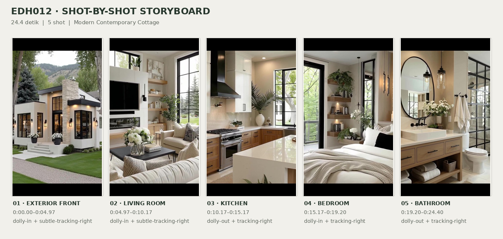
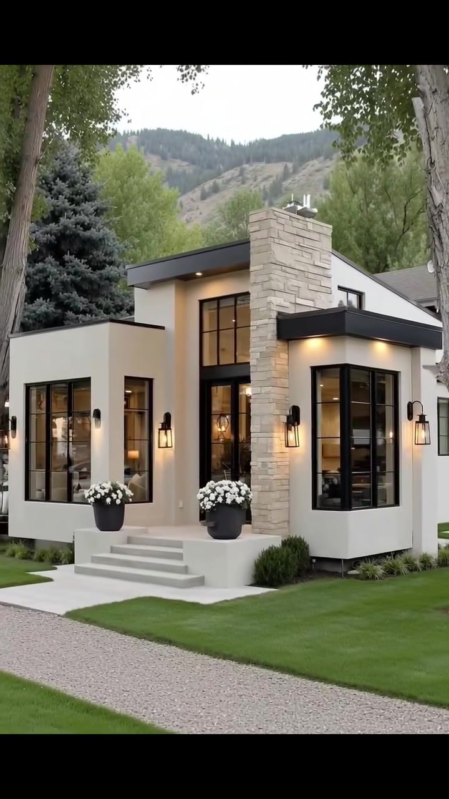
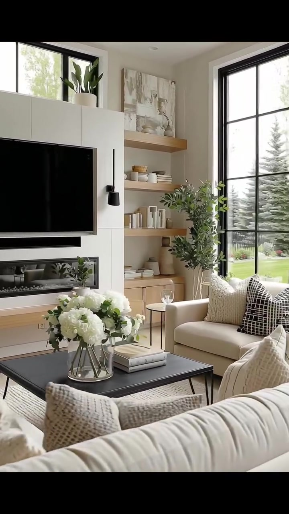
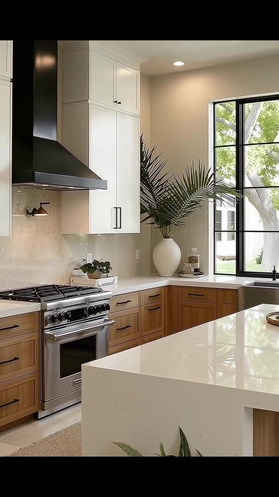
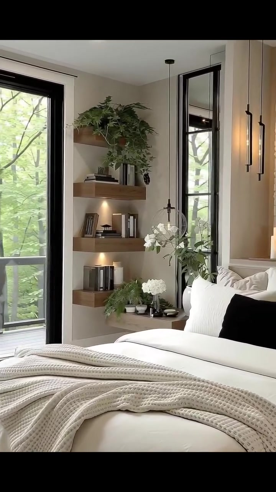
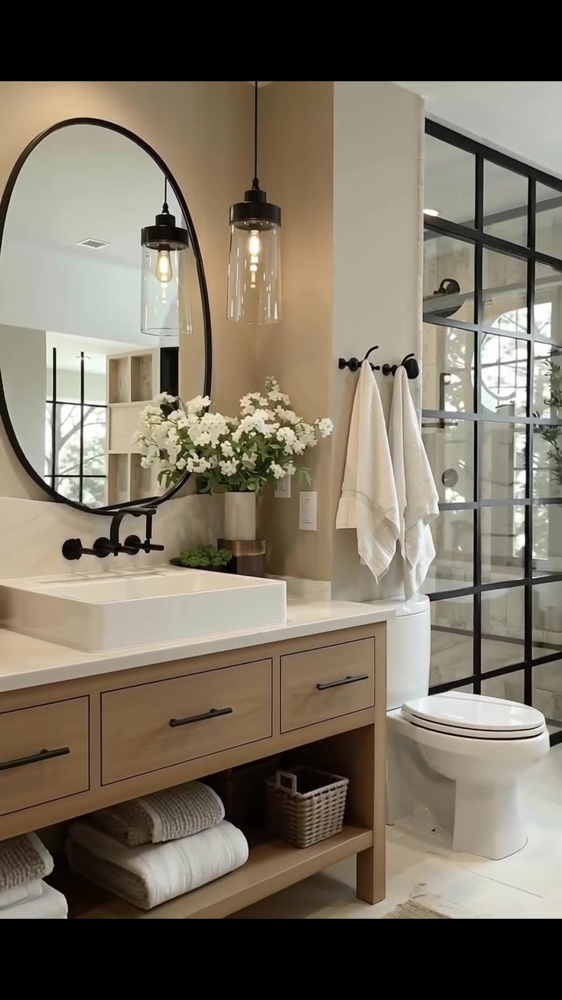

# edh012 — Modern Contemporary Cottage

<!-- homeku_request_id: edh012-20261104-001 -->

<!-- homeku_detail_narratives: chat-reviewed -->

**Sumber data:** [analysis.yaml](analysis.yaml) · **Status:** draft · **Diverifikasi manusia:** Tidak

## 1. Informasi Video

| Informasi | Nilai |
|---|---|
| ID | edh012 |
| File asli | edh012.mp4 |
| Durasi | 24.4 |
| Resolusi | 720x1280 |
| FPS | 30 |
| Rasio | 9:16 |
| Jumlah shot | 5 |

## 2. Storyboard Gabungan

## 3. Identitas Desain

| Aspek | Hasil analisis |
|---|---|
| Gaya utama | modern contemporary cottage |
| Wilayah terkait gaya desain | north america, europe |
| Pengaruh gaya | modern farmhouse, mountain contemporary |
| Ciri eksterior | off white smooth wall finish, prominent pale stone chimney, mixed low pitch roofline, large black grid windows, warm lantern sconces, raised entry platform and steps |
| Gaya interior | warm modern farmhouse, contemporary neutral interior, natural wood accents, black metal details |
| Confidence gaya | medium |

## 4. Ukuran & Proporsi Bangunan

| Aspek | Estimasi visual |
|---|---|
| Ukuran yang terlihat | medium |
| Bentuk bangunan | asymmetric multi volume |
| Skala vertikal | mostly single story with tall central volume |
| Tapak bangunan | moderate |
| Perkiraan luas lantai | 90–160 m² |
| Confidence | low |

> Luas adalah perkiraan visual, bukan ukuran terukur.

## 5. Warna, Pencahayaan, dan Atmosfer

| Warna dominan | HEX (perkiraan) |
|---|---|
| warm off white | #E6E1D8 |
| sand beige | #C7B9A6 |
| natural oak brown | #AA7A4D |
| matte black | #252525 |
| pale stone gray | #B2ADA5 |
| garden green | #547D50 |

| Aspek | Hasil analisis |
|---|---|
| Pencahayaan | diffused daylight, warm exterior sconces, warm interior downlights and pendants |
| Lingkungan | landscaped green lawn, gravel foreground path, mature trees, wooded hillside background, neighboring residential structure |
| Musim yang tampak | Tidak diketahui |
| Mood | warm, calm, airy, upscale, cozy |

## 6. Struktur dan Timeline Video

**Jenis:** exterior to interior home tour · **Tempo:** slow · **Transisi:** straight cuts between continuous smooth camera shots

| Shot | Waktu (detik) | Durasi | Area/Scene | Gerakan Kamera |
|---|---|---|---|---|
| Shot 01 | 0.0–4.97 | 4.97 | exterior front | dolly in, subtle tracking right |
| Shot 02 | 4.97–10.17 | 5.20 | living room | dolly in, subtle tracking right |
| Shot 03 | 10.17–15.17 | 5.00 | kitchen | dolly out, tracking right |
| Shot 04 | 15.17–19.2 | 4.03 | bedroom | dolly in, tracking right |
| Shot 05 | 19.2–24.4 | 5.20 | bathroom | dolly out, tracking right |

## 7. Analisis per Shot

### Shot 01 — exterior front

**Waktu:** 0.0–4.97 detik

| Komponen | Pengamatan |
|---|---|
| Fokus utama | front facade and stone chimney |
| Framing awal → akhir | wide front three quarter view → closer front three quarter view |
| Sudut pandang | eye level oblique front |
| Gerakan kamera | dolly in, subtle tracking right |
| Kecepatan kamera | slow smooth |
| Pencahayaan | soft outdoor daylight with warm exterior and interior lamps |
| Transisi keluar | straight cut |

**Detail yang terlihat**

**Arsitektur**

Fasad terdiri atas beberapa massa asimetris dengan kombinasi bidang atap landai, termasuk bagian yang tampak hampir datar. Dinding luar berfinishing halus putih hangat, dipadukan dengan cerobong batu susun berwarna abu\-abu muda yang tinggi di dekat bagian tengah depan. Tepi atap dan kanopi yang menonjol berwarna hitam. Area pintu masuk yang masuk ke dalam memiliki kaca tinggi berkisi hitam, sementara jendela besar berkisi hitam juga tampak pada sudut dan sisi fasad. Akses masuk dinaikkan di atas pelataran beton pucat dengan tangga pendek. Lampu dinding bergaya lentera hitam mengapit bukaan depan, dan lampu tanam bernuansa hangat berada di bawah tepi atap yang menjorok. Pada kaki fasad terlihat semak rendah dan rumpun tanaman hias.

**Furnitur dan properti**

Di kedua sisi tangga masuk terdapat pot hitam besar berisi gugusan bunga putih. Dari balik kaca pintu masuk terlihat lampu gantung interior yang menyala hangat.

**Lingkungan**

Batang pohon\-pohon besar berkulit abu\-abu membingkai rumah dari area depan dan sisi kanan. Halaman depan ditutup rumput hijau yang terawat, dengan jalur kerikil krem muda melintang serong pada bagian depan bawah gambar. Sebatang konifer rapat berwarna hijau kebiruan gelap berada di belakang sisi kiri rumah, sedangkan pohon berdaun hijau terang mengelilingi dan melatarinya. Lereng perbukitan berhutan terlihat di kejauhan di atas garis atap. Pada sisi kanan juga terlihat sebagian rumah tetangga berwarna pucat dengan atap miring.

**Catatan pengamatan:** Pada awal shot, pohon besar membingkai rumah; gerakan mendekat membuat teras, jendela hitam dan chimney semakin dominan.

**Confidence:** Kamera medium · Detail visual high

### Shot 02 — living room

**Waktu:** 4.97–10.17 detik

| Komponen | Pengamatan |
|---|---|
| Fokus utama | living room media wall and seating group |
| Framing awal → akhir | wide living area view → closer media wall and sofa detail |
| Sudut pandang | eye level interior three quarter |
| Gerakan kamera | dolly in, subtle tracking right |
| Kecepatan kamera | slow smooth |
| Pencahayaan | abundant soft window daylight with subtle warm interior accents |
| Transisi keluar | straight cut |

**Detail yang terlihat**

**Arsitektur**

Dinding media berpanel putih menampung televisi layar datar hitam berukuran besar, dengan perapian kaca horizontal yang panjang dan sempit di bawahnya serta ambalan kayu terang memanjang di bagian bawah. Di sisi kanan dinding media terpasang tiga rak display kayu mengambang pada dinding krem hangat. Sebuah jendela besar berbingkai hitam dan berkisi tinggi hampir dari lantai sampai plafon berada di sebelah kanan. Plafon putih memiliki bidang bertingkat dangkal serta lampu tanam kecil, sementara lantai tampak berfinishing kayu terang.

**Furnitur dan properti**

Sofa kain krem di bagian depan menghadap dinding televisi, dengan sofa krem lainnya berada dekat jendela besar. Di antara keduanya ada meja kopi hitam rendah berbentuk persegi panjang, yang memuat vas kaca dengan buket bunga putih dan tumpukan buku berwarna pucat. Beberapa bantal dekoratif krem bertekstur berada di sofa, termasuk bantal berpola kotak hitam\-putih pada sofa dekat jendela. Karpet luas bertekstur krem muda mengisi area di bawah meja. Pohon hias dalam pot terletak di antara rak dan jendela. Rak\-rak kayu berisi buku, keramik putih, dan pot\-pot kecil, sementara lukisan abstrak bernuansa netral ada di atas rak tertinggi.

**Lingkungan**

Melalui jendela kanan terlihat hamparan rumput hijau, sejumlah pohon konifer tinggi berwarna hijau kebiruan, pagar logam hitam di belakang area rumput, dan tanaman perbatasan rendah yang sedang berbunga dekat pagar.

**Catatan pengamatan:** Shot bergerak semakin dekat ke dinding TV, rak dekoratif, sofa, dan bantal; area luar pada jendela kanan menjadi lebih sempit.

**Confidence:** Kamera medium · Detail visual high

### Shot 03 — kitchen

**Waktu:** 10.17–15.17 detik

| Komponen | Pengamatan |
|---|---|
| Fokus utama | two tone kitchen and white island |
| Framing awal → akhir | tight range and cabinet view → wider kitchen island and window view |
| Sudut pandang | eye level interior three quarter |
| Gerakan kamera | dolly out, tracking right |
| Kecepatan kamera | slow smooth |
| Pencahayaan | natural daylight through sink window with warm ceiling and task lighting |
| Transisi keluar | straight cut |

**Detail yang terlihat**

**Arsitektur**

Dapur memakai kabinet atas putih berpola panel shaker dengan gagang hitam, sedangkan kabinet bawah menggunakan tampilan kayu cokelat hangat dengan pola panel dan gagang serupa. Backsplash di area kompor tampak seperti batu berwarna beige muda; countertop pucat membentuk sudut L. Island besar berwarna putih cerah dengan tepi waterfall mendominasi depan frame. Kompor gas berwarna baja tahan karat berada di bawah cooker hood hitam bersudut. Pada bagian belakang terdapat jendela besar berkisi hitam di atas sink, lengkap dengan keran hitam berleher tinggi melengkung. Plafon putih dilengkapi lampu tanam bulat, dan sebagian lantai dekat island tampak menggunakan ubin persegi berwarna pucat.

**Furnitur dan properti**

Di sudut countertop terdapat vas bulat putih gading besar berisi pelepah hijau yang menyerupai palem. Pot tanaman hijau kecil diletakkan di meja sebelah kompor. Keset memanjang anyaman berwarna tan alami ada di depan kabinet bawah. Di atas island terlihat baki kayu bundar rendah dengan sejumlah dekorasi. Pada ujung kanan island tampak sebagian bangku tinggi berwarna gelap, dan di area lantai bagian depan island ada tanaman berdaun rimbun dalam pot.

**Lingkungan**

Melalui jendela dapur tampak batang besar serta daun hijau sebuah pohon, juga sebagian dinding bangunan luar berwarna pucat.

**Catatan pengamatan:** Framing berubah dari close detail cooker dan kabinet ke pandangan lebih luas, memperlihatkan island, area sink, lantai, serta stool pada kanan.

**Confidence:** Kamera medium · Detail visual high

### Shot 04 — bedroom

**Waktu:** 15.17–19.2 detik

| Komponen | Pengamatan |
|---|---|
| Fokus utama | white bed and natural wood bedside display |
| Framing awal → akhir | medium wide bed and balcony door view → closer headboard and bedside niche detail |
| Sudut pandang | eye level slightly oblique interior |
| Gerakan kamera | dolly in, tracking right |
| Kecepatan kamera | slow smooth |
| Pencahayaan | soft green filtered daylight with warm pendants and shelf lights |
| Transisi keluar | straight cut |

**Detail yang terlihat**

**Arsitektur**

Dinding kamar tidur memiliki finishing taupe hangat. Di sebelah kiri terdapat pintu kaca tinggi berbingkai hitam menuju balkon, dan jendela tinggi ramping berbingkai hitam berada dekat sisi kanan tempat tidur. Niche samping ranjang dilengkapi beberapa rak kayu melayang dengan pencahayaan aksen hangat di bawah rak. Pada sisi kanan kepala ranjang ada bidang dinding berpenampilan batu pucat bertekstur kasar dengan cermin bundar besar berbingkai hitam. Plafon putih memakai lampu tanam, sementara dua lampu gantung vertikal ramping berwarna hitam berada di dekat sisi ranjang.

**Furnitur dan properti**

Tempat tidur besar berlapis kain bernuansa krem dan putih mendominasi foreground. Bantal putih bertumpuk mengapit satu bantal aksen hitam memanjang, sedangkan selimut rajut krem tebal tersampir di ujung ranjang. Tanaman pot berdaun menjuntai mengisi rak atas, dengan buku serta vas dekoratif kecil di rak\-rak lainnya. Bagian rak bawah juga memuat rangkaian bunga putih dan pot tanaman hijau kecil. Tiga lilin pilar berwarna krem ditempatkan pada ambalan dinding sebelah kanan.

**Lingkungan**

Di balik pintu kaca balkon sebelah kiri terlihat kanopi pohon gugur berdaun hijau rapat dan garis pagar balkon horizontal berwarna gelap.

**Catatan pengamatan:** Gerak mendekat dan bergeser ke kanan mengurangi porsi pintu balkon, sementara area kepala ranjang, rak, lampu, serta cermin batu tampak lebih dekat.

**Confidence:** Kamera medium · Detail visual high

### Shot 05 — bathroom

**Waktu:** 19.2–24.4 detik

| Komponen | Pengamatan |
|---|---|
| Fokus utama | bathroom vanity glass shower and freestanding tub |
| Framing awal → akhir | tight vanity towel and shower partition detail → wider full bathroom with tub view |
| Sudut pandang | eye level interior oblique |
| Gerakan kamera | dolly out, tracking right |
| Kecepatan kamera | slow smooth |
| Pencahayaan | soft window daylight with warm glass pendant and ceiling lights |
| Transisi keluar | video end |

**Detail yang terlihat**

**Arsitektur**

Kamar mandi memiliki dinding bernuansa beige hangat dan kabinet wastafel lebar berpenampilan kayu terang dengan rak bawah terbuka. Countertop putih cerah menyangga wastafel vessel persegi panjang berwarna putih. Di atasnya terdapat cermin dinding bundar besar berbingkai hitam dan keran hitam yang terpasang pada dinding. Lampu gantung silinder kaca bening dengan fitting hitam menerangi area cermin. Di sebelah kanan toilet terdapat sekat shower kaca berkisi logam hitam. Lantai menggunakan ubin besar berpenampilan batu pucat, dan di dekat bathtub terdapat jendela besar berkisi hitam.

**Furnitur dan properti**

Toilet putih berada di sisi kanan kabinet wastafel. Dua handuk mandi putih digantung pada kait\-kait hitam di dinding atas toilet. Di atas countertop terdapat vas bunga putih. Rak terbuka bawah kabinet menyimpan handuk lipat putih dan taupe serta sebuah keranjang anyaman kecil. Pada bagian kanan jauh tampak bathtub putih freestanding berbentuk oval di bawah jendela. Sebuah tanaman berdaun rimbun dalam pot putih berdiri di antara shower dan bathtub, sedangkan dua karpet persegi panjang serat alami menutupi sebagian lantai pucat.

**Lingkungan**

Melalui jendela di sisi bathtub terlihat cabang\-cabang pohon di luar dan cahaya siang yang masuk.

**Catatan pengamatan:** Awal shot fokus dekat wastafel, gantungan handuk, toilet, dan kaca shower; framing berangsur melebar dan bergeser kanan sehingga bathtub dan jendela tampak jelas.

**Confidence:** Kamera medium · Detail visual high

## 8. Kualitas dan Ketidakpastian Analisis

| Parameter | Hasil |
|---|---|
| Status | draft |
| Verifikasi manusia | Tidak |
| Ketepatan timestamp | estimated |
| Ketidakpastian | building floor area is visual estimate without measured scale, stone and wood materials described by appearance not confirmed composition, roof structure and upper level usage not fully visible, precise dolly vs digital reframe camera method cannot be verified, common regions describe style association not actual property location, season and geographic location are not verifiable from foliage |

**Catatan:** Analisis visual berdasarkan seluruh durasi video dan sampling sebelum/sesudah setiap perpindahan shot. MP4 chat cocok dengan Git blob SHA 1fe82eafb550ddb2cfa3b999163d3dadc46a81fc di main/video/edh012.mp4; source terverifikasi. Narasi review disimpan terpisah dari YAML.

---

*Laporan ini diturunkan dari [analysis.yaml](analysis.yaml).*
