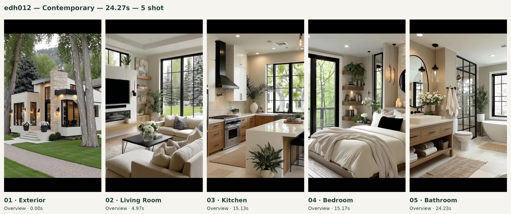
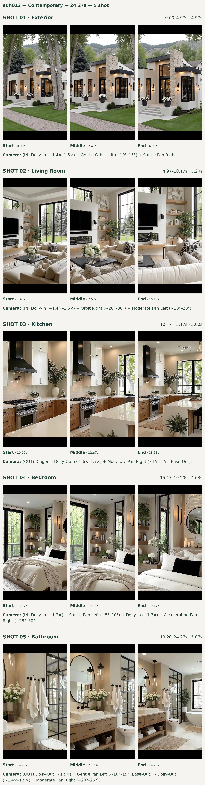
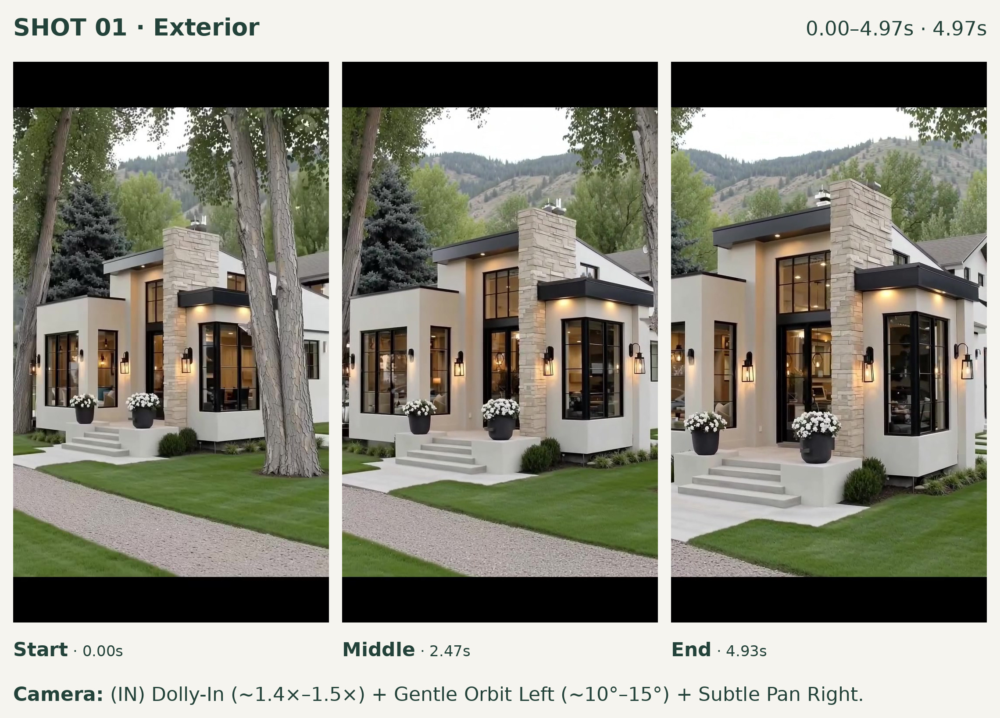
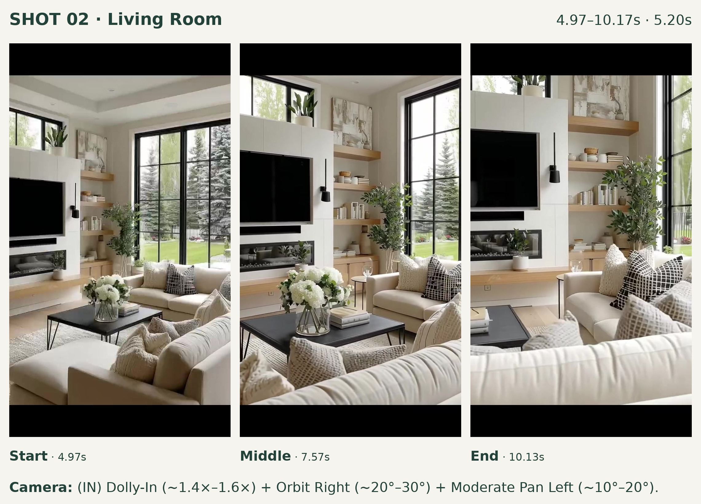
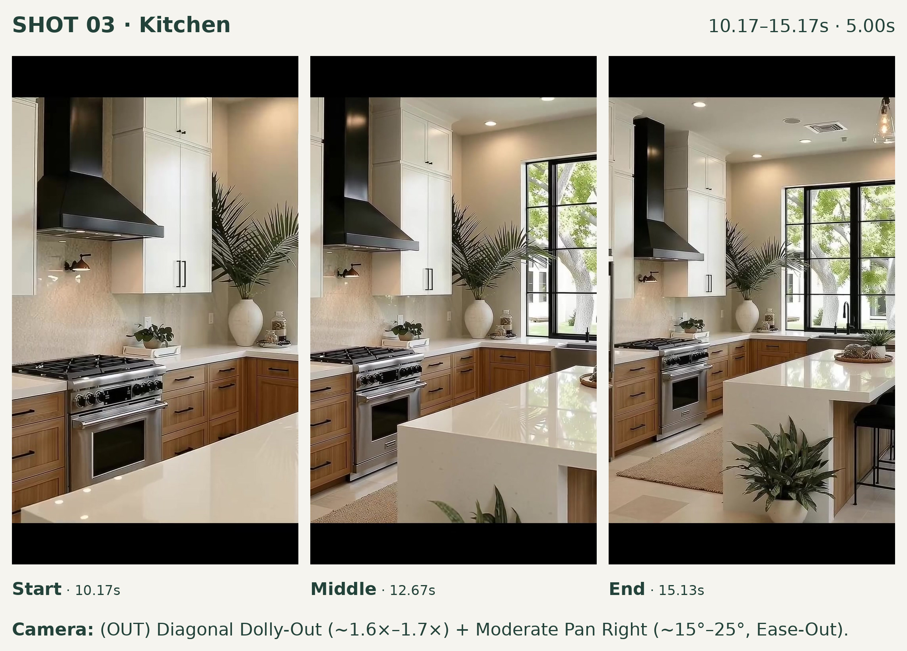
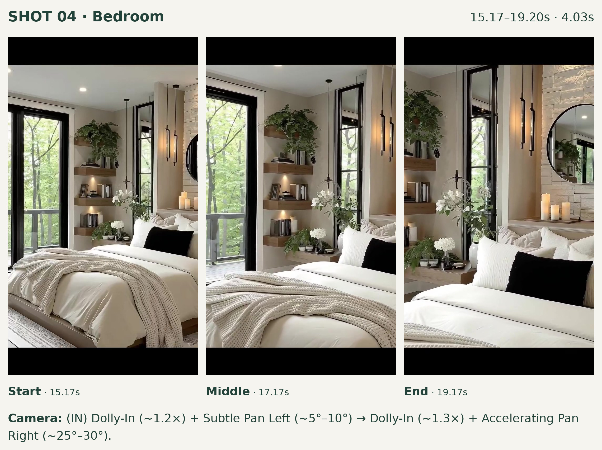
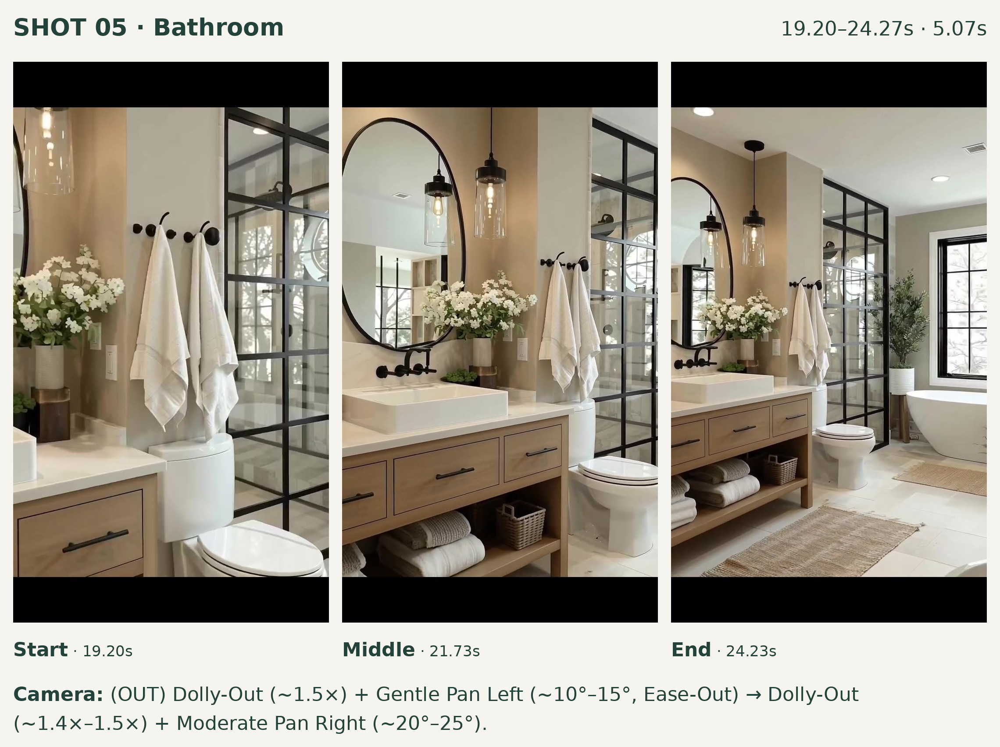

# edh012 — Contemporary Woodland House — Warm Neutral Interiors

## 1. Profil desain

- **Nama desain:** Contemporary Woodland House — Warm Neutral Interiors
- **Tipe rumah:** Detached House
- **Gaya utama:** **Contemporary**
- **Pengaruh gaya:** Modern Rustic
- **Gaya interior:** Warm Contemporary
- **Susunan ruang utama:** Montase eksterior, living room, kitchen, bedroom, bathroom; hubungan denah tidak diperlihatkan
- **Ciri khas:** —
- **Material utama:** Bidang putih hangat, tekstur batu, tampilan kayu cokelat, aksen hitam
- **Pencahayaan:** Cahaya alami dari kaca lebar dipadukan lampu aksen hangat dan downlight
- **Atmosfer:** Tenang, hangat dan terang dengan kontras hitam yang tegas
- **Lingkungan:** Rumput terawat, pohon tinggi dan lereng berhutan terlihat dari fasad dan bukaan

### Palet warna

| Peran | Warna | HEX |
| --- | --- | --- |
| Dominan | Warm White | `#E5E1D8` |
| Pendamping | Sand Beige | `#C5B7A2` |
| Pendamping | Natural Oak Brown | `#A47B54` |
| Aksen | Charcoal Black | `#262726` |
| Pendamping | Stone Taupe | `#B0A99B` |
| Aksen | Leaf Green | `#687B4D` |

## 2. Ukuran & proporsi

| Aspek | Estimasi visual |
| --- | --- |
| **Ukuran rumah** | medium |
| **Bentuk bangunan** | — |
| **Lantai & bentuk atap** | single-storey appearance |
| **Tapak bangunan** | articulated rectangular massing |
| **Proporsi utama** | Massa rendah melebar dengan aksen vertikal batu dan kaca tinggi |
| **Perkiraan luas lantai** | **90–160 m²** |

## 3. Shot Timeline

Durasi 24.27s · 5 shot.

**Camera Pattern:** IN – IN – OUT – IN – OUT.

| Shot | Time (s) | Duration | Area/Scene | Camera Movement |
| --- | --- | --- | --- | --- |
| 01 | 0.00–4.97 | 4.97s | Exterior | Dolly-In (~1.4×–1.5×) + Gentle Orbit Left (~10°–15°) + Subtle Pan Right. |
| 02 | 4.97–10.17 | 5.20s | Living Room | Dolly-In (~1.4×–1.6×) + Orbit Right (~20°–30°) + Moderate Pan Left (~10°–20°). |
| 03 | 10.17–15.17 | 5.00s | Kitchen | Diagonal Dolly-Out (~1.6×–1.7×) + Moderate Pan Right (~15°–25°, Ease-Out). |
| 04 | 15.17–19.20 | 4.03s | Bedroom | Dolly-In (~1.2×) + Subtle Pan Left (~5°–10°) → Dolly-In (~1.3×) + Accelerating Pan Right (~25°–30°). |
| 05 | 19.20–24.27 | 5.07s | Bathroom | Dolly-Out (~1.5×) + Gentle Pan Left (~10°–15°, Ease-Out) → Dolly-Out (~1.4×–1.5×) + Moderate Pan Right (~20°–25°). |

## 4. Overview

**Shot 01 · Exterior · 0.00s**

> Dari taman depan agak kanan, menghadap fasad secara oblique; memperlihatkan massa rendah, atap, tangga, pohon dan jalur.

**Shot 02 · Living Room · 4.97s**

> Dari sisi belakang sofa menghadap dinding media dan kaca tinggi; sofa, meja, TV, rak dan halaman terlihat bersama.

**Shot 03 · Kitchen · 15.13s**

> Dari posisi mundur menghadap sudut dapur; kabinet, range, jendela, island dan bangku terlihat dalam satu frame.

**Shot 04 · Bedroom · 15.17s**

> Dari kaki/sisi ranjang menghadap kepala ranjang dan kaca kiri; mencakup ranjang, rak sudut dan bukaan tinggi.

**Shot 05 · Bathroom · 24.23s**

> Dari posisi mundur menghadap memanjang ruang; vanity, panel shower, toilet dan bathtub dekat jendela tercakup.

## 5. Storyboard

## 6. Shot Details

### Shot 01 · Exterior

**Time:** 0.00–4.97s · **Duration:** 4.97s

#### **A. Desain area**

**Arsitektur**

> Massa rendah bersusun dengan atap landai, bidang dinding putih, pilar batu tinggi, jendela hitam berpetak, pintu kaca tinggi dan kanopi datar di atas sudut depan. Tangga lebar menuju akses depan.

**Furnitur & dekorasi**

> Pot gelap berisi bunga putih mengapit akses, tanaman bulat rendah di dasar fasad.

**Lingkungan**

> Rumput terawat, jalur paving, batang pohon besar foreground dan perbukitan berhutan di belakang.

#### **B. Framing & Lighting**

- **Fokus:** Pilar batu dan pintu masuk.
- **Camera Start:** Di jalur/taman depan, agak di kanan fasad. · Menuju pintu dan pilar fasad. · oblique · Sekitar tinggi mata. · Nyaris level.
- **Framing:** Wide oblique dari taman, pohon membingkai fasad. → Fasad lebih rapat, tangga dan pilar dominan.
- **Lighting:** Daylight lembut, sconce dan downlight hangat.
- **Foreground dan kedalaman:** Rumput, jalur dan batang pohon kanan. · Foreground pohon, tangga, massa rumah, pohon dan bukit latar.
- **Reveal:** Pohon bergeser keluar dan pintu serta pilar semakin terbuka.
- **Kesesuaian gerak:** Pendekatan dan orbit memperjelas akses serta tekstur fasad.

#### **C. Camera Movement**

Kamera mendekat ke fasad sambil menggeser posisi ke kiri mengitari sudut rumah; arah pandang mengimbangi agar pintu dan pilar tetap dalam bingkai.

**Tempo:** Halus, laju pendekatan relatif stabil; pergeseran lateral terlihat lebih kuat di awal hingga tengah dan mereda di akhir.

**Camera:** Dolly-In (~1.4×–1.5×) + Gentle Orbit Left (~10°–15°) + Subtle Pan Right.

---

### Shot 02 · Living Room

**Time:** 4.97–10.17s · **Duration:** 5.20s

#### **A. Desain area**

**Arsitektur**

> Ruang tinggi terang dengan plafon berlapis, jendela hitam tinggi berpetak di sisi sofa, dan dinding media putih berisi TV serta perapian linear di bawahnya.

**Furnitur & dekorasi**

> Sofa krem menghadap dinding media, meja kopi hitam rendah di tengah, bantal berpola dan vas bunga putih. Rak kayu terbuka di sebelah TV memuat buku/dekorasi; tanaman tinggi di sudut.

**Lingkungan**

> Cahaya siang masuk lewat kaca besar; halaman rumput dan pepohonan terlihat.

#### **B. Framing & Lighting**

- **Fokus:** Meja kopi, TV dan sofa.
- **Camera Start:** Di belakang/sisi tempat duduk. · Ke dinding media dan kaca tinggi. · oblique · Sekitar tinggi mata duduk/berdiri rendah. · Nyaris level.
- **Framing:** Wide dari sisi sofa memperlihatkan meja, TV dan jendela. → Framing lebih rapat pada TV dan sofa.
- **Lighting:** Daylight kuat dari jendela, interior netral terang.
- **Foreground dan kedalaman:** Sofa dan bantal netral. · Sofa, meja, dinding media dan kaca ke halaman.
- **Reveal:** Meja dan TV membesar, punggung sofa masuk foreground.
- **Kesesuaian gerak:** Dolly-In dan orbit menunjukkan relasi tempat duduk dengan media.

#### **C. Camera Movement**

Kamera mendekati area TV sambil bergerak ke kanan relatif meja; pandangan mengarah kiri sehingga sisi belakang sofa semakin dominan.

**Tempo:** Gerak kontinu, sapuan lateral terasa lebih kuat di tengah, kemudian mengecil; pembesaran cenderung melambat.

**Camera:** Dolly-In (~1.4×–1.6×) + Orbit Right (~20°–30°) + Moderate Pan Left (~10°–20°).

---

### Shot 03 · Kitchen

**Time:** 10.17–15.17s · **Duration:** 5.00s

#### **A. Desain area**

**Arsitektur**

> Kabinet bawah tampak kayu cokelat dengan countertop terang, kabinet atas putih, backsplash beige dan jendela hitam di belakang area sink. Kompor berada di sisi kiri dengan hood hitam besar; pencahayaan recessed.

**Furnitur & dekorasi**

> Range stainless-look di bawah hood hitam, meja island berpermukaan putih dengan ujung waterfall-like, bangku gelap terlihat di sisi kanan dan tanaman di ujung dekat.

**Lingkungan**

> Cahaya alami dari jendela dengan vegetasi di luar; lampu plafon memberi isi cahaya hangat.

#### **B. Framing & Lighting**

- **Fokus:** Kompor, island dan kabinet.
- **Camera Start:** Dekat meja putih menghadap kabinet kompor. · Ke range dan sudut dapur. · oblique · Sekitar tinggi mata. · Nyaris level.
- **Framing:** Framing rapat kompor dan countertop. → Wide memperlihatkan island dan kabinet.
- **Lighting:** Daylight jendela dan recessed downlight.
- **Foreground dan kedalaman:** Countertop putih. · Meja, range, kabinet dan jendela.
- **Reveal:** Island, bangku, jendela dan lantai terbuka saat mundur.
- **Kesesuaian gerak:** Dolly-Out dan Pan Right memperluas konfigurasi dapur.

#### **C. Camera Movement**

Kamera mundur diagonal ke kiri dari kompor sambil menyapu pandangan ke kanan sehingga island, jendela dan ruang lantai terbuka.

**Tempo:** Mundur relatif merata; sapuan kanan menurun bertahap, bukan berhenti mendadak.

**Camera:** Diagonal Dolly-Out (~1.6×–1.7×) + Moderate Pan Right (~15°–25°, Ease-Out).

---

### Shot 04 · Bedroom

**Time:** 15.17–19.20s · **Duration:** 4.03s

#### **A. Desain area**

**Arsitektur**

> Kaca tinggi berbingkai hitam di kiri ranjang menghadap pepohonan, bidang headboard netral dengan aksen batu terang, plafon putih dan lampu gantung ramping.

**Furnitur & dekorasi**

> Ranjang besar dengan bedding putih-krem, selimut rajut beige dan bantal hitam; rak sudut terbuka berisi tanaman dan dekorasi, cermin bulat di kanan kepala ranjang.

**Lingkungan**

> Pepohonan terlihat dari kaca tinggi; daylight lembut bercampur lampu hangat.

#### **B. Framing & Lighting**

- **Fokus:** Ranjang, rak dan cermin.
- **Camera Start:** Dekat sisi/kaki ranjang. · Ke kepala ranjang, rak dan kaca kiri. · oblique · Sekitar tinggi dada/mata. · Nyaris level.
- **Framing:** Wide dari kaki ranjang memperlihatkan kaca dan rak. → Ranjang/headboard dan cermin dominan.
- **Lighting:** Daylight dari kaca, lampu gantung hangat.
- **Foreground dan kedalaman:** Selimut dan ujung ranjang. · Ranjang, rak sudut, headboard dan kaca.
- **Reveal:** Ranjang mendekat; cermin dan aksen dinding masuk kanan.
- **Kesesuaian gerak:** Dolly-In dan perubahan pan membawa fokus ke headboard.

#### **C. Camera Movement**

Kamera maju menuju ranjang; awal sapuan kiri ringan, lalu berbalik menyapu kanan ke headboard dan cermin sambil tetap mendekat.

**Tempo:** Maju stabil; sapuan awal ringan lalu meningkat jelas pada paruh kedua, tanpa cut internal.

**Movement Timeline**

| Time (s) | Area & fokus | Camera Movement | Tempo |
| --- | --- | --- | --- |
| 15.17–16.77 | Bedroom · Ranjang, rak dan pintu kaca | Dolly-In (~1.2×) + Subtle Pan Left (~5°–10°) | Maju stabil; sapuan awal ringan lalu meningkat jelas pada paruh kedua, tanpa cut internal. |
| 16.77–19.20 | Bedroom · Headboard, bantal dan cermin | Dolly-In (~1.3×) + Accelerating Pan Right (~25°–30°) | Maju stabil; sapuan awal ringan lalu meningkat jelas pada paruh kedua, tanpa cut internal. |

**Camera:** Dolly-In (~1.2×) + Subtle Pan Left (~5°–10°) → Dolly-In (~1.3×) + Accelerating Pan Right (~25°–30°).

---

### Shot 05 · Bathroom

**Time:** 19.20–24.27s · **Duration:** 5.07s

#### **A. Desain area**

**Arsitektur**

> Kamar mandi berpalet putih-beige dengan panel shower kaca berpetak hitam, lantai terang, jendela hitam di ujung dan downlight. Vanity berada di kiri, toilet di antara vanity dan panel shower, bathtub terungkap di kanan.

**Furnitur & dekorasi**

> Vanity tampak kayu dengan laci, rak bawah terbuka berisi handuk, basin putih persegi di atas countertop, keran hitam, cermin bulat dan lampu gantung. Toilet putih, bathtub putih berdiri bebas, handuk menggantung pada kait.

**Lingkungan**

> Daylight dari jendela ujung, cahaya hangat di area cermin dan aksen tanaman.

#### **B. Framing & Lighting**

- **Fokus:** Vanity, shower dan bathtub.
- **Camera Start:** Dekat vanity dan toilet. · Ke kait handuk dan shower. · oblique · Sekitar tinggi mata. · Nyaris level.
- **Framing:** Framing rapat vanity, handuk dan panel kaca. → Wide vanity, shower, toilet, bathtub dan jendela.
- **Lighting:** Daylight ujung, lampu pendant hangat.
- **Foreground dan kedalaman:** Vanity, bunga dan toilet. · Vanity, panel shower, lalu bathtub di ujung.
- **Reveal:** Cermin terbuka kiri sebelum sapuan kanan membuka bathtub.
- **Kesesuaian gerak:** Dolly-Out dan pan berbalik memperluas pemahaman layout.

#### **C. Camera Movement**

Kamera mundur dari detail vanity dan handuk, mula-mula menyapu kiri ke wastafel/cermin, lalu membalik pandangan kanan menuju shower dan bathtub.

**Tempo:** Mundur cukup nyata di awal dan melambat menjelang akhir; sapuan berganti arah secara halus sekitar pertengahan.

**Movement Timeline**

| Time (s) | Area & fokus | Camera Movement | Tempo |
| --- | --- | --- | --- |
| 19.20–21.67 | Bathroom · Vanity, handuk dan cermin | Dolly-Out (~1.5×) + Gentle Pan Left (~10°–15°, Ease-Out) | Mundur cukup nyata di awal dan melambat menjelang akhir; sapuan berganti arah secara halus sekitar pertengahan. |
| 21.67–24.27 | Bathroom · Shower, toilet dan bathtub | Dolly-Out (~1.4×–1.5×) + Moderate Pan Right (~20°–25°) | Mundur cukup nyata di awal dan melambat menjelang akhir; sapuan berganti arah secara halus sekitar pertengahan. |

**Camera:** Dolly-Out (~1.5×) + Gentle Pan Left (~10°–15°, Ease-Out) → Dolly-Out (~1.4×–1.5×) + Moderate Pan Right (~20°–25°).

**Catatan referensi:** Estimasi luas 90–160 m² sangat tentatif berdasarkan proporsi fasad, furnitur dan cakupan ruang, tanpa pengukuran atau denah. Urutan cut tidak membuktikan hubungan ruang atau satu rumah fisik. Semua material dan HEX adalah perkiraan tampilan visual. Hasil kamera dari checkpoint Fase 2 disetujui pengguna dan dipertahankan.
