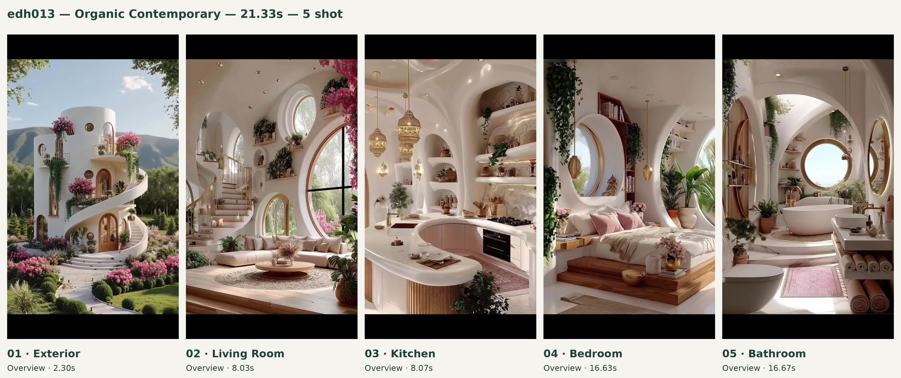
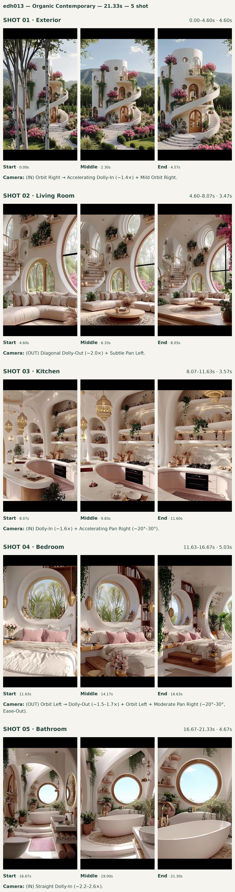
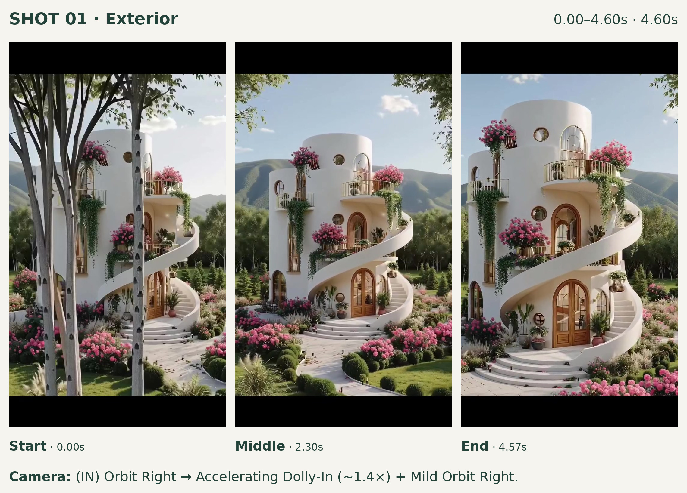
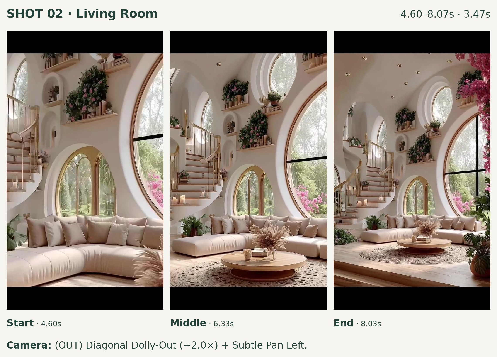
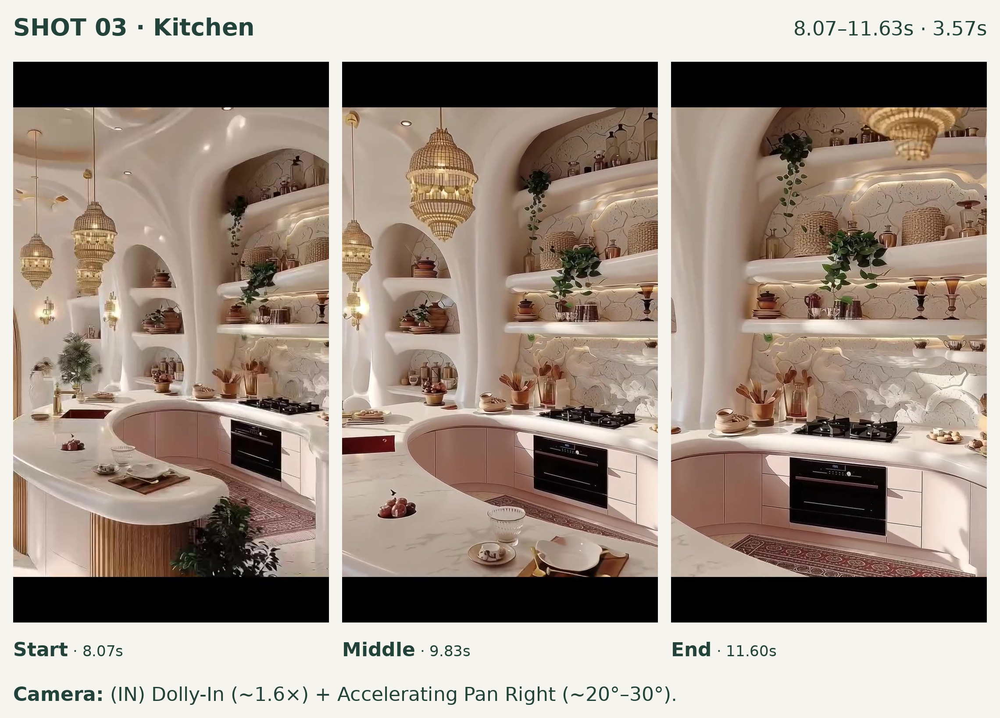
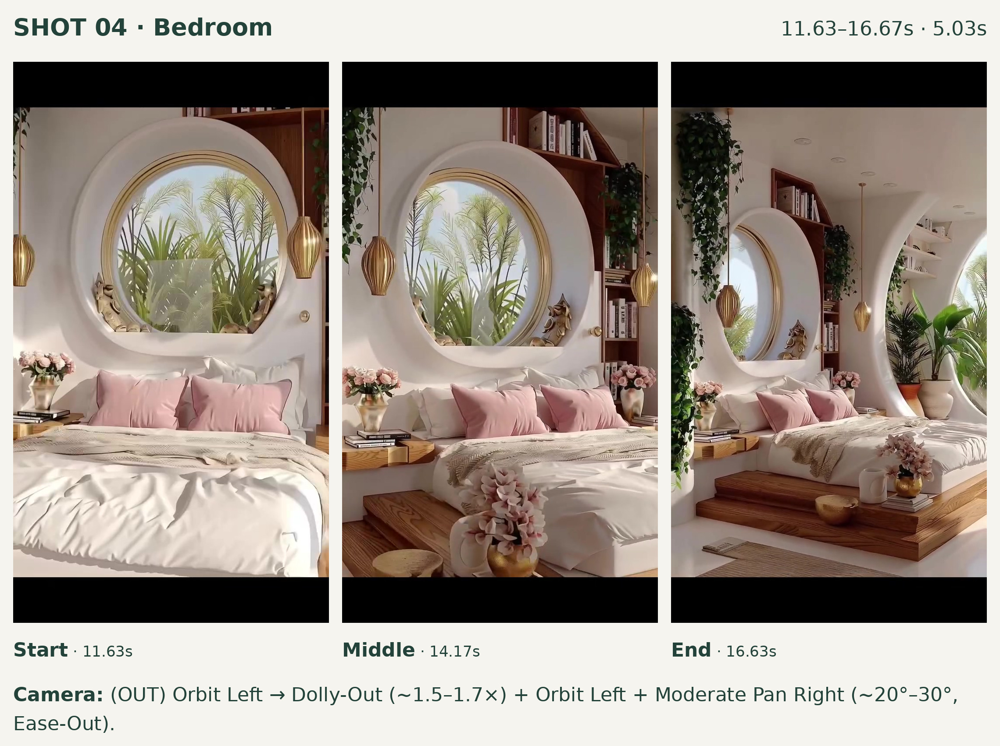
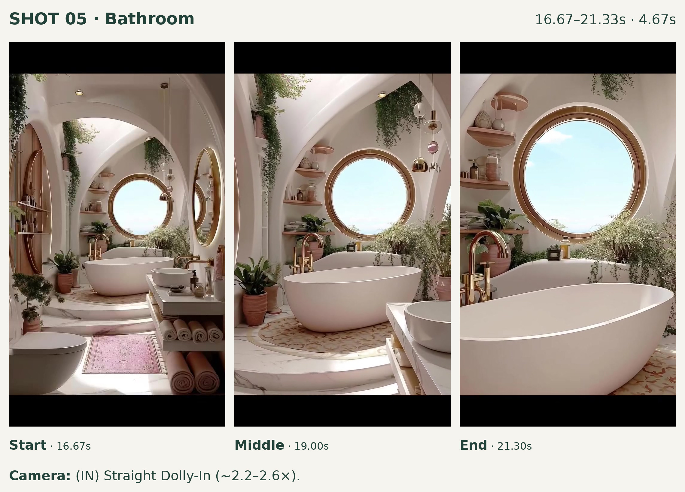

# edh013 — Rumah Menara Organik Putih dengan Taman Bunga

## 1. Profil desain

- **Nama desain:** Rumah Menara Organik Putih dengan Taman Bunga
- **Tipe rumah:** Tower House
- **Gaya utama:** **Organic Contemporary**
- **Pengaruh gaya:** Mediterranean-inspired
- **Gaya interior:** Organic Modern; Romantic Botanical
- **Susunan ruang utama:** Ruang tamu tinggi dengan tangga, dapur melengkung, kamar tidur dan kamar mandi berpanggung; denah tidak terkonfirmasi
- **Ciri khas:** Tangga luar membelit menara; jendela lingkar besar; ceruk lengkung dan tanaman berulang
- **Material utama:** Permukaan putih halus, tekstur kayu hangat, batu terang berpola dan logam emas tampak visual
- **Pencahayaan:** Cahaya alami melalui bukaan besar; aksen lampu gantung, downlight dan lampu rak hangat
- **Atmosfer:** Terang, romantis, lembut dan rimbun dengan aksen merah muda serta emas
- **Lingkungan:** Taman bunga merah muda, pepohonan, semak terpangkas dan perbukitan di belakang

### Palet warna

| Peran | Warna | HEX |
| --- | --- | --- |
| Dominan | Putih gading | `#F1EAE0` |
| Pendamping | Krem hangat | `#D7C7B7` |
| Pendamping | Kayu madu | `#A97647` |
| Aksen | Dusty rose | `#C49A9B` |
| Aksen | Hijau daun | `#567443` |
| Aksen | Emas hangat | `#B28A4C` |

## 2. Ukuran & proporsi

| Aspek | Estimasi visual |
| --- | --- |
| **Ukuran rumah** | small |
| **Bentuk bangunan** | Massa menara silindris dengan volume samping bertingkat |
| **Lantai & bentuk atap** | Sekitar tiga tingkat tampak dari fasad dan tangga luar · Garis atas silindris rata; konstruksi atap tidak terlihat |
| **Tapak bangunan** | Kompak, massa bulat vertikal dengan sayap lebih rendah |
| **Proporsi utama** | Tinggi dominan dibanding lebar; volume interior ruang tamu tampak tinggi |
| **Perkiraan luas lantai** | **75–150 m²** |

## 3. Shot Timeline

Durasi 21.33s · 5 shot.

**Camera Pattern:** IN – OUT – IN – OUT – IN.

| Shot | Time (s) | Duration | Area/Scene | Camera Movement |
| --- | --- | --- | --- | --- |
| 01 | 0.00–4.60 | 4.60s | Exterior | Orbit Right → Accelerating Dolly-In (~1.4×) + Mild Orbit Right. |
| 02 | 4.60–8.07 | 3.47s | Living Room | Diagonal Dolly-Out (~2.0×) + Subtle Pan Left. |
| 03 | 8.07–11.63 | 3.57s | Kitchen | Dolly-In (~1.6×) + Accelerating Pan Right (~20°–30°). |
| 04 | 11.63–16.67 | 5.03s | Bedroom | Orbit Left → Dolly-Out (~1.5–1.7×) + Orbit Left + Moderate Pan Right (~20°–30°, Ease-Out). |
| 05 | 16.67–21.33 | 4.67s | Bathroom | Straight Dolly-In (~2.2–2.6×). |

## 4. Overview

**Shot 01 · Exterior · 2.30s**

> Wide dari jalur taman menghadap menara putih, memperlihatkan massa bertingkat, tangga melingkar, taman dan perbukitan tanpa batang pohon dominan.

**Shot 02 · Living Room · 8.03s**

> Wide dari depan podium menghadap sofa, meja bundar, tangga kiri, ceruk dan jendela bundar kanan; tepi podium menunjukkan elevasi area duduk.

**Shot 03 · Kitchen · 8.07s**

> Wide dari depan meja berujung bulat menghadap area memasak; mencakup lampu gantung, kabinet melengkung, ceruk dan rak belakang.

**Shot 04 · Bedroom · 16.63s**

> Wide serong dari depan podium menghadap ranjang, jendela bundar di kiri, rak, bukaan besar kanan dan tanaman; menunjukkan tangga podium.

**Shot 05 · Bathroom · 16.67s**

> Wide dari ujung masuk kamar mandi menghadap bathtub melalui lengkung; toilet kiri, vanity kanan, podium bertingkat dan jendela bundar terlihat bersama.

## 5. Storyboard

## 6. Shot Details

### Shot 01 · Exterior

**Time:** 0.00–4.60s · **Duration:** 4.60s

#### **A. Desain area**

**Arsitektur**

> Menara putih bertingkat dengan puncak silindris rata, massa samping lebih rendah, tangga luar melingkar menuju balkon dan pintu lengkung; tangga lebar di kaki menara menuju pintu kayu berlengkung. Jendela bundar kecil berulang.

**Furnitur & dekorasi**

> Pot tanaman dan bunga merah muda di balkon serta dekat pintu; furnitur luar tidak jelas.

**Lingkungan**

> Tapak berdiri di taman dengan jalur berkelok, semak hijau terpangkas, bunga merah muda dan pepohonan; bukit hijau di latar.

#### **B. Framing & Lighting**

- **Fokus:** Menara, pintu dan tangga melingkar.
- **Camera Start:** Di jalur taman, di balik batang pohon dekat. · Menghadap menara dari arah depan serong. · oblique · Kira-kira setinggi mata, di luar rumah. · Sedikit mendongak ke massa tinggi.
- **Framing:** Wide eksterior dengan batang pohon menghalangi sebagian fasad. → Medium-wide fasad dengan pintu dan tangga lebih dominan.
- **Lighting:** Cahaya siang dari langit terbuka; bayang pepohonan.
- **Foreground dan kedalaman:** Batang pohon, semak dan jalur. · Pohon dekat, rumah tengah dan bukit jauh memberi paralaks.
- **Reveal:** Fasad terbuka setelah batang pohon berlalu, kemudian pintu membesar.
- **Kesesuaian gerak:** Orbit membuka fasad dari balik pohon; dolly-in mempertegas akses.

#### **C. Camera Movement**

Kamera bergerak menyamping ke kanan mengitari fasad, melewati batang pohon dekat, lalu mendekati pintu dan tangga dengan pembesaran yang semakin cepat.

**Tempo:** Sapuan lateral sedang di awal, pembesaran makin cepat pada akhir; awal pendekatan sekitar F81–90 bersifat gradual.

**Movement Timeline**

| Time (s) | Area & fokus | Camera Movement | Tempo |
| --- | --- | --- | --- |
| 0.00–2.70 | Exterior · Fasad dan tangga spiral | Orbit Right | Sapuan lateral sedang di awal, pembesaran makin cepat pada akhir; awal pendekatan sekitar F81–90 bersifat gradual. |
| 2.70–4.60 | Exterior · Pintu depan dan tangga | Accelerating Dolly-In (~1.4×) + Mild Orbit Right | Sapuan lateral sedang di awal, pembesaran makin cepat pada akhir; awal pendekatan sekitar F81–90 bersifat gradual. |

**Camera:** Orbit Right → Accelerating Dolly-In (~1.4×) + Mild Orbit Right.

---

### Shot 02 · Living Room

**Time:** 4.60–8.07s · **Duration:** 3.47s

#### **A. Desain area**

**Arsitektur**

> Ruang tinggi dengan dinding putih melengkung, jendela bundar besar di kanan dan pintu/jendela lengkung di belakang sofa. Tangga di kiri naik mengitari dinding; podium kayu rendah membatasi area duduk. Ceruk dan rak tanaman menyertai bukaan.

**Furnitur & dekorasi**

> Sofa sectional krem melengkung menghadap meja kopi bundar kayu, dengan bantal netral dan karpet bulat bertekstur; rak ceruk menampung tanaman dan dekorasi.

**Lingkungan**

> Pepohonan dan bunga terlihat melalui bukaan; cahaya alami lembut dari jendela besar, downlight di plafon.

#### **B. Framing & Lighting**

- **Fokus:** Sofa dan komposisi ruang tinggi.
- **Camera Start:** Dekat sofa pada sisi depan area duduk. · Menghadap sofa, bukaan belakang dan tangga kiri. · oblique · Sekitar tinggi mata duduk/berdiri rendah. · Hampir level.
- **Framing:** Sofa dan bukaan mengisi bidang. → Wide dengan podium, meja, tangga dan jendela.
- **Lighting:** Cahaya jendela sisi kanan; downlight hangat.
- **Foreground dan kedalaman:** Sofa dekat, kemudian tepi podium. · Sofa dekat, meja tengah, tangga dan bukaan belakang.
- **Reveal:** Meja bulat dan batas podium terbuka ketika kamera mundur.
- **Kesesuaian gerak:** Dolly-out diagonal menambah cakupan dan pan kiri menjaga area duduk.

#### **C. Camera Movement**

Kamera mundur dari sofa, memperluas pandangan ke meja, tangga, jendela, dan tepi lantai; komponen lateral kanan ringan dan kompensasi arah pandang kiri mungkin menyertai.

**Tempo:** Mundur cukup merata, sedikit mereda mendekati akhir; ruang terbuka cepat namun transisi halus.

**Camera:** Diagonal Dolly-Out (~2.0×) + Subtle Pan Left.

---

### Shot 03 · Kitchen

**Time:** 8.07–11.63s · **Duration:** 3.57s

#### **A. Desain area**

**Arsitektur**

> Dapur dengan kabinet bawah melengkung mengikuti dinding, rak terbuka dan ceruk lengkung, backsplash terang berpola batu, serta meja kerja depan berujung bulat. Sambungan meja ke kabinet tidak terlihat penuh sehingga tipe island/peninsula belum pasti.

**Furnitur & dekorasi**

> Meja depan dengan top terang dan sisi bilah kayu, cangkir dan piring; kompor hitam di atas oven tanam hitam, rak berisi keramik, keranjang dan tanaman; lampu gantung emas dekoratif.

**Lingkungan**

> Cahaya interior hangat dari lampu gantung, downlight dan strip rak; lingkungan luar tidak terlihat jelas.

#### **B. Framing & Lighting**

- **Fokus:** Kompor, oven dan ceruk rak.
- **Camera Start:** Di depan meja kerja berujung bulat. · Menghadap serong ke kabinet dan rak belakang. · oblique · Sekitar tinggi mata berdiri. · Hampir level.
- **Framing:** Wide meja depan, lampu gantung dan kabinet melengkung. → Lebih dekat ke oven, kompor dan rak.
- **Lighting:** Lampu gantung emas dan cahaya rak hangat.
- **Foreground dan kedalaman:** Meja depan dan cangkir. · Meja depan, kabinet tengah, ceruk belakang.
- **Reveal:** Detail kompor dan rak semakin dominan.
- **Kesesuaian gerak:** Dolly-in dan pan kanan memusatkan area memasak.

#### **C. Camera Movement**

Kamera maju ke area kompor sambil mengalihkan arah pandang ke kanan, dengan paralaks lampu gantung dan perubahan perspektif meja pulau.

**Tempo:** Maju relatif merata, sapuan kanan bertambah kuat pada paruh kedua.

**Camera:** Dolly-In (~1.6×) + Accelerating Pan Right (~20°–30°).

---

### Shot 04 · Bedroom

**Time:** 11.63–16.67s · **Duration:** 5.03s

#### **A. Desain area**

**Arsitektur**

> Kamar dengan jendela bundar besar berbingkai hangat di atas ranjang, rak buku vertikal mengapit bukaan dan lengkung besar di kanan. Ranjang berada pada podium kayu bertingkat; dinding dan plafon terang melengkung.

**Furnitur & dekorasi**

> Ranjang berseprai putih, bantal dusty rose, lampu gantung emas di sisi, meja samping kayu dengan bunga serta rak buku dan tanaman gantung. Tanaman besar terlihat di sisi bukaan kanan.

**Lingkungan**

> Daun hijau terlihat di balik jendela bundar; cahaya alami terang masuk dari bukaan tersebut dan sisi kanan.

#### **B. Framing & Lighting**

- **Fokus:** Ranjang, jendela dan podium.
- **Camera Start:** Dekat kaki ranjang. · Menghadap hampir frontal ke ranjang dan jendela bundar. · frontal · Sekitar tinggi mata. · Hampir level.
- **Framing:** Ranjang dan jendela mendominasi. → Wide serong dengan podium dan lengkung sisi kanan.
- **Lighting:** Cahaya jendela lembut; lampu sisi emas.
- **Foreground dan kedalaman:** Selimut ranjang, kemudian podium dan dekorasi bunga. · Ranjang dekat, jendela dan rak belakang, bukaan kanan.
- **Reveal:** Podium dan bukaan samping terungkap pada gerak mundur.
- **Kesesuaian gerak:** Orbit kiri lalu dolly-out dengan pan kanan membuka relasi ranjang dan sisi kanan.

#### **C. Camera Movement**

Kamera mula-mula menggeser sudut pandang di depan ranjang ke kiri, lalu mundur sambil terus menyamping dan mengarahkan pandangan ke kanan, memperlihatkan podium dan lengkung kanan.

**Tempo:** Gerak awal lebih lembut, mundur dan sapuan meningkat pada tengah lalu mereda pada akhir; batas overlap perkiraan F396–405.

**Movement Timeline**

| Time (s) | Area & fokus | Camera Movement | Tempo |
| --- | --- | --- | --- |
| 11.63–13.20 | Bedroom · Ranjang dan jendela bulat | Orbit Left | Gerak awal lebih lembut, mundur dan sapuan meningkat pada tengah lalu mereda pada akhir; batas overlap perkiraan F396–405. |
| 13.20–16.67 | Bedroom · Podium ranjang, jendela dan lengkung kanan | Dolly-Out (~1.5–1.7×) + Orbit Left + Moderate Pan Right (~20°–30°, Ease-Out) | Gerak awal lebih lembut, mundur dan sapuan meningkat pada tengah lalu mereda pada akhir; batas overlap perkiraan F396–405. |

**Camera:** Orbit Left → Dolly-Out (~1.5–1.7×) + Orbit Left + Moderate Pan Right (~20°–30°, Ease-Out).

---

### Shot 05 · Bathroom

**Time:** 16.67–21.33s · **Duration:** 4.67s

#### **A. Desain area**

**Arsitektur**

> Kamar mandi memanjang melalui lengkung lebar menuju bathtub putih di atas podium melingkar bertingkat. Jendela bundar berbingkai kayu hangat di belakang tub, ceruk/rak di kiri, vanity dan cermin bundar di kanan.

**Furnitur & dekorasi**

> Bathtub oval freestanding dengan keran emas di kiri, wastafel vessel putih di vanity kanan, cermin bulat, handuk gulung, toilet di kiri depan dan keset merah muda; rak sudut berisi keramik, tanaman.

**Lingkungan**

> Cahaya alami dari jendela bundar dengan langit biru tampak; tanaman pot dan gantung di zona bathtub, lampu gantung kecil dan downlight.

#### **B. Framing & Lighting**

- **Fokus:** Bathtub oval dan jendela.
- **Camera Start:** Di ujung masuk kamar mandi, di antara toilet dan vanity. · Menghadap bathtub dan jendela bundar di ujung. · frontal · Sekitar tinggi mata berdiri. · Hampir level.
- **Framing:** Wide memuat toilet, vanity, lengkung dan bathtub. → Close wide bathtub dan jendela bundar.
- **Lighting:** Cahaya alami jendela, lampu hangat.
- **Foreground dan kedalaman:** Toilet, vanity dan keset. · Saniter dekat, podium tengah dan jendela jauh.
- **Reveal:** Bathtub dan detail keran membesar sementara saniter dekat keluar bingkai.
- **Kesesuaian gerak:** Dolly-in lurus menggunakan sumbu bathtub sebagai fokus.

#### **C. Camera Movement**

Kamera maju menuju bathtub di bawah jendela bulat, mengeluarkan wastafel dan lengkung depan dari frame, dengan sedikit perubahan arah di bagian akhir.

**Tempo:** Maju stabil secara umum; pembesaran tampak makin kuat di akhir karena perspektif dekat. Tidak cukup bukti percepatan fisik terpisah.

**Camera:** Straight Dolly-In (~2.2–2.6×).

**Catatan referensi:** Luas lantai 75–150 m² adalah perkiraan kasar dari massa dan skala furnitur, bukan hasil ukur. Video memperlihatkan lima take terpisah; tidak membuktikan denah, koneksi ruang atau bahwa semua interior berasal dari bangunan yang sama. Material dan HEX adalah tampilan visual; interpretasi gaya, jumlah tingkat, dan tipe rumah bersifat tentatif. Notasi kamera mengikuti hasil Fase 2 yang disetujui tanpa perubahan.
