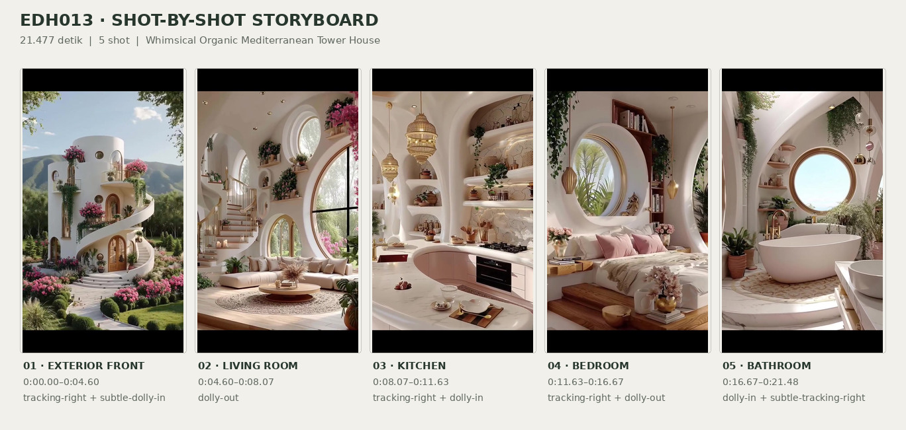
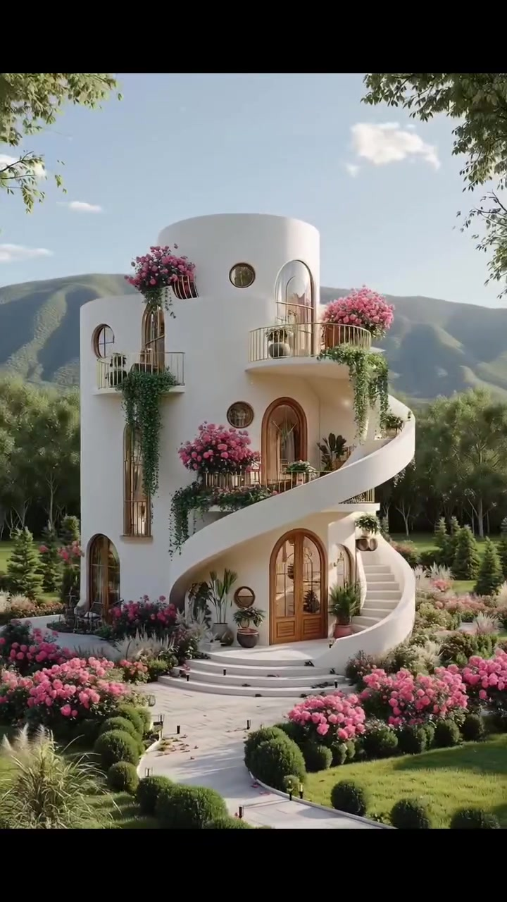
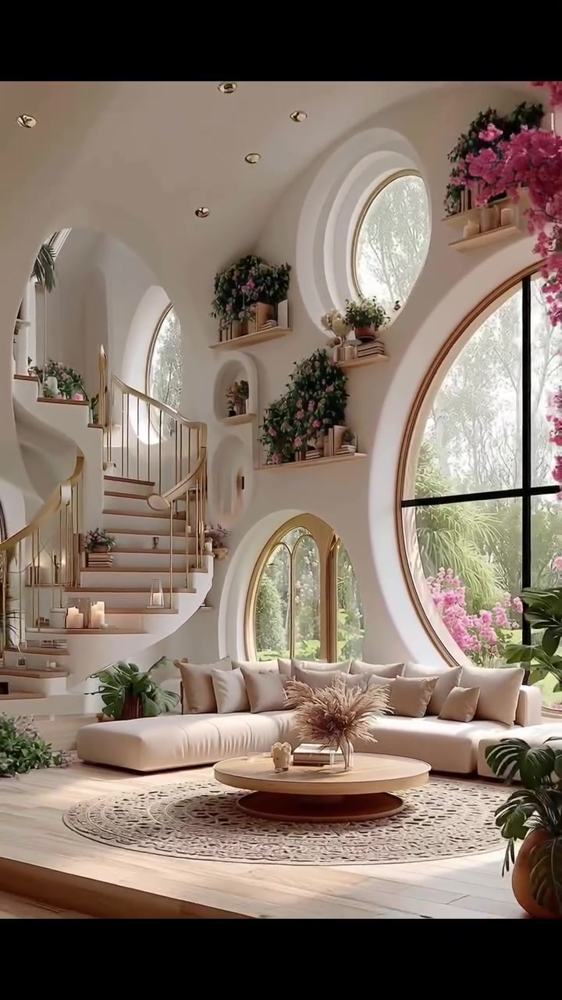
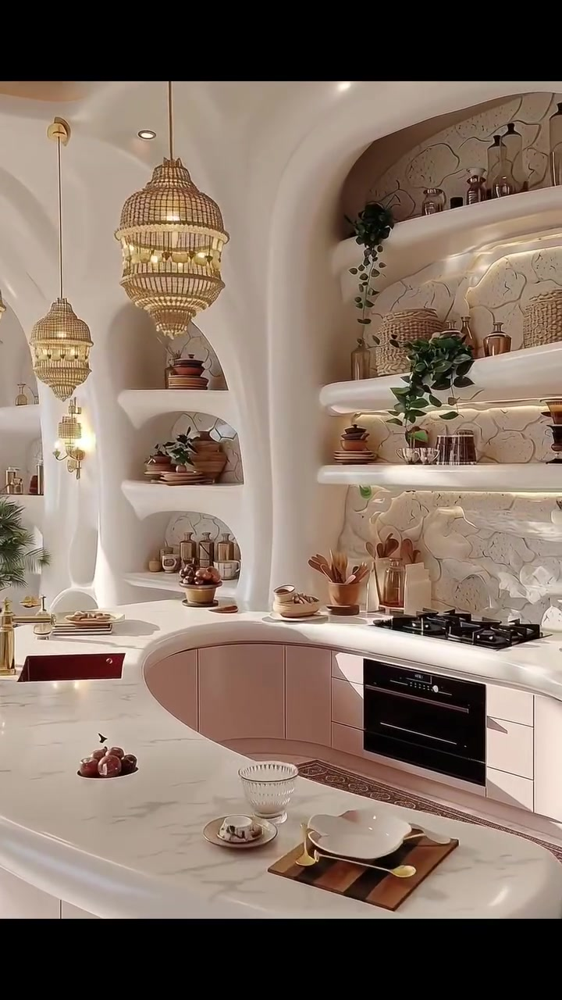
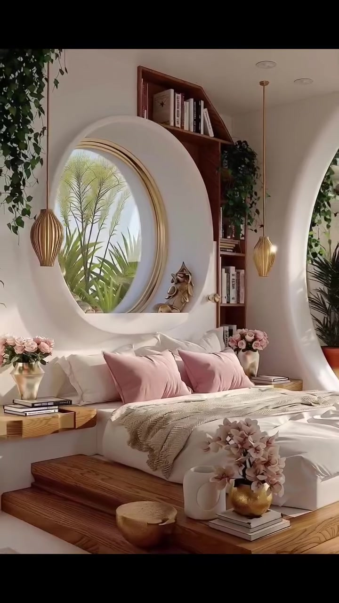
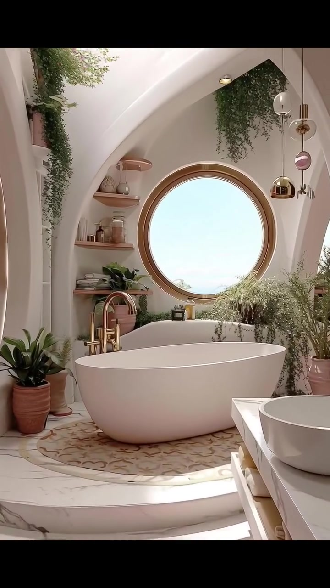

# edh013 — Whimsical Organic Mediterranean Tower House

<!-- homeku_request_id: edh013-b7e814338b236e299f9e103b0e60cd81358a5215 -->

<!-- homeku_detail_narratives: chat-reviewed -->

**Sumber data:** [analysis.yaml](analysis.yaml) · **Status:** draft · **Diverifikasi manusia:** Tidak

## 1. Informasi Video

| Informasi | Nilai |
|---|---|
| ID | edh013 |
| File asli | edh013.mp4 |
| Durasi | 21.477 |
| Resolusi | 720x1280 |
| FPS | 30 |
| Rasio | 9:16 |
| Jumlah shot | 5 |

## 2. Storyboard Gabungan

## 3. Identitas Desain

| Aspek | Hasil analisis |
|---|---|
| Gaya utama | whimsical organic mediterranean tower house |
| Wilayah terkait gaya desain | europe |
| Pengaruh gaya | storybook fantasy architecture, organic modern interiors, soft mediterranean forms |
| Ciri eksterior | smooth white stucco appearance cylindrical tower, white exterior spiral staircase, arched wood tone glazed doors, round porthole windows, small curved balconies with gold tone railings, abundant pink flowering planters |
| Gaya interior | organic modern, warm minimal luxury, curved white plaster appearance forms, soft pink neutrals and brass accents, botanical decor |
| Confidence gaya | medium |

## 4. Ukuran & Proporsi Bangunan

| Aspek | Estimasi visual |
|---|---|
| Ukuran yang terlihat | medium |
| Bentuk bangunan | stacked cylindrical tower with curved external stair |
| Skala vertikal | three level appearance |
| Tapak bangunan | compact |
| Perkiraan luas lantai | 90–160 m² |
| Confidence | low |

> Luas adalah perkiraan visual, bukan ukuran terukur.

## 5. Warna, Pencahayaan, dan Atmosfer

| Warna dominan | HEX (perkiraan) |
|---|---|
| warm white | #F3F0E9 |
| soft blush pink | #DFA9B3 |
| light honey wood | #B88A62 |
| champagne gold | #C6AA75 |
| leaf green | #617853 |

| Aspek | Hasil analisis |
|---|---|
| Pencahayaan | clear warm daylight, large window soft daylight, warm recessed and pendant lighting |
| Lingkungan | flower filled manicured garden, dense trees behind house, green mountain ridges in distance, tropical looking plants visible through interior windows |
| Musim yang tampak | Tidak diketahui |
| Mood | dreamy, whimsical, airy, soft luxurious, serene |

## 6. Struktur dan Timeline Video

**Jenis:** architectural home tour · **Tempo:** slow · **Transisi:** hard cuts between slow continuous camera moves

| Shot | Waktu (detik) | Durasi | Area/Scene | Gerakan Kamera |
|---|---|---|---|---|
| Shot 01 | 0.0–4.6 | 4.60 | exterior front | tracking right, subtle dolly in |
| Shot 02 | 4.6–8.07 | 3.47 | living room | dolly out |
| Shot 03 | 8.07–11.63 | 3.56 | kitchen | tracking right, dolly in |
| Shot 04 | 11.63–16.67 | 5.04 | bedroom | tracking right, dolly out |
| Shot 05 | 16.67–21.477 | 4.81 | bathroom | dolly in, subtle tracking right |

## 7. Analisis per Shot

### Shot 01 — exterior front

**Waktu:** 0.0–4.6 detik

| Komponen | Pengamatan |
|---|---|
| Fokus utama | white cylindrical tower house with spiral exterior stair |
| Framing awal → akhir | wide three quarter exterior view with foreground tree → medium wide frontal view of tower and entry |
| Sudut pandang | eye level slightly elevated frontal three quarter |
| Gerakan kamera | tracking right, subtle dolly in |
| Kecepatan kamera | slow |
| Pencahayaan | warm directional daylight with clear soft shadows |
| Transisi keluar | hard cut |

**Detail yang terlihat**

**Arsitektur**

Rumah menampilkan massa menara silinder bertingkat tiga yang tampak berfinishing putih halus, dengan tepi puncak datar membulat dan dinding berkurva. Tangga luar berwarna putih melingkari sisi kanan dari lantai dasar ke teras atas, dibatasi pagar parapet masif yang juga melengkung; tangga masuk yang lebar dan membulat menuju pintu utama. Pintu masuk di tengah lantai bawah berupa pintu ganda kaca berbingkai warna kayu berbentuk lengkung, sementara pintu lengkung serupa membuka ke teras tingkat tengah. Di fasad kiri tampak bukaan kaca tinggi ramping berbingkai kayu, jendela\-jendela bulat kecil, balkon kecil di sisi kiri, dan balkon kanan atas dengan pagar logam berwarna hangat yang tipis serta bagian bawah balkon membulat.

**Furnitur dan properti**

Gugusan bunga merah muda tumbuh dari pot\-pot besar pada balkon atas, diselingi sulur tanaman hijau yang menjuntai melewati tepi balkon. Sejumlah tanaman daun dalam pot ditempatkan di sisi pintu masuk lantai dasar. Lampu jalur kecil berwarna gelap mengikuti jalan setapak depan, dan dua kursi luar berwarna gelap tampak di dekat pintu samping kiri bawah.

**Lingkungan**

Jalan setapak tampak berwarna batu terang dan melengkung menuju anak tangga masuk, dikelilingi semak berbunga merah muda lebat di kedua sisi, topiary hijau tua berbentuk bulat, rumput pendek yang rapi, serta rumpun rumput hias pucat. Ada pula semak kecil mirip konifer di tepi taman. Di belakang rumah terlihat pepohonan hijau rapat dan punggungan pegunungan hijau yang luas. Pada awal shot, batang pohon berkulit pucat menutup sebagian bingkai kiri dan bergeser keluar ketika kamera bergerak; cabang\-cabang berdaun hijau juga membingkai sudut atas. Langit biru pucat memiliki sejumlah awan putih kecil.

**Catatan pengamatan:** Tangkapan bergerak ke kanan sehingga batang pohon foreground bergeser keluar dan fasad semakin terbuka; material dibaca dari tampilan, bukan spesifikasi.

**Confidence:** Kamera medium · Detail visual high

### Shot 02 — living room

**Waktu:** 4.6–8.07 detik

| Komponen | Pengamatan |
|---|---|
| Fokus utama | bright curving living room with round windows and cream sectional sofa |
| Framing awal → akhir | medium view of sofa round window and left stair → wide view revealing full seating area and raised floor edge |
| Sudut pandang | eye level interior three quarter |
| Gerakan kamera | dolly out |
| Kecepatan kamera | slow |
| Pencahayaan | bright soft daylight through large windows and warm recessed ceiling lights |
| Transisi keluar | hard cut |

**Detail yang terlihat**

**Arsitektur**

Ruang keluarga memiliki plafon putih tinggi yang melengkung dengan lampu tanam kecil. Di sisi kiri, tangga spiral putih memakai anak tangga berpenampilan kayu terang dan railing ramping berwarna emas hangat. Dinding kanan memuat jendela bulat sangat besar berbingkai warna kayu dengan pembagi hitam menyilang; lebih tinggi ada jendela bulat lain yang lebih kecil. Beberapa bukaan kaca tinggi berbentuk lengkung dan pintu kaca lengkung terlihat di sisi kiri serta belakang. Relung\-relung dinding dan rak melayang berpenampilan kayu terang menghiasi area atas sofa, sementara lengkungan putih menghubungkan bagian ruang. Lantai berpenampilan kayu terang dengan tepi level lantai yang sedikit meninggi di bagian depan.

**Furnitur dan properti**

Sofa sudut rendah berbentuk L berwarna krem berada di bawah jendela, dilapisi deretan bantal krem dan beige. Di depannya ada meja kopi bundar rendah berpermukaan kayu terang dan alas pedestal cokelat hangat, berdiri di atas karpet bundar krem bermotif kerawang. Meja dihias vas kaca dengan batang rumput kering cokelat muda, buku, serta wadah kecil berwarna netral. Rak atas memuat buku\-buku kecil, pot tanaman, dan sulur bunga merah muda dengan daun hijau. Beberapa lilin tersusun di anak tangga kiri bawah; tanaman daun lebar dalam pot berada di kanan depan, dan gugusan bunga merah muda menggantung dari tepi atas kanan bingkai.

**Lingkungan**

Di balik jendela\-jendela bulat dan lengkung terlihat pepohonan hijau yang tersinari matahari. Gugusan bunga merah muda terang tampak di luar sisi jendela bundar kanan.

**Catatan pengamatan:** Frame berangsur melebar; bagian karpet, lantai depan, tanaman kanan dan lengkung tangga terlihat semakin lengkap.

**Confidence:** Kamera medium · Detail visual high

### Shot 03 — kitchen

**Waktu:** 8.07–11.63 detik

| Komponen | Pengamatan |
|---|---|
| Fokus utama | organic white kitchen with rounded counter and arched display shelves |
| Framing awal → akhir | wide view of curved kitchen peninsula and wall shelves → medium close view of cooktop oven and display shelves |
| Sudut pandang | eye level slightly high interior three quarter |
| Gerakan kamera | tracking right, dolly in |
| Kecepatan kamera | slow |
| Pencahayaan | warm pendant and shelf lighting combined with bright diffuse daylight |
| Transisi keluar | hard cut |

**Detail yang terlihat**

**Arsitektur**

Dapur memakai plafon putih menerus yang melengkung, bukaan\-bukaan lengkung, dan lampu tanam bulat kecil. Countertop putih membentuk semenanjung melingkar di depan, dengan kabinet bawah berkurva berwarna beige merah muda pucat dan bidang sirip vertikal berpenampilan kayu terang di tepian depannya. Permukaan countertop tampak seperti marmer putih dengan guratan abu\-abu lembut. Dinding kanan diisi rak terbuka putih yang mengikuti kurva dinding, backsplash relief organik putih gading, serta pencahayaan strip hangat di bawah rak. Tiga relung pajangan berbentuk lengkung berjajar ke atas pada dinding kiri. Di belakang terdapat oven tanam hitam di bawah kompor gas hitam; bak cuci persegi berwarna merah bata tua berada di counter kiri. Lorong memasak dilapisi karpet runner sempit berwarna mawar\-bata bermotif.

**Furnitur dan properti**

Di atas counter kiri tergantung tiga lampu gantung bertingkat berpenampilan anyaman, dan relung kiri diberi lampu dinding bernuansa emas hangat. Bak cuci memiliki keran warna emas. Rak tinggi memuat keranjang anyaman, tembikar, stoples kaca, gelas berpenampilan metalik, dan tanaman pot menjuntai. Counter belakang memiliki wadah sendok masak kayu, sedangkan semenanjung depan menampilkan mangkuk, piring, baki kayu berisi perlengkapan makan netral, dan benda kecil cokelat yang menyerupai makanan. Ada tanaman pot berdaun mirip palem di bagian belakang kiri serta berbagai vas dan dekor berwarna emas\-tembaga dalam relung.

**Lingkungan**

Tidak ada detail yang tercatat.

**Catatan pengamatan:** Gerakan menyeberang ke kanan dan mendekat, membuat rak, tekstur backsplash, kompor serta oven lebih menonjol.

**Confidence:** Kamera medium · Detail visual high

### Shot 04 — bedroom

**Waktu:** 11.63–16.67 detik

| Komponen | Pengamatan |
|---|---|
| Fokus utama | white bed on raised wood platform under large round window |
| Framing awal → akhir | medium close frontal view of bed and round window → wide three quarter view of raised bed and right archway |
| Sudut pandang | eye level interior three quarter |
| Gerakan kamera | tracking right, dolly out |
| Kecepatan kamera | slow |
| Pencahayaan | bright warm daylight entering circular window with soft golden pendant accents |
| Transisi keluar | hard cut |

**Detail yang terlihat**

**Arsitektur**

Dinding kamar tidur berwarna krem terang dan halus, dengan plafon lampu tanam. Tepat di belakang kepala tempat tidur terdapat jendela bulat besar dengan bingkai berpenampilan kayu pucat dan ceruk putih tebal berkurva. Di kanannya berdiri rak buku terbuka warna kayu dari lantai hingga atas, sedangkan sisi lebih kanan membuka ke lengkungan putih besar dan rak\-rak putih melayang. Tempat tidur berada di atas platform berpenampilan kayu dengan dua anak tangga rendah di bagian depan. Dua lampu gantung ramping berwarna emas hangat menggantung pada kedua sisi tempat tidur.

**Furnitur dan properti**

Tempat tidur rendah berlapis kain putih dan selimut putih kusut, dengan throw krem bertekstur serta dua bantal merah muda pucat di depan bantal putih. Meja samping kecil warna kayu berada di kedua sisi. Meja kiri memuat vas metalik berisi mawar merah muda pucat dan tumpukan buku. Di ujung tempat tidur ada vas emas berisi bunga merah muda, mangkuk kayu kecil, dan kendi putih mungil pada platform. Dua patung hias hewan kecil berada pada relung jendela. Rak kayu kanan diisi buku; tanaman merambat hijau memanjang di dinding kiri dan di sekitar rak kanan. Di balik lengkungan kanan tampak tanaman hijau berdaun lebar dalam pot.

**Lingkungan**

Di luar jendela bulat besar terlihat daun\-daun panjang hijau menyerupai palem dengan langit terang pucat di belakangnya.

**Catatan pengamatan:** Awal berpusat pada kasur dan jendela bulat; kamera bergeser kanan dan mundur, menyingkap lemari buku, platform kayu serta lengkungan ruang samping.

**Confidence:** Kamera medium · Detail visual high

### Shot 05 — bathroom

**Waktu:** 16.67–21.477 detik

| Komponen | Pengamatan |
|---|---|
| Fokus utama | freestanding white oval bathtub beneath giant circular window |
| Framing awal → akhir | wide view from bathroom entrance with tub vanity toilet → close three quarter view of freestanding tub and round window |
| Sudut pandang | eye level interior three quarter |
| Gerakan kamera | dolly in, subtle tracking right |
| Kecepatan kamera | slow |
| Pencahayaan | strong soft daylight through round window with warm ceiling and pendant glow |
| Transisi keluar | end of video |

**Detail yang terlihat**

**Arsitektur**

Kamar mandi memiliki plafon putih berbentuk kubah lengkung yang saling tumpang tindih, dengan bukaan lengkung membingkai area bathtub di belakang dan lampu tanam kecil. Jendela bulat besar berbingkai warna kayu berada tepat di atas bak mandi. Area bak dinaikkan pada platform membulat yang dicapai melalui dua anak tangga berpenampilan marmer terang. Lantainya memperlihatkan urat abu\-abu seperti marmer, sementara bagian bawah bak menggunakan ubin motif terakota\-krem. Relung pajangan berpenampilan kayu menempel pada dinding kiri dan rak kecil warna kayu berada di sebelah kiri jendela. Di sisi kanan terdapat meja vanity putih dengan rak bawah warna kayu dan cermin oval besar berbingkai emas.

**Furnitur dan properti**

Bak mandi putih bebas berdiri berbentuk oval diletakkan di tengah depan jendela bulat, dengan keran pengisi tinggi berwarna emas mengilap di sisi kirinya. Vanity kanan dilengkapi wastafel mangkuk putih, keran emas, dispenser, dan aksesori mandi kecil. Toilet putih tampak di kiri depan. Pada rak terbuka bawah vanity tersusun handuk gulung beige dan merah muda kusam; karpet kecil merah muda bermotif berada di jalur tengah. Beberapa tanaman hijau dalam pot mengelilingi bak dan lengkungan, sementara sulur menjuntai dari relung bagian atas. Rak kiri memuat handuk lipat berwarna terang serta botol\-botol kecil; di tepi bak terlihat wadah gelap kecil dan botol amber. Di dekat kanan jendela tergantung lampu orb kaca\-logam, dan relung kiri menampilkan dekor bernuansa emas serta kayu.

**Lingkungan**

Melalui jendela bulat terlihat langit biru pucat dan garis horizon jauh yang samar; lingkungan di baliknya tidak cukup jelas untuk ditentukan lebih spesifik.

**Catatan pengamatan:** Kamera perlahan mendekati bak mandi; toilet dan vanity keluar dari bingkai sementara permukaan ubin, rak kiri dan jendela bulat semakin detail.

**Confidence:** Kamera medium · Detail visual high

## 8. Kualitas dan Ketidakpastian Analisis

| Parameter | Hasil |
|---|---|
| Status | draft |
| Verifikasi manusia | Tidak |
| Ketepatan timestamp | estimated frame level |
| Ketidakpastian | floor area and exact storey use are visual estimates not measurements, architectural style and european region are aesthetic associations not geolocation, stucco wood marble and metal materials are identified by appearance only, camera move terms are inferred from screen motion, season and actual location are unknown, interior and exterior space connections are not independently verified |

**Catatan:** Lima shot dikenali dari empat perubahan frame besar sekitar 4.60, 8.07, 11.63, dan 16.67 detik. Durasi file container 21.477 detik, sementara 640 frame pada 30 FPS mencakup sekitar 21.333 detik; sisa waktu mengikuti durasi container. Tidak ada analisis audio.

---

*Laporan ini diturunkan dari [analysis.yaml](analysis.yaml).*
