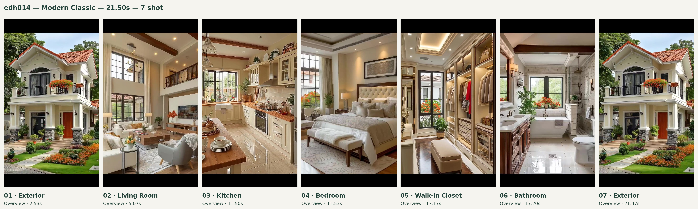
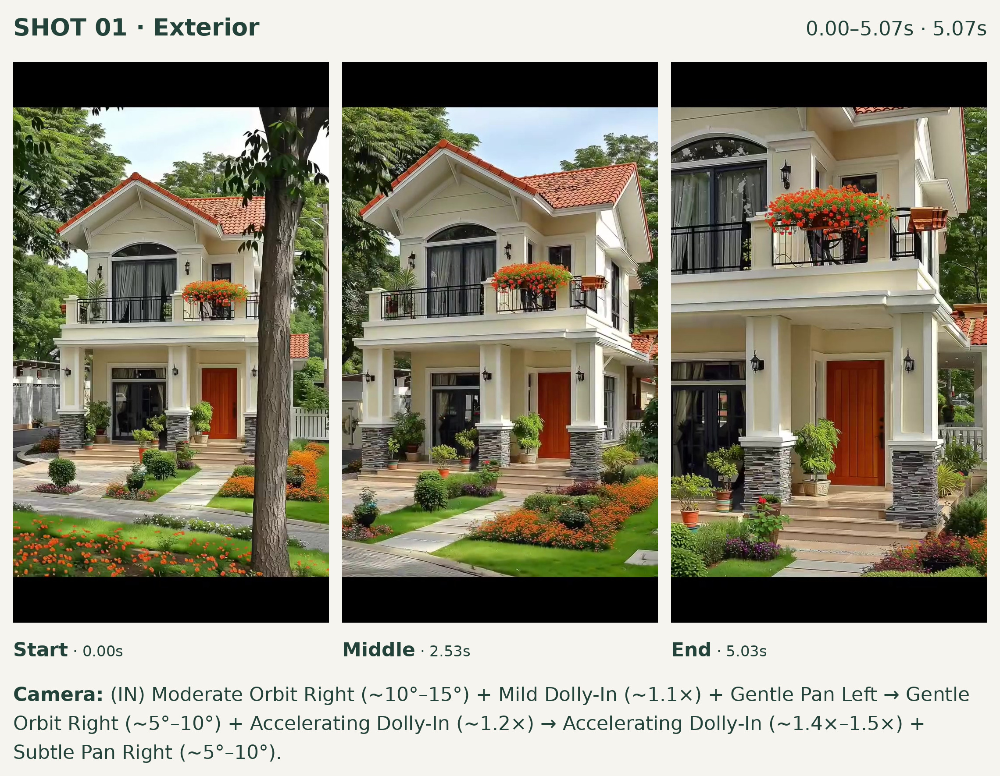
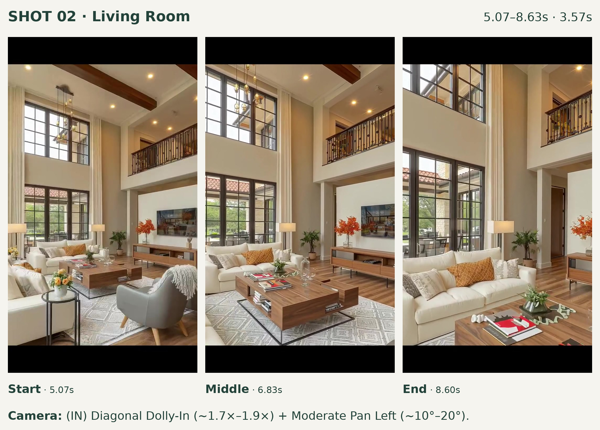
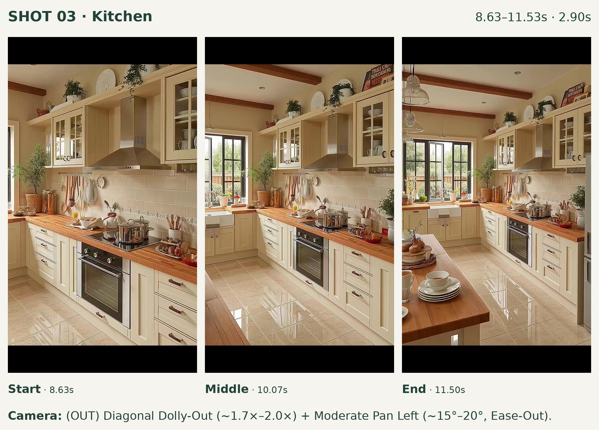
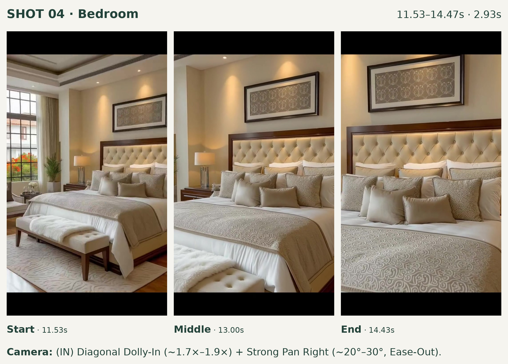
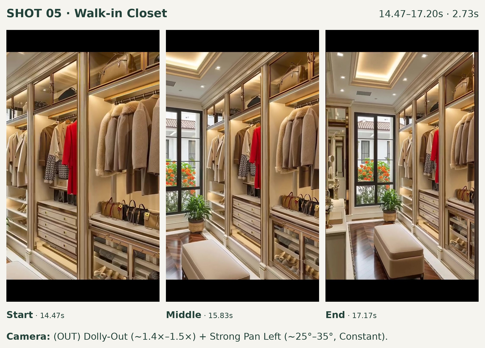
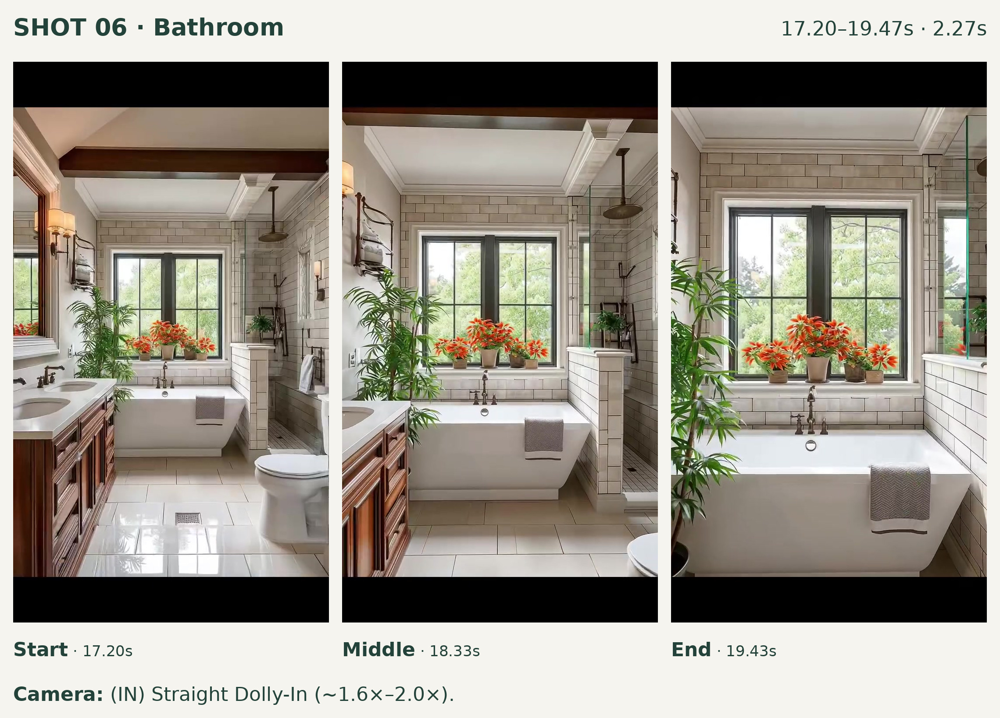
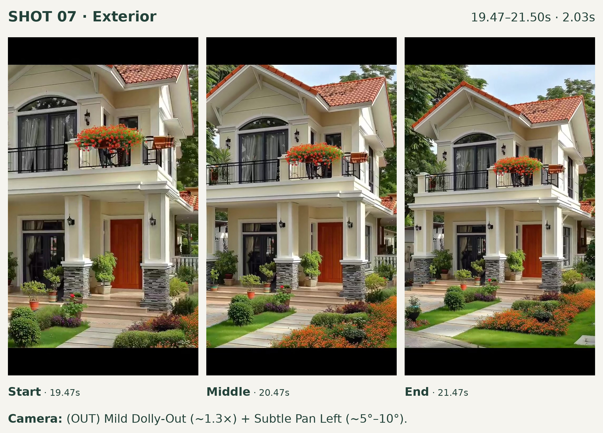

# edh014 — Rumah Dua Lantai Bergaya Modern Klasik dengan Taman Bunga

## 1. Profil desain

- **Nama desain:** Rumah Dua Lantai Bergaya Modern Klasik dengan Taman Bunga
- **Tipe rumah:** Detached House
- **Gaya utama:** **Modern Classic**
- **Pengaruh gaya:** Traditional Cottage
- **Gaya interior:** Transitional
- **Susunan ruang utama:** Eksterior, ruang keluarga bervolume tinggi, dapur, kamar tidur, walk-in closet, kamar mandi; hubungan denah tidak terbukti oleh cut
- **Ciri khas:** Balkon berbunga, kolom teras dengan kaki batu dan living room double-height
- **Material utama:** Bidang krem terang, aksen kayu hangat, batu gelap pada kaki kolom, bingkai gelap; bahan aktual tidak terverifikasi
- **Pencahayaan:** Cahaya siang melalui jendela besar, dilengkapi lampu downlight, lampu meja dan cahaya rak hangat
- **Atmosfer:** Hangat, rapi, terang dan nyaman dengan aksen klasik
- **Lingkungan:** Taman depan berumput, tanaman pangkas dan bunga jingga, pohon dewasa serta pagar samping terlihat

### Palet warna

| Peran | Warna | HEX |
| --- | --- | --- |
| Dominan | Warm Ivory | `#E9E0CC` |
| Pendamping | Soft Taupe | `#B4A58E` |
| Pendamping | Honey Wood | `#A66B3F` |
| Aksen | Charcoal | `#35332D` |
| Aksen | Terracotta | `#B95D36` |
| Aksen | Garden Green | `#507339` |

## 2. Ukuran & proporsi

| Aspek | Estimasi visual |
| --- | --- |
| **Ukuran rumah** | Medium |
| **Bentuk bangunan** | Dua tingkat, gable depan dan balkon di atas teras |
| **Lantai & bentuk atap** | Two Storeys · Atap miring bergenteng tampak terakota, gable depan |
| **Tapak bangunan** | Compact rectangular mass with projecting front porch |
| **Proporsi utama** | Fasad relatif ramping, dua tingkat, teras menjorok dan balkon di atasnya |
| **Perkiraan luas lantai** | **120–200 m²** |

## 3. Shot Timeline

Durasi 21.50s · 7 shot.

**Camera Pattern:** IN – IN – OUT – IN – OUT – IN – OUT.

| Shot | Time (s) | Duration | Area/Scene | Camera Movement |
| --- | --- | --- | --- | --- |
| 01 | 0.00–5.07 | 5.07s | Exterior | Moderate Orbit Right (~10°–15°) + Mild Dolly-In (~1.1×) + Gentle Pan Left → Gentle Orbit Right (~5°–10°) + Accelerating Dolly-In (~1.2×) → Accelerating Dolly-In (~1.4×–1.5×) + Subtle Pan Right (~5°–10°). |
| 02 | 5.07–8.63 | 3.57s | Living Room | Diagonal Dolly-In (~1.7×–1.9×) + Moderate Pan Left (~10°–20°). |
| 03 | 8.63–11.53 | 2.90s | Kitchen | Diagonal Dolly-Out (~1.7×–2.0×) + Moderate Pan Left (~15°–20°, Ease-Out). |
| 04 | 11.53–14.47 | 2.93s | Bedroom | Diagonal Dolly-In (~1.7×–1.9×) + Strong Pan Right (~20°–30°, Ease-Out). |
| 05 | 14.47–17.20 | 2.73s | Walk-in Closet | Dolly-Out (~1.4×–1.5×) + Strong Pan Left (~25°–35°, Constant). |
| 06 | 17.20–19.47 | 2.27s | Bathroom | Straight Dolly-In (~1.6×–2.0×). |
| 07 | 19.47–21.50 | 2.03s | Exterior | Mild Dolly-Out (~1.3×) + Subtle Pan Left (~5°–10°). |

## 4. Overview

**Shot 01 · Exterior · 2.53s**

> Dari taman depan menghadap serong fasad, setelah pohon keluar; dua lantai, atap, balkon, teras dan taman tampak utuh.

**Shot 02 · Living Room · 5.07s**

> Dari sudut depan ruang menghadap sofa dan dinding TV; terlihat volume tinggi, galeri, jendela dua tingkat dan kelompok duduk.

**Shot 03 · Kitchen · 11.50s**

> Dari ujung jalur dapur menghadap kabinet kanan dan jendela; meja kiri, oven, hood serta belokan counter terlihat.

**Shot 04 · Bedroom · 11.53s**

> Dari sisi kaki ranjang menghadap serong headboard; jendela kiri, plafon, bangku, karpet dan susunan ranjang terlihat.

**Shot 05 · Walk-in Closet · 17.17s**

> Dari pangkal lorong menghadap jendela ujung; rak kanan, sebagian kiri, bangku tengah dan plafon tray terlihat.

**Shot 06 · Bathroom · 17.20s**

> Dari pintu/pangkal ruang menghadap bathtub dan jendela; vanity kiri, toilet dan shower kanan serta lorong tengah terlihat.

**Shot 07 · Exterior · 21.47s**

> Dari taman depan menghadap serong fasad; keseluruhan dua tingkat, atap, teras dan taman terlihat.

## 5. Storyboard

## 6. Shot Details

### Shot 01 · Exterior

**Time:** 0.00–5.07s · **Duration:** 5.07s

#### **A. Desain area**

**Arsitektur**

> Fasad dua tingkat krem dengan gable depan, atap merah terakota, balkon berpagar gelap, bukaan atas melengkung, teras berkolom persegi dengan kaki bertekstur batu dan pintu warna kayu di kanan. Tangga pendek menghubungkan jalan setapak dan teras.

**Furnitur & dekorasi**

> Pot bunga jingga di pagar balkon, pot tanaman di teras dan lampu dinding gelap mengapit bukaan.

**Lingkungan**

> Pohon besar di depan, halaman rumput, jalur lurus berlapis paving, bedeng bunga jingga dan semak bulat; cahaya siang.

#### **B. Framing & Lighting**

- **Fokus:** Pintu utama dan fasad
- **Camera Start:** Di taman depan agak serong · Ke fasad dan teras kanan · oblique · Setinggi pandangan pejalan kaki (perkiraan) · Relatif datar
- **Framing:** Wide fasad dengan batang pohon kanan → Medium teras dan balkon
- **Lighting:** Cahaya siang dari luar
- **Foreground dan kedalaman:** Pohon, rumput dan bunga · Lapisan pohon, taman, teras, balkon
- **Reveal:** Pohon keluar, pintu dan kolom menjadi fokus
- **Kesesuaian gerak:** Orbit awal membuka sisi rumah lalu pendekatan memperbesar teras

#### **C. Camera Movement**

Badan kamera bergeser melengkung ke kanan di depan rumah sambil menjaga fasad, kemudian mendekat semakin cepat ke teras dan pintu.

**Tempo:** Awal sedang, kemudian lebih cepat terutama mendekati teras.

- **0.00–3.33s · moderate:** Sapuan lateral kemudian pendekatan bertahap.
- **3.33–5.07s · fast:** Ekspansi teras dan taman meningkat jelas.

**Movement Timeline**

| Time (s) | Area & fokus | Camera Movement | Tempo |
| --- | --- | --- | --- |
| 0.00–1.60 | Exterior · Fasad depan dan pohon foreground | Moderate Orbit Right (~10°–15°) + Mild Dolly-In (~1.1×) + Gentle Pan Left | Sapuan lateral kemudian pendekatan bertahap. |
| 1.60–3.00 | Exterior · Sisi kanan fasad dan teras | Gentle Orbit Right (~5°–10°) + Accelerating Dolly-In (~1.2×) | Sapuan lateral kemudian pendekatan bertahap. |
| 3.00–5.07 | Exterior · Teras dan pintu utama | Accelerating Dolly-In (~1.4×–1.5×) + Subtle Pan Right (~5°–10°) | Sapuan lateral kemudian pendekatan bertahap.; Ekspansi teras dan taman meningkat jelas. |

**Camera:** Moderate Orbit Right (~10°–15°) + Mild Dolly-In (~1.1×) + Gentle Pan Left → Gentle Orbit Right (~5°–10°) + Accelerating Dolly-In (~1.2×) → Accelerating Dolly-In (~1.4×–1.5×) + Subtle Pan Right (~5°–10°).

---

### Shot 02 · Living Room

**Time:** 5.07–8.63s · **Duration:** 3.57s

#### **A. Desain area**

**Arsitektur**

> Ruang keluarga bervolume tinggi dengan jendela grid gelap dua tingkat di kiri, balok kayu tampak di plafon, galeri lantai atas berpagar gelap di kanan serta dinding TV di bawahnya. Lantai tampak papan kayu.

**Furnitur & dekorasi**

> Sofa krem menghadap TV, kursi aksen abu-abu, meja kopi kayu persegi panjang dengan kaki gelap, karpet berpola, lampu meja dan dekorasi bunga jingga.

**Lingkungan**

> Vegetasi luar terlihat lewat jendela; sinar siang berpadu downlight dan lampu meja.

#### **B. Framing & Lighting**

- **Fokus:** Sofa dan meja kopi
- **Camera Start:** Di sudut ruang keluarga dekat kursi · Serong ke sofa dan jendela · oblique · Sekitar tinggi mata duduk-berdiri · Relatif datar
- **Framing:** Wide ruang, galeri, TV dan kursi → Medium sofa dan jendela
- **Lighting:** Cahaya jendela kiri dan lampu hangat
- **Foreground dan kedalaman:** Kursi dan meja · Kursi, meja, sofa, bukaan tinggi
- **Reveal:** TV keluar kanan, sofa lebih dekat
- **Kesesuaian gerak:** Pendekatan diagonal memperkuat skala meja dan sofa, pan kiri menonjolkan jendela

#### **C. Camera Movement**

Kamera maju diagonal ke kiri menuju meja dan sofa, sambil menggeser pandangan dari dinding TV menuju bidang jendela.

**Tempo:** Maju halus dengan ekspansi lebih kuat pada bagian akhir; perubahan perspektif turut menaikkan laju tampak.

**Camera:** Diagonal Dolly-In (~1.7×–1.9×) + Moderate Pan Left (~10°–20°).

---

### Shot 03 · Kitchen

**Time:** 8.63–11.53s · **Duration:** 2.90s

#### **A. Desain area**

**Arsitektur**

> Kabinet krem berjajar di kanan dengan countertop kayu, backsplash terang dan cooker hood; kabinet berbelok menuju jendela di ujung. Balok kayu tampak di plafon dan lantai terang mengilap. Meja kiri terpisah secara visual; sambungan tidak jelas.

**Furnitur & dekorasi**

> Kabinet panel krem, sebagian pintu kaca, oven tanam di bawah kompor, hood, peralatan masak dan piring di meja foreground.

**Lingkungan**

> Cahaya jendela ujung memantul di lantai; lampu gantung dan cahaya interior hangat.

#### **B. Framing & Lighting**

- **Fokus:** Kompor, kabinet dan jendela
- **Camera Start:** Dekat sisi kabinet kompor · Ke kabinet kanan dan jendela ujung · oblique · Sekitar tinggi mata · Sedikit melihat bidang meja
- **Framing:** Medium kabinet dan kompor → Wide jalur dapur dan meja kiri
- **Lighting:** Cahaya jendela dan refleksi lantai
- **Foreground dan kedalaman:** Countertop dan meja kiri · Meja, kabinet, lorong ke jendela
- **Reveal:** Meja kiri serta jendela muncul
- **Kesesuaian gerak:** Dolly-Out dan pan kiri memperluas cakupan

#### **C. Camera Movement**

Kamera mundur dari kompor sambil menyapu ke kiri, membuka jendela dan meja di sisi kiri.

**Tempo:** Retreat dan sapuan jelas, lancar, sedikit mereda menjelang akhir.

**Camera:** Diagonal Dolly-Out (~1.7×–2.0×) + Moderate Pan Left (~15°–20°, Ease-Out).

---

### Shot 04 · Bedroom

**Time:** 11.53–14.47s · **Duration:** 2.93s

#### **A. Desain area**

**Arsitektur**

> Kamar tidur dinding beige dengan plafon bertingkat, jendela grid tinggi di kiri dan bidang headboard di belakang ranjang. Lantai kayu tampak di sekitar karpet.

**Furnitur & dekorasi**

> Ranjang besar dengan headboard tufted krem berbingkai gelap, bantal berlapis, selimut taupe, bangku kaki ranjang berlapis kain, meja samping dan lampu.

**Lingkungan**

> Pohon dan bunga tampak di luar jendela; cahaya siang kiri serta spotlight hangat pada dinding.

#### **B. Framing & Lighting**

- **Fokus:** Ranjang dan headboard
- **Camera Start:** Di kaki ranjang agak kiri · Serong menuju headboard · oblique · Sekitar tinggi mata · Relatif datar
- **Framing:** Wide ranjang, bangku dan jendela → Close headboard serta bantal
- **Lighting:** Jendela kiri dan spotlight
- **Foreground dan kedalaman:** Bangku kaki ranjang · Bangku, ranjang, headboard
- **Reveal:** Jendela keluar dan bantal menjadi dominan
- **Kesesuaian gerak:** Dolly-In dengan Pan Right mempersempit fokus ke headboard

#### **C. Camera Movement**

Kamera mendekati ranjang sambil memutar pandangan ke kanan, dari sudut lebar menuju headboard dan bantal.

**Tempo:** Mendekat cepat secara visual tetapi terkendali; sapuan horizontal mereda di akhir.

**Camera:** Diagonal Dolly-In (~1.7×–1.9×) + Strong Pan Right (~20°–30°, Ease-Out).

---

### Shot 05 · Walk-in Closet

**Time:** 14.47–17.20s · **Duration:** 2.73s

#### **A. Desain area**

**Arsitektur**

> Lorong walk-in closet dengan kabinet terbuka tinggi di kanan, jendela grid di ujung, plafon tray bercahaya tidak langsung dan lantai kayu gelap. Kabinet di kiri juga tampak sebagian pada akhir.

**Furnitur & dekorasi**

> Rak baju gantung, laci, rak sepatu dan tas bagian atas; pencahayaan strip rak. Bangku empuk krem memanjang di tengah lorong dan tanaman dekat jendela.

**Lingkungan**

> Bunga dan vegetasi terlihat melalui jendela ujung; lampu rak dan cove memberi cahaya hangat.

#### **B. Framing & Lighting**

- **Fokus:** Rak pakaian dan lorong
- **Camera Start:** Dekat rak kanan · Ke rak lalu menyapu ke ujung lorong · oblique · Sekitar tinggi mata · Relatif datar
- **Framing:** Close rak baju dan laci → Wide lorong, bangku dan jendela
- **Lighting:** Lampu rak hangat dan cahaya jendela
- **Foreground dan kedalaman:** Rak kanan · Kabinet, bangku, jendela
- **Reveal:** Jendela dan bangku terlihat utuh
- **Kesesuaian gerak:** Dolly-Out dan pan kiri membuka sumbu lorong

#### **C. Camera Movement**

Kamera mundur dari rak pakaian sambil menyapu pandangan ke kiri menuju lorong dan jendela.

**Tempo:** Mundur dan menyapu dengan laju relatif seragam sepanjang shot.

**Camera:** Dolly-Out (~1.4×–1.5×) + Strong Pan Left (~25°–35°, Constant).

---

### Shot 06 · Bathroom

**Time:** 17.20–19.47s · **Duration:** 2.27s

#### **A. Desain area**

**Arsitektur**

> Kamar mandi memanjang dengan jendela grid gelap di ujung, dinding bata/ubin persegi panjang terang, plafon berprofil dan balok kayu tampak. Area shower di kanan dipisahkan bidang kaca/partisi rendah.

**Furnitur & dekorasi**

> Vanity kayu dengan top putih, cermin di kiri, toilet putih di kanan, bathtub putih di bawah jendela, keran, handuk, tanaman dan bunga jingga.

**Lingkungan**

> Cahaya siang dari jendela dan vegetasi luar; bidang terang memantulkan cahaya.

#### **B. Framing & Lighting**

- **Fokus:** Bathtub dan bunga
- **Camera Start:** Di pangkal kamar mandi · Lurus menuju bathtub dan jendela · frontal · Sekitar tinggi mata · Relatif datar
- **Framing:** Wide vanity, toilet, shower, tub → Medium bathtub dan jendela
- **Lighting:** Cahaya jendela ujung
- **Foreground dan kedalaman:** Vanity dan toilet · Vanity, partisi, bathtub, jendela
- **Reveal:** Vanity dan toilet keluar framing
- **Kesesuaian gerak:** Dolly-In menegaskan sumbu ruang serta skala bathtub

#### **C. Camera Movement**

Kamera maju relatif lurus di antara vanity dan shower menuju bathtub dan jendela.

**Tempo:** Pendekatan nyata dalam 2,23 detik, ekspansi meningkat mendekati akhir; tidak cukup untuk memastikan akselerasi fisik terpisah dari perspektif.

**Camera:** Straight Dolly-In (~1.6×–2.0×).

---

### Shot 07 · Exterior

**Time:** 19.47–21.50s · **Duration:** 2.03s

#### **A. Desain area**

**Arsitektur**

> Fasad yang cocok secara visual dengan shot pembuka: dua tingkat krem, gable terakota, balkon berpagar gelap dengan bukaan lengkung, teras berkolom berkaki batu dan pintu kayu di kanan.

**Furnitur & dekorasi**

> Bunga jingga di balkon dan pot teras, lampu dinding gelap.

**Lingkungan**

> Jalur paving, rumput, semak pangkas, bedeng bunga jingga dan pepohonan mengisi halaman depan dalam cahaya siang.

#### **B. Framing & Lighting**

- **Fokus:** Fasad dan pintu utama
- **Camera Start:** Di jalur depan dekat teras · Ke fasad depan agak serong · oblique · Sekitar tinggi pandangan · Relatif datar
- **Framing:** Medium teras dan balkon → Wide rumah dan taman
- **Lighting:** Cahaya siang
- **Foreground dan kedalaman:** Tangga dan semak · Taman, teras, balkon dan atap
- **Reveal:** Atap dan jalur taman kembali terlihat
- **Kesesuaian gerak:** Dolly-Out dan Pan Left mengembalikan konteks fasad

#### **C. Camera Movement**

Kamera mundur dari teras menuju framing fasad yang lebih luas, dengan sapuan kiri ringan.

**Tempo:** Mundur halus, ekspansi negatif sedikit melambat di akhir; tidak cukup untuk menyatakan profil laju fisik pasti.

**Camera:** Mild Dolly-Out (~1.3×) + Subtle Pan Left (~5°–10°).
