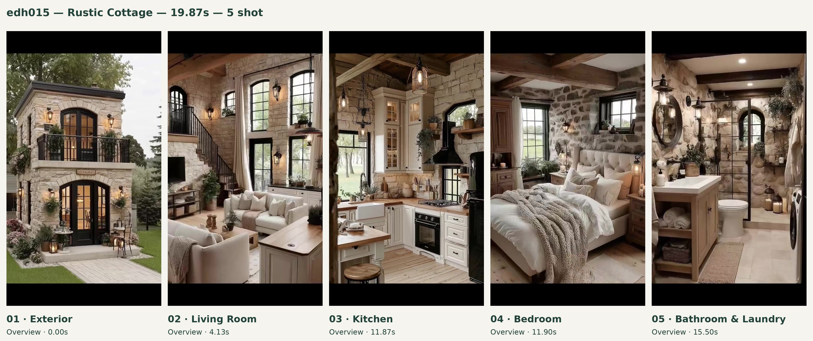
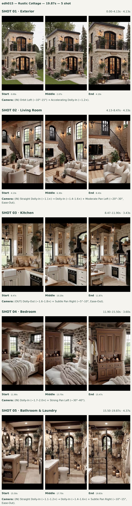
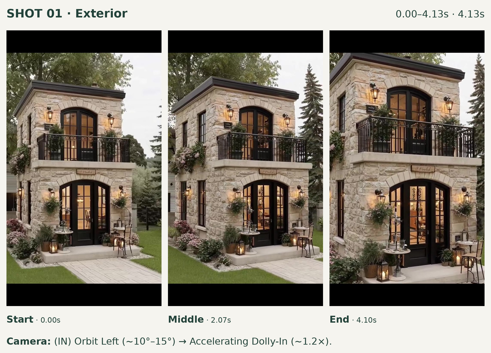
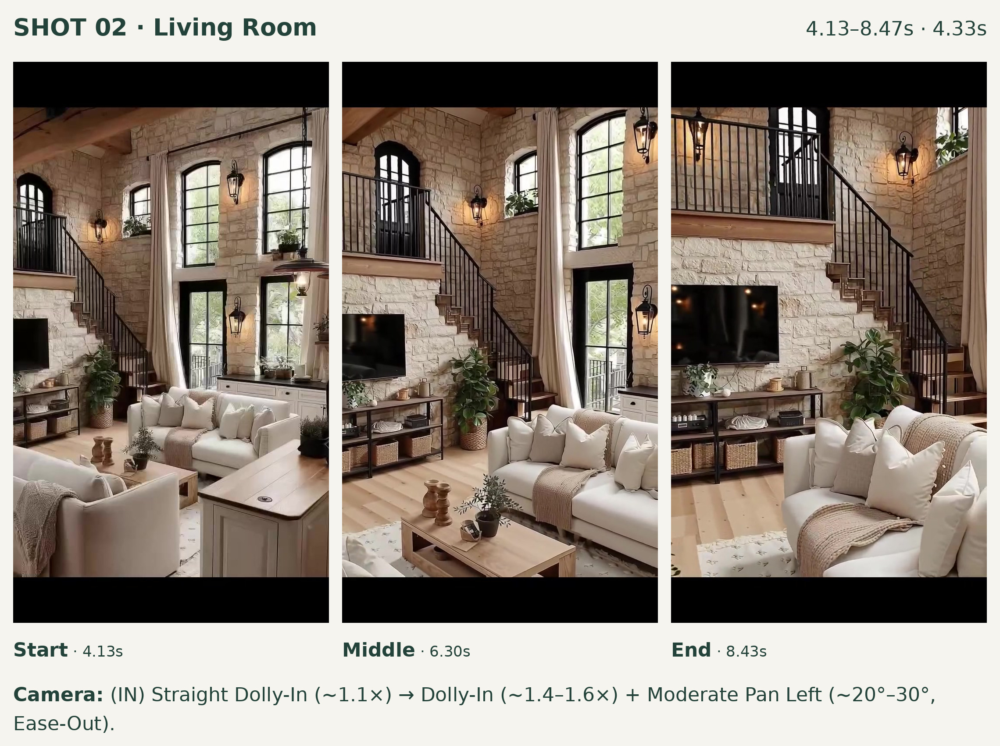
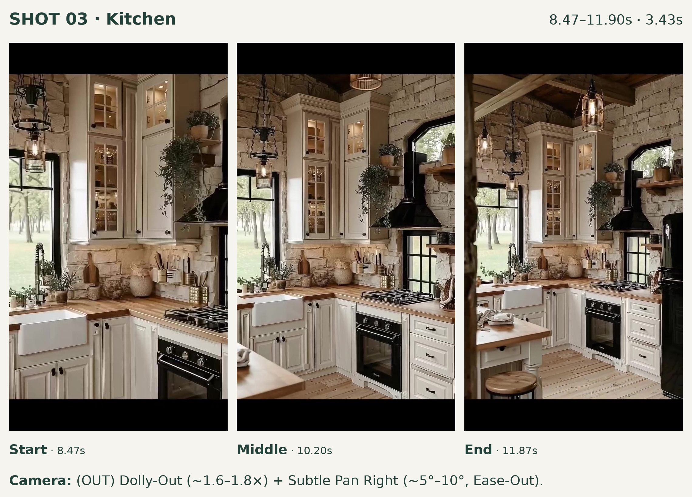
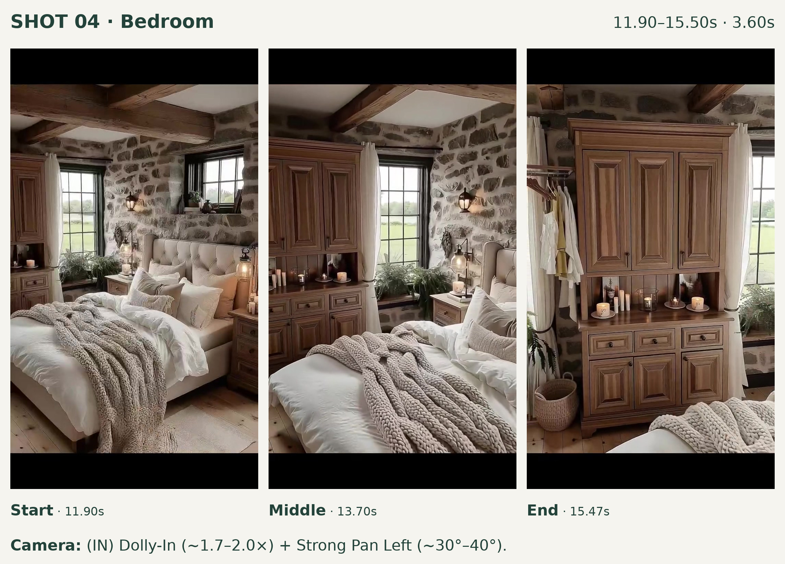
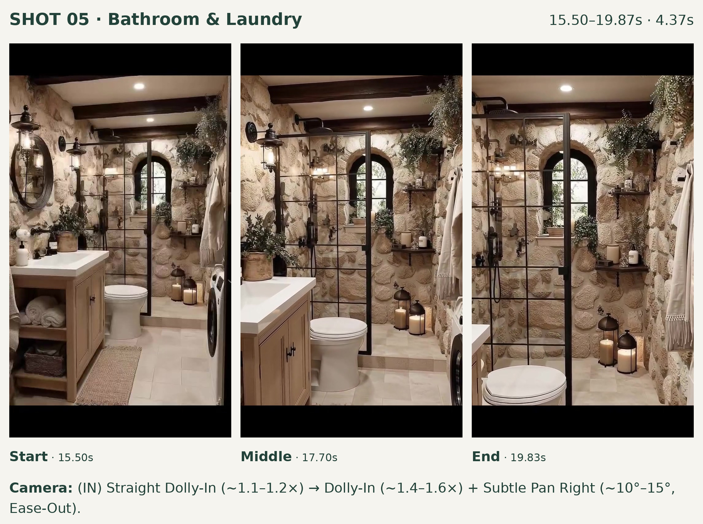

# edh015 — Rustic Stone Cottage dengan Balkon dan Living Double-Height

## 1. Profil desain

- **Nama desain:** Rustic Stone Cottage dengan Balkon dan Living Double-Height
- **Tipe rumah:** Cottage
- **Gaya utama:** **Rustic Cottage**
- **Pengaruh gaya:** European Country
- **Gaya interior:** Rustic Country
- **Susunan ruang utama:** Living tinggi dengan tangga; kitchen, bedroom dan bathroom & laundry tampak sebagai shot terpisah
- **Ciri khas:** Balkon besi gelap, lengkungan berulang, balok ekspos tampak dan tekstur batu
- **Material utama:** Permukaan bertekstur batu krem, kayu cokelat dan metal hitam tampak
- **Pencahayaan:** Cahaya siang dari bukaan, lampu dinding dan gantung hangat
- **Atmosfer:** Hangat, intim dan bernuansa pedesaan
- **Lingkungan:** Rumput, pepohonan dan tanaman berbunga di sekitar fasad

### Palet warna

| Peran | Warna | HEX |
| --- | --- | --- |
| Dominan | Krem batu | `#C4B39A` |
| Pendamping | Ivory | `#E8E1D3` |
| Pendamping | Cokelat kayu | `#876446` |
| Aksen | Arang hitam | `#282824` |
| Aksen | Hijau zaitun | `#66704B` |

## 2. Ukuran & proporsi

| Aspek | Estimasi visual |
| --- | --- |
| **Ukuran rumah** | small |
| **Bentuk bangunan** | Massa vertikal kompak dua tingkat |
| **Lantai & bentuk atap** | Dua tingkat tampak pada fasad; living bervolume tinggi dengan landing tangga. · Garis atap landai dengan lis gelap; bentuk penuh tidak terlihat |
| **Tapak bangunan** | Massa kompak cenderung persegi panjang; kedalaman tidak terukur. |
| **Proporsi utama** | Fasad sempit dan tinggi; balkon atas hampir selebar muka. |
| **Perkiraan luas lantai** | **65–110 m²** |

## 3. Shot Timeline

Durasi 19.87s · 5 shot.

**Camera Pattern:** IN – IN – OUT – IN – IN.

| Shot | Time (s) | Duration | Area/Scene | Camera Movement |
| --- | --- | --- | --- | --- |
| 01 | 0.00–4.13 | 4.13s | Exterior | Orbit Left (~10°–15°) → Accelerating Dolly-In (~1.2×). |
| 02 | 4.13–8.47 | 4.33s | Living Room | Straight Dolly-In (~1.1×) → Dolly-In (~1.4–1.6×) + Moderate Pan Left (~20°–30°, Ease-Out). |
| 03 | 8.47–11.90 | 3.43s | Kitchen | Dolly-Out (~1.6–1.8×) + Subtle Pan Right (~5°–10°, Ease-Out). |
| 04 | 11.90–15.50 | 3.60s | Bedroom | Dolly-In (~1.7–2.0×) + Strong Pan Left (~30°–40°). |
| 05 | 15.50–19.87 | 4.37s | Bathroom & Laundry | Straight Dolly-In (~1.1–1.2×) → Dolly-In (~1.4–1.6×) + Subtle Pan Right (~10°–15°, Ease-Out). |

## 4. Overview

**Shot 01 · Exterior · 0.00s**

> Di luar, di depan rumah sedikit ke kiri. Menghadap fasad dan sisi kiri. Wide seluruh fasad dengan konteks taman.

**Shot 02 · Living Room · 4.13s**

> Di tepi living, dekat counter foreground. Menghadap area duduk, bukaan kanan dan tangga belakang. Wide ruang duduk dan volume tinggi.

**Shot 03 · Kitchen · 11.87s**

> Dekat sudut bidang kerja. Menghadap sink kiri dan range kanan. Pada akhir gerakan mundur, kamera berada lebih jauh dari sudut bidang kerja. Wide sudut kitchen dengan meja depan.

**Shot 04 · Bedroom · 11.90s**

> Di dekat kaki ranjang. Menghadap kepala ranjang dan lemari di kiri. Wide ranjang dengan jendela dan sebagian lemari.

**Shot 05 · Bathroom & Laundry · 15.50s**

> Di awal ruang, dekat vanity dan laundry. Menghadap shower dan jendela di ujung. Wide ruang mandi dengan fungsi laundry di tepi.

## 5. Storyboard

## 6. Shot Details

### Shot 01 · Exterior

**Time:** 0.00–4.13s · **Duration:** 4.13s

#### **A. Desain area**

**Arsitektur**

> Massa dua tingkat kompak dengan bidang batu krem, lis atap gelap, pintu ganda lengkung di bawah balkon dan bukaan atas berbingkai hitam. Balkon memiliki pagar vertikal, teras depan tersambung jalur paving.

**Furnitur & dekorasi**

> Kursi kecil, meja dan lentera berada di teras; lampu dinding mengapit bukaan, tanaman pot dan rambat di balkon.

**Lingkungan**

> Rumput mengapit jalur; pohon tinggi menjadi latar, bed tanaman berbunga di sisi kiri fasad.

#### **B. Framing & Lighting**

- **Fokus:** Fasad dan bukaan lengkung.
- **Camera Start:** Di luar, di depan rumah sedikit ke kiri. · Menghadap fasad dan sisi kiri. · oblique · Sekitar tinggi mata; estimasi visual. · Hampir level, sedikit mengarah ke atas.
- **Framing:** Wide seluruh fasad dengan konteks taman. → Lebih rapat pada balkon dan pintu depan.
- **Lighting:** Siang lembut dengan lampu dinding hangat.
- **Foreground dan kedalaman:** Paving dan rumput. · Teras, balkon dan pepohonan membentuk lapisan.
- **Reveal:** Sisi kiri lalu detail pintu dan balkon.
- **Kesesuaian gerak:** Orbit membuka sisi kiri; Dolly-In mengurangi konteks tapak.

#### **C. Camera Movement**

Kamera mula-mula mengitari fasad ke kiri, kemudian pendekatan makin nyata ke muka rumah.

**Tempo:** Sedang dan halus; sapuan lateral mereda, pendekatan menguat di paruh akhir.

**Movement Timeline**

| Time (s) | Area & fokus | Camera Movement | Tempo |
| --- | --- | --- | --- |
| 0.00–1.50 | Exterior · Fasad, sudut kiri dan balkon | Orbit Left (~10°–15°) | Sedang dan halus; sapuan lateral mereda, pendekatan menguat di paruh akhir. |
| 1.50–4.13 | Exterior · Pintu depan dan balkon | Accelerating Dolly-In (~1.2×) | Sedang dan halus; sapuan lateral mereda, pendekatan menguat di paruh akhir. |

**Camera:** Orbit Left (~10°–15°) → Accelerating Dolly-In (~1.2×).

---

### Shot 02 · Living Room

**Time:** 4.13–8.47s · **Duration:** 4.33s

#### **A. Desain area**

**Arsitektur**

> Volume living tinggi dengan dinding tampak batu krem, bukaan tinggi berkisi hitam dan pintu kaca di kanan. Tangga kayu dengan railing hitam naik di sepanjang dinding kiri-belakang menuju landing atas.

**Furnitur & dekorasi**

> Dua sofa krem menghadap meja kopi kayu, TV pada dinding kiri di atas konsol terbuka; bantal, karpet dan tanaman pot melembutkan ruang.

**Lingkungan**

> Cahaya jendela memperlihatkan vegetasi di luar; detail tapak tidak jelas.

#### **B. Framing & Lighting**

- **Fokus:** Area duduk, TV dan tangga.
- **Camera Start:** Di tepi living, dekat counter foreground. · Menghadap area duduk, bukaan kanan dan tangga belakang. · oblique · Sekitar tinggi mata. · Nyaris level.
- **Framing:** Wide ruang duduk dan volume tinggi. → Medium-wide TV, sofa kanan dan tangga.
- **Lighting:** Cahaya jendela dan sconce hangat.
- **Foreground dan kedalaman:** Counter dan punggung sofa. · Sofa, meja kopi, TV, tangga dan landing.
- **Reveal:** TV dan tangga lebih dominan setelah sapuan kiri.
- **Kesesuaian gerak:** Dolly-In dan Pan Left membawa fokus dari bukaan ke tangga.

#### **C. Camera Movement**

Kamera mendekat dari sisi counter ke ruang duduk, kemudian arah pandang menyapu kiri menuju TV dan tangga.

**Tempo:** Sedang; pendekatan kontinu, sapuan kiri menguat di tengah dan mereda relatif pada akhir.

**Movement Timeline**

| Time (s) | Area & fokus | Camera Movement | Tempo |
| --- | --- | --- | --- |
| 4.13–5.00 | Living Room · Sofa dan meja ruang duduk | Straight Dolly-In (~1.1×) | Sedang; pendekatan kontinu, sapuan kiri menguat di tengah dan mereda relatif pada akhir. |
| 5.00–8.47 | Living Room · Tangga, TV dan sofa | Dolly-In (~1.4–1.6×) + Moderate Pan Left (~20°–30°, Ease-Out) | Sedang; pendekatan kontinu, sapuan kiri menguat di tengah dan mereda relatif pada akhir. |

**Camera:** Straight Dolly-In (~1.1×) → Dolly-In (~1.4–1.6×) + Moderate Pan Left (~20°–30°, Ease-Out).

---

### Shot 03 · Kitchen

**Time:** 8.47–11.90s · **Duration:** 3.43s

#### **A. Desain area**

**Arsitektur**

> Kabinet krem membentuk bidang kerja sudut; sink di bawah jendela kiri, range/oven di kanan dengan hood hitam. Dinding tampak batu terang, plafon dengan balok cokelat dan lantai tampak papan kayu.

**Furnitur & dekorasi**

> Sink apron putih, kabinet panel dengan sebagian pintu kaca, kompor dan oven gelap, hood hitam, lemari pendingin di kanan. Meja kerja dan bangku tampak di foreground kiri; hubungan meja dengan kabinet belum jelas.

**Lingkungan**

> Pohon dan rumput terlihat lewat jendela sink; lampu gantung memberi aksen hangat.

#### **B. Framing & Lighting**

- **Fokus:** Bidang kerja sudut.
- **Camera Start:** Dekat sudut bidang kerja. · Menghadap sink kiri dan range kanan. · oblique · Sekitar tinggi mata. · Hampir level.
- **Framing:** Close-medium area sink dan kabinet. → Wide sudut kitchen dengan meja depan.
- **Lighting:** Cahaya siang dari jendela dan lampu gantung.
- **Foreground dan kedalaman:** Counter dan sink dekat. · Kabinet sudut, jendela dan alat masak.
- **Reveal:** Meja foreground, plafon dan pendingin muncul saat mundur.
- **Kesesuaian gerak:** Dolly-Out memperluas cakupan; Pan Right ringan menyeimbangkan range.

#### **C. Camera Movement**

Kamera mundur dari sudut kabinet dapur, membuka meja, lampu gantung dan lantai dengan sapuan kanan ringan di awal.

**Tempo:** Sedang, cukup lancar; perubahan skala melambat sedikit menjelang akhir, sapuan kanan mereda.

**Camera:** Dolly-Out (~1.6–1.8×) + Subtle Pan Right (~5°–10°, Ease-Out).

---

### Shot 04 · Bedroom

**Time:** 11.90–15.50s · **Duration:** 3.60s

#### **A. Desain area**

**Arsitektur**

> Dinding batu tidak beraturan, plafon berbalok kayu, jendela tinggi dekat lemari dan jendela kecil di atas kepala ranjang; lantai tampak kayu.

**Furnitur & dekorasi**

> Ranjang ber-headboard empuk krem, selimut rajut, bantal berlapis, nakas dan sconce hangat. Lemari kayu berpintu panel dengan rak terbuka dan laci di sisi kiri, rel pakaian terlihat di akhir.

**Lingkungan**

> Lapangan hijau tampak melalui jendela; lampu dinding hangat dan cahaya siang lembut.

#### **B. Framing & Lighting**

- **Fokus:** Ranjang lalu lemari.
- **Camera Start:** Di dekat kaki ranjang. · Menghadap kepala ranjang dan lemari di kiri. · oblique · Sekitar tinggi mata. · Hampir level.
- **Framing:** Wide ranjang dengan jendela dan sebagian lemari. → Medium pada lemari; ujung ranjang terpotong.
- **Lighting:** Cahaya jendela dan sconce hangat.
- **Foreground dan kedalaman:** Ujung ranjang dan selimut. · Ranjang, lemari, jendela dan dinding batu.
- **Reveal:** Lemari serta rel pakaian menjadi dominan.
- **Kesesuaian gerak:** Dolly-In + Pan Left mengalihkan fokus dari ranjang ke penyimpanan.

#### **C. Camera Movement**

Kamera mendekat sambil menyapu kiri dari ranjang ke lemari kayu.

**Tempo:** Relatif cepat untuk durasi 3.6 s; sapuan dan pendekatan menguat di tengah, tetap aktif menjelang cut.

**Camera:** Dolly-In (~1.7–2.0×) + Strong Pan Left (~30°–40°).

---

### Shot 05 · Bathroom & Laundry

**Time:** 15.50–19.87s · **Duration:** 4.37s

#### **A. Desain area**

**Arsitektur**

> Ruang memanjang dengan dinding batu, balok gelap dan lantai terang. Shower walk-in di ujung dengan partisi kaca bergrid hitam dan jendela lengkung; vanity di kiri, laundry tampak di kanan.

**Furnitur & dekorasi**

> Vanity kayu dengan wastafel putih dan rak handuk, cermin oval; toilet putih sebelum shower, rak kecil, lentera dan tanaman. Mesin laundry bukaan depan tampak di tepi kanan awal.

**Lingkungan**

> Cahaya siang lewat jendela lengkung bercampur downlight dan lampu dekoratif; luar tidak cukup terlihat untuk menilai tapak.

#### **B. Framing & Lighting**

- **Fokus:** Shower dan jendela lengkung.
- **Camera Start:** Di awal ruang, dekat vanity dan laundry. · Menghadap shower dan jendela di ujung. · frontal · Sekitar tinggi mata. · Nyaris level.
- **Framing:** Wide ruang mandi dengan fungsi laundry di tepi. → Medium-close shower dan jendela.
- **Lighting:** Cahaya jendela, downlight dan lampu dekoratif.
- **Foreground dan kedalaman:** Vanity kiri dan mesin laundry kanan. · Vanity, toilet, partisi dan jendela shower.
- **Reveal:** Partisi, jendela lengkung, rak dan lentera.
- **Kesesuaian gerak:** Dolly-In lalu Pan Right memperjelas shower dan mengurangi foreground.

#### **C. Camera Movement**

Kamera maju menuju shower, kemudian menyapu kanan ringan sehingga shower dan jendela menjadi fokus.

**Tempo:** Sedang dan stabil; pendekatan terus berjalan, sapuan kanan menguat sekitar pertengahan lalu mereda.

**Movement Timeline**

| Time (s) | Area & fokus | Camera Movement | Tempo |
| --- | --- | --- | --- |
| 15.50–16.80 | Bathroom & Laundry · Vanity, toilet dan shower | Straight Dolly-In (~1.1–1.2×) | Sedang dan stabil; pendekatan terus berjalan, sapuan kanan menguat sekitar pertengahan lalu mereda. |
| 16.80–19.87 | Bathroom & Laundry · Kusen shower dan jendela lengkung | Dolly-In (~1.4–1.6×) + Subtle Pan Right (~10°–15°, Ease-Out) | Sedang dan stabil; pendekatan terus berjalan, sapuan kanan menguat sekitar pertengahan lalu mereda. |

**Camera:** Straight Dolly-In (~1.1–1.2×) → Dolly-In (~1.4–1.6×) + Subtle Pan Right (~10°–15°, Ease-Out).
