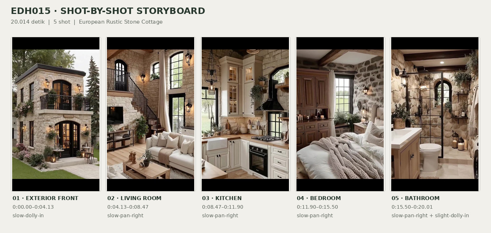
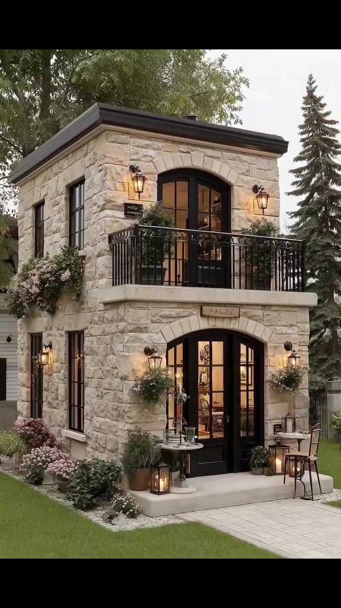
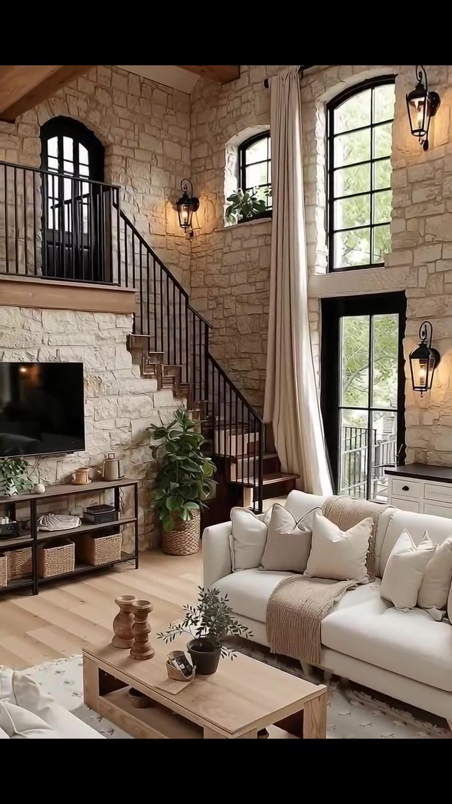
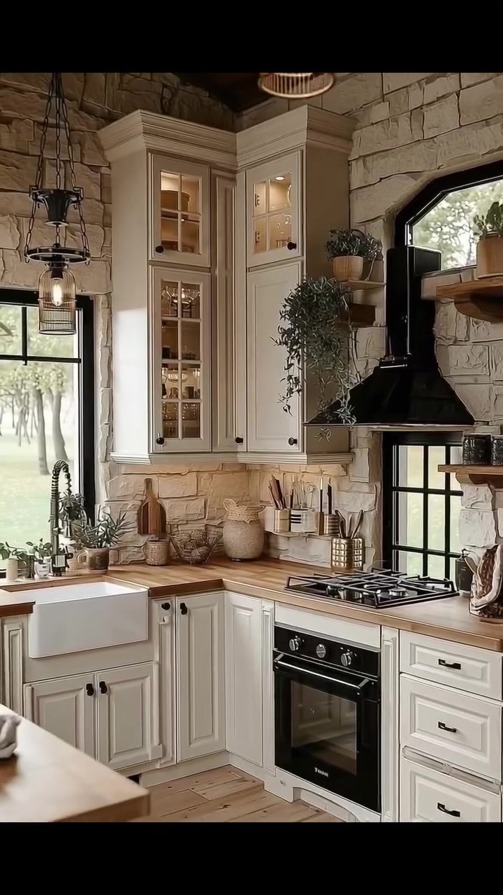
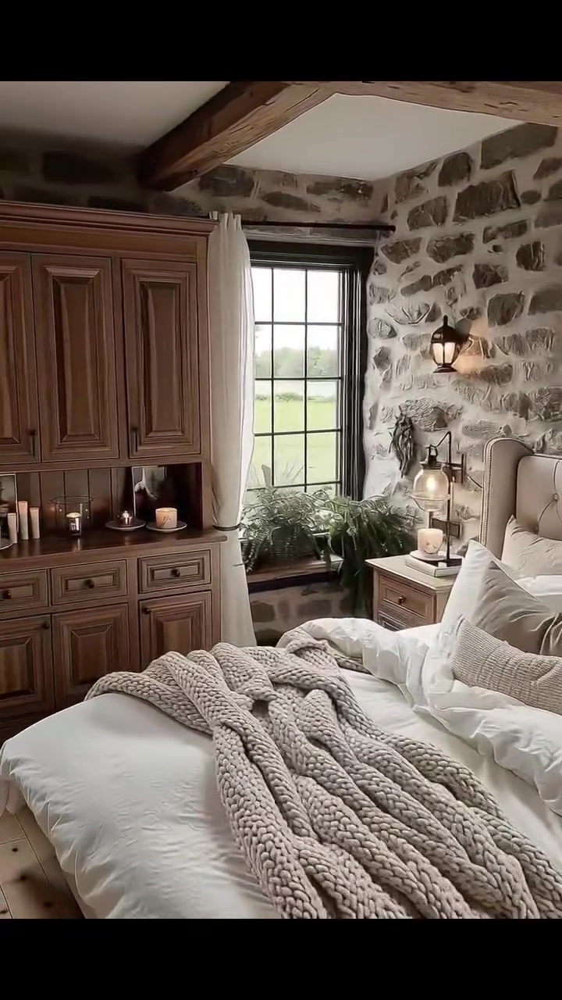
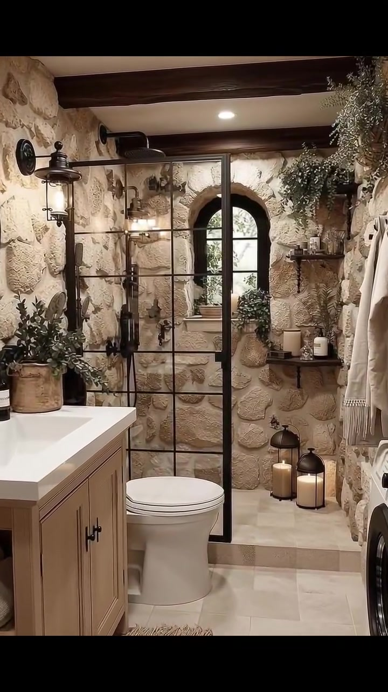

# edh015 — European Rustic Stone Cottage

<!-- homeku_request_id: edh015-20261104-001 -->

<!-- homeku_detail_narratives: chat-reviewed -->

**Sumber data:** [analysis.yaml](analysis.yaml) · **Status:** draft · **Diverifikasi manusia:** Tidak

## 1. Informasi Video

| Informasi | Nilai |
|---|---|
| ID | edh015 |
| File asli | edh015.mp4 |
| Durasi | 20.014 |
| Resolusi | 720x1280 |
| FPS | 30 |
| Rasio | 9:16 |
| Jumlah shot | 5 |

## 2. Storyboard Gabungan

## 3. Identitas Desain

| Aspek | Hasil analisis |
|---|---|
| Gaya utama | european rustic stone cottage |
| Wilayah terkait gaya desain | europe, north america |
| Pengaruh gaya | french country, english cottage, rustic farmhouse |
| Ciri eksterior | narrow two story stone appearance facade, pale beige irregular stone appearance cladding, dark low slope roof edge, upper black framed arched glazed double doors, projecting upper balcony with black metal railing, ground floor black framed arched glazed double entry, warm wall mounted lantern sconces, stone planter boxes and flowing greenery near balcony |
| Gaya interior | rustic stone walled rooms, exposed natural wood ceiling beams, creamy neutral fabric furnishings, warm wood cabinetry and flooring, black metal window frames and fixtures, country style kitchen with cream cabinets |
| Confidence gaya | medium |

## 4. Ukuran & Proporsi Bangunan

| Aspek | Estimasi visual |
|---|---|
| Ukuran yang terlihat | small |
| Bentuk bangunan | compact rectangular |
| Skala vertikal | two story with double height interior appearance |
| Tapak bangunan | compact |
| Perkiraan luas lantai | 65–110 m² |
| Confidence | low |

> Luas adalah perkiraan visual, bukan ukuran terukur.

## 5. Warna, Pencahayaan, dan Atmosfer

| Warna dominan | HEX (perkiraan) |
|---|---|
| warm limestone beige | #C6B69C |
| soft cream | #E7DDCC |
| warm natural wood brown | #987354 |
| charcoal black | #282724 |
| muted leaf green | #65745B |

| Aspek | Hasil analisis |
|---|---|
| Pencahayaan | soft overcast appearing daylight, warm wall lanterns and pendant lights, daylight through black framed windows |
| Lingkungan | compact house amid green lawn and mature trees, planted borders and stone edge landscaping, partially visible green outdoor views through windows |
| Musim yang tampak | green foliage season undetermined |
| Mood | cozy, rustic, inviting, warm, serene |

## 6. Struktur dan Timeline Video

**Jenis:** home tour · **Tempo:** moderate · **Transisi:** hard cuts between scenes

| Shot | Waktu (detik) | Durasi | Area/Scene | Gerakan Kamera |
|---|---|---|---|---|
| Shot 01 | 0.0–4.133 | 4.13 | exterior front | slow dolly in |
| Shot 02 | 4.133–8.467 | 4.33 | living room | slow pan right |
| Shot 03 | 8.467–11.9 | 3.43 | kitchen | slow pan right |
| Shot 04 | 11.9–15.5 | 3.60 | bedroom | slow pan right |
| Shot 05 | 15.5–20.014 | 4.51 | bathroom | slow pan right, slight dolly in |

## 7. Analisis per Shot

### Shot 01 — exterior front

**Waktu:** 0.0–4.133 detik

| Komponen | Pengamatan |
|---|---|
| Fokus utama | narrow two story stone cottage facade |
| Framing awal → akhir | wide front three quarter view → closer front facade view |
| Sudut pandang | slightly low front left three quarter |
| Gerakan kamera | slow dolly in |
| Kecepatan kamera | slow |
| Pencahayaan | soft daylight with warm exterior lanterns |
| Transisi keluar | hard cut |

**Detail yang terlihat**

**Arsitektur**

Bangunan tampak kompak dan menjulang dua lantai dengan massa persegi panjang, dibalut permukaan menyerupai batu alam tak beraturan berwarna krem muda. Tepi atap yang landai berwarna arang gelap membingkai bagian atas. Di lantai dua terdapat sepasang pintu kaca lengkung berbingkai hitam yang membuka ke balkon menjorok, dengan pagar logam hitam bergaris vertikal dan alas balkon batu terang yang tebal. Di bawahnya, pintu masuk utama juga berupa pintu kaca ganda berlengkung dan berbingkai hitam; jendela sempit dengan bingkai senada terlihat pada sisi kiri bangunan. Lampu dinding model lentera mengapit bukaan di kedua tingkat, sementara cahaya kuning hangat terlihat dari balik pintu kaca.

**Furnitur dan properti**

Rangkaian tanaman hijau dan bunga menjuntai di kedua sisi pagar balkon, disertai keranjang tanaman gantung di sekitar pintu masuk lantai dasar. Di kiri pintu terdapat meja bundar kecil berkaki tunggal berwarna gelap; pada sisi kanan tampak dua kursi luar ruang bersama sebuah meja kecil. Pot\-pot tanaman berkumpul di kaki fasad, dan beberapa lentera dekoratif menyala diletakkan dekat ambang masuk.

**Lingkungan**

Halaman rumput hijau yang rapi membentang di depan dan sisi kanan rumah. Jalur pijakan berwarna pucat mengarah lurus ke pintu masuk, sedangkan semak berbunga rendah dan tepi batu terang menghiasi kaki fasad di sebelah kiri. Tajuk pohon rindang menaungi bagian kiri atas rumah, pohon\-pohon hijau gelap yang tinggi tampak di belakang dan kanan, serta beberapa semak kecil tumbuh di sisi kanan bangunan. Langit di atas atap terlihat terang dan cenderung berawan.

**Catatan pengamatan:** Kamera mendekati fasad; identitas batu dan luas bangunan hanya berdasarkan tampilan, bukan verifikasi material atau ukuran.

**Confidence:** Kamera medium · Detail visual high

### Shot 02 — living room

**Waktu:** 4.133–8.467 detik

| Komponen | Pengamatan |
|---|---|
| Fokus utama | double height stone living room with stairs and seating |
| Framing awal → akhir | wide double height living area → medium wide view of stair and seating |
| Sudut pandang | eye level with upward view to mezzanine |
| Gerakan kamera | slow pan right |
| Kecepatan kamera | slow |
| Pencahayaan | soft window daylight mixed with warm wall lanterns |
| Transisi keluar | hard cut |

**Detail yang terlihat**

**Arsitektur**

Ruang keluarga memiliki dinding tinggi dua lantai dengan permukaan batu berwarna pucat dan tekstur kasar. Jendela\-jendela tinggi bersekat hitam serta sebuah pintu kaca tinggi di bagian bawah membawa cahaya ke ruangan. Pada lantai mezzanine tampak pintu hitam berlengkung dan pagar pengaman logam gelap. Sebuah tangga berkerangka logam gelap dengan pijakan menyerupai kayu naik di salah satu sisi ruang. Langit\-langit memperlihatkan balok dan papan kayu hangat, sedangkan lantai berupa papan berpenampilan kayu terang. Tirai panjang berwarna muda mengapit bukaan tinggi. Televisi layar datar hitam terpasang pada dinding batu, dan beberapa lampu dinding model lentera hitam mengikuti susunan dinding tersebut.

**Furnitur dan properti**

Sofa tiga dudukan berlapis kain krem dilengkapi beberapa bantal pucat, berhadapan dengan kursi berlengan berwarna muda di bagian depan; sebagian kursi lain tampak di sisi kanan. Meja kopi kayu persegi panjang berdiri di tengah kelompok duduk, di atas karpet besar bernuansa netral terang. Di bawah televisi terdapat konsol rendah memanjang dengan rak terbuka dari kayu dan rangka logam hitam. Vas kecil serta tanaman dekoratif diletakkan di meja dan konsol, sementara tanaman pot berdaun besar berada dekat tangga. Lampu\-lampu lentera di dinding memancarkan cahaya jingga hangat.

**Lingkungan**

Melalui jendela\-jendela tinggi berbingkai hitam terlihat cahaya siang dan kehijauan di luar. Pepohonan dan bagian halaman rumput juga tampak samar melewati pintu kaca di tingkat bawah.

**Catatan pengamatan:** Panorama bergerak ke kanan, sehingga tangga, pagar mezzanine, dan detail area duduk muncul bergantian.

**Confidence:** Kamera medium · Detail visual high

### Shot 03 — kitchen

**Waktu:** 8.467–11.9 detik

| Komponen | Pengamatan |
|---|---|
| Fokus utama | cream country kitchen with black range and wood countertops |
| Framing awal → akhir | medium view of sink and cabinetry → wider view including range and side counter |
| Sudut pandang | eye level three quarter kitchen view |
| Gerakan kamera | slow pan right |
| Kecepatan kamera | slow |
| Pencahayaan | natural window daylight with warm pendant and cabinet lights |
| Transisi keluar | hard cut |

**Detail yang terlihat**

**Arsitektur**

Dinding dan backsplash dapur memperlihatkan permukaan menyerupai batu tidak beraturan berwarna pucat. Kabinet bawah bergaya shaker berwarna krem memakai kenop gelap, dengan lemari atas tinggi berpintu kaca untuk memajang isinya. Countertop tampak seperti kayu bernuansa hangat. Bak cuci putih bermuka apron berada di bawah jendela hitam, dilengkapi keran leher angsa hitam yang tinggi. Kompor gas dan oven berwarna hitam berada di bawah tudung hisap hitam yang melebar ke bawah pada dinding batu. Bukaan jendela berbingkai hitam memasukkan cahaya dari luar; rak kayu terbuka terpasang di sisi kanan tudung. Lantai berupa papan berpenampilan kayu terang dan sebuah balok kayu tampak di bagian atas ruangan.

**Furnitur dan properti**

Peralatan makan dan gelas terlihat di balik pintu kaca kabinet atas. Talenan dengan nuansa tembaga dan kayu, wadah alat masak, serta botol kecil menghiasi countertop di sekitar kompor. Pot tanaman kecil dan tanaman menjuntai berada dekat jendela serta bagian atas lemari. Lampu gantung logam gelap menerangi meja kerja, sementara sebuah panci atau teko pucat terlihat di atas kompor. Di depan ada perpanjangan counter kecil berwarna kayu muda dengan bangku bundar di bawah tepinya. Cangkir dan peralatan makan putih juga tertata pada rak terbuka.

**Lingkungan**

Dari jendela dapur terlihat cahaya siang yang pucat dan sebagian pepohonan di luar bangunan.

**Catatan pengamatan:** Material countertop, lantai, dan batu dinilai menurut penampakan; kamera menampilkan lebih banyak sisi kanan dapur di akhir shot.

**Confidence:** Kamera medium · Detail visual high

### Shot 04 — bedroom

**Waktu:** 11.9–15.5 detik

| Komponen | Pengamatan |
|---|---|
| Fokus utama | cream tufted bed and tall natural wood armoire |
| Framing awal → akhir | medium wide bed and stone wall view → medium view of wood armoire and bed edge |
| Sudut pandang | eye level three quarter interior |
| Gerakan kamera | slow pan right |
| Kecepatan kamera | slow |
| Pencahayaan | soft daylight with warm bedside lantern glow |
| Transisi keluar | hard cut |

**Detail yang terlihat**

**Arsitektur**

Kamar tidur berdinding permukaan batu kasar abu\-abu krem, dengan balok\-balok langit\-langit kayu besar berwarna cokelat hangat gelap dan bidang plafon putih di antaranya. Jendela tinggi bersekat hitam disertai tirai krem, serta jendela lebih kecil yang terletak tinggi pada dinding dekat tempat tidur. Lantai memperlihatkan papan berpenampilan kayu terang. Elemen lemari tinggi berwarna kayu alami menempati salah satu sisi ruang. Lampu dinding model lentera dari logam hitam mengeluarkan cahaya hangat dekat tempat tidur.

**Furnitur dan properti**

Tempat tidur berukuran besar memiliki sandaran empuk krem dengan kancing dekoratif dan tumpukan seprai serta bantal putih\-gading. Selimut rajut tebal berwarna beige tersampir di ujung ranjang. Meja samping tempat tidur dari kayu terang berada di kedua sisi, dilengkapi lampu kecil bercahaya dan lilin dekoratif. Saat kamera bergerak tampak lemari pakaian kayu tinggi berpintu panel berukir dengan laci di bagian bawah, sementara lilin dan benda dekoratif kecil mengisi ceruk terbukanya. Tanaman pakis dan tanaman hijau kecil ditempatkan dekat jendela, karpet tenun pucat terlihat di lantai, dan pakaian berwarna muda tergantung di dekat lemari.

**Lingkungan**

Rumput hijau serta pepohonan yang lebih jauh terlihat melalui jendela tinggi. Cahaya siang yang lembut juga masuk dari jendela kecil bersekat hitam di atas area sisi tempat tidur.

**Catatan pengamatan:** Kamera bergeser ke kanan dari ranjang menuju lemari tinggi; ukuran dan material furnitur tidak diukur langsung.

**Confidence:** Kamera medium · Detail visual high

### Shot 05 — bathroom

**Waktu:** 15.5–20.014 detik

| Komponen | Pengamatan |
|---|---|
| Fokus utama | stone walled bathroom with black framed shower |
| Framing awal → akhir | medium wide view of vanity to shower → tighter centered shower and window view |
| Sudut pandang | eye level front three quarter interior |
| Gerakan kamera | slow pan right, slight dolly in |
| Kecepatan kamera | slow |
| Pencahayaan | warm recessed and wall lights with daylight from arched window |
| Transisi keluar | end of video |

**Detail yang terlihat**

**Arsitektur**

Kamar mandi menggunakan dinding bertekstur menyerupai batu tidak beraturan berwarna beige pucat dan ubin lantai persegi krem pucat. Plafon putih disilang balok kayu gelap. Area shower dipisahkan oleh panel kaca bening dengan kisi\-kisi rangka hitam, serta dilengkapi shower hujan di bagian atas dan semprotan tangan beserta selang gelap. Jendela sempit dengan puncak lengkung dan bingkai hitam berada di dalam area shower. Lampu tanam bulat putih tampak pada plafon, rak\-rak terbuka kayu dipasang di dinding batu di kanan jendela, dan kabinet wastafel dengan tampilan kayu terdapat di bagian depan kiri.

**Furnitur dan properti**

Wastafel persegi panjang putih menempati kabinet di sisi kiri depan, sementara sebagian cermin oval berbingkai gelap terlihat pada dinding. Kloset putih berada di depan sekat shower. Handuk krem dilipat di rak terbuka bagian bawah kabinet wastafel, dengan lampu dinding lentera hitam dekat cermin. Tanaman menjuntai tumbuh dari bagian atas rak dekat shower, sedangkan botol dan perlengkapan mandi kecil tersusun pada dua rak dinding. Sepasang lentera lantai hitam berisi lilin krem besar ditempatkan di sudut shower. Handuk atau jubah krem berjumbai tergantung di sebelah kanan, dan sejumlah tanaman kecil berada di rak serta ambang jendela. Karpet tenun sempit berwarna pucat tampak di dekat kloset. Pada tepi kanan juga terlihat sebagian perangkat putih bermuka bundar yang mungkin merupakan peralatan laundry, tetapi jenisnya tidak dapat dipastikan.

**Lingkungan**

Di balik jendela lengkung shower terlihat kehijauan tanaman luar yang kurang tajam.

**Catatan pengamatan:** Pergerakan berakhir pada kabin shower dan jendela lengkung; fungsi peralatan putih di tepi kanan tidak pasti.

**Confidence:** Kamera medium · Detail visual high

## 8. Kualitas dan Ketidakpastian Analisis

| Parameter | Hasil |
|---|---|
| Status | draft |
| Verifikasi manusia | Tidak |
| Ketepatan timestamp | estimated |
| Ketidakpastian | Waktu perpindahan shot diperoleh dari perbedaan frame dan dibulatkan ke tiga desimal., Batu, kayu, dan tekstil dideskripsikan menurut penampakan; material aslinya tidak terbukti., Luas lantai 65–110 m² adalah perkiraan kasar dari proporsi fasad, dengan confidence rendah., Asosiasi gaya Eropa dan Amerika Utara bukan identifikasi lokasi bangunan., Rangkaian interior tidak membuktikan kesinambungan denah seluruh ruang., Objek putih yang terpotong di sisi kanan kamar mandi mungkin perangkat laundry, tetapi tidak dapat dipastikan. |

**Catatan:** Analisis visual sepanjang lima shot; tidak mencakup audio, ide konten, atau prompt generatif.

---

*Laporan ini diturunkan dari [analysis.yaml](analysis.yaml).*
