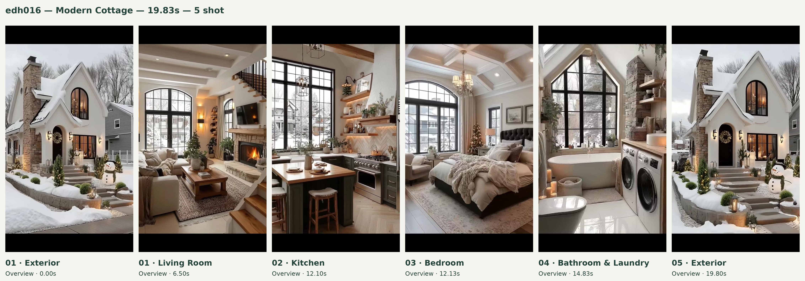
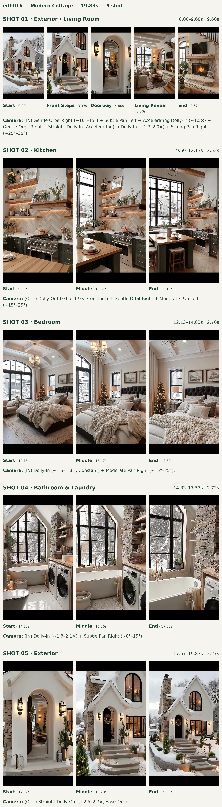
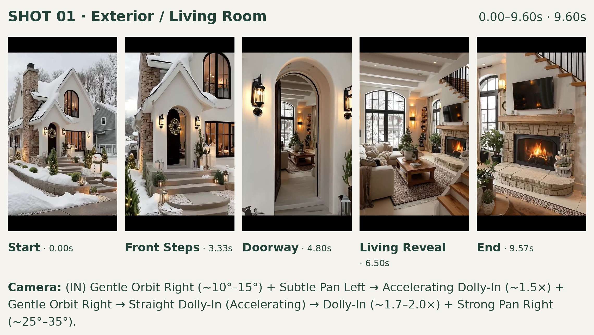
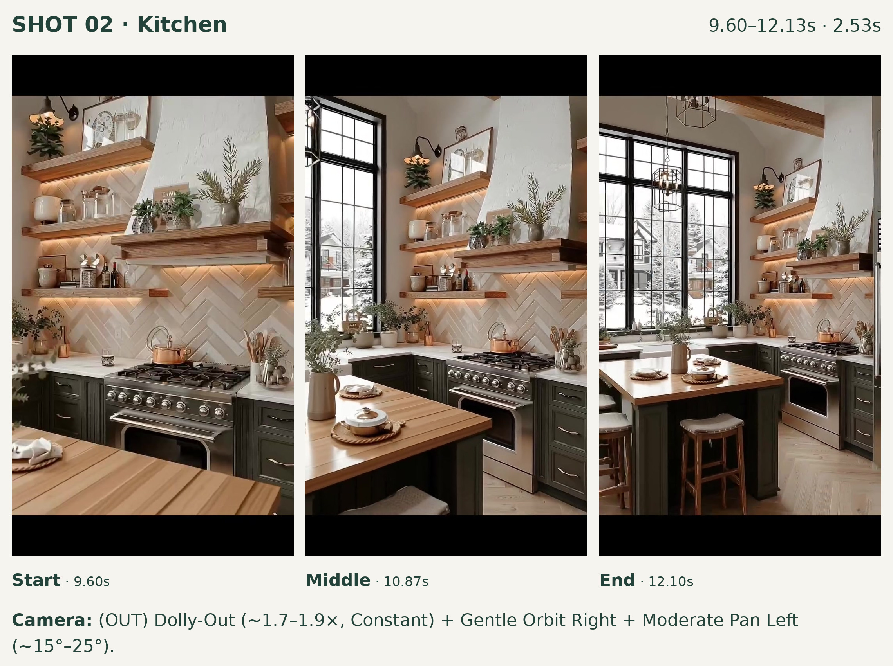
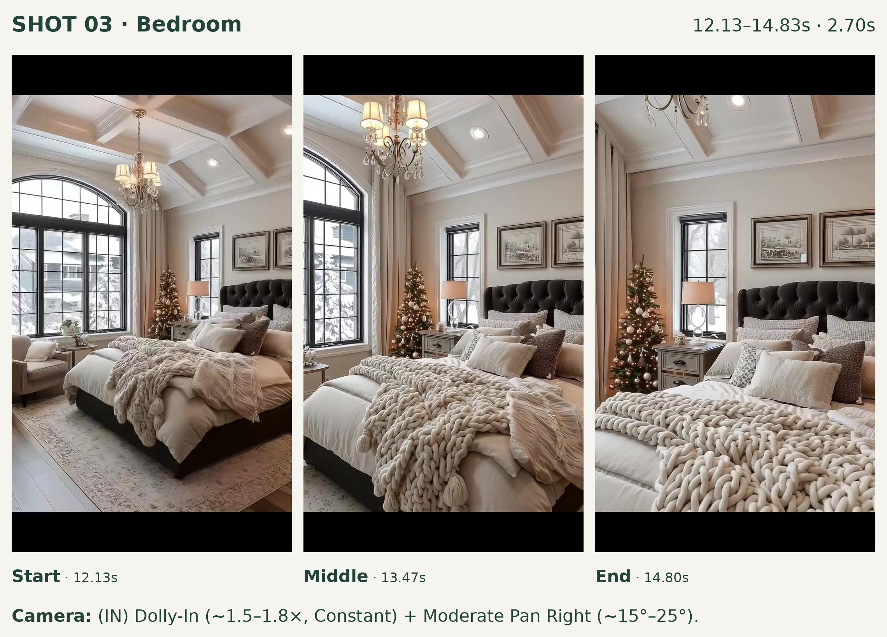
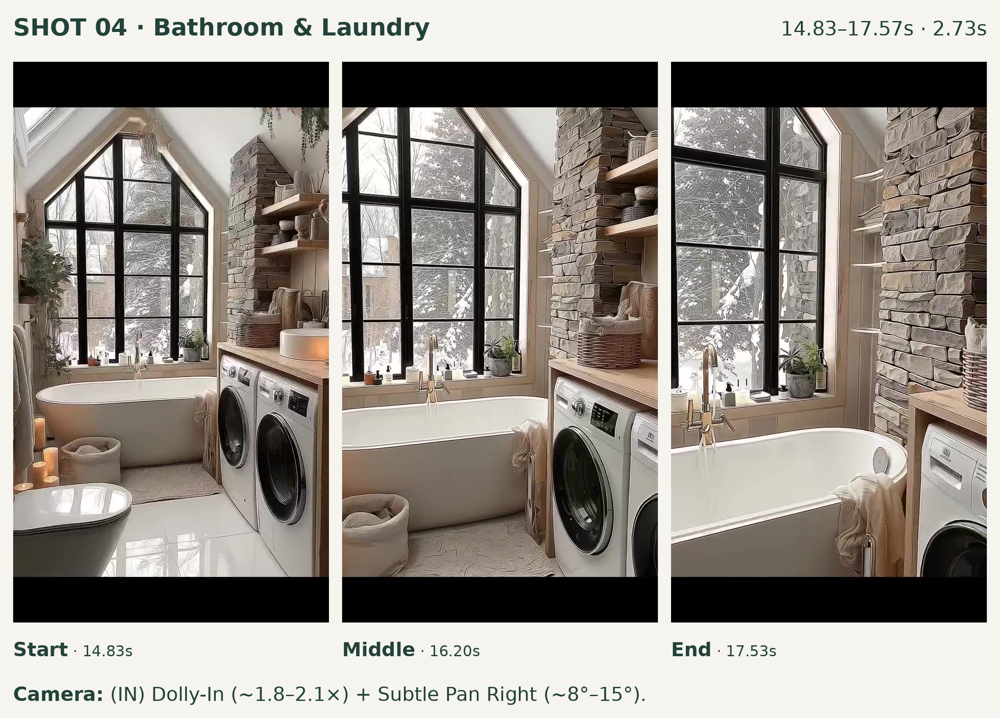
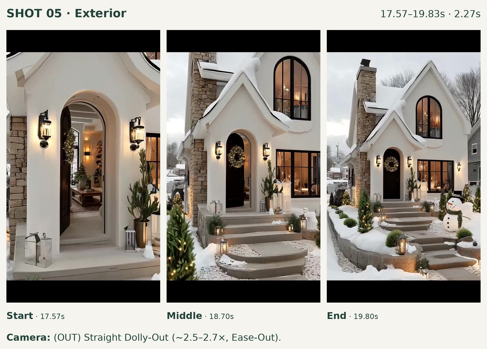

# edh016 — Snowy White Gabled Cottage

## 1. Profil desain

- **Nama desain:** Snowy White Gabled Cottage
- **Tipe rumah:** Cottage
- **Gaya utama:** **Modern Cottage**
- **Pengaruh gaya:** English Cottage; Modern Farmhouse
- **Gaya interior:** Cozy Rustic Modern
- **Susunan ruang utama:** Exterior terhubung langsung melalui entrance ke living; kitchen, bedroom dan bathroom/laundry muncul lewat cut
- **Ciri khas:** Cerobong batu tinggi, fireplace dengan TV, jendela besar berbingkai gelap dan dekorasi musiman
- **Material utama:** Fasad putih halus, tampilan batu susun, kayu hangat dan bingkai hitam
- **Pencahayaan:** Daylight dingin dari jendela besar, sconce dan lampu interior hangat serta api fireplace
- **Atmosfer:** Hangat, nyaman dan meriah dalam suasana musim dingin
- **Lingkungan:** Salju, pohon meranggas, tanaman evergreen dan rumah tetangga tampak

### Palet warna

| Peran | Warna | HEX |
| --- | --- | --- |
| Dominan | Putih hangat | `#E6DFD2` |
| Pendamping | Krem linen | `#CFC0AA` |
| Pendamping | Kayu madu | `#A8794B` |
| Pendamping | Batu taupe | `#8C8071` |
| Aksen | Arang | `#292825` |
| Aksen | Hijau pinus | `#40513B` |

## 2. Ukuran & proporsi

| Aspek | Estimasi visual |
| --- | --- |
| **Ukuran rumah** | medium |
| **Bentuk bangunan** | Massa gable tinggi dan proyeksi entrance beratap gable |
| **Lantai & bentuk atap** | Dua tingkat tampak; tangga interior dan jendela atas · Steep gable roof; permukaan tertutup salju |
| **Tapak bangunan** | Kompak, massa utama dengan proyeksi entrance |
| **Proporsi utama** | Massa tinggi dengan gable curam; fasad relatif sempit |
| **Perkiraan luas lantai** | **90–150 m²** |

## 3. Shot Timeline

Durasi 19.83s · 5 shot.

**Camera Pattern:** IN – OUT – IN – IN – OUT.

| Shot | Time (s) | Duration | Area/Scene | Camera Movement |
| --- | --- | --- | --- | --- |
| 01 | 0.00–9.60 | 9.60s | Exterior / Living Room | Gentle Orbit Right (~10°–15°) + Subtle Pan Left → Accelerating Dolly-In (~1.5×) + Gentle Orbit Right → Straight Dolly-In (Accelerating) → Dolly-In (~1.7–2.0×) + Strong Pan Right (~25°–35°). |
| 02 | 9.60–12.13 | 2.53s | Kitchen | Dolly-Out (~1.7–1.9×, Constant) + Gentle Orbit Right + Moderate Pan Left (~15°–25°). |
| 03 | 12.13–14.83 | 2.70s | Bedroom | Dolly-In (~1.5–1.8×, Constant) + Moderate Pan Right (~15°–25°). |
| 04 | 14.83–17.57 | 2.73s | Bathroom & Laundry | Dolly-In (~1.8–2.1×) + Subtle Pan Right (~8°–15°). |
| 05 | 17.57–19.83 | 2.27s | Exterior | Straight Dolly-Out (~2.5–2.7×, Ease-Out). |

## 4. Overview

**Shot 01 · Exterior · 0.00s**

> Dari halaman pada sudut serong, kamera menghadap massa rumah, gable, cerobong, pintu dan tangga dengan konteks salju.

**Shot 01 · Living Room · 6.50s**

> Dari sisi masuk, kamera menghadap jendela besar dan fireplace; kursi, sofa, meja kopi dan sebagian tangga masuk dalam wide interior.

**Shot 02 · Kitchen · 12.10s**

> Dari sisi luar meja, kamera menghadap area kerja dan jendela; range, rak, kabinet, meja dan stool terlihat bersama.

**Shot 03 · Bedroom · 12.13s**

> Dari sudut kaki ranjang, kamera menghadap diagonal ke jendela dan headboard; ranjang, bukaan besar, chandelier dan dekorasi terlihat.

**Shot 04 · Bathroom & Laundry · 14.83s**

> Dari sisi masuk, kamera menghadap bathtub di bawah jendela gable dan dua mesin laundry di kanan; fungsi gabungan terbaca jelas.

**Shot 05 · Exterior · 19.80s**

> Dari halaman setelah mundur, kamera menghadap fasad hampir frontal; gable, cerobong, tangga dan dekorasi halaman bersalju tercakup.

## 5. Storyboard

## 6. Shot Details

### Shot 01 · Exterior / Living Room

**Time:** 0.00–9.60s · **Duration:** 9.60s

**Shot Type:** Continuous shot · Multi area · No cut.

#### **A. Desain area**

##### **Exterior**

**Arsitektur**

> Massa putih ber-gable curam dengan cerobong bertekstur batu di kiri fasad. Pintu lengkung hitam berada di bawah gable kecil, diapit sconce; tangga bertingkat menghubungkan halaman dengan landing. Jendela atas melengkung tinggi dan bukaan bawah bergrid hitam. Fasad tampak plester halus, bukan material terkonfirmasi.

**Furnitur & dekorasi**

> Pot evergreen, lentera lantai, wreath pada pintu dan dekorasi manusia salju berada sepanjang tangga dan halaman.

**Lingkungan**

> Salju menutup halaman dan atap, pohon meranggas dan rumah tetangga terlihat; cahaya luar difus kontras dengan lampu hangat.

##### **Living Room**

**Arsitektur**

> Ruang keluarga dengan ceiling putih berbalok, jendela lengkung besar bergrid hitam, fireplace bertekstur batu dengan hearth melengkung dan mantel kayu. Tangga dengan railing gelap terlihat di atas kanan. Akses dari pintu depan tampak langsung, hubungan ke ruang lain belum terlihat.

**Furnitur & dekorasi**

> Sofa dan kursi berlapis krem menghadap meja kopi kayu persegi panjang di atas rug berpola; TV hitam di atas mantel, tanaman pot dan pohon dekoratif menyelingi ruang.

**Lingkungan**

> Jendela memperlihatkan pohon dan salju; daylight dari kiri berpadu dengan nyala fireplace dan lampu dinding hangat.

#### **B. Framing & Lighting**

- **Fokus:** Pintu, lalu jendela dan fireplace
- **Camera Start:** Halaman depan, serong kiri fasad · Ke pintu depan lalu fireplace · oblique · Setinggi pandang relatif · Sedikit mendongak ke gable; kemudian mendatar
- **Framing:** Wide exterior → Medium close fireplace
- **Lighting:** Daylight difus, sconce dan api hangat
- **Foreground dan kedalaman:** Salju, tangga dan pot · Fasad, ambang pintu, seating, fireplace
- **Reveal:** Fasad menuju interior dan sapuan fireplace
- **Kesesuaian gerak:** Orbit dan dolly membawa pintu ke pusat; pan kanan membuka fireplace
- **Area:** Exterior / Living Room
- **Rute kamera:** Exterior (0.00–5.83s · Front steps & doorway · fasad dan entrance) → Living Room (5.83–9.60s · Arched doorway · seating dan fireplace)

**Hubungan antararea**

- **Penghubung area:** Pintu lengkung depan membuka lintasan langsung menuju living pada take kontinu.
- **Peralihan:** Exterior · 0.00–6.00s; Living Room · 4.50–9.60s
- **Orientasi ruang:** Satu take dari halaman melalui pintu depan menuju living; tanpa cut.

#### **C. Camera Movement**

Kamera bergeser melengkung ke kanan di depan fasad, mendekati pintu, melintasi ambang, lalu maju sambil menyapu kanan menuju fireplace.

**Tempo:** Awal perlahan; pendekatan pintu meningkat, kemudian sapuan ruang keluarga terukur.

- **0.00–1.70s · slow:** Perubahan sudut fasad perlahan.
- **1.70–6.90s · moderate:** Pendekatan meningkat terutama saat menuju dan melewati pintu.
- **6.90–9.60s · moderate:** Sapuan kanan progresif sambil tetap maju.

**Alur visual:** Exterior → Entry → Living Room; satu take kontinu.

**Movement Timeline**

| Time (s) | Area & fokus | Camera Movement | Tempo |
| --- | --- | --- | --- |
| 0.00–1.70 | Exterior / Living Room · Exterior facade | Gentle Orbit Right (~10°–15°) + Subtle Pan Left | Perubahan sudut fasad perlahan. |
| 1.70–3.33 | Exterior / Living Room · Front steps and entry | Accelerating Dolly-In (~1.5×) + Gentle Orbit Right | Pendekatan meningkat terutama saat menuju dan melewati pintu. |
| 3.33–6.90 | Exterior / Living Room · Entry to living room | Straight Dolly-In (Accelerating) | Pendekatan meningkat terutama saat menuju dan melewati pintu. |
| 6.90–9.60 | Exterior / Living Room · Living room fireplace | Dolly-In (~1.7–2.0×) + Strong Pan Right (~25°–35°) | Sapuan kanan progresif sambil tetap maju. |

**Camera:** Gentle Orbit Right (~10°–15°) + Subtle Pan Left → Accelerating Dolly-In (~1.5×) + Gentle Orbit Right → Straight Dolly-In (Accelerating) → Dolly-In (~1.7–2.0×) + Strong Pan Right (~25°–35°).

---

### Shot 02 · Kitchen

**Time:** 9.60–12.13s · **Duration:** 2.53s

#### **A. Desain area**

**Arsitektur**

> Dinding putih dengan jendela besar hitam di kiri area kerja; backsplash berpola chevron terang, rak kayu terbuka bertingkat di atas range, kabinet bawah gelap. Meja berpermukaan kayu di foreground terpisah secara visual; tipe island belum pasti.

**Furnitur & dekorasi**

> Range logam dengan oven di bawah, kabinet panel gelap dan rak terbuka berisi peralatan serta tanaman. Meja kerja kayu memiliki place setting dan stool kayu di sisi depan.

**Lingkungan**

> Jendela menghadap pohon bersalju; daylight dari kiri dan pencahayaan rak hangat menonjolkan backsplash.

#### **B. Framing & Lighting**

- **Fokus:** Range, meja, jendela
- **Camera Start:** Dekat range dan meja · Ke range dan rak terbuka · oblique · Sekitar tinggi meja hingga mata · Hampir mendatar
- **Framing:** Medium close range → Wide kitchen
- **Lighting:** Daylight kiri dan lampu rak hangat
- **Foreground dan kedalaman:** Tepi meja kayu · Meja, range, rak dan jendela
- **Reveal:** Mundur membuka meja dan jendela
- **Kesesuaian gerak:** Dolly-out dan pan kiri memperluas cakupan

#### **C. Camera Movement**

Kamera mundur sambil menyapu kiri untuk membuka island, stool dan jendela, dengan indikasi perpindahan badan ke kanan.

**Tempo:** Mundur stabil, sapuan kiri berkembang dan sedikit melambat di ujung.

**Camera:** Dolly-Out (~1.7–1.9×, Constant) + Gentle Orbit Right + Moderate Pan Left (~15°–25°).

---

### Shot 03 · Bedroom

**Time:** 12.13–14.83s · **Duration:** 2.70s

#### **A. Desain area**

**Arsitektur**

> Ceiling tinggi putih dengan balok bernuansa kayu, jendela lengkung besar bergrid hitam di kiri serta jendela persegi panjang di samping ranjang, tirai panjang krem dan dinding panel putih.

**Furnitur & dekorasi**

> Ranjang besar dengan headboard gelap berumbai/tufted, lapisan linen dan selimut rajut krem, bantal bertumpuk. Chandelier menggantung, lukisan berbingkai di atas headboard, pohon dekoratif dan kursi dekat jendela.

**Lingkungan**

> Cahaya siang dari jendela besar memperlihatkan lanskap musim dingin; chandelier dan pohon memberi aksen hangat.

#### **B. Framing & Lighting**

- **Fokus:** Ranjang dan headboard
- **Camera Start:** Sudut dekat kaki ranjang · Ke ranjang, jendela dan headboard · oblique · Setinggi pandang relatif · Hampir mendatar
- **Framing:** Wide bedroom → Medium close bedding
- **Lighting:** Daylight jendela dan chandelier
- **Foreground dan kedalaman:** Ranjang dan rug · Ranjang, jendela, headboard
- **Reveal:** Maju dan pan kanan ke headboard
- **Kesesuaian gerak:** Dolly-in dan pan kanan menekankan tekstil dan headboard

#### **C. Camera Movement**

Kamera maju menuju ranjang sambil menyapu kanan, memindahkan fokus dari jendela besar ke headboard dan bedding.

**Tempo:** Pendekatan relatif stabil dengan sapuan sedikit menguat di akhir.

**Camera:** Dolly-In (~1.5–1.8×, Constant) + Moderate Pan Right (~15°–25°).

---

### Shot 04 · Bathroom & Laundry

**Time:** 14.83–17.57s · **Duration:** 2.73s

#### **A. Desain area**

**Arsitektur**

> Ruang gabungan bathroom dan laundry dengan ceiling mengikuti gable, jendela besar bergrid hitam mengikuti puncak atap, bidang vertikal bertekstur batu dan lantai terang.

**Furnitur & dekorasi**

> Bathtub oval bebas di depan jendela, dua mesin front-loading berjajar di bawah countertop kayu di kanan, rak terbuka di atasnya, keranjang dan botol perawatan.

**Lingkungan**

> Daylight kuat dari jendela dengan pemandangan pohon dan salju; aksesori hangat di dekat bathtub.

#### **B. Framing & Lighting**

- **Fokus:** Bathtub, jendela, mesin
- **Camera Start:** Dekat sisi masuk ruang · Ke bathtub, jendela dan laundry · oblique · Setinggi pandang relatif · Hampir mendatar
- **Framing:** Wide bathroom & laundry → Medium close bathtub
- **Lighting:** Daylight besar dari jendela
- **Foreground dan kedalaman:** Tepi perlengkapan dan keranjang · Bathtub, jendela, mesin
- **Reveal:** Maju ke bathtub dan pilar
- **Kesesuaian gerak:** Dolly-in dengan pan kanan menonjolkan pilar dan tub

#### **C. Camera Movement**

Kamera mendekati bathtub dan jendela, dengan sapuan tipis ke kanan ke arah pilar batu dan laundry.

**Tempo:** Pendekatan halus; pembesaran lebih terasa di akhir akibat perspektif, bukan bukti akselerasi badan pasti.

**Camera:** Dolly-In (~1.8–2.1×) + Subtle Pan Right (~8°–15°).

---

### Shot 05 · Exterior

**Time:** 17.57–19.83s · **Duration:** 2.27s

#### **A. Desain area**

**Arsitektur**

> Massa putih ber-gable curam dengan cerobong bertekstur batu di kiri fasad. Pintu lengkung hitam berada di bawah gable kecil, diapit sconce; tangga bertingkat menghubungkan halaman dengan landing. Jendela atas melengkung tinggi dan bukaan bawah bergrid hitam. Fasad tampak plester halus, bukan material terkonfirmasi.

**Furnitur & dekorasi**

> Pot evergreen, lentera lantai, wreath pada pintu dan dekorasi manusia salju berada sepanjang tangga dan halaman.

**Lingkungan**

> Salju menutup halaman dan atap, pohon meranggas dan rumah tetangga terlihat; cahaya luar difus kontras dengan lampu hangat.

#### **B. Framing & Lighting**

- **Fokus:** Pintu lalu fasad
- **Camera Start:** Dekat ambang pintu depan · Ke pintu dan fasad · frontal · Setinggi pandang relatif · Hampir mendatar
- **Framing:** Close entrance → Wide exterior
- **Lighting:** Daylight difus dan sconce hangat
- **Foreground dan kedalaman:** Landing dan kusen · Pintu, tangga, halaman
- **Reveal:** Mundur membuka fasad dan tapak
- **Kesesuaian gerak:** Dolly-out membuka skala rumah dan konteks salju

#### **C. Camera Movement**

Kamera mundur dari pintu melalui tangga, membuka kembali fasad serta taman bersalju.

**Tempo:** Reveal lebar dalam sekitar 2.23 detik, paling cepat di awal lalu mereda secara visual.

**Camera:** Straight Dolly-Out (~2.5–2.7×, Ease-Out).

**Catatan referensi:** Luas 90–150 m² merupakan perkiraan visual kasar dengan asumsi massa kompak dan dua tingkat tampak; tidak ada denah, skala terkalibrasi atau bukti luas aktual. Warna HEX perkiraan penampilan pada frame. Material fisik, identitas rumah lintas cut dan denah keseluruhan tidak terverifikasi. Kamera dan Production Start dipertahankan sesuai persetujuan Fase 2.
