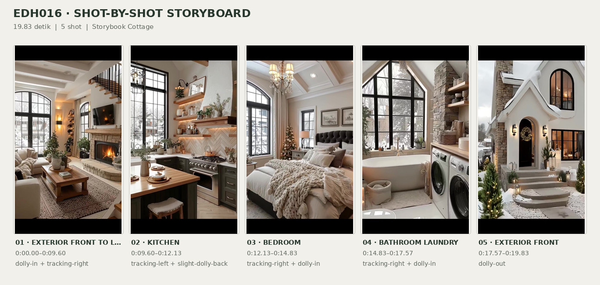
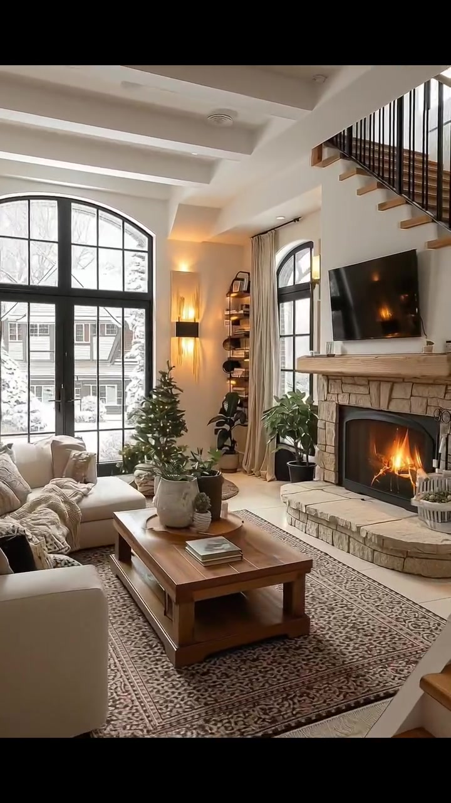
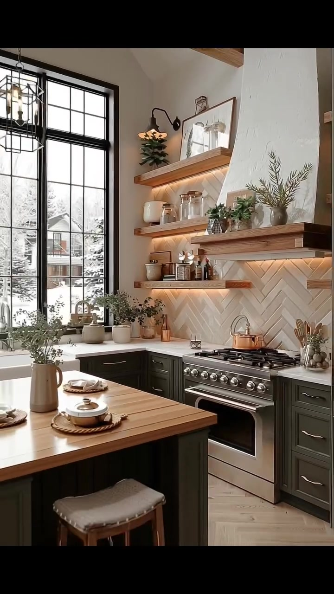
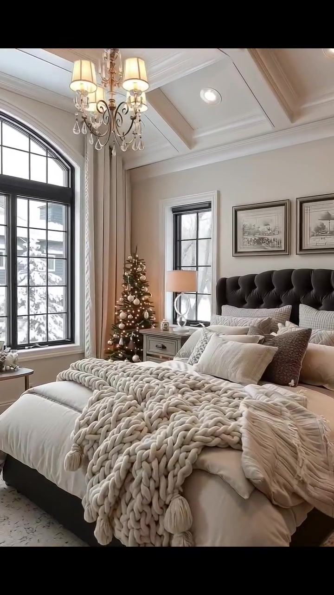
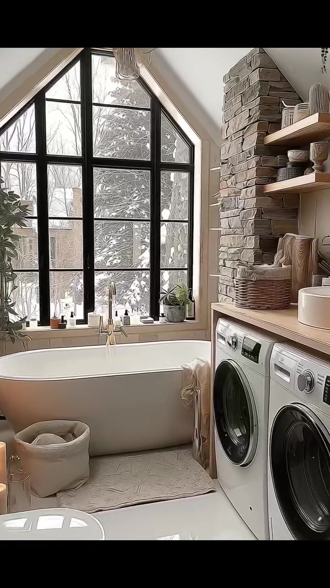
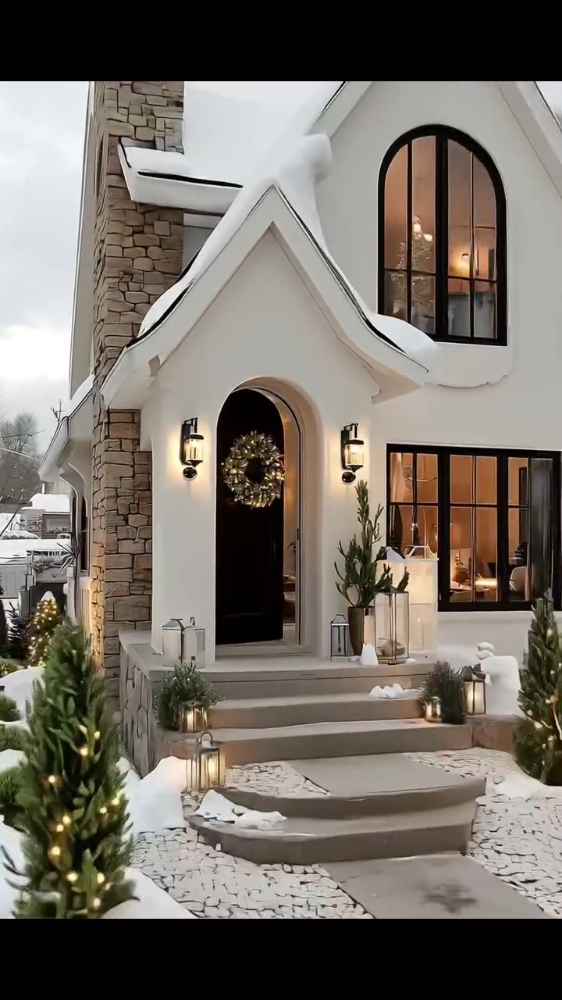

# edh016 — Storybook Cottage

<!-- homeku_request_id: edh016-20261104-001 -->

<!-- homeku_detail_narratives: chat-reviewed -->

**Sumber data:** [analysis.yaml](analysis.yaml) · **Status:** draft · **Diverifikasi manusia:** Tidak

## 1. Informasi Video

| Informasi | Nilai |
|---|---|
| ID | edh016 |
| File asli | edh016.mp4 |
| Durasi | 19.83 |
| Resolusi | 720x1280 |
| FPS | 30 |
| Rasio | 9:16 |
| Jumlah shot | 5 |

## 2. Storyboard Gabungan

## 3. Identitas Desain

| Aspek | Hasil analisis |
|---|---|
| Gaya utama | storybook cottage |
| Wilayah terkait gaya desain | europe, north america |
| Pengaruh gaya | english country cottage, modern european cottage, rustic farmhouse interior |
| Ciri eksterior | steep intersecting gable roofs, snow covered roof planes, cream white stucco appearance facade, beige stone chimney, black framed arched upper window, recessed arched front door, warm black metal exterior lanterns, gray stone front steps |
| Gaya interior | modern rustic cottage, warm neutral palette, stone fireplace and wood mantel, white coffered and beamed ceilings, black grid windows, light wood finishings, seasonal christmas decor |
| Confidence gaya | medium |

## 4. Ukuran & Proporsi Bangunan

| Aspek | Estimasi visual |
|---|---|
| Ukuran yang terlihat | medium |
| Bentuk bangunan | narrow rectangular with multiple front gables |
| Skala vertikal | main floor with upper level under steep roof |
| Tapak bangunan | moderate |
| Perkiraan luas lantai | 100–170 m² |
| Confidence | low |

> Luas adalah perkiraan visual, bukan ukuran terukur.

## 5. Warna, Pencahayaan, dan Atmosfer

| Warna dominan | HEX (perkiraan) |
|---|---|
| warm ivory | #EFEAE0 |
| snow white | #F4F4F2 |
| stone beige | #A99A88 |
| charcoal black | #292A28 |
| medium warm wood | #B48C63 |
| evergreen | #44523A |
| soft amber | #DBA45D |

| Aspek | Hasil analisis |
|---|---|
| Pencahayaan | soft overcast winter daylight, warm lit wall lanterns, warm recessed and practical interior lighting, fireplace glow, warm under shelf kitchen lighting |
| Lingkungan | snow covered suburban front garden, curving stone walkway and retaining wall, neighbor house visible, bare winter trees, snow laden evergreens, christmas decorations |
| Musim yang tampak | snowy winter appearance |
| Mood | cozy, warm, festive, inviting, calm |

## 6. Struktur dan Timeline Video

**Jenis:** cottage home tour · **Tempo:** moderate · **Transisi:** continuous entrance walkthrough followed by hard cuts

| Shot | Waktu (detik) | Durasi | Area/Scene | Gerakan Kamera |
|---|---|---|---|---|
| Shot 01 | 0.0–9.6 | 9.60 | exterior front to living room | dolly in, tracking right |
| Shot 02 | 9.6–12.13 | 2.53 | kitchen | tracking left, slight dolly back |
| Shot 03 | 12.13–14.83 | 2.70 | bedroom | tracking right, dolly in |
| Shot 04 | 14.83–17.57 | 2.74 | bathroom laundry | tracking right, dolly in |
| Shot 05 | 17.57–19.83 | 2.26 | exterior front | dolly out |

## 7. Analisis per Shot

### Shot 01 — exterior front to living room

**Waktu:** 0.0–9.6 detik

| Komponen | Pengamatan |
|---|---|
| Fokus utama | front entry then stone fireplace and living area |
| Framing awal → akhir | wide front three quarter exterior → medium close living room fireplace |
| Sudut pandang | front three quarter to interior eye level |
| Gerakan kamera | dolly in, tracking right |
| Kecepatan kamera | moderate |
| Pencahayaan | soft overcast daylight outside warm ambient lights inside |
| Transisi keluar | hard cut |

**Detail yang terlihat**

**Arsitektur**

Pada awal gerakan tampak fasad berpenampilan plester krem\-putih dengan atap\-atap pelana curam berselimut salju. Cerobong berlapis batu tak beraturan berwarna beige menjulang di sisi kiri, sementara jendela tinggi melengkung berkusen hitam mengisi pelana lantai atas. Pelana lebih kecil dengan tepi atap melengkung menaungi pintu masuk gelap yang mundur ke dalam relung lengkung. Di kanan pintu ada jendela persegi berkisi hitam; lampu dinding logam hitam yang menyala mengapit pintu, dan undakan batu abu\-abu lebar menuju ke teras. Melalui pintu lengkung yang terbuka, kamera memperlihatkan interior terang: plafon putih dengan balok melintang, jendela besar melengkung berkisi hitam, dinding putih, serta lantai berwarna pucat. Di sisi kanan ruang keluarga terdapat perapian berlapis batu beige dan ambang kayu tebal, dengan televisi hitam terpasang di atasnya. Tangga bertapak kayu terang dan pagar vertikal hitam naik di atas area perapian; di sampingnya terlihat jendela lengkung yang lebih sempit. Lampu dinding bernuansa hangat dan lampu tanam plafon menerangi ruangan.

**Furnitur dan properti**

Pintu depan dihiasi karangan Natal, dengan tanaman hijau kecil dalam pot, kado terbungkus perak, serta lentera kaca\-logam di dekat anak tangga. Di kanan jalan masuk berdiri manusia salju bertopi dan bersyal gelap. Di ruang keluarga, sofa besar berlapis kain krem dengan bantal dan selimut netral menghadap meja kopi kayu persegi panjang. Buku dan tanaman kecil diletakkan di atas meja, di atas karpet bermotif beige\-cokelat. Pohon Natal berdekorasi berdiri dekat jendela besar; beberapa tanaman berdaun lebar ditempatkan dekat meja dan perapian. Tirai krem panjang menggantung di samping jendela, sedangkan rak terbuka hitam dengan buku serta vas tampak di tepi ruangan. Di sekitar perapian terdapat perlengkapan perapian dan dekorasi pot kecil.

**Lingkungan**

Halaman depan dan bedeng taman yang ditinggikan tertutup salju, dibatasi dinding penahan batu abu\-abu rendah yang melengkung. Jalan setapak batu berkelok menuju tangga depan, dengan pohon konifer kecil berlampu kuning hangat serta semak hijau membulat yang sebagian muncul dari salju. Di belakang rumah menjulang pohon\-pohon tinggi tanpa daun, sementara rumah tetangga berpelapis horizontal abu\-abu berada di kanan. Langit tampak pucat mendung. Melalui jendela ruang keluarga terlihat lingkungan permukiman bersalju beserta pepohonan tanpa daun.

**Catatan pengamatan:** Gerakan tunggal tanpa hard cut, dari fasad masuk melewati pintu lalu bergeser ke kanan menyorot ruang keluarga dan perapian.

**Confidence:** Kamera medium · Detail visual high

### Shot 02 — kitchen

**Waktu:** 9.6–12.13 detik

| Komponen | Pengamatan |
|---|---|
| Fokus utama | kitchen range backsplash wood shelves and island |
| Framing awal → akhir | medium cooking wall view → wide kitchen window and island view |
| Sudut pandang | interior eye level |
| Gerakan kamera | tracking left, slight dolly back |
| Kecepatan kamera | slow |
| Pencahayaan | soft daylight through window and warm under shelf lighting |
| Transisi keluar | hard cut |

**Detail yang terlihat**

**Arsitektur**

Dinding memasak berpusat pada tudung kompor tinggi meruncing dengan permukaan menyerupai plester putih bertekstur. Di belakang kompor, backsplash berpenampilan ubin krem tersusun herringbone diterangi lampu hangat dari bawah rak kayu mengambang di kedua sisi tudung. Kabinet bawah bergaya shaker berwarna arang gelap memakai pegangan logam keperakan, dipadukan dengan countertop terang. Di dinding kiri, jendela tinggi berkisi hitam berada di atas bak cuci putih model apron\-front dan keran logam. Lantai tampak bermotif kayu terang pola herringbone, dengan bagian balok kayu hangat terlihat dekat plafon area jendela.

**Furnitur dan properti**

Sebuah kompor\-oven stainless steel berukuran besar dengan beberapa tungku berada tepat di bawah tudung, dan ketel berwarna tembaga di atasnya. Island di depan memakai top kayu dengan dasar gelap dan kursi tinggi kayu berbantalan terang. Permukaan island dihiasi vas keramik berisi tanaman, piring putih dan serbet di atas alas anyaman. Rak\-rak kayu berisi stoples kaca, wadah keramik krem, botol\-botol kecil, nampan kayu, karya seni berbingkai, dan pot tanaman. Pot dan vas kecil juga menghiasi countertop dekat jendela. Lampu gantung rangka logam hitam berbentuk sangkar terlihat di depan jendela, lampu dinding leher angsa hitam terpasang di atas rak kiri, serta wadah peralatan memasak kayu berdiri di kanan kompor.

**Lingkungan**

Dari jendela dapur terlihat pepohonan hijau tertutup salju, atap bersalju, serta bagian rumah tetangga.

**Catatan pengamatan:** Kamera bergerak ke kiri sehingga jendela, island, dan wastafel semakin terlihat; batuan material hanya dijelaskan menurut penampakan.

**Confidence:** Kamera medium · Detail visual high

### Shot 03 — bedroom

**Waktu:** 12.13–14.83 detik

| Komponen | Pengamatan |
|---|---|
| Fokus utama | tufted bed with chunky knit blanket |
| Framing awal → akhir | wide bedroom from foot left → closer bed and headboard view |
| Sudut pandang | interior eye level |
| Gerakan kamera | tracking right, dolly in |
| Kecepatan kamera | slow |
| Pencahayaan | soft window daylight and warm chandelier light |
| Transisi keluar | hard cut |

**Detail yang terlihat**

**Arsitektur**

Kamar tidur memiliki plafon putih berpanel cekung dengan lis dekoratif dan lampu tanam bulat. Sebuah jendela besar berbentuk lengkung berkisi hitam mendominasi dinding kiri; jendela sempit berbingkai hitam berada di kiri kepala tempat tidur. Dinding dicat beige hangat dengan lis putih pada plafon dan sekeliling bukaan, sementara lantainya tampak berpenampilan kayu pucat.

**Furnitur dan properti**

Tempat tidur besar bersandar pada headboard kain arang gelap bermotif tufted. Seprai dan duvet putih gading dilapis banyak bantal krem\-putih, dengan selimut rajut krem berukuran sangat besar terbentang di kaki ranjang. Karpet netral bermotif berada di bawah tempat tidur. Di kiri ranjang terdapat meja samping warna terang yang menahan lampu berkap putih dengan kaki berbentuk lingkar oval terbuka. Pohon Natal kecil berhias lampu berdiri di antara ranjang dan jendela. Sebuah chandelier bernuansa kuningan dengan kap kain krem serta ornamen kaca menggantung di atas ranjang. Dua gambar lanskap monokrom berbingkai terpasang di atas headboard, tirai krem panjang membingkai jendela besar, dan sebuah kursi berlapis kain terang bersama meja kayu kecil serta tanaman dalam pot berada di bawah jendela.

**Lingkungan**

Melalui jendela terlihat atap rumah tetangga yang tertutup salju serta ranting konifer bersalju.

**Catatan pengamatan:** Sudut beralih perlahan dari jendela besar dan kaki tempat tidur menuju headboard, lampu, dan pohon Natal.

**Confidence:** Kamera medium · Detail visual high

### Shot 04 — bathroom laundry

**Waktu:** 14.83–17.57 detik

| Komponen | Pengamatan |
|---|---|
| Fokus utama | freestanding bathtub below gable window and laundry machines |
| Framing awal → akhir | wide bath laundry room view → close bathtub window and stone wall |
| Sudut pandang | interior eye level |
| Gerakan kamera | tracking right, dolly in |
| Kecepatan kamera | slow |
| Pencahayaan | diffused window daylight and warm candlelight |
| Transisi keluar | hard cut |

**Detail yang terlihat**

**Arsitektur**

Area mandi sekaligus laundry berada di bawah plafon pelana putih yang curam. Jendela tinggi mengikuti bentuk pelana dan dibagi kisi\-kisi hitam, menghadap tepat ke atas bathtub. Pada kanan jendela berdiri bidang dinding aksen batu bertumpuk berwarna abu\-abu beige; dinding lain dan lis jendela bernuansa krem terang. Lantai memakai ubin berpenampilan putih mengilap. Sebuah countertop kayu terang menutup dua alat laundry, rak pajangan kayu terbuka terpasang lebih tinggi di sisi kanan, dan rak ceruk putih sempit tampak di antara jendela serta dinding batu. Pengisi air bak berdiri dengan finishing menyerupai kuningan berada di bawah jendela.

**Furnitur dan properti**

Bathtub putih berbentuk oval berdiri tepat di bawah jendela. Di sebelah kanannya terdapat dua mesin laundry putih dengan pintu depan, berada di bawah countertop kayu. Keranjang anyaman berisi handuk netral di atas countertop; rak\-rak menyimpan handuk terlipat, botol dan vas. Pot hijau kecil serta botol perlengkapan mandi tersusun pada ambang jendela. Handuk krem tersampir pada sisi kanan bathtub, alas mandi persegi panjang berwarna netral terhampar di depannya. Beberapa lilin pilar menyala di lantai sebelah kiri, bersama keranjang kain krem berisi gulungan tekstil. Bagian depan kiri juga memperlihatkan sedikit wastafel/baskom putih bundar, sementara tanaman menjuntai terlihat di sudut atas kanan.

**Lingkungan**

Melalui jendela besar tampak cabang\-cabang konifer tertutup salju, dengan ranting pepohonan tanpa daun di belakangnya.

**Catatan pengamatan:** Dua mesin bukaan depan dan bathtub berada dalam satu ruang; beberapa detail di tepi frame hanya terlihat sesaat.

**Confidence:** Kamera medium · Detail visual high

### Shot 05 — exterior front

**Waktu:** 17.57–19.83 detik

| Komponen | Pengamatan |
|---|---|
| Fokus utama | snow covered front cottage entry |
| Framing awal → akhir | close arched entry and front steps → medium front facade with snowman |
| Sudut pandang | exterior front eye level |
| Gerakan kamera | dolly out |
| Kecepatan kamera | slow |
| Pencahayaan | soft overcast daylight with warm exterior lanterns |
| Transisi keluar | end of video |

**Detail yang terlihat**

**Arsitektur**

Kamera kembali memperlihatkan fasad krem\-putih dengan atap pelana curam bersalju dan cerobong batu beige menjulang di sisi kiri. Jendela besar melengkung berkusen hitam mengisi pelana utama lantai atas. Pelana masuk yang lebih kecil menaungi pintu hitam dalam relung lengkung, sedangkan jendela lantai dasar berkisi hitam berada di kanan pintu. Lampu dinding logam hitam menyala hangat di sekitar pintu masuk; undakan batu abu\-abu dan landing kecil menghubungkan pintu dengan jalur depan. Cahaya amber dari interior memancar lewat kaca jendela.

**Furnitur dan properti**

Karangan dekorasi Natal menggantung pada pintu hitam. Di dekat pintu ada kado berbungkus perak dan pot\-pot kecil, sementara lentera kaca dengan cahaya hangat berjajar di tangga dan taman. Pohon konifer kecil berlampu tali berada di kedua sisi jalur masuk, dengan manusia salju bertopi dan bersyal gelap di kanan jalan setapak.

**Lingkungan**

Salju putih menutupi bedeng taman depan yang melengkung; dinding penahan batu abu\-abu rendah membatasinya dari trotoar. Semak hijau membulat muncul dari sela salju. Pohon tinggi tanpa daun terlihat di belakang rumah, dengan rumah tetangga berpelapis abu\-abu di kanan. Langit kelabu\-putih tampak mendung, sementara tepi jalan dan trotoar depan juga bersalju.

**Catatan pengamatan:** Pengambilan gambar kembali ke area depan rumah dari jarak dekat lalu mundur memperlihatkan fasad lebih luas.

**Confidence:** Kamera medium · Detail visual high

## 8. Kualitas dan Ketidakpastian Analisis

| Parameter | Hasil |
|---|---|
| Status | draft |
| Verifikasi manusia | Tidak |
| Ketepatan timestamp | estimated |
| Ketidakpastian | building floor area is visual estimate without measured scale, stone wood and plaster identifications are visual appearances, style and common regions are interpretations not real location, winter appearance does not prove calendar season or geographic location, first shot contains two areas in one unbroken camera move, video generation origin is not inferred from visuals |

**Catatan:** Analisis hanya berdasarkan rangkaian frame MP4 yang cocok Git blob SHA dengan GitHub. Lima shot ditentukan dari perpindahan visual keras; area eksterior hingga ruang keluarga berada dalam satu gerakan kamera tanpa cut.

---

*Laporan ini diturunkan dari [analysis.yaml](analysis.yaml).*
