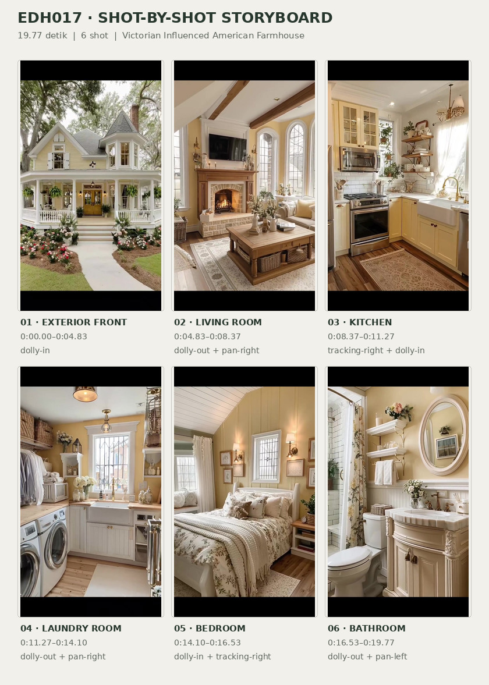
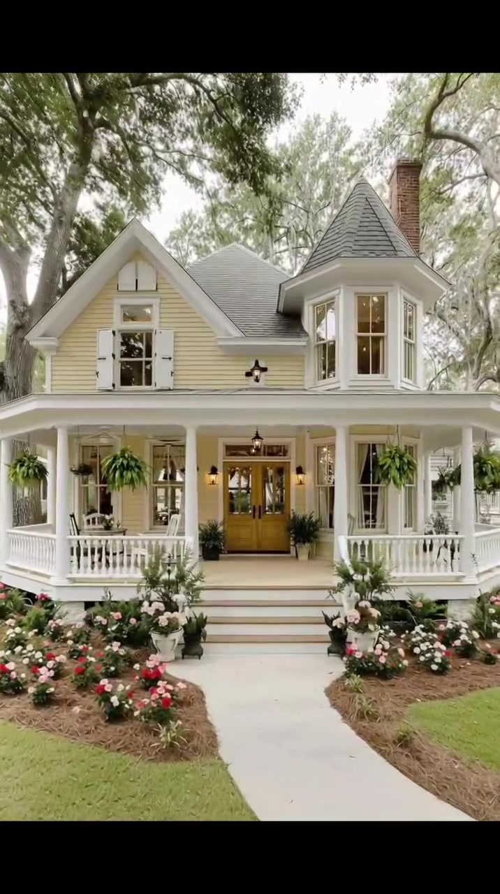
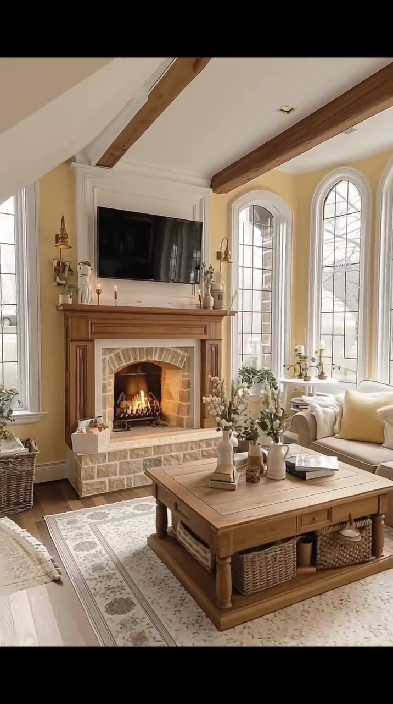
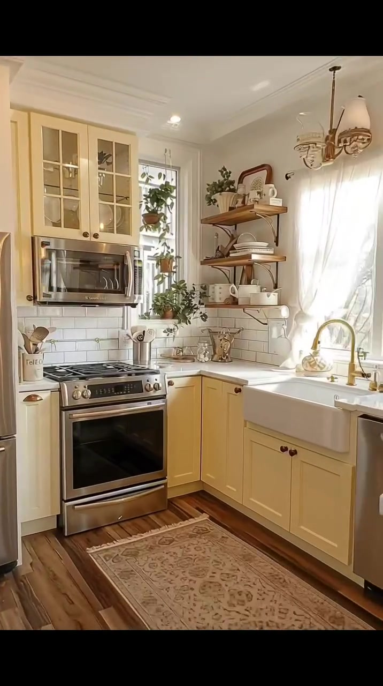
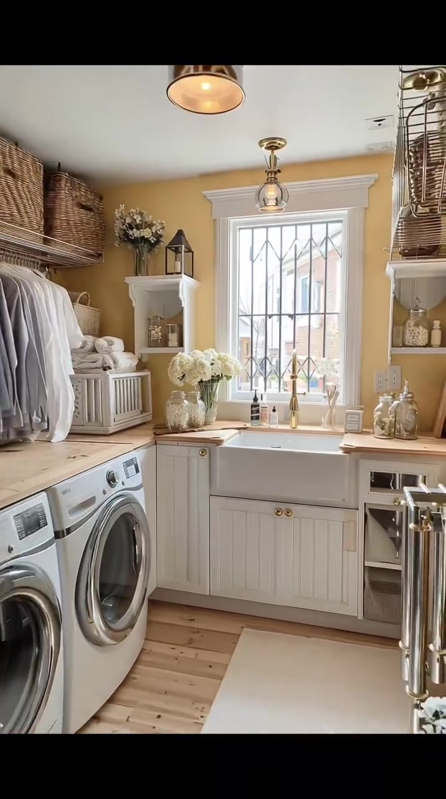
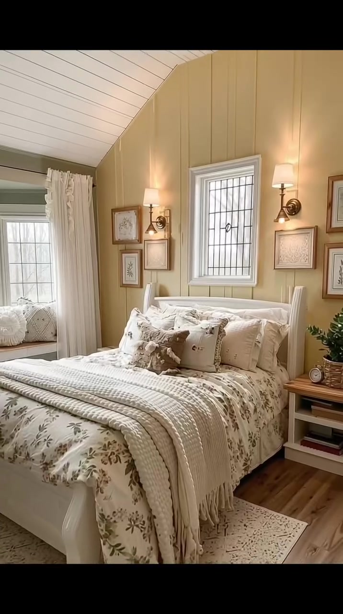
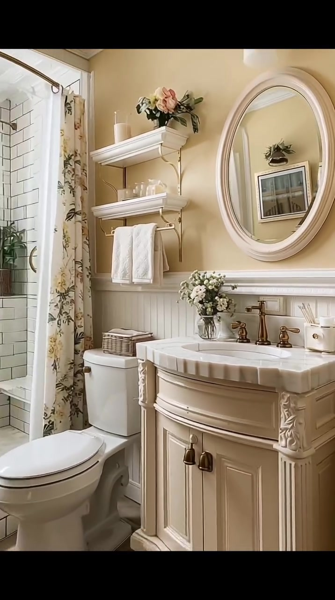

# edh017 — Victorian Influenced American Farmhouse

<!-- homeku_request_id: edh017-20261104-1349 -->

<!-- homeku_detail_narratives: chat-reviewed -->

**Sumber data:** [analysis.yaml](analysis.yaml) · **Status:** draft · **Diverifikasi manusia:** Tidak

## 1. Informasi Video

| Informasi | Nilai |
|---|---|
| ID | edh017 |
| File asli | edh017.mp4 |
| Durasi | 19.77 |
| Resolusi | 716x1280 |
| FPS | 30.0 |
| Rasio | 9:16 |
| Jumlah shot | 6 |

## 2. Storyboard Gabungan

## 3. Identitas Desain

| Aspek | Hasil analisis |
|---|---|
| Gaya utama | victorian influenced american farmhouse |
| Wilayah terkait gaya desain | north america |
| Pengaruh gaya | folk victorian, traditional country cottage, classic farmhouse |
| Ciri eksterior | pale yellow horizontal siding, multi gabled gray shingle appearance roof, pointed polygonal bay turret, white wraparound porch with columns and spindle railing, central wood tone glazed entry doors, red brick chimney, white trimmed tall windows, curved front walkway and flower gardens |
| Gaya interior | warm traditional farmhouse, vintage country cottage, subtle victorian decorative accents |
| Confidence gaya | medium |

## 4. Ukuran & Proporsi Bangunan

| Aspek | Estimasi visual |
|---|---|
| Ukuran yang terlihat | large |
| Bentuk bangunan | broad multi gabled mass with polygonal front bay |
| Skala vertikal | two story |
| Tapak bangunan | moderate |
| Perkiraan luas lantai | 180–300 m² |
| Confidence | low |

> Luas adalah perkiraan visual, bukan ukuran terukur.

## 5. Warna, Pencahayaan, dan Atmosfer

| Warna dominan | HEX (perkiraan) |
|---|---|
| butter yellow | #E8D4A5 |
| warm cream white | #F3EEE3 |
| natural wood brown | #A47B55 |
| roof and metal gray | #797C79 |
| garden green | #607957 |
| dusty pink floral | #C98B84 |

| Aspek | Hasil analisis |
|---|---|
| Pencahayaan | soft diffuse daylight, natural light through tall windows, warm wall sconces and pendants, visible fireplace flame |
| Lingkungan | mature shade trees around front yard, manicured grass lawn, flower filled mulched front beds, curved walkway to front porch, partial neighboring building |
| Musim yang tampak | Tidak diketahui |
| Mood | warm, cozy, romantic, inviting, nostalgic |

## 6. Struktur dan Timeline Video

**Jenis:** house tour · **Tempo:** moderate · **Transisi:** hard cuts between slow camera moves

| Shot | Waktu (detik) | Durasi | Area/Scene | Gerakan Kamera |
|---|---|---|---|---|
| Shot 01 | 0.0–4.83 | 4.83 | exterior front | dolly in |
| Shot 02 | 4.83–8.37 | 3.54 | living room | dolly out, pan right |
| Shot 03 | 8.37–11.27 | 2.90 | kitchen | tracking right, dolly in |
| Shot 04 | 11.27–14.1 | 2.83 | laundry room | dolly out, pan right |
| Shot 05 | 14.1–16.53 | 2.43 | bedroom | dolly in, tracking right |
| Shot 06 | 16.53–19.77 | 3.24 | bathroom | dolly out, pan left |

## 7. Analisis per Shot

### Shot 01 — exterior front

**Waktu:** 0.0–4.83 detik

| Komponen | Pengamatan |
|---|---|
| Fokus utama | yellow two story house and front porch |
| Framing awal → akhir | wide frontal establishing → medium frontal porch view |
| Sudut pandang | eye level slightly upward |
| Gerakan kamera | dolly in |
| Kecepatan kamera | slow |
| Pencahayaan | soft diffuse daylight with warm entry lamps |
| Transisi keluar | hard cut |

**Detail yang terlihat**

**Arsitektur**

Fasad rumah dua lantai dilapisi bidang horizontal berwarna kuning pucat. Atap abu\-abu yang tampak seperti sirap memiliki beberapa pelana dengan kemiringan curam; di sisi kanan depan terdapat bagian menjorok berbentuk poligonal dengan atap kerucut runcing dan jendela\-jendela tinggi berbingkai putih. Pada pelana kiri atas terlihat jendela dengan daun penutup putih dan engsel gelap, sedangkan cerobong bata merah naik di belakang atap kanan. Beranda putih yang lebar membungkus sisi depan rumah, ditopang kolom bundar dan dibatasi pagar jeruji putih pada bagian depan dan samping. Pintu masuk ganda bernuansa kayu dengan panel kaca dan transom atas berada di tengah, dicapai melalui tangga depan yang lebar dan terang. Jendela lantai dasar bertrim putih terletak di antara kolom beranda; lampu gantung gelap serta lampu dinding hangat berada di sekitar pintu.

**Furnitur dan properti**

Keranjang pakis hijau tergantung di sela kolom beranda. Pot tanaman gelap berada di kedua sisi tangga masuk, sementara beberapa pot bunga berwarna terang menghiasi beranda depan dan sekitar anak tangga.

**Lingkungan**

Pohon besar yang telah matang berdiri di kanan depan rumah, dengan cabang\-cabang berdaun yang membentang di atas bangunan. Halaman depan berupa rumput hijau yang terpangkas rapi, dipotong jalur pejalan kaki pucat dan melengkung menuju tangga beranda. Bedeng taman bermulsa di sepanjang jalur dipenuhi bunga merah muda, merah, dan putih; semak hijau rendah serta bunga juga tumbuh pada kaki beranda. Sebagian bangunan tetangga berwarna terang tampak di ujung kiri, dan langit pucat yang terang terlihat di sela kanopi pohon.

**Catatan pengamatan:** Kamera maju mendekati bagian tengah fasad; sudut akhir menonjolkan pintu masuk dan tangga. Bahan pelapis dan genteng hanya dinilai dari tampak permukaannya.

**Confidence:** Kamera high · Detail visual high

### Shot 02 — living room

**Waktu:** 4.83–8.37 detik

| Komponen | Pengamatan |
|---|---|
| Fokus utama | fireplace and cream seating area |
| Framing awal → akhir | tight fireplace view → wide living room view |
| Sudut pandang | eye level slightly upward |
| Gerakan kamera | dolly out, pan right |
| Kecepatan kamera | slow |
| Pencahayaan | soft daylight from arched windows and warm sconce light and firelight |
| Transisi keluar | hard cut |

**Detail yang terlihat**

**Arsitektur**

Dinding ruang keluarga berwarna kuning mentega hangat dengan lis dan cornice putih; balok\-balok besar berpenampilan kayu melintang pada plafon putih. Perapian memiliki mantel kayu klasik berpanel, keliling bercorak batu berwarna pucat, mulut perapian melengkung, dan ambang bawah yang menonjol. Di sisi kanan ruangan berjajar jendela tinggi melengkung dengan kisi dan bingkai putih. Di atas mantel terdapat bidang panel putih cekung. Lantai tampak seperti papan kayu cokelat hangat, sedangkan ujung shot memperlihatkan tiang dan pagar tangga putih di bagian depan.

**Furnitur dan properti**

Televisi layar datar hitam terpasang di atas perapian yang terlihat menyala oranye. Sofa berlapis kain krem dengan bantal terang berada di kanan. Meja kopi kayu rendah berbentuk persegi panjang terletak di tengah karpet bermotif pucat, dengan keranjang anyam di rak bawah. Di atas meja ada vas dan rangkaian bunga krem\-putih; mantel perapian dihias lilin kecil dan vas keramik. Sepasang lampu dinding bernuansa emas antik mengapit perapian. Karpet dekoratif terang menutupi sebagian lantai kayu, dan sebagian kursi berlengan berlapis kain terang terlihat di kanan depan.

**Lingkungan**

Melalui jendela lengkung terlihat cabang\-cabang pohon berwarna terang di bagian luar.

**Catatan pengamatan:** Tampilan berangsur melebar ke kanan; tangga tampak menjelang akhir. Bahan perapian dan lantai adalah identifikasi berbasis penampakan.

**Confidence:** Kamera medium · Detail visual high

### Shot 03 — kitchen

**Waktu:** 8.37–11.27 detik

| Komponen | Pengamatan |
|---|---|
| Fokus utama | cream cabinetry range and apron sink |
| Framing awal → akhir | wide corner kitchen view → medium stove and sink view |
| Sudut pandang | eye level |
| Gerakan kamera | tracking right, dolly in |
| Kecepatan kamera | slow |
| Pencahayaan | bright window daylight with warm pendant and ceiling lights |
| Transisi keluar | hard cut |

**Detail yang terlihat**

**Arsitektur**

Kabinet bawah bergaya shaker berwarna kuning krem pucat menggunakan kenop bundar gelap, sedangkan kabinet atas berwarna senada memakai panel pintu kaca di atas microwave. Backsplash tersusun dari ubin subway putih dengan garis nat gelap, dan countertop sudut tampak padat berwarna putih. Wastafel apron putih berukuran besar dipasang di bawah jendela kanan dengan keran lengkung bernuansa kuningan. Plafon memiliki lis mahkota putih dan lampu tanam; lantainya berupa papan berpenampilan kayu hangat. Di depan kanan tampak semenanjung pendek berpanel vertikal putih. Jendela di kanan kompor berbingkai putih dengan tirai tipis putih, sementara dua rak terbuka dari kayu dipasang di dinding paling kanan.

**Furnitur dan properti**

Kompor\-oven dan microwave di atasnya memiliki tampilan baja tahan karat; bagian kulkas dengan finishing serupa tampak di ujung kiri pada awal shot. Lampu gantung kaca bening serta lampu hias gantung bernuansa kuningan berada di atas area kerja. Rak kayu menampung piring, mangkuk, dan cangkir putih. Tanaman berdaun ditempatkan dekat ambang jendela dan pada rak. Sebuah vas bunga pucat menghias countertop depan, karpet panjang krem bermotif terletak di depan kompor, sedangkan wadah alat masak logam, stoples kecil, dan keranjang berada di permukaan kerja.

**Lingkungan**

Tidak ada detail yang tercatat.

**Catatan pengamatan:** Pergerakan bergeser ke kanan dan mendekat ke kompor. Kulkas terlihat pada awal shot, sementara detail backsplash, rak terbuka dan wastafel makin jelas di akhir.

**Confidence:** Kamera medium · Detail visual high

### Shot 04 — laundry room

**Waktu:** 11.27–14.1 detik

| Komponen | Pengamatan |
|---|---|
| Fokus utama | apron utility sink and front load washers |
| Framing awal → akhir | medium sink and window view → wide laundry room view |
| Sudut pandang | eye level |
| Gerakan kamera | dolly out, pan right |
| Kecepatan kamera | slow |
| Pencahayaan | soft daylight through window with warm hanging lamp |
| Transisi keluar | hard cut |

**Detail yang terlihat**

**Arsitektur**

Ruang laundry berdinding kuning pucat hangat dengan trim jendela putih yang lebar. Kabinet bawah putih memakai panel pintu beralur vertikal dan kenop kuningan, sementara wastafel utilitas apron putih yang dalam berada tepat di bawah jendela. Countertop di kedua sisi tampak seperti kayu berwarna terang. Jendela tinggi memiliki kisi dekoratif berpola belah ketupat gelap. Pada kedua sisi tersedia ceruk dan rak terbuka putih, dengan rak penyimpanan kawat logam pada bagian atas dinding. Lantai menyerupai papan kayu terang dan plafon putih dilengkapi lampu gantung kecil bergaya vintage.

**Furnitur dan properti**

Dua mesin laundry putih berbukaan depan dipasang berdampingan di bawah countertop kiri. Keranjang anyam besar disimpan pada rak\-rak atas, sementara kemeja\-kemeja terang digantung pada rel di atas mesin. Handuk putih terlipat ditempatkan di keranjang pada countertop kiri. Keran tinggi bernuansa kuningan berdiri di atas wastafel. Stoples kaca kecil tersusun di countertop serta rak, bersama vas kaca berisi bunga putih di kiri wastafel dan lentera dekoratif gelap di salah satu rak samping. Alas lantai persegi panjang pucat terletak di depan wastafel.

**Lingkungan**

Melalui jendela laundry terlihat permukaan luar bangunan lain dengan pelapis berwarna kemerahan.

**Catatan pengamatan:** Awalnya area sink terlihat lebih dekat; saat mundur dan bergeser, pasangan mesin laundry, pakaian tergantung, rak atas, dan lantai semakin terlihat.

**Confidence:** Kamera medium · Detail visual high

### Shot 05 — bedroom

**Waktu:** 14.1–16.53 detik

| Komponen | Pengamatan |
|---|---|
| Fokus utama | white bed against yellow paneled gable wall |
| Framing awal → akhir | wide bedroom corner view → medium centered bed view |
| Sudut pandang | eye level slightly upward |
| Gerakan kamera | dolly in, tracking right |
| Kecepatan kamera | slow |
| Pencahayaan | diffuse daylight through windows and warm sconce lighting |
| Transisi keluar | hard cut |

**Detail yang terlihat**

**Arsitektur**

Plafon kamar tidur berbentuk miring tinggi dengan deretan papan putih di atas tempat tidur, bertemu dinding ujung pelana berpanel vertikal kuning pucat hangat. Sebuah jendela kecil berkisi dengan bingkai putih berada tinggi di atas sandaran ranjang. Pada sudut kiri terdapat ceruk berjendela dengan trim putih, sedangkan lantai berupa papan berpenampilan kayu cokelat hangat. Pertemuan plafon miring dan dinding dirapikan lis putih.

**Furnitur dan properti**

Ranjang kayu putih dengan sandaran kepala serta kaki ranjang tinggi ditempatkan di tengah dinding. Selimut penutup bercorak bunga krem dilapisi banyak bantal putih, dengan rajutan tebal krem bertekstur terhampar pada bagian kaki ranjang. Di bawahnya ada karpet krem bermotif halus. Sepasang lampu dinding bernuansa perunggu hangat dan berkap putih mengapit area tidur, berdampingan dengan beberapa bingkai ilustrasi botani kecil pada kedua sisi jendela tengah. Bangku duduk berlapis bantal putih berada dalam ceruk jendela kiri dengan tirai panjang putih gading. Di kanan ranjang terdapat meja samping kecil kayu terang dan putih, dihias tanaman hijau dalam pot serta jam bundar kecil.

**Lingkungan**

Tidak ada detail yang tercatat.

**Catatan pengamatan:** Kamera bergerak semakin dekat ke ranjang dan sedikit ke kanan; warna kuning lembut panel dinding dan tekstur bedding menjadi fokus.

**Confidence:** Kamera medium · Detail visual high

### Shot 06 — bathroom

**Waktu:** 16.53–19.77 detik

| Komponen | Pengamatan |
|---|---|
| Fokus utama | ornate vanity with oval mirror and shower |
| Framing awal → akhir | tight sink and mirror view → wide vanity to shower view |
| Sudut pandang | eye level |
| Gerakan kamera | dolly out, pan left |
| Kecepatan kamera | slow |
| Pencahayaan | soft ambient daylight with warm wall light |
| Transisi keluar | video end |

**Detail yang terlihat**

**Arsitektur**

Kamar mandi memiliki dinding atas krem hangat dan panel wainscot putih beralur vertikal, lis mahkota putih, serta plafon berpanel putih. Kabinet wastafel krem memperlihatkan ukiran dekoratif di sudut dan dua pintu depan. Permukaan countertop putih tampak bermotif marmer dengan tepi beralur, tanpa kepastian bahan asli. Cermin oval tegak berbingkai putih tebal menggantung di atasnya. Rak dinding terbuka putih di sisi kiri disangga konsol bernuansa kuningan. Area shower di sebelah kiri berlapis ubin subway putih dengan nat gelap, memperlihatkan panel kaca bening dan batang bagian atas bernuansa kuningan. Lantai memakai ubin persegi bernuansa krem muda.

**Furnitur dan properti**

Keran wastafel tiga bagian beserta kedua pegangan tampil bernuansa kuningan antik. Vas kaca kecil berisi bunga putih ditempatkan di kiri keran. Handuk putih tersusun dan tergantung di bawah rak dinding. Toilet putih berada di antara shower dan kabinet wastafel, dengan keranjang anyam kecil di atas tangkinya. Rak teratas dihias bunga merah muda dan putih; rak lainnya berisi stoples dekoratif kecil serta lilin putih. Tanaman hijau berada di sisi shower dan tirai bercorak bunga putih tampak pada tepi shower. Sebuah gambar dinding berbingkai kecil terpantul di cermin oval, sedangkan lampu dinding hangat berkap putih tampak dekat bagian atas cermin.

**Lingkungan**

Tidak ada detail yang tercatat.

**Catatan pengamatan:** Tampilan dimulai dari close-up wastafel dan cermin lalu melebar ke kiri sehingga toilet dan area shower berubin putih masuk ke frame. Corak permukaan countertop tidak membuktikan marmer asli.

**Confidence:** Kamera medium · Detail visual high

## 8. Kualitas dan Ketidakpastian Analisis

| Parameter | Hasil |
|---|---|
| Status | draft |
| Verifikasi manusia | Tidak |
| Ketepatan timestamp | frame approximate |
| Ketidakpastian | building floor area is visual estimate without floor plan or scale, roof wall floor countertop materials identified by appearance not specification, visual architectural region association is not actual building location, season and geographic location cannot be confirmed, camera motion inferred from image sequence, minor object counts and room dimensions not measured |

**Catatan:** Seluruh durasi visual (593 frame pada 30 fps) diamati melalui sampling sepanjang shot; batas hard cut diperkirakan dari perubahan frame. Durasi stream video 19.77 dtk, sedangkan container dengan audio sekitar 19.92 dtk. Lokasi sebenarnya, bahan asli, dan luas lantai tidak dapat dipastikan.

---

*Laporan ini diturunkan dari [analysis.yaml](analysis.yaml).*
