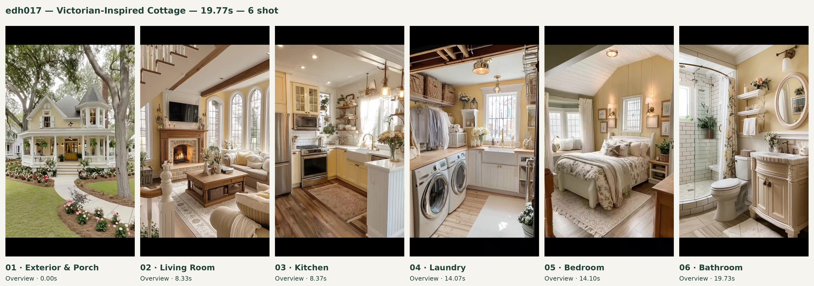
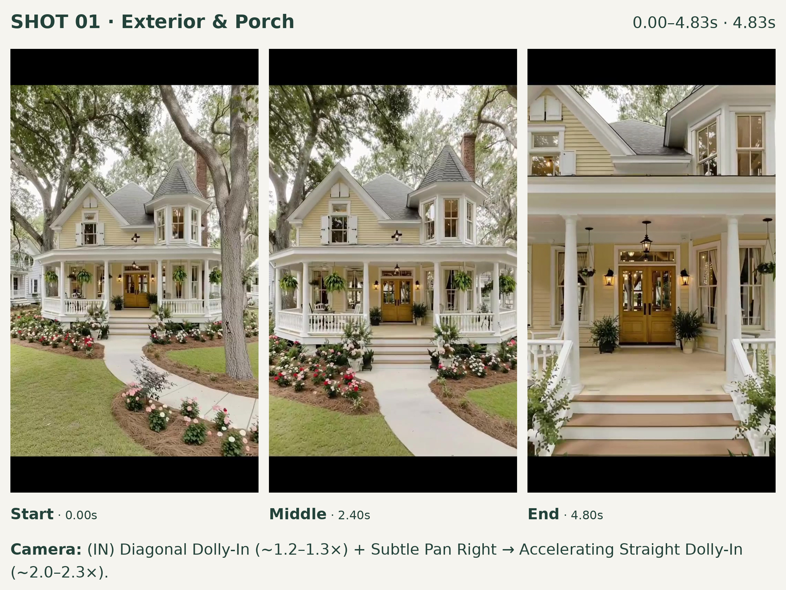
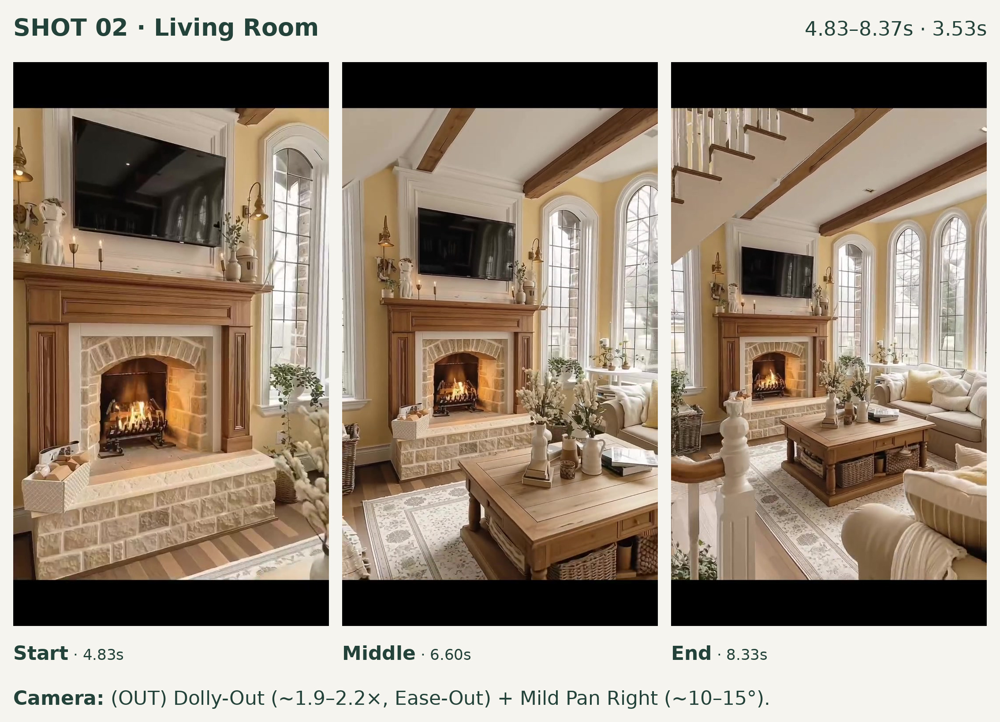
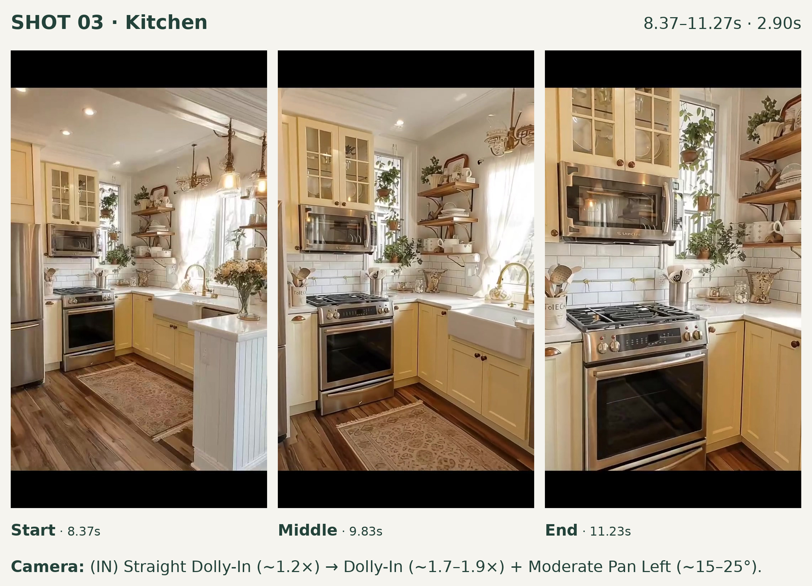
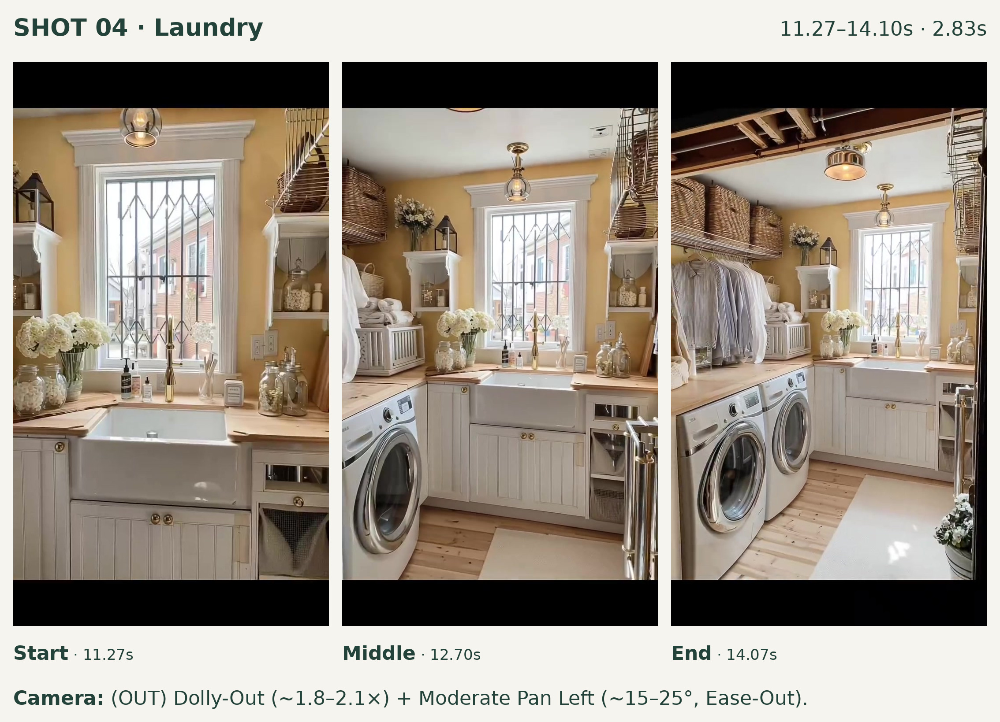
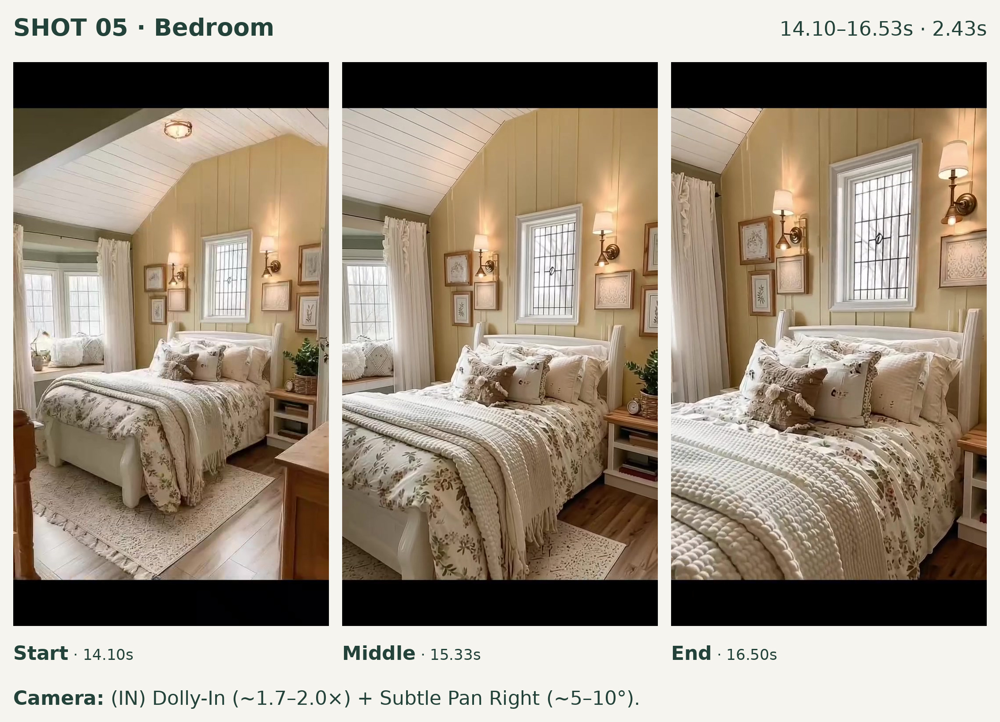
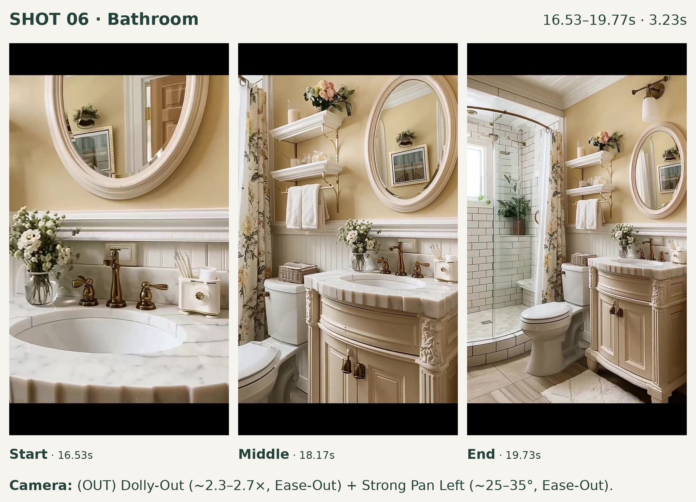

# edh017 — Warm Victorian-Inspired Cottage

## 1. Profil desain

- **Nama desain:** Warm Victorian-Inspired Cottage
- **Tipe rumah:** Detached House
- **Gaya utama:** **Victorian-Inspired Cottage**
- **Pengaruh gaya:** Queen Anne Revival
- **Gaya interior:** Traditional Country Cottage
- **Susunan ruang utama:** Urutan edit eksterior, living, kitchen, laundry, bedroom, bathroom; koneksi denah tidak terverifikasi
- **Ciri khas:** Menara sudut, perapian dengan TV, kabinet kuning dan tekstil floral
- **Material utama:** Tampilan siding kuning, trim putih, kayu hangat, batu/bata perapian dan permukaan putih; material aktual tidak terverifikasi
- **Pencahayaan:** Cahaya siang melalui jendela, lampu aksen hangat dan api perapian
- **Atmosfer:** Hangat, dekoratif, nyaman dan bernuansa country klasik
- **Lingkungan:** Halaman rumput, pepohonan dewasa, jalur melengkung dan bed bunga

### Palet warna

| Peran | Warna | HEX |
| --- | --- | --- |
| Dominan | Butter Yellow | `#D5BA82` |
| Dominan | Warm Ivory | `#EEE7D6` |
| Pendamping | Warm Oak | `#A98155` |
| Pendamping | Taupe Beige | `#B9A68B` |
| Aksen | Slate Gray | `#7F8180` |
| Aksen | Garden Green | `#768451` |

## 2. Ukuran & proporsi

| Aspek | Estimasi visual |
| --- | --- |
| **Ukuran rumah** | medium |
| **Bentuk bangunan** | Massa asimetris dengan gable dan proyeksi menara sudut |
| **Lantai & bentuk atap** | Dua tingkat tampak pada fasad; cakupan lantai atas tidak diketahui · Gable curam dan atap menara kerucut berwarna abu-abu |
| **Tapak bangunan** | Massa kompak dengan proyeksi sudut dan beranda depan |
| **Proporsi utama** | Atap curam, fasad vertikal berlapis, beranda horizontal rendah |
| **Perkiraan luas lantai** | **90–170 m²** |

## 3. Shot Timeline

Durasi 19.77s · 6 shot.

**Camera Pattern:** IN – OUT – IN – OUT – IN – OUT.

| Shot | Time (s) | Duration | Area/Scene | Camera Movement |
| --- | --- | --- | --- | --- |
| 01 | 0.00–4.83 | 4.83s | Exterior & Porch | Diagonal Dolly-In (~1.2–1.3×) + Subtle Pan Right → Accelerating Straight Dolly-In (~2.0–2.3×). |
| 02 | 4.83–8.37 | 3.53s | Living Room | Dolly-Out (~1.9–2.2×, Ease-Out) + Mild Pan Right (~10–15°). |
| 03 | 8.37–11.27 | 2.90s | Kitchen | Straight Dolly-In (~1.2×) → Dolly-In (~1.7–1.9×) + Moderate Pan Left (~15–25°). |
| 04 | 11.27–14.10 | 2.83s | Laundry | Dolly-Out (~1.8–2.1×) + Moderate Pan Left (~15–25°, Ease-Out). |
| 05 | 14.10–16.53 | 2.43s | Bedroom | Dolly-In (~1.7–2.0×) + Subtle Pan Right (~5–10°). |
| 06 | 16.53–19.77 | 3.23s | Bathroom | Dolly-Out (~2.3–2.7×, Ease-Out) + Strong Pan Left (~25–35°, Ease-Out). |

## 4. Overview

**Shot 01 · Exterior & Porch · 0.00s**

> Dari halaman depan, pandangan hampir frontal pada tinggi mata mencakup gable, menara sudut, beranda, jalur melengkung, rumput dan pohon.

**Shot 02 · Living Room · 8.33s**

> Dari sisi railing, kamera menghadap serong ke perapian dan deretan jendela lengkung; wide mencakup meja kopi, sofa, hearth, balok dan tangga.

**Shot 03 · Kitchen · 8.37s**

> Dari sisi masuk, wide serong menampilkan kulkas kiri, oven di tengah, kabinet kuning, sink dekat jendela kanan dan lantai papan.

**Shot 04 · Laundry · 14.07s**

> Dari ujung akses, kamera menghadap serong ke jendela dan sink; wide menunjukkan mesin kiri, penyimpanan di kedua sisi dan koridor lantai.

**Shot 05 · Bedroom · 14.10s**

> Dari sisi kaki ranjang, pandangan serong mencakup ranjang, jendela belakang dan kiri, plafon miring serta dinding panel kuning.

**Shot 06 · Bathroom · 19.73s**

> Dari sisi akses, kamera menghadap serong ke dinding vanity dan shower; wide mencakup shower kaca kiri, toilet tengah, vanity serta cermin kanan.

## 5. Storyboard

## 6. Shot Details

### Shot 01 · Exterior & Porch

**Time:** 0.00–4.83s · **Duration:** 4.83s

#### **A. Desain area**

**Arsitektur**

> Massa asimetris bergable curam dengan menara sudut beratap kerucut; siding tampak kuning dan trim putih. Beranda beratap bertiang putih, railing serta tangga depan menuju pintu berpanel kaca.

**Furnitur & dekorasi**

> Pot tanaman dan lampu gantung di sekitar pintu.

**Lingkungan**

> Rumput, bed bunga, pohon besar dan jalur pejalan kaki melengkung.

#### **B. Framing & Lighting**

- **Fokus:** Pintu dan tangga
- **Camera Start:** Di halaman depan · Menuju fasad dan tangga · Frontal agak serong · Sekitar tinggi mata · Relatif datar
- **Framing:** Wide fasad, pohon dan jalur taman → Close-up tangga dan pintu
- **Lighting:** Siang terfilter kanopi pohon, lampu teras hangat
- **Foreground dan kedalaman:** Jalur melengkung dan tanaman · Jalur menuju beranda dan massa rumah
- **Reveal:** Detail tangga serta pintu semakin dominan
- **Kesesuaian gerak:** Dolly-in menyempitkan cakupan; pan ringan mempertahankan fasad

#### **C. Camera Movement**

Kamera mendekati rumah dari halaman sambil menggeser posisi ke kiri; gerak lateral mereda ketika tangga menjadi sumbu pendekatan, lalu pembesaran fasad meningkat.

**Tempo:** Lambat pada awal, meningkat ke sedang, lalu cepat ketika mendekati tangga; pembesaran perspektif turut memperkuat efek.

- **0.00–1.60s · slow:** Geser dan pendekatan awal perlahan.
- **1.60–3.20s · moderate:** Pendekatan makin jelas.
- **3.20–4.83s · fast:** Pembesaran tangga dan pintu cepat.

**Movement Timeline**

| Time (s) | Area & fokus | Camera Movement | Tempo |
| --- | --- | --- | --- |
| 0.00–2.50 | Exterior & Porch · Fasad dan jalur masuk | Diagonal Dolly-In (~1.2–1.3×) + Subtle Pan Right | Geser dan pendekatan awal perlahan.; Pendekatan makin jelas. |
| 2.50–4.83 | Exterior & Porch · Tangga teras dan pintu | Accelerating Straight Dolly-In (~2.0–2.3×) | Pendekatan makin jelas.; Pembesaran tangga dan pintu cepat. |

**Camera:** Diagonal Dolly-In (~1.2–1.3×) + Subtle Pan Right → Accelerating Straight Dolly-In (~2.0–2.3×).

---

### Shot 02 · Living Room

**Time:** 4.83–8.37s · **Duration:** 3.53s

#### **A. Desain area**

**Arsitektur**

> Volume tinggi dengan plafon miring berbalok tampak kayu, jendela lengkung tinggi dan perapian berbingkai kayu dengan hearth tampak bata/batu. Balustrade tangga putih terlihat di sisi.

**Furnitur & dekorasi**

> TV hitam di atas mantel; meja kopi kayu persegi panjang di atas karpet, sofa krem dan bantal serta dekor bunga.

**Lingkungan**

> Cahaya masuk lewat jendela tinggi; pemandangan luar tidak teridentifikasi.

#### **B. Framing & Lighting**

- **Fokus:** Perapian dan zona duduk
- **Camera Start:** Dekat hearth · Menghadap perapian · Frontal agak serong · Sekitar tinggi mata · Hampir datar
- **Framing:** Close-up perapian dan TV → Wide seating, jendela, railing
- **Lighting:** Cahaya jendela dari kanan, api hangat
- **Foreground dan kedalaman:** Hearth lalu meja kopi · Hearth, meja dan jendela membentuk lapisan
- **Reveal:** Zona duduk dan railing terbuka
- **Kesesuaian gerak:** Dolly-out dan pan kanan memperluas cakupan

#### **C. Camera Movement**

Kamera mundur dari perapian sambil membuka sisi kanan ruang, meja dan sofa; railing masuk pada akhir.

**Tempo:** Sedang dan halus; pengecilan skala melandai di akhir walau sapuan kanan masih terlihat.

**Camera:** Dolly-Out (~1.9–2.2×, Ease-Out) + Mild Pan Right (~10–15°).

---

### Shot 03 · Kitchen

**Time:** 8.37–11.27s · **Duration:** 2.90s

#### **A. Desain area**

**Arsitektur**

> Counter kerja bersiku dengan kabinet kuning, backsplash tampak ubin putih, jendela di atas sink dan lantai tampak papan kayu.

**Furnitur & dekorasi**

> Kabinet berpanel dan upper berpintu kaca, kulkas metalik kiri, range/oven di bawah microwave, sink apron putih dan rak terbuka. Lampu recessed dan gantung.

**Lingkungan**

> Jendela terang; detail luar tidak cukup jelas.

#### **B. Framing & Lighting**

- **Fokus:** Oven dan counter
- **Camera Start:** Di sisi masuk dapur · Menuju range dan counter sink · Serong · Sekitar tinggi mata · Relatif datar
- **Framing:** Wide kabinet, kulkas, range dan sink → Close-up range dan rak
- **Lighting:** Cahaya jendela kanan dan lampu plafon
- **Foreground dan kedalaman:** Ujung counter serta karpet · Lantai menuju sudut kerja
- **Reveal:** Detail range, backsplash dan rak
- **Kesesuaian gerak:** Dolly-in dan pan kiri memusatkan oven

#### **C. Camera Movement**

Kamera mendekati area kerja dapur, awalnya mempertahankan cakupan sink dan kompor kemudian mengarahkan pandangan ke kiri menuju oven.

**Tempo:** Sedang, lebih dinamis di pertengahan dan akhir; pertumbuhan skala meningkat.

**Movement Timeline**

| Time (s) | Area & fokus | Camera Movement | Tempo |
| --- | --- | --- | --- |
| 8.37–9.20 | Kitchen · Area kerja dapur | Straight Dolly-In (~1.2×) | Sedang, lebih dinamis di pertengahan dan akhir; pertumbuhan skala meningkat. |
| 9.20–11.27 | Kitchen · Oven dan microwave | Dolly-In (~1.7–1.9×) + Moderate Pan Left (~15–25°) | Sedang, lebih dinamis di pertengahan dan akhir; pertumbuhan skala meningkat. |

**Camera:** Straight Dolly-In (~1.2×) → Dolly-In (~1.7–1.9×) + Moderate Pan Left (~15–25°).

---

### Shot 04 · Laundry

**Time:** 11.27–14.10s · **Duration:** 2.83s

#### **A. Desain area**

**Arsitektur**

> Ruang laundry relatif sempit memanjang; jendela tinggi di ujung, sink di bawahnya dan deretan mesin di kiri. Elemen kayu tampak di plafon depan.

**Furnitur & dekorasi**

> Sink apron putih, dua mesin front-load di bawah worktop tampak kayu, rak, keranjang, gantungan pakaian dan kabinet putih beralur.

**Lingkungan**

> Cahaya siang dari jendela; detail lingkungan luar terbatas.

#### **B. Framing & Lighting**

- **Fokus:** Sink lalu mesin
- **Camera Start:** Dekat sink · Menghadap jendela dan sink · Frontal · Sekitar tinggi mata · Relatif datar
- **Framing:** Close-up sink dan jendela → Wide sink, mesin, rak dan lantai
- **Lighting:** Cahaya frontal dari jendela dan lampu gantung
- **Foreground dan kedalaman:** Tepi worktop · Koridor lantai menuju sink
- **Reveal:** Dua mesin dan gantungan terungkap
- **Kesesuaian gerak:** Dolly-out dan pan kiri membuka deretan mesin

#### **C. Camera Movement**

Kamera mundur dari wastafel laundry, memutar pandangan ke kiri untuk memperlihatkan mesin cuci dan pengering.

**Tempo:** Sedang, sapuan meningkat di tengah dan mereda menjelang akhir.

**Camera:** Dolly-Out (~1.8–2.1×) + Moderate Pan Left (~15–25°, Ease-Out).

---

### Shot 05 · Bedroom

**Time:** 14.10–16.53s · **Duration:** 2.43s

#### **A. Desain area**

**Arsitektur**

> Plafon putih miring tampak berpapan, dinding kuning berpanel vertikal, jendela di atas headboard serta glazing di sisi kiri. Lantai tampak kayu dengan karpet.

**Furnitur & dekorasi**

> Ranjang ganda berheadboard empuk, bedding floral krem dan selimut rajut, meja samping kayu, gambar berbingkai dan sconce hangat.

**Lingkungan**

> Cahaya siang terfilter tirai; luar tidak teridentifikasi.

#### **B. Framing & Lighting**

- **Fokus:** Ranjang dan jendela
- **Camera Start:** Dekat kaki ranjang · Menuju headboard dan jendela · Serong ringan · Sekitar tinggi mata · Relatif datar
- **Framing:** Wide ranjang dan plafon miring → Medium dekat headboard dan tekstil
- **Lighting:** Cahaya jendela kiri serta sconce hangat
- **Foreground dan kedalaman:** Kaki ranjang dan karpet · Lapisan ranjang menuju dinding
- **Reveal:** Tekstur bedding dan dekor makin jelas
- **Kesesuaian gerak:** Dolly-in dan pan kanan ringan memusatkan headboard

#### **C. Camera Movement**

Kamera maju dari kaki ranjang dan membingkai kepala ranjang serta jendela, dengan sapuan kanan ringan.

**Tempo:** Sedang, pertumbuhan skala sedikit meningkat ke akhir.

**Camera:** Dolly-In (~1.7–2.0×) + Subtle Pan Right (~5–10°).

---

### Shot 06 · Bathroom

**Time:** 16.53–19.77s · **Duration:** 3.23s

#### **A. Desain area**

**Arsitektur**

> Shower bersekat kaca di kiri, toilet di tengah dan vanity kanan. Dinding kuning di atas wainscot putih; shower tampak berubin putih.

**Furnitur & dekorasi**

> Vanity krem berprofil dekoratif dan top tampak batu terang, cermin bundar/oval berbingkai putih, fitting metal hangat, toilet, rak handuk dan bunga.

**Lingkungan**

> Cahaya dari sisi shower; pemandangan luar tidak terurai.

#### **B. Framing & Lighting**

- **Fokus:** Vanity lalu cakupan kamar mandi
- **Camera Start:** Dekat vanity · Menghadap wastafel dan cermin · Frontal · Sekitar tinggi mata · Relatif datar
- **Framing:** Close-up wastafel dan cermin → Wide shower, toilet, vanity
- **Lighting:** Cahaya siang kiri dan lampu dinding hangat
- **Foreground dan kedalaman:** Bibir wastafel · Vanity depan hingga shower
- **Reveal:** Toilet dan shower terbuka
- **Kesesuaian gerak:** Dolly-out dan pan kiri memperluas cakupan

#### **C. Camera Movement**

Kamera mundur dari vanity dan menyapu kiri untuk mengungkap toilet dan shower; laju pembesaran balik dan sapuan melandai.

**Tempo:** Sedang dengan gerak paling nyata di awal dan mereda menuju akhir.

**Camera:** Dolly-Out (~2.3–2.7×, Ease-Out) + Strong Pan Left (~25–35°, Ease-Out).
