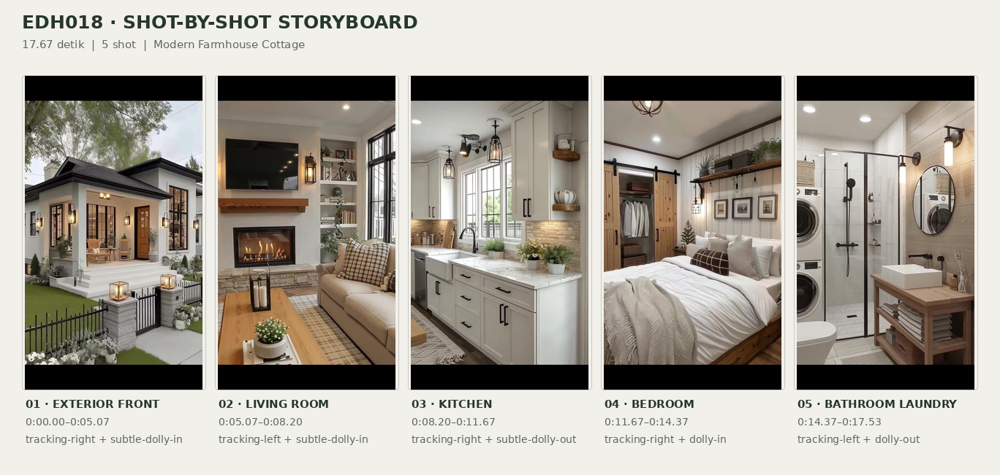
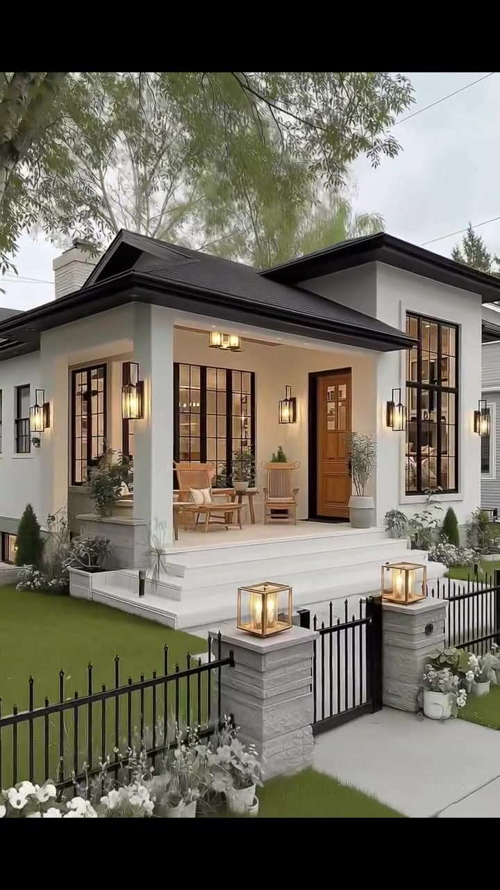
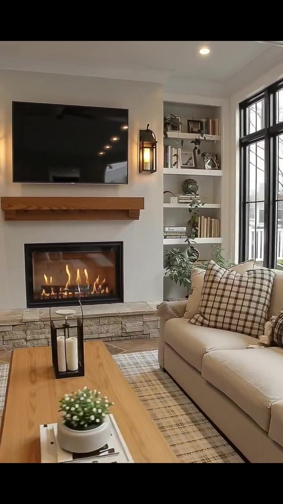
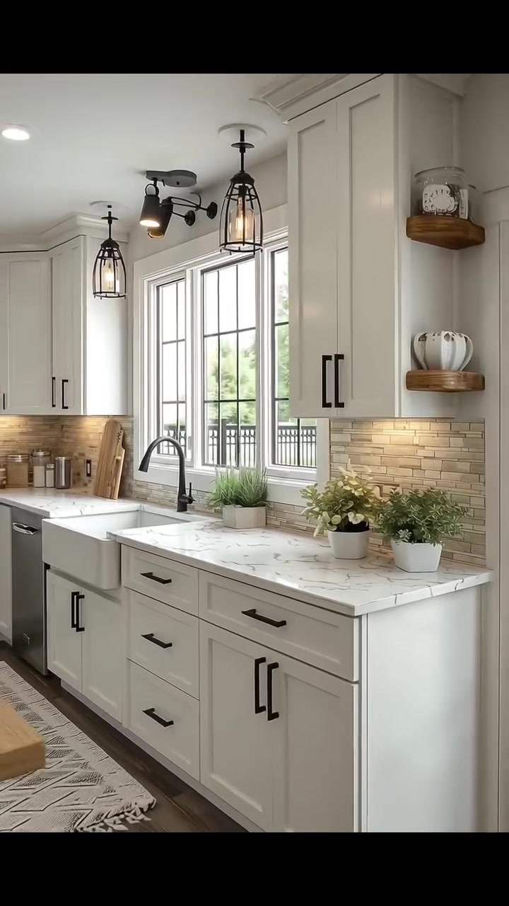
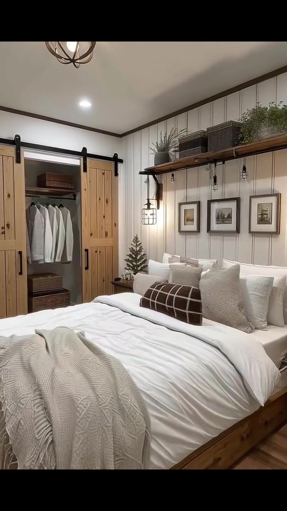
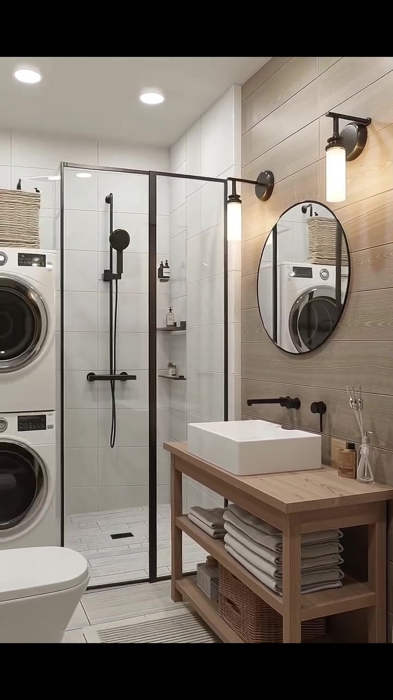

# edh018 — Modern Farmhouse Cottage

<!-- homeku_request_id: edh018-20261104-1356 -->

<!-- homeku_detail_narratives: chat-reviewed -->

**Sumber data:** [analysis.yaml](analysis.yaml) · **Status:** draft · **Diverifikasi manusia:** Tidak

## 1. Informasi Video

| Informasi | Nilai |
|---|---|
| ID | edh018 |
| File asli | edh018.mp4 |
| Durasi | 17.67 |
| Resolusi | 720x1280 |
| FPS | 30 |
| Rasio | 9:16 |
| Jumlah shot | 5 |

## 2. Storyboard Gabungan

## 3. Identitas Desain

| Aspek | Hasil analisis |
|---|---|
| Gaya utama | modern farmhouse cottage |
| Wilayah terkait gaya desain | north america |
| Pengaruh gaya | contemporary cottage, transitional farmhouse |
| Ciri eksterior | off white facade, dark pitched roof, black grid windows, covered front porch, natural wood entry door, black metal lanterns, grey stone accents |
| Gaya interior | modern farmhouse, warm transitional, rustic wood accents |
| Confidence gaya | high |

## 4. Ukuran & Proporsi Bangunan

| Aspek | Estimasi visual |
|---|---|
| Ukuran yang terlihat | medium |
| Bentuk bangunan | compact rectangular with front porch and taller rear volume |
| Skala vertikal | primarily single story with possible lower level |
| Tapak bangunan | moderate |
| Perkiraan luas lantai | 90–160 m² |
| Confidence | low |

> Luas adalah perkiraan visual, bukan ukuran terukur.

## 5. Warna, Pencahayaan, dan Atmosfer

| Warna dominan | HEX (perkiraan) |
|---|---|
| soft ivory white | #EEEDE7 |
| charcoal black | #25282B |
| natural wood brown | #AD845E |
| warm beige | #C7B8A5 |
| pale stone grey | #B5B0A8 |
| muted garden green | #78866B |

| Aspek | Hasil analisis |
|---|---|
| Pencahayaan | soft overcast daylight, natural window daylight, warm wall and pendant lights, recessed ceiling downlights |
| Lingkungan | landscaped residential front yard, mature tree canopy, black picket fence, nearby residential houses |
| Musim yang tampak | Tidak diketahui |
| Mood | cozy, tidy, calm, warm, welcoming |

## 6. Struktur dan Timeline Video

**Jenis:** home tour · **Tempo:** moderate · **Transisi:** hard cuts between five continuous moving shots

| Shot | Waktu (detik) | Durasi | Area/Scene | Gerakan Kamera |
|---|---|---|---|---|
| Shot 01 | 0–5.07 | 5.07 | exterior front | tracking right, subtle dolly in |
| Shot 02 | 5.07–8.2 | 3.13 | living room | tracking left, subtle dolly in |
| Shot 03 | 8.2–11.67 | 3.47 | kitchen | tracking right, subtle dolly out |
| Shot 04 | 11.67–14.37 | 2.70 | bedroom | tracking right, dolly in |
| Shot 05 | 14.37–17.53 | 3.16 | bathroom laundry | tracking left, dolly out |

## 7. Analisis per Shot

### Shot 01 — exterior front

**Waktu:** 0–5.07 detik

| Komponen | Pengamatan |
|---|---|
| Fokus utama | white cottage facade and front porch |
| Framing awal → akhir | wide front left three quarter view with fence and lawn → medium front porch and entry view |
| Sudut pandang | eye level front left three quarter |
| Gerakan kamera | tracking right, subtle dolly in |
| Kecepatan kamera | slow |
| Pencahayaan | soft overcast daylight and warm porch lights |
| Transisi keluar | hard cut |

**Detail yang terlihat**

**Arsitektur**

Bangunan memiliki dinding luar berwarna putih gading dengan permukaan halus, atap depan miring berwarna arang gelap dan lis tepi hitam, serta volume bangunan di bagian kanan\-belakang yang tampak lebih tinggi. Teras beratap ditopang kolom persegi putih dan dicapai melalui anak tangga putih yang lebar. Pada fasad tampak jendela\-jendela tinggi berkisi dan berbingkai hitam di kedua sisi area masuk, serta pintu utama kayu cokelat hangat dengan panel kaca. Lampu dinding berbingkai logam hitam dipasang di dekat bukaan dan pintu, sementara satu lampu plafon persegi panjang menyala di bawah atap teras. Dasar kolom teras berlapis batu abu\-abu pucat, dan ada satu jendela kecil di bagian bawah dinding sisi kiri.

**Furnitur dan properti**

Di teras terdapat dua kursi berlengan bergaya anyaman dengan rangka kayu terang dan sebuah meja kayu bundar kecil di antaranya. Kursi di sebelah kiri memiliki bantalan berwarna terang. Tanaman hijau dalam pot ditempatkan di dekat pintu masuk dan kolom teras.

**Lingkungan**

Pohon besar dengan dedaunan hijau muda berada di sisi kiri dan kanopinya menaungi bagian atap. Halaman depan berupa rumput hijau terpangkas rapi, dibatasi pagar besi hitam berpola batang runcing dan gerbang sewarna di depan. Dua pilar batu abu\-abu pada gerbang diberi lampu kaca di bagian atas. Bunga\-bunga putih dan semak rendah tumbuh sepanjang pagar, dengan trotoar beton terang di depannya. Rumah tetangga berlapis dinding terang terlihat di kanan, sementara langit di atas atap tampak pucat dan berawan.

**Catatan pengamatan:** Kamera bergerak ke kanan sambil sedikit mendekat; pagar, taman, tangga, dan teras tetap dapat diikuti sepanjang shot.

**Confidence:** Kamera medium · Detail visual high

### Shot 02 — living room

**Waktu:** 5.07–8.2 detik

| Komponen | Pengamatan |
|---|---|
| Fokus utama | fireplace wall and beige sofa |
| Framing awal → akhir | medium wide living room with windows sofa and fireplace → closer fireplace tv and sofa view |
| Sudut pandang | eye level interior three quarter |
| Gerakan kamera | tracking left, subtle dolly in |
| Kecepatan kamera | slow |
| Pencahayaan | soft daylight from black framed windows with warm sconces and firelight |
| Transisi keluar | hard cut |

**Detail yang terlihat**

**Arsitektur**

Ruang keluarga menggunakan dinding putih dan plafon putih dengan lis bertingkat. Di dinding utama terdapat perapian persegi panjang berbingkai hitam, dengan bagian bawah berlapis batu abu\-abu muda dan ambang mantel kayu tebal di atasnya. Televisi datar hitam besar dipasang di atas mantel. Di kanan perapian terdapat rak terbuka built\-in putih, sedangkan sisi kanan ruangan memiliki jendela\-jendela tinggi berkisi hitam. Lampu dinding bergaya lentera logam hitam mengapit area perapian, dan plafon dilengkapi lampu downlight bulat.

**Furnitur dan properti**

Sofa berlapis kain beige ditempatkan di kanan dan menghadap perapian, dengan bantal dekoratif kotak\-kotak cokelat serta krem. Sebagian kursi berlapis kain krem terang tampak di bagian depan. Meja kopi kayu persegi panjang berada di antara dudukan dan perapian, berisi lentera kaca hitam dengan lilin serta pot putih kecil berisi tanaman hijau di atas tumpukan buku. Karpet beige bermotif garis saling silang mengisi area bawah meja. Rak built\-in menampung buku, foto berbingkai dan tanaman kecil; tanaman hijau berdaun juga terlihat dekat sofa dan rak.

**Lingkungan**

Melalui jendela kanan terlihat hamparan rumput hijau, pagar berwarna gelap, dan bangunan hunian berwarna terang di luarnya.

**Catatan pengamatan:** Gerakan mendekat dan bergeser halus ke arah perapian; televisi, rak built-in, sofa dan dekorasi meja terlihat lebih dekat di akhir.

**Confidence:** Kamera medium · Detail visual high

### Shot 03 — kitchen

**Waktu:** 8.2–11.67 detik

| Komponen | Pengamatan |
|---|---|
| Fokus utama | white farmhouse sink and cabinet wall |
| Framing awal → akhir | medium close up of sink counter and window → wider kitchen counter cabinet run |
| Sudut pandang | eye level oblique interior |
| Gerakan kamera | tracking right, subtle dolly out |
| Kecepatan kamera | moderate |
| Pencahayaan | bright daylight from window with warm under cabinet and pendant lights |
| Transisi keluar | hard cut |

**Detail yang terlihat**

**Arsitektur**

Dapur menampilkan kabinet atas dan bawah putih model shaker dengan pegangan hitam. Permukaan meja berwarna putih menyerupai marmer dengan urat abu\-abu, sedangkan backsplash menggunakan ubin persegi panjang ramping berwarna beige hangat. Jendela besar berkisi hitam berada tepat di atas sink farmhouse putih model apron\-front dan keran tinggi melengkung hitam matte. Di bawah kabinet terdapat pencahayaan hangat; di atas meja menggantung lampu bergaya sangkar hitam serta lampu sorot plafon hitam yang bisa diarahkan. Lantai berpenampilan kayu cokelat gelap, mesin pencuci piring berwarna metalik berada di kiri sink, dan dua rak kayu sudut kecil terpasang di dinding kanan.

**Furnitur dan properti**

Beberapa papan potong kayu disandarkan pada backsplash kiri, berdampingan dengan wadah penyimpanan kecil. Pot putih berisi tanaman hijau mirip rumput berada di belakang sink, sementara dua pot putih berisi tanaman hijau dan bunga krem pucat menghiasi bagian kanan countertop. Rak sudut atas memuat jam kecil berbentuk analog, dan rak di bawahnya menampung wadah keramik putih bergalur. Karpet runner bermotif warna netral membentang di lantai; tepi meja kayu hangat sebagian tampak di sudut kanan bawah.

**Lingkungan**

Pepohonan hijau, pagar logam hitam, dan sebagian rumah berwarna terang di dekatnya terlihat melalui jendela dapur.

**Catatan pengamatan:** Kamera bergeser ke kanan dan sedikit menjauh, membuka lebih banyak kabinet, meja dapur, rak sudut, dan lantai.

**Confidence:** Kamera high · Detail visual high

### Shot 04 — bedroom

**Waktu:** 11.67–14.37 detik

| Komponen | Pengamatan |
|---|---|
| Fokus utama | natural wood bed and barn door wardrobe |
| Framing awal → akhir | wide three quarter bedroom showing bed and wardrobe → closer bed headboard and shelf view |
| Sudut pandang | eye level from foot left of bed |
| Gerakan kamera | tracking right, dolly in |
| Kecepatan kamera | slow |
| Pencahayaan | warm indoor lighting from downlights and wall lanterns |
| Transisi keluar | hard cut |

**Detail yang terlihat**

**Arsitektur**

Dinding belakang tempat tidur dilapisi panel vertikal putih dengan lis mahkota plafon cokelat gelap. Di kiri tempat tidur terdapat pintu geser barn door kayu alami pada rel logam hitam panjang; celah di antaranya memperlihatkan lemari dengan pakaian gantung berwarna terang. Lantai berpenampilan papan kayu hangat, sementara plafon putih memiliki downlight bulat dan lampu gantung berbentuk bola rangka logam hitam. Lampu dinding bersangkar logam hitam terpasang di sisi area tempat tidur.

**Furnitur dan properti**

Tempat tidur besar berangka kayu alami diletakkan menempel pada dinding panel putih. Seprai dan selimut putih dilengkapi sejumlah bantal putih\-krem, satu bantal panjang kotak\-kotak cokelat gelap dan krem, serta selimut rajut tebal krem di bagian kaki ranjang. Tiga bingkai gambar kecil gelap berjajar di atas sandaran. Lebih tinggi lagi, rak kayu panjang menampung keranjang anyaman dan tanaman hijau. Di samping ranjang terlihat meja kayu kecil dengan dekorasi menyerupai pohon konifer mini; keranjang penyimpanan anyaman berada di rak dalam lemari, sedangkan sebagian karpet bermotif klasik lembut tampak di bawah tempat tidur.

**Lingkungan**

Tidak ada detail yang tercatat.

**Catatan pengamatan:** Mendekat ke tempat tidur dengan pergeseran ke kanan; bagian ranjang membesar sementara lemari geser makin berada di sisi kiri frame.

**Confidence:** Kamera medium · Detail visual high

### Shot 05 — bathroom laundry

**Waktu:** 14.37–17.53 detik

| Komponen | Pengamatan |
|---|---|
| Fokus utama | wood vanity shower and stacked laundry appliances |
| Framing awal → akhir | medium close view of vanity mirror and shower edge → wide bathroom showing shower laundry vanity and toilet |
| Sudut pandang | eye level interior three quarter |
| Gerakan kamera | tracking left, dolly out |
| Kecepatan kamera | moderate |
| Pencahayaan | bright recessed ceiling lights and warm wall sconces |
| Transisi keluar | end of video |

**Detail yang terlihat**

**Arsitektur**

Dinding aksen di belakang wastafel memakai papan horizontal berpenampilan kayu terang. Area shower berdinding ubin putih berukuran besar dan dipisahkan panel kaca bening berbingkai logam hitam. Perlengkapan shower berupa kepala pancuran genggam pada batang vertikal dan pengatur air hitam matte, dengan ceruk rak kecil berisi botol di dalam bilik. Lantainya tersusun dari ubin persegi panjang terang berurat abu\-abu halus. Plafon menggunakan downlight putih bulat; dua lampu dinding berbentuk tabung pada dudukan logam hitam mengapit cermin bulat, dan keran wastafel hitam matte dipasang langsung pada dinding.

**Furnitur dan properti**

Meja wastafel kayu alami berpenyimpanan terbuka menopang baskom putih berbentuk persegi, dengan cermin bulat berbingkai hitam di atasnya. Rak terbuka menyimpan tumpukan handuk warna terang, sementara keranjang anyaman cokelat ditempatkan di rak terbawah. Dua mesin laundry front\-loading putih disusun bertumpuk di kiri, dengan kloset putih yang sebagian tampak di depan kirinya. Di atas meja terdapat diffuser batang dalam botol kaca dan wadah kecil; keranjang anyaman lain terlihat di atas mesin laundry. Keset kamar mandi bermotif garis netral terbentang di depan meja wastafel.

**Lingkungan**

Tidak ada detail yang tercatat.

**Catatan pengamatan:** Kamera mundur dan bergeser ke kiri dari wastafel; bilik shower, mesin cuci-pengering bertumpuk, dan toilet masuk ke dalam frame.

**Confidence:** Kamera medium · Detail visual high

## 8. Kualitas dan Ketidakpastian Analisis

| Parameter | Hasil |
|---|---|
| Status | draft |
| Verifikasi manusia | Tidak |
| Ketepatan timestamp | estimated |
| Ketidakpastian | Perkiraan luas lantai 90–160 m² sangat kasar karena tidak ada ukuran pembanding yang pasti dan seluruh massa bangunan tidak terlihat., Sebagian label material memakai akhiran appearance/look karena jenis bahan sebenarnya tidak dapat dipastikan dari video., Arah gerakan kamera diperkirakan dari pergeseran elemen dalam frame; gerakan fisik kamera tidak dapat dikonfirmasi., Kawasan north america adalah asosiasi gaya arsitektur, bukan lokasi rumah., Durasi kontainer 17,67 detik, sedangkan frame visual berakhir sekitar 17,53 detik. |

**Catatan:** Observasi visual sepanjang setiap shot; belum diverifikasi oleh pengguna. Tidak ada analisis audio atau prompt generatif.

---

*Laporan ini diturunkan dari [analysis.yaml](analysis.yaml).*
