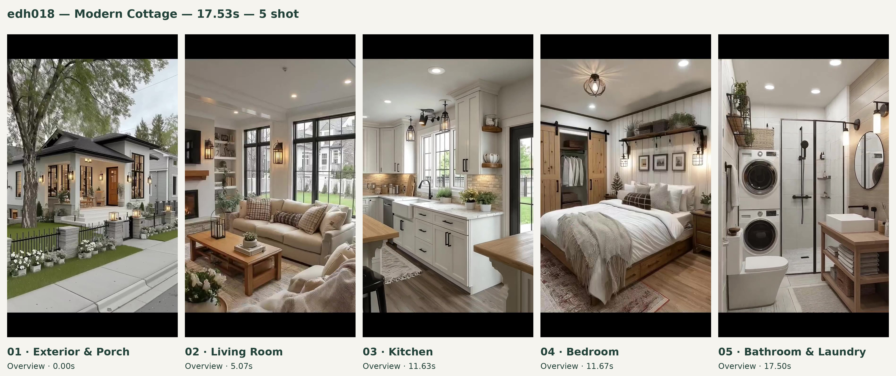
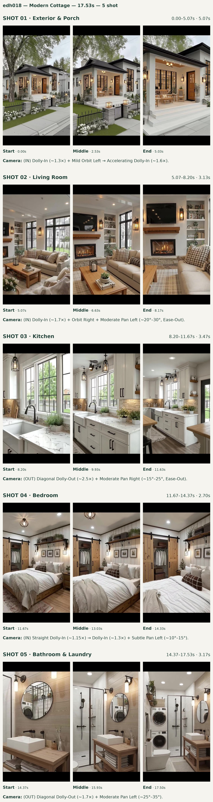
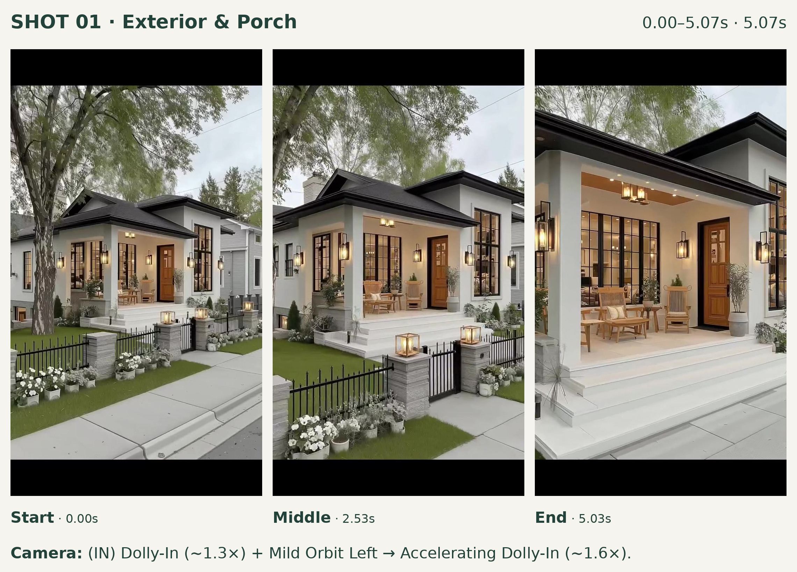
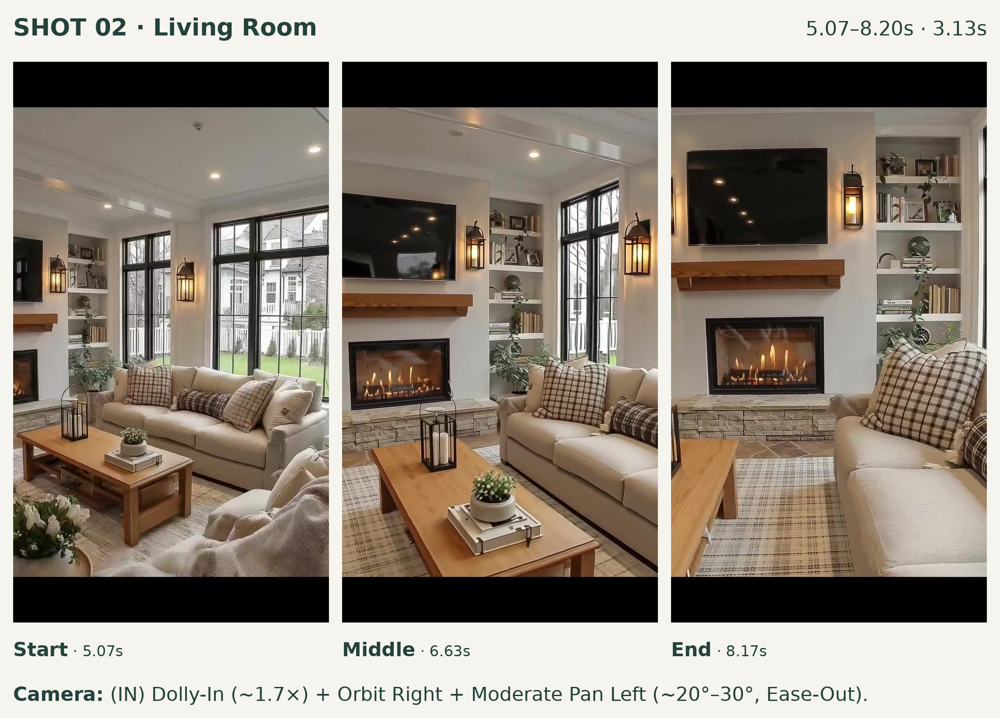
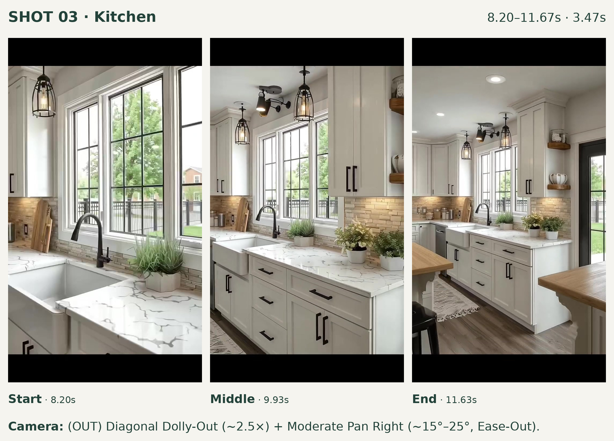
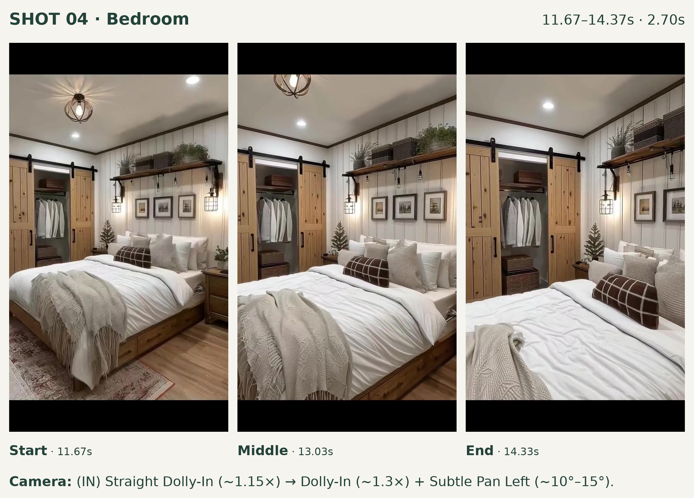
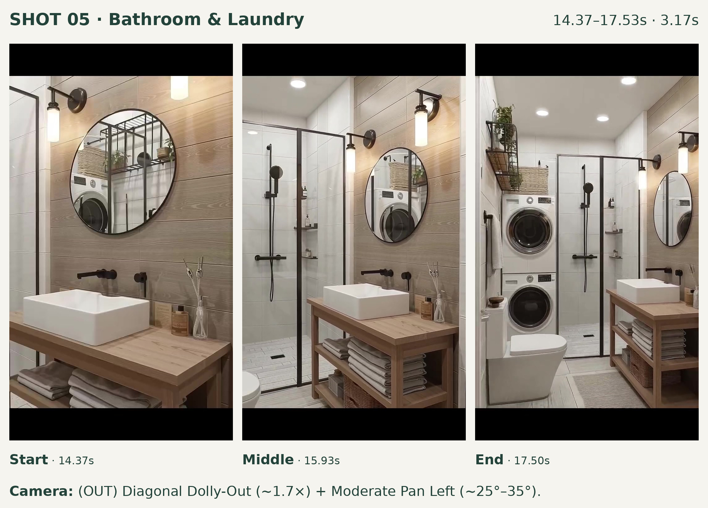

# edh018 — Warm Modern Cottage with Black-Framed Windows

## 1. Profil desain

- **Nama desain:** Warm Modern Cottage with Black-Framed Windows
- **Tipe rumah:** Bungalow
- **Gaya utama:** **Modern Cottage**
- **Pengaruh gaya:** Modern Farmhouse
- **Gaya interior:** Cozy Rustic Modern
- **Susunan ruang utama:** Urutan edit memperlihatkan teras, ruang keluarga, dapur, kamar tidur, kamar mandi sekaligus laundry; koneksi denah tidak teramati
- **Ciri khas:** Perapian dengan TV dan rak terbuka, apron-front sink, lemari pintu geser kayu, laundry bertumpuk di kamar mandi
- **Material utama:** Dinding terang, aksen kayu hangat, bingkai logam gelap, bidang batu/ubin dan tekstil netral; semua berdasarkan tampilan
- **Pencahayaan:** Cahaya siang lembut melalui bukaan dengan sconce, lampu gantung dan downlight hangat
- **Atmosfer:** Hangat, nyaman, rapi dan domestik, dengan kontras gelap yang terukur
- **Lingkungan:** Halaman rumput, pagar besi gelap, tanaman bunga putih, pohon dewasa dan trotoar; vegetasi terlihat melalui jendela

### Palet warna

| Peran | Warna | HEX |
| --- | --- | --- |
| Dominan | Warm white | `#E5E0D6` |
| Pendamping | Natural oak brown | `#A77E54` |
| Aksen | Charcoal black | `#292A28` |
| Pendamping | Warm beige | `#C8BAA7` |
| Pendamping | Stone gray | `#AAA7A1` |
| Aksen | Muted garden green | `#687653` |

## 2. Ukuran & proporsi

| Aspek | Estimasi visual |
| --- | --- |
| **Ukuran rumah** | small |
| **Bentuk bangunan** | Massa rendah dengan volume kanan sedikit lebih tinggi dan teras depan menjorok |
| **Lantai & bentuk atap** | Satu lantai tampak dari fasad · Atap gelap berbidang miring rendah, garis lis tebal dan bidang kecil menyerupai gable di kiri |
| **Tapak bangunan** | Massa kompak, denah keseluruhan tidak terlihat |
| **Proporsi utama** | Massa horizontal rendah dengan jendela vertikal tinggi dan teras menjorok |
| **Perkiraan luas lantai** | **60–105 m²** |

## 3. Shot Timeline

Durasi 17.53s · 5 shot.

**Camera Pattern:** IN – IN – OUT – IN – OUT.

| Shot | Time (s) | Duration | Area/Scene | Camera Movement |
| --- | --- | --- | --- | --- |
| 01 | 0.00–5.07 | 5.07s | Exterior & Porch | Dolly-In (~1.3×) + Mild Orbit Left → Accelerating Dolly-In (~1.6×). |
| 02 | 5.07–8.20 | 3.13s | Living Room | Dolly-In (~1.7×) + Orbit Right + Moderate Pan Left (~20°–30°, Ease-Out). |
| 03 | 8.20–11.67 | 3.47s | Kitchen | Diagonal Dolly-Out (~2.5×) + Moderate Pan Right (~15°–25°, Ease-Out). |
| 04 | 11.67–14.37 | 2.70s | Bedroom | Straight Dolly-In (~1.15×) → Dolly-In (~1.3×) + Subtle Pan Left (~10°–15°). |
| 05 | 14.37–17.53 | 3.17s | Bathroom & Laundry | Diagonal Dolly-Out (~1.7×) + Moderate Pan Left (~25°–35°). |

## 4. Overview

**Shot 01 · Exterior & Porch · 0.00s**

> Kamera berada di trotoar luar pagar, menghadap serong ke depan rumah pada tinggi mata perkiraan. Wide mencakup pohon kiri, pagar, rumput, teras bertangga dan fasad putih dengan jendela tinggi.

**Shot 02 · Living Room · 5.07s**

> Kamera di sudut ruang duduk, menghadap serong menuju sofa di depan jendela dan dinding perapian kiri. Wide mencakup meja kopi kayu, rug, sofa, dudukan foreground dan cahaya jendela.

**Shot 03 · Kitchen · 11.63s**

> Kamera sudah mundur ke sisi seberang area kerja, menghadap serong deret kabinet dan jendela. Wide menunjukkan sink, kabinet bawah/atas, rak kanan, pintu berkaca, lantai papan dan sebagian meja foreground.

**Shot 04 · Bedroom · 11.67s**

> Kamera dari sudut kaki ranjang menghadap serong ke headboard dan lemari kiri. Wide memperlihatkan ranjang utuh, lantai kayu, rug, nakas, pintu geser lemari dan rak atas.

**Shot 05 · Bathroom & Laundry · 17.50s**

> Kamera telah mundur ke depan ruang menghadap serong ke shower belakang. Wide mencakup laundry bertumpuk dan toilet kiri, shower berkaca tengah serta vanity kanan dengan basin dan cermin.

## 5. Storyboard

## 6. Shot Details

### Shot 01 · Exterior & Porch

**Time:** 0.00–5.07s · **Duration:** 5.07s

#### **A. Desain area**

**Arsitektur**

> Teras depan menjorok di bawah atap gelap dengan kolom persegi terang dan tiga anak tangga lebar. Fasad berwarna putih hangat, jendela vertikal berkisi hitam, pintu kayu berkaca di kanan teras; volume kanan sedikit lebih tinggi dan jendela tinggi.

**Furnitur & dekorasi**

> Dua kursi kayu dan meja kecil di depan jendela teras, tanaman pot di tepi; lampu gantung di plafon teras.

**Lingkungan**

> Halaman rumput di balik pagar besi hitam dengan pilar batu dan lentera; jalur menuju tangga, bunga putih di tepi pagar, pohon besar dan trotoar.

#### **B. Framing & Lighting**

- **Fokus:** Teras dan pintu masuk
- **Camera Start:** Di luar pagar dekat trotoar · Menghadap serong ke fasad dan teras · oblique · Sekitar tinggi mata, estimasi · Hampir datar, sedikit turun ke halaman
- **Framing:** Wide fasad, pohon, pagar dan trotoar → Medium-wide teras dan tangga
- **Lighting:** Siang lembut dari luar, lentera teras hangat
- **Foreground dan kedalaman:** Pohon, pagar dan trotoar · Pagar dekat, rumput tengah, fasad di belakang
- **Reveal:** Melewati dominasi pohon dan pagar menuju teras
- **Kesesuaian gerak:** Pendekatan dan orbit ringan membuka teras sebelum dolly lebih cepat

#### **C. Camera Movement**

Kamera mendekati teras dengan lintasan melengkung ringan pada awal, kemudian pendekatan makin dominan dan membesar cepat menuju tangga.

**Tempo:** Lambat–sedang pada awal, menjadi cepat mendekati teras di akhir.

- **0.00–3.10s · moderate:** Pendekatan dan pergeseran lateral halus.
- **3.10–5.07s · fast:** Pembesaran perspektif makin cepat.

**Movement Timeline**

| Time (s) | Area & fokus | Camera Movement | Tempo |
| --- | --- | --- | --- |
| 0.00–3.10 | Exterior & Porch · Fasad, pagar dan teras | Dolly-In (~1.3×) + Mild Orbit Left | Pendekatan dan pergeseran lateral halus. |
| 3.10–5.07 | Exterior & Porch · Tangga dan bukaan teras | Accelerating Dolly-In (~1.6×) | Pembesaran perspektif makin cepat. |

**Camera:** Dolly-In (~1.3×) + Mild Orbit Left → Accelerating Dolly-In (~1.6×).

---

### Shot 02 · Living Room

**Time:** 5.07–8.20s · **Duration:** 3.13s

#### **A. Desain area**

**Arsitektur**

> Ruang keluarga dengan plafon terang berlis, downlight dan jendela tinggi berkisi hitam. Dinding fokus berisi TV di atas mantel kayu dan perapian, rak terbuka di kanan; hearth bertekstur batu.

**Furnitur & dekorasi**

> Sofa krem panjang di depan jendela, kursi/sofa krem lain di foreground, meja kopi kayu persegi panjang di atas rug kotak-kotak. Bantal pola kotak, buku, tanaman dan lentera menghias meja.

**Lingkungan**

> Melalui jendela tampak rumput, pagar dan bangunan samar; lokasi serta hubungan ke teras tidak terbukti.

#### **B. Framing & Lighting**

- **Fokus:** Perapian dan zona duduk
- **Camera Start:** Di sudut zona duduk, dekat dudukan foreground · Menghadap serong ke sofa, jendela dan perapian kiri · oblique · Sekitar tinggi mata duduk/berdiri rendah, estimasi · Sedikit turun ke meja
- **Framing:** Wide zona duduk dan jendela → Medium framing TV/perapian dan tepi sofa
- **Lighting:** Cahaya jendela kanan dan lampu hangat, api perapian
- **Foreground dan kedalaman:** Meja kopi dan dudukan krem · Meja dekat, sofa tengah, dinding TV belakang
- **Reveal:** Perapian menjadi pusat dan jendela keluar dari sisi kanan
- **Kesesuaian gerak:** Dolly-in dengan orbit kanan dan pan kiri menggeser fokus ke perapian

#### **C. Camera Movement**

Kamera mendekati area sofa dan perapian sambil menyapu kiri, dengan perpindahan lateral kanan relatif meja; sapuan mereda menjelang akhir.

**Tempo:** Sedang, sapuan kiri relatif aktif pada awal dan tengah, melandai di akhir sementara pendekatan tetap berlangsung.

**Camera:** Dolly-In (~1.7×) + Orbit Right + Moderate Pan Left (~20°–30°, Ease-Out).

---

### Shot 03 · Kitchen

**Time:** 8.20–11.67s · **Duration:** 3.47s

#### **A. Desain area**

**Arsitektur**

> Deret kabinet putih bergaya panel dengan countertop putih bermotif urat abu-abu, backsplash bata kecil krem, jendela lebar berkisi di atas apron-front sink. Kabinet atas mengapit jendela dan rak kayu kecil di ujung kanan; pintu berkaca gelap di kanan. Meja foreground terpotong sehingga konfigurasi dapur penuh tidak pasti.

**Furnitur & dekorasi**

> Sink putih apron-front dan keran lengkung hitam, gagang kabinet gelap, rak kecil berisi cangkir; pot tanaman di countertop. Meja kayu terlihat di foreground kiri dan kanan, bangku gelap tampak sebagian; tipe island/peninsula tidak dapat dipastikan.

**Lingkungan**

> Vegetasi hijau, pagar dan atap bangunan tampak melalui jendela; cahaya siang menerangi area kerja.

#### **B. Framing & Lighting**

- **Fokus:** Sink dan keseluruhan deret kabinet
- **Camera Start:** Dekat countertop dan sink · Menghadap serong sepanjang jendela dan permukaan kerja · oblique · Sekitar tinggi dada/mata, estimasi · Sedikit turun ke countertop
- **Framing:** Close/medium countertop, sink dan jendela → Wide deret kabinet dan sisi meja depan
- **Lighting:** Cahaya siang dari jendela, undercabinet hangat dan lampu plafon
- **Foreground dan kedalaman:** Countertop dan sink · Countertop dekat, jendela dan kabinet di belakang
- **Reveal:** Kabinet kanan, rak, lantai dan pintu terbuka dalam komposisi
- **Kesesuaian gerak:** Dolly-out diagonal dengan pan kanan memperluas cakupan area kerja

#### **C. Camera Movement**

Kamera mundur dari sink untuk memperlihatkan countertop dan ruang dapur; sapuan kanan lebih jelas pada awal lalu mereda.

**Tempo:** Mundur cukup cepat dengan sapuan awal aktif, berkurang menjelang akhir.

**Camera:** Diagonal Dolly-Out (~2.5×) + Moderate Pan Right (~15°–25°, Ease-Out).

---

### Shot 04 · Bedroom

**Time:** 11.67–14.37s · **Duration:** 2.70s

#### **A. Desain area**

**Arsitektur**

> Kamar tidur kompak dengan dinding kepala ranjang berpanel vertikal terang, plafon putih berlis gelap, lantai papan kayu. Lemari pakaian berpintu geser kayu dengan rel hitam dan bagian tengah terbuka menempati sisi kiri; rak panjang di atas headboard.

**Furnitur & dekorasi**

> Ranjang ganda berbingkai kayu, selimut putih dengan throw krem dan bantal kotak gelap; nakas kayu di samping. Lemari terbuka memperlihatkan pakaian gantung dan penyimpanan bawah, rak atas memuat kotak dan tanaman, lampu gantung kecil di sisi kepala ranjang.

**Lingkungan**

> Pemandangan luar tidak tampak di shot ini; tidak dapat menyimpulkan posisi jendela atau hubungan kamar dengan ruang lain.

#### **B. Framing & Lighting**

- **Fokus:** Ranjang dan lemari
- **Camera Start:** Di sudut kaki ranjang · Menghadap serong ke headboard dan lemari kiri · oblique · Sekitar tinggi mata, estimasi · Sedikit turun ke permukaan ranjang
- **Framing:** Wide ranjang, lemari dan rak headboard → Medium dekat ranjang dan lemari
- **Lighting:** Downlight, lampu sangkar dan lampu samping hangat
- **Foreground dan kedalaman:** Kaki ranjang, throw dan rug · Ranjang depan, lemari kiri dan panel belakang
- **Reveal:** Lemari dan rel geser semakin dominan
- **Kesesuaian gerak:** Dolly-in kemudian pan kiri halus menekankan penyimpanan

#### **C. Camera Movement**

Kamera mendekati tempat tidur, kemudian pandangan makin bergeser kiri ke arah lemari.

**Tempo:** Sedang dan halus; sapuan kiri makin terlihat pada paruh kedua, pendekatan terus berlangsung.

**Movement Timeline**

| Time (s) | Area & fokus | Camera Movement | Tempo |
| --- | --- | --- | --- |
| 11.67–12.60 | Bedroom · Tempat tidur | Straight Dolly-In (~1.15×) | Sedang dan halus; sapuan kiri makin terlihat pada paruh kedua, pendekatan terus berlangsung. |
| 12.60–14.37 | Bedroom · Ranjang dan lemari pintu geser | Dolly-In (~1.3×) + Subtle Pan Left (~10°–15°) | Sedang dan halus; sapuan kiri makin terlihat pada paruh kedua, pendekatan terus berlangsung. |

**Camera:** Straight Dolly-In (~1.15×) → Dolly-In (~1.3×) + Subtle Pan Left (~10°–15°).

---

### Shot 05 · Bathroom & Laundry

**Time:** 14.37–17.53s · **Duration:** 3.17s

#### **A. Desain area**

**Arsitektur**

> Kamar mandi merangkap laundry dengan shower berkaca berbingkai hitam di belakang, dinding area vanity berpanel horizontal tampak kayu, dinding shower ubin putih dan lantai abu-abu. Vanity di kanan, kloset depan kiri dan laundry bertumpuk di sisi kiri shower.

**Furnitur & dekorasi**

> Vanity meja kayu terbuka dengan basin putih persegi, keran dinding hitam, cermin bulat berbingkai gelap dan rak handuk. Shower hitam dengan handheld dan rak sudut. Dua mesin front-load ditumpuk vertikal di kiri, keranjang dan tanaman di rak atas; kloset putih di depan.

**Lingkungan**

> Tidak ada pemandangan luar yang teramati; pantulan cermin memperlihatkan laundry dan partisi shower, bukan bukti jendela luar.

#### **B. Framing & Lighting**

- **Fokus:** Vanity lalu seluruh kamar mandi/laundry
- **Camera Start:** Dekat vanity sisi kanan · Menghadap serong ke cermin dan tepi shower · oblique · Sekitar tinggi mata, estimasi · Sedikit turun ke meja vanity
- **Framing:** Medium dekat vanity, basin, cermin → Wide shower, vanity, laundry dan kloset
- **Lighting:** Sconce hangat dan downlight terang
- **Foreground dan kedalaman:** Meja vanity dan basin · Vanity dekat, shower belakang dan laundry kiri
- **Reveal:** Shower, kloset serta laundry bertumpuk masuk ke frame
- **Kesesuaian gerak:** Dolly-out diagonal dan pan kiri membuka fungsi gabungan

#### **C. Camera Movement**

Kamera mundur menyerong sambil menggeser pandangan ke kiri, dari wastafel ke shower dan laundry.

**Tempo:** Sedang, sapuan relatif stabil, perubahan skala lebih kuat di tengah dan melandai ringan di akhir.

**Camera:** Diagonal Dolly-Out (~1.7×) + Moderate Pan Left (~25°–35°).

**Catatan referensi:** Estimasi luas 60–105 m² adalah perkiraan kasar berdasarkan massa fasad dan cakupan interior; bukan pengukuran denah. Jumlah lantai, batas tapak dan hubungan antarruang tidak dapat diverifikasi. Jenis material hanya berdasarkan tampilan visual, bukan spesifikasi fisik. Urutan shot terpisah oleh cut, tidak membuktikan seluruh ruang berada pada satu rumah fisik. Interpretasi kamera Fase 2 dipertahankan sesuai persetujuan pengguna; kemungkinan orbit versus dolly diagonal dan estimasi sudut/skala tetap terbatas oleh bukti 2D.
