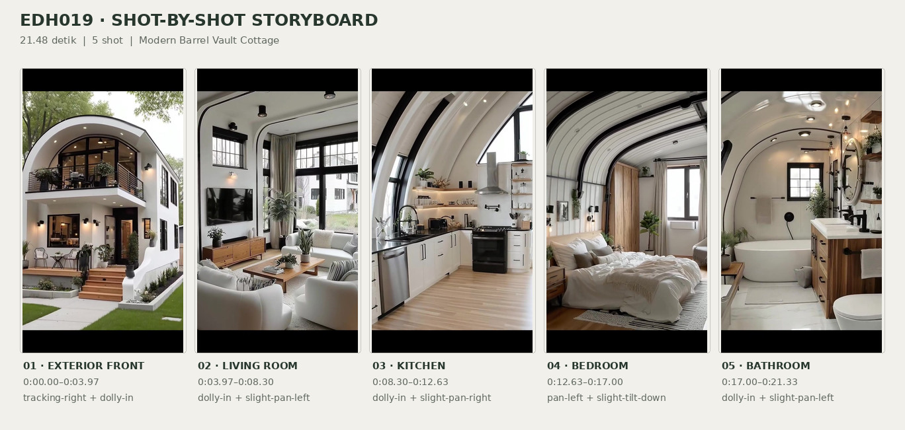
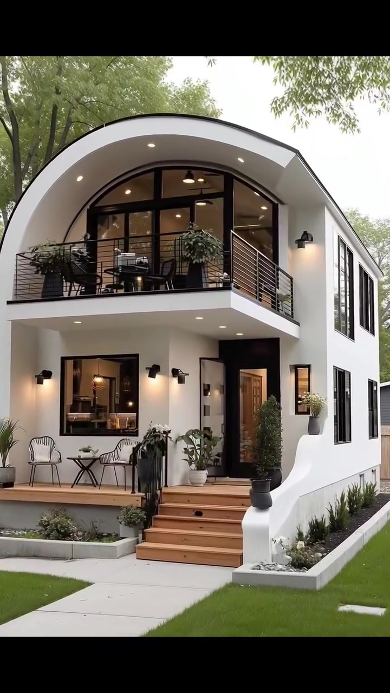
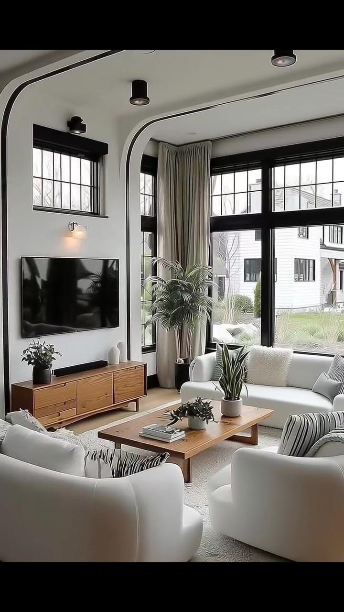
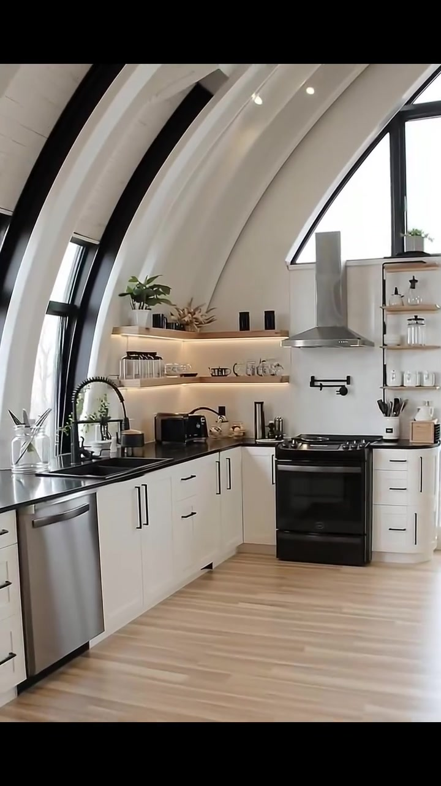
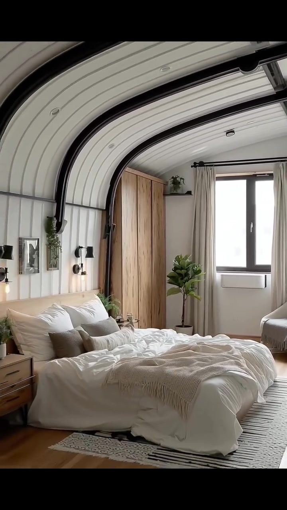
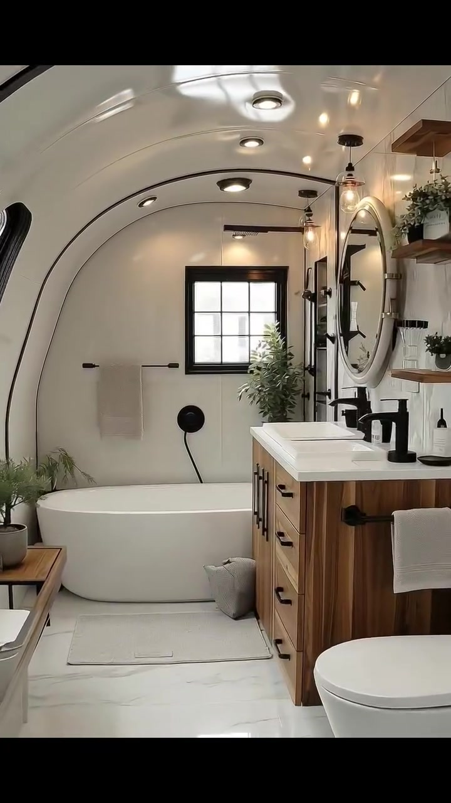

# edh019 — Modern Barrel Vault Cottage

<!-- homeku_request_id: edh019-20261104-1400 -->

<!-- homeku_detail_narratives: chat-reviewed -->

**Sumber data:** [analysis.yaml](analysis.yaml) · **Status:** draft · **Diverifikasi manusia:** Tidak

## 1. Informasi Video

| Informasi | Nilai |
|---|---|
| ID | edh019 |
| File asli | edh019.mp4 |
| Durasi | 21.48 |
| Resolusi | 720x1280 |
| FPS | 30 |
| Rasio | 9:16 |
| Jumlah shot | 5 |

## 2. Storyboard Gabungan

## 3. Identitas Desain

| Aspek | Hasil analisis |
|---|---|
| Gaya utama | modern barrel vault cottage |
| Wilayah terkait gaya desain | north america, europe |
| Pengaruh gaya | quonset inspired roof form, modern farmhouse, scandinavian interior |
| Ciri eksterior | white smooth appearance facade, arched front roofline, large black framed glazing, upper balcony with dark horizontal railing, warm wood entry stairs, wall sconces and recessed downlights |
| Gaya interior | contemporary cozy minimalism, modern scandinavian, warm natural wood accents, black metal accents |
| Confidence gaya | medium |

## 4. Ukuran & Proporsi Bangunan

| Aspek | Estimasi visual |
|---|---|
| Ukuran yang terlihat | medium |
| Bentuk bangunan | elongated rectangular with curved roof |
| Skala vertikal | two story |
| Tapak bangunan | moderate |
| Perkiraan luas lantai | 130–200 m² |
| Confidence | low |

> Luas adalah perkiraan visual, bukan ukuran terukur.

## 5. Warna, Pencahayaan, dan Atmosfer

| Warna dominan | HEX (perkiraan) |
|---|---|
| soft white | #F0EFEA |
| matte black | #292B2B |
| light natural wood | #BC936B |
| warm cream | #DAD2C2 |
| leaf green | #73836D |

| Aspek | Hasil analisis |
|---|---|
| Pencahayaan | soft diffuse daylight, warm wall sconces, recessed ceiling spotlights, warm undercabinet shelf lighting |
| Lingkungan | landscaped residential lot, mature green canopy trees, neatly mown lawn, neighboring residential buildings |
| Musim yang tampak | Tidak diketahui |
| Mood | clean, cozy, airy, calm, warm modern |

## 6. Struktur dan Timeline Video

**Jenis:** home tour · **Tempo:** slow · **Transisi:** hard cuts between five continuously moving shots

| Shot | Waktu (detik) | Durasi | Area/Scene | Gerakan Kamera |
|---|---|---|---|---|
| Shot 01 | 0.0–3.97 | 3.97 | exterior front | tracking right, dolly in |
| Shot 02 | 3.97–8.3 | 4.33 | living room | dolly in, slight pan left |
| Shot 03 | 8.3–12.63 | 4.33 | kitchen | dolly in, slight pan right |
| Shot 04 | 12.63–17.0 | 4.37 | bedroom | pan left, slight tilt down |
| Shot 05 | 17.0–21.33 | 4.33 | bathroom | dolly in, slight pan left |

## 7. Analisis per Shot

### Shot 01 — exterior front

**Waktu:** 0.0–3.97 detik

| Komponen | Pengamatan |
|---|---|
| Fokus utama | white curved roof two story house with balcony |
| Framing awal → akhir | wide front three quarter view with foreground trees → medium front right three quarter view |
| Sudut pandang | eye level slightly upward |
| Gerakan kamera | tracking right, dolly in |
| Kecepatan kamera | slow |
| Pencahayaan | soft diffuse daylight with warm entrance sconces and recessed lights |
| Transisi keluar | hard cut |

**Detail yang terlihat**

**Arsitektur**

Rumah memanjang dua lantai ini memiliki fasad putih berpenampilan halus dan garis atap melengkung seperti barrel vault, termasuk bagian dinding samping depan yang turut melengkung. Bukaan kaca besar berbentuk lengkung di lantai atas memakai kisi bingkai hitam dan menghadap balkon depan yang menjorok keluar, dengan pagar logam hitam bergaris horizontal. Pada sisi kanan terlihat deretan jendela tinggi berbentuk persegi panjang dengan bingkai hitam. Pintu masuk berada lebih ke dalam dengan panel bernuansa kayu hangat; beberapa anak tangga tampak berfinishing seperti kayu dengan pegangan hitam menuju teras depan yang terangkat di bawah balkon. Jendela besar berbingkai hitam berada di kiri pintu. Lampu dinding hitam mengapit area bukaan bawah, sedangkan lampu tanam bulat terlihat di bawah balkon dan tepi atap.

**Furnitur dan properti**

Di teras kiri lantai dasar terdapat dua kursi berwarna terang dengan sandaran berpola terbuka, dipisahkan meja bistro bundar hitam. Balkon lantai atas juga menampilkan kursi luar ruang gelap dan meja kecil. Tanaman berdaun lebat dalam pot besar menempati sisi kanan balkon, sedangkan satu tanaman pot lain terlihat di tepi kiri. Beberapa pot tanaman putih dan gelap ditata di dekat tangga serta pintu masuk.

**Lingkungan**

Pohon\-pohon besar dengan kanopi daun hijau berdiri di depan rumah; pada awal shot, batang pohon di foreground sempat menutupi sebagian fasad. Rumput hijau yang dipangkas rapi mengelilingi jalur pejalan kaki lurus dari beton berwarna abu\-abu terang menuju tangga. Bedeng tanaman sempit di depan dan sisi kanan berisi semak rendah serta rumput hias, dengan batu dekoratif putih pada bedeng yang berada di kanan tangga. Rumah tetangga berwarna terang tampak di kiri, bangunan abu\-abu gelap di kanan, dan pagar kayu vertikal berwarna terang di area kanan belakang. Langit di sela pepohonan terlihat cerah pucat seperti berawan.

**Catatan pengamatan:** Pohon besar menutup sebagian fasad di awal; kamera bergeser ke kanan dan mendekat sehingga balkon, tangga, dan sisi kanan rumah lebih jelas.

**Confidence:** Kamera medium · Detail visual high

### Shot 02 — living room

**Waktu:** 3.97–8.3 detik

| Komponen | Pengamatan |
|---|---|
| Fokus utama | tv wall and wood media console in bright living room |
| Framing awal → akhir | wide living area view → closer tv wall and media console view |
| Sudut pandang | interior eye level |
| Gerakan kamera | dolly in, slight pan left |
| Kecepatan kamera | slow |
| Pencahayaan | bright soft window daylight with warm wall sconce |
| Transisi keluar | hard cut |

**Detail yang terlihat**

**Arsitektur**

Ruang keluarga berdinding putih tinggi memiliki tepian plafon melengkung dengan aksen hitam. Di sebelah kanan dinding TV terdapat rangkaian jendela sudut berukuran besar dengan kisi\-kisi hitam, sementara jendela lebih kecil berada tinggi di atas televisi. Lampu dinding putih berada tepat di atas TV, dan beberapa lampu plafon berbentuk silinder hitam tampak di bagian atas. Tirai panjang beige muda menggantung di sudut jendela, lantai terlihat menyerupai kayu berwarna terang, dan lis dasar hitam mengikuti bagian dekat jendela.

**Furnitur dan properti**

Televisi layar datar hitam terpasang pada dinding putih di atas kabinet media panjang dan rendah berwarna kayu hangat dengan beberapa laci. Soundbar hitam tipis diletakkan di atas kabinet. Sofa berlapis kain krem berada di bawah jendela sudut kanan, sementara kursi empuk bundar putih gading tampak di foreground. Meja kopi kayu persegi panjang yang rendah berada di tengah area duduk, di atas karpet besar bertekstur krem. Bantal krem dan bantal berpola garis gelap menghiasi tempat duduk; tanaman hijau dalam pot tersebar dekat jendela, di atas kabinet, dan di atas meja. Di meja kopi juga ada tumpukan kecil buku.

**Lingkungan**

Melalui jendela\-jendela tinggi terlihat bangunan tetangga bersisi terang, cabang\-cabang pohon, dan sebagian vegetasi rendah di luar. Cahaya siang yang lembut masuk dari arah jendela kanan dan menerangi ruang keluarga.

**Catatan pengamatan:** Framing semakin rapat ke area televisi; jenis pergerakan dolly versus pembesaran digital tidak dapat dipastikan dari video.

**Confidence:** Kamera medium · Detail visual high

### Shot 03 — kitchen

**Waktu:** 8.3–12.63 detik

| Komponen | Pengamatan |
|---|---|
| Fokus utama | black stove under stainless hood in curved ceiling kitchen |
| Framing awal → akhir | wide l shaped kitchen with sink and stove → medium close view of range and wall shelves |
| Sudut pandang | interior eye level slight upward |
| Gerakan kamera | dolly in, slight pan right |
| Kecepatan kamera | slow |
| Pencahayaan | soft daylight with warm under shelf led lighting |
| Transisi keluar | hard cut |

**Detail yang terlihat**

**Arsitektur**

Dapur ini memiliki plafon putih melengkung seperti barrel vault, dengan panel berpenampilan papan dan rusuk lengkung hitam yang terlihat jelas, disertai lampu tanam kecil. Jendela tinggi berbingkai hitam berada di sisi ruang, termasuk bukaan bersudut di bagian atas. Kabinet bawah membentuk huruf L dengan pintu gaya shaker putih dan tarikan hitam; countertop tampak gelap hampir hitam, sedangkan lantai menyerupai papan kayu terang. Area backsplash di belakang kompor berpenampilan putih halus. Dua tingkat rak terbuka bernuansa kayu dipasang pada dinding dapur dan diterangi cahaya hangat di bawah rak.

**Furnitur dan properti**

Di bawah jendela samping terdapat bak cuci berwarna gelap dengan keran hitam tinggi berleher melengkung dan detail pegas, serta mesin pencuci piring berpenampilan stainless steel di bawah countertop kiri. Kompor berdiri hitam dengan oven berada pada dinding belakang di bawah cooker hood berpenampilan stainless steel berwarna perak. Di sisi kiri kompor terlihat toaster hitam dan peralatan countertop kecil. Rak terbuka menampung stoples kaca transparan, cangkir dan piring putih, tanaman hijau kecil, serta rangkaian batang kering. Di kanan kompor terdapat wadah alat masak putih berisi perkakas gelap dan bernuansa kayu, serta perlengkapan hitam berbentuk lengan lipat pada dinding di atas kompor. Teko putih dan kotak kayu kecil turut terlihat di rak kanan.

**Lingkungan**

Cahaya alami dari luar masuk secara lembut melalui jendela dapur berbingkai hitam; pemandangan luar tidak tampak cukup jelas untuk diidentifikasi lebih rinci.

**Catatan pengamatan:** Kamera bergerak mendekati kompor; area wastafel di kiri perlahan keluar dari framing.

**Confidence:** Kamera medium · Detail visual high

### Shot 04 — bedroom

**Waktu:** 12.63–17.0 detik

| Komponen | Pengamatan |
|---|---|
| Fokus utama | low white bed under curved ribbed ceiling |
| Framing awal → akhir | medium view of window wardrobe and near bed edge → wide view of bed left wall wardrobe and window |
| Sudut pandang | interior eye level |
| Gerakan kamera | pan left, slight tilt down |
| Kecepatan kamera | slow |
| Pencahayaan | diffuse window daylight and soft warm bedside sconces |
| Transisi keluar | hard cut |

**Detail yang terlihat**

**Arsitektur**

Kamar tidur mempunyai plafon melengkung berlapis panel putih menyerupai papan yang disilang oleh rusuk penyangga hitam. Dinding di sisi tempat tidur memakai panel vertikal putih, dengan lampu dinding hitam pada area samping tempat tidur. Jendela belakang berbingkai hitam dan dilengkapi tirai panjang beige terang pada batang rel hitam. Lantai tampak menyerupai papan kayu berwarna hangat, dan sebuah panel persegi panjang putih terpasang di bawah jendela.

**Furnitur dan properti**

Tempat tidur rendah yang lebar memiliki duvet putih serta beberapa bantal krem dan abu\-abu, dengan selimut rajut beige bertekstur disampirkan di bagian bawah kasur. Lemari tinggi berpenampilan kayu alami berada di kiri jendela dan meja samping tempat tidur dari kayu berada di kiri ranjang. Kursi aksen berlapis kain abu\-abu terang tampak di kanan jendela. Pohon hias hijau dalam pot putih berdiri di antara area kasur dan jendela, sementara pot\-pot kecil berada di meja samping ranjang dan rak tinggi pada sudut. Karpet terang bergaris\-garis gelap membentang di kaki tempat tidur; hiasan dinding berbingkai kecil berada di atas sisi kiri kepala ranjang.

**Lingkungan**

Cahaya siang yang terang dan tersebar masuk melalui jendela hitam di dinding belakang. Detail luar jendela tidak cukup jelas untuk diuraikan.

**Catatan pengamatan:** Awal shot menonjolkan jendela dan lemari; kamera menyingkap lebih banyak kasur dan dinding kiri sampai akhir.

**Confidence:** Kamera medium · Detail visual high

### Shot 05 — bathroom

**Waktu:** 17.0–21.33 detik

| Komponen | Pengamatan |
|---|---|
| Fokus utama | white bathtub below black grid window and black shower |
| Framing awal → akhir | wide view of tub toilet and vanity → closer view of window and tub wall |
| Sudut pandang | interior eye level |
| Gerakan kamera | dolly in, slight pan left |
| Kecepatan kamera | slow |
| Pencahayaan | soft daylight with warm ceiling and pendant light |
| Transisi keluar | end of video |

**Detail yang terlihat**

**Arsitektur**

Kamar mandi menggunakan plafon putih melengkung dengan garis lis hitam tipis, lampu tanam bulat, dan sebuah lampu plafon bertepi gelap. Permukaan dinding terlihat putih halus; jendela persegi dengan kisi dan bingkai hitam berada tepat di atas bathtub putih berbentuk membulat yang ditempatkan sepanjang dinding belakang. Lantai terlihat seperti ubin putih dengan pola urat marmer tipis. Di atas bathtub terdapat kepala rain shower pada lengan horizontal hitam serta pengatur mandi bulat hitam dengan selang fleksibel gelap. Sisi kanan ditempati kabinet wastafel berpenampilan kayu terang dengan gagang laci hitam dan countertop putih dengan dua basin.

**Furnitur dan properti**

Di atas kabinet wastafel terdapat cermin bundar berbingkai terang, lampu gantung kaca bening dengan dudukan logam gelap, keran\-keran hitam, dan aksesori kecil berwarna gelap. Toilet putih terlihat di depan kabinet pada awal shot. Handuk beige muda menggantung pada batang hitam di kiri jendela. Pohon hias hijau dalam pot putih berada di kanan bak mandi; di dinding kanan tampak rak kayu melayang dengan beberapa pot kecil. Di kiri bathtub terlihat bangku kayu kecil dan tanaman, sedangkan alas mandi terang berada di lantai depannya. Keranjang kain abu\-abu berada di lantai antara bathtub dan kabinet.

**Lingkungan**

Cahaya siang lembut masuk melalui jendela berkisi hitam di atas bak mandi; objek di luar jendela tidak dapat diidentifikasi dengan yakin.

**Catatan pengamatan:** Kamera mendekat ke bathtub dan jendela, sementara wastafel, toilet, dan rak semakin keluar dari bingkai.

**Confidence:** Kamera medium · Detail visual high

## 8. Kualitas dan Ketidakpastian Analisis

| Parameter | Hasil |
|---|---|
| Status | draft |
| Verifikasi manusia | Tidak |
| Ketepatan timestamp | estimated |
| Ketidakpastian | actual building location and construction system are unverified, architectural style and common regions are visual associations only, building floor area 130 to 200 m2 is low confidence visual estimate, wood stone metal and wall materials describe visible appearance not material tests, dolly versus digital zoom and small pans are not precisely distinguishable, season cannot be reliably determined from green foliage, video stream ends around 21 33s while container duration is 21 48s |

**Catatan:** Lima shot diidentifikasi dari empat hard cut pada sekitar 3.97, 8.30, 12.63, dan 17.00 detik. Seluruh kategori didasarkan pada pengamatan visual; warna dan luas merupakan estimasi.

---

*Laporan ini diturunkan dari [analysis.yaml](analysis.yaml).*
