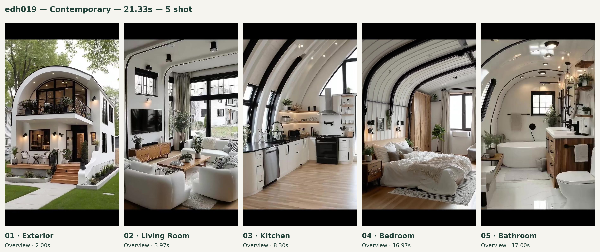
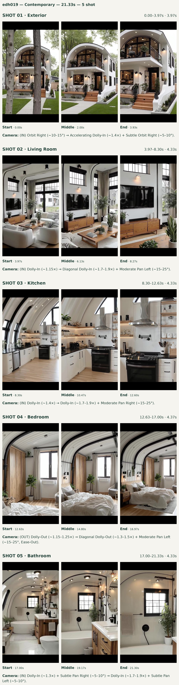
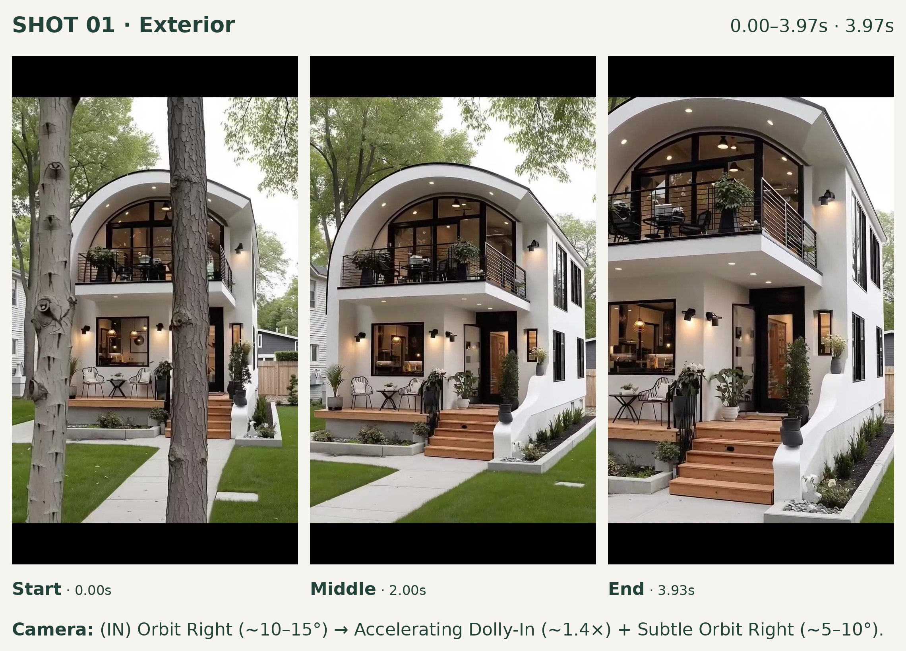
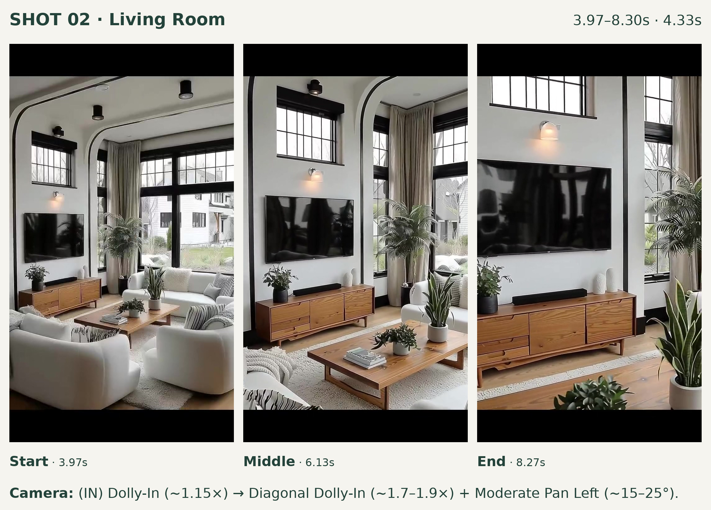
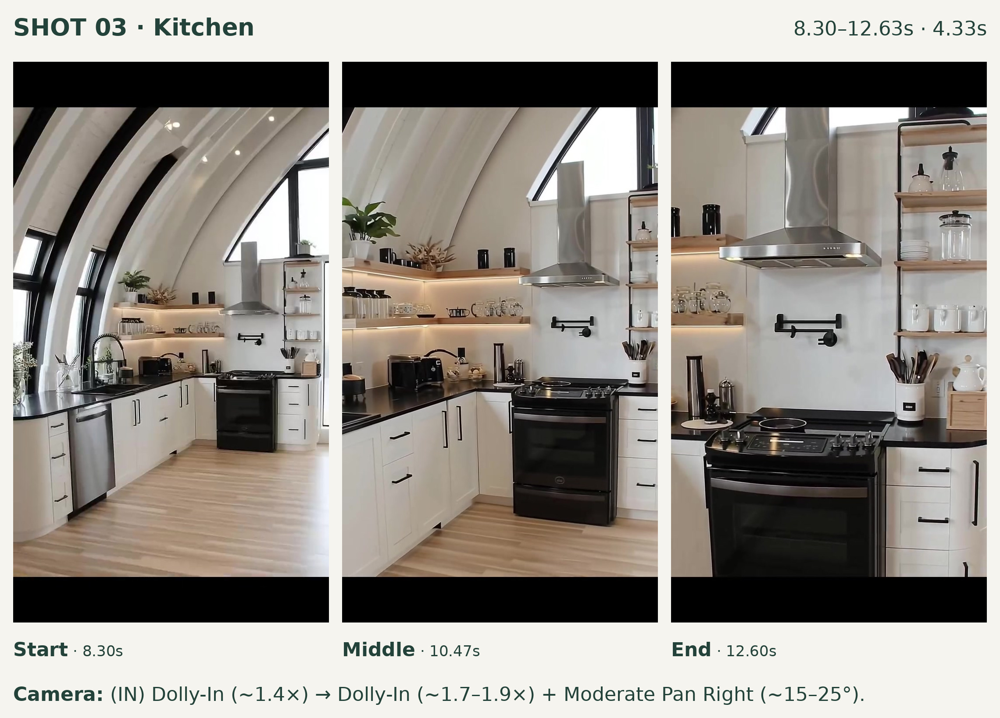
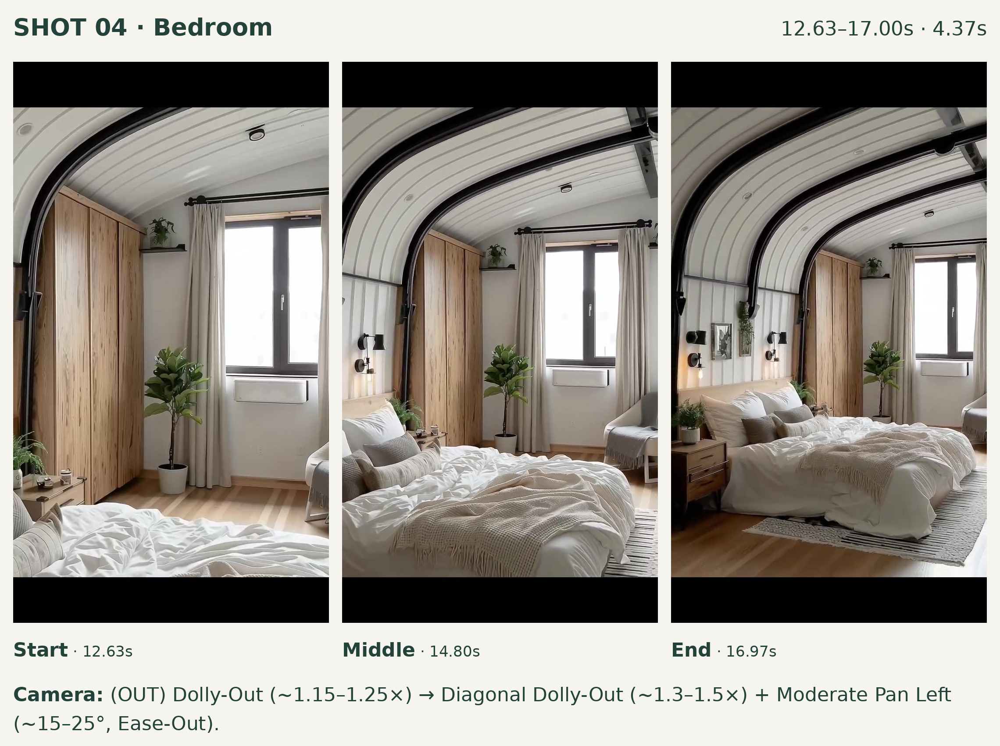
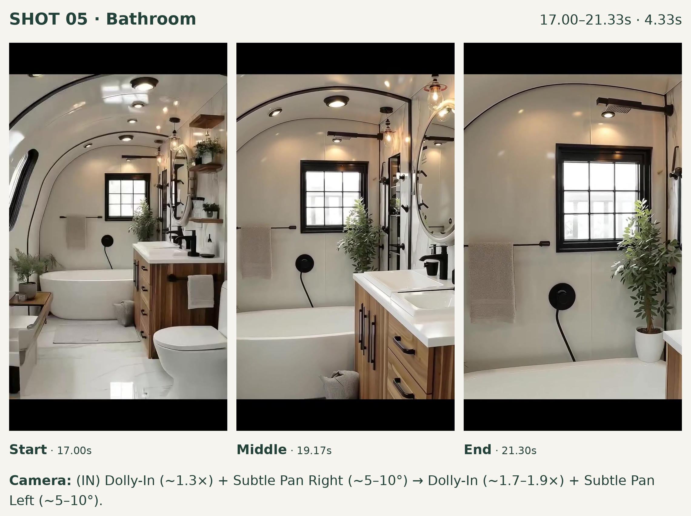

# edh019 — Rumah Lengkung Putih dengan Rangka Hitam dan Kayu

## 1. Profil desain

- **Nama desain:** Rumah Lengkung Putih dengan Rangka Hitam dan Kayu
- **Tipe rumah:** Detached House
- **Gaya utama:** **Contemporary**
- **Pengaruh gaya:** Industrial
- **Gaya interior:** Modern Warm Minimalism
- **Susunan ruang utama:** Eksterior, ruang keluarga, dapur, kamar tidur dan kamar mandi tampil terpisah oleh cut; koneksi denah tidak terbukti
- **Ciri khas:** Rangka lengkung hitam berulang di interior dan kaca fasad atas mengikuti lengkungan
- **Material utama:** Bidang putih halus dan panel beralur terang, rangka hitam, aksen tampilan kayu hangat
- **Pencahayaan:** Cahaya siang melalui kaca dan jendela, dipadukan lampu dinding, downlight, dan lampu kabinet hangat
- **Atmosfer:** Terang, nyaman dan kontras grafis hitam-putih dengan kayu hangat
- **Lingkungan:** Halaman rumput, pohon tinggi dan jalur pijakan lurus; vegetasi tampak melalui sebagian jendela

### Palet warna

| Peran | Warna | HEX |
| --- | --- | --- |
| Dominan | Putih hangat | `#E8E5DE` |
| Pendamping | Hitam arang | `#252524` |
| Pendamping | Kayu madu | `#B78B61` |
| Pendamping | Krem linen | `#D6CEC1` |
| Aksen | Hijau daun | `#687B45` |

## 2. Ukuran & proporsi

| Aspek | Estimasi visual |
| --- | --- |
| **Ukuran rumah** | Small to medium |
| **Bentuk bangunan** | Massa ramping dua tingkat dengan selubung melengkung dan balkon depan |
| **Lantai & bentuk atap** | Dua tingkat tampak pada fasad · Barrel vault profile; atap dan dinding atas menyatu sebagai lengkung kontinu |
| **Tapak bangunan** | Massa memanjang dan ramping; denah penuh tidak terlihat |
| **Proporsi utama** | Fasad relatif sempit dan tinggi, puncak lengkung menegaskan vertikalitas |
| **Perkiraan luas lantai** | **70–120 m²** |

## 3. Shot Timeline

Durasi 21.33s · 5 shot.

**Camera Pattern:** IN – IN – IN – OUT – IN.

| Shot | Time (s) | Duration | Area/Scene | Camera Movement |
| --- | --- | --- | --- | --- |
| 01 | 0.00–3.97 | 3.97s | Exterior | Orbit Right (~10–15°) → Accelerating Dolly-In (~1.4×) + Subtle Orbit Right (~5–10°). |
| 02 | 3.97–8.30 | 4.33s | Living Room | Dolly-In (~1.15×) → Diagonal Dolly-In (~1.7–1.9×) + Moderate Pan Left (~15–25°). |
| 03 | 8.30–12.63 | 4.33s | Kitchen | Dolly-In (~1.4×) → Dolly-In (~1.7–1.9×) + Moderate Pan Right (~15–25°). |
| 04 | 12.63–17.00 | 4.37s | Bedroom | Dolly-Out (~1.15–1.25×) → Diagonal Dolly-Out (~1.3–1.5×) + Moderate Pan Left (~15–25°, Ease-Out). |
| 05 | 17.00–21.33 | 4.33s | Bathroom | Dolly-In (~1.3×) + Subtle Pan Right (~5–10°) → Dolly-In (~1.7–1.9×) + Subtle Pan Left (~5–10°). |

## 4. Overview

**Shot 01 · Exterior · 2.00s**

> Dari halaman depan pada sudut agak serong, rumah dua tingkat berlengkung, balkon kaca grid, tangga, jalur dan rumput terlihat tanpa batang utama menutup fasad.

**Shot 02 · Living Room · 3.97s**

> Dari belakang kelompok sofa, mengarah serong ke dinding TV dan kaca tinggi di kanan; area duduk, meja dan konsol terlihat bersama.

**Shot 03 · Kitchen · 8.30s**

> Dari ujung ruang, melihat kabinet bawah di kiri dan kompor di ujung, langit-langit melengkung dan jendela miring atas terlihat.

**Shot 04 · Bedroom · 16.97s**

> Dari sisi kaki ranjang mengarah serong ke headboard kiri dan jendela ujung; ranjang, lemari, meja sisi dan lengkung plafon tercakup.

**Shot 05 · Bathroom · 17.00s**

> Dari pintu/sisi dekat ruang, mengarah ke bak mandi dan jendela ujung; vanity kanan, kloset dekat dan rangka lengkung terlihat.

## 5. Storyboard

## 6. Shot Details

### Shot 01 · Exterior

**Time:** 0.00–3.97s · **Duration:** 3.97s

#### **A. Desain area**

**Arsitektur**

> Massa putih dua tingkat dengan atap lengkung, balkon atas berbingkai hitam dan pagar gelap; bukaan atas mengikuti lengkung. Pintu gelap di kanan dan jendela grid di kiri, tangga berwarna kayu menuju teras.

**Furnitur & dekorasi**

> Teras bawah berisi tempat duduk dan tanaman; balkon atas juga dihiasi tanaman.

**Lingkungan**

> Rumput, pohon tinggi, jalur lurus ke tangga dan batas tanam di kanan; lampu dinding menyala.

#### **B. Framing & Lighting**

- **Fokus:** Fasad lengkung dan pintu masuk
- **Camera Start:** Halaman depan di balik pohon · Ke fasad depan · Serong ringan menuju frontal · Kira-kira setinggi mata di halaman · Relatif datar, sedikit mendongak
- **Framing:** Wide fasad dengan oklusi batang alami → Fasad lebih dekat, pintu dan tangga dominan
- **Lighting:** Siang difus; lampu dinding hangat
- **Foreground dan kedalaman:** Batang pohon, rumput, jalur beton · Pohon dekat, teras dan massa rumah jauh
- **Reveal:** Pohon bergeser membuka sisi kanan; tangga membesar
- **Kesesuaian gerak:** Orbit memanfaatkan paralaks pohon; Dolly-In menekankan akses

#### **C. Camera Movement**

Kamera menyibak batang pohon dari kiri ke kanan secara orbit mengitari muka rumah, lalu mendekat ke tangga dan sisi kanan fasad; peralihan komponen gradual.

**Tempo:** Reveal lateral sedang pada awal, pendekatan terasa makin cepat pada akhir; sebagian kenaikan laju gambar berasal dari perspektif.

**Movement Timeline**

| Time (s) | Area & fokus | Camera Movement | Tempo |
| --- | --- | --- | --- |
| 0.00–1.47 | Exterior · Fasad dan batang pohon | Orbit Right (~10–15°) | Reveal lateral sedang pada awal, pendekatan terasa makin cepat pada akhir; sebagian kenaikan laju gambar berasal dari perspektif. |
| 1.47–3.97 | Exterior · Tangga masuk dan fasad kanan | Accelerating Dolly-In (~1.4×) + Subtle Orbit Right (~5–10°) | Reveal lateral sedang pada awal, pendekatan terasa makin cepat pada akhir; sebagian kenaikan laju gambar berasal dari perspektif. |

**Camera:** Orbit Right (~10–15°) → Accelerating Dolly-In (~1.4×) + Subtle Orbit Right (~5–10°).

**Catatan:** Material dan dimensi bersifat estimasi tampilan; hubungan fisik antarshot tidak dikonfirmasi.

---

### Shot 02 · Living Room

**Time:** 3.97–8.30s · **Duration:** 4.33s

#### **A. Desain area**

**Arsitektur**

> Volume tinggi, bidang putih, rangka lengkung hitam dan jendela grid atas; kaca lebar bertirai di kanan, lantai tampilan kayu.

**Furnitur & dekorasi**

> Sofa krem menghadap TV dinding, meja kopi persegi kayu di antaranya, konsol rendah kayu di bawah TV; tanaman dan karpet terang.

**Lingkungan**

> Kaca kanan memberi pandangan hijau dan bangunan luar; lampu dinding menerangi bidang TV.

#### **B. Framing & Lighting**

- **Fokus:** TV, konsol dan area duduk
- **Camera Start:** Di belakang sofa · Ke dinding TV dan jendela kanan · Serong lebar · Setinggi mata berdiri, perkiraan · Hampir horizontal
- **Framing:** Wide kelompok duduk dan bukaan tinggi → TV dan konsol kayu memenuhi bagian tengah
- **Lighting:** Cahaya siang dari kaca kanan; lampu dinding hangat
- **Foreground dan kedalaman:** Punggung sofa dan meja kayu · Sofa dekat, meja tengah, TV dan jendela jauh
- **Reveal:** Meja dan TV membesar, jendela kanan terpotong
- **Kesesuaian gerak:** Dolly-In menonjolkan susunan berlapis; Pan Left memilih TV

#### **C. Camera Movement**

Maju dari belakang sofa menuju dinding TV sambil menggeser arah pandang ke kiri; orientasi dinding berubah menjadi lebih frontal.

**Tempo:** Smooth, sapuan kiri lebih nyata di tengah lalu melunak; pembesaran terus berlanjut.

**Movement Timeline**

| Time (s) | Area & fokus | Camera Movement | Tempo |
| --- | --- | --- | --- |
| 3.97–4.97 | Living Room · Kelompok sofa dan meja kopi | Dolly-In (~1.15×) | Smooth, sapuan kiri lebih nyata di tengah lalu melunak; pembesaran terus berlanjut. |
| 4.97–8.30 | Living Room · TV dan konsol kayu | Diagonal Dolly-In (~1.7–1.9×) + Moderate Pan Left (~15–25°) | Smooth, sapuan kiri lebih nyata di tengah lalu melunak; pembesaran terus berlanjut. |

**Camera:** Dolly-In (~1.15×) → Diagonal Dolly-In (~1.7–1.9×) + Moderate Pan Left (~15–25°).

**Catatan:** Material dan dimensi bersifat estimasi tampilan; hubungan fisik antarshot tidak dikonfirmasi.

---

### Shot 03 · Kitchen

**Time:** 8.30–12.63s · **Duration:** 4.33s

#### **A. Desain area**

**Arsitektur**

> Selubung lengkung putih beralur, rangka gelap dan bukaan tinggi mengikuti kurva; kabinet bawah sepanjang sisi kiri dan berbelok pada dinding ujung. Lantai tampilan papan kayu.

**Furnitur & dekorasi**

> Kabinet putih berpegangan gelap, worktop hitam, sink dan keran melengkung di kiri, kompor hitam dengan hood metal di ujung. Rak terbuka berisi wadah dan tanaman; peralatan di atas meja.

**Lingkungan**

> Bukaan atas membawa cahaya siang, rak diterangi strip hangat; tidak ada hubungan ruang lain yang terkonfirmasi.

#### **B. Framing & Lighting**

- **Fokus:** Kompor dan cooker hood
- **Camera Start:** Di ujung ruang dapur · Ke kompor dan kabinet · Wide serong sepanjang meja · Setinggi mata berdiri, perkiraan · Hampir horizontal
- **Framing:** Wide dapur dengan bidang lengkung dan kabinet → Close framing kompor, hood dan rak
- **Lighting:** Cahaya siang dari jendela atas dan lampu rak hangat
- **Foreground dan kedalaman:** Lantai kayu dan tepi meja kiri · Kabinet dekat, kompor dan dinding ujung jauh
- **Reveal:** Kompor dan hood menjadi pusat
- **Kesesuaian gerak:** Dolly-In mengikuti jalur kosong; Pan Right memusatkan zona masak

#### **C. Camera Movement**

Maju di sepanjang dapur menuju kompor, lalu reframe ke kanan agar kompor dan hood mengisi pusat gambar.

**Tempo:** Maju mulus, sapuan kanan meningkat pada paruh akhir; skala relatif melambat menjelang ujung meski framing berubah cepat.

**Movement Timeline**

| Time (s) | Area & fokus | Camera Movement | Tempo |
| --- | --- | --- | --- |
| 8.30–10.00 | Kitchen · Kabinet L, sink dan kompor | Dolly-In (~1.4×) | Maju mulus, sapuan kanan meningkat pada paruh akhir; skala relatif melambat menjelang ujung meski framing berubah cepat. |
| 10.00–12.63 | Kitchen · Kompor, pot filler dan hood | Dolly-In (~1.7–1.9×) + Moderate Pan Right (~15–25°) | Maju mulus, sapuan kanan meningkat pada paruh akhir; skala relatif melambat menjelang ujung meski framing berubah cepat. |

**Camera:** Dolly-In (~1.4×) → Dolly-In (~1.7–1.9×) + Moderate Pan Right (~15–25°).

**Catatan:** Material dan dimensi bersifat estimasi tampilan; hubungan fisik antarshot tidak dikonfirmasi.

---

### Shot 04 · Bedroom

**Time:** 12.63–17.00s · **Duration:** 4.37s

#### **A. Desain area**

**Arsitektur**

> Plafon lengkung putih beralur dengan rangka hitam; jendela tegak di dinding ujung dengan tirai terang, lantai tampilan kayu.

**Furnitur & dekorasi**

> Ranjang berlapis tekstil putih krem dengan headboard di kiri, meja sisi kayu dan lampu dinding; lemari tinggi kayu dekat jendela serta tanaman di sudut.

**Lingkungan**

> Jendela memberi cahaya difus; tidak tampak detail lingkungan luar yang cukup.

#### **B. Framing & Lighting**

- **Fokus:** Ranjang, headboard dan lemari
- **Camera Start:** Dekat kaki ranjang · Ke jendela ujung dan lemari · Serong dalam ruang · Setinggi mata, perkiraan · Hampir horizontal
- **Framing:** Ranjang dekat dengan lemari dan jendela dominan → Wide ranjang dan dinding kiri lebih utuh
- **Lighting:** Siang dari jendela, lampu dinding dan plafon
- **Foreground dan kedalaman:** Selimut dan tepi ranjang · Ranjang dekat, lemari dan jendela jauh
- **Reveal:** Mundur membuka headboard, meja sisi dan lantai
- **Kesesuaian gerak:** Dolly-Out memberi keluasan; Pan Left memperkenalkan headboard

#### **C. Camera Movement**

Mundur dari dekat ranjang ke framing lebih lebar, membuka headboard dan sisi kiri kamar dengan sapuan pandang ke kiri.

**Tempo:** Mundur halus dan pengungkapan ranjang bertahap; laju pengecilan cenderung mereda di akhir.

**Movement Timeline**

| Time (s) | Area & fokus | Camera Movement | Tempo |
| --- | --- | --- | --- |
| 12.63–13.87 | Bedroom · Jendela, lemari dan tepi ranjang | Dolly-Out (~1.15–1.25×) | Mundur halus dan pengungkapan ranjang bertahap; laju pengecilan cenderung mereda di akhir. |
| 13.87–17.00 | Bedroom · Ranjang dan headboard | Diagonal Dolly-Out (~1.3–1.5×) + Moderate Pan Left (~15–25°, Ease-Out) | Mundur halus dan pengungkapan ranjang bertahap; laju pengecilan cenderung mereda di akhir. |

**Camera:** Dolly-Out (~1.15–1.25×) → Diagonal Dolly-Out (~1.3–1.5×) + Moderate Pan Left (~15–25°, Ease-Out).

**Catatan:** Material dan dimensi bersifat estimasi tampilan; hubungan fisik antarshot tidak dikonfirmasi.

---

### Shot 05 · Bathroom

**Time:** 17.00–21.33s · **Duration:** 4.33s

#### **A. Desain area**

**Arsitektur**

> Plafon melengkung putih dan lengkung rangka gelap; dinding terang dengan jendela grid hitam di ujung, lantai terang.

**Furnitur & dekorasi**

> Bak mandi putih melintang di ujung, kloset putih di area dekat, vanity kayu di kanan dengan countertop putih, keran gelap, cermin bulat dan tanaman. Fitting mandi gelap terpasang di dinding bak.

**Lingkungan**

> Jendela menyebarkan cahaya, lampu dinding dan titik plafon memberi sorot hangat; luar tidak jelas.

#### **B. Framing & Lighting**

- **Fokus:** Bak mandi dan jendela
- **Camera Start:** Di ujung dekat kamar mandi · Ke bak mandi dan jendela ujung · Wide hampir aksial · Setinggi mata, perkiraan · Hampir horizontal
- **Framing:** Wide bak, kloset, vanity, kaca → Bak dan jendela menjadi dominan
- **Lighting:** Siang dari jendela grid, lampu dinding dan downlight
- **Foreground dan kedalaman:** Kloset dan vanity kanan · Vanity dekat, bak dan jendela jauh
- **Reveal:** Mendekati bak; vanity keluar sisi kanan
- **Kesesuaian gerak:** Dolly-In mengikuti lorong; koreksi Pan menjaga bak

#### **C. Camera Movement**

Maju melalui lorong antara vanity dan bangku menuju bak mandi serta jendela belakang, dengan koreksi arah pandang kecil sepanjang take.

**Tempo:** Maju kontinu dan smooth; perubahan skala relatif cenderung mereda, tetapi objek dekat tetap cepat keluar frame.

**Movement Timeline**

| Time (s) | Area & fokus | Camera Movement | Tempo |
| --- | --- | --- | --- |
| 17.00–18.37 | Bathroom · Bak mandi, vanity dan jendela | Dolly-In (~1.3×) + Subtle Pan Right (~5–10°) | Maju kontinu dan smooth; perubahan skala relatif cenderung mereda, tetapi objek dekat tetap cepat keluar frame. |
| 18.37–21.33 | Bathroom · Jendela belakang dan bak mandi | Dolly-In (~1.7–1.9×) + Subtle Pan Left (~5–10°) | Maju kontinu dan smooth; perubahan skala relatif cenderung mereda, tetapi objek dekat tetap cepat keluar frame. |

**Camera:** Dolly-In (~1.3×) + Subtle Pan Right (~5–10°) → Dolly-In (~1.7–1.9×) + Subtle Pan Left (~5–10°).

**Catatan:** Material dan dimensi bersifat estimasi tampilan; hubungan fisik antarshot tidak dikonfirmasi.
