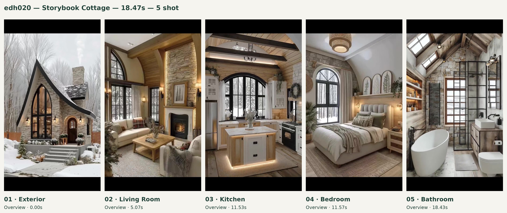
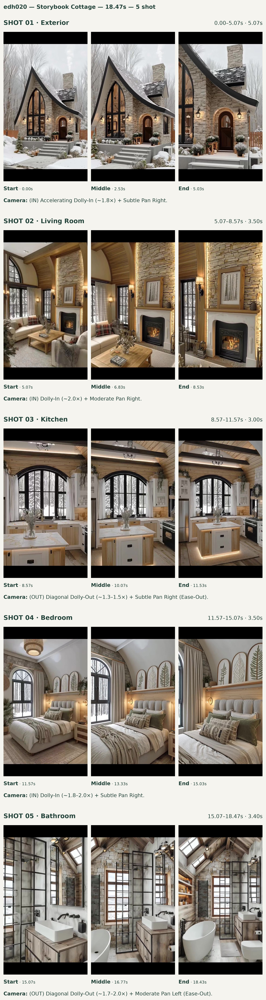
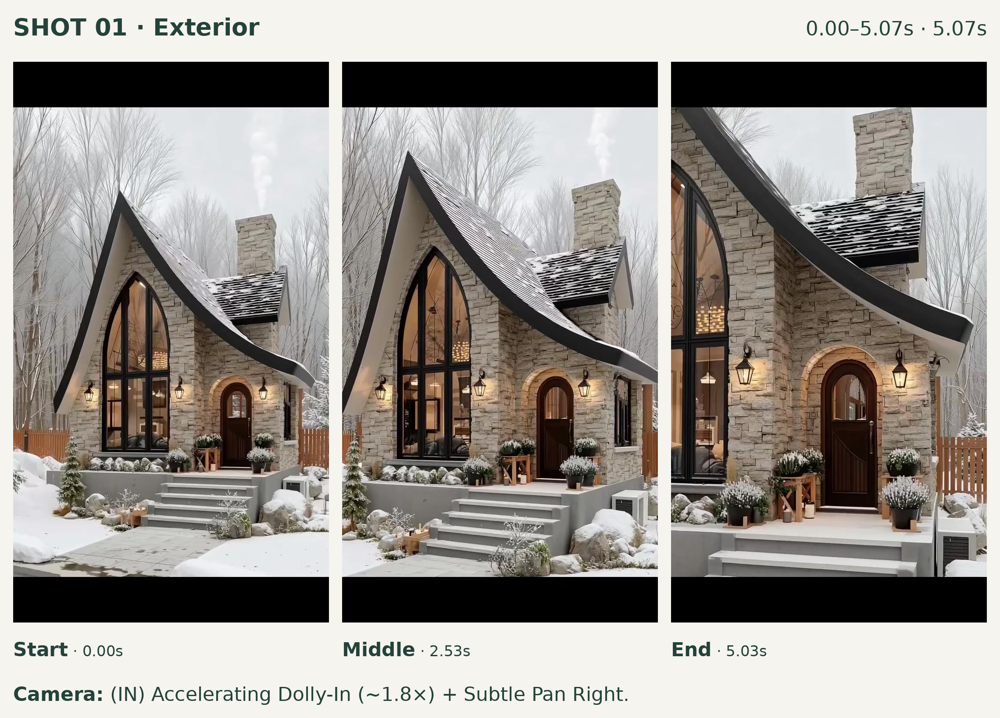
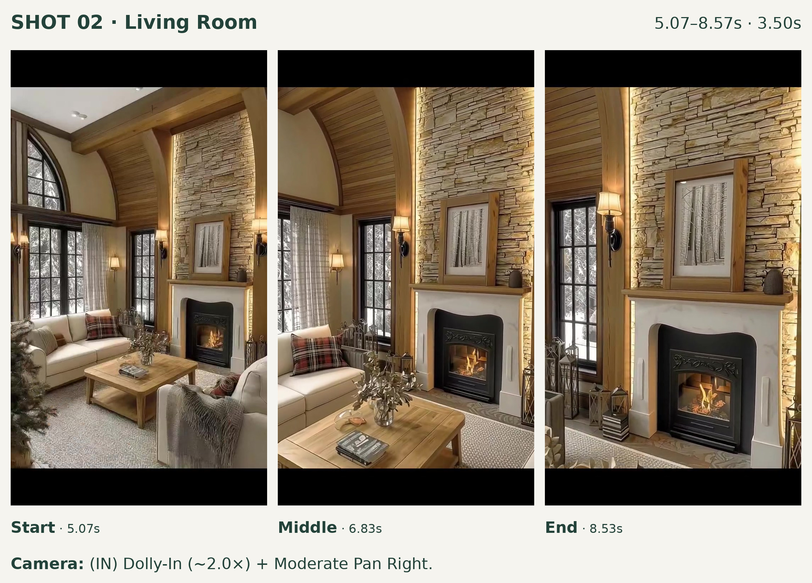
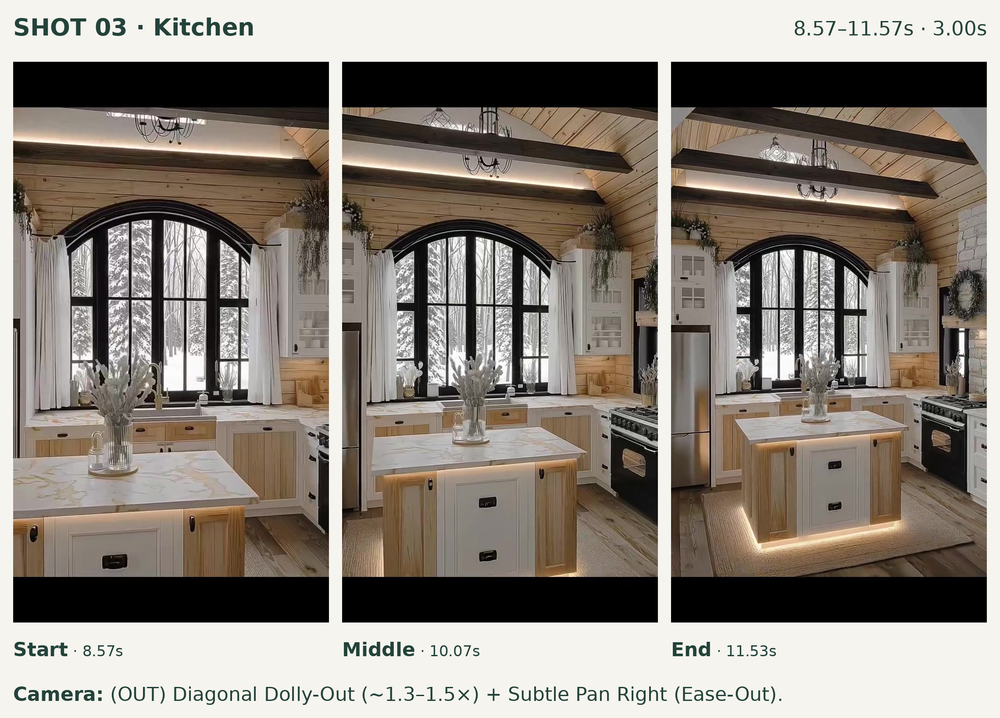
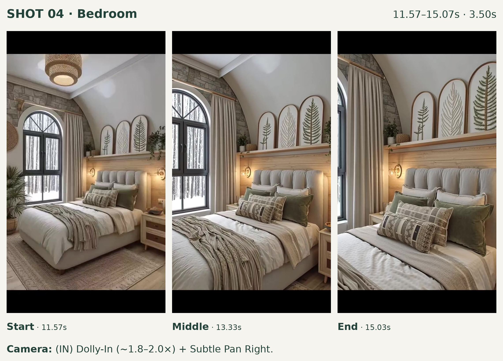
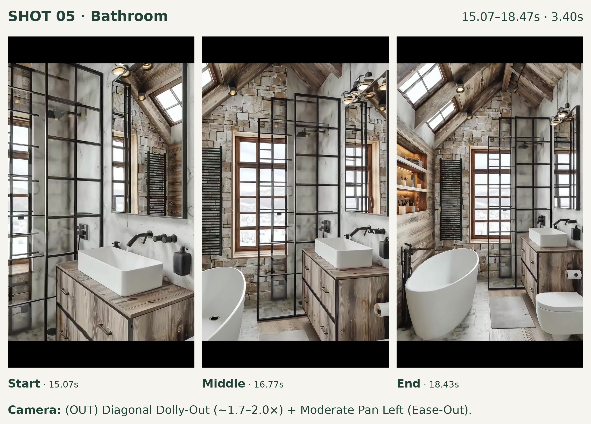

# edh020 — Snowy Woodland Stone Cottage

## 1. Profil desain

- **Nama desain:** Snowy Woodland Stone Cottage
- **Tipe rumah:** Detached House
- **Gaya utama:** **Storybook Cottage**
- **Pengaruh gaya:** Gothic Revival; Rustic
- **Gaya interior:** Rustic Cottage
- **Susunan ruang utama:** Exterior, Living Room, Kitchen, Bedroom, Bathroom tampil lewat cut; hubungan denah belum diketahui
- **Ciri khas:** Tepi gable melengkung, jendela lancip berkisi gelap, perapian batu, island berlampu bawah dan kamar mandi beratap skylight.
- **Material utama:** Tampilan batu susun, kayu alami, tekstil netral, metal gelap
- **Pencahayaan:** Cahaya salju difus dari jendela dan skylight; lampu aksen hangat
- **Atmosfer:** Hangat dan nyaman di interior, tenang di lanskap bersalju
- **Lingkungan:** Hutan pohon meranggas, salju, pagar kayu dan jalur masuk

### Palet warna

| Peran | Warna | HEX |
| --- | --- | --- |
| Dominan | Warm ivory | `#E8E0D2` |
| Dominan | Stone greige | `#B5A591` |
| Pendamping | Honey oak | `#B58B59` |
| Aksen | Charcoal black | `#292825` |
| Aksen | Muted olive | `#777B60` |
| Pendamping | Walnut brown | `#79533D` |

## 2. Ukuran & proporsi

| Aspek | Estimasi visual |
| --- | --- |
| **Ukuran rumah** | Small to medium |
| **Bentuk bangunan** | Gable tinggi dengan tepi atap melengkung dan sayap rendah |
| **Lantai & bentuk atap** | Satu tingkat utama tampak; volume atap tinggi · Atap gelap curam, lapisan salju dan cerobong batu |
| **Tapak bangunan** | Massa depan kompak; denah tidak terlihat |
| **Proporsi utama** | Gable depan tinggi, massa samping lebih rendah |
| **Perkiraan luas lantai** | **65–120 m²** |

## 3. Shot Timeline

Durasi 18.47s · 5 shot.

**Camera Pattern:** IN – IN – OUT – IN – OUT.

| Shot | Time (s) | Duration | Area/Scene | Camera Movement |
| --- | --- | --- | --- | --- |
| 01 | 0.00–5.07 | 5.07s | Exterior | Accelerating Dolly-In (~1.8×) + Subtle Pan Right. |
| 02 | 5.07–8.57 | 3.50s | Living Room | Dolly-In (~2.0×) + Moderate Pan Right. |
| 03 | 8.57–11.57 | 3.00s | Kitchen | Diagonal Dolly-Out (~1.3–1.5×) + Subtle Pan Right (Ease-Out). |
| 04 | 11.57–15.07 | 3.50s | Bedroom | Dolly-In (~1.8–2.0×) + Subtle Pan Right. |
| 05 | 15.07–18.47 | 3.40s | Bathroom | Diagonal Dolly-Out (~1.7–2.0×) + Moderate Pan Left (Ease-Out). |

## 4. Overview

**Shot 01 · Exterior · 0.00s**

> Di depan rumah dari jalur masuk, melihat fasad hampir frontal; seluruh gable, cerobong, pintu, tangga dan lanskap salju tercakup.

**Shot 02 · Living Room · 5.07s**

> Dari sisi area duduk melihat diagonal ke perapian kanan dan jendela kiri; sofa, meja, gable tinggi dan dinding aksen terlihat.

**Shot 03 · Kitchen · 11.53s**

> Dari depan island menghadap jendela lengkung dan kabinet belakang; wide akhir memperlihatkan island, lemari es kiri, kompor kanan dan balok gelap.

**Shot 04 · Bedroom · 11.57s**

> Dari dekat kaki ranjang, diagonal ke headboard dan jendela kiri; ranjang, karpet, meja samping dan bukaan lengkung tampak.

**Shot 05 · Bathroom · 18.43s**

> Dari area masuk/ujung ruang melihat sepanjang sumbu kamar mandi; bathtub kiri, shower di belakang, vanity dan toilet kanan, skylight di atas.

## 5. Storyboard

## 6. Shot Details

### Shot 01 · Exterior

**Time:** 0.00–5.07s · **Duration:** 5.07s

#### **A. Desain area**

**Arsitektur**

> Gable runcing bertepi lengkung gelap turun ke kanan, fasad bertekstur batu krem, cerobong tinggi dan atap samping bersalju. Jendela lancip berkisi hitam di kiri, pintu kayu lengkung di kanan, dicapai lewat tangga lebar dan landing.

**Furnitur & dekorasi**

> Pot tanaman mengapit pintu, lentera hitam di kedua sisi dan tanaman kecil pada bedeng depan.

**Lingkungan**

> Salju menutup tanah dan atap; pohon tanpa daun rapat di belakang, pagar kayu dan jalur paving di depan.

#### **B. Framing & Lighting**

- **Fokus:** Pintu masuk
- **Camera Start:** Jalur depan · Menuju pintu masuk · Hampir frontal · Setinggi mata, perkiraan · Hampir level
- **Framing:** Wide fasad penuh dan tapak → Pintu dan tangga dominan
- **Lighting:** Cahaya siang difus, lentera hangat
- **Foreground dan kedalaman:** Salju, jalur dan tangga · Jalur–tangga–fasad–hutan
- **Reveal:** Detail pintu, batu dan lampu makin terlihat
- **Kesesuaian gerak:** Dolly-In mengisolasi akses; sapuan kanan ringan.

#### **C. Camera Movement**

Maju dari fasad penuh menuju pintu masuk; pembesaran makin cepat, dengan sapuan ringan ke kanan.

**Tempo:** Pelan pada awal F0–45, meningkat bertahap F45–105, terasa sedang hingga relatif cepat pada F105–151. Percepatan merupakan laju gambar, belum tentu laju fisik.

**Camera:** Accelerating Dolly-In (~1.8×) + Subtle Pan Right.

**Catatan:** Frame native pertama jernih tanpa transisi penutup. Production Start terpisah tidak diperlukan.

---

### Shot 02 · Living Room

**Time:** 5.07–8.57s · **Duration:** 3.50s

#### **A. Desain area**

**Arsitektur**

> Volume tinggi dengan jendela lancip di atas bukaan kisi hitam, bidang kayu melengkung di plafon/dinding, balok kayu dan dinding batu perapian; surround krem dan mantel kayu.

**Furnitur & dekorasi**

> Sofa krem menghadap meja kopi kayu persegi panjang, kursi/sofa di foreground kanan, karpet bertekstur terang, bantal kotak dan throw; lukisan pohon di atas mantel.

**Lingkungan**

> Hutan bersalju tampak lewat jendela, cahaya alami dingin berimbang dengan api dan lampu dinding hangat.

#### **B. Framing & Lighting**

- **Fokus:** Perapian
- **Camera Start:** Sisi area duduk · Diagonal ke perapian · Oblique · Setinggi mata, perkiraan · Hampir level
- **Framing:** Wide sofa, meja, jendela dan perapian → Close perapian dan lukisan
- **Lighting:** Cahaya jendela kiri, lampu dinding dan api
- **Foreground dan kedalaman:** Meja dan sisi sofa · Furnitur dekat–perapian–jendela
- **Reveal:** Detail mantel dan tekstur batu
- **Kesesuaian gerak:** Dolly-In dan Pan Right menuju perapian.

#### **C. Camera Movement**

Kamera mendekati perapian sambil membawa fokus dari kelompok duduk menuju perapian dan lukisan.

**Tempo:** Sedang dan mengalir; pembesaran relatif konsisten F152–229, perpindahan lateral gambar lebih cepat menjelang F229–256.

**Camera:** Dolly-In (~2.0×) + Moderate Pan Right.

**Catatan:** Frame native pertama jernih tanpa transisi penutup. Production Start terpisah tidak diperlukan.

---

### Shot 03 · Kitchen

**Time:** 8.57–11.57s · **Duration:** 3.00s

#### **A. Desain area**

**Arsitektur**

> Plafon miring berlapis papan kayu dengan balok hitam, jendela lengkung berkisi di atas meja kerja, kabinet keliling krem dan kayu; dinding batu di kanan.

**Furnitur & dekorasi**

> Island berdiri di tengah, top putih bercorak urat, panel kayu dan laci krem, lampu bawah; vas di atas; lemari es kiri dan range hitam kanan, sink di bawah jendela.

**Lingkungan**

> Pepohonan bersalju tampak dari jendela; tirai putih, lampu gantung dan cahaya strip hangat melengkapi daylight.

#### **B. Framing & Lighting**

- **Fokus:** Island serta jendela
- **Camera Start:** Depan island dekat top · Ke jendela belakang · Hampir frontal · Setinggi mata, perkiraan · Hampir level
- **Framing:** Island dan jendela dominan → Wide kitchen dan appliances
- **Lighting:** Daylight belakang dan aksen hangat
- **Foreground dan kedalaman:** Top island dan vas · Island–kabinet–jendela
- **Reveal:** Lemari es, range, lantai dan balok
- **Kesesuaian gerak:** Dolly-Out diagonal membuka layout dapur.

#### **C. Camera Movement**

Mundur dari island ke tampilan dapur lebih luas, disertai sapuan kanan tipis yang mereda.

**Tempo:** Sedang dan relatif merata pada pembesaran ruang; komponen sapuan terasa lebih cepat awal F257–289 dan mereda F297–346.

**Camera:** Diagonal Dolly-Out (~1.3–1.5×) + Subtle Pan Right (Ease-Out).

**Catatan:** Frame native pertama jernih tanpa transisi penutup. Production Start terpisah tidak diperlukan.

---

### Shot 04 · Bedroom

**Time:** 11.57–15.07s · **Duration:** 3.50s

#### **A. Desain area**

**Arsitektur**

> Jendela lengkung berbingkai gelap pada dinding aksen batu, bidang dinding putih miring dan panel kayu horizontal di belakang headboard dengan shelf.

**Furnitur & dekorasi**

> Ranjang upholstered krem dengan headboard bersegmen vertikal, linen ivory, throw taupe dan bantal olive; meja samping kayu berlaci di kanan, tiga panel botani lengkung di atas shelf, lampu dinding bulat dan pendant anyaman.

**Lingkungan**

> Pohon tanpa daun terlihat melalui jendela kiri, cahaya difus dan sconce hangat; tanaman pot dekat jendela.

#### **B. Framing & Lighting**

- **Fokus:** Ranjang/headboard
- **Camera Start:** Dekat kaki ranjang · Diagonal ke headboard · Oblique · Setinggi mata, perkiraan · Sedikit turun ke ranjang
- **Framing:** Wide ranjang dan jendela → Close headboard dan panel botani
- **Lighting:** Daylight kiri dan sconce hangat
- **Foreground dan kedalaman:** Kaki ranjang dan karpet · Ranjang–headboard–dinding
- **Reveal:** Tekstur linen dan ornamen
- **Kesesuaian gerak:** Dolly-In menuju headboard; sapuan kanan ringan belum pasti.

#### **C. Camera Movement**

Dari framing ranjang dan jendela ke close framing bantal, headboard, dan panel botani.

**Tempo:** Sedang dan halus; perubahan ukuran sedikit meningkat menjelang akhir, tanpa batas onset atau easing yang jelas.

**Camera:** Dolly-In (~1.8–2.0×) + Subtle Pan Right.

**Catatan:** Frame native pertama jernih tanpa transisi penutup. Production Start terpisah tidak diperlukan.

---

### Shot 05 · Bathroom

**Time:** 15.07–18.47s · **Duration:** 3.40s

#### **A. Desain area**

**Arsitektur**

> Plafon miring dengan balok kayu dan dua skylight; dinding batu di ujung, papan kayu di kiri, shower kaca berkisi hitam, jendela belakang persegi panjang.

**Furnitur & dekorasi**

> Bathtub putih oval freestanding kiri dengan keran hitam, vanity kayu kanan dengan basin putih kotak dan cermin, toilet kanan depan; rak terbuka berlampu di kiri dan towel radiator gelap di belakang.

**Lingkungan**

> Cahaya skylight dan jendela menerangi batu/kayu; spot dan lampu vanity hangat; lanskap di luar tidak jelas selain terang.

#### **B. Framing & Lighting**

- **Fokus:** Vanity dan shower
- **Camera Start:** Dekat vanity · Ke shower dan vanity · Oblique · Setinggi mata, perkiraan · Hampir level
- **Framing:** Close vanity dan shower → Wide bathtub, toilet, shower dan skylight
- **Lighting:** Daylight skylight dan lampu hangat
- **Foreground dan kedalaman:** Basin dan kabinet · Vanity–shower–jendela
- **Reveal:** Bathtub, toilet, rak dan volume atap
- **Kesesuaian gerak:** Dolly-Out diagonal dan Pan Left membuka ruang.

#### **C. Camera Movement**

Mundur serong ke kiri dari vanity dan shower, menyapu kiri untuk membuka bathtub serta komposisi kamar mandi.

**Tempo:** Sedang, sapuan lebih aktif F452–529 dan melandai menjelang F553. Laju penyusutan ukuran relatif stabil.

**Camera:** Diagonal Dolly-Out (~1.7–2.0×) + Moderate Pan Left (Ease-Out).

**Catatan:** Frame native pertama jernih tanpa transisi penutup. Production Start terpisah tidak diperlukan.
