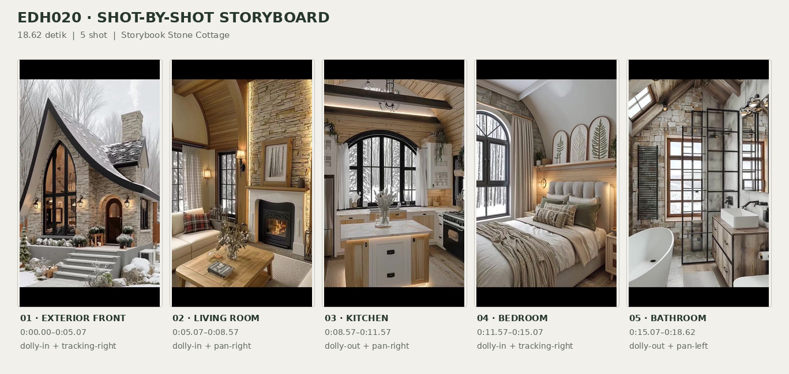
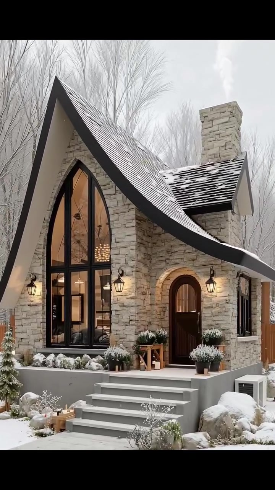
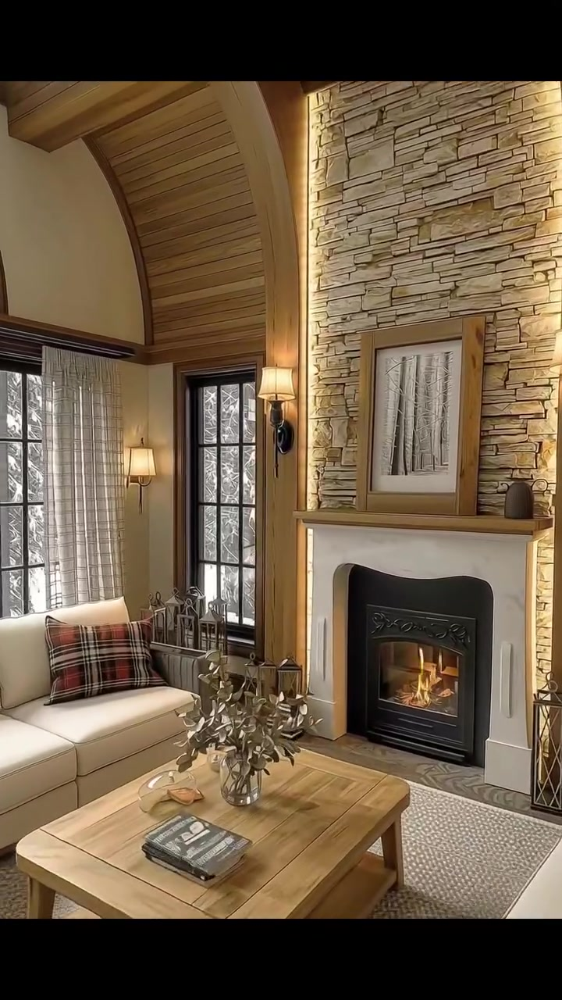
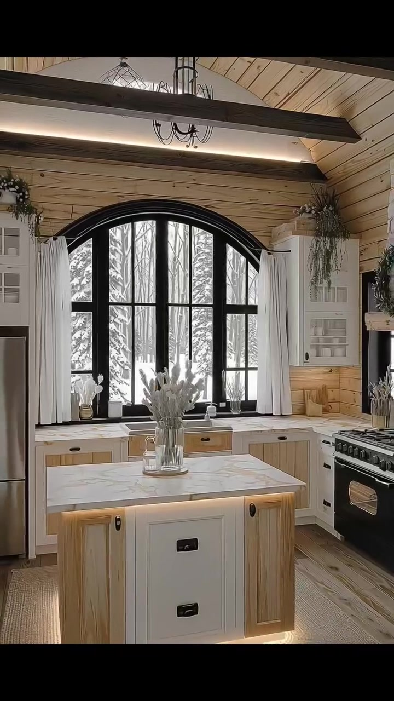
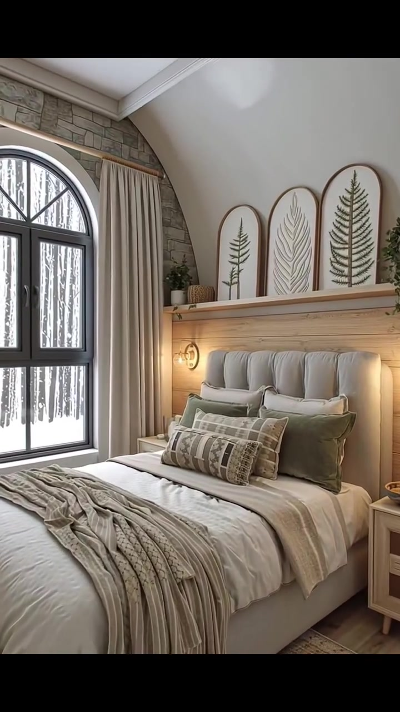
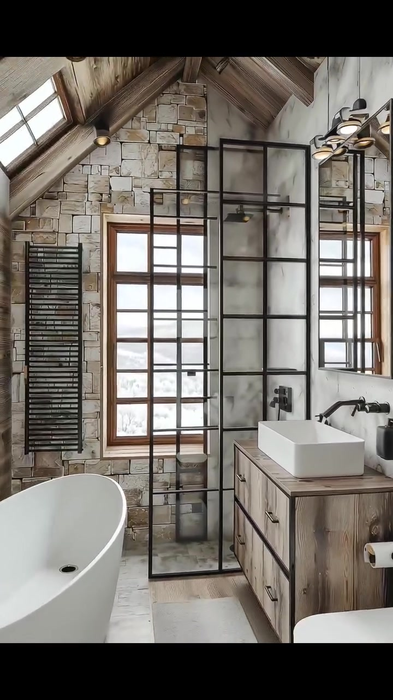

# edh020 — Storybook Stone Cottage

<!-- homeku_request_id: edh020-20261104-1400 -->

<!-- homeku_detail_narratives: chat-reviewed -->

**Sumber data:** [analysis.yaml](analysis.yaml) · **Status:** draft · **Diverifikasi manusia:** Tidak

## 1. Informasi Video

| Informasi | Nilai |
|---|---|
| ID | edh020 |
| File asli | edh020.mp4 |
| Durasi | 18.62 |
| Resolusi | 720x1280 |
| FPS | 30 |
| Rasio | 9:16 |
| Jumlah shot | 5 |

## 2. Storyboard Gabungan

## 3. Identitas Desain

| Aspek | Hasil analisis |
|---|---|
| Gaya utama | storybook stone cottage |
| Wilayah terkait gaya desain | europe, north america |
| Pengaruh gaya | rustic european cottage, modern rustic, storybook architecture |
| Ciri eksterior | steep front gable with sweeping curved black eave, pale gray beige stone cladding, pointed arch black framed front glazing, round arched dark wood entry door, dark shingled secondary roof, rectangular stone chimney, raised front terrace with gray steps |
| Gaya interior | warm rustic cottage, natural wood and stone finishes, neutral soft furnishings, black metal accents |
| Confidence gaya | medium |

## 4. Ukuran & Proporsi Bangunan

| Aspek | Estimasi visual |
|---|---|
| Ukuran yang terlihat | medium |
| Bentuk bangunan | compact front gabled volume with side roof extension |
| Skala vertikal | single story with tall vaulted roof possible loft |
| Tapak bangunan | moderate |
| Perkiraan luas lantai | 75–140 m² |
| Confidence | low |

> Luas adalah perkiraan visual, bukan ukuran terukur.

## 5. Warna, Pencahayaan, dan Atmosfer

| Warna dominan | HEX (perkiraan) |
|---|---|
| warm stone beige | #B9AB96 |
| pale cream | #EBE5D9 |
| natural wood brown | #B58D66 |
| charcoal black | #262624 |
| muted olive green | #777A67 |
| snow white | #ECECE8 |

| Aspek | Hasil analisis |
|---|---|
| Pencahayaan | soft overcast exterior daylight, warm interior practical lighting, fireplace glow, warm architectural accent lighting |
| Lingkungan | snow covered cottage garden, leafless tall trees behind house, wooden boundary fence, snowy woodland views through windows |
| Musim yang tampak | snowy winter like conditions |
| Mood | cozy, quiet, rustic elegant, warm interior contrast with cold exterior |

## 6. Struktur dan Timeline Video

**Jenis:** architectural home tour · **Tempo:** moderate · **Transisi:** straight cuts between five continuous camera moves

| Shot | Waktu (detik) | Durasi | Area/Scene | Gerakan Kamera |
|---|---|---|---|---|
| Shot 01 | 0.0–5.07 | 5.07 | exterior front | dolly in, tracking right |
| Shot 02 | 5.07–8.57 | 3.50 | living room | dolly in, pan right |
| Shot 03 | 8.57–11.57 | 3.00 | kitchen | dolly out, pan right |
| Shot 04 | 11.57–15.07 | 3.50 | bedroom | dolly in, tracking right |
| Shot 05 | 15.07–18.62 | 3.55 | bathroom | dolly out, pan left |

## 7. Analisis per Shot

### Shot 01 — exterior front

**Waktu:** 0.0–5.07 detik

| Komponen | Pengamatan |
|---|---|
| Fokus utama | stone cottage front facade and entry |
| Framing awal → akhir | wide front three quarter view → medium close front entry view |
| Sudut pandang | eye level slightly low front right angle |
| Gerakan kamera | dolly in, tracking right |
| Kecepatan kamera | slow |
| Pencahayaan | soft overcast daylight with warm wall lantern glow |
| Transisi keluar | hard cut |

**Detail yang terlihat**

**Arsitektur**

Fasad depan cottage tampak dilapisi batu berwarna abu\-abu krem. Massa utamanya memiliki atap pelana sangat curam dengan tepian hitam yang melengkung menyapu ke bawah; atap samping berpenutup gelap tampak tertutup salju pada sebagian bidangnya, dengan cerobong batu berbentuk persegi panjang menjulang di sisi kanan. Di kiri pintu terdapat jendela tinggi berujung runcing dengan kisi hitam yang memperlihatkan cahaya hangat dari dalam. Pintu berpenampilan kayu cokelat tua berbentuk lengkung membulat di sebelah kanan jendela, dikelilingi lis batu pucat. Teras depan yang ditinggikan memiliki empat anak tangga abu\-abu terang, beberapa lentera dinding hitam berada di sekitar pintu dan jendela, serta sebuah jendela samping kecil berbingkai hitam terletak di kanan pintu.

**Furnitur dan properti**

Di atas teras terdapat semak dalam pot gelap yang tersaput salju dan beberapa dudukan tanaman kecil dari kayu dekat pintu. Di sebelah kanan tangga terlihat sebuah unit luar ruangan berbentuk kotak berwarna terang. Sebuah peti kayu kecil dan tanaman pot berada dekat kaki tangga sebelah kiri.

**Lingkungan**

Salju menutupi tanah di sekeliling cottage, sementara jalur berpaving abu\-abu mengarah menuju tangga masuk. Pohon\-pohon tinggi tanpa daun berada di belakang dan kiri rumah, dan pagar kayu berwarna cokelat hangat tampak pada tepi area. Batu\-batu besar serta semak rendah di dekat dasar tangga tersaput salju. Langit terlihat abu\-abu pucat dan mendung; jejak putih tipis menyerupai asap tampak di atas cerobong batu.

**Catatan pengamatan:** Kamera mendekati fasad lalu bergeser ke kanan: jendela runcing yang dominan di kiri semakin terpotong, sementara pintu dan tangga mengisi frame. Material batu dinilai dari tampilan tekstur.

**Confidence:** Kamera medium · Detail visual high

### Shot 02 — living room

**Waktu:** 5.07–8.57 detik

| Komponen | Pengamatan |
|---|---|
| Fokus utama | stone fireplace and cream seating |
| Framing awal → akhir | wide living area view → close fireplace wall view |
| Sudut pandang | interior eye level three quarter angle |
| Gerakan kamera | dolly in, pan right |
| Kecepatan kamera | slow |
| Pencahayaan | cool window daylight with warm sconces and fireplace flame |
| Transisi keluar | hard cut |

**Detail yang terlihat**

**Arsitektur**

Ruang keluarga memiliki plafon tinggi melengkung dari papan berpenampilan kayu dengan balok\-balok kayu tebal yang terekspos. Dinding aksen batu bernuansa beige menjulang dari lantai hingga plafon di area perapian. Perapian berbingkai putih memiliki ruang api logam hitam dengan nyala api yang terlihat, serta rak mantel kayu di atasnya. Jendela\-jendela tinggi berkisi dan berbingkai hitam tampak di sisi kiri dan dekat perapian, diselingi bidang dinding krem di antara tiang kayu. Cahaya aksen vertikal hangat berada di sepanjang dinding batu, sementara jendela memiliki tirai krem dan lis kayu gelap.

**Furnitur dan properti**

Kelompok tempat duduk berlapis kain krem mengelilingi meja kopi persegi panjang dari kayu terang. Di sofa kiri terdapat bantal kotak\-kotak merah, hitam, dan beige; kursi pada bagian depan kanan diberi selimut abu\-abu. Meja kopi menampung vas bening dengan ranting berdaun kering dan setumpuk buku. Di atas perapian terlihat gambar hutan monokrom berbingkai dan vas kecil gelap pada rak mantel. Lentera dekoratif berbahan logam hitam berdiri di lantai dekat perapian, lampu dinding kap hangat terpasang pada tiang kayu, dan lampu lantai ramping berkap krem berada dekat jendela kiri. Karpet bertekstur berwarna netral terang melapisi area di bawah meja kopi.

**Lingkungan**

Batang\-batang pohon di area bersalju tampak dari jendela besar sebelah kiri. Vegetasi luar ruangan yang tertutup salju juga terlihat melalui jendela di samping perapian.

**Catatan pengamatan:** Awal shot memperlihatkan area duduk lengkap, lalu bergerak mendekat ke dinding perapian di kanan. Api terlihat di firebox; ukuran ruang tidak dapat diukur.

**Confidence:** Kamera medium · Detail visual high

### Shot 03 — kitchen

**Waktu:** 8.57–11.57 detik

| Komponen | Pengamatan |
|---|---|
| Fokus utama | central kitchen island and arched rear window |
| Framing awal → akhir | medium view of island and rear window → wider view including range and island base |
| Sudut pandang | interior eye level front facing angle |
| Gerakan kamera | dolly out, pan right |
| Kecepatan kamera | slow |
| Pencahayaan | bright cool window daylight with warm island accent glow |
| Transisi keluar | hard cut |

**Detail yang terlihat**

**Arsitektur**

Dapur memiliki plafon tinggi mengikuti kemiringan atap dengan papan kayu terang dan balok melintang berwarna gelap. Di atas countertop belakang terdapat jendela besar melengkung dengan kisi hitam dan tirai panjang putih pada kedua sisinya. Kabinet atas berwarna putih dilengkapi pintu pajangan berkaca, sedangkan kabinet bawah tampak memakai panel kayu pucat dengan isian putih. Countertop berwarna putih memperlihatkan urat abu\-abu menyerupai batu marmer. Dinding di sekitar jendela dilapisi papan kayu horizontal, lantai tampak seperti papan kayu hangat, dan dasar island memancarkan cahaya aksen kekuningan. Dinding berpenampilan batu kasar terlihat di kanan; sebuah lampu gantung berstruktur logam hitam tergantung pada area plafon.

**Furnitur dan properti**

Island dapur berbentuk persegi panjang berada di tengah, dengan sisi berpenampilan kayu terang dan muka laci putih. Vas kaca berisi batang\-batang bunga putih ditempatkan di atas island. Lemari es metalik berada di sebelah kiri kompor besar berwarna hitam pada rangkaian kabinet belakang kanan. Sejumlah pot tanaman kecil menempati ambang jendela, tanaman menjuntai berada di atas kabinet atas, dan papan pemotong kayu bersandar pada dinding belakang. Karpet anyaman terang berada di bawah island, pegangan laci dan kabinet terlihat gelap, serta rangkaian dekoratif menyerupai karangan daun hijau gelap tergantung di dinding batu sebelah kanan. Sebuah keran logam terlihat dekat sisi kiri countertop belakang.

**Lingkungan**

Dari jendela besar belakang terlihat pohon\-pohon konifer yang tersaput salju dan hamparan tanah luar yang putih terang.

**Catatan pengamatan:** Bidang pandang melebar sambil sedikit bergeser ke kanan; semakin jelas kulkas, kompor, sisi island, dan dinding batu. Tekstur countertop hanya diasosiasikan dengan batu bermotif marmer.

**Confidence:** Kamera medium · Detail visual high

### Shot 04 — bedroom

**Waktu:** 11.57–15.07 detik

| Komponen | Pengamatan |
|---|---|
| Fokus utama | neutral bed and arched window |
| Framing awal → akhir | wide bed and window view → close bed headboard view |
| Sudut pandang | interior eye level three quarter angle |
| Gerakan kamera | dolly in, tracking right |
| Kecepatan kamera | slow |
| Pencahayaan | soft snow reflected daylight with warm bedside sconces |
| Transisi keluar | hard cut |

**Detail yang terlihat**

**Arsitektur**

Plafon kamar tidur berwarna putih dan miring tinggi, bertemu dengan dinding aksen berpenampilan batu di sekitar jendela. Jendela besar berbentuk lengkung di bagian atas dengan kisi hitam terletak di kiri tempat tidur dan dikelilingi batu abu\-abu krem. Dinding belakang tempat tidur dilapisi papan horizontal kayu terang, dengan rak kayu panjang di atas headboard dan pencahayaan tersembunyi hangat di bawahnya. Dua lampu dinding kecil bernuansa logam hangat mengapit tempat tidur. Tirai krem panjang berada di kanan jendela lengkung, dan lis profil putih terlihat pada pertemuan plafon serta dinding miring.

**Furnitur dan properti**

Tempat tidur besar berlapis kain krem menempati area tengah ke kanan dari jendela. Bantal\-bantal krem ditumpuk bersama bantal aksen hijau zaitun redup di depannya, dengan bantal dekoratif persegi panjang bermotif beige dan abu\-abu di bagian depan. Selimut tebal krem dan kain penutup taupe tersusun berlapis di atas tempat tidur. Di rak headboard tersandar tiga gambar botani berbingkai lengkung. Sebuah nakas kayu terang berada di kanan tempat tidur, tanaman hijau dalam pot berada di lantai dekat jendela kiri, dan lampu gantung bulat bertekstur anyaman tergantung di area atas. Karpet anyaman netral terang terhampar di bawah ranjang; pot tanaman kecil dan keranjang anyaman juga berada di rak headboard.

**Lingkungan**

Melalui jendela lengkung kamar tidur terlihat pepohonan tanpa daun di lingkungan yang tertutup salju.

**Catatan pengamatan:** Shot dimulai cukup lebar hingga jendela dan tepi karpet terlihat, lalu mendekati bantal serta headboard. Tiga gambar botani terlihat pada rak dinding di atas tempat tidur.

**Confidence:** Kamera medium · Detail visual high

### Shot 05 — bathroom

**Waktu:** 15.07–18.62 detik

| Komponen | Pengamatan |
|---|---|
| Fokus utama | glass shower partition and wood vanity |
| Framing awal → akhir | medium view of vanity and shower screen → wide full bathroom view with tub and toilet |
| Sudut pandang | interior eye level slightly high angle |
| Gerakan kamera | dolly out, pan left |
| Kecepatan kamera | slow |
| Pencahayaan | diffuse skylight daylight with warm recessed shelf and vanity lighting |
| Transisi keluar | end of video |

**Detail yang terlihat**

**Arsitektur**

Kamar mandi memiliki plafon miring tinggi dari papan kayu berwarna gelap dengan balok kayu rustic yang terekspos. Pada sisi kiri bidang atap tampak beberapa jendela skylight miring, sedangkan dinding belakang berlapis batu kasar berwarna pucat. Sekat shower berkaca dengan rangka kisi logam hitam berdiri dekat tengah ruangan. Di belakang area wastafel dan shower terlihat panel putih berpola menyerupai marmer, dengan jendela persegi panjang berkusen kayu hangat pada dinding batu paling belakang. Lantai tampak menggunakan ubin berpenampilan batu abu\-abu terang; rak kayu terbuka yang masuk ke dinding kiri dilengkapi cahaya aksen hangat. Lampu sorot kecil hitam berada pada area balok plafon, dan cermin dinding persegi panjang besar terpasang di atas kabinet wastafel kanan.

**Furnitur dan properti**

Bathtub putih berbentuk oval dan berdiri bebas berada di kiri ruangan. Di kanan terdapat wastafel mangkuk persegi panjang putih di atas kabinet kayu rustic terang dengan laci dan pegangan logam gelap, serta keran gelap terpasang pada dinding. Penghangat handuk vertikal hitam berbentuk tangga berdiri di kiri jendela belakang. Kloset putih terlihat di kanan depan, sementara perlengkapan shower gelap berada di belakang sekat kaca berkisi. Di atas cermin terdapat tiga lampu berkap berstruktur logam hitam. Handuk lipat dan botol\-botol kecil menempati rak cekung kiri, keset persegi panjang abu\-abu berada di depan area shower, dispenser sabun hitam terletak di kanan wastafel, dan tempat tisu toilet berada dekat kloset kanan.

**Lingkungan**

Melalui jendela belakang terlihat bentang luar yang pucat dan bersalju. Cahaya luar ruangan yang terang namun menyebar juga tampak masuk melalui skylight miring di atap.

**Catatan pengamatan:** Shot melebar dari kabinet wastafel dan sekat shower menuju komposisi yang menampilkan bathtub kiri, jendela di tengah, kloset kanan, dan plafon ber-skylight. Material permukaan tidak dapat dipastikan secara fisik.

**Confidence:** Kamera medium · Detail visual medium

## 8. Kualitas dan Ketidakpastian Analisis

| Parameter | Hasil |
|---|---|
| Status | draft |
| Verifikasi manusia | Tidak |
| Ketepatan timestamp | frame aligned estimated |
| Ketidakpastian | Jenis batu, kayu, penutup atap, dan countertop diidentifikasi dari penampakan, bukan pengujian material., Rentang luas lantai hanya perkiraan visual karena dimensi, kedalaman bangunan, dan denah utuh tidak terlihat., Kehadiran lantai loteng tidak dapat dipastikan dari tinggi atap dan plafon., Wilayah terkait gaya merupakan asosiasi arsitektur, bukan lokasi asli rumah., Salju dan pohon tanpa daun menyiratkan kondisi mirip musim dingin, bukan bukti bulan atau musim astronomis tertentu., Gerakan kamera merupakan interpretasi dari perubahan framing; hubungan spasial antarruang tidak dipastikan. |

**Catatan:** Lima shot dengan empat cut yang diidentifikasi sekitar 5,07 s, 8,57 s, 11,57 s, dan 15,07 s. Pengamatan meliputi awal, tengah, dan akhir setiap shot. Sumber chat dan main/video/edh020.mp4 memiliki Git blob SHA yang sama: 8cd575a8a8879a6d3a7d6bc6b62da1db8b4d8eb6.

---

*Laporan ini diturunkan dari [analysis.yaml](analysis.yaml).*
