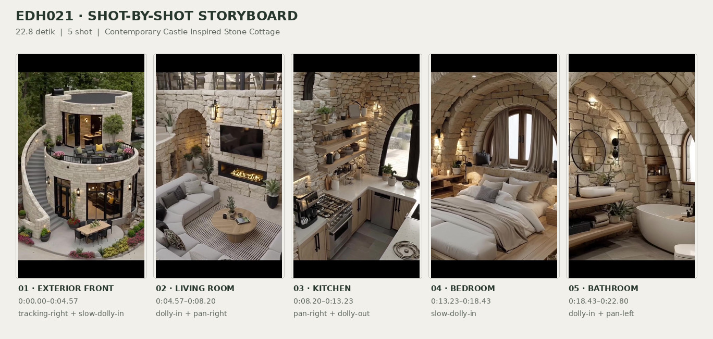
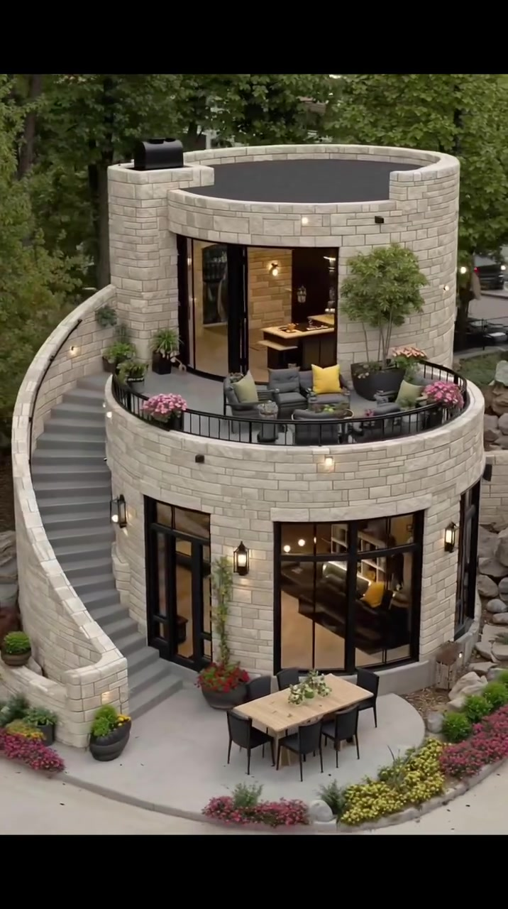
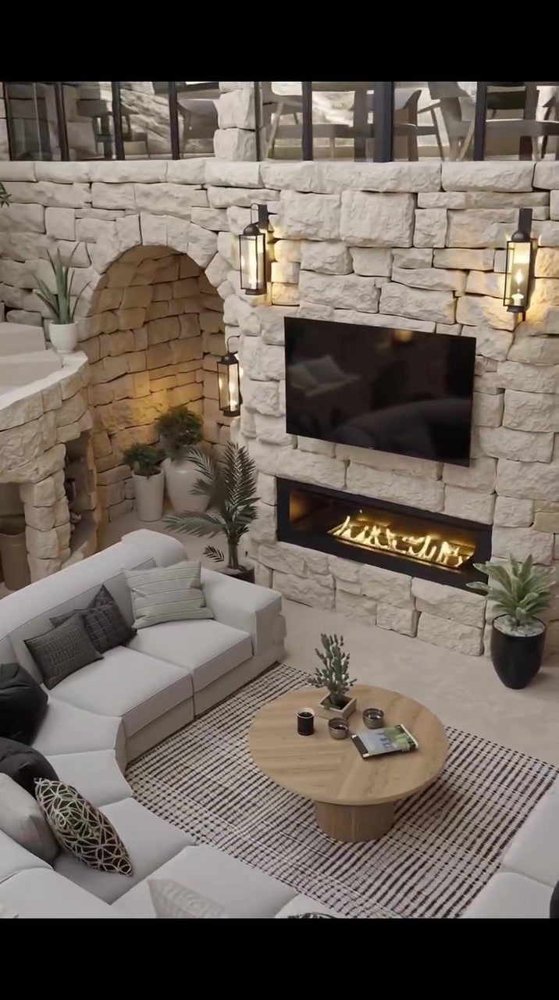
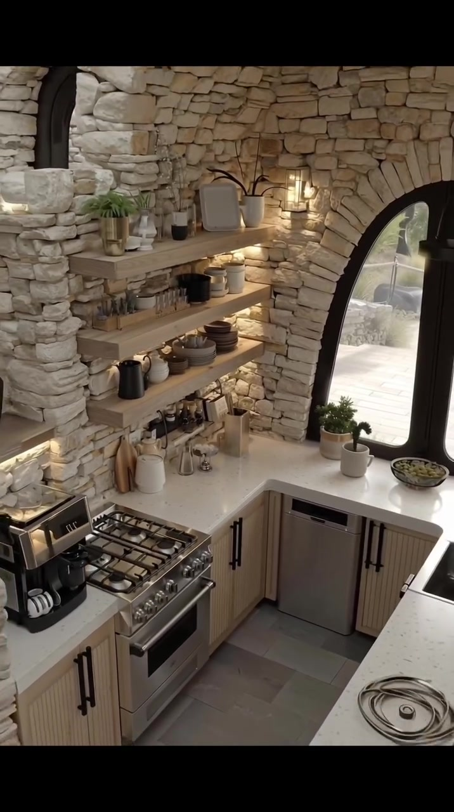
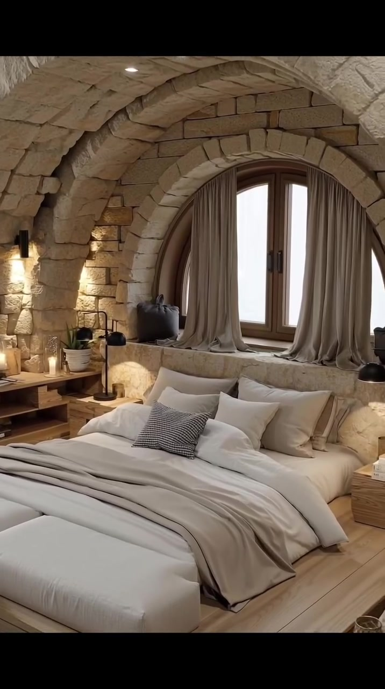
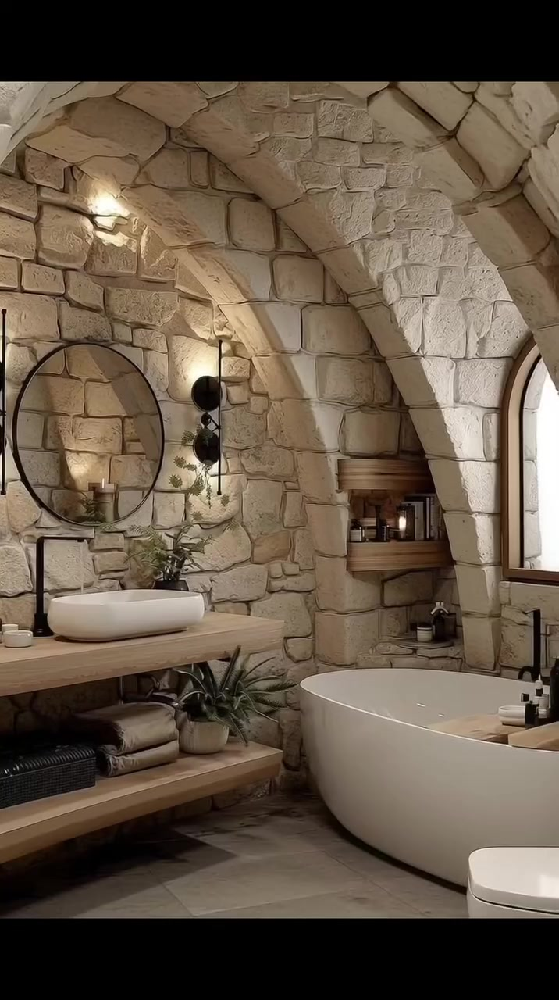

# edh021 — Contemporary Castle Inspired Stone Cottage

<!-- homeku_request_id: edh021-20261104-analysis-01 -->

<!-- homeku_detail_narratives: chat-reviewed -->

**Sumber data:** [analysis.yaml](analysis.yaml) · **Status:** draft · **Diverifikasi manusia:** Tidak

## 1. Informasi Video

| Informasi | Nilai |
|---|---|
| ID | edh021 |
| File asli | edh021.mp4 |
| Durasi | 22.8 |
| Resolusi | 716x1280 |
| FPS | 30 |
| Rasio | 9:16 |
| Jumlah shot | 5 |

## 2. Storyboard Gabungan

## 3. Identitas Desain

| Aspek | Hasil analisis |
|---|---|
| Gaya utama | contemporary castle inspired stone cottage |
| Wilayah terkait gaya desain | europe |
| Pengaruh gaya | medieval castle architecture, rustic limestone interiors, organic modern furnishings |
| Ciri eksterior | light beige stone block cladding, rounded two level building mass, curved open upper terrace, curving exterior staircase, floor to ceiling black framed ground glazing, black metal terrace railings, warm wall lantern sconces |
| Gaya interior | rustic stone vaulted interiors, neutral contemporary furniture, warm wood accents, black metal light fixtures |
| Confidence gaya | medium |

## 4. Ukuran & Proporsi Bangunan

| Aspek | Estimasi visual |
|---|---|
| Ukuran yang terlihat | medium |
| Bentuk bangunan | stacked cylindrical masses with curved terraces |
| Skala vertikal | two levels with upper terrace |
| Tapak bangunan | moderate |
| Perkiraan luas lantai | 100–180 m² |
| Confidence | low |

> Luas adalah perkiraan visual, bukan ukuran terukur.

## 5. Warna, Pencahayaan, dan Atmosfer

| Warna dominan | HEX (perkiraan) |
|---|---|
| limestone beige | #BEB19A |
| warm cream | #E5DED2 |
| light natural wood | #C4A47E |
| charcoal black | #2E302E |
| muted taupe | #867B70 |
| garden green | #4A5F3C |

| Aspek | Hasil analisis |
|---|---|
| Pencahayaan | soft diffused exterior daylight, warm amber wall sconces, warm undershelf kitchen lighting, soft daylight through arch windows |
| Lingkungan | tree surrounded residential setting, paved front patio, ornamental flower borders, natural rock landscaping |
| Musim yang tampak | Tidak diketahui |
| Mood | warm, cozy, earthy, sculptural, calm |

## 6. Struktur dan Timeline Video

**Jenis:** architectural home tour · **Tempo:** slow · **Transisi:** hard cuts between slow moving shots

| Shot | Waktu (detik) | Durasi | Area/Scene | Gerakan Kamera |
|---|---|---|---|---|
| Shot 01 | 0.0–4.57 | 4.57 | exterior front | tracking right, slow dolly in |
| Shot 02 | 4.57–8.2 | 3.63 | living room | dolly in, pan right |
| Shot 03 | 8.2–13.23 | 5.03 | kitchen | pan right, dolly out |
| Shot 04 | 13.23–18.43 | 5.20 | bedroom | slow dolly in |
| Shot 05 | 18.43–22.8 | 4.37 | bathroom | dolly in, pan left |

## 7. Analisis per Shot

### Shot 01 — exterior front

**Waktu:** 0.0–4.57 detik

| Komponen | Pengamatan |
|---|---|
| Fokus utama | rounded two level stone house with curved upper terrace |
| Framing awal → akhir | wide elevated three quarter exterior → medium wide elevated front exterior |
| Sudut pandang | high three quarter front view |
| Gerakan kamera | tracking right, slow dolly in |
| Kecepatan kamera | slow |
| Pencahayaan | soft diffused daylight with warm exterior lanterns |
| Transisi keluar | hard cut |

**Detail yang terlihat**

**Arsitektur**

Rumah tampak tersusun dari dua massa silindris bertingkat dengan dinding luar berupa susunan balok batu persegi panjang berwarna krem\-beige. Massa menara bulat di tingkat atas memiliki bidang atap yang terlihat datar dan gelap di balik parapet batu rendah. Sebuah teras setengah lingkaran melingkari bagian depan menara, dibatasi parapet batu lengkung dengan pagar logam hitam. Di sisi kiri, tangga luar melengkung naik mengikuti dinding batu dengan anak tangga abu\-abu. Lantai dasar memiliki pintu dan jendela kaca tinggi berbingkai logam hitam yang mengikuti bentuk bangunan; bukaan kaca hitam tinggi lainnya menghadap ke teras lantai atas. Lampu dinding berbentuk lentera memancarkan cahaya amber pada fasad, sementara pelataran lantai dasar menggunakan permukaan paving berwarna terang.

**Furnitur dan properti**

Teras lantai atas diisi kelompok sofa dan kursi santai outdoor abu\-abu gelap dengan bantal kuning serta warna netral; sebuah meja kopi rendah berada di antara tempat duduk. Di pelataran bawah terdapat meja makan luar ruang berbentuk persegi panjang dengan permukaan menyerupai kayu terang dan beberapa kursi hitam, serta hiasan tanaman kecil di atas meja. Pot gelap besar berisi pohon kecil ditempatkan di teras atas, sedangkan pot berbunga merah muda mengikuti tepian pagar teras.

**Lingkungan**

Deretan pohon tinggi berdaun hijau lebat membentuk latar belakang rumah. Tumpukan bongkah batu pucat berada di sisi kanan fasad bawah. Di tepi depan jalur pejalan kaki terlihat hamparan bunga merah muda dan kuning, diikuti semak hijau kecil serta pot tanaman bulat di sekitar pelataran. Jalur paving abu\-abu muda membentang di depan bangunan, dan sebagian mobil yang terparkir terlihat di belakang sisi kanan rumah.

**Catatan pengamatan:** Pandangan tinggi bergerak perlahan ke kanan dan mendekat; komposisi bergeser dari sisi kiri rumah menuju tangga dan teras depan.

**Confidence:** Kamera medium · Detail visual high

### Shot 02 — living room

**Waktu:** 4.57–8.2 detik

| Komponen | Pengamatan |
|---|---|
| Fokus utama | stone media wall with linear fireplace and curved seating |
| Framing awal → akhir | wide high angle double height living room → medium high angle fireplace and sofa view |
| Sudut pandang | elevated oblique interior |
| Gerakan kamera | dolly in, pan right |
| Kecepatan kamera | slow |
| Pencahayaan | warm wall lanterns and soft interior ambient light |
| Transisi keluar | hard cut |

**Detail yang terlihat**

**Arsitektur**

Ruang keluarga memperlihatkan interior tinggi dengan dinding balok batu kasar berwarna beige muda dan lantai berpenampilan batu terang. Di sisi kiri terdapat beberapa bukaan berbentuk lengkung, dengan tangga atau pembatas galeri batu yang melengkung di bagian belakang. Pada tingkat atas tampak bidang kaca berpetak dengan bingkai logam hitam. Dinding utama memiliki perapian horizontal memanjang dengan nyala api kuning terlihat di dalam ceruk. Beberapa lampu dinding bergaya lentera logam hitam menyinari permukaan batu dengan cahaya hangat.

**Furnitur dan properti**

Sebuah televisi datar berwarna hitam dipasang pada dinding di atas perapian. Sofa sectional besar berlapis kain krem tersusun melengkung mengelilingi meja kopi, dengan segmen duduk lurus tambahan di bagian kiri belakang. Sofa dihiasi bantal abu\-abu, hitam, serta motif geometris. Di tengah terdapat meja kopi bulat berbahan tampak kayu terang, diletakkan di atas karpet persegi panjang berwarna terang dengan garis kisi gelap halus. Meja memuat tanaman kecil dalam pot gelap, buku atau majalah, dan beberapa cangkir kecil. Tanaman hijau tinggi dalam pot gelap berada di kanan perapian dan di antara sofa dengan perapian; tanaman pot kecil juga terlihat pada pijakan tangga batu, bersama lentera hitam kecil di tepian kiri area duduk.

**Lingkungan**

Tidak ada detail yang tercatat.

**Catatan pengamatan:** Gerakan mendekati dinding TV dan perapian; bagian lengkung sofa di kiri berangsur terpotong oleh framing.

**Confidence:** Kamera medium · Detail visual high

### Shot 03 — kitchen

**Waktu:** 8.2–13.23 detik

| Komponen | Pengamatan |
|---|---|
| Fokus utama | stone walled kitchen with floating shelves and arch window |
| Framing awal → akhir | medium close view of open shelves and counter → wide three quarter view of compact kitchen |
| Sudut pandang | slightly high oblique interior |
| Gerakan kamera | pan right, dolly out |
| Kecepatan kamera | slow |
| Pencahayaan | warm shelf lighting mixed with daylight from arch window |
| Transisi keluar | hard cut |

**Detail yang terlihat**

**Arsitektur**

Dapur berdinding batu susun kasar berwarna beige terang dilengkapi tiga rak kayu tebal yang dipasang melayang, dengan cahaya hangat pada bagian bawah rak. Countertop berpenampilan batu putih berbintik, sedangkan kabinet bawah berwarna taupe memiliki panel bergaris vertikal dan pegangan hitam panjang. Susunan countertop membentuk area kerja kompak menyerupai huruf U dengan peninsula di sisi kanan. Jendela tinggi berpuncak lengkung dan berbingkai hitam berada di atas counter belakang. Sebuah lengkung batu besar beserta pilar membingkai sisi kiri dapur. Lantai menggunakan ubin persegi panjang besar abu\-abu muda. Kompor gas berbadan baja nirkarat berada pada counter kiri, satu perangkat berpanel depan baja nirkarat tertanam di bawah counter belakang, dan bak cuci gelap dengan keran hitam tinggi berada di peninsula kanan. Pada ujung kiri frame akhir tampak sebagian anak tangga batu yang diberi pencahayaan.

**Furnitur dan properti**

Rak\-rak terbuka menampung tumpukan piring dan mangkuk warna netral, gelas kaca bening, teko hitam, serta kendi keramik putih. Rak bagian atas juga memuat tanaman kecil dalam pot dan vas putih. Pada countertop terdapat papan potong kayu yang disandarkan ke dinding batu, wadah alat memasak dan bumbu kecil, serta mesin kopi hitam di sebelah kiri kompor. Dekat jendela tampak pot tanaman kecil dan sebuah mangkuk dangkal berisi benda yang tidak teridentifikasi pasti. Di peninsula terdapat nampan dengan botol\-botol gelap kecil dan tanaman hijau.

**Lingkungan**

Melalui jendela lengkung dapur terlihat permukaan paving pucat, bagian dinding pembatas batu yang rendah, serta beberapa objek luar ruang yang bentuknya tidak cukup jelas untuk diidentifikasi lebih jauh.

**Catatan pengamatan:** Framing membuka ke kanan dari rak penyimpanan menuju jendela lengkung, kompor, kabinet, dan peninsula dengan bak cuci.

**Confidence:** Kamera medium · Detail visual high

### Shot 04 — bedroom

**Waktu:** 13.23–18.43 detik

| Komponen | Pengamatan |
|---|---|
| Fokus utama | large cream bed beneath arched stone window |
| Framing awal → akhir | wide frontal bedroom view → medium close frontal bed and window |
| Sudut pandang | eye level to slightly high frontal |
| Gerakan kamera | slow dolly in |
| Kecepatan kamera | slow |
| Pencahayaan | soft window daylight with warm recessed lights and reading lamps |
| Transisi keluar | hard cut |

**Detail yang terlihat**

**Arsitektur**

Kamar tidur memiliki langit\-langit berupa rangkaian lengkung kubah batu yang dalam, berulang di atas dinding balok batu kasar berwarna beige. Di belakang kepala tempat tidur ada ceruk jendela besar berbentuk busur, dengan jendela berdaun dua dan bingkai kayu alami tepat di tengah. Tirai panjang abu\-abu beige terkumpul dan menjuntai di ambang jendela yang dalam. Tempat tidur ditopang platform rendah dari kayu berwarna terang dengan pinggiran meninggi; lantainya berpenampilan papan kayu terang. Lampu sorot kecil tersembunyi pada beberapa bagian lengkung langit\-langit.

**Furnitur dan properti**

Tempat tidur besar berlapis bahan krem ditempatkan tepat di bawah ceruk jendela. Sprei dan bantalnya berlapis putih serta beige, dengan satu bantal aksen bermotif garis gelap dan selimut lempar taupe lembut melintang pada bagian kaki. Bangku empuk warna krem diletakkan di tepi depan platform. Di kanan terdapat meja samping rendah dari kayu terang, sedangkan sisi kiri memiliki rak samping terbuka berbahan kayu serupa. Lampu baca ramping hitam berada pada kedua sisi tempat tidur; buku dan lilin kecil terlihat pada permukaan samping. Tanaman hijau dalam pot berdiri di dekat rak kiri, aksesori anyaman kecil berada di sudut kanan bawah, dan beberapa bantal lantai gelap terlihat di depan sisi kiri tempat tidur.

**Lingkungan**

Tidak ada detail yang tercatat.

**Catatan pengamatan:** Kamera maju perlahan dan memperbesar tempat tidur, ceruk jendela, tekstur batu, serta tirai; bagian lantai dan aksesori tepi kamar makin keluar dari frame.

**Confidence:** Kamera high · Detail visual high

### Shot 05 — bathroom

**Waktu:** 18.43–22.8 detik

| Komponen | Pengamatan |
|---|---|
| Fokus utama | round black framed mirror and white vessel basin on wood vanity |
| Framing awal → akhir | wide view of vanity bathtub and toilet → close view of oval sink and round mirror |
| Sudut pandang | slightly high oblique interior |
| Gerakan kamera | dolly in, pan left |
| Kecepatan kamera | slow |
| Pencahayaan | soft daylight from narrow window with warm wall sconces |
| Transisi keluar | end of video |

**Detail yang terlihat**

**Arsitektur**

Kamar mandi dibentuk oleh langit\-langit kubah melengkung dan rusuk\-rusuk batu menonjol dari balok batu kasar berwarna beige pucat, sejalan dengan dinding batunya yang bertekstur. Di dekat bathtub ada jendela sempit berujung lengkung. Lantainya menggunakan ubin besar berpenampilan batu abu\-abu muda. Wastafel ditopang countertop tebal dari kayu terang yang melayang, dengan rak penyimpanan kayu terbuka pada bagian bawah. Di kanan cermin terdapat dua ceruk dinding batu yang dilengkapi rak kayu. Lampu dinding kecil bernuansa hangat menerangi lengkung batu.

**Furnitur dan properti**

Bathtub putih berdiri bebas berbentuk oval berada di sisi kanan dekat jendela, dengan kloset putih tergantung pada dinding di depannya. Di sisi kiri, sebuah wastafel mangkuk oval putih berada di atas vanity kayu, tepat di bawah cermin bulat besar berbingkai hitam tipis. Keran hitam tinggi terpasang di belakang wastafel, sementara lampu dinding logam hitam mengapit area cermin. Rak bawah menampung handuk lipat abu\-abu beige dan keranjang anyaman gelap. Tanaman hijau dalam pot berada di sekitar vanity serta bathtub; botol dan wadah kecil ada di atas vanity maupun pada ceruk rak, dan perlengkapan keran hitam terlihat di tepi bathtub.

**Lingkungan**

Tidak ada detail yang tercatat.

**Catatan pengamatan:** Dimulai dari keseluruhan kamar mandi termasuk bathtub dan kloset; kamera maju dan menggeser fokus ke wastafel oval serta cermin bulat hingga close-up.

**Confidence:** Kamera high · Detail visual high

## 8. Kualitas dan Ketidakpastian Analisis

| Parameter | Hasil |
|---|---|
| Status | draft |
| Verifikasi manusia | Tidak |
| Ketepatan timestamp | estimated |
| Ketidakpastian | exact stone type and structural material unverified, building dimensions and floor area estimated from visual scale only, interior and exterior layout continuity not verified, camera motion interpreted from apparent frame changes, actual geographic location and season unknown, furniture materials and exact counts not always confirmable |

**Catatan:** Analisis berdasarkan rangkaian frame sepanjang tiap shot pada video 716x1280; batas transisi diperiksa melalui perubahan adegan. Estimasi luas bersifat kesan visual, bukan ukuran atau bukti keterhubungan ruang. Sumber MP4 cocok secara Git blob SHA dengan main/video/edh021.mp4.

---

*Laporan ini diturunkan dari [analysis.yaml](analysis.yaml).*
