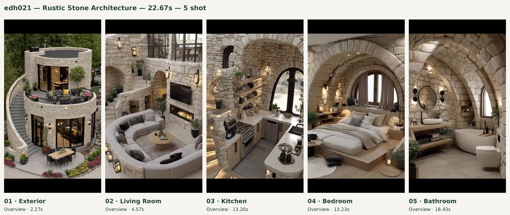
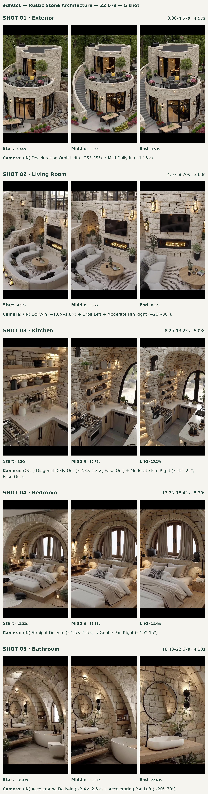
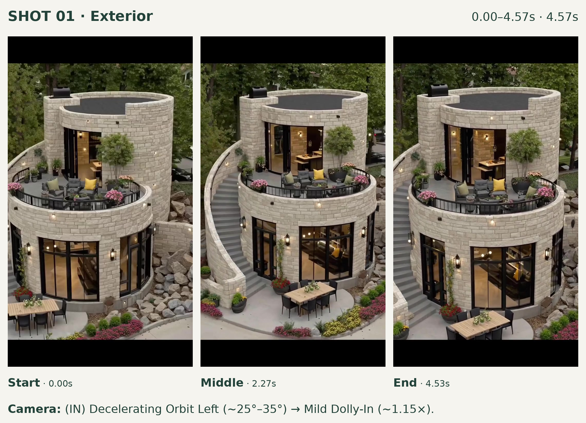
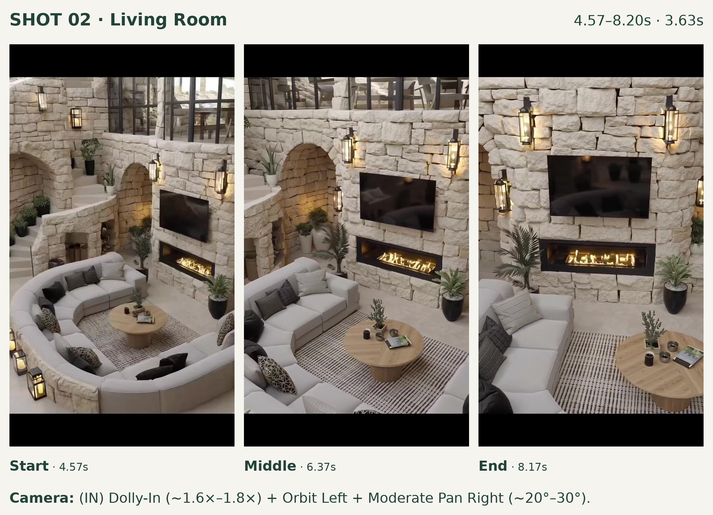
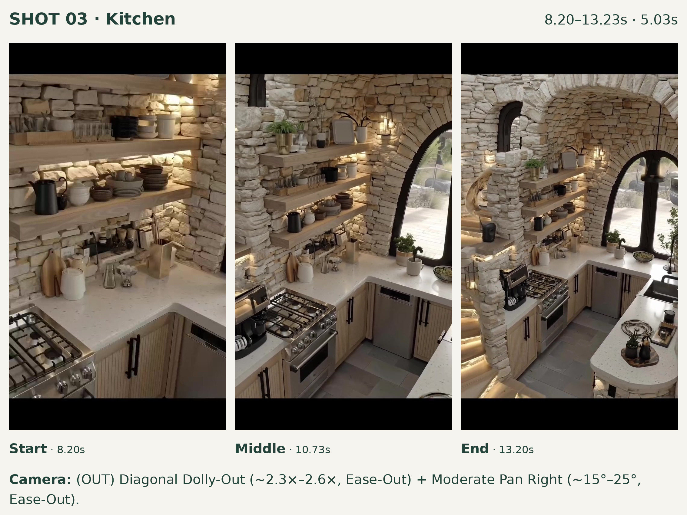
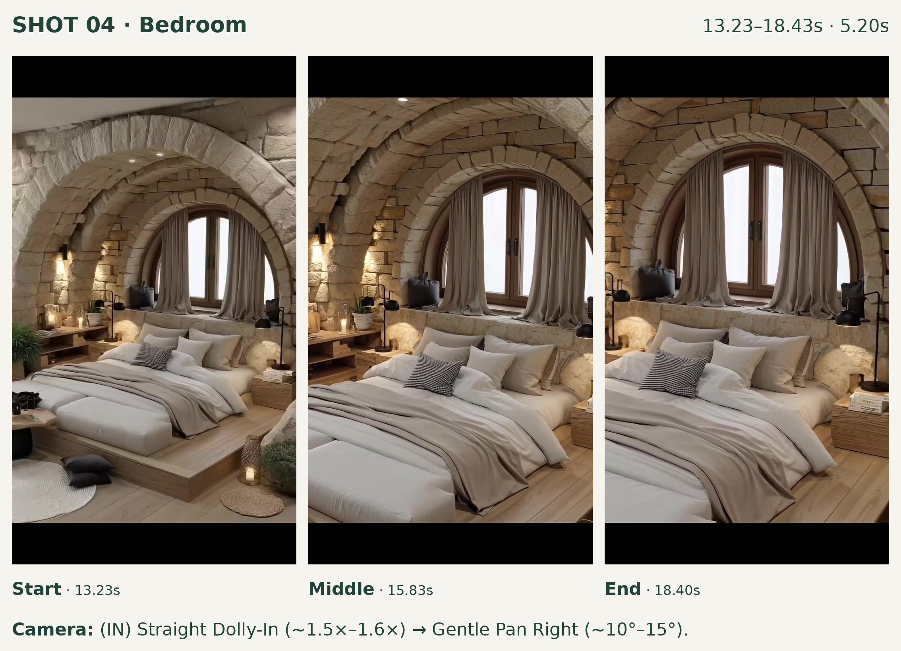
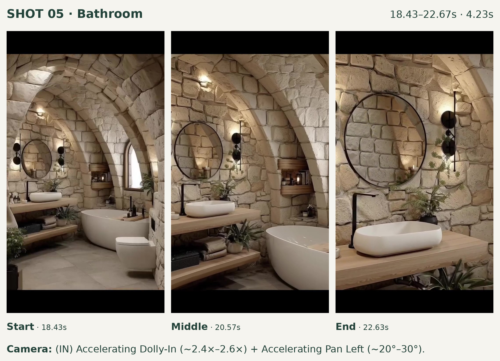

# edh021 — Cylindrical Stone Retreat

## 1. Profil desain

- **Nama desain:** Cylindrical Stone Retreat
- **Tipe rumah:** Tower House
- **Gaya utama:** **Rustic Stone Architecture**
- **Pengaruh gaya:** Medieval Revival
- **Gaya interior:** Rustic Contemporary
- **Susunan ruang utama:** Ruang duduk bertingkat, dapur berbentuk U secara visual, kamar dengan ranjang platform, kamar mandi dengan tub dan vanity; koneksi denah tidak diketahui
- **Ciri khas:** Tangga luar melengkung, area duduk cekung, vault batu, vanity kayu dengan cermin bundar
- **Material utama:** Tampilan batu blok krem, kayu hangat, bingkai logam gelap, tekstil netral
- **Pencahayaan:** Cahaya siang melalui kaca, lampu dinding dan lampu rak bernuansa hangat
- **Atmosfer:** Hangat, intim, organik dan menyerupai retreat batu
- **Lingkungan:** Pepohonan rapat, batu alam tampak di tapak dan planter berbunga

### Palet warna

| Peran | Warna | HEX |
| --- | --- | --- |
| Dominan | Beige batu | `#B7A990` |
| Pendamping | Putih gading | `#E2DDD2` |
| Pendamping | Kayu cokelat muda | `#AD8D66` |
| Pendamping | Taupe | `#918171` |
| Aksen | Arang | `#302D28` |
| Aksen | Hijau daun | `#536044` |

## 2. Ukuran & proporsi

| Aspek | Estimasi visual |
| --- | --- |
| **Ukuran rumah** | small |
| **Bentuk bangunan** | Massa melingkar bertingkat, teras depan melengkung |
| **Lantai & bentuk atap** | Dua tingkat terlihat dari fasad · Parapet melingkar di puncak; permukaan dalam tampak datar |
| **Tapak bangunan** | rounded compact massing |
| **Proporsi utama** | Massa vertikal silindris dengan teras melingkar di tingkat atas |
| **Perkiraan luas lantai** | **65–120 m²** |

## 3. Shot Timeline

Durasi 22.67s · 5 shot.

**Camera Pattern:** IN – IN – OUT – IN – IN.

| Shot | Time (s) | Duration | Area/Scene | Camera Movement |
| --- | --- | --- | --- | --- |
| 01 | 0.00–4.57 | 4.57s | Exterior | Decelerating Orbit Left (~25°–35°) → Mild Dolly-In (~1.15×). |
| 02 | 4.57–8.20 | 3.63s | Living Room | Dolly-In (~1.6×–1.8×) + Orbit Left + Moderate Pan Right (~20°–30°). |
| 03 | 8.20–13.23 | 5.03s | Kitchen | Diagonal Dolly-Out (~2.3×–2.6×, Ease-Out) + Moderate Pan Right (~15°–25°, Ease-Out). |
| 04 | 13.23–18.43 | 5.20s | Bedroom | Straight Dolly-In (~1.5×–1.6×) → Gentle Pan Right (~10°–15°). |
| 05 | 18.43–22.67 | 4.23s | Bathroom | Accelerating Dolly-In (~2.4×–2.6×) + Accelerating Pan Left (~20°–30°). |

## 4. Overview

**Shot 01 · Exterior · 2.27s**

> Posisi tinggi di depan serong fasad, mengarah ke bawah; wide F68 mencakup dua tingkat, tangga melengkung, teras, patio dan pepohonan.

**Shot 02 · Living Room · 4.57s**

> Dari atas sisi area duduk menghadap serong ke dinding TV; wide F137 mencakup sofa cekung, meja, tangga kiri, bukaan lengkung dan kaca tinggi.

**Shot 03 · Kitchen · 13.20s**

> Dari posisi mundur di depan dapur, mengarah serong turun ke sudut kerja; wide F396 mencakup rak, range, jendela lengkung, countertop kanan dan tangga kiri.

**Shot 04 · Bedroom · 13.23s**

> Dari kaki ranjang, pandangan sedikit serong ke headboard; wide F397 memperlihatkan platform, dua sisi ranjang, lengkung batu dan jendela.

**Shot 05 · Bathroom · 18.43s**

> Dari sisi masuk, pandangan serong ke tub dan vanity; wide F553 memperlihatkan wastafel, tub, toilet, ceruk dan vault batu.

## 5. Storyboard

## 6. Shot Details

### Shot 01 · Exterior

**Time:** 0.00–4.57s · **Duration:** 4.57s

#### **A. Desain area**

**Arsitektur**

> Massa dua tingkat melingkar dengan kulit blok batu krem, parapet atas, teras melengkung dan railing gelap; tangga luar mengikuti sisi kiri. Kaca tinggi berbingkai hitam di lantai bawah dan bukaan teras atas.

**Furnitur & dekorasi**

> Teras atas berisi kursi gelap, bantalan kuning dan tanaman pot; meja persegi panjang dengan kursi di patio bawah.

**Lingkungan**

> Pepohonan rapat di belakang, gugusan batu di sisi kanan, jalur patio dan tanaman berbunga di kaki bangunan.

#### **B. Framing & Lighting**

- **Fokus:** Fasad dan teras
- **Camera Start:** Dari luar, posisi tinggi di depan serong bangunan · Ke fasad dan teras · oblique elevated · Tinggi di atas patio · Miring ke bawah
- **Framing:** Wide fasad dua tingkat, patio dan latar hijau → Fasad lebih dekat, tangga kiri terpotong
- **Lighting:** Cahaya luar merata dan lampu dinding hangat
- **Foreground dan kedalaman:** Meja patio, tanaman · Patio–fasad–pepohonan
- **Reveal:** Tangga luar semakin terbuka
- **Kesesuaian gerak:** Orbit membuka sisi, dolly memperbesar fasad

#### **C. Camera Movement**

Kamera mengitari fasad ke kiri, memperlihatkan tangga, lalu mendekat ringan ke bukaan depan.

**Tempo:** Sedang di awal, orbit mereda menjelang F90 lalu pendekatan ringan semakin terlihat di akhir.

**Movement Timeline**

| Time (s) | Area & fokus | Camera Movement | Tempo |
| --- | --- | --- | --- |
| 0.00–3.00 | Exterior · Fasad melengkung dan tangga luar | Decelerating Orbit Left (~25°–35°) | Sedang di awal, orbit mereda menjelang F90 lalu pendekatan ringan semakin terlihat di akhir. |
| 3.00–4.57 | Exterior · Bukaan kaca dan teras | Mild Dolly-In (~1.15×) | Sedang di awal, orbit mereda menjelang F90 lalu pendekatan ringan semakin terlihat di akhir. |

**Camera:** Decelerating Orbit Left (~25°–35°) → Mild Dolly-In (~1.15×).

---

### Shot 02 · Living Room

**Time:** 4.57–8.20s · **Duration:** 3.63s

#### **A. Desain area**

**Arsitektur**

> Ruang duduk cekung dengan dinding batu blok terang, tangga dan parapet batu di kiri, lengkung menuju ruang lain serta kaca tinggi di atas; TV dan perapian linear pada bidang batu.

**Furnitur & dekorasi**

> Sofa sectional melengkung warna gading mengitari meja kopi kayu bundar di atas rug geometris. TV hitam di atas perapian linear, lampu dinding dan tanaman pot.

**Lingkungan**

> Cahaya alami melalui kaca tinggi; latar luar tidak cukup jelas.

#### **B. Framing & Lighting**

- **Fokus:** TV dan perapian
- **Camera Start:** Dari sisi atas area duduk · Ke sofa dan dinding TV · oblique elevated · Di atas tinggi duduk · Miring ke bawah
- **Framing:** Wide sofa melengkung, tangga dan TV → Medium menuju TV, meja dan sofa
- **Lighting:** Cahaya atas dan lentera hangat
- **Foreground dan kedalaman:** Parapet serta tepi sofa · Sofa dekat, meja tengah, bidang TV jauh
- **Reveal:** Bidang TV menjadi frontal
- **Kesesuaian gerak:** Dolly dan rotasi mengerucutkan komposisi

#### **C. Camera Movement**

Kamera maju sambil bergeser mengitari area duduk ke kiri dan memutar pandangan ke kanan menuju TV serta perapian.

**Tempo:** Sedang, berkelanjutan; pembesaran sedikit melambat di akhir, sapuan masih berlangsung sampai cut.

**Camera:** Dolly-In (~1.6×–1.8×) + Orbit Left + Moderate Pan Right (~20°–30°).

---

### Shot 03 · Kitchen

**Time:** 8.20–13.23s · **Duration:** 5.03s

#### **A. Desain area**

**Arsitektur**

> Dapur kompak dalam dinding dan lengkung batu, countertop terang berbelok di bawah jendela lengkung. Bidang countertop kanan membentuk sisi ketiga secara visual; sambungan utuh tidak pasti. Tangga bercahaya tampak di kiri akhir.

**Furnitur & dekorasi**

> Kabinet bawah warna kayu bergaris vertikal, handle gelap, range/oven dan rak kayu terbuka berisi peralatan makan. Rak berlampu hangat; bidang counter kanan membulat dengan peralatan kecil.

**Lingkungan**

> Cahaya siang dari jendela; permukaan luar terang tampak terbatas.

#### **B. Framing & Lighting**

- **Fokus:** Rak, kompor, jendela
- **Camera Start:** Dekat bidang rak dan counter · Ke sudut kerja lalu ke kanan · oblique elevated · Di atas countertop · Miring ke bawah
- **Framing:** Detail rak dan sudut counter → Wide dapur, jendela dan sisi counter
- **Lighting:** Cahaya jendela dan lampu rak hangat
- **Foreground dan kedalaman:** Counter dan kompor · Rak dekat, jendela di belakang
- **Reveal:** Bukaan, countertop kanan dan tangga
- **Kesesuaian gerak:** Dolly-out memperluas ruang disertai pan

#### **C. Camera Movement**

Kamera mundur dari rak dapur, membuka kompor, jendela dan bidang kerja hingga terlihat lebih lebar, dengan sapuan ke kanan.

**Tempo:** Sedang pada awal dan tengah, mereda pada akhir; pembukaan ruang cukup besar tetapi halus.

**Camera:** Diagonal Dolly-Out (~2.3×–2.6×, Ease-Out) + Moderate Pan Right (~15°–25°, Ease-Out).

---

### Shot 04 · Bedroom

**Time:** 13.23–18.43s · **Duration:** 5.20s

#### **A. Desain area**

**Arsitektur**

> Kamar dengan lengkung/vault batu berlapis yang membingkai jendela tinggi berbusur. Ranjang terpusat di bawah bukaan, lantai tampak papan kayu.

**Furnitur & dekorasi**

> Ranjang besar platform kayu rendah dengan headboard berlapis kain, bedding putih gading dan taupe, meja kecil di sisi, tirai panjang dan lampu hangat; rug terang di kaki ranjang.

**Lingkungan**

> Jendela memberi cahaya siang difus; detail pemandangan tidak terbaca.

#### **B. Framing & Lighting**

- **Fokus:** Ranjang dan lengkung jendela
- **Camera Start:** Dari arah kaki ranjang agak serong · Ke headboard dan jendela · oblique · Sekitar tinggi mata · Sedikit ke bawah
- **Framing:** Wide ranjang, vault dan lantai → Medium ranjang dan jendela
- **Lighting:** Cahaya jendela difus, lampu sisi hangat
- **Foreground dan kedalaman:** Kaki platform dan rug · Ranjang dekat, headboard dan bukaan jauh
- **Reveal:** Detail tekstil dan jendela
- **Kesesuaian gerak:** Dolly-in lalu pan mempersempit cakupan

#### **C. Camera Movement**

Kamera mendekati ranjang dan jendela, lalu pendekatan mereda dan pandangan menyapu ke kanan.

**Tempo:** Sedang dan halus; pendekatan mereda, lalu pan kanan relatif ringan sampai akhir.

**Movement Timeline**

| Time (s) | Area & fokus | Camera Movement | Tempo |
| --- | --- | --- | --- |
| 13.23–16.73 | Bedroom · Ranjang dan jendela melengkung | Straight Dolly-In (~1.5×–1.6×) | Sedang dan halus; pendekatan mereda, lalu pan kanan relatif ringan sampai akhir. |
| 16.73–18.43 | Bedroom · Headboard, jendela dan sisi kanan ranjang | Gentle Pan Right (~10°–15°) | Sedang dan halus; pendekatan mereda, lalu pan kanan relatif ringan sampai akhir. |

**Camera:** Straight Dolly-In (~1.5×–1.6×) → Gentle Pan Right (~10°–15°).

---

### Shot 05 · Bathroom

**Time:** 18.43–22.67s · **Duration:** 4.23s

#### **A. Desain area**

**Arsitektur**

> Kamar mandi dengan vault/lengkung batu, jendela lengkung kecil di sisi tub, ceruk dinding, dan lantai terang. Vanity kiri, tub di belakang dan toilet di kanan layar awal.

**Furnitur & dekorasi**

> Vanity papan kayu terbuka dua tingkat dengan vessel sink putih, keran tinggi gelap, cermin bundar bingkai gelap dan sconce vertikal. Tub oval putih, toilet putih, handuk serta tanaman pada rak.

**Lingkungan**

> Cahaya siang dari jendela kecil bercampur cahaya lampu hangat; pemandangan luar tidak jelas.

#### **B. Framing & Lighting**

- **Fokus:** Cermin dan wastafel
- **Camera Start:** Dari sisi masuk ruang · Ke tub dan vanity, kemudian kiri · oblique · Sekitar tinggi mata · Sedikit ke bawah
- **Framing:** Wide vanity, tub, toilet dan vault → Close vanity dan cermin
- **Lighting:** Cahaya jendela dan sconce hangat
- **Foreground dan kedalaman:** Lantai dan tepi vanity · Vanity dekat, tub dan jendela di belakang
- **Reveal:** Detail cermin, sink dan keran
- **Kesesuaian gerak:** Dolly-in serta pan kiri mengalihkan fokus

#### **C. Camera Movement**

Kamera maju ke wastafel dengan sapuan kiri yang meningkat, hingga cermin dan baskom mendominasi framing.

**Tempo:** Sedang di awal, semakin cepat secara visual menuju akhir; pembesaran dan sapuan meningkat tanpa jeda yang jelas.

**Camera:** Accelerating Dolly-In (~2.4×–2.6×) + Accelerating Pan Left (~20°–30°).

**Catatan referensi:** Estimasi luas 65–120 m² sangat kasar, berdasar massa kompak dua tingkat dan skala furnitur; tanpa denah atau kalibrasi. Gaya dan tipe interpretatif, HEX perkiraan visual. Tampilan batu/kayu bukan verifikasi material fisik. Lima cut tidak membuktikan konektivitas atau bahwa seluruh ruang berasal dari satu bangunan fisik. Kamera disalin tanpa perubahan dari hasil Fase 2 yang disetujui; keraguan arah orbit, overlap dan akselerasi tetap berlaku.
