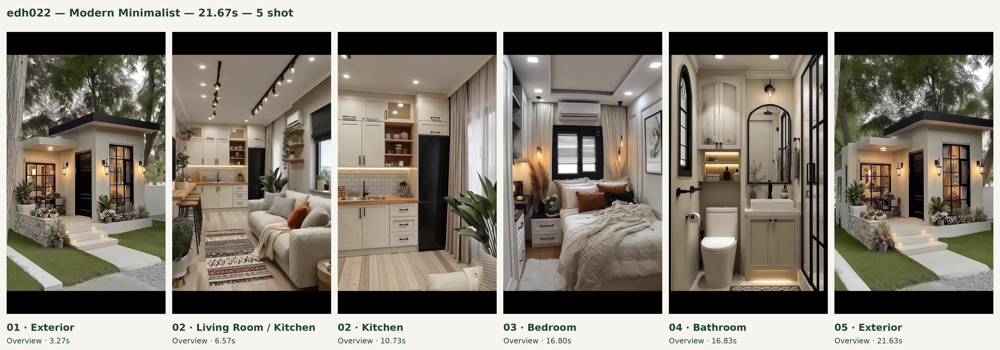
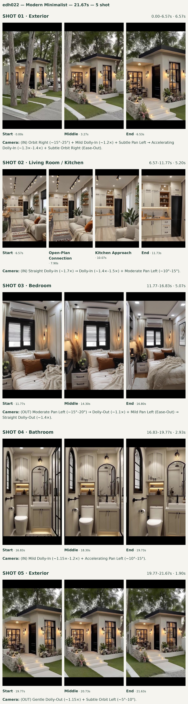
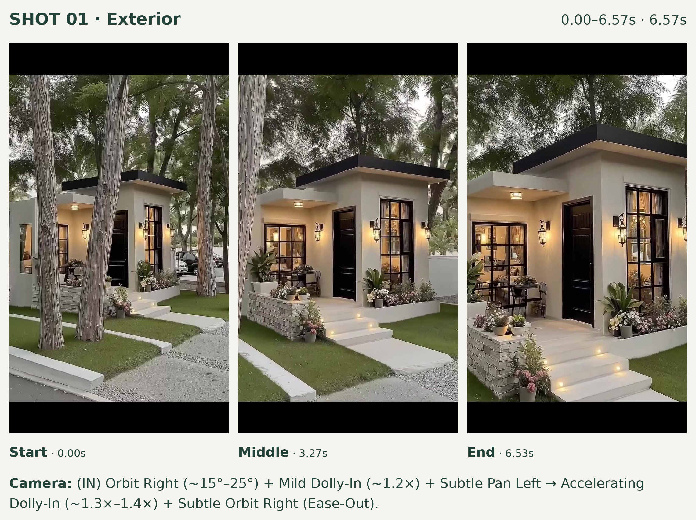
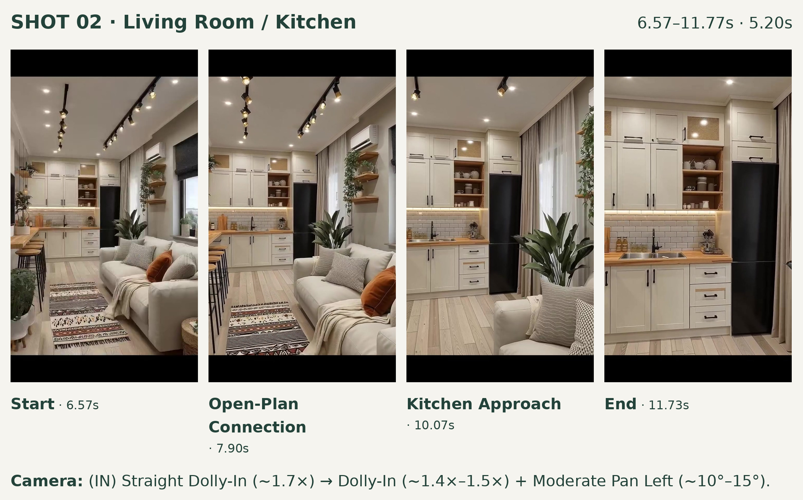
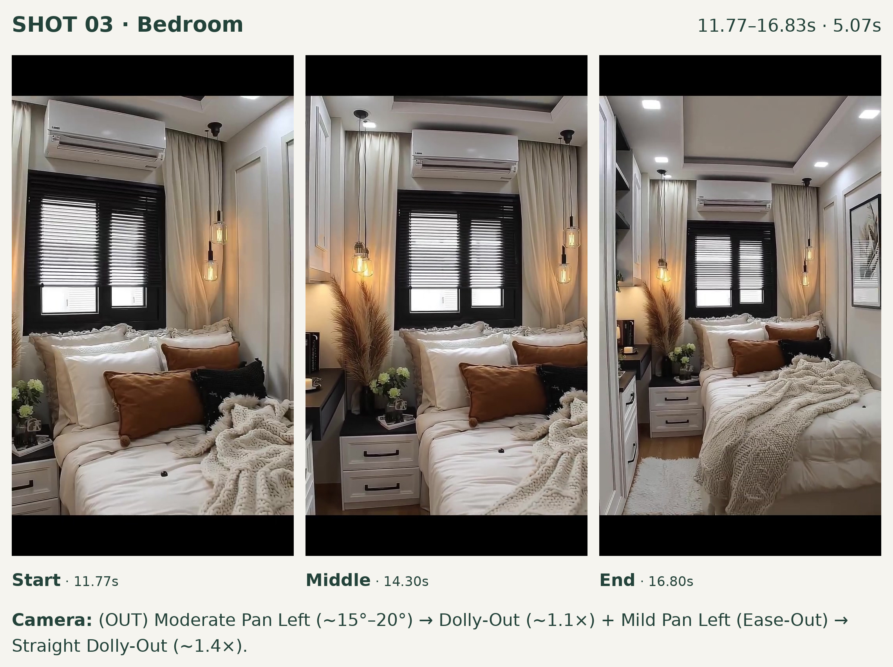
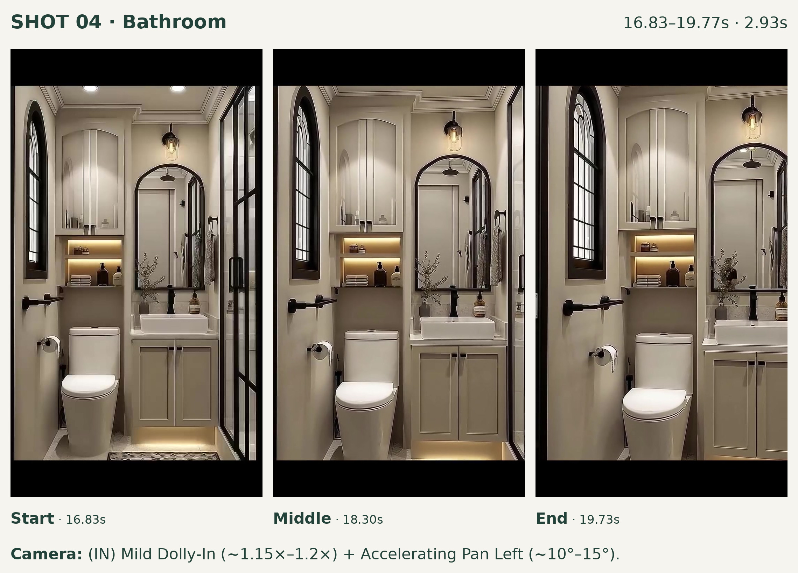
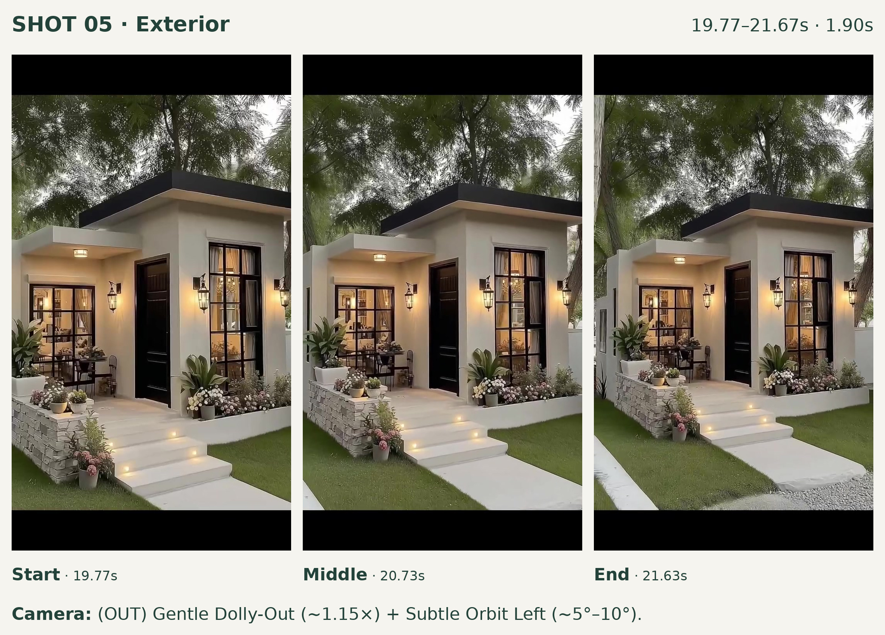

# edh022 — Compact Warm Modern House

## 1. Profil desain

- **Nama desain:** Compact Warm Modern House
- **Tipe rumah:** Detached House
- **Gaya utama:** **Modern Minimalist**
- **Pengaruh gaya:** Transitional
- **Gaya interior:** Warm Modern; Modern Farmhouse
- **Susunan ruang utama:** Living dan kitchen tersambung dalam satu lintasan; bedroom dan bathroom muncul pada cut terpisah
- **Ciri khas:** —
- **Material utama:** Dinding tampak plester krem, aksen batu susun, kayu terang, bingkai hitam
- **Pencahayaan:** Cahaya difus dari bukaan, lampu dinding, track light dan strip hangat
- **Atmosfer:** Hangat, kompak dan intim dengan kontras gelap-terang
- **Lingkungan:** Pepohonan tinggi, rumput dan jalur masuk berpaving

### Palet warna

| Peran | Warna | HEX |
| --- | --- | --- |
| Dominan | Warm white | `#DDD6C8` |
| Dominan | Cream | `#D5CABB` |
| Aksen | Charcoal black | `#252525` |
| Pendamping | Light oak | `#BDA485` |
| Aksen | Rust brown | `#9A5632` |
| Pendamping | Muted sage green | `#62734A` |

## 2. Ukuran & proporsi

| Aspek | Estimasi visual |
| --- | --- |
| **Ukuran rumah** | compact |
| **Bentuk bangunan** | Massa rendah bersudut siku, atap bertepi hitam dan kanopi masuk |
| **Lantai & bentuk atap** | Single-story visible mass · Garis atap horizontal dengan overhang tipis |
| **Tapak bangunan** | Compact rectilinear mass |
| **Proporsi utama** | Massa rendah dengan bukaan vertikal tinggi |
| **Perkiraan luas lantai** | **35–65 m²** |

## 3. Shot Timeline

Durasi 21.67s · 5 shot.

**Camera Pattern:** IN – IN – OUT – IN – OUT.

| Shot | Time (s) | Duration | Area/Scene | Camera Movement |
| --- | --- | --- | --- | --- |
| 01 | 0.00–6.57 | 6.57s | Exterior | Orbit Right (~15°–25°) + Mild Dolly-In (~1.2×) + Subtle Pan Left → Accelerating Dolly-In (~1.3×–1.4×) + Subtle Orbit Right (Ease-Out). |
| 02 | 6.57–11.77 | 5.20s | Living Room / Kitchen | Straight Dolly-In (~1.7×) → Dolly-In (~1.4×–1.5×) + Moderate Pan Left (~10°–15°). |
| 03 | 11.77–16.83 | 5.07s | Bedroom | Moderate Pan Left (~15°–20°) → Dolly-Out (~1.1×) + Mild Pan Left (Ease-Out) → Straight Dolly-Out (~1.4×). |
| 04 | 16.83–19.77 | 2.93s | Bathroom | Mild Dolly-In (~1.15×–1.2×) + Accelerating Pan Left (~10°–15°). |
| 05 | 19.77–21.67 | 1.90s | Exterior | Gentle Dolly-Out (~1.15×) + Subtle Orbit Left (~5°–10°). |

## 4. Overview

**Shot 01 · Exterior · 3.27s**

> Kamera dari jalur depan menghadap serong ke fasad pada tinggi mata; massa, atap, teras, pintu, tangga, rumput dan pepohonan terlihat dalam satu wide.

**Shot 02 · Living Room / Kitchen · 6.57s**

> Kamera dari awal living menghadap ke kabinet ujung; wide mencakup sofa kanan, meja dan bangku kiri, karpet, jalur tengah dan kitchen.

**Shot 02 · Kitchen · 10.73s**

> Kamera dekat ujung living menghadap hampir frontal ke kabinet; meja kerja, rak, kulkas dan bukaan samping menjadi cakupan dapur.

**Shot 03 · Bedroom · 16.80s**

> Kamera mundur dekat akses kamar, menghadap ranjang dan jendela belakang; wide memperlihatkan plafon, sisi kanan, meja samping kiri dan ranjang.

**Shot 04 · Bathroom · 16.83s**

> Kamera di akses menghadap dinding belakang; wide mencakup jendela lengkung kiri, toilet, vanity dan partisi shower kanan.

**Shot 05 · Exterior · 21.63s**

> Kamera menjauh di jalur depan, menghadap serong fasad; wide mencakup massa, atap, teras, tangga, halaman dan pohon.

## 5. Storyboard

## 6. Shot Details

### Shot 01 · Exterior

**Time:** 0.00–6.57s · **Duration:** 6.57s

#### **A. Desain area**

**Arsitektur**

> Massa rendah berwarna krem dengan tepi atap hitam menjorok, kanopi teras rata, pintu hitam dan jendela tinggi bergrid. Tangga terang dengan lampu kecil menghubungkan teras ke jalur. Dinding rendah bertekstur batu membatasi teras.

**Furnitur & dekorasi**

> Meja dan kursi kecil di teras; pot tanaman di sisi tangga, lampu dinding hangat.

**Lingkungan**

> Rumput, jalur paving terang dan pohon tinggi mengapit fasad.

#### **B. Framing & Lighting**

- **Fokus:** Fasad dan akses masuk
- **Camera Start:** Di jalur depan, di luar taman · Serong ke fasad dan pintu · oblique · Sekitar tinggi mata · Hampir datar
- **Framing:** Wide, pohon di depan fasad → Lebih dekat ke tangga dan pintu
- **Lighting:** Cahaya luar difus dan lampu teras hangat
- **Foreground dan kedalaman:** Pohon, rumput, jalur · Pohon dekat, jalur tengah, massa belakang
- **Reveal:** Fasad terbuka setelah pohon bergeser
- **Kesesuaian gerak:** Orbit membuka fasad sebelum pendekatan menekankan akses

#### **C. Camera Movement**

Kamera bergerak ke kanan melewati batang pohon, membuka bidang fasad sambil sedikit mendekat dan mengarahkan pandangan ke kiri; pendekatan ke teras menjadi dominan setelah pohon keluar dari kiri.

**Tempo:** Gerak lateral cukup stabil pada awal, mereda saat pendekatan makin dominan; pembesaran bertambah pada bagian akhir.

**Movement Timeline**

| Time (s) | Area & fokus | Camera Movement | Tempo |
| --- | --- | --- | --- |
| 0.00–4.00 | Exterior · Fasad dan pohon foreground | Orbit Right (~15°–25°) + Mild Dolly-In (~1.2×) + Subtle Pan Left | Gerak lateral cukup stabil pada awal, mereda saat pendekatan makin dominan; pembesaran bertambah pada bagian akhir. |
| 4.00–6.57 | Exterior · Tangga, pintu, jendela fasad | Accelerating Dolly-In (~1.3×–1.4×) + Subtle Orbit Right (Ease-Out) | Gerak lateral cukup stabil pada awal, mereda saat pendekatan makin dominan; pembesaran bertambah pada bagian akhir. |

**Camera:** Orbit Right (~15°–25°) + Mild Dolly-In (~1.2×) + Subtle Pan Left → Accelerating Dolly-In (~1.3×–1.4×) + Subtle Orbit Right (Ease-Out).

---

### Shot 02 · Living Room / Kitchen

**Time:** 6.57–11.77s · **Duration:** 5.20s

**Shot Type:** Continuous shot · Multi area · No cut.

#### **A. Desain area**

##### **Living Room**

**Arsitektur**

> Ruang memanjang terbuka ke dapur, plafon rata dengan track light hitam dan downlight; bukaan di sisi kanan dengan tirai panjang. Lantai papan tampak kayu terang.

**Furnitur & dekorasi**

> Sofa krem di kanan menghadap sisi kiri, bantal krem dan karat, selimut rajut, karpet motif garis dan pot tanaman; rak kayu melayang di sisi jendela.

**Lingkungan**

> Cahaya difus dari jendela kanan; luar tidak terbaca jelas.

##### **Kitchen**

**Arsitektur**

> Kabinet panel krem berjajar di dinding ujung, backsplash ubin persegi panjang terang, meja kerja tampak kayu. Kulkas hitam berada di kanan. Area meja di sisi kiri hanya sebagian terlihat; sambungan tidak jelas.

**Furnitur & dekorasi**

> Kabinet atas-bawah berpintu panel dengan gagang gelap, rak terbuka kayu di antara kabinet atas, sink dan keran hitam, kulkas tinggi hitam, bangku di meja sisi kiri.

**Lingkungan**

> Lampu strip hangat di bawah kabinet dan cahaya sisi kanan.

#### **B. Framing & Lighting**

- **Fokus:** Lintasan living menuju kitchen
- **Camera Start:** Di sisi awal ruang living · Ke ujung kitchen sepanjang ruang · frontal · Sekitar tinggi mata · Hampir datar
- **Framing:** Wide living dan kitchen di belakang → Kabinet dan sink dominan
- **Lighting:** Track light, downlight, jendela kanan dan strip kabinet
- **Foreground dan kedalaman:** Sofa kanan dan meja kiri · Sofa dekat, jalur tengah, kabinet jauh
- **Reveal:** Sofa keluar framing, detail kitchen terbuka
- **Kesesuaian gerak:** Dolly-In menyusuri ruang lalu pan kiri menekankan sink
- **Area:** Living Room / Kitchen
- **Rute kamera:** —

**Hubungan antararea**

- **Penghubung area:** —
- **Peralihan:** Living Room · 6.57–10.73s; Kitchen · 6.57–11.77s
- **Orientasi ruang:** —

#### **C. Camera Movement**

Maju menyusuri living menuju kitchen, dengan arah pandang relatif stabil pada awal lalu menyapu kiri menuju rak dan sink pada akhir.

**Tempo:** Maju berkelanjutan; aliran visual lebih cepat ketika sofa dan tanaman lewat serta framing kitchen menyempit.

**Movement Timeline**

| Time (s) | Area & fokus | Camera Movement | Tempo |
| --- | --- | --- | --- |
| 6.57–10.07 | Living Room / Kitchen · Living menuju kitchen | Straight Dolly-In (~1.7×) | Maju berkelanjutan; aliran visual lebih cepat ketika sofa dan tanaman lewat serta framing kitchen menyempit. |
| 10.07–11.77 | Living Room / Kitchen · Kabinet, rak terbuka dan sink | Dolly-In (~1.4×–1.5×) + Moderate Pan Left (~10°–15°) | Maju berkelanjutan; aliran visual lebih cepat ketika sofa dan tanaman lewat serta framing kitchen menyempit. |

**Camera:** Straight Dolly-In (~1.7×) → Dolly-In (~1.4×–1.5×) + Moderate Pan Left (~10°–15°).

---

### Shot 03 · Bedroom

**Time:** 11.77–16.83s · **Duration:** 5.07s

#### **A. Desain area**

**Arsitektur**

> Kamar sempit memanjang; jendela grid gelap dengan blind dan tirai krem di belakang ranjang, AC di atasnya. Plafon bertingkat dangkal dengan downlight; panel dinding terang di sisi kanan.

**Furnitur & dekorasi**

> Ranjang menghadap kamera dengan linen putih, bantal rust dan hitam, selimut rajut krem. Meja samping berlaci di kiri, lampu gantung hangat, dekorasi rumput kering, karya bingkai di kanan.

**Lingkungan**

> Cahaya jendela belakang tersaring blind, lampu gantung memberi aksen hangat.

#### **B. Framing & Lighting**

- **Fokus:** Ranjang dan jendela
- **Camera Start:** Dekat kaki ranjang · Ke jendela belakang · frontal · Sekitar tinggi mata · Hampir datar
- **Framing:** Ranjang dan jendela memenuhi bingkai → Wide menampilkan sisi ruang, plafon dan ranjang
- **Lighting:** Cahaya tersaring blind dan lampu gantung hangat
- **Foreground dan kedalaman:** Selimut rajut · Ranjang dekat, jendela belakang
- **Reveal:** Meja samping dan dinding kanan terbuka
- **Kesesuaian gerak:** Pan kiri kemudian Dolly-Out membuka volume

#### **C. Camera Movement**

Sapuan kiri dari framing dekat ranjang membuka nakas dan sisi kiri, kemudian kamera mundur sampai terlihat cakupan kamar yang lebih luas.

**Tempo:** Sapuan awal jelas, lalu berpadu mundur; perubahan arah pandang mereda dan pelebaran framing berlanjut stabil.

**Movement Timeline**

| Time (s) | Area & fokus | Camera Movement | Tempo |
| --- | --- | --- | --- |
| 11.77–13.27 | Bedroom · Headboard, jendela dan nakas kiri | Moderate Pan Left (~15°–20°) | Sapuan awal jelas, lalu berpadu mundur; perubahan arah pandang mereda dan pelebaran framing berlanjut stabil. |
| 13.27–14.43 | Bedroom · Nakas, ranjang dan bukaan kiri | Dolly-Out (~1.1×) + Mild Pan Left (Ease-Out) | Sapuan awal jelas, lalu berpadu mundur; perubahan arah pandang mereda dan pelebaran framing berlanjut stabil. |
| 14.43–16.83 | Bedroom · Cakupan kamar tidur | Straight Dolly-Out (~1.4×) | Sapuan awal jelas, lalu berpadu mundur; perubahan arah pandang mereda dan pelebaran framing berlanjut stabil. |

**Camera:** Moderate Pan Left (~15°–20°) → Dolly-Out (~1.1×) + Mild Pan Left (Ease-Out) → Straight Dolly-Out (~1.4×).

---

### Shot 04 · Bathroom

**Time:** 16.83–19.77s · **Duration:** 2.93s

#### **A. Desain area**

**Arsitektur**

> Kamar mandi sempit dengan jendela lengkung berbingkai hitam di kiri, dinding krem dan partisi shower grid hitam di kanan. Cermin lengkung mengulang bentuk jendela.

**Furnitur & dekorasi**

> Toilet putih di kiri kabinet vanity panel krem dengan basin kotak dan keran hitam. Kabinet tinggi panel lengkung dan ceruk bercahaya di atas toilet. Cermin lengkung hitam dan lampu gantung di atas vanity.

**Lingkungan**

> Cahaya dari jendela kiri dan lampu hangat pada ceruk serta bawah vanity; lingkungan luar tidak jelas.

#### **B. Framing & Lighting**

- **Fokus:** Toilet, vanity dan jendela
- **Camera Start:** Di sisi akses kamar mandi · Ke toilet, vanity dan cermin · frontal · Sekitar tinggi mata · Hampir datar
- **Framing:** Wide mencakup partisi shower kanan → Jendela dan kabinet toilet dominan
- **Lighting:** Cahaya jendela kiri dan ceruk hangat
- **Foreground dan kedalaman:** Partisi shower di kanan · Peralatan dekat, dinding belakang
- **Reveal:** Partisi keluar kanan saat sapuan kiri
- **Kesesuaian gerak:** Dolly-In ringan dan pan kiri mengutamakan jendela

#### **C. Camera Movement**

Mendekat ringan sambil menyapu kiri dari vanity ke toilet dan jendela lengkung.

**Tempo:** Pembesaran ringan relatif konstan; sapuan horizontal menguat dari awal ke tengah dan akhir.

**Camera:** Mild Dolly-In (~1.15×–1.2×) + Accelerating Pan Left (~10°–15°).

---

### Shot 05 · Exterior

**Time:** 19.77–21.67s · **Duration:** 1.90s

#### **A. Desain area**

**Arsitektur**

> Massa rendah berwarna krem dengan tepi atap hitam menjorok, kanopi teras rata, pintu hitam dan jendela tinggi bergrid. Tangga terang dengan lampu kecil menghubungkan teras ke jalur. Dinding rendah bertekstur batu membatasi teras.

**Furnitur & dekorasi**

> Meja dan kursi kecil di teras; pot tanaman di sisi tangga, lampu dinding hangat.

**Lingkungan**

> Rumput, jalur paving terang dan pohon tinggi mengapit fasad.

#### **B. Framing & Lighting**

- **Fokus:** Fasad dan akses
- **Camera Start:** Dekat jalur masuk depan · Serong ke teras dan fasad · oblique · Sekitar tinggi mata · Hampir datar
- **Framing:** Teras dan pintu cukup dekat → Wide fasad dan halaman
- **Lighting:** Cahaya difus luar dengan lampu aksen
- **Foreground dan kedalaman:** Tangga dan jalur · Jalur dekat, teras tengah, pepohonan belakang
- **Reveal:** Halaman dan jalur semakin luas
- **Kesesuaian gerak:** Dolly-Out dengan orbit kecil membuka konteks tapak

#### **C. Camera Movement**

Mundur pelan dari teras dengan pergeseran sudut kecil ke kiri sehingga halaman dan sisi kiri kembali terbuka.

**Tempo:** Gerak mundur ringan, hampir konstan dan sapuan sudut kecil selama shot pendek.

**Camera:** Gentle Dolly-Out (~1.15×) + Subtle Orbit Left (~5°–10°).

**Catatan referensi:** Luas 35–65 m² hanya perkiraan visual kasar dari skala furnitur dan massa; denah, dimensi, material fisik dan keterhubungan antar-cut tidak terverifikasi. Warna HEX perkiraan tampilan dengan pengaruh pencahayaan. Living–Kitchen terlihat kontinu; kamar dan kamar mandi tidak dapat dipastikan posisi fisiknya terhadap ruang lain. Notasi kamera dan ketidakpastian Fase 2 dipertahankan sesuai persetujuan.
