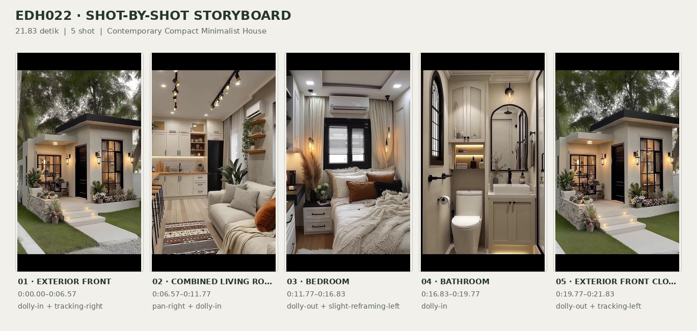
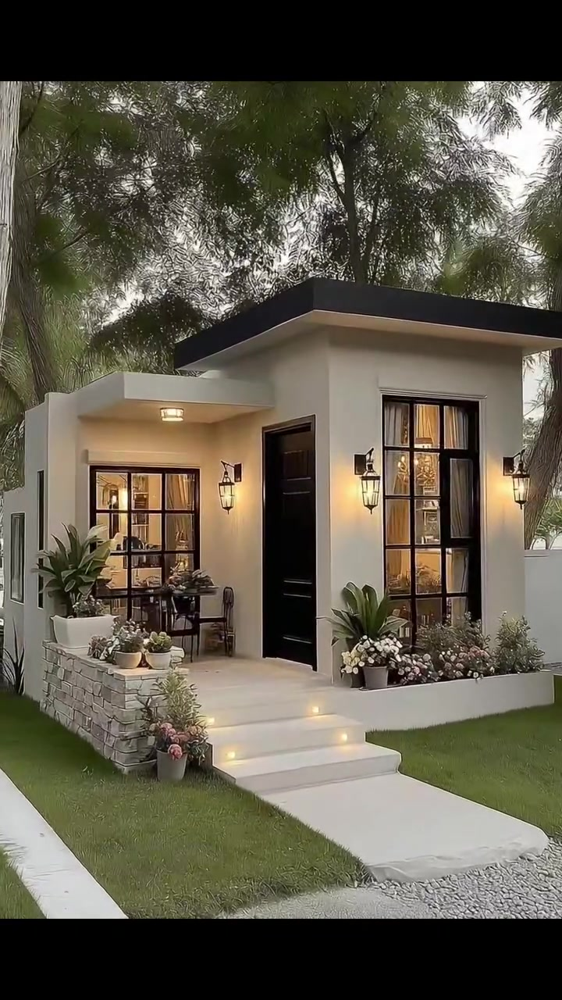
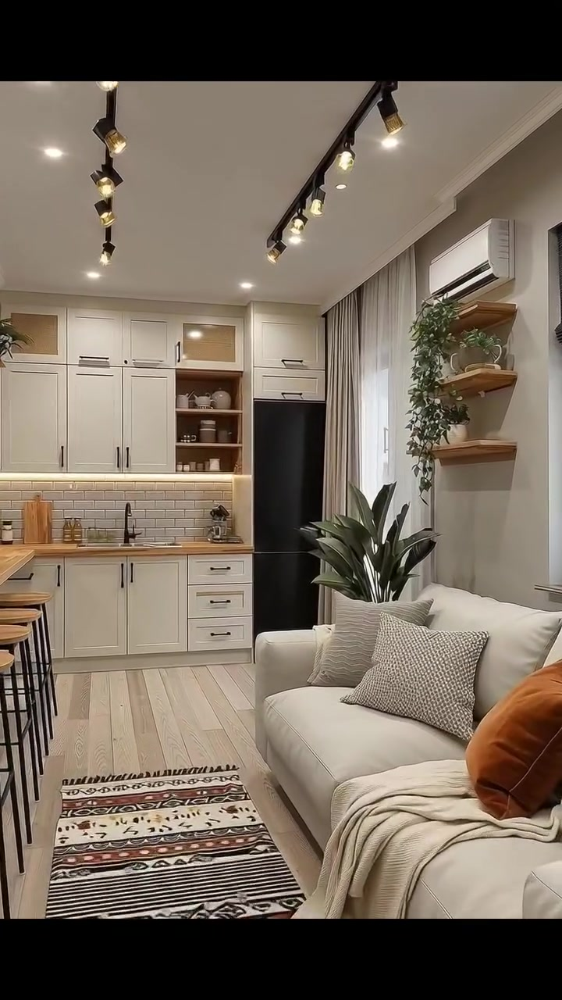
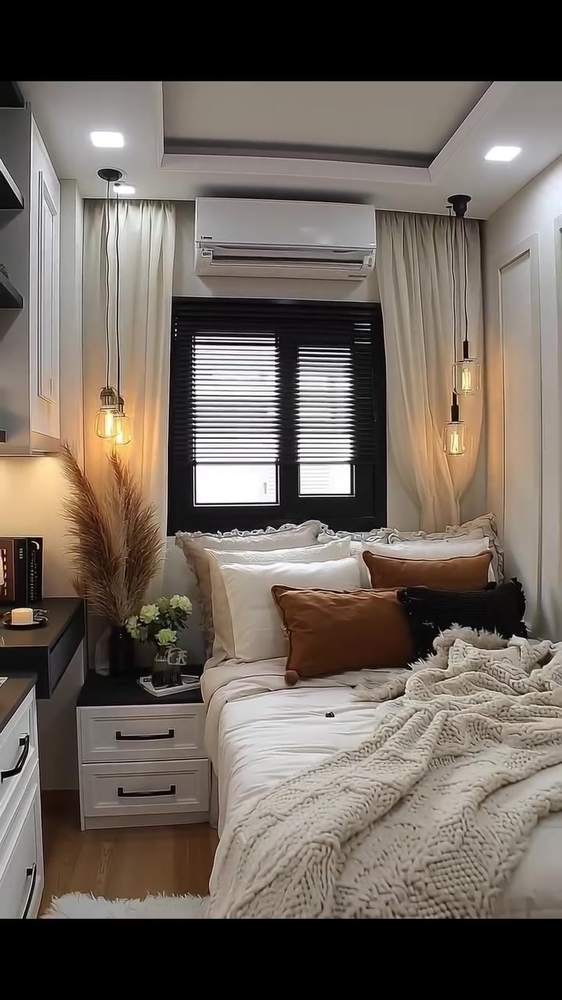
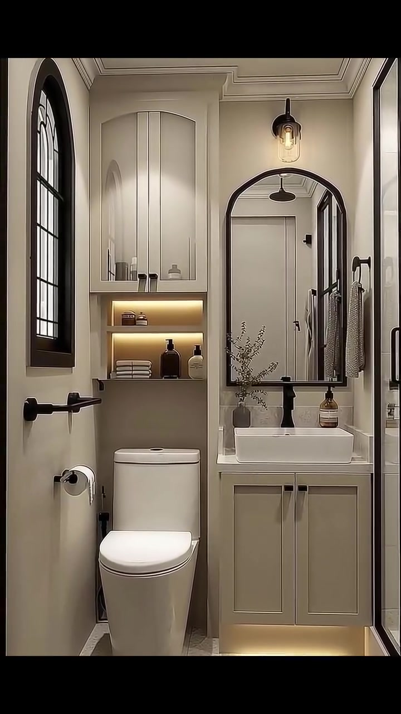
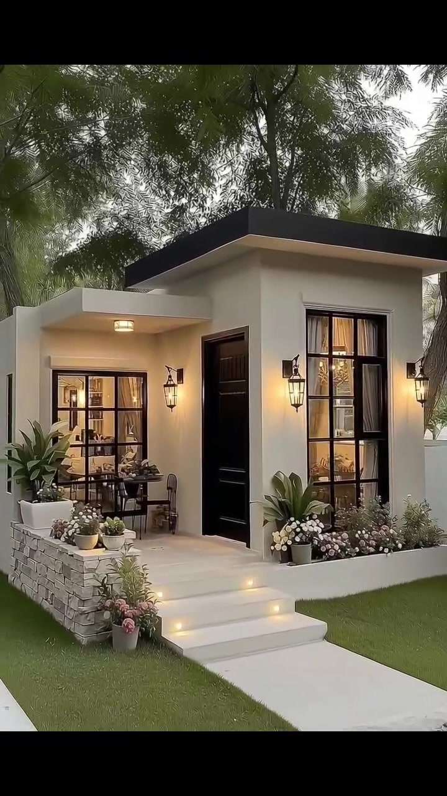

# edh022 — Contemporary Compact Minimalist House

<!-- homeku_request_id: edh022-20261104-01 -->

<!-- homeku_detail_narratives: chat-reviewed -->

**Sumber data:** [analysis.yaml](analysis.yaml) · **Status:** draft · **Diverifikasi manusia:** Tidak

## 1. Informasi Video

| Informasi | Nilai |
|---|---|
| ID | edh022 |
| File asli | edh022.mp4 |
| Durasi | 21.83 |
| Resolusi | 720x1280 |
| FPS | 30 |
| Rasio | 9:16 |
| Jumlah shot | 5 |

## 2. Storyboard Gabungan

## 3. Identitas Desain

| Aspek | Hasil analisis |
|---|---|
| Gaya utama | contemporary compact minimalist house |
| Wilayah terkait gaya desain | Tidak diketahui |
| Pengaruh gaya | warm minimalism, modern bungalow, transitional interior details |
| Ciri eksterior | offwhite plaster appearance walls, nearly flat roof appearance with dark fascia, black gridded windows, recessed black front door, shallow covered entrance, raised stone planter and small lit entry stairs |
| Gaya interior | warm contemporary, neutral shaker cabinetry, compact multifunctional space, black metal accents, soft neutral textiles |
| Confidence gaya | medium |

## 4. Ukuran & Proporsi Bangunan

| Aspek | Estimasi visual |
|---|---|
| Ukuran yang terlihat | small |
| Bentuk bangunan | compact rectangular with offset front volumes |
| Skala vertikal | single story |
| Tapak bangunan | compact |
| Perkiraan luas lantai | 35–60 m² |
| Confidence | low |

> Luas adalah perkiraan visual, bukan ukuran terukur.

## 5. Warna, Pencahayaan, dan Atmosfer

| Warna dominan | HEX (perkiraan) |
|---|---|
| warm offwhite | #EEE9DF |
| charcoal black | #252423 |
| light greige | #C8BDB0 |
| pale wood | #BFA887 |
| leaf green | #637852 |
| rust brown | #AF6C41 |

| Aspek | Hasil analisis |
|---|---|
| Pencahayaan | soft cloudy daylight, warm exterior lanterns, warm interior spotlights, warm cabinet and niche leds, warm bedside pendants |
| Lingkungan | tree shaded small landscaped house lot, neat green front lawn, white front path and low garden walls, dense mature tree canopy |
| Musim yang tampak | Tidak diketahui |
| Mood | cozy, calm, tidy, warm and welcoming |

## 6. Struktur dan Timeline Video

**Jenis:** compact home tour · **Tempo:** slow · **Transisi:** hard cuts between rooms and return to exterior

| Shot | Waktu (detik) | Durasi | Area/Scene | Gerakan Kamera |
|---|---|---|---|---|
| Shot 01 | 0.0–6.57 | 6.57 | exterior front | dolly in, tracking right |
| Shot 02 | 6.57–11.77 | 5.20 | combined living room and kitchen | pan right, dolly in |
| Shot 03 | 11.77–16.83 | 5.06 | bedroom | dolly out, slight reframing left |
| Shot 04 | 16.83–19.77 | 2.94 | bathroom | dolly in |
| Shot 05 | 19.77–21.83 | 2.06 | exterior front closing | dolly out, tracking left |

## 7. Analisis per Shot

### Shot 01 — exterior front

**Waktu:** 0.0–6.57 detik

| Komponen | Pengamatan |
|---|---|
| Fokus utama | compact cream house front facade |
| Framing awal → akhir | wide front three quarter view → medium close front facade |
| Sudut pandang | eye level front left |
| Gerakan kamera | dolly in, tracking right |
| Kecepatan kamera | slow |
| Pencahayaan | soft overcast daylight and warm exterior lanterns |
| Transisi keluar | hard cut |

**Detail yang terlihat**

**Arsitektur**

Fasad rumah satu lantai yang tampak kecil menggunakan dinding berfinishing halus berwarna krem pucat. Dua massa depan bertingkat ketinggian berbeda mempunyai tepi atap hitam dengan tampilan hampir datar; massa kanan lebih tinggi dibanding kanopi teras di kiri. Pintu utama hitam berpanel berada di antara jendela berkisi hitam, dengan jendela tinggi di kanan dan jendela di bawah kanopi kiri; tirai krem tampak di balik kaca. Lampu dinding bergaya lentera dan lampu plafon kanopi memancarkan cahaya hangat. Menuju pintu terdapat tiga anak tangga putih yang lebar dengan lampu tanam pada bagian depan, dibatasi dinding planter berlapis batu abu\-abu di kiri dan bedeng bunga terangkat putih di bawah jendela kanan.

**Furnitur dan properti**

Di bawah kanopi kiri terdapat meja kecil gelap dan beberapa kursi logam. Beberapa pot bunga merah muda dan putih berjajar pada dinding batu, bersama tanaman kecil yang tampak menyerupai sukulen. Pot berisi tanaman hijau berdaun lebar ditempatkan di sisi area teras dan dekat jendela depan.

**Lingkungan**

Rumah dinaungi beberapa batang pohon tinggi berkulit kayu pucat dan kasar, dengan tajuk hijau rapat serta beberapa daun menyerupai palem di belakang. Rumput pendek menghijau di kedua sisi jalur masuk beton terang, sementara kerikil abu\-abu terdapat di tepian. Bagian dinding batas putih tampak di belakang sisi kanan rumah, dengan langit terang berawan terlihat di sela pepohonan; pada bagian awal shot, sebagian kendaraan terparkir juga terlihat jauh di balik sisi kanan bangunan.

**Catatan pengamatan:** Shot pembuka menyorot fasad dari sisi kiri-depan sambil mendekat dan bergeser ke kanan; pitch atap dan material finishing tidak dapat dipastikan.

**Confidence:** Kamera medium · Detail visual high

### Shot 02 — combined living room and kitchen

**Waktu:** 6.57–11.77 detik

| Komponen | Pengamatan |
|---|---|
| Fokus utama | shared living kitchen interior |
| Framing awal → akhir | wide narrow room view with sofa and kitchen → medium kitchen cabinetry view |
| Sudut pandang | eye level from living area |
| Gerakan kamera | pan right, dolly in |
| Kecepatan kamera | slow |
| Pencahayaan | warm spotlights and undercabinet lighting with filtered daylight |
| Transisi keluar | hard cut |

**Detail yang terlihat**

**Arsitektur**

Ruang duduk yang memanjang berbatasan langsung dengan dapur pada dinding belakang, memperlihatkan susunan kompak tanpa sekat besar. Kabinet bergaya shaker berwarna putih krem menggunakan gagang panjang hitam pada pintu serta laci bawah. Permukaan meja dapur tampak seperti kayu terang, dipadukan backsplash ubin persegi panjang putih dengan garis nat abu\-abu, lampu garis hangat di bawah kabinet, bak cuci inset metalik, dan keran tinggi hitam. Di antara lemari atas terdapat rak pajang terbuka berwarna kayu. Lantainya berupa papan bernuansa kayu terang. Plafon putih memiliki dua rel lampu sorot hitam memanjang dan beberapa downlight. Pada dinding kanan terlihat jendela berbingkai hitam dengan roller blind gelap, tirai panjang abu\-abu krem, AC split putih di atas rak dinding kayu, sedangkan sisi kiri memuat meja sarapan memanjang dengan permukaan seperti kayu.

**Furnitur dan properti**

Sofa berlapis kain krem menempel pada sisi kanan ruangan, dilengkapi bantal bertekstur putih dan beige, satu bantal jingga kecokelatan serta selimut rajut beige. Karpet lorong panjang berpola geometris hitam, krem, dan cokelat kemerahan memiliki rumbai di ujungnya. Beberapa bangku tinggi berangka gelap dan dudukan bundar mirip kayu berada di meja sisi kiri. Dapur dilengkapi kulkas tinggi hitam, rak berisi piring, cangkir, dan stoples putih, serta wadah\-wadah kecil di countertop. Tanaman berdaun menjuntai berada pada rak kayu dinding kanan, sementara tanaman berdaun lebar tumbuh di dekat sofa.

**Lingkungan**

Tidak ada detail yang tercatat.

**Catatan pengamatan:** Kamera bergeser dari tampilan gabungan sofa dan dapur ke lemari dapur; jumlah dudukan dan bahan countertop hanya perkiraan visual.

**Confidence:** Kamera medium · Detail visual high

### Shot 03 — bedroom

**Waktu:** 11.77–16.83 detik

| Komponen | Pengamatan |
|---|---|
| Fokus utama | white bed under black framed window |
| Framing awal → akhir | medium close bed and window → wider full bedroom view |
| Sudut pandang | eye level facing head of bed |
| Gerakan kamera | dolly out, slight reframing left |
| Kecepatan kamera | slow |
| Pencahayaan | warm bedside pendants and recessed ceiling lights with window daylight |
| Transisi keluar | hard cut |

**Detail yang terlihat**

**Arsitektur**

Kamar tidur berukuran tampak kompak menempatkan tempat tidur tepat di bawah jendela dua bidang berbingkai hitam. Jendela memakai bilah roller blind gelap serta tirai panjang warna beige di kedua sisinya, sementara unit AC split putih terpasang di atas bukaan tersebut. Plafon putih memiliki bagian tengah cekung berbentuk persegi panjang dengan downlight kotak berwarna hangat. Dinding berwarna netral terang memiliki panel moulding sederhana, dan sisi kiri memuat kabinet penyimpanan tanam serta rak terbuka berwarna putih gading. Di bagian bawah tampak lantai menyerupai papan kayu terang, serta pintu berpanel putih pada dinding kanan.

**Furnitur dan properti**

Tempat tidur dengan seprai putih menampilkan beberapa bantal putih tebal, bantal aksen persegi panjang berwarna cokelat karamel, serta bantal kecil hitam di sisi kanan. Selimut rajut tebal krem membentang di bagian bawah kasur. Di kedua sisi terdapat nakas dua laci putih dengan permukaan gelap dan lampu gantung kaca bercahaya hangat. Di nakas kiri terlihat vas gelap berisi rumput kering berwarna cokelat muda, rangkaian bunga putih kecil, serta buku. Karpet lembut warna terang terlihat di dekat kaki ranjang, sedangkan lukisan botani berbingkai hitam menghiasi dinding kanan.

**Lingkungan**

Tidak ada detail yang tercatat.

**Catatan pengamatan:** Kamera mundur perlahan sehingga seluruh tempat tidur, kabinet kiri, dan panel dekoratif kanan makin terlihat; ukuran kasur tidak bisa diukur.

**Confidence:** Kamera medium · Detail visual high

### Shot 04 — bathroom

**Waktu:** 16.83–19.77 detik

| Komponen | Pengamatan |
|---|---|
| Fokus utama | toilet and arched mirror vanity |
| Framing awal → akhir | wide compact bathroom view → closer toilet and vanity view |
| Sudut pandang | eye level facing back wall |
| Gerakan kamera | dolly in |
| Kecepatan kamera | slow |
| Pencahayaan | warm wall lantern shelf lighting and ceiling downlights |
| Transisi keluar | hard cut |

**Detail yang terlihat**

**Arsitektur**

Kamar mandi sempit menggunakan dinding krem hangat dan plafon putih berlis dekoratif dengan lampu tanam. Pada sisi kiri ada jendela tinggi melengkung dengan bingkai hitam. Area belakang menempatkan kabinet penyimpanan tinggi warna greige di atas toilet putih, dengan dua rak terbuka berlampu hangat pada bagian bawahnya. Di kanan toilet terdapat kabinet wastafel dua pintu bergaya shaker warna krem keabu\-abuan, di atasnya berdiri baskom putih berbentuk persegi panjang dengan keran hitam. Cermin besar berbingkai hitam dengan bagian atas melengkung dipasang di belakang wastafel. Sisi kanan dibatasi partisi shower kaca berbingkai hitam; kepala pancuran bundar gelap tampak lewat pantulan cermin. Lampu hangat juga menerangi bagian kaki kabinet wastafel.

**Furnitur dan properti**

Lampu dinding logam hitam dengan bohlam hangat terpasang di atas cermin. Rak bercahaya berisi tumpukan handuk putih dan beberapa botol kaca maupun botol berwarna amber. Di meja wastafel tampak vas kecil berisi ranting ramping dan botol sabun pompa amber. Dinding kiri memiliki palang handuk hitam serta dudukan tisu toilet dengan gulungannya, sementara handuk kecil bertekstur terang tergantung di sisi partisi shower kanan.

**Lingkungan**

Tidak ada detail yang tercatat.

**Catatan pengamatan:** Bingkai kaca di kanan tampak memisahkan area shower; kepala shower terlihat dalam refleksi cermin. Material lantai dan konfigurasi shower tidak terkonfirmasi.

**Confidence:** Kamera medium · Detail visual high

### Shot 05 — exterior front closing

**Waktu:** 19.77–21.83 detik

| Komponen | Pengamatan |
|---|---|
| Fokus utama | front entry and lit porch at dusk like daylight |
| Framing awal → akhir | medium close front facade → medium wide front terrace and walkway |
| Sudut pandang | eye level front left |
| Gerakan kamera | dolly out, tracking left |
| Kecepatan kamera | slow |
| Pencahayaan | dim soft outdoor daylight with warm facade and step lighting |
| Transisi keluar | video end |

**Detail yang terlihat**

**Arsitektur**

Dari sudut depan\-kiri, rumah satu lantai berwarna krem kembali memperlihatkan massa atap yang tampak hampir datar, lis atap hitam tebal pada volume kanan, serta kanopi teras putih yang lebih rendah di kiri pintu. Pintu utama hitam berada di antara jendela\-jendela berkisi hitam, yakni jendela tinggi di kanan dan jendela menuju teras kiri yang terlihat terang dari dalam. Lampu lentera hitam pada dinding dan lampu plafon kanopi menyala hangat. Tiga undakan putih dengan lampu tanam menghubungkan jalan depan ke teras, dibatasi tembok planter batu abu\-abu kasar di kiri dan bedeng tanaman terangkat putih di bawah jendela kanan.

**Furnitur dan properti**

Di teras kiri kembali tampak meja kecil gelap dengan kursi logam. Pot\-pot tanaman kecil dan bunga diletakkan di atas serta dekat dinding planter batu; tanaman hijau berdaun lebar terdapat di dekat kedua jendela depan, dengan bunga berwarna merah muda dan putih sepanjang tepi teras.

**Lingkungan**

Halaman depan dipenuhi rumput hijau pendek yang mengapit jalan setapak beton pucat dari tangga, dengan area kerikil di sisi luar jalur. Pepohonan tinggi berdaun hijau rapat menaungi rumah, dan sebatang pohon berkulit kasar masuk ke sisi kiri bingkai ketika kamera menjauh. Langit terlihat terang dan berawan melalui sela\-sela cabang.

**Catatan pengamatan:** Shot penutup mundur sedikit dan bergeser kiri, memperlihatkan kembali fasad, tangga bercahaya, taman, dan jalur depan.

**Confidence:** Kamera medium · Detail visual high

## 8. Kualitas dan Ketidakpastian Analisis

| Parameter | Hasil |
|---|---|
| Status | draft |
| Verifikasi manusia | Tidak |
| Ketepatan timestamp | frame based estimate |
| Ketidakpastian | estimated floor area 35 to 60 m2 without measured scale, exact roof pitch and structural material not visible, stucco wood and stone materials are appearance based, actual site location and season not verifiable, camera motion direction inferred from framing, dark shower partition identified from partial glass and reflection |

**Catatan:** Analisis mencakup tampilan awal, tengah, dan akhir kelima shot. Batas cut diperkirakan dari frame video; tidak ada penilaian audio. Durasi container sekitar 21,83 detik, sedikit lebih panjang dari rentang frame video.

---

*Laporan ini diturunkan dari [analysis.yaml](analysis.yaml).*
