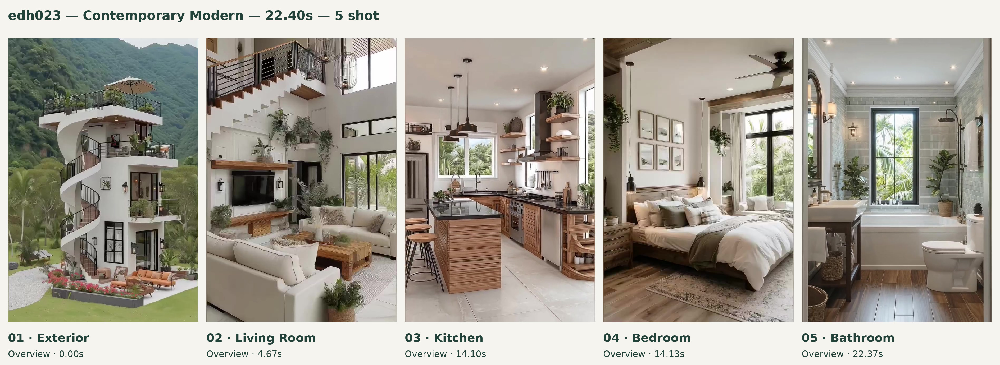
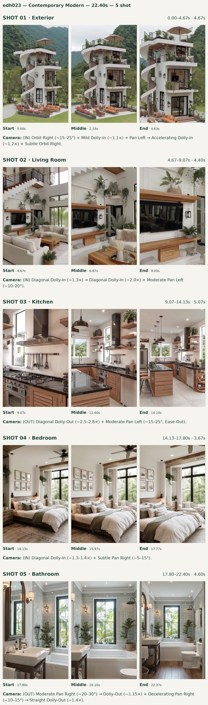
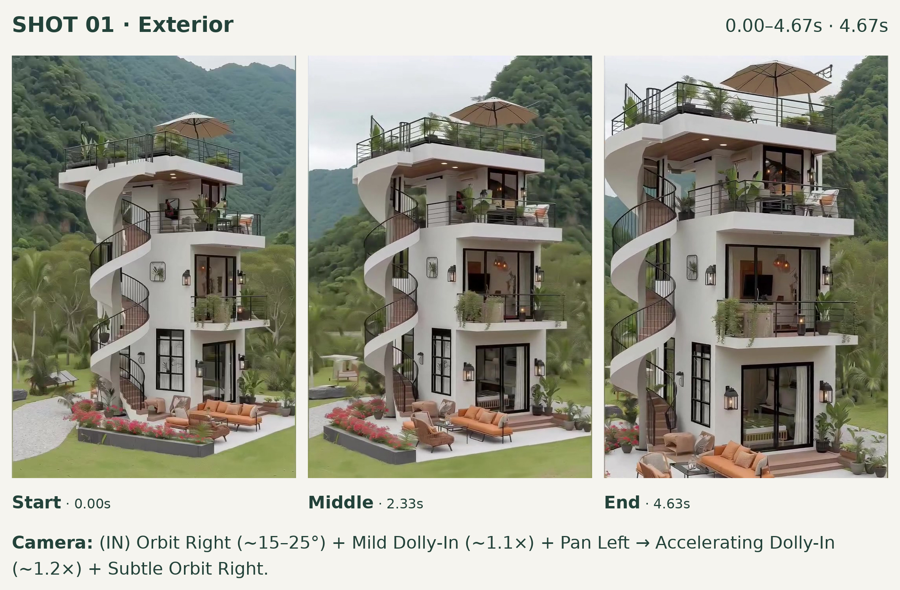
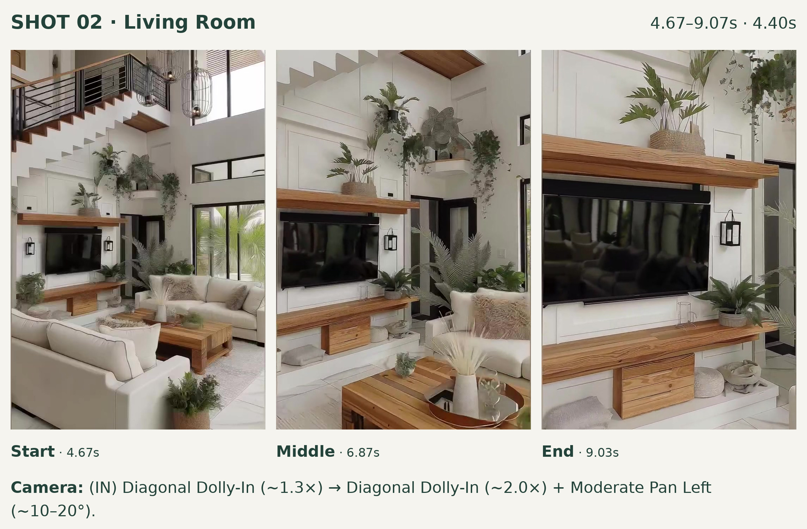
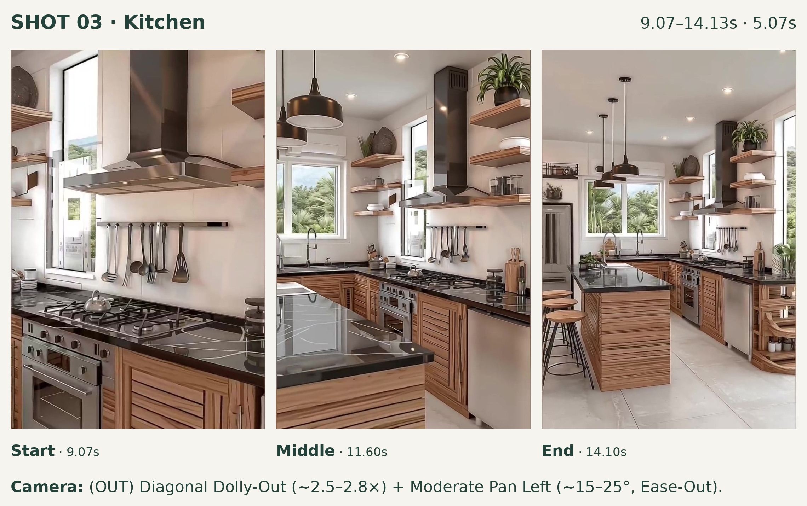
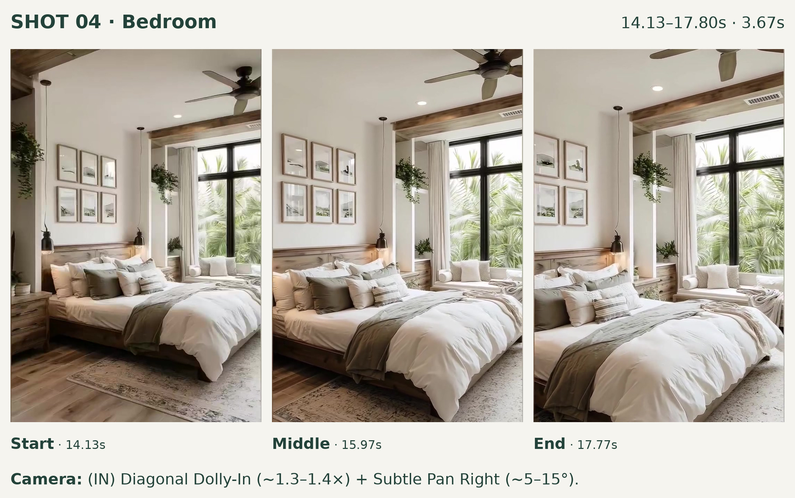
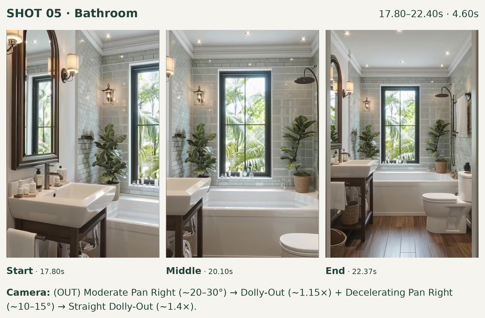

# edh023 — Compact Modern Tower House with Spiral Stair & Rooftop Terrace

## 1. Profil desain

- **Nama desain:** Compact Modern Tower House with Spiral Stair & Rooftop Terrace
- **Tipe rumah:** Tower House
- **Gaya utama:** **Contemporary Modern**
- **Pengaruh gaya:** Tropical Modern
- **Gaya interior:** Modern Organic; Transitional
- **Susunan ruang utama:** Eksterior, ruang keluarga bervolume tinggi, dapur, kamar tidur dan kamar mandi ditampilkan sebagai lima take terpisah; hubungan denah tidak diperlihatkan.
- **Ciri khas:** Tangga spiral luar menyambung tingkat, balkon lengkung, rooftop dengan payung, dan ruang keluarga berundak tangga terbuka.
- **Material utama:** Permukaan putih halus, bidang dan furnitur tampak kayu cokelat, bingkai gelap dan kaca; bahan fisik tidak terverifikasi.
- **Pencahayaan:** Cahaya siang menyebar melalui kaca tinggi, dilengkapi lampu gantung, downlight dan sconce.
- **Atmosfer:** Terang, hangat, organik dan dekat vegetasi.
- **Lingkungan:** Taman berbunga, rumput, pohon tropis dan pegunungan berhutan tampak di eksterior; vegetasi terlihat melalui jendela interior.

### Palet warna

| Peran | Warna | HEX |
| --- | --- | --- |
| Dominan | Warm White | `#E5E1D7` |
| Pendamping | Natural Wood Brown | `#A77B56` |
| Pendamping | Soft Beige | `#C9BDAA` |
| Aksen | Charcoal | `#343535` |
| Pendamping | Sage Grey | `#A8B1A9` |
| Aksen | Terracotta Orange | `#C17D4D` |

## 2. Ukuran & proporsi

| Aspek | Estimasi visual |
| --- | --- |
| **Ukuran rumah** | small |
| **Bentuk bangunan** | Massa ramping vertikal dengan slab balkon melengkung di sisi kiri fasad. |
| **Lantai & bentuk atap** | Tiga tingkat tertutup tampak dan teras atap · Atap datar berupa teras berpagar dengan payung dan tanaman. |
| **Tapak bangunan** | Massa kompak, jejak lantai relatif sempit |
| **Proporsi utama** | Tinggi dominan; balkon horizontal melengkung menonjol pada sisi tangga |
| **Perkiraan luas lantai** | **65–115 m²** |

## 3. Shot Timeline

Durasi 22.40s · 5 shot.

**Camera Pattern:** IN – IN – OUT – IN – OUT.

| Shot | Time (s) | Duration | Area/Scene | Camera Movement |
| --- | --- | --- | --- | --- |
| 01 | 0.00–4.67 | 4.67s | Exterior | Orbit Right (~15–25°) + Mild Dolly-In (~1.1×) + Pan Left → Accelerating Dolly-In (~1.2×) + Subtle Orbit Right. |
| 02 | 4.67–9.07 | 4.40s | Living Room | Diagonal Dolly-In (~1.3×) → Diagonal Dolly-In (~2.0×) + Moderate Pan Left (~10–20°). |
| 03 | 9.07–14.13 | 5.07s | Kitchen | Diagonal Dolly-Out (~2.5–2.8×) + Moderate Pan Left (~15–25°, Ease-Out). |
| 04 | 14.13–17.80 | 3.67s | Bedroom | Diagonal Dolly-In (~1.3–1.4×) + Subtle Pan Right (~5–15°). |
| 05 | 17.80–22.40 | 4.60s | Bathroom | Moderate Pan Right (~20–30°) → Dolly-Out (~1.15×) + Decelerating Pan Right (~10–15°) → Straight Dolly-Out (~1.4×). |

## 4. Overview

**Shot 01 · Exterior · 0.00s**

> Dari luar di sisi depan-kiri, menghadap fasad dan tangga spiral; massa utuh, halaman dan pegunungan terlihat.

**Shot 02 · Living Room · 4.67s**

> Dari belakang sofa di sisi ruang, menghadap diagonal ke TV dan jendela kanan; sofa, meja, tangga dan volume tinggi terlihat.

**Shot 03 · Kitchen · 14.10s**

> Dari sisi masuk dapur, menghadap ke area masak dan jendela belakang; island, bangku, kabinet siku dan kulkas terlihat.

**Shot 04 · Bedroom · 14.13s**

> Dari dekat kaki ranjang sisi kiri, menghadap serong kepala ranjang dan jendela kanan; ranjang, meja samping, karpet dan kipas terlihat.

**Shot 05 · Bathroom · 22.37s**

> Dari sisi pintu, menghadap lurus jendela di atas bathtub; vanity kiri dan toilet serta shower kanan tampak.

## 5. Storyboard

## 6. Shot Details

### Shot 01 · Exterior

**Time:** 0.00–4.67s · **Duration:** 4.67s

#### **A. Desain area**

**Arsitektur**

> Massa rumah ramping tiga tingkat dengan slab balkon putih melengkung di kiri; tangga spiral luar berpagar gelap naik antartingkat, rooftop datar berpagar. Pintu kaca gelap besar dan jendela vertikal menghadap halaman, lantai dasar berundak pendek.

**Furnitur & dekorasi**

> Sofa luar warna jingga dan kursi menghadap area duduk di patio; pot tanaman di balkon dan rooftop dengan payung.

**Lingkungan**

> Rumput dan bedeng bunga mengitari tapak; pohon berdaun panjang dan gunung berhutan menjadi latar.

#### **B. Framing & Lighting**

- **Fokus:** Fasad putih dan tangga spiral
- **Camera Start:** Di luar pada sisi depan-kiri rumah · Menghadap serong ke fasad dan tangga luar · oblique · Sedikit di atas permukaan patio, perkiraan visual · Hampir mendatar; massa tinggi masih masuk frame
- **Framing:** Wide massa utuh dan taman → Lebih dekat ke pintu dan balkon, sebagian taman terpotong
- **Lighting:** Cahaya siang lembut merata, latar hijau
- **Foreground dan kedalaman:** Bedeng bunga dan patio sebagai lapisan depan · Taman, fasad, pepohonan dan gunung membangun kedalaman
- **Reveal:** Orbit membuka sudut fasad, akhir mendekat
- **Kesesuaian gerak:** Wide awal menyampaikan massa dan konteks; pendekatan menekankan bukaan

#### **C. Camera Movement**

Kamera mengitari fasad dari sisi tangga menuju pandangan lebih frontal sambil mendekat ringan; pendekatan menjadi dominan di akhir.

**Tempo:** Sapuan awal terkendali, pendekatan lebih cepat pada sepertiga akhir; bukan bukti percepatan motor yang terkalibrasi.

**Movement Timeline**

| Time (s) | Area & fokus | Camera Movement | Tempo |
| --- | --- | --- | --- |
| 0.00–3.00 | Exterior · Fasad dan tangga spiral | Orbit Right (~15–25°) + Mild Dolly-In (~1.1×) + Pan Left | Sapuan awal terkendali, pendekatan lebih cepat pada sepertiga akhir; bukan bukti percepatan motor yang terkalibrasi. |
| 3.00–4.67 | Exterior · Bukaan fasad dan teras | Accelerating Dolly-In (~1.2×) + Subtle Orbit Right | Sapuan awal terkendali, pendekatan lebih cepat pada sepertiga akhir; bukan bukti percepatan motor yang terkalibrasi. |

**Camera:** Orbit Right (~15–25°) + Mild Dolly-In (~1.1×) + Pan Left → Accelerating Dolly-In (~1.2×) + Subtle Orbit Right.

---

### Shot 02 · Living Room

**Time:** 4.67–9.07s · **Duration:** 4.40s

#### **A. Desain area**

**Arsitektur**

> Ruang keluarga bervolume tinggi, dinding panel putih, tangga naik melintang di atas area TV dengan anak tangga tampak kayu dan railing horizontal gelap. Jendela dan pintu kaca tinggi di kanan, clerestory horizontal di atas.

**Furnitur & dekorasi**

> Dua sofa krem mengelilingi meja kopi persegi panjang kayu; TV besar pada dinding kiri diapit lampu dinding, konsol kayu rendah dan rak kayu tinggi dengan tanaman. Bantal tekstur terang, pot daun lebar dan karpet pucat.

**Lingkungan**

> Vegetasi terlihat melalui kaca kanan; tidak terlihat hubungan langsung dengan eksterior shot pertama.

#### **B. Framing & Lighting**

- **Fokus:** Dinding TV dan tanaman
- **Camera Start:** Belakang sofa dekat area duduk · Diagonal menuju TV dan sisi jendela · oblique · Sekitar tinggi mata, estimasi · Sedikit mengarah ke bawah pada meja, volume tinggi masih terlihat
- **Framing:** Wide sofa, tangga, TV dan jendela → Close framing TV dan konsol
- **Lighting:** Cahaya siang dari kanan, tambahan lampu dinding
- **Foreground dan kedalaman:** Sandaran sofa dan meja kopi · Sofa dekat, meja, TV, tangga dan kaca belakang
- **Reveal:** Mendekat hingga fokus TV, jendela keluar
- **Kesesuaian gerak:** Dolly-in dan pan mengalihkan fokus dari tata ruang ke detail TV

#### **C. Camera Movement**

Kamera mendekati dinding TV dari sisi sofa dan menggeser pandangan ke kiri; sofa dan meja terpotong karena pendekatan.

**Tempo:** Pendekatan halus dengan laju skala meningkat di tengah, sapuan/reframing kiri lebih nyata pada paruh akhir.

**Movement Timeline**

| Time (s) | Area & fokus | Camera Movement | Tempo |
| --- | --- | --- | --- |
| 4.67–5.83 | Living Room · Ruang keluarga menuju TV | Diagonal Dolly-In (~1.3×) | Pendekatan halus dengan laju skala meningkat di tengah, sapuan/reframing kiri lebih nyata pada paruh akhir. |
| 5.83–9.07 | Living Room · TV dan rak kayu | Diagonal Dolly-In (~2.0×) + Moderate Pan Left (~10–20°) | Pendekatan halus dengan laju skala meningkat di tengah, sapuan/reframing kiri lebih nyata pada paruh akhir. |

**Camera:** Diagonal Dolly-In (~1.3×) → Diagonal Dolly-In (~2.0×) + Moderate Pan Left (~10–20°).

---

### Shot 03 · Kitchen

**Time:** 9.07–14.13s · **Duration:** 5.07s

#### **A. Desain area**

**Arsitektur**

> Kabinet bawah membentuk siku di dinding belakang dan kanan; bukaan terang di belakang sink dan dekat cooker hood, plafon datar dengan downlight. Lantai pucat ubin besar, dinding backsplash putih, countertop gelap reflektif.

**Furnitur & dekorasi**

> Kompor tanam dengan oven di bawah dan hood metal gelap di atas; rak kayu terbuka mengapit hood, alat masak digantung di rel. Island persegi panjang berpanel kayu horizontal dan top gelap, bangku pada sisi kiri; sink di bawah jendela belakang, kulkas terlihat kiri, appliance metal di kanan.

**Lingkungan**

> Pohon dan dedaunan terlihat lewat jendela belakang, tanpa bukti lokasi.

#### **B. Framing & Lighting**

- **Fokus:** Kompor lalu konfigurasi dapur
- **Camera Start:** Dekat countertop area kompor · Serong ke hood dan bidang kerja · oblique · Sekitar tinggi mata di atas countertop · Sedikit menurun ke permukaan kerja
- **Framing:** Detail kompor, hood dan rak → Wide island, meja siku, jendela dan kulkas
- **Lighting:** Cahaya siang dari bukaan belakang dan samping, downlight dan pendant
- **Foreground dan kedalaman:** Countertop gelap yang masuk dari bawah kiri · Island depan, kabinet kanan, sink dan jendela belakang
- **Reveal:** Mundur membuka island dan bangku
- **Kesesuaian gerak:** Dolly-out dan pan kiri mengungkap layout; diskontinuitas skala F280–281 tetap dicatat

#### **C. Camera Movement**

Kamera mundur dari kompor dan memperluas pandangan ke kiri hingga island serta keseluruhan dapur terlihat. Ada lompatan reframing F280–281 dalam adegan sama.

**Tempo:** Mundur cukup konsisten; sapuan kiri lebih aktif di tengah lalu mereda. Lompatan awal lokal bukan bukti perubahan tempo fisik.

**Camera:** Diagonal Dolly-Out (~2.5–2.8×) + Moderate Pan Left (~15–25°, Ease-Out).

---

### Shot 04 · Bedroom

**Time:** 14.13–17.80s · **Duration:** 3.67s

#### **A. Desain area**

**Arsitektur**

> Dinding putih, plafon dengan balok tampak kayu dan kipas gelap; jendela tinggi bingkai gelap dengan tirai putih di kanan; lantai papan tampak kayu.

**Furnitur & dekorasi**

> Ranjang besar dengan headboard kayu rendah, duvet putih, bantal krem/abu dan throw cokelat keabu; meja samping kayu kiri dan lampu gantung gelap, enam artwork dalam susunan grid di atas ranjang. Kursi atau bangku berbantal dekat jendela, karpet motif di bawah kaki ranjang.

**Lingkungan**

> Dedaunan hijau tampak dekat jendela; cahaya luar tersaring tirai.

#### **B. Framing & Lighting**

- **Fokus:** Ranjang putih dan cahaya jendela
- **Camera Start:** Dekat kaki ranjang sisi kiri · Menghadap diagonal ke kepala ranjang dan jendela · oblique · Sekitar tinggi mata · Sedikit mengarah ke bawah pada ranjang
- **Framing:** Wide ranjang, lantai, artwork dan kipas → Ranjang lebih dekat dengan jendela dominan
- **Lighting:** Cahaya alami kanan, lampu sisi ranjang dan downlight
- **Foreground dan kedalaman:** Karpet dan kaki ranjang · Kaki ranjang, headboard, dinding dan jendela
- **Reveal:** Pendekatan mengutamakan tekstil dan bukaan
- **Kesesuaian gerak:** Gerak diagonal menekankan ranjang serta area jendela

#### **C. Camera Movement**

Kamera mendekati ranjang dengan komponen badan ke kanan dan sapuan pandangan kanan ringan menuju jendela.

**Tempo:** Pendekatan dan sapuan relatif konsisten, tanpa jeda atau perubahan tempo besar.

**Camera:** Diagonal Dolly-In (~1.3–1.4×) + Subtle Pan Right (~5–15°).

---

### Shot 05 · Bathroom

**Time:** 17.80–22.40s · **Duration:** 4.60s

#### **A. Desain area**

**Arsitektur**

> Ruang memanjang, dinding berubin kecil abu kehijauan, cornice putih dan plafon dengan downlight. Jendela tinggi bingkai gelap di tengah dinding belakang di atas bathtub, lantai papan tampak kayu.

**Furnitur & dekorasi**

> Wastafel putih persegi di atas vanity kayu gelap rak terbuka, cermin tinggi dan lampu sconce hangat kiri; bathtub putih di belakang, shower kepala bulat gelap di kanan bathtub, toilet putih kanan depan; pot tanaman di kedua sisi jendela dan keranjang penyimpanan.

**Lingkungan**

> Vegetasi hijau rapat di luar jendela menjadi fokus belakang; lokasi tidak diketahui.

#### **B. Framing & Lighting**

- **Fokus:** Jendela belakang dan konfigurasi sanitair
- **Camera Start:** Dekat vanity di sisi kiri ruang · Menghadap serong jendela dan bathtub · oblique · Sekitar tinggi mata · Hampir mendatar
- **Framing:** Vanity, cermin dan sebagian bathtub → Wide hampir simetris jendela dan bathtub, vanity serta toilet di tepi
- **Lighting:** Cahaya siang dari jendela, sconce hangat, downlight
- **Foreground dan kedalaman:** Wastafel kiri, toilet kanan di akhir · Vanity dan toilet depan, bathtub dan jendela belakang
- **Reveal:** Pan membuka sisi kanan, mundur memperlihatkan lantai dan fixtures
- **Kesesuaian gerak:** Pan menuju jendela diikuti Dolly-Out memberi overview ruang

#### **C. Camera Movement**

Kamera menyapu kanan dari wastafel ke jendela dan bathtub, kemudian mundur untuk membuka kloset dan keseluruhan kamar mandi.

**Tempo:** Pan awal relatif cepat dan mereda; mundur menguat pada paruh kedua, sapuan hampir berhenti saat framing frontal.

**Movement Timeline**

| Time (s) | Area & fokus | Camera Movement | Tempo |
| --- | --- | --- | --- |
| 17.80–19.20 | Bathroom · Wastafel menuju jendela dan bathtub | Moderate Pan Right (~20–30°) | Pan awal relatif cepat dan mereda; mundur menguat pada paruh kedua, sapuan hampir berhenti saat framing frontal. |
| 19.20–20.40 | Bathroom · Jendela, bathtub, shower | Dolly-Out (~1.15×) + Decelerating Pan Right (~10–15°) | Pan awal relatif cepat dan mereda; mundur menguat pada paruh kedua, sapuan hampir berhenti saat framing frontal. |
| 20.40–22.40 | Bathroom · Kamar mandi frontal | Straight Dolly-Out (~1.4×) | Pan awal relatif cepat dan mereda; mundur menguat pada paruh kedua, sapuan hampir berhenti saat framing frontal. |

**Camera:** Moderate Pan Right (~20–30°) → Dolly-Out (~1.15×) + Decelerating Pan Right (~10–15°) → Straight Dolly-Out (~1.4×).

**Catatan referensi:** Estimasi luas 65–115 m² berdasarkan massa sempit tiga tingkat dan skala furnitur; tidak ada pengukuran, denah, atau luas tanah. Label gaya dan tipe merupakan interpretasi visual. Material hanya penampilan. Lima area dipisah cut; tidak dapat memastikan hubungan denah, urutan lantai, atau identitas rumah yang sama. F280–281 menunjukkan lompatan skala pada dapur; cut tetap mengikuti pemetaan kamera yang disetujui.
